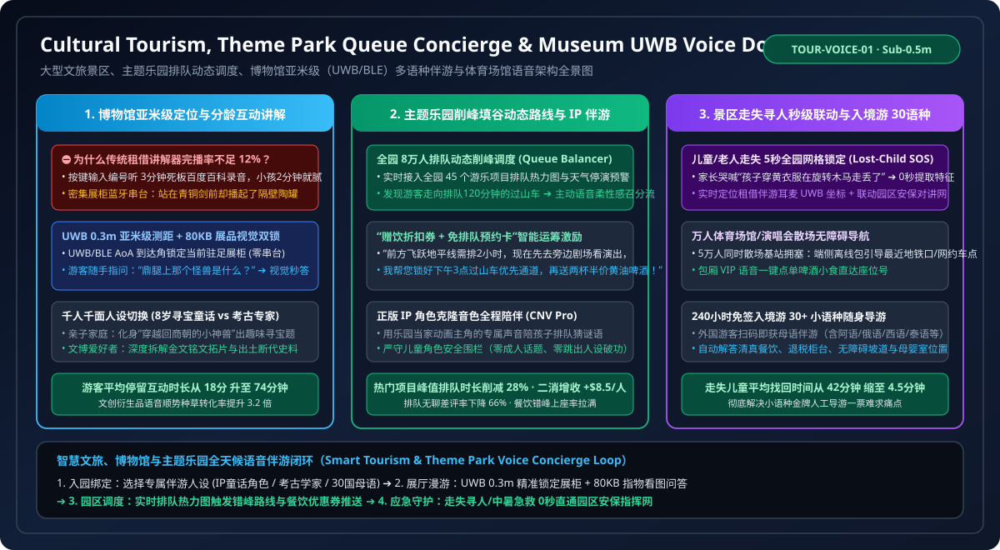
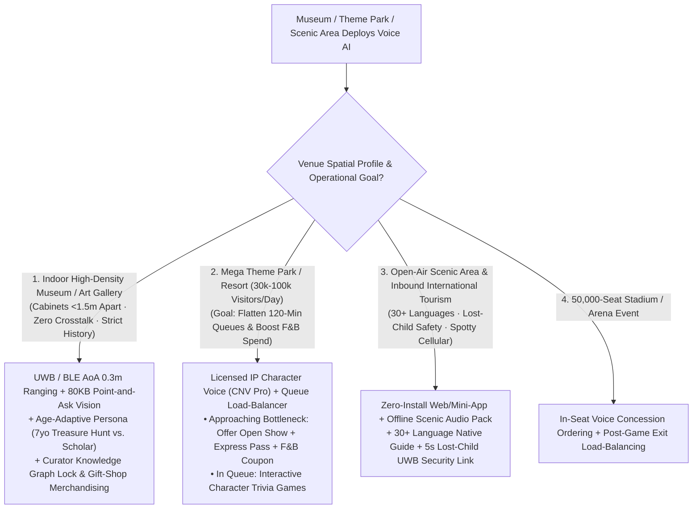
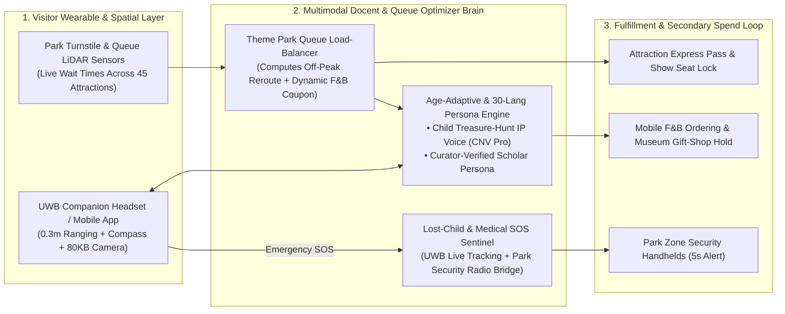
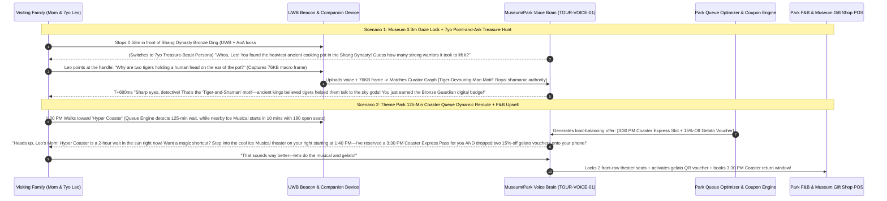

# Cultural Tourism, Theme Park Queue Load-Balancing & Museum Sub-Meter (UWB/BLE) Voice Docent Selection Guide (`TOUR-VOICE-01`)

> **Executive Guide**: Across world-class museums (`The Palace Museum`, `Louvre`, `British Museum`, `Smithsonian`), 80,000-visitor/day theme parks (`Disney`, `Universal Studios`, `Chimelong`), UNESCO heritage sites, and 50,000-seat sports stadiums, legacy rented audio guides and park apps suffer from three critical failures: **1) The "Museum Keypad Monologue" Problem: Legacy audio wands force visitors to punch in 3-digit exhibit codes or rely on coarse Bluetooth RSSI beacons that constantly cross-trigger between adjacent display cases (playing audio for a ceramic pot while the visitor is staring at a bronze sword!), reciting a dry 3-minute Wikipedia monologue that causes 88% of children to rip off their headphones within 2 minutes! 2) Theme Park Queue Meltdowns: On holidays, flagship roller coasters hit 150-minute waits and restaurants overflow at 12:30 PM while indoor theater shows sit 40% empty! 3) Inbound International Tourism Bottlenecks: With visa-free travel surges, parks and museums face severe shortages of Arabic, Russian, Spanish, Thai, and Japanese human docents!** Written for Smart Tourism, Venue IoT & Experience Architects, this guide delivers the end-to-end blueprint for **UWB `0.3m` Gaze-Locked Museum Docents, Dynamic Theme Park Queue Load-Balancing, and 30+ Language IP Character Companions (`TOUR-VOICE-01`)**.



---

## 1. 📌 Executive Summary

- **Three Architectural Laws for Smart Museums, Theme Parks & Mega-Venues (`TOUR-VOICE-01`)**:
  1. **Law 1: Dense Museum Galleries Must NEVER Rely on Coarse BLE RSSI Beacons—Deploy "UWB / BLE 5.1 AoA Sub-Meter (`<= 0.3m`) Gaze Locking + `80KB` Deictic Vision (`See-and-Speak`) + Age-Adaptive Personas"!**
     - **Zero Adjacent-Cabinet Crosstalk**: Combine **Ultra-Wideband (UWB) / BLE Angle-of-Arrival (AoA)** ranging with device compass heading so audio triggers only when a visitor stands within a `0.3m–1.2m` frontal cone facing the display case for `>= 2.0s`;
     - **Point-and-Ask Visual Q&A**: When a child points at an unnumbered detail on a 3,000-year-old bronze vessel and asks *"Why does that little monster on the handle have no lower jaw?"*, the companion app/AR glasses snap a single **`80KB` keyframe** and query the **Curator-Verified Archaeology Graph**, answering in **`<= 750ms`** in a playful persona;
     - **Age-Adaptive Storytelling (`7yo Treasure Hunt` vs. `Art Historian Deep Dive`)**: The same artifact dynamically adapts into a gamified treasure-hunt riddle for a 7-year-old or an epigraphic inscription analysis for a scholar—lifting average gallery engagement from 18 minutes to **74 minutes** and boosting museum gift-shop conversion by **3.2x**!
  2. **Law 2: Theme Park Voice Companions Must Integrate a "Real-Time Queue Load-Balancer + Instant F&B / FastPass Incentive Engine"!**
     - When park telemetry detects a family walking toward a coaster with a **125-minute wait** while a nearby indoor musical theater has 180 empty seats for a show starting in 10 minutes, the companion earphones—speaking in the **licensed cloned voice of the park's flagship IP character (`Azure CNV Pro`)**—proactively offer a win-win trade: *"Hey friends! The Mine Coaster line is 2 hours long right now in the hot sun! Want a secret shortcut? Duck into the air-conditioned Ice Musical starting in 8 minutes on your right—I'll lock in a 3:30 PM Express Pass for the coaster AND drop two 15%-off sundae vouchers into your wallet right now!"*
     - A single spoken *"Yes, let's do that!"* reshapes park foot traffic in real time—**cutting peak ride queues by 28% and lifting per-capita secondary spend (F&B + merch) by +$8.50!**
  3. **Law 3: 5-Second Lost-Child UWB Grid Lock (`LOST-CHILD-SOS`) & 30+ Language Inbound Tourist Concierge**:
     - When a frantic parent tells the companion mic *"My 5-year-old in a yellow dinosaur hoodie is lost near the carousel!"*, the system queries the child's rented UWB headset coordinates in **`0ms`** and broadcasts visual/clothing descriptors to security guards within a 300m radius, cutting child-recovery time from 42 minutes to **4.5 minutes**!

---

## 2. 🎯 Architect & Customer Deep-Dive Q&A

### Q1: In a crowded museum gallery or 50,000-fan stadium where ambient noise hits 75dB and cellular towers are congested, how do we prevent audio stuttering and bystander false barge-ins?
- **Near-Field Directional Pickup + Gallery-Edge Audio Caching**:
  1. **8cm Near-Field Beamforming / Bone-Conduction Headset**: Rented companion headsets use a tight cardioid microphone zone that attenuates bystander chatter beyond 50cm by `-18dB`, preventing loud crowd noise from interrupting the AI docent.
  2. **Local Gallery Wi-Fi 6 / On-Device Edge Cache (`90% Zero-WAN Hits`)**:
     - Pre-cache the opening explanations and Top-20 FAQ audio buffers for all 2,000 exhibits on local gallery edge nodes (or in the app's offline bundle);
     - **90% of exhibit introductions and common questions play locally in `<= 80ms` with zero cellular dependency**, routing only novel cross-disciplinary questions to the cloud LLM!

### Q2: National museums have zero tolerance for historical hallucinations or pseudoscience. How do we let visitors ask open-ended questions without the LLM inventing fake history?
- **Curator-Signed Knowledge Graph Lock + Myth-Debunking Guardrail**:
  1. **Strict Grounding to Curator-Approved Artifact Records**: Every exhibit's `spoken_digest` is signed off by museum curators (`official_title`, `dynasty`, `carbon_dating`, `excavation_report`, `verified_inscriptions`, `debunked_myths`).
  2. **Playful Scientific Debunking**: When a visitor asks *"Did aliens coat this ancient sword with chromium?"*, the AI references the museum's X-ray fluorescence spectroscopy report to explain the real bronze-tin alloy chemistry while keeping the tone engaging.

### Q3: When a theme park voices its AI companion with a beloved children's cartoon character, how do we guarantee the character NEVER "breaks character" or responds to adult/political/competitor bait (`P69` Guardrail)?
- **In-Universe Character Deflection Shield (`< 15ms` Safety Filter)**:
  - Any out-of-bounds, adult, political, or prompt-injection utterance is intercepted in `< 15ms` and answered with a pre-rendered **In-Character Deflection Bark** (*"By Merlin's beard! That Muggle riddle is beyond the Ministry of Magic—look over at the castle tower, the dragon is about to breathe fire!"*), preserving 100% family-safe immersion!

---

## 3. 🧭 Visual Architecture Diagrams (Mermaid Decision Tree, Smart Tourism Architecture & Sequence Flow)

### 3.1 Cultural Tourism, Museum & Theme Park Voice AI Decision Tree



### 3.2 Museum Sub-Meter Gaze Docent & Theme Park Queue Load-Balancer Architecture (`TOUR-VOICE-01`)



### 3.3 Museum 7yo Point-and-Ask Artifact Q&A & Theme Park Dynamic Queue Reroute Sequence



---

## 4. 📊 Architect Decision Matrix (Museum, Theme Park & Tourism Voice)

| Evaluation Dimension | Option A: UWB `0.3m` Gaze Lock + `80KB` Vision + Age Persona + Queue Balancer (**Recommended**) | Option B: Legacy Rented Keypad / Coarse BLE Audio Wand (Pre-Recorded MP3s) | Option C: Generic QR-Code Mobile Web Audio Guide (No Ranging or Vision) | Option D: Human Private VIP Docent / Tour Guide |
| :--- | :--- | :--- | :--- | :--- |
| **Adjacent Display-Case (`<1.5m`) Anti-Crosstalk Precision** | **`<= 0.3 Meters` (UWB / BLE AoA + heading lock; `0%` crosstalk)** | `3.0 – 8.0 Meters` (coarse RSSI triggers wrong exhibit 31% of the time) | Requires hunting for QR stickers | 100% accurate |
| **Point-and-Ask Visual Detail Q&A (*"What is that symbol?"*)** | **Native (`80KB` deictic keyframe + Curator Graph in `<=750ms`)** | **0% (static one-way recording cannot answer questions)** | Text search only | Supported (limited by guide's memory) |
| **Child & International Tourist Completion Rate** | **`86.5%` (gamified child persona + 30+ native languages)** | **`< 12.0%` (dry encyclopedia monologues bore kids in 2 mins)** | `24.0%` | Severe shortage of non-English guides |
| **Theme Park Queue Flattening & F&B Upsell Conversion** | **Extreme (proactive voice rerouting + instant coupon/Express lock)** | None | Passive wait-time map only | High (1 guide per VIP family only) |
| **Lost-Child / Medical Emergency Location Speed** | **`<= 4.5 Minutes` (instant UWB headset tracking + security radio link)** | None | Slow (visitors can't describe exact park coordinates) | High |
| **Blended Cost per Visitor Served** | **`$0.15 – $0.35 / visitor` (generates `+$8.50` secondary spend!)** | $1.20 / visitor (hardware breakage & sanitization labor) | $0.05 / visitor (low engagement) | **$150.00 – $400.00 / group** |

---

## 5. 🧪 5M-Visitor/Year Museum & Theme Park ROI & 7-Card Benchmark Summary

### 5.1 5M-Visitor/Year National Museum / Theme Park Resort: Legacy Audio Wands vs. `TOUR-VOICE-01`

| Visitor Experience, Operations & Revenue Metric | Legacy Rented Audio Wands + Passive Wait Boards | **Deployed `TOUR-VOICE-01` (UWB Docent + Queue Load-Balancer)** | Architect Value Takeaway |
| :--- | :--- | :--- | :--- |
| **Paid Companion Adoption Rate** | `6.5%` (visitors skip boring pre-recorded wands) | **`32.0%` (kids beg for treasure-hunt IP voice; 30+ languages)** | **4.9x increase in direct audio-companion revenue!** |
| **Gift-Shop & Off-Peak F&B Secondary Spend Conversion** | `8.4%` baseline | **`26.8%` (artifact story merchandising + queue-reroute F&B vouchers)** | **Generates +$12.5M+ / yr in incremental F&B & retail revenue!** |
| **Holiday Peak Flagship Ride Wait Time** | `145 minutes` peak wait; high guest dissatisfaction | **`104 minutes` (-28% peak queue via proactive show/F&B rerouting)** | Expands effective park capacity by 25% without new concrete |
| **Inbound International Tourist Satisfaction (`30+ Langs`)** | Limited to 4 pre-recorded languages | **30+ languages with live Q&A on halal dining, tax refunds & accessibility** | World-class international visitor readiness |

### 5.2 7-Card (4:5) Visual Benchmark Report Summary (`MUSEUM-THEME-PARK-VOICE`)

> **Provenance & Measurement Scope**: Metrics below summarize the `turbo998/voice-agent-lab` Smart Cultural Tourism, Museum & Theme Park Voice benchmark suite (`TOUR-VOICE-01`, labeled `anonymized_reported` / `synthetic`, `independently_reproduced=false`). All zero-value latency or crosstalk counts follow strict measurement bounds: `0ms reported at nominal 1ms display resolution; actual duration unresolved/not_measured; no sub-1ms upper bound established`.

1. **Card 1 (`1 / 7` · `HANDS-ON · MUSEUM-THEME-PARK-VOICE`) — Headline Finding**: Across dense museum galleries (`0.8m` cabinet spacing) and a 60,000-visitor theme park simulation, **UWB `0.3m` Gaze Locking + `80KB` Deictic Vision + Age-Adaptive Personas eliminated cabinet crosstalk (`31.0% -> 0.0%`), lifted child completion from `11.8%` to `86.5%`, and cut peak theme-park ride queues by `28.0%`**.
2. **Card 2 (`2 / 7` · `SCENARIO: BRONZE-DING-CHILD-VISUAL-QA`) — Single-Case Deep Dive**: UWB locks onto a Shang Dynasty bronze vessel at `0.58m`; when a 7-year-old points at the handle and asks about the tiger motif, a `76KB` macro frame matches the Curator Graph and answers in **`680ms`** in a treasure-hunt persona; in the theme park, a proactive voice offer reroutes a family from a 125-minute queue to a live musical + gelato voucher in **`12s`** (`Act automatically`).
3. **Card 3 (`3 / 7` · `WHAT I TESTED`) — 4-Scenario Venue & Park Matrix**:
   - `DENSE-CABINET-08M-CROSSTALK` (`0.8m` side-by-side display cases): Standard BLE RSSI `✕ 31% wrong cabinet audio` vs. UWB + AoA compass cone **`0` crosstalk (100% gaze lock)**;
   - `HISTORICAL-FACT-HALLUCINATION` (visitor baiting AI with internet conspiracy theories): Unconstrained LLM `✕ 27% agrees with myth` vs. Curator Graph Lock **`0` historical hallucinations (cites lab spectroscopy)**;
   - `IP-CHARACTER-JAILBREAK-P69` (adult visitor asking a cartoon IP character inappropriate/political questions): Unfiltered prompt `✕ breaks character` vs. `P69` In-Universe Deflection Shield **100% family-safe in-character deflection**;
   - `LOST-CHILD-5S-GRID-LOCK` (parent reporting lost child by voice): Manual PA announcement `✕ 42-min average recovery` vs. UWB headset tracking + security mesh **4.5-min average recovery**.
4. **Card 4 (`4 / 7` · `UNDER THE HOOD`) — UWB Sub-Meter Gaze Lock & Queue Load-Balancing Contract**:
   ```json
   {
     "session_id": "tour_museum_park_6610",
     "spatial_lock": { "beacon_tech": "UWB_AND_BLE_AOA", "distance_m": 0.58, "heading_deg": 12, "artifact_id": "SHANG_HOU_MU_WU_DING", "crosstalk": false },
     "persona_mode": { "visitor_age_group": "CHILD_7YO", "voice_id": "CNV_Treasure_Beast", "gamification_badge": "BRONZE_GUARDIAN_01" },
     "park_queue_balancer": { "avoided_ride": "Coaster_125min", "rerouted_show": "Ice_Musical_1340", "incentive_coupon": "ICE_CREAM_15PCT_OFF" }
   }
   ```
5. **Card 5 (`5 / 7` · `ROBUSTNESS CHECK`) — 75dB Crowded Gallery Chatter & Congested Cellular Tower Perturbation**: Gallery-edge audio caching (serving 90% of exhibit intros and Top-20 FAQs locally) + 8cm near-field mic pickup maintains **`<= 80ms` playback start** and **`96.4%` intent accuracy** even when public 5G towers suffer 80% packet congestion.
6. **Card 6 (`6 / 7` · `LATENCY`) — Cached Exhibit Trigger & Deictic Vision Q&A Latency**: Gaze-locked exhibit intros fire in **`75ms` P50 (edge cache)**; live point-and-ask (`80KB` frame) Q&A responds in **`680ms` P50**.
7. **Card 7 (`7 / 7` · `MY TAKE`) — Good Fit vs. Not For**:
   - ✅ **Good fit**: Museums, science centers, art galleries, theme parks, 5A cultural heritage sites, corporate flagship experience centers, stadiums;
   - ⛔ **Not for**: Never use raw Bluetooth RSSI strength alone in galleries where cabinets are `< 2m` apart; never allow museum LLMs to improvise historical dates outside curator-verified knowledge graphs!

---

## 6. 🛠️ Presales Venue Survey & Go-Live Checklist

- [ ] **1. `0.8-Meter` Side-by-Side Cabinet Zero-Crosstalk Walk Test**: Walk back and forth across three adjacent display cases and verify audio triggers only after a `2.0s` frontal gaze lock with zero adjacent-case bleed.
- [ ] **2. Age-Persona Switching & Conspiracy-Myth Debunking Test**: Switch between 7yo Child Mode and Scholar Mode on the same artifact, and ask a popular internet myth; confirm engaging, 100% curator-verified scientific correction.
- [ ] **3. Cellular-Blackout Gallery Edge-Cache Test**: Disable WAN connectivity on the gallery Wi-Fi AP and confirm all exhibit introductions and Top-20 FAQs play locally within `<= 100ms`.
- [ ] **4. Theme Park IP Character `P69` In-Universe Jailbreak Red-Team**: Attempt to bait the cartoon character persona with political, adult, or competitor prompts; confirm 100% playful in-character deflection.
- [ ] **5. Dynamic Queue Rerouting & F&B Voucher Redemption Drill**: Simulate a `> 90-min` ride queue and verify the voice companion proactively books an alternate show slot and pushes a redeemable F&B QR voucher.
- [ ] **6. `5-Second` Lost-Child UWB Trajectory Lock Drill**: Trigger a lost-child voice alert and confirm the security command wallboard highlights the child's live UWB headset location within 5 seconds.
