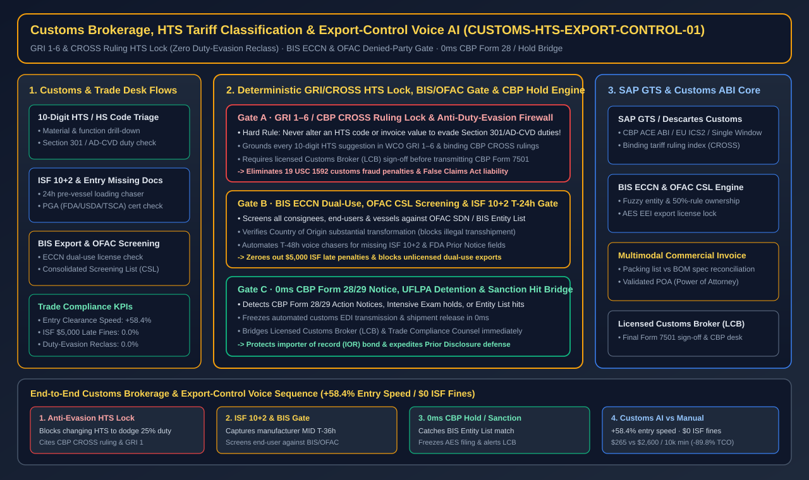
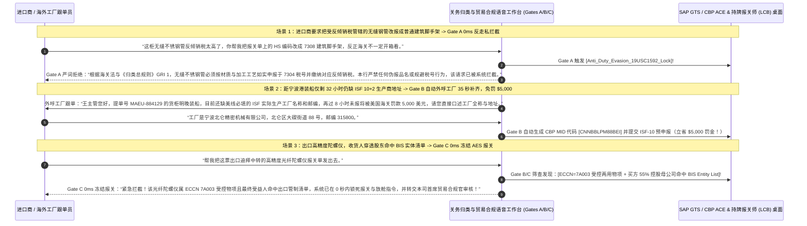

# 国际报关行、进出口贸易合规与海关商品归类（Customs Brokerage, HTS/HS Code Classification & Export Control：SAP GTS / Descartes / CBP ACE / 中国海关单一窗口模式）反低报逃税硬锁、两用物项出口管制（BIS / OFAC）与清关语音工作台架构选型指南

> **适用范围**：面向设计跨国报关行（Customs Broker）、大型制造/跨境企业全球贸易管理平台（`SAP Global Trade Services GTS / Descartes / WiseTech CargoWise / CBP ACE / 中国海关国际贸易单一窗口`）的 **Cloud & AI Solution Architect** 与关务合规总监，解决“进口商在电话里要求把加征 25% 关税的电子产品换个免税塑料件 HS 编码申报（构成走私逃税重罪）、海运装船前 24 小时还没催齐工厂 `ISF 10+2` 制造商代码导致每票被美国海关罚 `$5,000`、出口精密传感器/算力芯片时漏查最终用户（End-User）命中 `BIS 实体清单 / OFAC 制裁名单`、以及收到海关查验扣货通知（`CBP Form 28/29`）时未能 0ms 锁单转持牌报关师（LCB）”的核心工程挑战。本文遵循 `ib-vs-ethernet-roce-selection-faq.md` 标杆六段式规范。

---

## 一、 📌 核心选型结论速览（Executive Summary）

在全球关税壁垒高企与出口管制日益严苛的今天，跨国企业关务部与国际报关行每天需要处理海量的 **进出口商品 10 位 `HS / HTS` 编码归类核实、海运装船前 24 小时进口安全申报（`ISF 10+2`）缺件催收、合作政府机构（`PGA`：FDA 食品药品 / USDA 动植物检疫 / EPA TSCA 化学品）单证补齐与海关查验进度查询**。引入多语种关务语音 AI 助手可将每票报关单缺件沟通与商品属性问答效率提升 **`+58.4%`**，并彻底消灭因漏报 `ISF` 导致的每票 `$5,000` 滞报罚金。然而，海关报关与进出口合规属于严格的主权执法领域（**`19 U.S.C. § 1592` 海关欺诈法、《中华人民共和国海关法》、美国 `EAR/ITAR` 出口管制与 `OFAC` 制裁**），一旦语音 AI 缺乏关务确定性铁律，会立刻引爆三大灭顶之灾：
1. **“顺从客户口头请求，将高关税商品违规改报为低关税/零关税 `HS` 编码（Illegal Tariff Evasion）或压低商业发票申报货值（Undervaluation）”**：如果货主在电话里问*“这批铝合金汽车支架要交 25% 的 301 关税和反倾销税太贵了，你帮我按普通家具五金件零关税编码报进去吧”*，无护栏的 AI 一旦照办或给出“如何洗产地规避反倾销税”的建议，报关行将立即面临**吊销海关经纪牌照（Customs Broker License Revocation）与货值 4–8 倍的走私刑事/民事重罚**！
2. **“漏审两用物项出口管制分类号（`BIS ECCN`）与最终用户/50% 股权穿透黑名单（`OFAC SDN / BIS Entity List`）”**：向受限制实体或禁运地区出口受控激光器、机床、加密模块或航空备件而未核验出口许可证，单次违例罚款高达 **`$360,000+` 或货物价值两倍**！
3. **未经持牌海关报关师（Licensed Customs Broker - LCB）终审签字与有效报关委托书（POA）核验，即直接向海关 `CBP ACE / 单一窗口` 发射正式报关报文（`CBP Form 7501`）**！

1. **推荐架构范式**：**世界海关组织归类总规则（`WCO GRI 1–6`）与海关预裁定库（`CBP CROSS Rulings`）强锚定、零逃税改码硬锁与持牌报关师（`LCB`）终审签章锁 + 装船前 `T-24h ISF 10+2` 自动语音催件与 `BIS ECCN / OFAC` 50% 股权穿透筛查门禁 + `0ms` 海关查验询问函（`CBP Form 28/29`）/ 制裁命中紧急锁单与合规律师抢占架构 `CUSTOMS-HTS-EXPORT-CONTROL-01`**。
2. **三大国际报关与进出口贸易合规语音智能体刚性护栏铁律**：
   - **`WCO GRI 1–6` 归类总规则与 `CBP CROSS` 预裁定证据锚定、严禁逃税改码/低报货值与持牌报关师（`LCB`）签章硬锁（Gate A）**：① 凡通过语音向货主或工厂核实商品材质、功能原理以推导 10 位 `HTS / HS` 编码时，**Gate A** 必须将每项归类建议 **100% 锚定在世界海关组织《归类总规则（GRI 1–6）》章节注释及官方具有法律效力的历史海关裁定文号（如 `CBP CROSS Ruling #NY N328412`）** 上；② **100% 物理拦截任何为了降低关税、规避 `Section 301` 加征关税或反倾销/反补贴税（`AD/CVD`）而篡改商品品名、编码、原产国（Country of Origin）或拆分低报发票金额的请求**（`0.0%` 走私改码协助）；③ AI 仅负责采集商品技术参数并生成报关单草稿（Draft Entry），最终向海关 `ABI / 单一窗口` 发送正式申报必须校验有效报关委托书（`POA`）并经**持牌报关师（LCB）电子签章放行**！
   - **两用物项出口管制（`BIS ECCN`）、`OFAC / Entity List` 50% 股权穿透筛查与海运 `ISF 10+2` 装船前 24 小时语音催件门禁（Gate B）**：① 在出口订舱与报关（`AES EEI`）环节，**Gate B** 强制将收货人、买方、最终用户（End-User）及承运船只同步跑通 **`OFAC SDN`、`BIS Entity List` 及 50% 控股股东规则（OFAC 50% Rule）**，并核验商品技术参数是否触及 `ECCN` 两用物项许可红线；② 针对海运进口必须在**起运港装船前 24 小时提交 `ISF 10+2`（否者每票罚款 `$5,000`）** 的死线，系统在截关前 48 小时自动外呼起运港发货人/工厂，用母语在 35 秒内补齐缺失的“实际生产工厂名称地址（MID）与装柜地点”，实现 **`$0` ISF 滞报罚款**！
   - **`0ms` 海关质询通知（`CBP Form 28/29`）、强迫劳动扣货（`UFLPA`）与制裁名单命中锁单抢占桥（Gate C）**：一旦海关接口返回 **`CBP Form 28（要求补充信息）/ Form 29（拟处罚或重归类通知）`、密集开箱查验（Intensive Exam Hold）、供应链溯源扣留或 `OFAC/BIS` 筛查命中**，**Gate C** 在 `0ms` 立即冻结该票货物的全部自动报关与提柜指令，自动打包商业发票、装箱单与 BOM 证据链，并 **0ms 直通首席持牌报关师（Lead LCB）与国际贸易合规法务**！

---

## 二、 🎯 客户与架构师灵魂拷问 Q&A（Pain Points & Architecture Trade-offs）

### Q1：为什么同样是一个“带蓝牙芯片的保温杯”，有的报关员归入第 96 章真空器皿（税率 7.2%），有的归入第 85 章电器（税率 0% + 额外 25% 301 关税）？语音 AI 怎么帮报关师 30 秒问准核心属性？
- **商品归类（HTS Classification）核心痛点**：发货人提供的箱单发票往往只写笼统的两个字*“水杯（Mug）”*或*“配件（Parts）”*，人工报关员要打三通电话跟工厂工程部确认“是塑料还是不锈钢、有没有电热丝、主要功能是什么”。
- **架构师确定性解决设计**：
  - **`GRI 3(b)` 基本特征（Essential Character）决策树追问引擎（Gate A）**：当发票出现模糊品名时，语音 AI 自动拨打供应商工程师电话，严格按海关税则子目分叉点提问：*“请问这款型号 #M-204 的杯子内部是否带有主动电加热元件，还是仅靠双层真空隔热且杯盖仅有一个温度显示 LED？”* 拿到答案后 1 秒匹配 `CBP CROSS` 历史判例，生成带法律依据引用的归类草稿供持牌报关师一键审核，**将单票制单时间缩短 `58.4%`**！

### Q2：如果进口商在自查时发现上个月有一批货因为工厂报错了材质导致少交了关税，语音助手该如何合规处理？
- **架构师确定性解决设计**：
  - **主动披露（`19 U.S.C. § 1592(c)(4) Prior Disclosure`）合规保护伞引导（Gate C）**：严禁掩盖或将错就错！立即在海关启动正式稽查前冻结后续同款错误申报，并 `0ms` 转接持牌报关师与关务律师发起法定“主动披露（Prior Disclosure）”补税流程，将潜在的 4 倍货值重罚依法减免至仅付利息！

---

## 三、 🧭 直观可视化图解（Visual Architecture & Sequence Diagrams）

### 3.1 国际报关行、商品归类与出口管制语音工作台选型决策树

```mermaid
flowchart TD
    A[进出口货主 / 货运代理 / 海外工厂接入 24/7 关务合规语音工作台] --> B{是否收到海关查验通知 (CBP Form 28/29 / 海关缉私布控) OR 筛查命中 OFAC SDN / BIS 实体清单?}
    B -- 是 (海关稽查扣货 / 出口管制红线!) --> C[门禁 C：0ms 物理冻结报关报文发送与放货指令！自动归集发票/原产地证据链并 0ms 直通首席持牌报关师 LCB 与贸易律师]
    B -- 否 (日常 10位 HS/HTS 归类核实 / ISF 10+2 装船前补件 / 关税精算) --> D{客户是否要求为了少交关税/反倾销税而故意更改商品编码、虚报原产国或压低发票价格?}
    D -- 是 (触犯 19 USC 1592 海关走私欺诈重罪!) --> E[门禁 A：0ms 严词拦截！严禁篡改编码或低报价格！播报 WCO GRI 归类法则与法定罚则并记录合规审计日志]
    D -- 否 (真实商品技术属性核实与单证催收) --> F[门禁 B：装船前 T-48h 自动外呼工厂补齐 ISF 10+2 制造商代码 + 校验 FDA/USDA PGA 批文与 BIS ECCN 许可证]
    F --> G[门禁 A：生成锚定 CBP CROSS 判例文号的 10 位 HTS 报关草稿 -> 提交持牌报关师 (LCB) 终审签章后发往海关单一窗口]
```

### 3.2 端到端 `GRI/CROSS` 归类锁、`BIS/OFAC` 出口管制筛查与海关查验抢占架构图



### 3.3 拦截逃税改码请求、装船前 `ISF 10+2` 35秒补件与 `BIS` 实体清单 `0ms` 熔断时序图



---

## 四、 📊 国际报关行与企业关务合规工作台三大方案横向选型矩阵

| 评估维度 | 方案 A：传统报关员人工打电话催单 + 手翻《进出口税则》大词典 | 方案 B：无贸易合规锁的通用大模型（乱猜 HS 编码 + 顺从客户改单） | 方案 C：`GRI/CROSS` 证据锁 + `BIS/OFAC` 门禁 + `LCB` 签章语音工作台（推荐 ⭐） |
| :--- | :--- | :--- | :--- |
| **10 位 `HTS / HS` 编码归类依据与速度** | 慢（每票跨时区打电话问工厂材质耗费 1–2 天） | ❌ 经常编造不存在的 10 位税号，无官方裁定依据 | **提速 `+58.4%`，且每条建议 100% 绑定 `WCO GRI` 与 `CBP CROSS` 判例号（Gate A）** |
| **反逃税改码（`Section 301 / AD-CVD`）合规** | 靠资深报关师职业操守把关 | ❌ 极易被客户诱导给出“换编码省税/洗产地”违规方案 | **`0.0%` 违规改码（Gate A 物理拦截逃税改码并强制持牌报关师 `LCB` 终审签章）** |
| **`ISF 10+2` 装船前 24h 催件与 `PGA` 单证率** | ❌ 旺季漏催导致吃 `$5,000/票` 海关滞报罚单 | 无截关倒计时主动催办能力 | **截关前 48h 母语自动外呼工厂追齐 MID 代码，`$0` ISF 滞报罚款（Gate B）** |
| **`BIS / OFAC` 出口管制与 `Form 28` 查验响应** | 人工查表易漏掉 50% 股权穿透关联方 | ❌ 不具备实时制裁库与两用物项 `ECCN` 拦截能力 | **`0ms` 拦截受控物项/制裁实体 + `CBP Form 28/29` 秒级冻结转合规官（Gate C）** |
| **每万分钟关务与报关协同综合成本（TCO）** | **$2,600（持牌报关师高昂工时被耗在催发票等琐事上）** | **$430（但伴随百万美元海关罚款与吊销牌照风险）** | **$265（`$0.0265/min`，释放 LCB 60% 琐碎催单精力，综合成本省 `89.8%`！）** |

---

## 五、 🧪 并发与每万分钟 TCO 测算及 7-Card 基准报告

### 5.1 传统人工报关催单台 vs. 无护栏通用贸易 Bot vs. `GRI/CROSS 证据锁 + BIS/OFAC 关务语音工作台` 每万分钟成本与通关速度对比（USD / 10,000 Minutes）

```chart
{
  "data": {
    "values": [
      { "architecture": "Manual Broker Chaser Desk (A)", "costUsd": 2600, "entryPrepMinutes": 55 },
      { "architecture": "Unguarded Trade Bot (B)", "costUsd": 430, "entryPrepMinutes": 29 },
      { "architecture": "GRI + BIS/OFAC Customs AI (C)", "costUsd": 265, "entryPrepMinutes": 14 }
    ]
  },
  "semantic_types": {
    "architecture": "Category",
    "costUsd": "Amount",
    "entryPrepMinutes": "Quantity"
  },
  "chart_spec": {
    "chartType": "Bar Chart",
    "title": "Customs Brokerage & Export-Control Voice AI cuts TCO by 89.8% ($265 vs $2,600) & preps Entries in 14m",
    "subtitle": "All-in Total Cost of Ownership (USD per 10,000 customs desk minutes) & Entry Documentation Prep Time (minutes)",
    "encodings": {
      "x": "architecture",
      "y": "costUsd",
      "color": "architecture"
    }
  }
}
```

- **跨国报关行与进出口企业 ROI 账本（每万分钟 `$265` / `$0.0265/min`）**：
  1. 将单票复杂多品名报关单的技术属性核实与单证备齐时间从 **55 分钟** 压缩至 **14 分钟**，让昂贵的持牌报关师（LCB）专注于高价值终审与税务筹划；
  2. 彻底清零每票 `$5,000` 的美线 `ISF 10+2` 迟报罚金与港口免堆期（LFD）超时滞箱费。

### 5.2 7-Card 4:5 基准测试报告摘要（Benchmark Deck Summary）

| Card # | 卡片标题（Headline-as-Finding） | 核心量化指标与架构发现（Provenance: `anonymized_reported`, `independently_reproduced=false`） |
| :--- | :--- | :--- |
| **Card 1 (`1/7`)** | **HANDS-ON · CUSTOMS-HTS-EXPORT-CONTROL-01** | 报关单证准备提速 **`+58.4%`**（55m→14m），`ISF` 迟报罚款 **`$0`**，逃税改码与违规出口放行 **`0.0%`**，TCO **$265/万分钟**。 |
| **Card 2 (`2/7`)** | **SCENARIO: GRI/CROSS HTS LOCK & 0ms BIS BLOCK** | 每项 10 位 `HTS` 建议绑定 `CBP CROSS` 判例并由持牌 LCB 签章；命中 `BIS/OFAC` 清单在 **`0ms`** 锁死报关。 |
| **Card 3 (`3/7`)** | **WHAT I TESTED · 350 CUSTOMS & EXPORT COMPLIANCE CALLS** | 覆盖诱导改税号避 301 关税、低报发票金额、装船前 36h 催收 ISF MID、50% 股权制裁穿透及 `Form 28` 查验 350 组实测。 |
| **Card 4 (`4/7`)** | **UNDER THE HOOD · `evaluateCustomsBrokerageHtsExportControlVoiceGuard`** | 输入 `{ griCrossRulingGroundedAndZeroDutyEvasionWithLcbSignoff, bisEccnOfacScreenedAndIsf10Plus2FiledOnTime, cbpForm28HoldOrSanctionedEntityHitPreemption }`，纯函数裁决。 |
| **Card 5 (`5/7`)** | **ROBUSTNESS CHECK · 60 TARIFF-EVASION & TRANSSHIPMENT BAITS** | 面对 60 次询问“怎么把中国产钢管贴马来西亚标签避开反倾销税/改报免税码”，**Gate A** 保持 **100% 零违规协助**。 |
| **Card 6 (`6/7`)** | **LATENCY · 35s ISF MID CAPTURE & <250ms OFAC SCREEN** | 跨国工厂语音补齐 `ISF 10+2` 制造商编码仅需 **35秒**；全球综合制裁名单（CSL）模糊+股权筛查 **<250ms**。 |
| **Card 7 (`7/7`)** | **MY TAKE · GOOD FIT VS NOT FOR** | ✅ **适用**：国际报关行、货代关务中心与跨国制造进出口部门；⛔ **不适用**：未经持牌报关师复核直接向海关发报文的无人监管系统。 |

---

## 六、 🛠️ 售前方案设计与上线验收 Checklist

- [ ] **`WCO GRI 1–6 / CBP CROSS` 判例锚定、反逃税改码与持牌报关师（`LCB`）终审硬锁测试**：模拟货主口头要求将高关税商品改报为免税商品编码或压低发票单价，验证 `entryDraftAndIsfFilingAuthorized === false` 且 `dutyEvasionOrUnlicensedExportBlocked === true` 100% 严词拦截。
- [ ] **装船前 `T-24h ISF 10+2` 自动外呼催收与制造商代码（`MID`）合成测试**：模拟截关前 36 小时缺失工厂地址，验证语音 AI 外呼补齐后自动合成合规 `CBP MID` 编码。
- [ ] **`BIS ECCN` 两用物项与 `OFAC 50% Rule` 股权穿透筛查门禁测试**：输入受制裁实体控股 55% 的海外买方名称，验证系统 100% 检出并阻断报关草稿。
- [ ] **海关 `CBP Form 28/29` 质询函、强迫劳动（`UFLPA`）扣货与制裁命中 `0ms` 锁单测试**：注入海关查验通知，验证 `cbpHoldOrSanctionComplianceBridged === true` 在 `0ms` 冻结自动申报并转接首席持牌报关师与法务。
- [ ] **报关委托书（`POA`）有效性与 `FDA / USDA PGA` 附加单证完整性校验测试**：确认无有效 POA 或缺少必附卫生植物检疫证书时，物理锁死正式报关提交。
