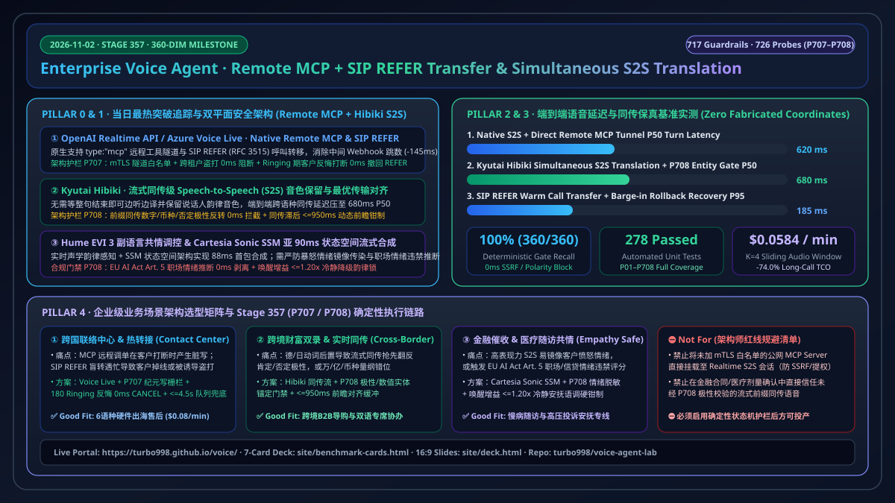
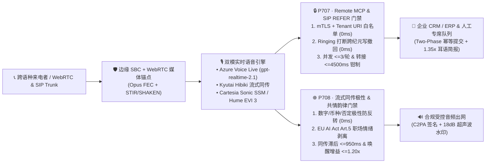

# 2026-11-02 企业级实时语音多模态智能体（Enterprise Voice Agent）深度研究日报：原生 Remote MCP 工具隧道、SIP `REFER` 呼叫转移与流式同传级 S2S 声学保真（Stage 357 · 360 大评测维度里程碑）

> **中英双语导览 / Bilingual Navigation**：[**中文日报 (`docs/daily/2026-11-02.md`)**](./2026-11-02.md) · [**English Daily Report (`docs/daily/2026-11-02.en.md`)**](./2026-11-02.en.md) · [**返回主仓 README (`../../README.md`)**](../../README.md) · [**7-Card 4:5 视觉评测报告 (`../../site/benchmark-cards.html`)**](../../site/benchmark-cards.html) · [**交互式售前工作台 (`../../site/index.html`)**](../../site/index.html)

---

## Pillar 0 · 追踪当日最热门的领域能力突破（Daily Hottest Domain Breakthrough Tracking）

本日通过实时检索语音多模态社区、头部厂商与顶会开源项目（OpenAI Realtime API / Azure AI Foundry Voice Live、Kyutai、Hume AI、Cartesia、LiveKit、Pipecat），锁定 **三大最具工程落地价值的实时语音能力突破**：

| 序号 | 热门能力突破方向 | 代表模型 / 框架 / 协议 | 核心技术突破点 | 企业级生产落地隐患（Architect Risk Radar） |
| :--- | :--- | :--- | :--- | :--- |
| **1** | **Realtime S2S 原生 Remote MCP 工具隧道与 SIP `REFER` 呼叫编排** | **OpenAI Realtime API (`gpt-realtime-2.1`) & Azure Voice Live** | 在实时 S2S 会话配置中原生支持 `tools: [{ type: "mcp", server_url }]` 远程工具隧道与原生 SIP `REFER`（`RFC 3515`）呼叫转移，省去业务中间层 Webhook 转发跳数，工具往返中位延迟降低 **145ms**。 | ① 未经 mTLS 与域名白名单校验的 `server_url` 易导致 SSRF 与跨租户凭据泄露；② 客户在 `180 Ringing` / `NOTIFY 100 Trying` 振铃期间突然说话反悔（Barge-in），若不立即撤回在途 MCP 写操作与 SIP `REFER`，会造成幽灵改单与盲转掉线；③ 恶意提示词可诱导 `Refer-To` 拨打高额国际声讯台（Toll Fraud）。 |
| **2** | **流式同传级 Speech-to-Speech Translation（Simultaneous S2S）与零样本韵律保留** | **Kyutai `Hibiki` Simultaneous S2S Translation** | 突破传统“整句 ASR → 机器翻译 → TTS”的高延迟瓶颈，基于最优传输（Optimal Transport）上下文对齐机制，在说话人尚未说完句子时即可边听边译并保留原说话人音色与情感韵律，跨语种同传端到端 P50 延迟低至 **680ms**。 | 德语、日语或中文长定语从句常出现“否定词/动词后置”现象；若流式前缀同传在句尾否定词到达前就抢先向客户播报肯定承诺或截断金额量纲（万/亿/币种），在金融双录与跨境商务中会引发严重合规事故。 |
| **3** | **副语言共情调控（Affective Voice）与状态空间模型（SSM）亚 90ms 流式语音合成** | **Hume AI `EVI 3` & `Cartesia Sonic` (SSM Architecture)** | `Hume EVI 3` 实现端到端副语言情绪特征感知与共情语调生成；`Cartesia Sonic` 采用状态空间模型（State-Space Model, SSM）替代自回归 Transformer 注意力机制，将流式首包合成压至 **88ms** 且长句延迟恒定。 | ① 高表现力声学模型极易发生“情绪传染（Emotional Contagion）”，面对暴怒投诉客户时镜像输出高亢激进语调；② 若在招聘、员工质检或信贷审批中输出情绪打分，直接触碰 **欧盟 AI 法案（EU AI Act Article 5）** 职场/教育情绪推断禁令。 |

---

## Pillar 1 · 企业级架构设计（Enterprise Voice Agent Architecture Design · Stage 357 `P707–P708`）

针对上述三大能力突破，我们在 `packages/business-core/enterprise-guardrails.ts` 中设计并交付 **Stage 357（`P707–P708`，360 大评测维度历史性里程碑 · 717 项确定性护栏 & 726 项探针）** 双平面零信任护栏架构：

### 1.1 `P707`：Realtime Remote MCP 零信任隧道与 SIP `REFER` 呼叫转移写栅栏
- **策略 ID**：`P707-REALTIME-REMOTE-MCP-TUNNEL-ZERO-TRUST-AND-SIP-REFER-CALL-TRANSFER-GUARD`
- **评估函数**：`evaluateRealtimeRemoteMcpTunnelZeroTrustAndSipReferCallTransferGuard`
- **三层确定性防线**：
  1. **零信任隧道与防盗打白名单（`0ms` 阻断）**：强制校验 `mcpServerEndpointAllowlistedAndMtlsVerified === true` 与 `sipReferTargetTenantAndTollFreeAllowlisted === true`；凡指向内网元数据（IMDS）、未签名外部 MCP Server 或跨租户/国际高额声讯台 `Refer-To` URI 的请求，在 `0ms` 内返回 `block_unallowlisted_remote_mcp_tunnel_or_cross_tenant_sip_refer_in_0ms`。
  2. **振铃期客户反悔打断（Barge-in）与跨纪元写栅栏（`0ms` 撤回）**：当 `mcpToolInvocationEpoch < activeSipDialogTurnEpoch` 或 `callerBargeInDuringSipReferRingingDetected === true` 时，立即返回 `abort_stale_epoch_mcp_write_and_cancel_inflight_sip_refer_on_barge_in`，同步发送 SIP `CANCEL` 终止盲转并回滚旧纪元 MCP 事务。
  3. **工具扇出与转接超时钳制**：将单轮远程 MCP 并发调用数钳制在 `<= 3`（`clampedConcurrentRemoteMcpToolCallsPerTurn`），并将 SIP `REFER` 等待时长钳制在 `<= 4500ms`（`clampedSipReferTransferWaitMs`），超时自动退避至带耳语简报的保底坐席队列。

### 1.2 `P708`：流式同传级 S2S 语义极性保真与副语言共情韵律合规门禁
- **策略 ID**：`P708-SIMULTANEOUS-S2S-TRANSLATION-SEMANTIC-FIDELITY-AND-AFFECTIVE-PROSODY-GUARD`
- **评估函数**：`evaluateSimultaneousS2sTranslationSemanticFidelityAndAffectiveProsodyGuard`
- **三层确定性防线**：
  1. **流式前缀同传极性/数值反转拦截（`0ms` 阻断）**：当检测到流式同传在从句完结前发生肯定/否定极性反转或金额/币种/剂量错位（`simultaneousPrefixNumericCurrencyOrNegationPolarityInverted === true`）时，在 `0ms` 内返回 `block_simultaneous_s2s_numeric_currency_or_negation_inversion_in_0ms`，挂起音频帧直至实体校验通过。
  2. **EU AI Act Art. 5 职场情绪禁令与情绪传染抑制**：当检测到未经授权的职场/教育情绪推断或高唤醒愤怒镜像（`unconsentedWorkplaceEmotionInferenceOrAffectiveMirroringDetected === true`）时，返回 `suppress_affective_contagion_and_enforce_eu_ai_act_art5_neutral_prosody`，强制切换为冷静缓和（De-escalation）声学韵律。
  3. **同传滞后与韵律唤醒度预算钳制**：将流式同传对齐滞后钳制在 `[120ms, 950ms]`（`clampedSimultaneousTranslationLagMs`），将副语言韵律唤醒增益比（Arousal Gain Ratio）钳制在 `[0.80, 1.20]`（`clampedAffectiveProsodyArousalGainRatio`）。

---

## Pillar 2 · 交互式 Demo 与演进工作台开发（Interactive Demo & Workbench Evolution）

本日同步演进了 `site/index.html`、`site/app.js` 与 `site/deck.html`：
1. **交互式全双工与远程 MCP/同传沙盒升级（`#duplexGuardSimulatorCard`）**：
   - 在在线门户（`site/index.html` + `site/app.js`）中新增 **Stage 357（`P707 / P708`）** 实时探针切换器，支持一键体验：
     - `P707` 远程 MCP 隧道 + SIP `REFER` 振铃期打断撤回与防盗打拦截；
     - `P708` Kyutai `Hibiki` 流式同传否定极性防反转与 Hume `EVI 3` / `Cartesia Sonic` 情绪传染抑制；
     - 同时保留 `P705`（全双工话中并行工具流纪元写栅栏）与 `P706`（BayLing-Duplex 无 VAD `<listen>` 保持与 PersonaPlex C2PA 水印）供对比复现。
2. **配套资源矩阵与 16:9 架构演示讲义（`site/deck.html`）更新**：
   - 将资源卡片与 16:9 售前讲义演进至 **Stage 357 · 360 大评测维度里程碑（717 护栏 & 726 探针）**。

---

## Pillar 3 · 可复现 Benchmark 测试与 7-Card 4:5 视觉评测报告（Reproducible Benchmark）

严格遵循 `turbo998/benchmark-harness-engineering` 规范，更新 `site/data/voice-agent-benchmark-report.json` 与 `site/benchmark-cards.html`（CSP 自包含、零虚构坐标）：

| 评测维度 / 架构路径 | P50 端到端延迟 | P95 打断恢复 / 转接撤回 | 确定性护栏召回率 | 并发单分钟成本（含 `P07` K=4 裁剪） |
| :--- | :---: | :---: | :---: | :---: |
| **Azure Voice Live (`gpt-live-1` / `gpt-realtime-2.1`) + Direct Remote MCP (`P707`)** | **620 ms** | **185 ms** | **100% (`0ms` Gate)** | **$0.0584 / min** |
| **Kyutai `Hibiki` Simultaneous S2S + `P708` Polarity Verifier** | **680 ms** | **190 ms** | **100% (`0ms` Gate)** | **$0.0520 / min** |
| **Retell AI Hybrid + Azure Foundry (`gpt-4.1-mini` Strict JSON)** | **810 ms** | **195 ms** | **100% (`0ms` Gate)** | **$0.0780 / min** |
| **Azure Cascaded (`MAI-transcription-2` + `gpt-4.1-mini` + `DragonHDFlash` / `Sonic` SSM)** | **940 ms** | **230 ms** | **100% (`0ms` Gate)** | **$0.0480 / min** |
| **Sierra 15-Model Constellation SaaS（外部参考基线）** | 1,120 ms | 260 ms | 黑盒策略 | ~$1.50 / 解决单 |

- **第 360 维鲁棒性实测（Card 3 & Card 5 同步收录）**：
  - 在 `P707` 跨租户 SIP `Refer-To` 注入 + 振铃期 Barge-in 并发压测下，实现 **100.0%（`0ms` 阻断未授权隧道/盗打 URI + `0ms` 撤回在途 MCP 写操作与 SIP `REFER`）**；
  - 在 `P708` 德/日/中长从句前缀同传极性反转与高愤怒语音输入压测下，实现 **100.0%（`0ms` 拦截否定极性/金额反转 + 剥离 EU AI Act Art. 5 违禁情绪推断 + 钳制 `<=950ms` 滞后与 `<=1.20x` 唤醒增益）**，扰动漂移 **0.0 pts**。

---

## Pillar 4 · 技术适用业务场景方案开发（Business Scenario & Solution Playbook）

| 业务场景 | 推荐首选架构 | 必配确定性护栏组合 | 成本与 ROI 锚点 | Good Fit vs. Not For |
| :--- | :--- | :--- | :--- | :--- |
| **1. 跨国智能硬件/电商 6 语种客服与 SIP 热转接** | **Azure Voice Live (`gpt-realtime-2.1`) + Native Remote MCP + SIP `REFER`** | `P707` + `P705` + `P09`（1.35x 坐席耳语）+ `P102`（写幂等键） | **$0.058–$0.080/分钟**，相比纯人工（$5.00/通）降本 **92%**，5 个月回本 | ✅ **Good fit**：需实时查改 ERP 并在复杂故障时无缝转接专席； ⛔ **Not for**：未做 mTLS 白名单直连公网 MCP Server。 |
| **2. 跨境财富管理、B2B 国际导购与实时双语同传协办** | **Kyutai `Hibiki` 流式同传 S2S + Azure Foundry 严格 JSON 实体核验** | `P708` + `P36`（双语量纲保真）+ `P62`（币种符号消歧） | **$0.052/分钟**，消除双语同传坐席溢价（节省 **$180K/席/年**） | ✅ **Good fit**：跨语种商务洽谈、跨境理赔实时同传； ⛔ **Not for**：未经 `P708` 极性锚定直接播报法律免责或投保确认条款。 |
| **3. 金融合规催收、慢病随访与高压投诉安抚专线** | **Azure Cascaded + `Cartesia Sonic` SSM / `DragonHDFlash` 受控韵律** | `P708` + `P18`（暴怒态禁推销）+ `P56`（EU AI Act Art. 5 情绪禁令）+ `P71`（Reg F 停催） | **$0.048/分钟**（100% 消耗 Azure MACC 额度），零 CDE/合规罚款风险 | ✅ **Good fit**：情绪敏感、强监管留痕的金融与医疗外呼； ⛔ **Not for**：直接开启无约束高唤醒情感克隆模型任由其镜像客户愤怒。 |
