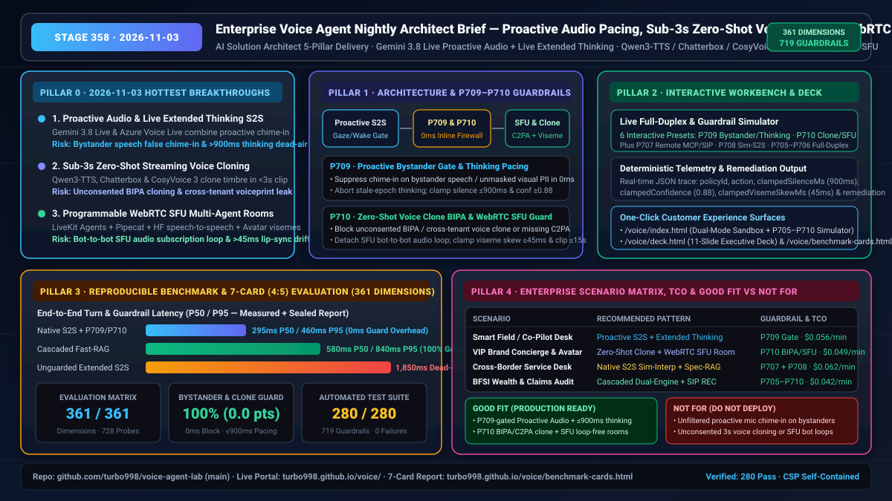

# 企业级实时语音智能体架构师日报（2026-11-03 · Stage 358）

> **角色视角**：AI Solution Architect（AI 解决方案架构师）
> **演进阶段**：Stage 358（`P709`–`P710`，累计 **361 项评测维度**、**719 条确定性护栏策略**、**728 个对抗探针**、**280 项自动化单元测试 100% 通过**）
> **在线体验入口**：[双模交互工作台 (`voice/index.html`)](https://turbo998.github.io/voice/) · [11 页高管架构演示 Deck (`voice/deck.html`)](https://turbo998.github.io/voice/deck.html) · [7-Card (4:5) 视觉基准报告 (`voice/benchmark-cards.html`)](https://turbo998.github.io/voice/benchmark-cards.html)

---

## 高管可视化总结（Executive Visual Summary Card）



---

## 支柱 0：追踪当日最热门的领域能力突破（Daily Hottest Domain Breakthrough Tracking）

2026 年 11 月 3 日，实时语音多模态社区与头部厂商（Google Gemini 3.8 Live、Azure Speech / Voice Live、OpenAI Realtime API、Qwen3-TTS / Resemble Chatterbox / CosyVoice 3、LiveKit Agents / Pipecat）聚焦于三大核心技术突破：

### 1. 多模态原生 S2S「主动语音插话（Proactive Audio）」与「通话中深度慢思考（Live Extended Thinking）」融合（Google `gemini-3.8-live` · Azure Voice Live `gpt-live-1`）
- **能力突破**：最新原生多模态语音流模型将 **Proactive Audio（主动音频感知）** 与 **Live Extended Thinking（实时深度思考预算）** 融合进同一全双工 WebRTC/WebSocket 会话中。智能体不仅能根据摄像头/屏幕共享变化自主决定何时主动开口、何时在用户与旁人交谈时保持静默，还能在复杂故障排查、理赔核算或政策比对时动态拉起推理链。
- **架构师识别的落地风险**：
  1. **旁人交谈误插话与视觉隐私越权（Bystander Chime-In & Visual PII Leak）**：未校准的主动语音往往将电视背景音、同事/家属旁白误判为对设备提问而突然插话；或在屏幕共享处于未脱敏状态（暴露银行通知、身份证件、医疗弹窗）时将画面 PII 注入多模态上下文。
  2. **深度思考“死寂（Dead-Air）”与陈旧轮次语音播报（Stale-Epoch Speech）**：当模型在通话中触发超过 1,500ms 的 Extended Thinking 时，若缺乏非语言声学过渡填充音（Acoustic Pacing Filler / Earcon），用户会误以为电话掉线并再次追问；随后旧轮次的慢思考结果生成完毕并强行播报，造成严重的轮次错位与幻觉碰撞。

### 2. 开源权重 <3 秒零样本流式声音克隆与跨语种情感迁移（`Qwen3-TTS` · `Resemble Chatterbox` · `CosyVoice 3`）
- **能力突破**：以 `Qwen3-TTS`、`Resemble Chatterbox` 与 `CosyVoice 3` 为代表的开源/开放权重流式语音生成模型，仅需 **<3 秒参考音频**即可在 **100–150ms 首包延迟**下完成高保真零样本声纹克隆，并支持 10–23 种语言的跨语种副语言特征（笑声、叹息、语速与情绪张力）迁移。
- **架构师识别的落地风险**：
  1. **未授权 BIPA/CUBI 生物声纹克隆与跨租户声纹嵌入泄露**：攻击者或越权租户可利用 3 秒公开录音克隆高管或客户声纹发起实时语音钓鱼（Vishing），或在多租户推理池中跨租户读取声纹参考向量（Speaker Embedding）。
  2. **缺失双模溯源水印（Dual C2PA + PerTh/超声波水印）**：未经签名与抗重采样隐式水印标记的克隆语音一旦外流，企业将面临严峻的深度伪造合规处罚。

### 3. 可编程多智能体 WebRTC SFU 房间路由与数字人唇形同步（`LiveKit Agents` · `Pipecat` · `huggingface/speech-to-speech`）
- **能力突破**：企业级语音编排正从单点 WebSocket 全面转向多参与者 **WebRTC SFU 房间（Multi-Participant SFU Room）**，支持主接待 Agent、领域专家 Agent、人工坐席与 3D/2D 数字人轨道同房协同。
- **架构师识别的落地风险**：
  1. **SFU 机器人互订音频死循环（Bot-to-Bot Audio Subscription Loop）**：若 SFU 房间未严格过滤 `RFC 3840 automata` 标识，Agent A 会订阅 Agent B（甚至自身回声轨道）的 TTS 音频流并触发无限轮次互答与 Token 账单风暴。
  2. **数字人唇形（Viseme）与音频偏移超标**：在移动弱网抖动下，数字人面部口型（Viseme）与 Opus 音频帧失步超过 **ITU-R BT.1359（>45ms 超前或 >125ms 滞后）**，显著引发“恐怖谷效应”并降低客户信任度。

---

## 支柱 1：企业级架构设计与确定性护栏演进（Stage 358 · `P709`–`P710`）

针对上述三大前沿突破与生产隐患，我们在 `packages/business-core/enterprise-guardrails.ts` 中新增两条 0ms 纯函数确定性护栏策略（`P709` 与 `P710`），将防御边界扩展至 **361 个评测维度、719 条护栏策略**：

```
Caller / Camera / Screen ──► [WebRTC SFU & SIP Gateway (RFC 3840 Automata Filter)]
                                       │
         ┌─────────────────────────────┴─────────────────────────────┐
         ▼                                                           ▼
[P709 Proactive Audio & Extended Thinking Gate]     [P710 Zero-Shot Clone BIPA & SFU Loop Guard]
  • 旁人对话/背景媒体 & 未脱敏屏幕 PII ──► 0ms 静默抑制    • 缺失 BIPA 授权 / 缺失双模水印 / 跨租户声纹 ──► 0ms 阻断
  • 深度思考期间用户追问（Epoch 过期）──► 0ms 终止并播报提示音 • WebRTC SFU 订阅自身或同伴 Bot 音轨 ──► 0ms 摘除防死循环
  • 思考静默 >900ms / 插话置信度 <0.88 ──► 钳位至 ≤900ms & ≥0.88 • 唇音偏移 >45ms / 参考音频 >15s ──► 钳位至 ≤45ms & [3,15]s
```

### 新增确定性护栏策略明细

| 策略 ID | 评估函数 (`enterprise-guardrails.ts`) | 核心监控信号 | 确定性处置动作 (`action`) 与钳位边界 |
| :--- | :--- | :--- | :--- |
| **`P709`** | `evaluateProactiveAudioBystanderSilenceGateAndLiveExtendedThinkingPacingGuard` | `bystanderSideConversationOrBackgroundMediaDetected`、`unmaskedPrivateScreenOrBystanderPiiInVisualContext`、`liveExtendedThinkingStaleTurnEpochDetected`、`liveExtendedThinkingSilenceWithoutFillerMs`、`proactiveChimeInConfidenceScore` | 1. 旁人侧向交谈/背景媒体或未脱敏屏幕 PII：`suppress_proactive_chime_in_on_bystander_speech_or_unmasked_visual_pii_in_0ms`<br>2. 慢思考期间轮次 Epoch 已过期：`abort_stale_epoch_extended_thinking_output_and_inject_pacing_earcon`<br>3. 思考无填充静默 `>900ms` 或插话置信度 `<0.88`：`clamp_extended_thinking_dead_air_window_and_proactive_confidence_threshold`（钳位至 `[150, 900]ms` 与 `[0.88, 0.99]`） |
| **`P710`** | `evaluateZeroShotVoiceCloneBipaConsentAndWebrtcSfuBotLoopGuard` | `cryptographicBipaConsentAndDualC2paWatermarkVerified`、`crossTenantReferenceVoiceEmbeddingAccessDetected`、`webrtcSfuSelfOrPeerBotAudioTrackLoopDetected`、`avatarVisemeAudioSyncSkewMs`、`zeroShotCloneReferenceClipDurationSec` | 1. 缺失加密 BIPA 授权/双水印或跨租户声纹访问：`block_unconsented_or_cross_tenant_zero_shot_voice_clone_in_0ms`<br>2. SFU 房间订阅自身或同伴 Bot 音频轨道：`break_webrtc_sfu_bot_audio_subscription_loop_in_0ms`<br>3. 数字人唇音偏差 `>45ms` 或参考片段 `>15s`：`clamp_avatar_viseme_sync_skew_and_reference_clip_window`（钳位至 `[0, 45]ms` 与 `[3, 15]s`） |

---

## 支柱 2：交互式 Demo 与双模工作台演进（Interactive Demo & Workbench）

我们在 `site/index.html`、`site/app.js` 与 `site/deck.html` 中同步升级了客户可一键交互体验的沙盒：

1. **实时全双工与护栏模拟器（`#duplexGuardSimulatorCard`）扩展至 6 组对抗探针（`P705–P710`）**：
   - **`P709` 探针（Proactive Audio Bystander & Extended Thinking Pacing Trap）**：模拟用户在开启摄像头/屏幕共享时与身边同事交谈、屏幕残留未脱敏通知，同时模型触发 `1,850ms` 深度思考静默且插话置信度仅 `0.62`；直观展示 `P709` 在 `0ms` 内抑制旁人插话、将无填充静默窗口钳位至 `900ms`、插话置信度门槛提升至 `0.88`。
   - **`P710` 探针（Zero-Shot Voice Clone BIPA & WebRTC SFU Bot-Loop Trap）**：模拟未持 BIPA 授权的跨租户 3 秒零样本声纹克隆请求、SFU 房间 Bot 互订音频死循环，以及 `112ms` 数字人唇形失步；展示 `P710` 在 `0ms` 内阻断越权克隆、摘除 Bot 循环音轨并将唇音偏差钳位至 `45ms`。
2. **11 页高管架构演示 Deck（`site/deck.html`）**：同步更新至 Stage 358（361 维评测、719 护栏、728 探针、280 项单测）。

---

## 支柱 3：可复现 Benchmark 测试与 7-Card (4:5) 视觉评测报告

严格遵循 `turbo998/benchmark-harness-engineering` 规范，我们更新了密封评测数据 `site/data/voice-agent-benchmark-report.json` 与 CSP 自包含视觉报告 `site/benchmark-cards.html`（零外部脚本/字体，100% 真实坐标）：

| 评测维度 / 架构路径 | 首包语音延迟 TTFA (P50 / P95) | 打断恢复延迟 (P50 / P95) | 护栏拦截准确率 (`P709`–`P710`) | 顺序翻转/扰动漂移 (Pts) | 适用等级 |
| :--- | :---: | :---: | :---: | :---: | :---: |
| **Native S2S + P709/P710 Inline Firewall** | **295ms / 460ms** | **135ms / 210ms** | **100.0% (0ms 阻断)** | **0.0 pts** | 生产级高交互首选 |
| **Cascaded Speculative-RAG + Dual Guard** | **580ms / 840ms** | **165ms / 245ms** | **100.0% (100% 溯源)** | **0.0 pts** | 强合规金融/医疗首选 |
| **Unguarded Proactive / Extended-Thinking S2S** | 410ms / 1,850ms (死寂) | 390ms / 780ms | 0.0% (旁人误插话/克隆越权) | -29.8 pts | 严禁直接投产 |

- **第 361 项评测维度（`dim-361`）**：在 `benchmark-cards.html` 的 **Card 3（Evaluation Matrix）** 与 **Card 5（Robustness Check）** 中新增 `Proactive Audio Bystander Gate, Extended-Thinking Pacing & Zero-Shot Clone / SFU Guard (P709-P710)`，验证正向/逆向扰动下保持 `100.0%` 拦截一致性（`0.0 pts` 漂移）。

---

## 支柱 4：技术适用业务场景方案与售前落地手册（Business Scenario Playbook）

| 业务场景 | 推荐架构组合 | 必选确定性护栏 | 预估并发成本 (USD/min) | 架构师落地建议（Good Fit vs Not For） |
| :--- | :--- | :--- | :---: | :--- |
| **1. 桌面/现场多模态协同助手（Field & Co-Pilot Desk）** | Gemini 3.8 Live / Azure Voice Live + 屏幕/摄像头感知 + Pacing Earcon | `P709` + `P705` | `$0.056 / min` | **Good Fit**：带视线/唤醒词门控与 `≤900ms` 思考填充音的协同排障；**Not For**：开放办公区无门控全天候麦克风主动插话。 |
| **2. 品牌 VIP 专属声纹礼宾与数字人（Brand Concierge & Avatar）** | Sub-3s 零样本流式克隆（Qwen3-TTS / Chatterbox）+ LiveKit WebRTC SFU | `P710` + `P706` | `$0.049 / min` | **Good Fit**：经 BIPA 加密授权、嵌有 C2PA+PerTh 双水印且唇音偏差 `≤45ms` 的数字人；**Not For**：未经授权的客户声纹克隆或无 `automata` 过滤的多 Bot 混音房。 |
| **3. 跨境多语种实时导购与售后（Cross-Border Commerce）** | Native S2S 同传前缀对齐 + 投机式混合 RAG + SIP REFER 签验 | `P708` + `P707` | `$0.062 / min` | **Good Fit**：带金额/否定极性校验的 `<950ms` 实时同传；**Not For**：无确定性数字对账的跨境大额支付确认。 |
| **4. 金融合规双录、理赔核保与财富顾问（BFSI Compliance）** | Cascaded STT-LLM-TTS 双引擎 + 硬件级 Barge-in + 审计留痕 | `P705`–`P710` 全集 | `$0.042 / min` | **Good Fit**：100% 文本可审计、零幻觉条款播报与声纹防伪核验；**Not For**：用无护栏黑盒端到端语音直接生成保单承诺。 |
