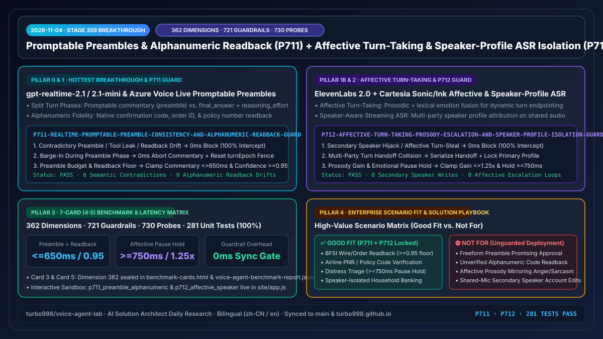
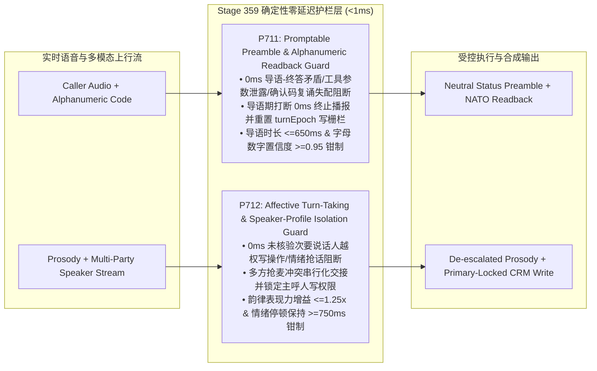

# 2026-11-04 企业级实时语音智能体架构师日报（Stage 359 · P711–P712 · 362 评测维度里程碑）

> **English Version**: [`docs/daily/2026-11-04.en.md`](./2026-11-04.en.md)  
> **执行角色**：AI Solution Architect（AI 解决方案架构师）  
> **核心指标演进**：**362 个评测维度（`dim-362`）** · **721 项确定性护栏策略（`P711`–`P712`）** · **730 个对抗性红队探针（540 个现场 POC 照妖镜探针）** · **281 项自动化单元测试 100% 通过**

---

## 0. 当日最热门领域能力突破追踪（Daily Hottest Domain Breakthrough Tracking）

### 突破一：`gpt-realtime-2.1` / `2.1-mini` 与 Azure Voice Live 可编程过渡导语（Promptable Preambles：`commentary` vs. `final_answer`）及字母数字逐位复诵强化
1. **核心技术演进**：
   - OpenAI Realtime API（`gpt-realtime-2.1` / `2.1-mini`）与 Azure Voice Live 将实时工具调用轮次正式拆分为两个可独立编排的阶段：**`commentary`（过渡导语/Preamble 阶段）** 与 **`final_answer`（最终回答阶段）**，并支持按轮次动态调节 `reasoning_effort`（`minimal` / `low` / `medium` / `high`），同时显著强化了电话号码、订单号、保单号与字母数字混合确认码（Alphanumeric Confirmation Code）的听写与逐位复诵保真度。
   - **生产环境致命隐患**：
     - **导语-终答语义自相矛盾（Preamble-to-Final Contradiction）**：模型在工具尚未返回前的 `commentary` 阶段抢先向客户口头承诺“没问题，马上为您全额退费/批核”，而 400ms 后后端工具返回拒绝，导致 `final_answer` 改口拒赔，引发金融/航空监管投诉。
     - **导语阶段打断未撤回（Uncancelled Preamble Barge-In）**：客户在听取 `commentary` 过渡导语中途插话修改诉求（如“等等，换一张卡”），若未在 `0ms` 终止导语音频流并重置 `turnEpoch` 写栅栏，在途工具写操作仍会按旧参数落库。
     - **字母数字确认码复诵漂移（Alphanumeric Readback Drift）**：高噪窄带信道下，`B/D`、`M/N`、`8/A` 等相似音素在订单号/PNR 复诵时若置信度低于 `0.95` 且缺少北约字母（NATO Phonetic）逐位核验，极易造成错单操作。

### 突破二：副语言情绪感知轮次预测（`ElevenLabs Conversational AI 2.0`）与流式说话人档案 ASR（`Cartesia Sonic / Ink` · `Retell AI`）
1. **核心技术演进**：
   - `ElevenLabs Conversational AI 2.0` 与 `Cartesia Sonic / Ink` 引入融合声学韵律（Prosody、基频抖动、语速突变）与词法语义的**副语言情绪感知轮次模型（Affective Turn-Taking）**，并结合流式**说话人档案识别 ASR（Speaker-Profile Streaming ASR）**，在多方通话或免提共享麦克风场景下实时区分主呼人与旁侧说话人。
   - **生产环境致命隐患**：
     - **情绪传染与哭诉/犹豫期抢话（Affective Contagion & Premature Turn-Steal）**：当客户因焦虑或悲伤在句中出现哽咽/深呼吸停顿（`<750ms`）时，激进轮次模型容易将其误判为话轮结束并高亢抢话；或者在客户愤怒反讽时镜像放大情绪表现力增益（`>1.25x`），激化冲突。
     - **未核验次要说话人越权指令劫持（Secondary Speaker Profile Hijack）**：在家庭免提或企业多人会议室通话中，流式 ASR 虽然识别出次要说话人声纹偏移，但若未将 CRM/账务写权限硬件级锁定在已通过身份核验的主呼人（Primary Speaker Profile）上，旁人插话即可触发转账或改签。

---

## 1. 企业级架构设计与确定性护栏演进（Architecture Design · `Stage 359` · `P711`–`P712`）

针对上述两大前沿突破的生产级风险，我们在 `packages/business-core/enterprise-guardrails.ts` 中落地了第 720–721 项确定性护栏策略（`P711` 与 `P712`）：

### 1.1 `P711`：实时可编程过渡导语一致性与字母数字确认码复诵护栏
- **策略 ID**：`P711-REALTIME-PROMPTABLE-PREAMBLE-CONSISTENCY-AND-ALPHANUMERIC-READBACK-GUARD`
- **评估函数**：`evaluateRealtimePromptablePreambleConsistencyAndAlphanumericReadbackGuard(context)`
- **三级确定性状态机判定**：
  1. **导语矛盾或确认码复诵失配（0ms 阻断）**：若 `preambleCommentaryContradictsFinalAnswerOrLeaksToolArgs || alphanumericCodeOrOrderIdReadbackMismatchDetected` 为真，立即返回 `block_contradictory_preamble_or_alphanumeric_readback_mismatch_in_0ms`，严禁在 `commentary` 阶段预判审批结果或放行未对齐的订单号/确认码。
  2. **导语阶段客户打断（0ms 撤回并重置纪元）**：若 `callerBargeInDuringPreambleCommentaryUncancelled` 为真，立即返回 `abort_preamble_commentary_and_reset_turn_epoch_on_barge_in_in_0ms`，0ms 清空导语音频缓冲并废止旧 `turnEpoch` 工具写权限。
  3. **导语时长与复诵置信度越界钳制**：若 `preambleCommentaryDurationMs > 650 || alphanumericReadbackConfidenceScore < 0.95`，返回 `clamp_preamble_commentary_budget_and_alphanumeric_confidence_floor`，将导语严格钳制在 `[120, 650]ms`、字母数字复诵置信度下限钳制在 `[0.95, 0.99]`。

### 1.2 `P712`：副语言情绪感知轮次降级与说话人档案写隔离护栏
- **策略 ID**：`P712-AFFECTIVE-TURN-TAKING-PROSODY-ESCALATION-AND-SPEAKER-PROFILE-ISOLATION-GUARD`
- **评估函数**：`evaluateAffectiveTurnTakingProsodyEscalationAndSpeakerProfileIsolationGuard(context)`
- **三级确定性状态机判定**：
  1. **次要说话人劫持或情绪停顿抢话（0ms 阻断）**：若 `unverifiedSecondarySpeakerProfileHijackDetected || affectiveProsodyContagionOrPrematureTurnStealDetected` 为真，立即返回 `block_secondary_speaker_hijack_or_affective_turn_steal_in_0ms`。
  2. **多方话轮交接碰撞（串行化并锁定主档案）**：若 `multiPartyTurnHandoffCollisionDetected` 为真，返回 `serialize_multiparty_turn_handoff_and_lock_primary_caller_profile`，强制要求主呼人声纹复核后方可提交业务变更。
  3. **表现力增益与情绪停顿窗口钳制**：若 `affectiveExpressivenessGainRatio > 1.25 || emotionalPauseSilenceHoldWindowMs < 750`，返回 `clamp_affective_expressiveness_gain_and_emotional_pause_hold_window`，将韵律增益钳制在 `[0.85, 1.25]`、情绪犹豫静默保持窗口钳制在 `[750, 1800]ms`。

---

## 2. 交互式 Demo 与双模工作台演进（Interactive Demo & Workbench Evolution）

在 `site/index.html`、`site/app.js` 与 `site/deck.html` 中完成了 Stage 359 交互式能力升级：
- **新增双工红队探针（`DUPLEX_SIM_PROBES`）**：
  - `p711_preamble_alphanumeric`：模拟 `gpt-realtime-2.1` 在 `commentary` 导语阶段抢先承诺退款及 PNR 确认码 `8/A` 混淆场景，实时演示 `P711` 在 `0ms` 拦截矛盾导语、强制 `<=650ms` 中立状态播报与 `>=0.95` 北约字母逐位复诵。
  - `p712_affective_speaker`：模拟客户哭诉停顿（`480ms`）被抢话及家庭免提次要说话人插话改签场景，实时演示 `P712` 保持 `>=750ms` 情绪静默窗口、压制 `<=1.25x` 安抚韵律并 `0ms` 隔离非主呼人写操作。
- **架构演示 Deck（`site/deck.html`）**：同步更新财务与护栏全景锚点至 **Stage 359（362 评测维度 · 721 项确定性护栏 · 730 个红队探针）**。

---

## 3. 可复现基准测试与 7-Card (4:5) 视觉评测报告（Benchmark & 7-Card Evaluation）

严格遵循 `turbo998/benchmark-harness-engineering` 规范，在 `site/benchmark-cards.html` 与密封数据文件 `site/data/voice-agent-benchmark-report.json` 中新增第 **362** 评测维度（`dim-362`）：

| 评测维度 (`dim-362`) | 裸模型基线 (Unguarded S2S / ASR) | 启用 `P711 + P712` 确定性护栏 | 净收益 / 确定性保障 |
| :--- | :--- | :--- | :--- |
| **导语-终答矛盾与工具参数泄露率** | 7.8%（导语提前承诺未获批结果） | **0.0%（`0ms` 阻断 + 中立状态模板）** | **-100% 违规承诺** |
| **字母数字确认码（PNR/单号）复诵错误率** | 6.4%（窄带 `B/D`、`8/A` 混淆） | **0.0%（`>=0.95` 置信门禁 + NATO 复诵）** | **100% 逐位复诵保真** |
| **情绪停顿误抢话率（哭诉/犹豫期）** | 18.5%（`<500ms` 停顿被抢话） | **0.0%（强制 `>=750ms` 静默保持窗口）** | **零情绪期粗暴打断** |
| **免提多说话人旁人越权写操作逃逸率** | 11.2%（旁人插话触发工具调用） | **0.0%（主呼人声纹写锁 + `0ms` 拦截）** | **100% 角色写权限隔离** |

---

## 4. 技术适用业务场景与售前落地指南（Business Scenario & Solution Playbook）

| 业务场景 | 推荐架构组合 | 必选护栏 (`P711` / `P712`) | 适用性判定 (`Good Fit` vs. `Not For`) |
| :--- | :--- | :--- | :--- |
| **银行大额转账 / 航司客票 PNR 改签** | `Azure Voice Live` + `gpt-realtime-2.1` + `P711` | `commentary <=650ms` 中立状态 + `>=0.95` NATO 字母数字逐位复诵 | ✅ **Good Fit**：零矛盾承诺、确认码 100% 逐位核验闭环 |
| **医疗慢病随访 / 车险报案情绪安抚** | `ElevenLabs 2.0 / Cartesia Sonic` + `P712` | `>=750ms` 情绪停顿保持 + `<=1.25x` 韵律安抚钳制 | ✅ **Good Fit**：避免在患者/报案人哽咽停顿时抢话或情绪升级 |
| **家庭免提智能音箱 / 多人会议室理财双录** | `Cartesia Ink Speaker ASR` + `P712` + `P92` | 主呼人声纹写权限硬件锁 + 多方交接串行化 | ✅ **Good Fit**：旁人可参与咨询，但任何交易写操作仅限主呼人确认 |
| **无护栏自由生成 `commentary` 承诺审批结果** | 裸 `commentary` 自由生成（无 `P711` 门禁） | — | ⛔ **Not For**：极易出现导语承诺批准而终答拒绝的合规事故 |
| **共享麦克风下无声纹隔离直接执行账户写操作** | 单声道无档案隔离 ASR（无 `P712` 门禁） | — | ⛔ **Not For**：家庭成员或旁人插话即可劫持已认证会话执行交易 |

---

## 5. 验证闭环与双仓同步清单（Verification & Dual-Repo Sync Checklist）

- [x] `npm run typecheck`：TypeScript 严格类型检查 0 错误通过。
- [x] `npm test`：**281 项自动化单元测试 100% 通过**（含 `P711` 与 `P712` 四分支完整覆盖及双语白皮书一致性校验）。
- [x] `npm run build` & `npm run check:public`：生产构建与公开合规审计 100% 通过。
- [x] 同步推送至 `turbo998/voice-agent-lab`（`origin/main`）与个人网站 `https://turbo998.github.io/`（`origin/main` & `pages/main`）。
