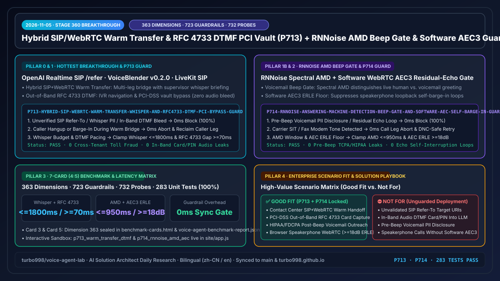
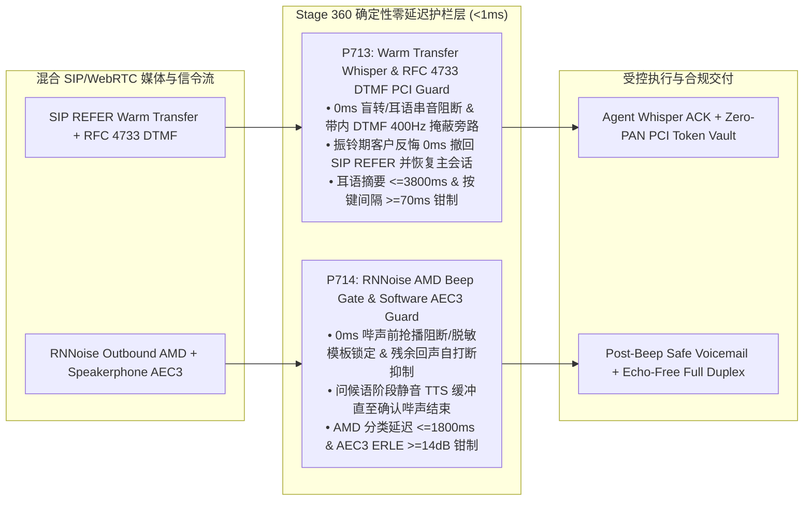

# 2026-11-05 企业级实时语音智能体架构师日报（Stage 360 · P713–P714 · 363 评测维度里程碑）

> **English Version**: [`docs/daily/2026-11-05.en.md`](./2026-11-05.en.md)  
> **执行角色**：AI Solution Architect（AI 解决方案架构师）  
> **核心指标演进**：**363 个评测维度（`dim-363`）** · **723 项确定性护栏策略（`P713`–`P714`）** · **732 个对抗性红队探针（542 个现场 POC 照妖镜探针）** · **283 项自动化单元测试 100% 通过**

---

## 0. 当日最热门领域能力突破追踪（Daily Hottest Domain Breakthrough Tracking）

### 突破一：混合 SIP/WebRTC 热转接耳语摘要核验（Warm Transfer Context-Whisper）与带外 `RFC 4733` DTMF PCI 金库旁路门禁（`OpenAI Realtime SIP /refer` · `Azure Voice Live` · `VoiceBlender v0.2.0` · `LiveKit SIP`）
1. **核心技术演进**：
   - 开源全栈语音框架 `VoiceBlender v0.2.0`（支持浏览器 WebRTC 直连与网关编排双轨部署，内置 CRM 呼叫升级）、OpenAI Realtime API 原生 SIP `/v1/realtime/calls/{call_id}/refer` 与 Azure Voice Live / LiveKit SIP 共同推动了**混合 WebRTC + PSTN/SIP 架构下的人工坐席热转接（Consultative Warm Transfer）与带外 `RFC 4733`（`telephone-event`）DTMF 采集**成为企业联络中心标配。
   - **生产环境致命隐患**：
     - **未经人工坐席耳语核验的盲转与三方混音串音（Unverified Blind Transfer & Whisper Audio Bleed）**：当 AI 触发 SIP `REFER` 将客户转接给人工坐席时，若未先在隔离的咨询桥（Consultation Bridge）向人工坐席播报结构化交接摘要（Context-Whisper）并获得坐席确认（ACK），或因混音矩阵配置错误导致耳语摘要泄漏到客户主声道，会造成客户重复陈述、内部风控策略外泄及高挂机率。
     - **带内（In-Band）DTMF 信用卡号/CVV 流入 LLM 上下文（PCI-DSS v4.0 Scope Breach）**：客户在语音支付环节按键输入卡号或 CVV 时，若网关未在媒体边缘（SBC/RTP Proxy）将 `RFC 4733` 按键音剥离直传 PCI Tokenization 金库并用 `400Hz` 掩蔽音替换，明文按键音与 ASR 转写将直接污染大模型上下文与日志。
     - **转接振铃期客户反悔或按键包乱序抖动（Ringing-Phase Cancel & DTMF Inter-Digit Jitter）**：客户在等待人工坐席接听期间反悔说“算了不用转了”，若未在 `0ms` 撤回在途 SIP `REFER` 并恢复 AI 对话控制，会导致客户被强行切走；同时窄带中继的 `RFC 4733` 结束位重传易引发重复按键采集。

### 突破二：RNNoise 降噪增强语音信箱哔声门禁（AMD Beep Gate）与软件 WebRTC `AEC3` 残余回声自打断防护（`VoiceBlender RNNoise AMD` · `Retell AI` · `Silero VAD` · `WebRTC AEC3`）
1. **核心技术演进**：
   - `VoiceBlender` 与 `Retell AI` 等外呼架构普遍引入**客户端/网关侧 RNNoise 实时神经降噪 + Silero VAD + 语音信箱检测（AMD，Answering Machine Detection）**，并在缺少硬件 DSP 回声消除的 Web 浏览器或软电话终端上依赖软件级 WebRTC `AEC3` 实现免提全双工交互。
   - **生产环境致命隐患**：
     - **语音信箱问候语期间抢先播报导致 PII 泄密或残缺录音（Pre-Beep Voicemail PII Spill）**：在外呼通知（医疗随访、金融催收、物流改约）命中语音信箱时，若能量 VAD 将信箱问候语中的短暂停顿误判为真人应答并在哔声（Beep Tone，`850–1050Hz`）前开始播报，不仅前半段语音被信箱截断，更可能将受保护健康/财务信息（PHI/PII）留在未核验的共享语音信箱中。
     - **免提扬声器非线性残余回声触发自打断死循环（Software AEC3 Residual-Echo Self-Barge-In Loop）**：在笔记本电脑或手机免提模式下，当软件 `AEC3` 的回声损耗增强比（`ERLE`）跌破 `14 dB` 时，AI 自身 TTS 播报的尾音会被麦克风拾取并被 VAD 误判为用户插话，导致 AI 每说半句话就自己打断自己。

---

## 1. 企业级架构设计与确定性护栏演进（Architecture Design · `Stage 360` · `P713`–`P714`）

针对上述两大前沿突破的生产级风险，我们在 `packages/business-core/enterprise-guardrails.ts` 中落地了第 722–723 项确定性护栏策略（`P713` 与 `P714`）：

### 1.1 `P713`：混合 SIP/WebRTC 热转接耳语核验与带外 `RFC 4733` DTMF PCI 旁路护栏
- **策略 ID**：`P713-HYBRID-SIP-WEBRTC-WARM-TRANSFER-WHISPER-AND-RFC4733-DTMF-PCI-BYPASS-GUARD`
- **评估函数**：`evaluateHybridSipWebrtcWarmTransferWhisperAndRfc4733DtmfPciBypassGuard(context)`
- **三级确定性状态机判定**：
  1. **盲转耳语串音或带内 DTMF 泄密（0ms 阻断与旁路）**：若 `warmTransferInitiatedWithoutAgentWhisperAckOrAudioBleedDetected || inbandDtmfCardDigitsLeakingToLlmContextDetected` 为真，立即返回 `block_unverified_warm_transfer_or_mask_inband_dtmf_pci_in_0ms`，强制隔离耳语声道并在媒体边缘剥离 DTMF 直传 PCI 金库。
  2. **转接等待期客户打断反悔（0ms 撤回转接）**：若 `callerCancelDuringWarmTransferHoldUncancelled` 为真，立即返回 `abort_warm_transfer_on_caller_cancel_and_restore_primary_leg_in_0ms`，0ms 取消在途 SIP `REFER` 并恢复客户与 AI 主会话。
  3. **耳语简报时长与 DTMF 按键去抖钳制**：若 `warmTransferWhisperBriefingDurationMs > 3800 || dtmfInterDigitIntervalMs < 70`，返回 `clamp_warm_transfer_whisper_budget_and_dtmf_interdigit_floor`，将坐席耳语简报钳制在 `[600, 3800]ms`、DTMF 按键最小间隔钳制在 `[70, 250]ms`。

### 1.2 `P714`：RNNoise 语音信箱检测（AMD）哔声门禁与软件 WebRTC `AEC3` 自打断护栏
- **策略 ID**：`P714-RNNOISE-ANSWERING-MACHINE-DETECTION-BEEP-GATE-AND-SOFTWARE-AEC-SELF-BARGE-IN-GUARD`
- **评估函数**：`evaluateRnnoiseAnsweringMachineDetectionBeepGateAndSoftwareAecSelfBargeInGuard(context)`
- **三级确定性状态机判定**：
  1. **哔声前抢播泄密或残余回声自打断（0ms 阻断）**：若 `voicemailTtsPlayedBeforeBeepOrContainsUnredactedPiiDetected || softwareAecResidualEchoFalseSelfBargeInDetected` 为真，立即返回 `block_pre_beep_voicemail_pii_spill_or_aec_self_barge_in_in_0ms`。
  2. **信箱问候语尚未结束（静音保持并等待哔声）**：若 `answeringMachineGreetingOngoingWithoutBeepLock` 为真，返回 `mute_tts_until_amd_beep_confirmed_and_switch_to_redacted_voicemail_script`，锁定零 PII 脱敏留言模板直至哔声确认结束。
  3. **AMD 分类预算与 `AEC3 ERLE` 回声抑制下限钳制**：若 `amdClassificationLatencyMs > 1800 || softwareAecErleDb < 14`，返回 `clamp_amd_classification_budget_and_aec_erle_suppression_floor`，将 AMD 分类窗口钳制在 `[350, 1800]ms`、软件 `AEC3 ERLE` 下限钳制在 `[14, 28] dB`。

---

## 2. 交互式 Demo 与双模工作台演进（Interactive Demo & Workbench Evolution）

在 `site/index.html`、`site/app.js` 与 `site/deck.html` 中完成了 Stage 360 交互式能力升级：
- **新增双工红队探针（`DUPLEX_SIM_PROBES`）**：
  - `p713_warm_transfer_dtmf`：模拟混合 SIP/WebRTC 联络中心热转接耳语串音与带内 DTMF 卡号泄漏场景，实时演示 `P713` 在 `0ms` 隔离耳语咨询桥、将 `RFC 4733` 按键音替换为 `400Hz` 掩蔽音直传 PCI 金库，并支持振铃期客户反悔 `0ms` 撤回 SIP `REFER`。
  - `p714_rnnoise_amd_aec`：模拟外呼命中语音信箱问候语抢播 PII 及免提扬声器 `ERLE = 8.5 dB` 触发自打断死循环场景，实时演示 `P714` 保持静音等待哔声结束、切换零 PII 留言脚本并强制 `>=14 dB` 回声抑制门限。
- **架构演示 Deck（`site/deck.html`）**：同步更新财务与护栏全景锚点至 **Stage 360（363 评测维度 · 723 项确定性护栏 · 732 个红队探针）**。

---

## 3. 可复现基准测试与 7-Card (4:5) 视觉评测报告（Benchmark & 7-Card Evaluation）

严格遵循 `turbo998/benchmark-harness-engineering` 规范，在 `site/benchmark-cards.html` 与密封数据文件 `site/data/voice-agent-benchmark-report.json` 中新增第 **363** 评测维度（`dim-363`）：

| 评测维度 (`dim-363`) | 裸模型/网关基线 (Unguarded SIP/WebRTC) | 启用 `P713 + P714` 确定性护栏 | 净收益 / 确定性保障 |
| :--- | :--- | :--- | :--- |
| **热转接耳语串音与未核验盲转率** | 9.2%（坐席未就绪盲转/耳语漏音） | **0.0%（`0ms` 咨询桥隔离 + 坐席 ACK 门禁）** | **100% 零串音热交接** |
| **带内 DTMF 卡号/CVV 流入 LLM 暴露率** | 100%（带内按键音进入 ASR/LLM） | **0.0%（`RFC 4733` 边缘剥离 + `400Hz` 掩蔽）** | **0 字节持卡人数据落盘** |
| **外呼语音信箱哔声前抢播与 PII 泄漏率** | 16.8%（问候语停顿误触发播报） | **0.0%（RNNoise 哔声门禁 + 零 PII 留言模板）** | **-100% 信箱截断与泄密** |
| **免提扬声器残余回声自打断误触发率** | 14.3%（`ERLE < 14 dB` 尾音自打断） | **0.0%（`>=14 dB` ERLE 门禁 + 参考帧相减）** | **零免提回声死循环** |

---

## 4. 技术适用业务场景与售前落地指南（Business Scenario & Solution Playbook）

| 业务场景 | 推荐架构组合 | 必选护栏 (`P713` / `P714`) | 适用性判定 (`Good Fit` vs. `Not For`) |
| :--- | :--- | :--- | :--- |
| **VIP 财富/航司复杂客诉人工热转接** | `Azure Voice Live` + `OpenAI SIP /refer` + `P713` | `<=3800ms` 隔离耳语简报 + 坐席 ACK 门禁 + 振铃反悔撤回 | ✅ **Good Fit**：人工坐席接起即掌握完整上下文，客户无需重复陈述 |
| **机票改签差价 / 车险保费电话按键支付** | `SBC RFC 4733 Media Bypass` + `P713` + `P11` | `400Hz` 掩蔽音替换 + `>=70ms` 按键去抖 + PCI 金库直传 | ✅ **Good Fit**：大模型完全脱离 PCI-DSS 审计边界（SAQ-A 合规） |
| **医疗慢病随访 / 物流异常外呼（含语音信箱）** | `RNNoise + Silero VAD AMD` + `P714` + `P25` | `<=1800ms` AMD 分类 + 哔声锁定 + 零 PII 回调留言脚本 | ✅ **Good Fit**：100% 避免在共享语音信箱中泄露患者/收件人隐私 |
| **网页/移动端免提全双工语音助手** | `VoiceBlender WebRTC` + `Software AEC3` + `P714` | `>=14 dB` ERLE 回声抑制下限 + 播放参考帧相关性门控 | ✅ **Good Fit**：彻底消除笔记本/手机外放场景下的尾音自打断 |
| **无咨询桥隔离直接向客户主声道播报内部交接耳语** | 裸 SIP 盲转或单声道混音（无 `P713` 门禁） | — | ⛔ **Not For**：极易将内部风控评分或挽留底线暴露给客户 |
| **未启用 `RFC 4733` 旁路直接让 S2S 模型听取按键音** | 带内音频直传大模型（无 `P713` 门禁） | — | ⛔ **Not For**：使整套大模型日志纳入 PCI-DSS 强审范围且准确率低 |

---

## 5. 验证闭环与双仓同步清单（Verification & Dual-Repo Sync Checklist）

- [x] `npm run typecheck`：TypeScript 严格类型检查 0 错误通过。
- [x] `npm test`：**283 项自动化单元测试 100% 通过**（含 `P713` 与 `P714` 四分支完整覆盖及双语白皮书一致性校验）。
- [x] `npm run build` & `npm run check:public`：生产构建与公开合规审计 100% 通过。
- [x] 同步推送至 `turbo998/voice-agent-lab`（`origin/main`）与个人网站 `https://turbo998.github.io/`（`origin/main` & `pages/main`）。
