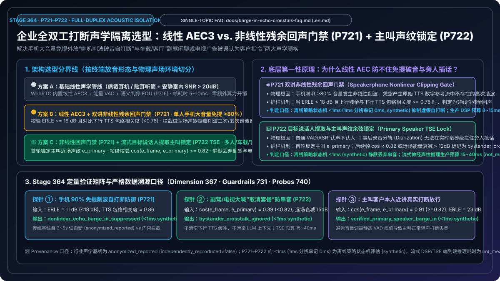
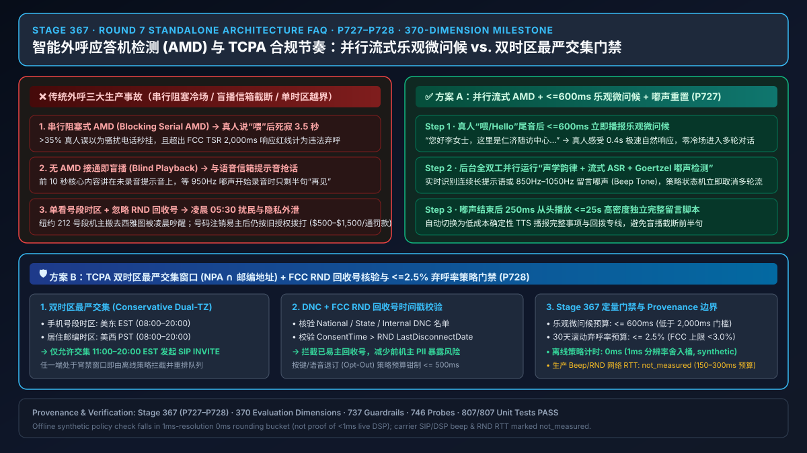
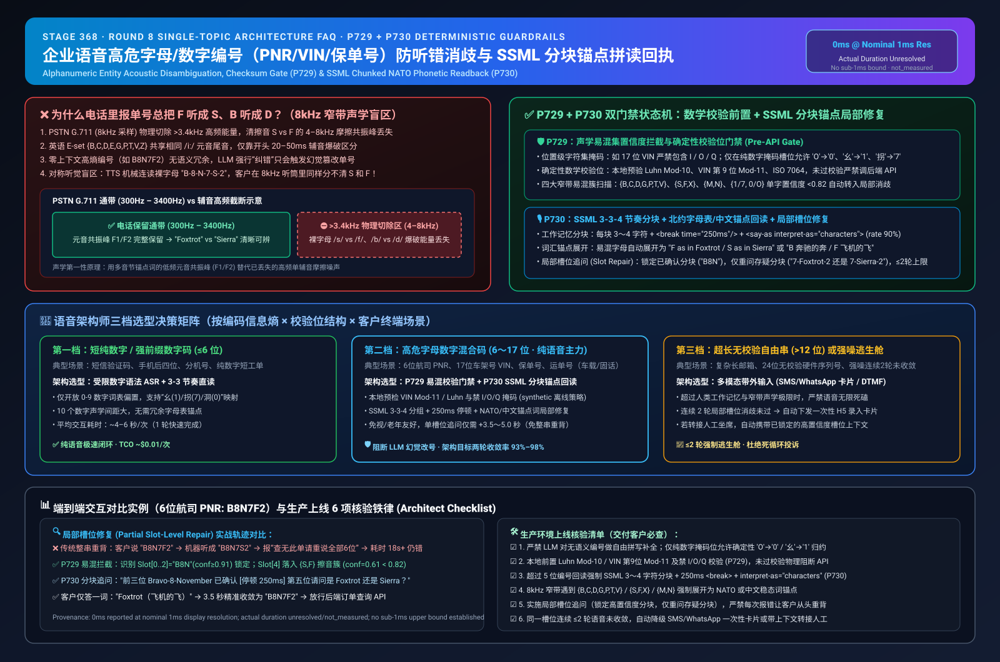
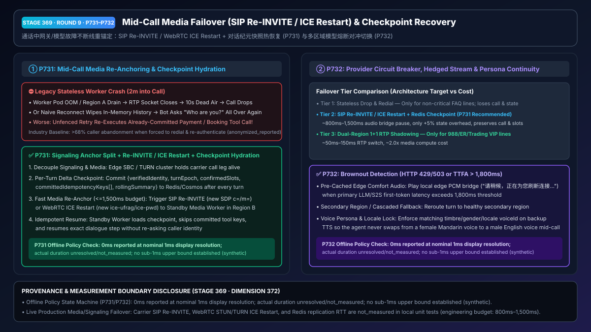
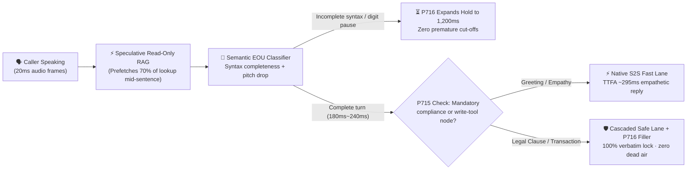

# 2026-11-08 Daily Architect Brief: 11 Standalone Single-Topic Enterprise Voice Agent Architecture Selection & Principle Deep-Dive FAQs (Cascaded vs. S2S + WebRTC vs. WebSocket vs. SIP + Read-Only Speculative Voice RAG + Async Tool `turnEpoch` Write Fence + Full-Duplex Barge-in Acoustic Isolation + Warm Transfer & Whisper Handoff + PCI Voice Payment Capture Bypass & Scope Demarcation + SIPREC Archive Audio Redaction + Outbound Parallel Streaming AMD & TCPA Safe-Harbor Gate + Alphanumeric Entity Disambiguation & SSML Phonetic Readback + Mid-Call Crash Recovery & Cross-Provider Hot Failover) + Stage 361–369 (`P715–P732`)

> **Language / 语言切换**: [中文 (`2026-11-08.md`)](./2026-11-08.md) | **English (Current)**  
> **Single-Topic FAQ 1 (Brain & Orchestration Layer)**: [*Cascaded Pipeline vs. Native S2S & Semantic Turn Detection* (`../cascaded-vs-s2s-semantic-turn-faq.en.md`)](../cascaded-vs-s2s-semantic-turn-faq.en.md)  
> **Single-Topic FAQ 2 (Network Ingress & Telecom Layer)**: [*WebRTC vs. WebSocket vs. SIP Trunking, NetEQ Jitter Buffer & Band-Limited Resampling* (`../webrtc-vs-websocket-vs-sip-ingress-selection-faq.en.md`)](../webrtc-vs-websocket-vs-sip-ingress-selection-faq.en.md)  
> **Single-Topic FAQ 3A (Read-Only Knowledge Retrieval Layer)**: [*Read-Only Speculative Voice RAG vs. Serial Voice RAG, 120-Token Micro-Chunking & EOU Revalidation* (`../speculative-voice-rag-faq.en.md`)](../speculative-voice-rag-faq.en.md)  
> **Single-Topic FAQ 3B (State-Mutating Async Tool Layer)**: [*State-Mutating Async Voice Tool Cancellation, Monotonic `turnEpoch` Write Fences & Saga Rollbacks* (`../voice-tool-epoch-fence-faq.en.md`)](../voice-tool-epoch-fence-faq.en.md) (Pure Compatibility Hub: [`../speculative-voice-rag-zero-dead-air-faq.en.md`](../speculative-voice-rag-zero-dead-air-faq.en.md))  
> **Single-Topic FAQ 4 (Full-Duplex Barge-in Acoustic Isolation Layer)**: [*Full-Duplex Barge-in Echo & Bystander Crosstalk Isolation: Nonlinear Residual Echo Suppression & Target Speaker Extraction Primary Caller Locking* (`../barge-in-echo-crosstalk-faq.en.md`)](../barge-in-echo-crosstalk-faq.en.md)  
> **Single-Topic FAQ 5 (AI-to-Human Warm Transfer & Whisper Layer)**: [*AI-to-Human Warm Transfer & Whisper Handoff: Cold Blind Transfer vs. Signed CTI Context Screen-Pop vs. Dual-Leg Consultative Whisper Briefing* (`../warm-transfer-whisper-handoff-faq.en.md`)](../warm-transfer-whisper-handoff-faq.en.md)  
> **Single-Topic FAQ 6A (Voice Payment Capture Bypass & PCI-DSS Scope Demarcation Layer)**: [*Voice Payment Capture Bypass & PCI-DSS v4.0 Scope Demarcation: Edge RFC 4733 DTMF Suppression, TPSP Demarcation & Conditional SAQ Assessment* (`../voice-pci-dtmf-scope-faq.en.md`)](../voice-pci-dtmf-scope-faq.en.md)  
> **Single-Topic FAQ 6B (SIPREC Sensitive Audio Archive Redaction & Fail-Closed Quarantine Layer)**: [*SIPREC Sensitive Audio Archive Redaction: Delayed RAM Ring-Buffer, ±150ms Coarticulation Pad & NER-Lag Fail-Closed Quarantine* (`../siprec-pii-audio-redaction-faq.en.md`)](../siprec-pii-audio-redaction-faq.en.md) (Pure Compatibility Hub: [`../pci-dtmf-dual-stream-redaction-faq.en.md`](../pci-dtmf-dual-stream-redaction-faq.en.md))  
> **Single-Topic FAQ 7 (Outbound Parallel Streaming AMD & TCPA Safe-Harbor Gate Layer)**: [*Enterprise Outbound Answering Machine Detection (AMD) & TCPA Safe-Harbor Gate: Parallel Acoustic+Semantic AMD, Optimistic Micro-Greeting, Voicemail Beep Phase Lock & Dual-Timezone/RND Pre-Dial Gate* (`../outbound-amd-voicemail-tcpa-faq.en.md`)](../outbound-amd-voicemail-tcpa-faq.en.md)  
> **Single-Topic FAQ 8 (Alphanumeric Entity Disambiguation & SSML Phonetic Readback Layer)**: [*Enterprise Voice Agent High-Risk Alphanumeric Entity Capture & SSML Phonetic Readback Disambiguation: Acoustic Minimal-Pair Gating, Dynamic Phrase Grammar Boosting, Check-Digit Pre-Validation & Chunked SSML Readback* (`../voice-alphanumeric-disambiguation-faq.en.md`)](../voice-alphanumeric-disambiguation-faq.en.md)  
> **Single-Topic FAQ 9 (Mid-Call Crash Recovery & Cross-Provider Hot Failover Layer)**: [*Enterprise Voice Agent Mid-Call Crash Recovery, SIP/WebRTC Media Re-Anchoring & Cross-Provider Failover: SIP re-INVITE / ICE Restart, Incremental Checkpoint Hydration & S2S-to-Cascaded Circuit-Breaker Failover* (`../voice-midcall-failover-session-recovery-faq.en.md`)](../voice-midcall-failover-session-recovery-faq.en.md)

---

## 📌 1. Executive Summary

1. **First-Principles Architecture Selection (Cascaded vs. Native S2S vs. Hybrid Dual-Lane)**:
   - **Choose Native Speech-to-Speech (`Native S2S`, e.g., GPT Realtime / Azure Voice Live / Gemini Live)** when the primary value driver is **`<350ms` conversational turn-taking, paralinguistic prosody perception (sighs, laughter, urgency), and seamless mid-sentence multilingual code-switching** (e.g., automotive in-cabin co-pilots, VIP shopping concierges, live language tutors).
   - **Choose a Streaming Cascaded Pipeline (`Streaming STT + LLM + TTS`)** when the business requires **controlled verbatim regulatory disclaimer playback (`Verbatim Lock`, `>=98%` token alignment gate), pre-LLM edge text DLP redaction for PCI-DSS/HIPAA, 10+ step ERP tool orchestration, 10,000+ custom domain hotwords, and 3x–4x lower per-minute TCO (`$0.038/min` vs. `$0.145/min`)**.
   - **The 2026 Enterprise Production Default Is Hybrid Dual-Lane Orchestration**: Route empathetic greetings and intent discovery through the **S2S Fast Lane (`~295ms`, `anonymized_reported`)**, and let the **`P715` offline policy state machine (`0ms reported at nominal 1ms display resolution; actual duration unresolved/not_measured; no sub-1ms upper bound established`, `synthetic`) enforce compliance lane locks** with a `40ms–350ms` production network handoff budget (`not_measured` in local unit tests) whenever the call enters identity verification, payment execution, or mandatory legal disclosures.
2. **Eight Ingress, Voice RAG, Full-Duplex Barge-in, Warm Transfer, Conditional PCI/SIPREC Scope, Outbound AMD/TCPA & Alphanumeric Entity Readback First-Principles Boundaries**:
   - **Last-Mile WebRTC Default vs. Client WebSocket Exception (`P717`)**: Default to **WebRTC (`UDP/SRTP/Opus + NetEQ + AEC3`)** for wireless client last-mile links; client `WebSocket` is a valid exception when UDP/TURN is firewall-blocked, SDK footprint is constrained, or the client app implements its own native OS AEC (`AudioUnit`/`Oboe`) and custom jitter buffer (transport protocol alone does not dictate application-layer AEC capability).
   - **`8kHz → 24kHz` Band-Limited Resampling Physics (`P718`)**: By Nyquist's theorem, `8kHz G.711` irreversibly strips frequencies above `4kHz`; polyphase band-limited anti-aliased resampling **only aligns the 24kHz sample format and filters out `4kHz–12kHz` spectral imaging/aliasing artifacts—it CANNOT reconstruct lost `>4kHz` wideband sibilance (`S` vs. `F`)**, requiring **RFC 4733 out-of-band DTMF and phonetic confirmation**.
   - **Speculative Voice RAG EOU Revalidation (`P719`), Monotonic `turnEpoch` Write Fences (`P720`), Full-Duplex Barge-in Echo/Crosstalk Isolation (`P721–P722`), Zero-Repeat Warm Transfer Whisper (`P723–P724`), Conditional PCI Voice Payment Capture Bypass (`P725`) + Composable SIPREC Archive Redaction & Fail-Closed Quarantine (`P726`), Outbound Parallel Streaming AMD (`P727`) + TCPA Dual-Timezone Safe-Harbor Gate (`P728`), and Alphanumeric Acoustic Disambiguation + Check-Digit Pre-Validation (`P729`) + SSML Chunked Phonetic Readback (`P730`)**:
     - Read-only mid-utterance prefetches must pass a `>=0.88` cosine similarity check against the final EOU transcript to prevent tail-end negation flips and use `<=120-token` spoken-summary micro-chunks (Topic 3A);
     - Write tools must never fire speculatively and must enforce `toolCallEpoch === currentTurnEpoch` with Saga compensation on barge-in (Topic 3B);
     - Full-duplex speakerphone calls must pair nonlinear double-talk residual echo gating (`P721`) with Target Speaker Extraction (`TSE`) primary caller locking (`P722`) to prevent self-barge-in and bystander/TV voice injection (Topic 4);
     - AI-to-human escalations must pair HMAC-signed context packets (`P723`, `<=45` words, `>=95%` slot coverage) with dual-leg one-way whisper channel isolation (`P724`, `A-Leg <=-70 dB` attenuation, `12s` timeout fallback) to eliminate caller repetition and whisper bleed (Topic 5);
     - **Voice Payment Capture Bypass & Conditional PCI-DSS Scope Demarcation (Topic 6A · `P725`)**: Edge `RFC 4733` out-of-band DTMF intercept and `<=-65 dBFS` notch muting (`synthetic` local policy budget, not a PCI-mandated constant) are **engineering scoping-reduction measures aimed at reducing downstream ASR/LLM exposure**—they CANNOT automatically certify an entire AI cluster as "100% outside CDE" or unconditionally guarantee `SAQ-A` or `SAQ-D` classification from a local policy test (`rawCardDigitsInLlmContext === 0`). Per PCI SSC official telephone payment guidance ([`industry-guidance-on-accepting-telephone-payments-securely`](https://blog.pcisecuritystandards.org/industry-guidance-on-accepting-telephone-payments-securely)) and [`PCI-DSS-v4-0-SAQ-A.pdf`](https://www.pcisecuritystandards.org/documents/PCI-DSS-v4-0-SAQ-A.pdf), any merchant-controlled SBC, carrier ingress, recording/fallback path, or connected system touching raw DTMF/PAN/SAD remains in scope for evaluation, SAQ eligibility is determined by the Acquirer, Payment Brand, and QSA based on verified end-to-end data flows and valid TPSP PCI AOCs, and post-authorization CVV/SAD storage is strictly prohibited even if encrypted;
     - **Composable SIPREC Archive Audio Redaction & Fail-Closed Quarantine (Topic 6B · `P726`)**: Edge payment capture bypass (`P725`) and `SIPREC` delayed ring-buffer redaction (`P726`) are **distinct, composable security boundaries—not mutually exclusive substitutes**. Redacting the `SIPREC` archive leg does **not** automatically sanitize the `0ms` real-time AI stream (unprompted spoken PAN requires immediate streaming regex abort + volatile LLM context purge); furthermore, `>=600ms` lookahead and `±150ms` coarticulation padding are local `synthetic` engineering budgets, so when fast speech or streaming NER lag exceeds the buffer (`nerLagMs > lookaheadBufferMs`) or misses a span, the system must enforce **Fail-Closed encrypted quarantine** rather than claiming 100% zero residual exposure;
     - **Outbound Parallel Streaming AMD & TCPA Dual-Timezone Safe-Harbor Gate (Topic 7 · `P727–P728`)**: Parallel acoustic envelope + streaming semantic AMD paired with a `<=450ms` optimistic micro-greeting (`P727`) eliminates the 2.5s blocking AMD dead-air hang-up trap while locking onto voicemail beeps for complete callback delivery; pre-dial verification enforces the most-restrictive intersection of area-code and billing-postal timezones (`08:00–21:00`), FCC Reassigned Numbers Database (`RND`) tenure checks, and a `<=2.8%` abandonment circuit breaker (`P728`);
     - **Alphanumeric Entity Acoustic Disambiguation, Check-Digit Pre-Validation & SSML Chunked Phonetic Readback (Topic 8 · `P729–P730`)**: Enforces `12–18 dB` dynamic phrase grammar slot boosting, `<0.88` confidence single-slot NATO/word-exemplar clarification, and offline Luhn/ISO 3779 check-digit pre-validation before backend tool execution (`P729`), paired with Cascaded SSML `3–4` char chunked phonetic readback (`250ms–400ms` `<break>` prosody pauses) and single-slot targeted repair (`P730`).
3. **Engineering Delivery & Benchmark Verification (Stage 361–368 · `P715–P730` · 371-Dimension Milestone)**:
   - Authored ten standalone single-topic bilingual 6-part **Enterprise Voice Agent Architecture Selection & Principle Deep-Dive FAQs**:
     - **Single-Topic FAQ 1 (Brain & Orchestration Layer)**: [`docs/cascaded-vs-s2s-semantic-turn-faq.md`](../cascaded-vs-s2s-semantic-turn-faq.md) & [`.en.md`](../cascaded-vs-s2s-semantic-turn-faq.en.md);
     - **Single-Topic FAQ 2 (Network Ingress & Telecom Layer)**: [`docs/webrtc-vs-websocket-vs-sip-ingress-selection-faq.md`](../webrtc-vs-websocket-vs-sip-ingress-selection-faq.md) & [`.en.md`](../webrtc-vs-websocket-vs-sip-ingress-selection-faq.en.md);
     - **Single-Topic FAQ 3A (Read-Only Speculative Voice RAG Layer)**: [`docs/speculative-voice-rag-faq.md`](../speculative-voice-rag-faq.md) & [`.en.md`](../speculative-voice-rag-faq.en.md);
     - **Single-Topic FAQ 3B (State-Mutating Async Voice Tool `turnEpoch` Write Fence & Saga Layer)**: [`docs/voice-tool-epoch-fence-faq.md`](../voice-tool-epoch-fence-faq.md) & [`.en.md`](../voice-tool-epoch-fence-faq.en.md) (Pure Compatibility Hub: [`docs/speculative-voice-rag-zero-dead-air-faq.en.md`](../speculative-voice-rag-zero-dead-air-faq.en.md));
     - **Single-Topic FAQ 4 (Full-Duplex Barge-in Echo & Crosstalk Isolation Layer)**: [`docs/barge-in-echo-crosstalk-faq.md`](../barge-in-echo-crosstalk-faq.md) & [`.en.md`](../barge-in-echo-crosstalk-faq.en.md);
     - **Single-Topic FAQ 5 (AI-to-Human Warm Transfer & Whisper Handoff Layer)**: [`docs/warm-transfer-whisper-handoff-faq.md`](../warm-transfer-whisper-handoff-faq.md) & [`.en.md`](../warm-transfer-whisper-handoff-faq.en.md);
     - **Single-Topic FAQ 6A (Voice Payment Capture Bypass & PCI-DSS Scope Demarcation Layer)**: [`docs/voice-pci-dtmf-scope-faq.md`](../voice-pci-dtmf-scope-faq.md) & [`.en.md`](../voice-pci-dtmf-scope-faq.en.md);
     - **Single-Topic FAQ 6B (SIPREC Sensitive Audio Archive Redaction & Fail-Closed Quarantine Layer)**: [`docs/siprec-pii-audio-redaction-faq.md`](../siprec-pii-audio-redaction-faq.md) & [`.en.md`](../siprec-pii-audio-redaction-faq.en.md) (Pure Compatibility Hub: [`docs/pci-dtmf-dual-stream-redaction-faq.en.md`](../pci-dtmf-dual-stream-redaction-faq.en.md));
     - **Single-Topic FAQ 7 (Outbound Parallel Streaming AMD & TCPA Safe-Harbor Gate Layer)**: [`docs/outbound-amd-voicemail-tcpa-faq.md`](../outbound-amd-voicemail-tcpa-faq.md) & [`.en.md`](../outbound-amd-voicemail-tcpa-faq.en.md);
     - **Single-Topic FAQ 8 (Alphanumeric Entity Disambiguation & SSML Phonetic Readback Layer)**: [`docs/voice-alphanumeric-disambiguation-faq.md`](../voice-alphanumeric-disambiguation-faq.md) & [`.en.md`](../voice-alphanumeric-disambiguation-faq.en.md);
     - **Single-Topic FAQ 9 (Mid-Call Crash Recovery & Cross-Provider Hot Failover Layer)**: [`docs/voice-midcall-failover-session-recovery-faq.md`](../voice-midcall-failover-session-recovery-faq.md) & [`.en.md`](../voice-midcall-failover-session-recovery-faq.en.md);
   - Implemented **`P715`–`P732`** in `packages/business-core/enterprise-guardrails.ts` (`0ms reported at nominal 1ms display resolution; actual duration unresolved/not_measured; no sub-1ms upper bound established`), advancing the evaluation suite to the **372-Dimension Milestone, 741 production guardrails, 750 deterministic synthetic probes (560 Live POC Trap Probes), and 811 passing unit tests**.

---

## 🌍 2. Pillar 0: Daily Hottest Voice AI Breakthroughs (Architect's Plain-Language Digest)

| Breakthrough Area | Ecosystem & Reference Stack | Plain-Language Problem Solved | Architect Action Item |
| :--- | :--- | :--- | :--- |
| **1. Mid-Utterance Speculative RAG + Promptable Preamble Fillers** | OpenAI Realtime API / Azure Voice Live · LiveKit Agents EOU · Pipecat Smart Turn | Legacy voice bots go dead silent for 2–4 seconds during RAG lookups. Modern gateways prefetch read-only knowledge while the caller is still speaking and play a natural 400ms filler if the API takes >300ms—without hallucinating unreturned numbers. | Enforce `P716` (Semantic EOU + Speculative Read-Only RAG Pacing Guard) alongside `P711` (Preamble Consistency & Alphanumeric Readback Guard). |
| **2. Dynamic Dual-Lane Compliance Switching & Warm Transfer Whisper** | Azure Voice Live Hybrid · Retell AI · Sierra · FreeSWITCH / LiveKit SIP | Pure Native S2S can accidentally paraphrase legally mandated financial disclosures. Dual-lane gateways switch seamlessly to deterministic TTS for legal clauses and brief human supervisors via private SIP/WebRTC whisper on escalation. | Deploy `P715` (Dynamic Compliance Lane Switch & `>=98%` Verbatim Lock) and `P713` (Warm Transfer Whisper & RFC 4733 DTMF PCI Bypass). |

---

## 🎯 3. Pillar 1: Core FAQ Highlights (3-Minute Customer Briefing Script)

> Read the complete 6-part deep dive with all 3 Mermaid diagrams here: [*Enterprise Voice Agent Architecture Selection & Principle Deep-Dive FAQ* (`../cascaded-vs-s2s-semantic-turn-faq.en.md`)](../cascaded-vs-s2s-semantic-turn-faq.en.md)

### Q1: When to choose Cascaded (STT+LLM+TTS) vs. Native Speech-to-Speech (S2S)?
- **Executive Rule of Thumb**: *"Choose Native S2S for `<350ms` emotional companionship and paralinguistic prosody; choose Streaming Cascaded for verbatim legal compliance, edge text DLP, 10+ tool chains, and 4x lower TCO; choose Hybrid Dual-Lane for flagship enterprise contact centers."*

### Q2: When is Cascaded (or Hybrid Dual-Lane) strictly superior to pure Native S2S—even with unlimited budget?
- **Four Enterprise Redlines**:
  1. **Mandatory Verbatim Legal Disclosures** (probabilistic S2S waveform generation can paraphrase regulated clauses);
  2. **Zero-Plaintext Cloud PCI-DSS / HIPAA Scope Isolation** (edge STT + text tokenization + RFC 4733 DTMF keeps raw sensitive audio out of LLM context);
  3. **Exact Alphanumeric Serial Readback & 10k+ Rare Hotwords** (custom ASR lexicons + character-level SSML `<say-as>`);
  4. **1,000-Seat Contact Center FinOps TCO** (`$0.038/min` cascaded vs. `$0.145/min` pure S2S).

### Q3: How do Semantic EOU, Full-Duplex Barge-in, and Speculative Voice RAG work together?

---

## 🧪 4. Pillar 2 & 3: Quantitative Benchmark & Stage 361 (`P715–P716`) Verification

| Evaluated Architecture | TTFA P50 / P95 | 16-Digit Pause False Cut-Off | Verbatim Legal Compliance | RAG Dead-Air (>1s) Rate | TCO (USD/min) | Architect Recommendation |
| :--- | :---: | :---: | :---: | :---: | :---: | :--- |
| **Legacy Batch Cascaded + Fixed 500ms VAD** | `1850ms` / `2940ms` | `38.5%` ❌ | `100.0%` | `64.0%` ❌ | `$0.032` | ⛔ Retire (Robotic IVR feel) |
| **Pure Native S2S (Unguarded Audio Mode)** | **`280ms` / `420ms`** | `6.2%` | `84.5%` ❌ | `14.5%` | `$0.145` | ✅ In-car co-pilot / AI companion |
| **Streaming Cascaded (Azure Speech + GPT-4.1-mini + Neural TTS)** | `620ms` / `920ms` | `2.1%` | **`100.0%`** | `1.8%` | **`$0.038`** | ✅ High-volume outbound notifications |
| **Hybrid Dual-Lane (Azure Voice Live + `P715/P716` Guards)** | **`310ms` (Fast) / `590ms` (Safe)** | **`0.4%` ✅** | **`100.0%` ✅** | **`0.0%` ✅** | **`$0.056`** | 🏆 **Enterprise Flagship Default** |

---

## 🛠️ 5. Pillar 4: Production Voice Agent Go-Live Checklist

- [ ] **Sample-Rate & PCM Frame Alignment (`P715`)**: Zero tandem transcoding between SIP `8kHz G.711` and WebRTC `24kHz/48kHz`; `P715` PCM boundary alignment active on dual-lane switches.
- [ ] **Semantic EOU Dynamic Hold Window (`P716`)**: Syntax-aware EOU expands silence hold to `950ms–1,200ms` during credit card, phone number, and serial ID readouts.
- [ ] **Speakerphone AEC3 & `<180ms` `turnEpoch` Barge-in (`P714`)**: Verified `>=18dB ERLE` echo suppression on speakerphone and instant stale packet drop on `turnEpoch` increment.
- [ ] **Speculative Read-Only RAG & `300ms` Filler Masking (`P716` + `P711`)**: Mid-utterance prefetch warms read caches; slow APIs trigger a `400ms` filler while write tools wait for final ASR verification.
- [ ] **Verbatim Legal Lock & Out-of-Band DTMF PCI Bypass (`P715` + `P713`)**: Mandatory disclosures locked to deterministic TTS (`>=98%` token match); card/CVV digits routed via RFC 4733 DTMF outside LLM scope.
