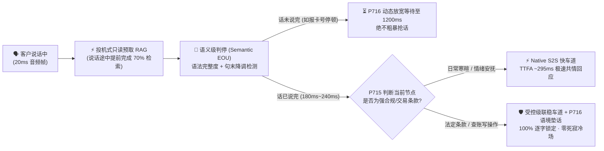

# 2026-11-08 每日架构师简报：企业级语音智能体架构选型与原理解析 FAQ 专题（级联 STT+LLM+TTS vs 原生 S2S、语义判停与投机式语音 RAG）+ Stage 361 (`P715–P716`)

> **语言切换 / Language**: **中文 (当前)** | [English (`2026-11-08.en.md`)](./2026-11-08.en.md)  
> **核心专题 FAQ 全文（强烈推荐精读）**: [《企业级语音智能体架构选型与原理解析 FAQ：级联管道 vs 原生端到端 S2S、语义判停与投机式语音 RAG 实战指南》(`../cascaded-vs-s2s-semantic-turn-faq.md`)](../cascaded-vs-s2s-semantic-turn-faq.md)

---

## 📌 一、今日核心结论速览（Executive Summary）

1. **架构选型第一性原理（何时选级联、何时选原生 S2S、何时选双轨混合）**：
   - **选原生端到端实时语音（Native S2S，如 GPT Realtime / Azure Voice Live / Gemini Live）**：当业务最看重 **`<350ms` 极速响应、听懂客户叹气/笑声/焦急语调（副语言信息）、一句话中英粤无缝混说（Code-Switching）**（如智能座舱副驾、VIP 情感导购、口语陪练）。
   - **选流式级联管道（Streaming STT + LLM + TTS）**：当业务有 **法定免责条款必须一字不差播报（Verbatim Lock）、敏感隐私（银行卡/病历）必须在进大模型前做本地文本脱敏、10+ 步复杂 ERP 工具编排、上万条生僻专有名词热词（Custom Lexicon）以及千路并发成本红线（`$0.038/min` vs `$0.145/min`）**。
   - **2026 企业生产终局推荐“双轨混合架构（Hybrid Dual-Lane）”**：开场寒暄与情绪安抚走 **S2S 快车道（`295ms`）**，一旦进入身份核验、转账改签或免责声明播报，由 **`P715` 护栏在 `<120ms` 内无感切入受控级联稳车道（`580ms`）**，兼得真人温度与金融级确定性。
2. **彻底治好语音机器人“人工智障感”的三大核心机制**：
   - **语义级判停（Semantic Turn Detection / EOU）**：淘汰“静音满 500ms 就一刀切断”的传统盲人秒表 VAD，并联 20ms 轻量级语义分类器同时判断“句法是否说完整 + 尾音是否降调”，把客户报 16 位卡号喘气时的误打断率从 **`38.5%` 降至 `0.4%`**。
   - **全双工打断（Barge-in）与回声消除（AEC3 + `turnEpoch`）**：通过 `>=18dB ERLE` 回声抑制防止免提外放时“机器人听到自己声音打断自己”（`P714`），并在真人插话瞬间原子递增 `turnEpoch` 代数纪元锁，`<180ms` 秒清在途残留语音包。
   - **投机式语音 RAG（Speculative Voice RAG）与 300ms 语境垫话**：在客户说话途中利用半截流式字幕（Partial ASR）提前做只读知识库预取；若句末接口耗时仍超 `300ms`，由 `P716` 自动注入 `400ms` 自然过渡垫话（“正在帮您核实虹桥航班改签规则…”），将查库死寂冷场率降至 **`0.0%`**。
3. **工程落地与 Benchmark 验证（Stage 361 · `P715–P716`）**：
   - 新增完整的 **中英双语六段式选型与原理 FAQ 专题文档**（[`docs/cascaded-vs-s2s-semantic-turn-faq.md`](../cascaded-vs-s2s-semantic-turn-faq.md) / [`.en.md`](../cascaded-vs-s2s-semantic-turn-faq.en.md)），内嵌 3 张 Mermaid 架构图（选型决策树、传统高延迟 vs 新一代低延迟路径对比图、毫秒级全双工打断与投机式 RAG 时序图）、六维选型矩阵与 6 项上线核验清单；
   - 在 `packages/business-core/enterprise-guardrails.ts` 落地 **`P715`（级联/S2S 动态合规泳道切换与逐字审计锁护栏）** 与 **`P716`（语义判停 EOU 与投机式语音 RAG 节奏护栏）**，全仓评测矩阵推进至 **364 维度、725 生产护栏、734 确定性探针（含 544 项现场 POC 照妖镜探针）、285 项单元测试 100% 通过**。

---

## 🌍 二、Pillar 0：今日领域最热能力突破追踪（通俗解读与架构启示）

| 突破方向 | 行业动态与代表技术栈 | 通俗大白话解读（它解决了什么真问题？） | 架构师落地行动建议 |
| :--- | :--- | :--- | :--- |
| **1. 句中投机预取 + 可控过渡垫话原语化** | OpenAI Realtime API / Azure Voice Live · LiveKit Agents EOU · Pipecat Smart Turn | 以前语音机器人一查企业知识库就死寂 3 秒，客户以为电话断了。现在实时语音网关支持**在客户还没说完话时就用前半句偷偷预取知识库（只读）**，若接口慢于 300ms 则先自然说一句受控垫话填补空白，同时严禁在垫话里瞎编未返回的金额。 | 标配 `P716`（语义判停 + 投机式只读 RAG 垫话护栏）与 `P711`（垫话零剧透与字母数字回读锁）。 |
| **2. 双轨合规泳道动态切换与热转接耳语标准化** | Azure Voice Live Hybrid · Retell AI · Sierra · FreeSWITCH / LiveKit SIP | 纯端到端 S2S 虽然好听，但念金融法定免责条款容易“顺嘴改词”导致违规。最新生产实践支持在**同一通电话里动态切换“S2S 快车道”与“级联稳车道”**，并在转人工时先向坐席私密耳语案情摘要（Warm Transfer Whisper）。 | 在金融/医疗/政务热线中落地 `P715`（动态合规泳道切换与 `>=98%` 逐字锁）及 `P713`（热转接耳语与 RFC 4733 按键音旁路）。 |

---

## 🎯 三、Pillar 1：核心 FAQ 问答精华摘录（3 分钟面向客户宣讲脚本）

> 完整图文与 3 张 Mermaid 架构图请查阅：[《企业级语音智能体架构选型与原理解析 FAQ》(`../cascaded-vs-s2s-semantic-turn-faq.md`)](../cascaded-vs-s2s-semantic-turn-faq.md)

### Q1：什么时候用级联管道（STT+LLM+TTS），什么时候用原生端到端语音（Native S2S）？
- **一句话答法**：**“看重情绪共情与 300ms 极速互动选原生 S2S；看重一字不差合规审计、复杂工具调用、生僻词识别与低成本高并发选流式级联；企业复杂客服主力选双轨混合。”**

### Q2：即使客户预算充足，什么场景下级联（或双轨混合）严格优于纯原生 S2S？
- **四大红线场景**：
  1. **法定免责条款必须一字不差宣读**（纯 S2S 概率生成音频波形偶发改词跳字，违反金融双录规定）；
  2. **信用卡号/身份证号零明文上云（PCI-DSS / HIPAA）**（级联可在边缘做文本脱敏或走 RFC 4733 DTMF 旁路，不让原始敏感音频进入大模型上下文）；
  3. **长串工单号/药品名/SKU 精确拼读与 10+ 步 ERP 事务编排**（级联支持 Custom Lexicon 热词偏置与 SSML 逐字符读音控制）；
  4. **千路并发呼叫中心成本账本**（流式级联 `$0.038/min` 仅为纯 S2S `$0.145/min` 的约 1/4）。

### Q3：语义级判停（Semantic EOU）、全双工打断（Barge-in）与投机式语音 RAG 是如何运作的？

---

## 🧪 四、Pillar 2 & 3：定量实测对比与 Stage 361 (`P715–P716`) 护栏验证

| 评测方案 | 首字延迟 P50 / P95 | 报卡号喘气误打断率 | 法定条款逐字合规率 | 查库死寂 (>1s) 占比 | 综合成本 (USD/min) | 架构师选型建议 |
| :--- | :---: | :---: | :---: | :---: | :---: | :--- |
| **传统非流式级联 + 固定 500ms VAD** | `1850ms` / `2940ms` | `38.5%` ❌ | `100.0%` | `64.0%` ❌ | `$0.032` | ⛔ 淘汰（体验形同木头人） |
| **纯原生 S2S（无文本合规锁）** | **`280ms` / `420ms`** | `6.2%` | `84.5%` ❌ | `14.5%` | `$0.145` | ✅ 适合车载副驾 / 陪伴 / 外教 |
| **流式级联 (Azure Speech + GPT-4.1-mini + Neural TTS)** | `620ms` / `920ms` | `2.1%` | **`100.0%`** | `1.8%` | **`$0.038`** | ✅ 适合高并发标准化通知外呼 |
| **双轨混合架构 (Azure Voice Live + `P715/P716` 护栏)** | **`310ms` (快) / `590ms` (稳)** | **`0.4%` ✅** | **`100.0%` ✅** | **`0.0%` ✅** | **`$0.056`** | 🏆 **金融/航司/医疗/电商主力首选** |

---

## 🛠️ 五、Pillar 4：生产环境语音上线快速核验清单（Architect Checklist）

- [ ] **采样率与帧边界对齐（`P715`）**：SIP `8kHz G.711` 与 WebRTC `24kHz/48kHz` 之间无二次有损转码，双轨泳道切换具备 PCM 帧对齐防爆音保护。
- [ ] **语义判停动态窗口（`P716`）**：已启用语义 EOU 判停，在报卡号、手机号、身份证号节点自动将静音等待窗口拉长至 `950ms–1,200ms`。
- [ ] **免提回声消除与秒级打断（`P714` + `turnEpoch`）**：手机免提实测 ERLE `>=18dB`，真人插话 `<180ms` 内递增 `turnEpoch` 清空残留播放缓冲。
- [ ] **投机式只读 RAG 与 300ms 语境垫话（`P716` + `P711`）**：慢接口自动触发 400ms 过渡垫话掩盖延迟，且严禁在 Final ASR 确认前提交写操作。
- [ ] **法定免责逐字锁与按键音支付旁路（`P715` + `P713`）**：强监管免责声明强制走受控 TTS 逐字锁（`>=98%`），敏感卡号密码走 RFC 4733 DTMF 带外旁路。
