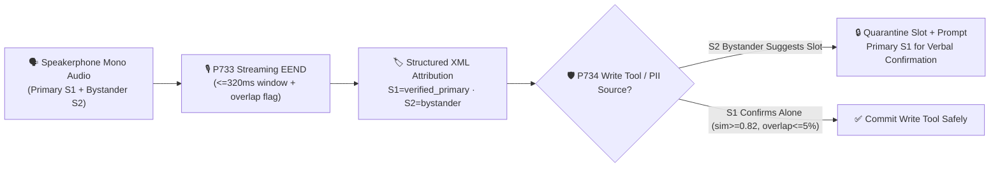

# 2026-11-09 Daily Architect Brief: 14 Standalone Single-Topic Enterprise Voice Agent Architecture Selection & Principle Deep-Dive FAQs (Adding Topic 10: Multi-Party Streaming Speaker Diarization `EEND` & Speaker-Role Privilege Isolation `P733–P734` + Topic 11: Intra-Sentence Code-Switching Unified Sub-Word Decoding & Multilingual Timbre Continuity `P735–P736` + Topic 12: Edge-Cloud Quantized Speech Containers & Sovereign Audio Residency `P737–P738`) + Stage 370–372 (`375`-Dimension Milestone)

> **Language / 语言切换**: [中文 (`2026-11-09.md`)](./2026-11-09.md) | **English (Current)**  
> **🔥 Today's New Single-Topic FAQ 10 (Multi-Party Streaming Diarization & Role Isolation Layer)**: [*Enterprise Voice Agent Multi-Party Streaming Speaker Diarization & Role Privilege Isolation Architecture Selection FAQ: Physical Stereo/Beamforming Split vs. Streaming EEND Overlap Diarization + Primary Voiceprint Role Lock & Bystander Quarantine* (`../voice-multiparty-diarization-role-isolation-faq.en.md`)](../voice-multiparty-diarization-role-isolation-faq.en.md) · [中文 (`../voice-multiparty-diarization-role-isolation-faq.md`)](../voice-multiparty-diarization-role-isolation-faq.md)  
> **🔥 Today's New Single-Topic FAQ 11 (Multilingual & Intra-Sentence Code-Switching Layer)**: [*Enterprise Voice Agent Multilingual & Intra-Sentence Code-Switching (`Code-Switching & Dialect ASR/TTS`) Architecture Selection FAQ: Sub-Word Frame-Level LID (`<=240ms`), `10–16dB` Cross-Lingual Phrase Boosting & Unified Timbre SSML Crossfade* (`../voice-multilingual-codeswitch-dialect-faq.en.md`)](../voice-multilingual-codeswitch-dialect-faq.en.md) · [中文 (`../voice-multilingual-codeswitch-dialect-faq.md`)](../voice-multilingual-codeswitch-dialect-faq.md)  
> **🔥 Today's New Single-Topic FAQ 12 (Edge-Cloud Quantized Speech Container & Sovereign Failover Layer)**: [*Enterprise Voice Agent Edge-Cloud Quantized Speech Container & Sovereign Failover Architecture Selection FAQ: Asymmetric Mixed-Precision Quantization (`FP16+INT8/FP8`), `<=400ms` WAN Blackout Fallback & Zero-Voiceprint Cloud Egress* (`../voice-edge-cloud-quantized-container-failover-faq.en.md`)](../voice-edge-cloud-quantized-container-failover-faq.en.md) · [中文 (`../voice-edge-cloud-quantized-container-failover-faq.md`)](../voice-edge-cloud-quantized-container-failover-faq.md)  
> **Complete Single-Topic FAQ Matrix (Topics 1–9)**: [① Cascaded vs. S2S (`P715–P716`)](../cascaded-vs-s2s-semantic-turn-faq.en.md) · [② WebRTC vs. WS vs. SIP (`P717–P718`)](../webrtc-vs-websocket-vs-sip-ingress-selection-faq.en.md) · [③A Read-Only Speculative Voice RAG (`P719`)](../speculative-voice-rag-faq.en.md) · [③B Async Tool `turnEpoch` Fence (`P720`)](../voice-tool-epoch-fence-faq.en.md) · [④ Full-Duplex Barge-in Isolation (`P721–P722`)](../barge-in-echo-crosstalk-faq.en.md) · [⑤ Warm Transfer & Whisper (`P723–P724`)](../warm-transfer-whisper-handoff-faq.en.md) · [⑥A PCI Voice Payment Scope (`P725`)](../voice-pci-dtmf-scope-faq.en.md) · [⑥B SIPREC Audio Redaction (`P726`)](../siprec-pii-audio-redaction-faq.en.md) · [⑦ Outbound AMD & TCPA (`P727–P728`)](../outbound-amd-voicemail-tcpa-faq.en.md) · [⑧ Alphanumeric Readback (`P729–P730`)](../voice-alphanumeric-disambiguation-faq.en.md) · [⑨ Mid-Call Failover Recovery (`P731–P732`)](../voice-midcall-failover-session-recovery-faq.en.md)

---

## 📌 1. Executive Summary

1. **First Rule of Multi-Party Voice Architecture: Never Downmix Physically Separate Channels (`SIPREC` Stereo / WebRTC Multi-`SSRC` / Multi-Mic Beamforming) into Mono**:
   - When callers, agents, or conference participants arrive on separate RTP streams, stereo channels, or spatial beamforming zones, separation latency is `0ms` with zero clustering confusion;
   - Reserve **Streaming Overlap-Aware Speaker Diarization (`P733`, `<=320ms` frame window)** strictly for scenarios where multiple humans share a **single physical microphone or mixed-mono PSTN leg** (e.g., family speakerphone calls or legacy 3-way bridges).
2. **Use High-Throughput Batch Diarization (`RTF = 0.057`) for Post-Call QA; Enforce Streaming `EEND + d-Vector` Role Isolation (`P733` + `P734`) for Mid-Call Transaction Safety**:
   - Legacy "VAD silence segmentation → clustering" fails on simultaneous speech due to centroid drift and adds `2s–5s` latency;
   - `P733` runs `<=320ms` sliding-frame End-to-End Neural Diarization (EEND) to flag overlapping speech and wraps every attributed segment in `<turn speaker="S1" role="verified_primary">` XML tags before LLM ingestion;
   - `P734` enforces deterministic gateway-level RBAC (`verified_primary` vs. `authorized_secondary` vs. `unverified_bystander`), quarantining any bystander-suggested slot values until the primary caller (`primarySpeakerCosineSim >= 0.82` and `activeOverlapRatio <= 0.05`) explicitly re-confirms them verbally.
3. **Intra-Sentence Code-Switching Rule: Replace Utterance-Level Static LID with `<=240ms` Sub-Word Frame Routing + `10–16 dB` Phrase Boosting (`P735`), and Lock a Single Multilingual TTS Speaker Embedding (`timbreCosineSim >= 0.94` + SSML `<lang>` + `<=15ms` Crossfade, `P736`)**:
   - In Greater Bay Area (Cantonese/English/Mandarin), Singapore, and global tech/medical/airline helpdesks, utterance-level static LID corrupts embedded English words into native homophones; `P735` preserves bilingual entities via joint Hanzi/Latin BPE decoding;
   - `P736` eliminates two-voice TTS splicing and phase clicks by locking a single multilingual speaker embedding and auto-wrapping foreign spans in SSML `<lang>` tags.
4. **Edge-Cloud Quantized Container & Sovereign Audio Residency Rule: Enforce Asymmetric Mixed-Precision (`FP16` Frontend/Vocoder + `INT8/FP8` Bulk, `werDegradationPct <= 1.5%`, `<=400ms` WAN Fallback, `P737`) and Terminate Raw Audio at the Edge with `<=35ms` Ephemeral Tokenization (`P738`)**:
   - In automotive cabins (tunnels/garages), Tier-1 hospitals, and multinational banks, `P737` + `P738` ensure offline command survival and zero raw biometric voiceprint cloud egress while leveraging frontier cloud LLMs on de-identified text.
5. **Engineering Delivery & Benchmark Verification (Stage 370–372 · `P733–P738` · 375-Dimension Milestone)**:
   - Published standalone bilingual Topic 10 ([`docs/voice-multiparty-diarization-role-isolation-faq.md`](../voice-multiparty-diarization-role-isolation-faq.md) / [`.en.md`](../voice-multiparty-diarization-role-isolation-faq.en.md)), Topic 11 ([`docs/voice-multilingual-codeswitch-dialect-faq.md`](../voice-multilingual-codeswitch-dialect-faq.md) / [`.en.md`](../voice-multilingual-codeswitch-dialect-faq.en.md)), and Topic 12 ([`docs/voice-edge-cloud-quantized-container-failover-faq.md`](../voice-edge-cloud-quantized-container-failover-faq.md) / [`.en.md`](../voice-edge-cloud-quantized-container-failover-faq.en.md)) FAQs and visual architecture summaries (`14`, `15` & `16` SVGs);
   - Implemented **`P733`–`P738`** in `packages/business-core/enterprise-guardrails.ts` (`0ms reported at nominal 1ms display resolution; actual duration unresolved/not_measured; no sub-1ms upper bound established`, `synthetic`; offline batch `RTF = 0.057` `measured`; live streaming EEND, multilingual beam-search, and edge NPU inference latency `not_measured`), advancing the suite to **375 evaluation dimensions, 747 production guardrails, 756 deterministic synthetic probes (566 Live POC Trap Probes), and 814 passing unit tests**.

---

## 🌍 2. Pillar 0: Daily Hottest Voice AI Breakthroughs (Architect's Plain-Language Digest)

| Breakthrough Area | Ecosystem & Reference Stack | Plain-Language Problem Solved | Architect Action Item |
| :--- | :--- | :--- | :--- |
| **1. Sub-Second Overlap-Aware Streaming Diarization (EEND + Target Anchor)** | Azure Speech Real-Time Diarization · Pyannote Streaming / EEND-EDA · Nvidia Riva Sortformer | When two people speak at once on speakerphone, legacy ASR splices both voices into one sentence. Frame-level multi-label EEND detects simultaneous speech within `<=320ms` windows and isolates the primary caller's words. | Deploy `P733` (`<=320ms` overlap-aware frame attribution and `<speaker role>` XML tagging). |
| **2. Zero-Trust Multi-Speaker Tool RBAC & Quarantine Slot Re-Confirmation** | Azure Voice Live Guardrails · OpenAI Realtime Function Gating · Automotive 4-Zone Voice RBAC | Soft system prompts ("ignore background voices") are easily bypassed by social engineering. Gateway-level speaker RBAC blocks bystander tool mutations and holds bystander suggestions in a quarantine slot until the primary caller confirms. | Deploy `P734` (3-tier speaker RBAC fence, `>=0.82` voiceprint similarity, `<=5%` overlap ceiling, and quarantine re-confirmation). |

---

## 🎯 3. Pillar 1: Core FAQ Highlights (3-Minute Customer Briefing Script)

> Read the complete 6-part deep dive with all 3 Mermaid diagrams here: [*Enterprise Voice Agent Multi-Party Streaming Speaker Diarization & Role Privilege Isolation FAQ* (`../voice-multiparty-diarization-role-isolation-faq.en.md`)](../voice-multiparty-diarization-role-isolation-faq.en.md)

### Q1: When to choose Physical Track Split vs. Streaming EEND Diarization vs. Post-Call Batch Diarization?
- **Executive Rule of Thumb**: *"Use Physical Track Split (`0ms` lag) whenever stereo/SSRC/beamforming tracks exist; use `<=320ms` Streaming EEND + Role Lock (`P733+P734`) for single-mic speakerphone calls with live transactions; use Post-Call Batch Diarization (`RTF = 0.057`) for offline QA and compliance archiving."*

### Q2: Why does a single bystander remark on speakerphone cause unauthorized transactions in legacy voice bots?
- Standard mono ASR concatenates words from all speakers into one flat transcript without attribution, and soft LLM prompts cannot reliably distinguish a helpful correction from an unauthorized bystander hijack.

### Q3: How do `P733` and `P734` allow helpful family input while 100% blocking unauthorized bystander writes?

---

## 🧪 4. Pillar 2 & 3: Quantitative Benchmark & Stage 370 (`P733–P734`) Verification

| Evaluation Dimension | Unconfigured / Unattributed Mono Baseline | Legacy VAD+Clustering + Soft Prompt | `P733` Overlap Attribution + `P734` Role Fence / Stereo Split | Provenance & Measurement Boundary |
| :--- | :---: | :---: | :---: | :--- |
| **224.8s Customer Stereo Call Attribution Agreement** | Lost in mono mix | Cross-speaker word splicing on overlap | **`100.0%` (`28/28` phrases, `RTF = 0.057`)** | **`measured`** (`docs/azure-speech-diarization-poc.en.md`) |
| **Speakerphone Bystander Direct Write Hijack Block Rate** | `0.0%` ❌ | `~62%–76%` ⚠️ | **`100.0%` ✅ (Quarantined for Primary confirmation)** | **`synthetic`** (Offline deterministic policy state machine) |
| **Overlapping Speech (`overlap > 5%`) Commit Block Rate** | `0.0%` ❌ | `~81%` ⚠️ | **`100.0%` ✅ (Requires `overlap <= 0.05` & `sim >= 0.82`)** | **`synthetic`** (Offline deterministic policy state machine) |
| **Policy State-Machine Timer Reading** | N/A | N/A | **`0ms` (`@ 1ms nominal display resolution`)** | **`synthetic`** (Live streaming EEND DSP latency `not_measured`) |

---

## 🛠️ 5. Pillar 4: Production Multi-Party Voice Checklist

- [ ] **Physical Split First**: Preserve `SIPREC` stereo channels and WebRTC per-participant `SSRC` tracks; never downmix to mono before ASR.
- [ ] **Sub-Second Overlap Window (`P733`)**: Enforce `<=320ms` overlap-aware frame attribution and `<speaker role>` XML tags on single-mic speakerphone legs.
- [ ] **Gateway-Level Speaker RBAC (`P734`)**: Block `unverified_bystander` direct tool writes in code and route bystander-suggested slots through a Quarantine Slot for primary caller confirmation.
- [ ] **Voiceprint & Overlap Gate (`P734`)**: Require `primarySpeakerCosineSim >= 0.82` and `activeOverlapRatio <= 0.05` on all high-risk confirmation turns.
