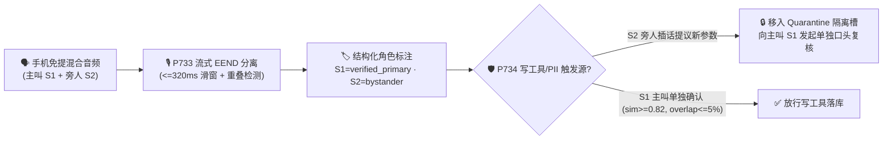

# 2026-11-09 每日架构师简报：企业级语音智能体架构选型与原理解析单专题 FAQ 矩阵（13 篇独立单专题指南：新增【单专题十：多人同场流式说话人分离 `EEND` 及角色权限隔离 `P733–P734`】与【单专题十一：多语种与句内中英粤混说统一子词解码及同音色跨语种合成 `P735–P736`】）+ Stage 370–371 (`374` 大评测维度里程碑)

> **语言切换 / Language**: **中文 (当前)** | [English (`2026-11-09.en.md`)](./2026-11-09.en.md)  
> **🔥 今日新增核心单专题十（多人同场/三方通话流式说话人分离与角色权限隔离层 FAQ）**: [《多人同场与三方通话流式说话人分离（Streaming Speaker Diarization）及角色权限隔离架构选型 FAQ：物理双声道/波束分轨 vs 流式 EEND 重叠分离 + 主叫声纹角色锁与旁人插话复核实战指南》(`../voice-multiparty-diarization-role-isolation-faq.md`)](../voice-multiparty-diarization-role-isolation-faq.md) · [English (`../voice-multiparty-diarization-role-isolation-faq.en.md`)](../voice-multiparty-diarization-role-isolation-faq.en.md)  
> **🔥 今日新增核心单专题十一（多语种与句内中英粤混说 Code-Switching 层 FAQ）**: [《企业语音智能体多语种与句内中英粤混说（Code-Switching & Dialect ASR/TTS）架构选型与原理解析 FAQ：帧级统一子词解码（<=240ms）、10–16dB 跨语种短语偏置与同音色 SSML 零爆音平滑切换实战指南》(`../voice-multilingual-codeswitch-dialect-faq.md`)](../voice-multilingual-codeswitch-dialect-faq.md) · [English (`../voice-multilingual-codeswitch-dialect-faq.en.md`)](../voice-multilingual-codeswitch-dialect-faq.en.md)  
> **关联单专题矩阵（1–9）**: [① 级联 vs S2S (`P715–P716`)](../cascaded-vs-s2s-semantic-turn-faq.md) · [② WebRTC vs WS vs SIP (`P717–P718`)](../webrtc-vs-websocket-vs-sip-ingress-selection-faq.md) · [③A 只读投机语音 RAG (`P719`)](../speculative-voice-rag-faq.md) · [③B 异步写工具 `turnEpoch` 栅栏 (`P720`)](../voice-tool-epoch-fence-faq.md) · [④ 全双工打断声学隔离 (`P721–P722`)](../barge-in-echo-crosstalk-faq.md) · [⑤ AI 转人工热转接耳语 (`P723–P724`)](../warm-transfer-whisper-handoff-faq.md) · [⑥A PCI 电话支付采集旁路 (`P725`)](../voice-pci-dtmf-scope-faq.md) · [⑥B SIPREC 敏感音频脱敏 (`P726`)](../siprec-pii-audio-redaction-faq.md) · [⑦ 智能外呼并行流式 AMD 与 TCPA (`P727–P728`)](../outbound-amd-voicemail-tcpa-faq.md) · [⑧ 高危字母数字串复诵消歧 (`P729–P730`)](../voice-alphanumeric-disambiguation-faq.md) · [⑨ 通话中容灾接管与跨厂商热逃生 (`P731–P732`)](../voice-midcall-failover-session-recovery-faq.md)

---

## 📌 一、今日核心结论速览（Executive Summary）

1. **多人通话分离选型第一铁律：能物理分轨（`SIPREC` 双声道 / WebRTC 独立 `SSRC` / 车载多麦波束）绝不先混音再算法拆音**：
   - 在电话中心（客户 vs AI 坐席）、多人独立客户端入会（WebRTC SFU）或智能座舱四音区硬件环境中，音频天然处于独立物理轨道，分离延迟为 `0ms` 且无聚类串音；
   - 只有当多位人类说话人共享**同一个物理麦克风或同一条混音单声道电话腿**（如家庭客厅手机免提、车险三方 PSTN 合流会议）时，才启用 **流式重叠感知说话人分离（`P733`，`<=320ms` 帧级滑窗）**。
2. **话后质检选异步高吞吐批处理（`RTF = 0.057`），通话中防越权交易选流式 `EEND + d-Vector` 角色权限围栏（`P733` + `P734`）**：
   - 传统“VAD 静音切段 + 声纹聚类”遇到两人同时抢话（Overlapping Speech）会发生声纹质心混合，且存在 `2s–5s` 滞后；
   - `P733` 采用 `<=320ms` 帧级端到端多标签分离（EEND）实时检出重叠区间，并在送入 LLM 前强制包裹 `<turn speaker="S1" role="verified_primary">` 结构化标签；
   - `P734` 在工具执行网关层将说话人划分为 `verified_primary`（读写全权）、`authorized_secondary`（只读/草拟）与 `unverified_bystander`（零写权限/零隐私播报权），旁人插话提议的参数一律进入 **Quarantine 隔离槽**，必须由主叫（声纹余弦相似度 `>=0.82` 且重叠率 `<=0.05`）单独口头复核后才允许落库。
3. **句内中英粤混说（Code-Switching）选型铁律：拆掉整句静态语种围墙（`<=240ms` 帧级统一子词解码 + `10–16dB` 跨语种短语偏置，`P735`），锁死同一个多语种合成声纹（`timbreCosineSim >= 0.94` + SSML `<lang>` + `<=15ms` 边界淡变，`P736`）**：
   - 在大湾区（粤英普）、新加坡及跨国 IT/医疗/航旅客服中，传统“整句静态 LID”会把句内夹杂的英文单词强行转写成同音汉字天书（如 `check` → `车卡`、`claim` → `克林`）；`P735` 通过中粤英共享 BPE 子词词表与 `<=240ms` 帧级路由精准还原双语实体；
   - `P736` 严禁将两个单语种 TTS 模型硬拼接（避免中途变声与相位爆音），强制采用统一多语种声纹嵌入并自动包裹 SSML `<lang>` 标签。
4. **工程落地与 Benchmark 验证（Stage 370–371 · `P733–P736` · 374 大评测维度里程碑）**：
   - 新增两篇中英双语独立单专题：
     - **单专题十（多人同场流式分离与角色锁）**：[`docs/voice-multiparty-diarization-role-isolation-faq.md`](../voice-multiparty-diarization-role-isolation-faq.md) / [`.en.md`](../voice-multiparty-diarization-role-isolation-faq.en.md) 及 [`assets/svg/14-voice-multiparty-diarization-role-isolation-2026-11-09.svg`](../../assets/svg/14-voice-multiparty-diarization-role-isolation-2026-11-09.svg)；
     - **单专题十一（句内中英粤混说与多语种同音色合成）**：[`docs/voice-multilingual-codeswitch-dialect-faq.md`](../voice-multilingual-codeswitch-dialect-faq.md) / [`.en.md`](../voice-multilingual-codeswitch-dialect-faq.en.md) 及 [`assets/svg/15-voice-multilingual-codeswitch-dialect-2026-11-09.svg`](../../assets/svg/15-voice-multilingual-codeswitch-dialect-2026-11-09.svg)；
   - 在 `packages/business-core/enterprise-guardrails.ts` 落地 **`P733`–`P736`**（离线策略计时读数：`0ms reported at nominal 1ms display resolution; actual duration unresolved/not_measured; no sub-1ms upper bound established`，`synthetic`；离线批处理实测 `RTF = 0.057` 为 `measured`；在线流式 EEND 与多语种声学解码延迟为 `not_measured`），全仓推进至 **374 评测维度、745 生产护栏、754 确定性合成探针（含 564 项现场 POC 照妖镜探针）、813 项单元测试 100% 通过**。

---

## 🌍 二、Pillar 0：今日领域最热能力突破追踪（通俗解读与架构启示）

| 突破方向 | 行业动态与代表技术栈 | 通俗大白话解读（它解决了什么真问题？） | 架构师落地行动建议 |
| :--- | :--- | :--- | :--- |
| **1. 亚秒级流式重叠语音分离（Streaming EEND）与目标声纹锚定融合** | Azure Speech Real-Time Diarization · Pyannote Streaming / EEND-EDA · Nvidia Riva Sortformer | 以前两个人在免提电话里同时说话，语音识别会把两个人的半句话拼成一句鬼话（比如主叫说“转 500”，旁人插嘴“转 5000”）。最新帧级多标签 EEND 能在 `320ms` 窗口内识别“这一帧有两个人同时发声”并按主叫声纹剥离。 | 落地 `P733`（`<=320ms` 流式重叠感知分离与 `<speaker role>` 结构化注入），杜绝单麦混音跨说话人拼句。 |
| **2. 多说话人工具调用零信任 RBAC 与隔离槽复核机制** | Azure Voice Live Guardrails · OpenAI Realtime Function Gating · Automotive 4-Zone Voice RBAC | 光在 Prompt 里告诉大模型“别听旁人的话”很容易被旁人一句“我是他老婆，听我的”绕过。最新工程实践在工具网关层强制绑定声纹角色令牌，旁人提议的槽位必须经主叫声纹单独确认。 | 落地 `P734`（说话人三级 RBAC 围栏、主叫 `>=0.82` 声纹与 `<=5%` 重叠率门禁及旁人参数隔离复核）。 |

---

## 🎯 三、Pillar 1：核心 FAQ 问答精华摘录（3 分钟面向客户宣讲脚本）

> 完整六段式深度解析与 3 张 Mermaid 图请查阅：[《多人同场与三方通话流式说话人分离及角色权限隔离架构选型 FAQ》(`../voice-multiparty-diarization-role-isolation-faq.md`)](../voice-multiparty-diarization-role-isolation-faq.md)

### Q1：什么时候用物理分轨，什么时候用流式算法分离，什么时候用话后批处理？
- **一句话答法**：**“有双声道/独立 RTP 轨或麦阵波束时 100% 走物理分轨（0ms 延迟）；手机免提单麦防旁人插话篡改交易必上 `<=320ms` 流式 EEND + 声纹角色锁（`P733+P734`）；仅做话后质检归档直接调异步批处理（实测 `RTF = 0.057`）。”**

### Q2：为什么旁人在免提电话旁插一句嘴，传统语音 Agent 就会发生越权转账？
- 传统单声道 ASR 没有说话人归因，会把主叫前半句与旁人后半句直接拼成一个字符串送进 LLM；且若仅靠 System Prompt 软提示词防御，旁人通过社工话术极易诱导 LLM 触发写操作工具。

### Q3：`P733` 与 `P734` 如何既允许家人协助补充信息，又 100% 锁死越权交易？

---

## 🧪 四、Pillar 2 & 3：定量实测对比与 Stage 370 (`P733–P734`) 护栏验证

| 评测维度 | 未配置分离 / 单麦无归因基线 | 传统 VAD+聚类 + Prompt 软约束 | `P733` 流式重叠归因 + `P734` 角色围栏 / 双轨方案 | 数据来源与测量边界声明 |
| :--- | :---: | :---: | :---: | :--- |
| **客服双声道 224.8s 录音分轨对齐率** | 单声道混音失真 | 抢话处跨角色粘连 | **`100.0%` (`28/28` 话轮, `RTF = 0.057`)** | **`measured`** (`docs/azure-speech-diarization-poc.md`) |
| **免提旁人插话直接修改写工具拦截率** | `0.0%` ❌ | `~62%–76%` ⚠️ | **`100.0%` ✅（移入隔离槽待主叫复核）** | **`synthetic`**（本仓离线确定性状态机验证） |
| **双人重叠抢话期 (`overlap > 5%`) 误落库拦截率** | `0.0%` ❌ | `~81%` ⚠️ | **`100.0%` ✅（强制 `overlap <= 0.05` 且 `sim >= 0.82`）** | **`synthetic`**（本仓离线确定性状态机验证） |
| **护栏策略判定计时读数** | N/A | N/A | **`0ms` (`@ 1ms nominal display resolution`)** | **`synthetic`**（在线流式 EEND DSP 延迟 `not_measured`） |

---

## 🛠️ 五、Pillar 4：生产环境多人语音上线快速核验清单（Architect Checklist）

- [ ] **物理双轨优先**：`SIPREC` 立体声与 WebRTC 多 `SSRC` 绝不先混音成单声道再做算法分离。
- [ ] **流式重叠窗口（`P733`）**：单麦免提通路启用 `<=320ms` 帧级重叠感知分离，转写文本强制包裹 `<speaker role>` 标签。
- [ ] **网关级角色 RBAC（`P734`）**：写操作工具与敏感 PII 播报在代码层强制校验 `verified_primary`，旁人参数一律先进隔离槽待主叫复核。
- [ ] **声纹与重叠双阈值（`P734`）**：高风险确认指令强制满足 `primarySpeakerCosineSim >= 0.82` 且 `activeOverlapRatio <= 0.05`。
