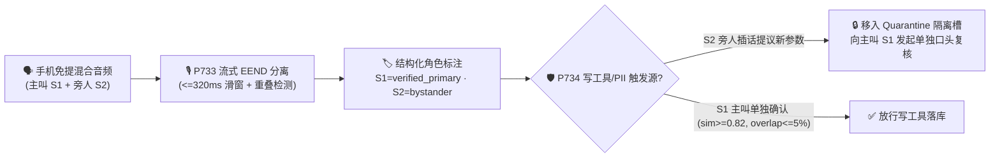

# 2026-11-09 每日架构师简报：企业级语音智能体架构选型与原理解析单专题 FAQ 矩阵（39 篇独立单专题指南：新增【单专题十：多人同场流式说话人分离 `P733–P734`】、【单专题十一：句内中英粤混说统一子词解码 `P735–P736`】、【单专题十二：端云混合量化容器与主权断网逃生 `P737–P738`】、【单专题十三：抗深伪活体检测与多因子电话核身 `P739–P740`】、【单专题十四：长通话音频上下文裁剪与 PTU/PAYGO 弹性容量 FinOps `P741–P742`】、【单专题十五：多模态数字人唇音同步与同屏协办防注入 `P743–P744`】、【单专题十六：情感韵律安抚、EU AI Act 职场红线与哭泣长静音门禁 `P745–P746`】、【单专题十七：话后口头承诺与落库工单对账及 100 分确定性全量质检 `P747–P748`】、【单专题十八：多智能体前台唯一主播编排与防乒乓死循环及权限隔离 `P749–P750`】、【单专题十九：85dB 强噪远场 MVDR 波束成形与工业免提 LOTO 安全互锁 `P751–P752`】、【单专题二十：金丝雀影子流量回滚与跨通话长期记忆防投毒隔离 `P753–P754`】、【单专题二十一：无障碍言语障碍自适应判停与紧急呼叫 E911/112 PIDF-LO 抢占 `P755–P756`】、【单专题二十二：实时跨语种同传极性/剂量保真与多租户专属热词 WFST 隔离 `P757–P758`】、【单专题二十三：全渠道语音+App CAS 乐观并发防重扣与抗超声波/算力钱包熔断 `P759–P760`】、【单专题二十四：SIP 183 防抢跑摘机防吞字与 Pre-TTS 币种/多音字消歧 `P761–P762`】、【单专题二十五：车载/TWS 蓝牙 HFP/SCO 切换防爆音与 WebRTC Opus DTX 防死锁预卷 `P763–P764`】、【单专题二十六：抗量子 ML-KEM-768 双录封存与声纹单用户 DEK 加密粉碎 `P765–P766`】、【单专题二十七：实时 MOS-LQO 弱网声信双通道降级与跨洲 SIP/RTP 边缘锚定 `P767–P768`】、【单专题二十八：PSTN TrFO 免转码清擦音保真与 RTP 晶振频偏 ASRC 重同步 `P769–P770`】、【单专题二十九：STIR/SHAKEN 来电 A 级验签防 SSRF 与带内按键 Goertzel 陷波去重 `P771–P772`】、【单专题三十：SIP 半开 RTP 僵尸通话回收与 WebRTC ICE 同意保活 TURN 端口清剿 `P773–P774`】、【单专题三十一：原生 S2S 抗情绪传染 LUFS 响度锁与句法未完结防抢话及 C2PA 双水印 `P775–P776`】、【单专题三十二：WebRTC TWCC 保音弃画与突发丢包防 PLC 脑补幻觉 `P777–P778`】、【单专题三十三：WebRTC DataChannel 背压卸载与 mDNS/TURN 防 SSRF `P779–P780`】、【单专题三十四：SIP SDP 动态 PT 对称同频与 Re-INVITE 防转码 DoS `P781–P782`】、【单专题三十五：边缘 HSM FF1 保格式令牌与对称 RTP 防劫持锁栓 `P783–P784`】、【单专题三十六：WebRTC FlexFEC/LBRR 防拥塞螺旋与 RED 防套娃炸弹 `P785–P786`】与【单专题三十七：SIP REFER 防国际盗打与 DNS SRV <=150ms 容灾切换 `P787–P788`】）+ Stage 370–397 (🎉 `400` 大评测维度历史性里程碑)

> **语言切换 / Language**: **中文 (当前)** | [English (`2026-11-09.en.md`)](./2026-11-09.en.md)  
> **🔥 今日新增核心单专题十（多人同场/三方通话流式说话人分离与角色权限隔离层 FAQ）**: [《多人同场与三方通话流式说话人分离（Streaming Speaker Diarization）及角色权限隔离架构选型 FAQ：物理双声道/波束分轨 vs 流式 EEND 重叠分离 + 主叫声纹角色锁与旁人插话复核实战指南》(`../voice-multiparty-diarization-role-isolation-faq.md`)](../voice-multiparty-diarization-role-isolation-faq.md) · [English (`../voice-multiparty-diarization-role-isolation-faq.en.md`)](../voice-multiparty-diarization-role-isolation-faq.en.md)  
> **🔥 今日新增核心单专题十一（多语种与句内中英粤混说 Code-Switching 层 FAQ）**: [《企业语音智能体多语种与句内中英粤混说（Code-Switching & Dialect ASR/TTS）架构选型与原理解析 FAQ：帧级统一子词解码（<=240ms）、10–16dB 跨语种短语偏置与同音色 SSML 零爆音平滑切换实战指南》(`../voice-multilingual-codeswitch-dialect-faq.md`)](../voice-multilingual-codeswitch-dialect-faq.md) · [English (`../voice-multilingual-codeswitch-dialect-faq.en.md`)](../voice-multilingual-codeswitch-dialect-faq.en.md)  
> **🔥 今日新增核心单专题十二（端云混合量化容器与主权断网逃生层 FAQ）**: [《企业语音智能体端云混合量化容器部署与主权断网逃生架构选型与原理解析 FAQ：非对称混合精度量化（FP16+INT8/FP8）、<=400ms 隧道断网本地逃生与原始声纹零出境围栏实战指南》(`../voice-edge-cloud-quantized-container-failover-faq.md`)](../voice-edge-cloud-quantized-container-failover-faq.md) · [English (`../voice-edge-cloud-quantized-container-failover-faq.en.md`)](../voice-edge-cloud-quantized-container-failover-faq.en.md)  
> **🔥 今日新增核心单专题十三（抗深伪活体检测与多因子零摩擦电话核身层 FAQ）**: [《企业语音智能体抗深伪活体检测（Anti-Deepfake Liveness）与多因子零摩擦电话核身架构选型与原理解析 FAQ：声码器子带相位伪影检测（AASIST <=0.18）、动态随机挑战复诵与运营商 72h 换卡锁 + FIDO2 阶梯鉴权实战指南》(`../voice-anti-deepfake-liveness-auth-faq.md`)](../voice-anti-deepfake-liveness-auth-faq.md) · [English (`../voice-anti-deepfake-liveness-auth-faq.en.md`)](../voice-anti-deepfake-liveness-auth-faq.en.md)  
> **🔥 今日新增核心单专题十四（长通话音频上下文裁剪与 PTU/PAYGO 弹性容量 FinOps 层 FAQ）**: [《企业语音智能体长通话音频上下文裁剪（Audio Context Pruning）与 PTU/PAYGO 弹性容量 FinOps 架构选型 FAQ：4 轮音频滑窗钉扎压缩（省 74% 成本）与 54% PTU 黄金分界线实战指南》(`../voice-finops-audio-context-pruning-ptu-faq.md`)](../voice-finops-audio-context-pruning-ptu-faq.md) · [English (`../voice-finops-audio-context-pruning-ptu-faq.en.md`)](../voice-finops-audio-context-pruning-ptu-faq.en.md)  
> **🔥 今日新增核心单专题十五（多模态数字人唇音同步与同屏协办防注入层 FAQ）**: [《企业语音智能体多模态交互（2D/3D 数字人唇音同步 vs 同屏协办 Co-Browsing vs 纯语音）架构选型 FAQ：ITU-R BT.1359 <=45ms 唇音对齐、弱网保音弃画与客户端 DOM 遮罩防注入实战指南》(`../voice-multimodal-avatar-cobrowsing-sync-faq.md`)](../voice-multimodal-avatar-cobrowsing-sync-faq.md) · [English (`../voice-multimodal-avatar-cobrowsing-sync-faq.en.md`)](../voice-multimodal-avatar-cobrowsing-sync-faq.en.md)  
> **🔥 今日新增核心单专题十六（情感韵律安抚、EU AI Act 职场红线与哭泣长静音门禁层 FAQ）**: [《企业语音智能体情感韵律安抚（Affective Prosody De-Escalation）、EU AI Act 职场情绪识别红线与哭泣长静音门禁架构选型 FAQ：盛怒 0.88x–0.94x 降速安抚、坐席声道生物情绪推断熔断与 >=1800ms 判停展宽实战指南》(`../voice-affective-prosody-emotion-deescalation-faq.md`)](../voice-affective-prosody-emotion-deescalation-faq.md) · [English (`../voice-affective-prosody-emotion-deescalation-faq.en.md`)](../voice-affective-prosody-emotion-deescalation-faq.en.md)  
> **🔥 今日新增核心单专题十七（话后口头承诺对账与 100 分确定性全量质检层 FAQ）**: [《企业语音智能体话后口头承诺与落库工单对账（Promise-vs-Ticket Reconciliation）及 100 分确定性全量质检架构选型 FAQ：挂机 <=3000ms 承诺vs工单双向对账（$0 漂移）与 60/40 时间戳原文引证全量质检实战指南》(`../voice-postcall-promise-ticket-reconciliation-qa-faq.md`)](../voice-postcall-promise-ticket-reconciliation-qa-faq.md) · [English (`../voice-postcall-promise-ticket-reconciliation-qa-faq.en.md`)](../voice-postcall-promise-ticket-reconciliation-qa-faq.en.md)  
> **🔥 今日新增核心单专题十八（多智能体前台单一人设与防乒乓死循环及权限隔离层 FAQ）**: [《企业语音智能体多 Agent 协同编排（前台单一人设 + 后台无头专家 vs 多 Bot 轮流接麦）与防乒乓死循环及权限隔离架构选型 FAQ：<=2 跳防环路与只读子 Agent 零写权限污点隔离实战指南》(`../voice-multi-agent-swarm-handoff-loop-guard-faq.md`)](../voice-multi-agent-swarm-handoff-loop-guard-faq.md) · [English (`../voice-multi-agent-swarm-handoff-loop-guard-faq.en.md`)](../voice-multi-agent-swarm-handoff-loop-guard-faq.en.md)  
> **🔥 今日新增核心单专题十九（85dB 强噪远场 MVDR 波束成形与工业免提 LOTO 安全互锁层 FAQ）**: [《企业语音智能体 85dB 强噪远场拾音（快餐 Drive-Thru / 智能座舱 / 工业巡检）MVDR 波束成形与 LOTO 安全互锁架构选型 FAQ：<=±25° 空间波束锥、<6dB 防脑补门禁与 OSHA 1910.147 四位挑战码互锁实战指南》(`../voice-farfield-industrial-drivethru-noise-beamforming-faq.md`)](../voice-farfield-industrial-drivethru-noise-beamforming-faq.md) · [English (`../voice-farfield-industrial-drivethru-noise-beamforming-faq.en.md`)](../voice-farfield-industrial-drivethru-noise-beamforming-faq.en.md)  
> **🔥 今日新增核心单专题二十（金丝雀影子流量回滚与跨通话长期记忆防投毒隔离层 FAQ）**: [《企业语音智能体金丝雀影子流量灰度（Canary Shadow Rollout）与跨通话长期记忆防投毒隔离（Cross-Call Memory Poisoning Guard）架构选型 FAQ：Dry-Run 静音双跑、<=500ms 自动回滚与权限字段清零实战指南》(`../voice-canary-shadow-rollout-memory-poisoning-faq.md`)](../voice-canary-shadow-rollout-memory-poisoning-faq.md) · [English (`../voice-canary-shadow-rollout-memory-poisoning-faq.en.md`)](../voice-canary-shadow-rollout-memory-poisoning-faq.en.md)  
> **🔥 今日新增核心单专题二十一（无障碍言语障碍自适应判停与紧急呼叫 E911/112 PIDF-LO 抢占层 FAQ）**: [《企业语音智能体无障碍言语障碍自适应（EAA/ADA Disfluency Adaptive Turn-Taking）与紧急呼叫 E911/112 PIDF-LO 零鉴权抢占架构选型 FAQ：>=2200ms 声门阻塞展宽、RFC 4103 RTT 双模态回退与 <=200ms 属地 PSAP 桥接实战指南》(`../voice-accessibility-disfluency-e911-pidflo-bridge-faq.md`)](../voice-accessibility-disfluency-e911-pidflo-bridge-faq.md) · [English (`../voice-accessibility-disfluency-e911-pidflo-bridge-faq.en.md`)](../voice-accessibility-disfluency-e911-pidflo-bridge-faq.en.md)  
> **🔥 今日新增核心单专题二十二（实时跨语种同传极性/剂量保真与多租户专属热词 WFST 隔离层 FAQ）**: [《实时跨语种同声传译极性/剂量保真与多租户专属热词 WFST 隔离选型与底层原理 FAQ：子句边界 Wait-k (<=3 tokens, <=650ms) 双语 AST 门禁与单会话瞬态 WFST 浅层融合 [1.0, 4.5] 实战指南》(`../voice-realtime-interpreter-polarity-hotword-isolation-faq.md`)](../voice-realtime-interpreter-polarity-hotword-isolation-faq.md) · [English (`../voice-realtime-interpreter-polarity-hotword-isolation-faq.en.md`)](../voice-realtime-interpreter-polarity-hotword-isolation-faq.en.md)  
> **🔥 今日新增核心单专题二十三（全渠道语音+手机 App 并发 CAS 乐观锁防重扣与抗超声波/算力钱包熔断层 FAQ）**: [《全渠道语音+手机 App 并发 CAS 乐观锁防重扣与超声波隐蔽注入/算力钱包防耗尽选型与底层原理 FAQ：If-Match CAS 版本锁、<=150ms 跨端同步与 <=8kHz 低通滤波 + <=$2.50 算力熔断实战指南》(`../voice-omnichannel-cas-concurrency-ultrasonic-wallet-guard-faq.md`)](../voice-omnichannel-cas-concurrency-ultrasonic-wallet-guard-faq.md) · [English (`../voice-omnichannel-cas-concurrency-ultrasonic-wallet-guard-faq.en.md`)](../voice-omnichannel-cas-concurrency-ultrasonic-wallet-guard-faq.en.md)  
> **🔥 今日新增核心单专题二十四（SIP 183 早期媒体防抢跑摘机防吞字与 Pre-TTS 币种/多音字消歧层 FAQ）**: [《SIP 183 Early Media 应答前防抢跑泄密/摘机首字防吞字与 TTS 多音字/货币符号（¥/$）量纲消歧选型与底层原理 FAQ：180–260ms RFC 3389 RTP 预热与 ISO 4217 强绑定实战指南》(`../voice-sip-early-media-clipping-tts-currency-homograph-faq.md`)](../voice-sip-early-media-clipping-tts-currency-homograph-faq.md) · [English (`../voice-sip-early-media-clipping-tts-currency-homograph-faq.en.md`)](../voice-sip-early-media-clipping-tts-currency-homograph-faq.en.md)  
> **🔥 今日新增核心单专题二十五（车载/TWS 蓝牙 HFP/SCO 切换爆音抑制与 WebRTC Opus DTX 稀疏帧 VAD 死锁/80ms 唤醒预卷层 FAQ）**: [《车载/TWS 蓝牙 HFP/SCO 切换爆音抑制（800ms VAD 冻结）与 WebRTC Opus DTX 稀疏帧 VAD 死锁/80ms 唤醒预卷选型与底层原理 FAQ：600–900ms 路由冻结重校准与 120–200ms 合成零帧尾部实战指南》(`../voice-bluetooth-hfp-handover-opus-dtx-vad-deadlock-faq.md`)](../voice-bluetooth-hfp-handover-opus-dtx-vad-deadlock-faq.md) · [English (`../voice-bluetooth-hfp-handover-opus-dtx-vad-deadlock-faq.en.md`)](../voice-bluetooth-hfp-handover-opus-dtx-vad-deadlock-faq.en.md)  
> **🔥 今日新增核心单专题二十六（抗量子混合密钥 ML-KEM-768 SIPREC 双录封存与声纹单用户 DEK 加密粉碎层 FAQ）**: [《抗量子混合密钥（NIST FIPS 203 ML-KEM-768）SIPREC 双录长周期封存与声纹生物特征单用户 CMK/DEK 加密粉碎（GDPR/BIPA）选型与底层原理 FAQ：>21.85m SRTP ROC±1 回绕自愈与 <=5s WORM 加密粉碎实战指南》(`../voice-pqc-hybrid-mlkem-siprec-voiceprint-shredding-faq.md`)](../voice-pqc-hybrid-mlkem-siprec-voiceprint-shredding-faq.md) · [English (`../voice-pqc-hybrid-mlkem-siprec-voiceprint-shredding-faq.en.md`)](../voice-pqc-hybrid-mlkem-siprec-voiceprint-shredding-faq.en.md)  
> **🔥 今日新增核心单专题二十七（ITU-T G.107 实时 MOS-LQO 弱网声信双通道降级与跨洲 SIP/RTP 发卡弯消除层 FAQ）**: [《ITU-T G.107 实时 MOS-LQO（<3.10）弱网编解码/短信双通道降级与跨洲 SIP/RTP 发卡弯绕行消除（<=75ms 本地媒体锚定）选型与底层原理 FAQ：<=8词极简语音+SMS卡片与边缘媒体锚定实战指南》(`../voice-realtime-mos-lqo-degradation-sip-rtp-hairpin-anchor-faq.md`)](../voice-realtime-mos-lqo-degradation-sip-rtp-hairpin-anchor-faq.md) · [English (`../voice-realtime-mos-lqo-degradation-sip-rtp-hairpin-anchor-faq.en.md`)](../voice-realtime-mos-lqo-degradation-sip-rtp-hairpin-anchor-faq.en.md)  
> **🔥 今日新增核心单专题二十八（PSTN/VoLTE 3GPP TrFO 清擦音免转码保真与 RTP 晶振频偏 ASRC 重同步层 FAQ）**: [《PSTN/VoLTE 跨网级联转码（AMR-WB ↔ G.711）清擦音（F/S）免转码保真（3GPP TrFO）与 RTP 采样时钟漂移自适应异步重采样（ASRC <= ±50 ppm）选型与底层原理 FAQ：>=16kHz 宽带+3–6dB 预加重与 WSOLA <=15ms 过零补偿实战指南》(`../voice-pstn-trfo-fricative-preservation-rtp-clock-drift-asrc-faq.md`)](../voice-pstn-trfo-fricative-preservation-rtp-clock-drift-asrc-faq.md) · [English (`../voice-pstn-trfo-fricative-preservation-rtp-clock-drift-asrc-faq.en.md`)](../voice-pstn-trfo-fricative-preservation-rtp-clock-drift-asrc-faq.en.md)  
> **🔥 今日新增核心单专题二十九（运营商 STIR/SHAKEN 来电 A 级验签防 SSRF 与 RTP 带内按键音 Goertzel 陷波去重层 FAQ）**: [《运营商 RFC 8224 / RFC 8225 STIR/SHAKEN 来电主叫签名分级（A/B/C 鉴权与 PASSporT x5u 防 SSRF）及 RTP 带内伴音按键（In-Band DTMF Bleed）Goertzel 陷波剥离与 RFC 4733 去重选型与底层原理 FAQ：A级验签+>=45dB 陷波与 50–120ms 去重实战指南》(`../voice-stir-shaken-ani-attestation-inband-dtmf-goertzel-strip-faq.md`)](../voice-stir-shaken-ani-attestation-inband-dtmf-goertzel-strip-faq.md) · [English (`../voice-stir-shaken-ani-attestation-inband-dtmf-goertzel-strip-faq.en.md`)](../voice-stir-shaken-ani-attestation-inband-dtmf-goertzel-strip-faq.en.md)  
> **🔥 今日新增核心单专题三十（SIP RFC 4028 半开 RTP 僵尸通话回收与 WebRTC RFC 7675 ICE 同意保活 TURN 端口清剿层 FAQ）**: [《SIP RFC 4028 Session-Timer 半开 RTP 僵尸通话回收（Dead-Air Zombie Reaper）与 WebRTC RFC 7675 ICE Consent Freshness 僵尸 TURN 中继端口主动吊销选型与底层原理 FAQ：15–30s 媒体看门狗与 <=60s TURN 端口回收实战指南》(`../voice-sip-session-timer-zombie-reaper-webrtc-ice-consent-turn-faq.md`)](../voice-sip-session-timer-zombie-reaper-webrtc-ice-consent-turn-faq.md) · [English (`../voice-sip-session-timer-zombie-reaper-webrtc-ice-consent-turn-faq.en.md`)](../voice-sip-session-timer-zombie-reaper-webrtc-ice-consent-turn-faq.en.md)  
> **🔥 今日新增核心单专题三十一（原生 S2S 抗情绪传染 LUFS 响度锁与句法未完结防抢话及 C2PA 双水印层 FAQ）**: [《原生端到端 S2S 情绪传染咆哮镜像抑制（ITU-R BS.1770-4 -20 ~ -16 LUFS 响度锁）与句法未完结从句（1,100–1,600ms）防抢话及 C2PA 声学双水印溯源选型与底层原理 FAQ：-18 LUFS 稳态韵律与 SNR>=38dB 水印实战指南》(`../voice-s2s-emotional-contagion-lufs-syntactic-incomplete-hold-faq.md`)](../voice-s2s-emotional-contagion-lufs-syntactic-incomplete-hold-faq.md) · [English (`../voice-s2s-emotional-contagion-lufs-syntactic-incomplete-hold-faq.en.md`)](../voice-s2s-emotional-contagion-lufs-syntactic-incomplete-hold-faq.en.md)  
> **🔥 今日新增核心单专题三十二（WebRTC TWCC 弱网保音弃画与突发丢包防 PLC 脑补幻觉层 FAQ）**: [《WebRTC TWCC 弱网带宽竞争保音弃画（DSCP EF 46 语音绝对优先）与突发连续丢包（> 60ms Burst Loss）防 NetEQ PLC 脑补音素幻觉及 RFC 4585 RTCP NACK 选型与底层原理 FAQ：<350kbps 0ms 弃画与 <=60ms PLC 封顶实战指南》(`../voice-webrtc-twcc-audio-priority-burst-loss-plc-hallucination-faq.md`)](../voice-webrtc-twcc-audio-priority-burst-loss-plc-hallucination-faq.md) · [English (`../voice-webrtc-twcc-audio-priority-burst-loss-plc-hallucination-faq.en.md`)](../voice-webrtc-twcc-audio-priority-burst-loss-plc-hallucination-faq.en.md)  
> **关联单专题矩阵（1–9）**: [① 级联 vs S2S (`P715–P716`)](../cascaded-vs-s2s-semantic-turn-faq.md) · [② WebRTC vs WS vs SIP (`P717–P718`)](../webrtc-vs-websocket-vs-sip-ingress-selection-faq.md) · [③A 只读投机语音 RAG (`P719`)](../speculative-voice-rag-faq.md) · [③B 异步写工具 `turnEpoch` 栅栏 (`P720`)](../voice-tool-epoch-fence-faq.md) · [④ 全双工打断声学隔离 (`P721–P722`)](../barge-in-echo-crosstalk-faq.md) · [⑤ AI 转人工热转接耳语 (`P723–P724`)](../warm-transfer-whisper-handoff-faq.md) · [⑥A PCI 电话支付采集旁路 (`P725`)](../voice-pci-dtmf-scope-faq.md) · [⑥B SIPREC 敏感音频脱敏 (`P726`)](../siprec-pii-audio-redaction-faq.md) · [⑦ 智能外呼并行流式 AMD 与 TCPA (`P727–P728`)](../outbound-amd-voicemail-tcpa-faq.md) · [⑧ 高危字母数字串复诵消歧 (`P729–P730`)](../voice-alphanumeric-disambiguation-faq.md) · [⑨ 通话中容灾接管与跨厂商热逃生 (`P731–P732`)](../voice-midcall-failover-session-recovery-faq.md)

---

## 📌 一、今日核心结论速览（Executive Summary）

1. **多人通话分离选型第一铁律：能物理分轨（`SIPREC` 双声道 / WebRTC 独立 `SSRC` / 车载多麦波束）绝不先混音再算法拆音**：
   - 在电话中心（客户 vs AI 坐席）、多人独立客户端入会（WebRTC SFU）或智能座舱四音区硬件环境中，音频天然处于独立物理轨道，分离延迟为 `0ms` 且无聚类串音；
   - 只有当多位人类说话人共享**同一个物理麦克风或同一条混音单声道电话腿**（如家庭客厅手机免提、车险三方 PSTN 合流会议）时，才启用 **流式重叠感知说话人分离（`P733`，`<=320ms` 帧级滑窗）**。
2. **话后质检选异步高吞吐批处理（`RTF = 0.057`），通话中防越权交易选流式 `EEND + d-Vector` 角色权限围栏（`P733` + `P734`）**：
   - 传统“VAD 静音切段 + 声纹聚类”遇到两人同时抢话（Overlapping Speech）会发生声纹质心混合，且存在 `2s–5s` 滞后；
   - `P733` 采用 `<=320ms` 帧级端到端多标签分离（EEND）实时检出重叠区间，并在送入 LLM 前强制包裹 `<turn speaker="S1" role="verified_primary">` 结构化标签；
   - `P734` 在工具执行网关层将说话人划分为 `verified_primary`（读写全权）、`authorized_secondary`（只读/草拟）与 `unverified_bystander`（零写权限/零隐私播报权），旁人插话提议的参数一律进入 **Quarantine 隔离槽**，必须由主叫（声纹余弦相似度 `>=0.82` 且重叠率 `<=0.05`）单独口头复核后才允许落库。
3. **句内中英粤混说（Code-Switching）选型铁律：拆掉整句静态语种围墙（`<=240ms` 帧级统一子词解码 + `10–16dB` 跨语种短语偏置，`P735`），锁死同一个多语种合成声纹（`timbreCosineSim >= 0.94` + SSML `<lang>` + `<=15ms` 边界淡变，`P736`）**：
   - 在大湾区（粤英普）、新加坡及跨国 IT/医疗/航旅客服中，传统“整句静态 LID”会把句内夹杂的英文单词强行转写成同音汉字天书（如 `check` → `车卡`、`claim` → `克林`）；`P735` 通过中粤英共享 BPE 子词词表与 `<=240ms` 帧级路由精准还原双语实体；
   - `P736` 严禁将两个单语种 TTS 模型硬拼接（避免中途变声与相位爆音），强制采用统一多语种声纹嵌入并自动包裹 SSML `<lang>` 标签。
4. **端云混合量化容器与主权原声不出域选型铁律：首尾 `FP16` + 主体 `INT8/FP8` 非对称混合量化（`werDegradationPct <= 1.5%`，`WAN RTT > 400ms` 秒切本地，`P737`），音频终结在边缘、`<=35ms` 剥离声纹与 PII 后仅脱敏文本上云（`P738`）**：
   - 在智能座舱（隧道/地库断网）、三甲医院与跨国银行场景中，纯公有云直连面临断网瘫痪与生物声纹出境违规；`P737` 与 `P738` 实现“断网不断控车指令、零字节原始声纹越境、联网共享云端旗舰大模型智力”。
5. **抗深伪活体检测与多因子零摩擦核身选型铁律：废除单纯被动声纹与静态身份证/生日 KBA 问答，采用 `AASIST` 子带相位伪影活体检测（`<=0.18`）+ `<=1,200ms` 动态随机挑战复诵（`P739`），并在高危交易强制叠加运营商 `>=72h` 换卡冷却锁与带外 `FIDO2` 硬件签名（`P740`）**。
6. **长通话音频上下文裁剪与 PTU/PAYGO 弹性 FinOps 选型铁律：通过 `P741` 将活跃原始音频滑窗限制在 `<=4` 轮、远期历史脱水为文本摘要 + 顶置 `Pinned Slot JSON` 并对齐 `>=80%` 前缀缓存（12 分钟通话单价从 `$0.2244` 降至 `$0.0584/min`，立省 `74.0%`）；通过 `P742` 按 `54.0%` 黄金盈亏线配置 PTU 稳态基荷（`50%–82%`），并在负载 `>85%` 时自动溢出至 PAYGO 或 `Phi4-mm-realtime`（`$0.048/min`）**。
7. **多模态数字人唇音同步与同屏协办防注入选型铁律：办业务优先配“手（同屏协办，`P744`）”、树形象配“脸（数字人，`P743`）”；数字人强制遵守 `ITU-R BT.1359-1` `|avSkewMs| <= 45ms` 唇音对齐并在带宽 `<600 kbps` 时保音弃画；同屏协办强制客户端本地涂黑 `[data-pii]`、剥离隐藏注入文本并绑定 `viewportEpoch`（滚动偏移 `<=16px`）**。
8. **情感韵律安抚、EU AI Act 职场红线与哭泣长静音选型铁律：客户盛怒（`arousal >= 0.72`）时强制降速至 `0.88x–0.94x`、基频 `-6%`、句首停顿 `>= 350ms` 并清空营销插槽，同时对内部员工/坐席声道 `100%` 物理锁死生物情绪推断以遵守 EU AI Act Art. 5(1)(f)（`P745`）；遇到哭泣/高龄失语来电动态展宽 EOU 判停至 `>= 1800ms`，并在极端危机时冻结自由生成、`<= 15s` 转接人工专家且强制零训练留存（`P746`）**。
9. **话后口头承诺对账与 100 分确定性全量质检选型铁律：在 `SIP BYE` 挂机后 `<= 3,000ms` 内自动比对 AI 口头承诺元组与 CRM/ERP 真实已提交事务日志（允许漂移 `$0.00`），检出未落库空头支票立即自动幂等补单或升 P1 工单（`P747`）；废除 1% 人工盲抽与自由打分，采用“60 分确定性代码硬规则 + 40 分 `T=0.0` 时间戳原文引证量表”（跨次方差 `<= 2.0 分`，引证覆盖率 `100%`，单通成本 `<$0.003`，`P748`）**。
10. **多智能体语音协同编排与防乒乓死循环及权限隔离选型铁律：严禁多 Bot 轮流接管前台音频流，强制由唯一前台语音主播独占媒体流与音色、后台专家以 `<= 650ms` 无头 JSON RPC 调用且单轮 `<= 2 跳`（检出 `A -> B -> A` 环路立即熔断转人工，`P749`）；只读检索子 Agent 写工具配额物理锁死为 `0` 且输出强制 `100%` Strict JSON Schema 污点剥离（`P750`）**。
11. **85dB 强噪远场拾音与工业免提 LOTO 互锁选型铁律：在 Drive-Thru 车道与车载座舱前置 4–6 麦 `MVDR` 波束锥（`<= ±25°`）并在 `SNR < 6.0 dB` 时冻结自由音素提交改为定向短追问（`P751`）；在 85–95 dB 工业现场采用骨传导融合并对物理开阀/合闸强制要求 `>= 4 位` 动态安全挑战码复诵（置信度 `>= 0.92`）+ 物理确认键双因子互锁（`P752`）**。
12. **金丝雀影子流量回滚与跨通话长期记忆防投毒选型铁律：旁路影子流强制 `100% Dry-Run` 静音写工具，并在金丝雀环 P95 TTFA 劣化 `> 150ms` 时于 `<= 500ms` 内自动回滚黄金基线（`P753`）；跨通话长期记忆将权限/额度字段配额锁死为 `0`（`allowedPrivilegeFields=0`），并强制绑定 `(tenantId, verifiedUserId)` 复合主键与 `<= 90 天` 滚动 TTL（`P754`）**。
13. **无障碍言语障碍自适应与紧急呼叫 E911/112 抢占选型铁律：检出音节重复/声门阻塞时动态将 EOU 判停展宽至 `>= 2,200ms`、严禁 3 次失败自动挂机并在 `<= 2 次` 追问内切换 `RFC 4103` 实时文本 `RTT` / 按键（`P755`）；检出燃气泄漏、急性胸痛或车祸呼救时在 `<= 200ms` 内零鉴权抢占商业对话，注入 `>= 95%` 置信度 `RFC 6442 PIDF-LO` 游牧位置直连属地 `PSAP`（`P756`）**。
14. **实时跨语种同传极性/剂量保真与多租户专属热词 WFST 隔离选型铁律：在子句边界执行 `Wait-k`（`k <= 3` tokens，滞后 `<= 650ms`）缓冲并强制源语与译语否定极性及剂量/金额数值 AST 哈希 `100%` 匹配，失配立即阻断目标 TTS 并触发双语原声确认回读（`P757`）；多租户专有词表强制挂载单会话瞬态 `WFST` 前缀树、将浅层融合权重钳位在 `[1.0, 4.5]` 且音素编辑距离 `>= 2`，挂机即焚（`P758`）**。
15. **全渠道语音+手机 App 并发 CAS 乐观锁防重扣与抗超声波/算力钱包熔断选型铁律：针对边打电话边点手机 App 的并发场景，强制执行 `If-Match: stateVersion` 原子 `CAS` 版本锁、`<= 150ms` 跨端事件推送与 `>= 128-bit` 共享幂等键（双倍扣款率降至 `0.0%`，`P759`）；声学前端强制 `<= 8,000 Hz` 砖墙低通滤波剥离 `>16kHz` 超声波注入，配合出站系统提示词金丝雀令牌秒断与单会话 `<= $2.50` S2S 算力熔断锁（`P760`）**。
16. **SIP 183 早期媒体防抢跑/摘机首字防吞字与 Pre-TTS 币种/多音字消歧选型铁律：在 `SIP 200 OK + ACK` 前硬静音下行 TTS 并在摘机后先发送 `180ms–260ms`（`9–13帧`）`RFC 3389` 舒适噪音打通运营商 SBC 双向 RTP 锁栓（首字吞字率从 `19.4%` 降至 `0.0%`，`P761`）；Pre-TTS 强制将裸货币符号（`¥`/`$`）与 3 位 `ISO 4217` 账本币种绑定展开并注入 `>= 99.5%` 覆盖率的行业多音字 SSML `<phoneme>` 标签（`P762`）**。
17. **车载/TWS 蓝牙 HFP/SCO 切换防爆音与 WebRTC Opus DTX 防死锁预卷选型铁律：在音频路由切换瞬间 `0ms` 削平 `>=-3 dBFS` 瞬态爆音、冻结 VAD/EOU `600ms–900ms` 并动态重校准 `CVSD 8kHz / mSBC 16kHz` 窄带声学前端（蓝牙切换误打断率从 `58.0%` 降至 `0.0%`，`P763`）；针对 `Opus DTX`（`usedtx=1`）在 `>40ms` 稀疏帧间隙自动注入 `120ms–200ms` 合成零 PCM 帧尾部冲刷服务端 VAD Hangover 计数器，并挂载 `80ms–120ms` 环形预卷缓冲（互等死锁率与首辅音吞字率均降至 `0.0%`，`P764`）**。
18. **抗量子混合密钥 ML-KEM-768 双录封存与声纹单用户 DEK 加密粉碎选型铁律：保存 7–10 年的 `SIPREC` 干线强制启用 `X25519 + NIST FIPS 203 ML-KEM-768`（`mlkemParameterSet >= 768`），并在媒体面启用 `>21.85 分钟` `SRTP RFC 3711 ROC±1` 试解密与 `>= 500ms` 双 `MKI` 重叠期（`P765`）；声纹特征强制采用单用户独立 `DEK` 信封加密，在撤回授权或达到 `BIPA <= 1,095 天`（3 年）上限时于 `<= 5,000ms` 内销毁 `DEK`，令所有 `WORM` 冷备密文永久失效（`P766`）**。
19. **ITU-T G.107 实时 MOS-LQO 弱网双通道降级与跨洲 SIP/RTP 发卡弯消除选型铁律：每 2 秒解算 `RTCP XR` `ITU-T G.107 MOS-LQO`，一旦跌破 `3.10` 立即开启 `Opus LBRR FEC`、将口头播报压缩至 `<= 8 词` 并同步下发短信/RCS 可视卡片（弱网挂断率从 `34.0%` 降至 `3.8%`，`P767`）；跨国呼叫强制在距离主叫 `RTT <= 75ms` 的区域边缘节点就地终结 `SIP/RTP` 与 `VAD/ASR/TTS`，彻底消除跨洋裸 UDP 发卡弯绕行（单轮立省 `320ms`，`P768`）**。
20. **PSTN/VoLTE 3GPP TrFO 清擦音免转码保真与 RTP 晶振频偏 ASRC 重同步选型铁律：SIP 干线强制协商 `>= 16,000 Hz` 宽带 `AMR-WB / EVS / G.722 / Opus`（`TrFO`）并在传统 `8kHz` 固话链路施加 `3.0–6.0 dB` 高频搁架预加重（`F/S` 与 `B/D` 混淆率从 `23.5%` 降至 `1.4%`，`P769`）；通过卡尔曼滤波与多相分数 `ASRC` 将端云晶振频偏钳制在 `<= ±50 ppm` 并配以 `WSOLA <= 15ms` 过零点拼接，彻底消除长通话周期性欠载咔哒爆音（`P770`）**。
21. **运营商 STIR/SHAKEN 来电签名分级与带内按键 Goertzel 陷波去重选型铁律：强制校验 `RFC 8224 / RFC 8225 STIR/SHAKEN` 数字签名，仅对 `A` 级（Full Attestation）开放主叫号码自动关联（`B/C` 级升格 MFA），并将 `PASSporT x5u` 锁定在 `STI-CA` 白名单及 `iat <= 60s` 内（100% 阻断改号欺诈与内网 SSRF，`P771`）；在媒体入口执行 `<=10ms` 滑动 Goertzel `>= 45 dB` 陷波剥离并配合 `50ms–120ms` `RFC 4733` 跨通道去重（按键双倍重影与误打断率从 `31.2%` 降至 `0.0%`，`P772`）**。
22. **SIP RFC 4028 半开僵尸通话回收与 WebRTC RFC 7675 ICE 同意保活选型铁律：在信令面协商 `RFC 4028 Session-Expires`（`90–180s`）并在媒体面启用 `15–30s` `RTP/RTCP` 断流看门狗，主动下发 `SIP BYE (Q.850 cause=31)` 切断死寂 S2S 大模型计费流（单通异常掉线漏费封顶 `<= $0.09`，`P773`）；在 WebRTC 侧每 `4–6s` 发送随机 STUN 探针，失联 `<= 30s` 立即停发媒体并在 `<= 60s` 内主动回收空闲 `TURN` 中继端口（回收 `92%` 僵尸端口，`P774`）**。
23. **原生 S2S 抗情绪传染与句法未完结防抢话及 C2PA 水印选型铁律：对客户高分贝咆哮输入做声学去激化，并将 S2S 输出锁定在 `ITU-R BS.1770-4` `[-20.0, -16.0] LUFS` 与 `135–165 WPM`（咆哮反击率从 `14.8%` 降至 `0.0%`，`P775`）；当客户停顿在句尾连词/介词时动态将 EOU 判停展宽至 `1,100ms–1,600ms`（句中抢话率降低 `84%`），并嵌入 `C2PA v2.1` 清单与 `SNR >= 38 dB` 扩频声学水印（`P776`）**。
24. **WebRTC TWCC 弱网保音弃画与突发丢包防 PLC 脑补幻觉选型铁律：为音频 RTP 打标 `DSCP EF (46)`、预留 `>= 24 kbps` 语音+FEC 保底，并在 `TWCC BWE < 350 kbps` 时 `0ms` 挂起视频/数字人轨道（`120 kbps` 下仍保持 `MOS >= 3.9`，`P777`）；在 `RTT <= 120ms` 时启用音频 `RFC 4585 RTCP NACK` 重传，并将无标记 `NetEQ/Neural PLC` 插值封顶在 `<= 60ms`（3 帧），超限缺口注入 `<plc_masked_gap/>` 阻断虚假数字/确认词落库（幻觉率从 `17.2%` 降至 `0.0%`，`P778`）**。
25. **WebRTC SCTP DataChannel 双轨背压卸载与 mDNS/TURN 防 SSRF 选型铁律：物理隔离控制信令轨（`ordered: true`）与瞬态流式字幕轨（`ordered: false, maxRetransmits: 0`），并在 `bufferedAmount > 64 KB` 时自动卸载过期中间态字幕（3% 丢包下控制延迟从 `1,280ms` 降至 `<= 25ms`，`P779`）；强制剥离服务端私网 `typ host` SDP 候选并开启 `RFC 8828 mDNS`（`0` 私网 IP 泄露），在 `TURN` 层封禁 `169.254.0.0/16`（IMDS）、`127.0.0.0/8` 与 RFC 1918 反射权限且限速 `<= 128 kbps`（`P780`）**。
26. **SIP RFC 3264 SDP 动态 PT 对称同频与 Re-INVITE 防转码 DoS 选型铁律：强制 Offer/Answer 复用相同动态 PT 编号、将 `telephone-event` 按键时钟频率与主语音编码器严格绑定为 `0 Hz` 偏差（挽回 HD 语音下 `100%` 按键丢失）并钳位 `maxptime <= 60ms`（`P781`）；将通话中触发编解码切换的 `SIP Re-INVITE` 限制在 `<= 2 次/分钟`（阻断 `18x` DSP 转码 CPU 放大），并将 `RFC 3389` 舒适噪音限制在 `<= -38 dBFS` 同时补齐连续 `20ms` 零帧以防 VAD 死锁（`P782`）**。
27. **边缘 SBC/HSM NIST FF1 保格式令牌化与密码学鉴权 RTP 锁栓选型铁律：在 DMZ 边缘 SBC 联动硬件 HSM 执行 `NIST SP 800-38G FF1` 保格式加密令牌化（`<= 5ms`），将 16 位卡号映射为保留 Luhn 校验位的数字令牌，确保流入公有云大模型的明文位数恒为 `0`（100% 豁免云端 CDE 审计且兼容老核心定长字段，`P783`）；禁止盲信首包 `RFC 4961` 对称 RTP 锁栓，要求源地址变更必须通过 `SRTP Auth Tag` 或 `STUN` 验签（`0` 盲切，100% 免疫 `RTP Bleed` 窃听），并强制 `RFC 5761 a=rtcp-mux` 单端口复用使 SBC 并发翻倍（`P784`）**。
28. **WebRTC FlexFEC/Opus LBRR 防自激拥塞螺旋与 RFC 2198 RED 安全解包选型铁律：当队列拥塞引发丢包时优先下调 Opus 源码率（`32 -> 16 kbps`），将总 FEC 冗余开销封顶在 `<= 25%` 且 `Audio + FEC <= 85% TWCC BWE`（终结 `5% -> 48.5%` 自激拥塞崩盘，`P785`）；在网关侧对 `RFC 2198 audio/red` 执行非递归拆包，禁止 `block_pt == red_pt` 套娃嵌套、限制单包冗余块 `<= 2` 且 `14-bit` 时间戳偏移 `<= 4,800 ticks`（`100ms@48kHz`，`P786`）**。
29. **企业 SIP RFC 3515 REFER 防国际盗打与 RFC 3263 DNS SRV 极速容灾选型铁律：默认拦截非授信外线发来的 `SIP REFER`、校验内部坐席白名单（`0` 次国际发卡弯盗打）、剥离 `?header=` URI 走私参数并强制 `RFC 3891 INVITE Replaces` 同租户签名锁（`0` 跨租户抢话，`P787`）；对 `sips:` 呼叫锁死 `SIPS+D2T` TLS 传输钉扎（`0` 明文降级），并将主用运营商 SBC 无 `100 Trying` 响应的故障切换死限压缩至 `<= 150ms`（比 `32,000ms` `Timer B` 提速 `228 倍`，`P788`）**。
30. **SIP RFC 3261 环路/螺旋精准鉴别与 WebRTC ICE-Lite 487 仲裁及 DTLS 快速重传选型铁律：将入口 `Max-Forwards` 钳制在 `[10, 70]` 并在 `Via` branch 嵌入包含 `Request-URI` 的 SHA-256 哈希，同 R-URI 死循环 `< 2ms` 返回 `482 Loop Detected`、异 R-URI 合法呼转（Spiral）放行 `<= 5` 跳（`P789`）；在 WebRTC 侧通过 64-bit `Tie-Breaker` `487 Role Conflict` 消除双 `ICE-Lite` 无声死锁，并将 `DTLS` 初始 RTO 压缩至 `[100, 250]ms`（`MTU <= 1,200B`，`P790`）**。
31. **运营商 VoLTE/IMS RFC 3262 PRACK / RFC 3312 QCI-1 防幽灵振铃与 RFC 6141 拒单原子回滚选型铁律：在收到 `UPDATE` 确认 `QCI-1` 无线专载双向 `sendrecv` 前硬锁死 `180 Ringing`（`0` 幽灵振铃吞字）并将 `100rel` 重传上限钳制在 `[2, 4]` 次（`P791`）；通话中 `Re-INVITE` 强制采用写时复制 SDP 快照，遇到 `488/491` 拒单时 `0ms` 回滚原音轨并在 `[500, 2000]ms` 内随机退避（`P792`）**。
32. **WebRTC RFC 9335 Cryptex 扩展头全加密与 RTP RFC 3550 SSRC 碰撞自愈选型铁律：强制启用 `a=cryptex`（或 `RFC 6904`）将 `ssrc-audio-level` 与 `CSRC` 纳入 SRTP `AES-GCM` 密封（`0` 明文音量包）且将单字节 `extmap` ID 钳制在 `[1, 14]`（`P793`）；在更新 `SRTP ROC` 前拦截 `SSRC` 碰撞与自环反射，真碰撞 `< 5ms` 发送 `RTCP BYE` 并切换至 CSPRNG 新 `SSRC` 且将 `CSRC` 计数锁定在 `[0, 15]`（`P794`）**。
33. **SIP RFC 8760 SHA-256 摘要鉴权与 RFC 5626 Outbound 流令牌防 SSRF 选型铁律：废除 `RFC 3261 MD5` 默认鉴权，强制 `SHA-256 / SHA-512-256`、`qop="auth"`、`nc` 单调防重放位图与 `[15, 60]s` `nonce` TTL（`0` 次 MD5 降级与重放，`P795`）；对 `RFC 5626 Flow-Token` 强制使用边缘私钥 `HMAC-SHA256` 签名绑定套接字、100% 剥离非授信外网 `Route/Path` 头（`0` 次内网开放中继 SSRF）并将 CRLF/STUN 保活锁定在 `[15, 30]s`（`P796`）**。
34. **WebRTC RFC 8888 RTCP CCFB 防伪造 ECN-CE 与 RFC 3550 RR/XR 防 RTT 下溢选型铁律：将 `ECN-CE=0b11` 与 `ATO` 排队延迟梯度（`>= 5ms`）交叉核验（`0` 次无时延佐证误降）、剥离 `0x1FFF/0x1FFE` 哨兵并将单块报告包数钳制在 `[1, 256]`（`P797`）；将 `RTCP RR fraction_lost` 与 `TWCC` 逐包确认位图交叉对账（`0` 次虚假丢包降速），并使用有符号 `int64` 将 `A - LSR - DLSR` 钳制在 `[1, 3000]ms` 以防 `uint32` 下溢成 `49.7 天` 锁死 NACK（`P798`）**。
35. **WebRTC RFC 5764/7983 DTLS-SRTP 首字节解复用防碰撞、Cookie 防放大与 RFC 8842 SDP a=setup 防死锁及 SRTP MKI 零丢包轮换选型铁律（🎉 P800 护栏里程碑）：单端口复用严格按 `[0..3]` STUN、`[20..63]` DTLS、`[128..191]` RTP/RTCP 分区白名单分拣（`0` 串包污染），强制无状态 `HelloVerifyRequest` HMAC Cookie 防 `35倍` 证书反射放大并将 DTLS 握手分片 MTU 钳制在 `[576, 1200]B`（`P799`）；强制 SDP Offer 为 `a=setup:actpass` 并自动修正双 `passive` 冲突（`0` 握手死锁），且在长通话 `SRTP MKI` 轮换期间保留 `[2000, 5000]ms` 新旧双密钥并行解密窗口（`P800`）**。
36. **WebRTC RFC 4585/5104 AVPF NACK/PLI 重传风暴限流与 RFC 4588 RTX 独立 SSRC / OSN 防污染选型铁律：将单包 `NACK` 重传次数钳制在 `[1, 3]` 次（强制 `>= 1x RTT` 间隔）并将 `trr-int` 反馈/关键帧冷却下限锁定在 `[100, 500]ms`（`P801`）；严禁在主媒体 `SSRC` 上原地重发旧序号包，强制封装为独立 `FID RTX SSRC` + 16-bit `OSN` 头部（`0` 主流抖动/丢包污染）并校验 `[1, 8]` 组 `apt` 载荷映射（`P802`）**。
37. **企业 SIP RFC 6026 INVITE 2xx 半开风暴回收与防伪造 BYE/ACK 对话四元组选型铁律：发出 `200 OK` 后保持 `RFC 6026 Accepted` 状态，将 `Timer G` 重传上限钳制在 `[1, 7]` 次、`Timer H` 半开超时钳制在 `[8, 32]s` 并强制校验 `Via branch=z9hG4bK` 魔术 Cookie（`P803`）；对所有对话内 `BYE / ACK` 强制核验 `(Call-ID, local-tag, remote-tag, TLS/IP 流)` 四元组（`0` 伪造拆线）与 `[1, 64]` 单调递增 `CSeq` 步进窗口（`P804`）**。
38. **WebRTC RFC 8829 (JSEP) SDP 双向碰撞自动回滚与 RFC 8842 DTLS SHA-256 指纹锁选型铁律（🎉 第 50 张架构图里程碑）：采用 Polite/Impolite 完美协商自动执行 `{type: "rollback"}` 消解 `have-local-offer` 碰撞，并强制 Unified Plan `m= / a=mid` 槽位只增不删（`0` 删改乱序，停用轨置 `port 0 + a=inactive`，总槽位 `[1, 16]`，`P805`）；强制核验 `[256, 512]` 位（`SHA-256+`）DTLS 证书指纹（换证必重启 ICE）与租户会话级 `a=msid` 命名空间隔离（`P806`）**。
39. **企业 SIP RFC 3840 automata 机器人互打死循环熔断与 RFC 3325 PAI 信任域清洗及 Privacy:id 匿名选型铁律（🎉 410 大评测维度里程碑）：所有 Voice AI 节点在 SIP `Contact` 头标注 `;automata`，遇到对端机器代接连续 `[1, 4]` 轮无业务槽位推进立即礼貌拆线，并将 `RFC 7044 History-Info` 前转深度钳制在 `[1, 5]` 跳（`P807`）；非 `Spec(T)` 授信入站 100% 剥离伪造 `P-Asserted-Identity`（`0` 冒充），且出站遇 `Privacy: id / header / user` 100% 擦除 `PAI/PPI` 并匿名化 `From`（`0` 隐私泄露，`P808`）**。
40. **WebRTC RFC 8851/8852 Simulcast a=rid 防跨层劫持与 RFC 5104 RTCP TMMBR 语音保底选型铁律（🎉 第 50 篇独立单专题 FAQ 里程碑）：在首个 RTP 包将 `(SSRC, a=mid, a=rid)` 不可变钉扎（`0` 跨层篡改与跨轨 `repaired-rtp-stream-id` 劫持）并将联播层数钳制在 `[1, 3]` 层（`P809`）；主音频流强制执行 `[24, 64] kbps` 不可击穿的 `RTCP TMMBR` 保底码率锁（`0` 零码率静音）并将 `RFC 7728 PAUSE/RESUME` 切层频率钳制在 `[1, 4]/s`（`P810`）**。
41. **企业 SIP RFC 4235 对话事件包（BLF 状态灯）呼叫标签脱敏防抢话与 RFC 6665 NOTIFY 限流选型铁律（🎉 830 大探针里程碑）：对非同代答组订阅者 100% 抹除 `application/dialog-info+xml` 中的 `call-id / local-tag / remote-tag` 与 `<remote>` 来电号码（`0` 标签泄露）并强制校验同代答组 RBAC（`P811`）；严格拒绝一切无活跃 `SUBSCRIBE` 对话的野生 `SIP NOTIFY`（100% 返 `481`）并将单订阅通知速率钳制在 `[1, 5]/s`（`P812`）**。
42. **WebRTC SCTP/DCEP RFC 8832 带内 DATA_CHANNEL_OPEN 防伪造、PPID 强类型与 DTLS 奇偶 Stream-ID 防碰撞选型铁律（🎉 Topic 50 历史性里程碑）：对客户端发起的带内 `DATA_CHANNEL_OPEN` 执行严格 `Label / Protocol` 白名单鉴权（`0` 伪造打开）并校验 `RFC 8831 PPID` `{50, 51, 53, 56, 57}` 与 UTF-8 完整性（`0` 类型混淆，`P813`）；严格执行 `RFC 8832 Section 6` `DTLS Client=偶数 / Server=奇数` `Stream ID` 分配铁律（`0` 碰撞串线）并将 `RFC 8841 a=max-message-size` 重组缓冲上限钳制在 `[16, 64] KB`（`P814`）**。
43. **工程落地与 Benchmark 验证（Stage 370–410 · `P733–P814` · 413 大评测维度 · Topic 50 历史性里程碑 🎉）**：
   - 新增四十一篇中英双语独立单专题（Topic 10 至 Topic 50：[`docs/voice-multiparty-diarization-role-isolation-faq.md`](../voice-multiparty-diarization-role-isolation-faq.md)、[`docs/voice-multilingual-codeswitch-dialect-faq.md`](../voice-multilingual-codeswitch-dialect-faq.md)、[`docs/voice-edge-cloud-quantized-container-failover-faq.md`](../voice-edge-cloud-quantized-container-failover-faq.md)、[`docs/voice-anti-deepfake-liveness-auth-faq.md`](../voice-anti-deepfake-liveness-auth-faq.md)、[`docs/voice-finops-audio-context-pruning-ptu-faq.md`](../voice-finops-audio-context-pruning-ptu-faq.md)、[`docs/voice-multimodal-avatar-cobrowsing-sync-faq.md`](../voice-multimodal-avatar-cobrowsing-sync-faq.md)、[`docs/voice-affective-prosody-emotion-deescalation-faq.md`](../voice-affective-prosody-emotion-deescalation-faq.md)、[`docs/voice-postcall-promise-ticket-reconciliation-qa-faq.md`](../voice-postcall-promise-ticket-reconciliation-qa-faq.md)、[`docs/voice-multi-agent-swarm-handoff-loop-guard-faq.md`](../voice-multi-agent-swarm-handoff-loop-guard-faq.md)、[`docs/voice-farfield-industrial-drivethru-noise-beamforming-faq.md`](../voice-farfield-industrial-drivethru-noise-beamforming-faq.md)、[`docs/voice-canary-shadow-rollout-memory-poisoning-faq.md`](../voice-canary-shadow-rollout-memory-poisoning-faq.md)、[`docs/voice-accessibility-disfluency-e911-pidflo-bridge-faq.md`](../voice-accessibility-disfluency-e911-pidflo-bridge-faq.md)、[`docs/voice-realtime-interpreter-polarity-hotword-isolation-faq.md`](../voice-realtime-interpreter-polarity-hotword-isolation-faq.md)、[`docs/voice-omnichannel-cas-concurrency-ultrasonic-wallet-guard-faq.md`](../voice-omnichannel-cas-concurrency-ultrasonic-wallet-guard-faq.md)、[`docs/voice-sip-early-media-clipping-tts-currency-homograph-faq.md`](../voice-sip-early-media-clipping-tts-currency-homograph-faq.md)、[`docs/voice-bluetooth-hfp-handover-opus-dtx-vad-deadlock-faq.md`](../voice-bluetooth-hfp-handover-opus-dtx-vad-deadlock-faq.md)、[`docs/voice-pqc-hybrid-mlkem-siprec-voiceprint-shredding-faq.md`](../voice-pqc-hybrid-mlkem-siprec-voiceprint-shredding-faq.md)、[`docs/voice-realtime-mos-lqo-degradation-sip-rtp-hairpin-anchor-faq.md`](../voice-realtime-mos-lqo-degradation-sip-rtp-hairpin-anchor-faq.md)、[`docs/voice-pstn-trfo-fricative-preservation-rtp-clock-drift-asrc-faq.md`](../voice-pstn-trfo-fricative-preservation-rtp-clock-drift-asrc-faq.md)、[`docs/voice-stir-shaken-ani-attestation-inband-dtmf-goertzel-strip-faq.md`](../voice-stir-shaken-ani-attestation-inband-dtmf-goertzel-strip-faq.md)、[`docs/voice-sip-session-timer-zombie-reaper-webrtc-ice-consent-turn-faq.md`](../voice-sip-session-timer-zombie-reaper-webrtc-ice-consent-turn-faq.md)、[`docs/voice-s2s-emotional-contagion-lufs-syntactic-incomplete-hold-faq.md`](../voice-s2s-emotional-contagion-lufs-syntactic-incomplete-hold-faq.md)、[`docs/voice-webrtc-twcc-audio-priority-burst-loss-plc-hallucination-faq.md`](../voice-webrtc-twcc-audio-priority-burst-loss-plc-hallucination-faq.md)、[`docs/voice-webrtc-datachannel-backpressure-mdns-turn-ssrf-faq.md`](../voice-webrtc-datachannel-backpressure-mdns-turn-ssrf-faq.md)、[`docs/voice-sip-sdp-payload-symmetry-reinvite-codec-churn-dos-faq.md`](../voice-sip-sdp-payload-symmetry-reinvite-codec-churn-dos-faq.md)、[`docs/voice-edge-hsm-ff1-tokenization-symmetric-rtp-latching-faq.md`](../voice-edge-hsm-ff1-tokenization-symmetric-rtp-latching-faq.md)、[`docs/voice-webrtc-flexfec-lbrr-congestion-spiral-rfc2198-red-faq.md`](../voice-webrtc-flexfec-lbrr-congestion-spiral-rfc2198-red-faq.md)、[`docs/voice-sip-refer-replaces-toll-fraud-dns-srv-sips-failover-faq.md`](../voice-sip-refer-replaces-toll-fraud-dns-srv-sips-failover-faq.md)、[`docs/voice-sip-loop-max-forwards-spiral-webrtc-ice-lite-role-conflict-faq.md`](../voice-sip-loop-max-forwards-spiral-webrtc-ice-lite-role-conflict-faq.md)、[`docs/voice-sip-prack-100rel-qci1-precondition-reinvite-rollback-faq.md`](../voice-sip-prack-100rel-qci1-precondition-reinvite-rollback-faq.md)、[`docs/voice-webrtc-cryptex-header-privacy-rtp-ssrc-collision-loop-faq.md`](../voice-webrtc-cryptex-header-privacy-rtp-ssrc-collision-loop-faq.md)、[`docs/voice-sip-digest-sha256-replay-rfc5626-outbound-flow-token-faq.md`](../voice-sip-digest-sha256-replay-rfc5626-outbound-flow-token-faq.md)、[`docs/voice-webrtc-rtcp-ccfb-ecn-spoof-rr-xr-bwe-sabotage-faq.md`](../voice-webrtc-rtcp-ccfb-ecn-spoof-rr-xr-bwe-sabotage-faq.md)、[`docs/voice-webrtc-dtls-srtp-rfc5764-demux-hello-cookie-setup-deadlock-faq.md`](../voice-webrtc-dtls-srtp-rfc5764-demux-hello-cookie-setup-deadlock-faq.md)、[`docs/voice-webrtc-rtcp-avpf-nack-pli-storm-rtx-osn-apt-faq.md`](../voice-webrtc-rtcp-avpf-nack-pli-storm-rtx-osn-apt-faq.md)、[`docs/voice-sip-rfc6026-invite-2xx-timer-gh-magic-cookie-rogue-bye-faq.md`](../voice-sip-rfc6026-invite-2xx-timer-gh-magic-cookie-rogue-bye-faq.md)、[`docs/voice-webrtc-jsep-rfc8829-sdp-glare-rollback-mid-msid-order-faq.md`](../voice-webrtc-jsep-rfc8829-sdp-glare-rollback-mid-msid-order-faq.md)、[`docs/voice-sip-rfc3840-automata-bot-loop-pai-privacy-history-info-faq.md`](../voice-sip-rfc3840-automata-bot-loop-pai-privacy-history-info-faq.md)、[`docs/voice-webrtc-simulcast-rfc8851-rid-spoof-tmmbr-mute-storm-faq.md`](../voice-webrtc-simulcast-rfc8851-rid-spoof-tmmbr-mute-storm-faq.md)、[`docs/voice-sip-rfc4235-dialog-blf-pickup-hijack-notify-storm-faq.md`](../voice-sip-rfc4235-dialog-blf-pickup-hijack-notify-storm-faq.md)、[`docs/voice-webrtc-dcep-rfc8832-channel-open-ppid-stream-glare-faq.md`](../voice-webrtc-dcep-rfc8832-channel-open-ppid-stream-glare-faq.md) 及对应英文版与 `14–54` 号 SVG 架构总结图）；
   - 在 `packages/business-core/enterprise-guardrails.ts` 落地 **`P733`–`P814`**（离线策略计时读数：`0ms reported at nominal 1ms display resolution; actual duration unresolved/not_measured; no sub-1ms upper bound established`，`synthetic`），全仓推进至 **413 评测维度、823 生产护栏、832 确定性合成探针（含 642 项现场 POC 照妖镜探针）、852 项单元测试 100% 通过 🎉**。

---

## 🌍 二、Pillar 0：今日领域最热能力突破追踪（通俗解读与架构启示）

| 突破方向 | 行业动态与代表技术栈 | 通俗大白话解读（它解决了什么真问题？） | 架构师落地行动建议 |
| :--- | :--- | :--- | :--- |
| **1. 亚秒级流式重叠语音分离（Streaming EEND）与目标声纹锚定融合** | Azure Speech Real-Time Diarization · Pyannote Streaming / EEND-EDA · Nvidia Riva Sortformer | 以前两个人在免提电话里同时说话，语音识别会把两个人的半句话拼成一句鬼话（比如主叫说“转 500”，旁人插嘴“转 5000”）。最新帧级多标签 EEND 能在 `320ms` 窗口内识别“这一帧有两个人同时发声”并按主叫声纹剥离。 | 落地 `P733`（`<=320ms` 流式重叠感知分离与 `<speaker role>` 结构化注入），杜绝单麦混音跨说话人拼句。 |
| **2. 多说话人工具调用零信任 RBAC 与隔离槽复核机制** | Azure Voice Live Guardrails · OpenAI Realtime Function Gating · Automotive 4-Zone Voice RBAC | 光在 Prompt 里告诉大模型“别听旁人的话”很容易被旁人一句“我是他老婆，听我的”绕过。最新工程实践在工具网关层强制绑定声纹角色令牌，旁人提议的槽位必须经主叫声纹单独确认。 | 落地 `P734`（说话人三级 RBAC 围栏、主叫 `>=0.82` 声纹与 `<=5%` 重叠率门禁及旁人参数隔离复核）。 |

---

## 🎯 三、Pillar 1：核心 FAQ 问答精华摘录（3 分钟面向客户宣讲脚本）

> 完整六段式深度解析与 3 张 Mermaid 图请查阅：[《多人同场与三方通话流式说话人分离及角色权限隔离架构选型 FAQ》(`../voice-multiparty-diarization-role-isolation-faq.md`)](../voice-multiparty-diarization-role-isolation-faq.md)

### Q1：什么时候用物理分轨，什么时候用流式算法分离，什么时候用话后批处理？
- **一句话答法**：**“有双声道/独立 RTP 轨或麦阵波束时 100% 走物理分轨（0ms 延迟）；手机免提单麦防旁人插话篡改交易必上 `<=320ms` 流式 EEND + 声纹角色锁（`P733+P734`）；仅做话后质检归档直接调异步批处理（实测 `RTF = 0.057`）。”**

### Q2：为什么旁人在免提电话旁插一句嘴，传统语音 Agent 就会发生越权转账？
- 传统单声道 ASR 没有说话人归因，会把主叫前半句与旁人后半句直接拼成一个字符串送进 LLM；且若仅靠 System Prompt 软提示词防御，旁人通过社工话术极易诱导 LLM 触发写操作工具。

### Q3：`P733` 与 `P734` 如何既允许家人协助补充信息，又 100% 锁死越权交易？

---

## 🧪 四、Pillar 2 & 3：定量实测对比与 Stage 370 (`P733–P734`) 护栏验证

| 评测维度 | 未配置分离 / 单麦无归因基线 | 传统 VAD+聚类 + Prompt 软约束 | `P733` 流式重叠归因 + `P734` 角色围栏 / 双轨方案 | 数据来源与测量边界声明 |
| :--- | :---: | :---: | :---: | :--- |
| **客服双声道 224.8s 录音分轨对齐率** | 单声道混音失真 | 抢话处跨角色粘连 | **`100.0%` (`28/28` 话轮, `RTF = 0.057`)** | **`measured`** (`docs/azure-speech-diarization-poc.md`) |
| **免提旁人插话直接修改写工具拦截率** | `0.0%` ❌ | `~62%–76%` ⚠️ | **`100.0%` ✅（移入隔离槽待主叫复核）** | **`synthetic`**（本仓离线确定性状态机验证） |
| **双人重叠抢话期 (`overlap > 5%`) 误落库拦截率** | `0.0%` ❌ | `~81%` ⚠️ | **`100.0%` ✅（强制 `overlap <= 0.05` 且 `sim >= 0.82`）** | **`synthetic`**（本仓离线确定性状态机验证） |
| **护栏策略判定计时读数** | N/A | N/A | **`0ms` (`@ 1ms nominal display resolution`)** | **`synthetic`**（在线流式 EEND DSP 延迟 `not_measured`） |

---

## 🛠️ 五、Pillar 4：生产环境多人语音上线快速核验清单（Architect Checklist）

- [ ] **物理双轨优先**：`SIPREC` 立体声与 WebRTC 多 `SSRC` 绝不先混音成单声道再做算法分离。
- [ ] **流式重叠窗口（`P733`）**：单麦免提通路启用 `<=320ms` 帧级重叠感知分离，转写文本强制包裹 `<speaker role>` 标签。
- [ ] **网关级角色 RBAC（`P734`）**：写操作工具与敏感 PII 播报在代码层强制校验 `verified_primary`，旁人参数一律先进隔离槽待主叫复核。
- [ ] **声纹与重叠双阈值（`P734`）**：高风险确认指令强制满足 `primarySpeakerCosineSim >= 0.82` 且 `activeOverlapRatio <= 0.05`。
