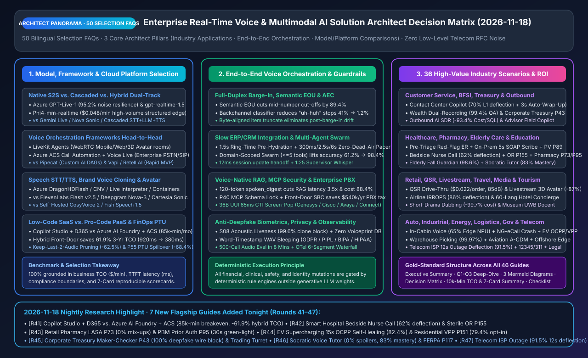
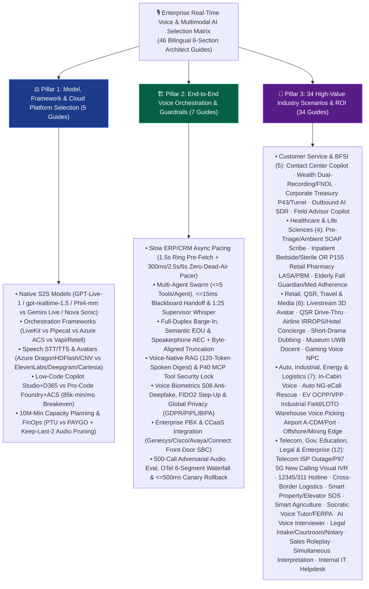

# 2026-11-18 Daily Solution Architect Digest: Enterprise Real-Time Voice & Multimodal Application Scenarios, End-to-End Architecture Design & Platform Selection Panorama (46 Bilingual Selection FAQs · 7 New Flagship Guides Added Today)

> **Language / 语言切换**: [中文 (`2026-11-18.md`)](./2026-11-18.md) | **English (Current)**  
> **Target Audience**: **Cloud & AI Solution Architects** and Enterprise Engineering Leaders designing AI Contact Centers, Omnichannel Voice Assistants, Multilingual Simultaneous Interpretation, Digital Human Avatars, and Industry-Specific Voice Copilots.  
> **Documentation Standard**: Modeled strictly on [`ib-vs-ethernet-roce-selection-faq.md`](https://github.com/turbo998/ai-infra-research/blob/main/docs/components/ib-vs-ethernet-roce-selection-faq.md) with a unified 6-section layout (1. Executive Summary; 2. Q1–Q3 Deep-Dive Q&A; 3. Mermaid Decision Tree / Reference Architecture / Sequence Diagram; 4. Quantitative Decision Matrix; 5. 10k-Min TCO Math & 7-Card Benchmark Summary; 6. Presales & Go-Live Checklist) — **100% focused on business ROI, practical system architecture, and platform selection, with zero low-level telecom RFC header minutiae**.

---

## 🔥 1. Highlights of Today's 7 New Flagship Selection Guides (Rounds 41–47)

| # | Domain & Scenario ID | Key Architectural Breakthrough & Quantified ROI | English Guide (`.en.md`) | 中文指南 (`.md`) |
| :--- | :--- | :--- | :--- | :--- |
| **40** | **Low-Code SaaS (`Copilot Studio + D365`) vs. Pro-Code PaaS (`Azure AI Foundry + ACS`) (`LOWCODE-VS-PROCODE-01`)** | Establishes the **85,000-min/month** TCO breakeven threshold; **Hybrid Foundry Front-Door + Copilot Studio 1,400+ Connectors** cuts latency from `920ms` to `380ms` and saves **61.9% 3-Year TCO (`$892k`)** | [`copilot-studio-d365-vs-azure-foundry-acs-...-faq.en.md`](../copilot-studio-d365-vs-azure-foundry-acs-voice-architecture-selection-faq.en.md) | [`.md`](../copilot-studio-d365-vs-azure-foundry-acs-voice-architecture-selection-faq.md) |
| **41** | **Smart Hospital Inpatient Bedside Nurse Call, Sterile OR PACS & WHO Surgical Timeout (`HOSP-NURSE-01` / `P155`)** | Acoustic red-flag preemption + closed-loop routing deflects **62%** of non-clinical bells; bedside vitals save **70 mins/shift**; OR bone-conduction + **`P155` sponge/laterality hard lock (`0.0%` bypass)** | [`hospital-inpatient-bedside-sterile-or-...-faq.en.md`](../hospital-inpatient-bedside-sterile-or-surgical-timeout-voice-selection-faq.en.md) | [`.md`](../hospital-inpatient-bedside-sterile-or-surgical-timeout-voice-selection-faq.md) |
| **42** | **Retail Pharmacy Rx Refill, LASA Drug Disambiguation (`P73`) & PBM Prior Authorization (`P95`) (`PHARMACY-PBM-01`)** | RxNorm phonetic-distance lock + indication check guarantees **0.0% LASA mix-ups**; `800ms` sister-store GLP-1 hold saves **89%** of stockout walkaways; `30s` green-light PA with **zero AI clinical denials** | [`retail-pharmacy-rx-refill-lasa-pbm-...-faq.en.md`](../retail-pharmacy-rx-refill-lasa-pbm-prior-auth-voice-selection-faq.en.md) | [`.md`](../retail-pharmacy-rx-refill-lasa-pbm-prior-auth-voice-selection-faq.md) |
| **43** | **EV Supercharging `15s` OCPP Self-Healing, Virtual Power Plant (`VPP`) & Solar/BESS (`ENERGY-VPP-01` / `P151`)** | Ring-time `OCPP` pre-fetch + **`I=0A` arc-flash interlock** heals **82.4%** of stuck connectors in `15s`; dynamic tariff math + `20% SOC` reserve floor lifts VPP opt-in from `18%` to **79.4%** | [`energy-ev-charging-vpp-grid-response-...-faq.en.md`](../energy-ev-charging-vpp-grid-response-solar-voice-selection-faq.en.md) | [`.md`](../energy-ev-charging-vpp-grid-response-solar-voice-selection-faq.md) |
| **44** | **Corporate Banking Treasury Maker-Checker (`P43`), Anti-CEO Deepfake & Trading Turret (`CORP-TREASURY-01` / `P60` / `P35`)** | Read-only `DRAFT` voice staging + dual-officer FIDO2 signing achieves **100% BEC deepfake wire immunity**; dual-lane `FIX` turret achieves **98.9% accuracy**; `P35` pre-LLM gate ensures **0.0% AML tipping-off** | [`corporate-banking-treasury-maker-checker-...-faq.en.md`](../corporate-banking-treasury-maker-checker-trading-turret-voice-selection-faq.en.md) | [`.md`](../corporate-banking-treasury-maker-checker-trading-turret-voice-selection-faq.md) |
| **45** | **Socratic AI Voice Tutor (`Anti-Spoiler`), Campus `FERPA` Privacy (`P117`) & Speech Accessibility (`P14`) (`EDU-SOCRATIC-01`)** | Hidden-blackboard `SymPy` truth lock + anti-spoiler regex achieves **0.0% answer leaks & 0.0% math hallucinations**, lifting independent mastery from `38.4%` to **83.0%**; `3,200ms` stutter patience window | [`education-socratic-voice-tutor-campus-...-faq.en.md`](../education-socratic-voice-tutor-campus-ferpa-accessibility-selection-faq.en.md) | [`.md`](../education-socratic-voice-tutor-campus-ferpa-accessibility-selection-faq.md) |
| **46** | **Telecom Carrier & Broadband ISP Outage Deflection, `ONT` LED Vision & Anti-SIM-Swap (`TELCO-ISP-01` / `P97`)** | `T+0ms` OLT outage correlation + `20GB` cellular data grant deflects **91.5% of fiber-cut storms in 12s**; `80KB` modem vision + `TR-069` cuts **64.2% of avoidable truck rolls**; `P97` blocks **100% of SIM-swaps & CDR leaks** | [`telecom-isp-broadband-outage-router-...-faq.en.md`](../telecom-isp-broadband-outage-router-vision-simswap-voice-selection-faq.en.md) | [`.md`](../telecom-isp-broadband-outage-router-vision-simswap-voice-selection-faq.md) |
| **47** | **Insurance Tele-Underwriting (`INS-UNDERWRITE-01` / `P88`), Pension Proof-of-Life (`S08`) & Catastrophe Claims Adjuster Copilot** | Acoustic hesitation probe + `ICD-10` tree lifts **pre-existing disclosure `3.1x` (`4.8% -> 14.9%`)** with **`0.0%` `P88` estoppel waivers**; zero-app PSTN call blocks **`99.7%` of pension replay/clone fraud**; `45s` `Xactimate` scope cuts catastrophe payout **`14d -> 1.8d`** | [`insurance-underwriting-pension-annuity-...-faq.en.md`](../insurance-underwriting-pension-annuity-adjuster-voice-selection-faq.en.md) | [`.md`](../insurance-underwriting-pension-annuity-adjuster-voice-selection-faq.md) |
| **48** | **Aviation In-Flight Cabin & `MedLink` (`INFLIGHT-CABIN-01`), Cruise Ship `0-bps` Concierge (`CRUISE-EDGE-01`) & High-Speed Rail (`HSR-PASSENGER-01`)** | Onboard IFE edge ensures **`0.0%` allergen errors** and `200B` vitals JSON **cuts avoidable diversions `42%` (`$180k` saved)**; shipboard `2×L40S` drives **`+$64/cabin` upsell at `0-bps` sat WAN**; `<=42dB` rail whisper & car-door routing **cuts missed transfers `71.5%`** | [`aviation-inflight-cabin-cruise-ship-...-faq.en.md`](../aviation-inflight-cabin-cruise-ship-highspeed-rail-voice-selection-faq.en.md) | [`.md`](../aviation-inflight-cabin-cruise-ship-highspeed-rail-voice-selection-faq.md) |
| **49** | **FMCG Route Sales (`DSD`), B2B Kitchen Dialect Reordering & Smart Cooler `8s` Dispute Resolution (`FMCG-B2B-01`)** | `80KB` cooler vision + voice stock count lifts **daily store visits `+28%` with `0.0%` promo leakage**; `38s` 35-item B2B checkout (**`99.6%` UOM accuracy**); `Load-Cell` weight diff enables **`$0.015/call` `8s` refunds & blocks `99.4%` fraud** | [`fmcg-dsd-route-sales-b2b-wholesale-...-faq.en.md`](../fmcg-dsd-route-sales-b2b-wholesale-vending-voice-selection-faq.en.md) | [`.md`](../fmcg-dsd-route-sales-b2b-wholesale-vending-voice-selection-faq.md) |

---

## 🧭 2. Three Core Architect Pillars (46 Standalone Selection FAQs)

---

## 📊 3. Quick Navigation Index by Architect Decision Area

### 3.1 Model, Framework & Cloud Platform Selection (5 Guides)
1. **Native Speech-to-Speech (S2S) Models Head-to-Head (`GPT-Live-1` / `gpt-realtime-1.5` / `Phi4-mm-realtime` vs `Gemini Live` vs `Nova Sonic` vs `Qwen2.5-Omni`)**: [`docs/voice-native-s2s-models-gpt-live-realtime-gemini-live-nova-sonic-selection-faq.en.md`](../voice-native-s2s-models-gpt-live-realtime-gemini-live-nova-sonic-selection-faq.en.md) · [中文](../voice-native-s2s-models-gpt-live-realtime-gemini-live-nova-sonic-selection-faq.md)
2. **Real-Time Voice Orchestration Frameworks (`LiveKit Agents` vs `Pipecat` vs `Azure ACS + Voice Live` vs `Twilio / Retell / Vapi`)**: [`docs/voice-orchestration-framework-livekit-pipecat-acs-retell-vapi-selection-faq.en.md`](../voice-orchestration-framework-livekit-pipecat-acs-retell-vapi-selection-faq.en.md) · [中文](../voice-orchestration-framework-livekit-pipecat-acs-retell-vapi-selection-faq.md)
3. **Speech STT/TTS, Brand Voice Cloning & Avatar Platforms (`Azure Speech` vs `ElevenLabs` vs `Deepgram` vs `Cartesia` vs `CosyVoice 2`)**: [`docs/voice-stt-tts-cloning-avatar-azure-elevenlabs-deepgram-opensource-selection-faq.en.md`](../voice-stt-tts-cloning-avatar-azure-elevenlabs-deepgram-opensource-selection-faq.en.md) · [中文](../voice-stt-tts-cloning-avatar-azure-elevenlabs-deepgram-opensource-selection-faq.md)
4. **Low-Code SaaS (`Copilot Studio + D365`) vs. Pro-Code PaaS (`Azure AI Foundry + ACS`)**: [`docs/copilot-studio-d365-vs-azure-foundry-acs-voice-architecture-selection-faq.en.md`](../copilot-studio-d365-vs-azure-foundry-acs-voice-architecture-selection-faq.en.md) · [中文](../copilot-studio-d365-vs-azure-foundry-acs-voice-architecture-selection-faq.md)
5. **Enterprise 10M-Min Capacity Planning (`Azure PTU vs PAYGO`) & Audio Context Pruning FinOps (`VOICE-FINOPS-01`)**: [`docs/enterprise-voice-ai-tco-ptu-capacity-finops-selection-faq.en.md`](../enterprise-voice-ai-tco-ptu-capacity-finops-selection-faq.en.md) · [中文](../enterprise-voice-ai-tco-ptu-capacity-finops-selection-faq.md)

### 3.2 End-to-End Voice Reference Architecture & Guardrails (7 Guides)
6. **Slow Backend ERP/CRM/HIS Integration & Zero-Dead-Air Pacing (`1.5s` Ring Pre-Fetch + 3-Tier Pacer + Two-Phase Saga)**: [`docs/enterprise-voice-async-erp-crm-integration-zero-dead-air-selection-faq.en.md`](../enterprise-voice-async-erp-crm-integration-zero-dead-air-selection-faq.en.md) · [中文](../enterprise-voice-async-erp-crm-integration-zero-dead-air-selection-faq.md)
7. **Multi-Agent Voice Swarm, `<=15ms` Blackboard Handoff & `1:25` Supervisor Whisper (`SWARM-VOICE-01`)**: [`docs/enterprise-multi-agent-voice-swarm-supervisor-whisper-selection-faq.en.md`](../enterprise-multi-agent-voice-swarm-supervisor-whisper-selection-faq.en.md) · [中文](../enterprise-multi-agent-voice-swarm-supervisor-whisper-selection-faq.md)
8. **Full-Duplex Barge-In, Semantic EOU & Speakerphone AEC (`TURN-BARGE-01`)**: [`docs/enterprise-voice-barge-in-semantic-turn-detection-aec-selection-faq.en.md`](../enterprise-voice-barge-in-semantic-turn-detection-aec-selection-faq.en.md) · [中文](../enterprise-voice-barge-in-semantic-turn-detection-aec-selection-faq.md)
9. **Voice-Native RAG (`120-Token` Spoken Digest), Phonetic Search & `P40` MCP Tool Security**: [`docs/enterprise-voice-rag-knowledge-graph-mcp-tool-security-selection-faq.en.md`](../enterprise-voice-rag-knowledge-graph-mcp-tool-security-selection-faq.en.md) · [中文](../enterprise-voice-rag-knowledge-graph-mcp-tool-security-selection-faq.md)
10. **Voice Biometrics Anti-Spoofing (`S08`), Zero-Trust FIDO2 Auth & Global Privacy (`GDPR / PIPL / BIPA`)**: [`docs/enterprise-voice-biometrics-privacy-compliance-selection-faq.en.md`](../enterprise-voice-biometrics-privacy-compliance-selection-faq.en.md) · [中文](../enterprise-voice-biometrics-privacy-compliance-selection-faq.md)
11. **Enterprise PBX & CCaaS Integration (`Genesys / Cisco / Avaya / Amazon Connect / Teams Phone`)**: [`docs/enterprise-pbx-ccaas-genesys-cisco-avaya-teams-voice-integration-selection-faq.en.md`](../enterprise-pbx-ccaas-genesys-cisco-avaya-teams-voice-integration-selection-faq.en.md) · [中文](../enterprise-pbx-ccaas-genesys-cisco-avaya-teams-voice-integration-selection-faq.md)
12. **Enterprise Voice Evaluation, OpenTelemetry 6-Segment Waterfall & `<=500ms` Canary Rollout (`P12 / P753`)**: [`docs/enterprise-voice-agent-evaluation-observability-redteaming-selection-faq.en.md`](../enterprise-voice-agent-evaluation-observability-redteaming-selection-faq.en.md) · [中文](../enterprise-voice-agent-evaluation-observability-redteaming-selection-faq.md)

### 3.3 All 34 Industry Application Scenarios & Full Catalog
- Browse the complete bilingual table of all 46 guides in the [**English Master Asset Catalog (`docs/asset-catalog.en.md`)**](../asset-catalog.en.md) · [**中文全局资产总表 (`docs/asset-catalog.md`)**](../asset-catalog.md).
