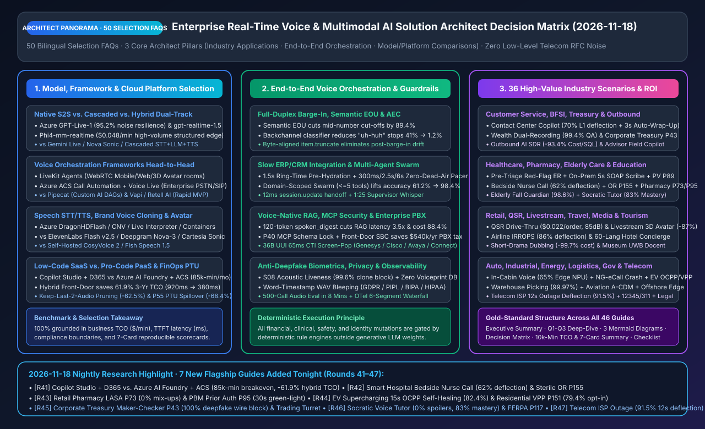
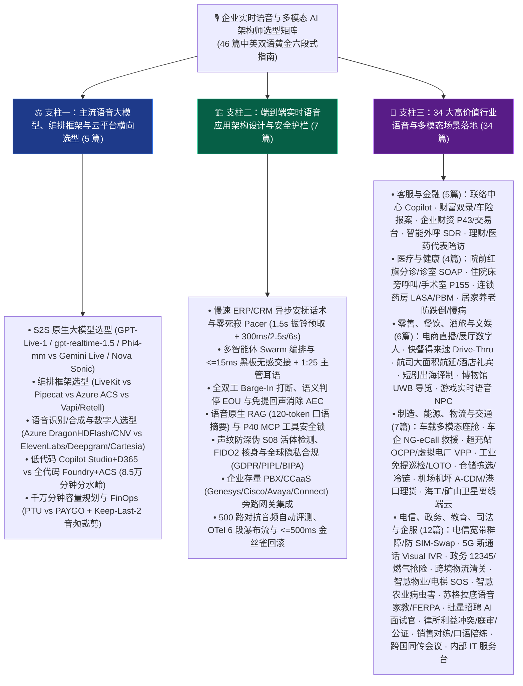

# 2026-11-18 每日架构师简报：企业实时语音与多模态应用场景、端到端架构设计与主流平台选型全景指南（50 篇中英双语选型 FAQ 矩阵 · 2026-11-18 新增 11 大旗舰专题）

> **语言切换 / Language**: **中文 (当前)** | [English (`2026-11-18.en.md`)](./2026-11-18.en.md)  
> **读者定位**：面向为企业规划智能联络中心、全渠道语音助手、多语种同传会议、数字人导购与行业专属语音 Copilot 的 **Cloud & AI Solution Architect（云与 AI 解决方案架构师）** 及业务技术负责人。  
> **写作标准**：全量遵循 [`ib-vs-ethernet-roce-selection-faq.md`](https://github.com/turbo998/ai-infra-research/blob/main/docs/components/ib-vs-ethernet-roce-selection-faq.md) 黄金六段式标杆（① 核心选型结论速览；② 客户与架构师灵魂拷问 Q&A；③ Mermaid 决策树/参考架构图/时序图；④ 多方案横向选型决策矩阵；⑤ 每万分钟 TCO 测算与 7-Card 基准摘要；⑥ 售前与上线 Checklist），**100% 聚焦企业真实业务痛点、架构落地与 TCO 账本，零底层通信协议字节头噪音**。

---

## 🔥 一、今日新增 7 大旗舰选型指南速览（Rounds 41–47）

| 序号 | 专题领域与场景代号 | 核心架构突破与量化商业收益 | 中文指南 (`.md`) | English Guide (`.en.md`) |
| :--- | :--- | :--- | :--- | :--- |
| **40** | **低代码 SaaS (`Copilot Studio + D365`) vs 全代码 PaaS (`Azure AI Foundry + ACS`) 平台选型 (`LOWCODE-VS-PROCODE-01`)** | 算清 **8.5 万分钟/月** TCO 黄金盈亏平衡点；采用 **Foundry 实时前台 + Copilot Studio 1,400+ 连接器后台**混合双引擎，首字延迟从 `920ms` 降至 `380ms`，三年总 TCO 节省 **61.9%**（省 `$89.2万`） | [`copilot-studio-d365-vs-azure-foundry-acs-...-faq.md`](../copilot-studio-d365-vs-azure-foundry-acs-voice-architecture-selection-faq.md) | [`.en.md`](../copilot-studio-d365-vs-azure-foundry-acs-voice-architecture-selection-faq.en.md) |
| **41** | **三甲医院住院床旁智能呼叫、无菌手术室 (`OR`) 声控阅片与 `WHO` 安全核查 (`HOSP-NURSE-01` / `P155`)** | 声学红旗抢占 + 闭环分类拦截 **62%** 非医疗按铃；床旁体征 5 秒入表每班省 **70 分钟**文书；手术室骨传导免唤醒 + **`P155` 纱布差额/左右侧位硬件强互锁 (`0.0%` 放行)** | [`hospital-inpatient-bedside-sterile-or-...-faq.md`](../hospital-inpatient-bedside-sterile-or-surgical-timeout-voice-selection-faq.md) | [`.en.md`](../hospital-inpatient-bedside-sterile-or-surgical-timeout-voice-selection-faq.en.md) |
| **42** | **连锁药房智能续方、听似神似药 (`LASA P73`) 消歧与医保事前审批 (`PBM PA P95`) (`PHARMACY-PBM-01`)** | RxNorm 音素距离锁 + 适应症强校验实现 **0.0% 高危 LASA 混药**；`800ms` 同城跨店锁药挽回 **89%** 缺货流失；`30 秒` 绿灯秒批 + **红旗仅转人工药师（零 AI 拒赔法律风险）** | [`retail-pharmacy-rx-refill-lasa-pbm-...-faq.md`](../retail-pharmacy-rx-refill-lasa-pbm-prior-auth-voice-selection-faq.md) | [`.en.md`](../retail-pharmacy-rx-refill-lasa-pbm-prior-auth-voice-selection-faq.en.md) |
| **43** | **新能源超充站 `15秒` 远程自愈 (`OCPP`)、虚拟电厂 (`VPP`) 负荷邀约与户用光储运维 (`ENERGY-VPP-01` / `P151`)** | 振铃期 `OCPP` 遥测预拉取 + **`I=0A` 零电流防拉弧互锁**实现 **82.4% 死锁枪 15 秒远程解锁**；电价收益精算 + `20% SOC` 保底锁将 VPP 签约率从 `18%` 拉升至 **79.4%** | [`energy-ev-charging-vpp-grid-response-...-faq.md`](../energy-ev-charging-vpp-grid-response-solar-voice-selection-faq.md) | [`.en.md`](../energy-ev-charging-vpp-grid-response-solar-voice-selection-faq.en.md) |
| **44** | **企业网银财资大额划款 (`P43` Maker-Checker)、防 CEO 深伪电诈与金融交易台 (`Turret`) (`CORP-TREASURY-01` / `P60` / `P35`)** | 语音只读立项 (`DRAFT`) + 财务双人硬件 FIDO2 盲签实现 **100% 免疫 CEO 深伪语音骗汇**；交易台双轨 `FIX` 报单提取 **98.9% 准确率**；`P35` 前置静音转接 **0.0% 反洗钱打草惊蛇** | [`corporate-banking-treasury-maker-checker-...-faq.md`](../corporate-banking-treasury-maker-checker-trading-turret-voice-selection-faq.md) | [`.en.md`](../corporate-banking-treasury-maker-checker-trading-turret-voice-selection-faq.en.md) |
| **45** | **智慧高校与 K12 教育：1对1 苏格拉底启发式口语家教 (防直接抄答案)、校园隐私 (`P117` FERPA) 与无障碍 (`P14`) (`EDU-SOCRATIC-01`)** | 隐藏真值黑板 + `SymPy` 符号求解器 + 正则防泄题门禁实现 **0.0% 泄露最终答案 & 0.0% 算错幻觉**，同类变式题独立正确率从 `38.4%` 跃升至 **83.0%**；`3,200ms` 口吃耐心窗公平赋能 | [`education-socratic-voice-tutor-campus-...-faq.md`](../education-socratic-voice-tutor-campus-ferpa-accessibility-selection-faq.md) | [`.en.md`](../education-socratic-voice-tutor-campus-ferpa-accessibility-selection-faq.en.md) |
| **46** | **电信运营商与宽带 ISP：万户光纤断网风暴 12秒拦截、光猫看图 (`TR-069`) 自愈与防 SIM-Swap 劫持 (`TELCO-ISP-01` / `P97`)** | `T+0ms` 局端 OLT 告警匹配 + 一键下发 `20GB` 应急流量包在 **12 秒内分流 91.5% 群障洪峰**；`80KB` 光猫看灯 + `TR-069` 自愈砍掉 **64.2% 装维白跑上门**；`P97` **100% 阻断 eSIM 盗补卡与通话详单外泄** | [`telecom-isp-broadband-outage-router-...-faq.md`](../telecom-isp-broadband-outage-router-vision-simswap-voice-selection-faq.md) | [`.en.md`](../telecom-isp-broadband-outage-router-vision-simswap-voice-selection-faq.en.md) |
| **47** | **保险与社保：寿险重疾智能核保回访 (`INS-UNDERWRITE-01` / `P88`)、养老金生存认证 (`S08`) 与巨灾查勘定损员多模态 Copilot** | 声学微踌躇探针 + `ICD-10` 医学树将**既往症如实披露率提升 `3.1 倍` (`4.8% -> 14.9%`)** 且 **`P88` 越权承保豁免 `0.0%`**；零 App 固话拦截 **`99.7%` 养老金录音/克隆冒领**；`45 秒` 生成 `Xactimate` 定损单将巨灾结案从 `14天` 缩至 **`1.8天`** | [`insurance-underwriting-pension-annuity-...-faq.md`](../insurance-underwriting-pension-annuity-adjuster-voice-selection-faq.md) | [`.en.md`](../insurance-underwriting-pension-annuity-adjuster-voice-selection-faq.en.md) |
| **48** | **航空客舱、远洋邮轮与高速铁路：万米高空乘务与 `MedLink` 急救 (`INFLIGHT-CABIN-01`)、邮轮断网礼宾 (`CRUISE-EDGE-01`) 与高铁静音车厢 (`HSR-PASSENGER-01`)** | 机载非安控 IFE 边缘实现 **`0.0%` 过敏餐误发** 与 `200B` 体征包**砍掉 `42%` 非必要医疗备降 (省 `$18万/次`)**；船载 `2×L40S` **零卫星流量增销 `+$64/舱房`**；高铁 `<=42dB` 耳语点餐与车门导航**降低 `71.5%` 漏乘** | [`aviation-inflight-cabin-cruise-ship-...-faq.md`](../aviation-inflight-cabin-cruise-ship-highspeed-rail-voice-selection-faq.md) | [`.en.md`](../aviation-inflight-cabin-cruise-ship-highspeed-rail-voice-selection-faq.en.md) |
| **49** | **快消渠道、B2B 餐饮供应链与无人零售：巡店车销 (`FMCG DSD`)、后厨一口气 15 品类方言补货与智能冰柜 `8秒` 争议秒退 (`FMCG-B2B-01`)** | `80KB` 冰柜排面照 + 免提车销使**日均拜访门店 `+28%` 且 `0.0%` 违规搭赠**；`38秒` 完成 35项批发补货（**箱/瓶规格准确率 `99.6%`**）；重力传感比对实现 **`$0.015/通` `8秒` 退差价并拦截 `99.4%` 羊毛党** | [`fmcg-dsd-route-sales-b2b-wholesale-...-faq.md`](../fmcg-dsd-route-sales-b2b-wholesale-vending-voice-selection-faq.md) | [`.en.md`](../fmcg-dsd-route-sales-b2b-wholesale-vending-voice-selection-faq.en.md) |
| **50** | **商业综合体与智慧停车场：出口道闸 `10秒` 脱困 (`PARK-GATE-01`)、地标级寻店/找车导览与幼童走失 `Code Adam` 安防联动 (`MALL-CONCIERGE-01`)** | 模糊车牌距离`<=1`纠错 + 容缺短信账单将**出口排障从 `185s` 缩至 `10.5s`（停车费追回率 `98.9%`）**；地标指路到达率 **`94.2%`**；`2.4秒`直灌 12个出口保安耳机将**走失幼童找回缩至 `3.8分钟`** | [`smart-mall-parking-gate-wayfinding-...-faq.md`](../smart-mall-parking-gate-wayfinding-retail-concierge-voice-selection-faq.md) | [`.en.md`](../smart-mall-parking-gate-wayfinding-retail-concierge-voice-selection-faq.en.md) |

---

## 🧭 二、三大核心研究支柱全景索引（46 篇独立选型指南）

---

## 📊 三、架构师高频选型速查表（按需求一秒定位对应指南）

### 3.1 平台、模型与编排框架选型（5 篇）
1. **原生语音大模型横评（`GPT-Live-1` / `gpt-realtime-1.5` / `Phi4-mm-realtime` vs `Gemini Live` vs `Nova Sonic` vs `Qwen2.5-Omni`）**：[`docs/voice-native-s2s-models-gpt-live-realtime-gemini-live-nova-sonic-selection-faq.md`](../voice-native-s2s-models-gpt-live-realtime-gemini-live-nova-sonic-selection-faq.md) · [English](../voice-native-s2s-models-gpt-live-realtime-gemini-live-nova-sonic-selection-faq.en.md)
2. **实时语音编排框架选型（`LiveKit Agents` vs `Pipecat` vs `Azure ACS + Voice Live` vs `Twilio / Retell / Vapi`）**：[`docs/voice-orchestration-framework-livekit-pipecat-acs-retell-vapi-selection-faq.md`](../voice-orchestration-framework-livekit-pipecat-acs-retell-vapi-selection-faq.md) · [English](../voice-orchestration-framework-livekit-pipecat-acs-retell-vapi-selection-faq.en.md)
3. **语音识别/合成、品牌音色克隆与数字人平台选型（`Azure Speech` vs `ElevenLabs` vs `Deepgram` vs `Cartesia` vs `CosyVoice 2`）**：[`docs/voice-stt-tts-cloning-avatar-azure-elevenlabs-deepgram-opensource-selection-faq.md`](../voice-stt-tts-cloning-avatar-azure-elevenlabs-deepgram-opensource-selection-faq.md) · [English](../voice-stt-tts-cloning-avatar-azure-elevenlabs-deepgram-opensource-selection-faq.en.md)
4. **低代码 SaaS (`Copilot Studio + D365`) vs 全代码 PaaS (`Azure AI Foundry + ACS`) 选型**：[`docs/copilot-studio-d365-vs-azure-foundry-acs-voice-architecture-selection-faq.md`](../copilot-studio-d365-vs-azure-foundry-acs-voice-architecture-selection-faq.md) · [English](../copilot-studio-d365-vs-azure-foundry-acs-voice-architecture-selection-faq.en.md)
5. **千万分钟容量规划（`Azure PTU vs PAYGO`）与音频滑窗裁剪 FinOps（`VOICE-FINOPS-01`）**：[`docs/enterprise-voice-ai-tco-ptu-capacity-finops-selection-faq.md`](../enterprise-voice-ai-tco-ptu-capacity-finops-selection-faq.md) · [English](../enterprise-voice-ai-tco-ptu-capacity-finops-selection-faq.en.md)

### 3.2 端到端语音架构与核心护栏（7 篇）
6. **慢速 ERP/CRM/HIS 接入与零死寂安抚话术编排（`1.5s` 振铃预取 + 三级 Pacer + 两阶段 Saga）**：[`docs/enterprise-voice-async-erp-crm-integration-zero-dead-air-selection-faq.md`](../enterprise-voice-async-erp-crm-integration-zero-dead-air-selection-faq.md) · [English](../enterprise-voice-async-erp-crm-integration-zero-dead-air-selection-faq.en.md)
7. **多智能体语音协同 (`Multi-Agent Swarm`)、`<=15ms` 黑板交接与 `1:25` 主管耳语（`SWARM-VOICE-01`）**：[`docs/enterprise-multi-agent-voice-swarm-supervisor-whisper-selection-faq.md`](../enterprise-multi-agent-voice-swarm-supervisor-whisper-selection-faq.md) · [English](../enterprise-multi-agent-voice-swarm-supervisor-whisper-selection-faq.en.md)
8. **全双工打断 (`Barge-In`)、语义级判停 (`Semantic EOU`) 与免提回声消除 (`TURN-BARGE-01`)**：[`docs/enterprise-voice-barge-in-semantic-turn-detection-aec-selection-faq.md`](../enterprise-voice-barge-in-semantic-turn-detection-aec-selection-faq.md) · [English](../enterprise-voice-barge-in-semantic-turn-detection-aec-selection-faq.en.md)
9. **语音原生 RAG (`120-Token` 口语摘要)、同音词检索与 `P40` MCP 工具安全锁**：[`docs/enterprise-voice-rag-knowledge-graph-mcp-tool-security-selection-faq.md`](../enterprise-voice-rag-knowledge-graph-mcp-tool-security-selection-faq.md) · [English](../enterprise-voice-rag-knowledge-graph-mcp-tool-security-selection-faq.en.md)
10. **声纹防深伪活体检测 (`S08`)、FIDO2 零信任鉴权与全球隐私合规 (`GDPR / PIPL / BIPA`)**：[`docs/enterprise-voice-biometrics-privacy-compliance-selection-faq.md`](../enterprise-voice-biometrics-privacy-compliance-selection-faq.md) · [English](../enterprise-voice-biometrics-privacy-compliance-selection-faq.en.md)
11. **企业存量呼叫中心与 PBX 集成（`Genesys / Cisco / Avaya / Amazon Connect / Teams Phone`）**：[`docs/enterprise-pbx-ccaas-genesys-cisco-avaya-teams-voice-integration-selection-faq.md`](../enterprise-pbx-ccaas-genesys-cisco-avaya-teams-voice-integration-selection-faq.md) · [English](../enterprise-pbx-ccaas-genesys-cisco-avaya-teams-voice-integration-selection-faq.en.md)
12. **企业语音评测、OpenTelemetry 6段延迟瀑布流与 `<=500ms` 金丝雀回滚（`P12 / P753`）**：[`docs/enterprise-voice-agent-evaluation-observability-redteaming-selection-faq.md`](../enterprise-voice-agent-evaluation-observability-redteaming-selection-faq.md) · [English](../enterprise-voice-agent-evaluation-observability-redteaming-selection-faq.en.md)

### 3.3 34 大高价值行业语音与多模态应用落地方案
- 完整 46 篇双语目录索引请直接查阅：[**中文全局资产总表 (`docs/asset-catalog.md`)**](../asset-catalog.md) · [**English Master Asset Catalog (`docs/asset-catalog.en.md`)**](../asset-catalog.en.md)。
