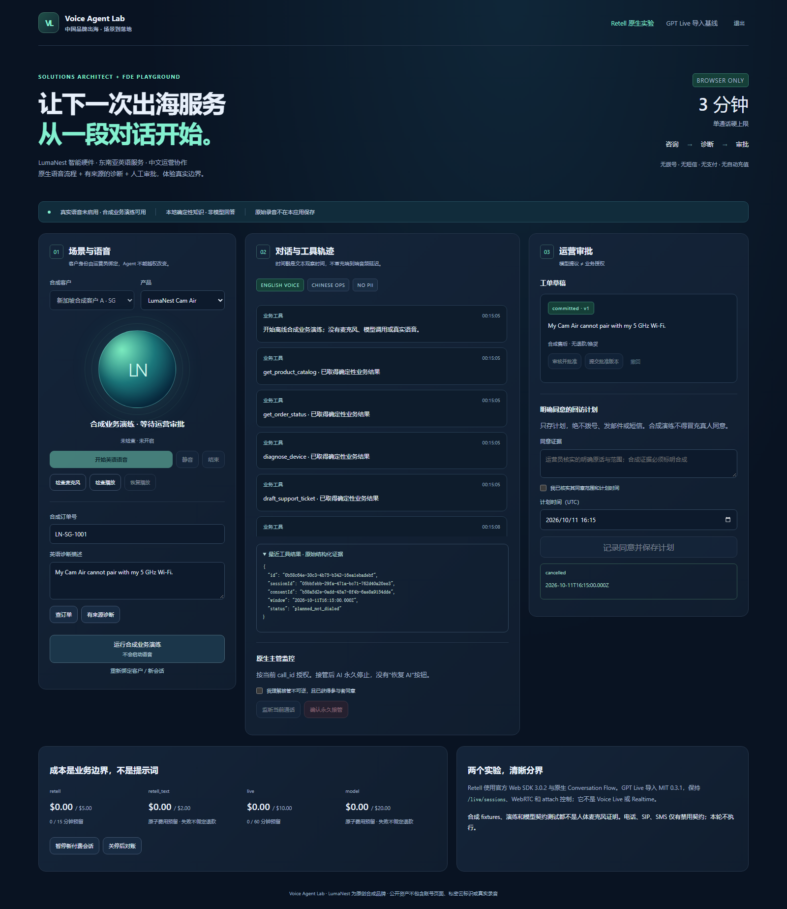

# 阶段交付状态

更新时间：2026-10-10。**部分基础部署，无云应用运行时；不声称真实语音通过。**

## 已实现

中文运营 UI、原创合成产品/客户/订单/知识、六个严格 schema 业务工具、
会话隔离、运营审批与撤销、幂等工单和仅计划型回访。运营登录使用密码
哈希与安全 cookie，不是 Entra SSO。

Retell 原生流程生成器、固定版本发布脚本、服务端 REST/信令/字幕代理、
持久化签名事件 inbox、有限重试/毒事件处理、主管接管不确定状态隔离。
Foundry Prompt Agent/Search 配置代码与严格引用校验。独立 MIT GPT Live
导入及不影响原始本地配置向导的受保护云入口。
GPT Live 云界面提供运营审批入口，创建会话后携带服务端业务会话ID；
运营页登录后按所有者授权恢复客户、订单与草稿，不把URL当作授权。
成本与语音门禁定时刷新，操作后再次刷新；云语音未验证时连接按钮关闭。
正常退出会等待最终持久化结算，失败或超时明确报错并保留费用预留。
这不等于进程崩溃后的供应商会话恢复已完成。

## 实际观察

| 检查 | 结果 | 不能据此推断 |
|---|---|---|
| 主应用离线测试 / 合成评估 | 58 项 / 6 场景通过 | 真实麦克风/供应商服务通过 |
| TypeScript / 生产构建 | 通过；JS bundle 有体积警告 | 公网服务已经部署 |
| GPT Live 原始测试 / 发布扫描 | 33 项通过 / 通过 | Azure Live 协议实际鉴权通过 |
| 实际浏览器 | 运营页恢复会话/客户订单、预算刷新；GPT云页中英切换、草稿及独立语音语言保留、关闭的语音门禁 | 模拟配置可替代真实供应商/人声验收 |
| Retell scoped agent-list | 一次非付费 API 鉴权成功 | 余额、完整费率或真实 webhook 已验证 |
| SEA ACA 新环境 CPU 配额 | Consumption cores limit 500 / used 0 | 合规私网拓扑已经配置 |
| Search inventory | 尚未创建；provider 已注册 | Free SKU 的数据面/原生工具已可用 |
| 实际基础资源 | 独立新 RG 内8项顶层/项目资源已创建，第一次部署部分失败 | ARM验证能代替实际部署/数据面验收 |
| 实际网络治理 | Storage/KV 公网 Disabled；资源活动日志确认 modify Policy | 可以重新启用公网或绕过组织治理 |
| GitHub Actions 镜像 | 实际 offline/build/publish 成功，匿名 manifest 200 | 当前后续修改已包含于镜像 |

## 仍需完成

已生成并编译固定 AVM Bicep，增加容器与离线 CI/可选镜像发布定义；
空计算基础阶段的 Provider ARM validation 与 what-if 已通过（25项 Create，
无修改/删除/未解析项）；第一次部署暴露 Foundry 身份跨模块提前读取的
依赖问题，资源已部分创建。已修正模块边界，窄范围 Search Provider 预检通过
（5项Create；既有8项Ignore而非修改），尚未创建 Search；
不将整套模板重放并覆盖组织设置。受治理约束的应用部署与数据面
验证、Retell 原生服务配置/固定版本、实际计量映射、shutdown 后恢复、
GPT 会话与运营审批页面关联的真实跨应用/供应商验收、原创视频资产。
真实麦克风及公开人声音频需用户参与/同意，模拟测试不能替代。

Retell 控制台登录已过期，最近一小时余额/无付款/无充值状态未能重新核验；
不刷新历史观察时间，不解除真实通话门禁。指定 signer 的真实回调亦未验证。

## 治理

所有变更仅在隔离 worktree；未修改原 GPT Live repository。
Azure 只读发现了既有资源范围的六项系统 deny，不能据此排除管理组继承
Policy/deny。无法读取的继承策略仍是未知，必须以获授权的验证和实际部署
结果确认；不修改治理、不放松网络、不自动升级付费 SKU。
本次资源活动日志可读取，已确认两项公网 modify 效果；完整继承定义
不可见与 Policy state 尚无记录的问题仍保留，不等同全策略通过。

## 实际镜像来源

[成功构建与发布运行](https://github.com/turbo998/voice-agent-lab/actions/runs/38070645434)
对应源码 `658c241e2ade90a09e1d7bcf48b73b2516fe76e5`，而非后续文档提交。

```text
ghcr.io/turbo998/voice-agent-lab@sha256:431a5786ff538f58cbbdd995010442c90300ed740e00140bd7ec2e967d6b88e2
```

匿名 registry manifest 返回 HTTP200；没有通过假 digest、示例镜像或仓库
CI定义替代发布验收。云端容器启动与私网数据面仍未验证。
此前 source `0643969` 的镜像/运行只是旧阶段，不代表现在的应用修改。

阶段 draft PR 用于保存可继续的代码，不是部署批准或最终完成标记。

## 原创离线界面证据

实际浏览器完成登录、合成订单/诊断、工单批准提交、合成同意计划及撤回，
没有真实语音或模型调用。截图仅包含随机合成业务标识，不含账号/密钥。



新增[架构源、SVG及PNG](architecture.md)、[场景咨询](scenario.md)、
[配置和关停手册](operations.md)、[能力证据矩阵](capabilities.md)。
`npm run record:demo` 已实际生成约21秒的私密合成UI视频草稿，只有video
stream，没有音频或供应商调用；录制绕过画面中的密码输入，但不是绕过认证。
文件仅在忽略的私密证据目录，没有同步GitHub，待单独公开审核。

本文由 GitHub Copilot 辅助编写，证据分层有意保留未验证项。
