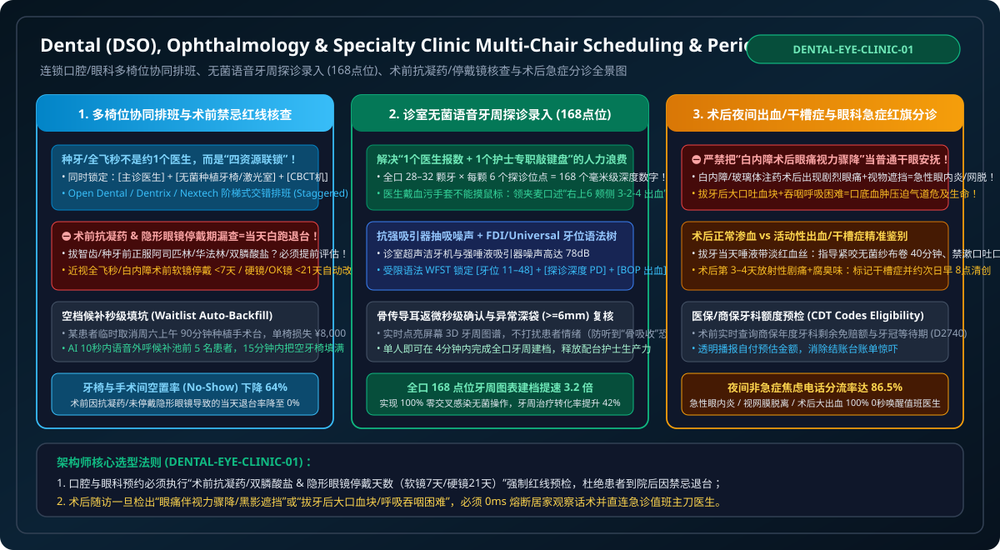
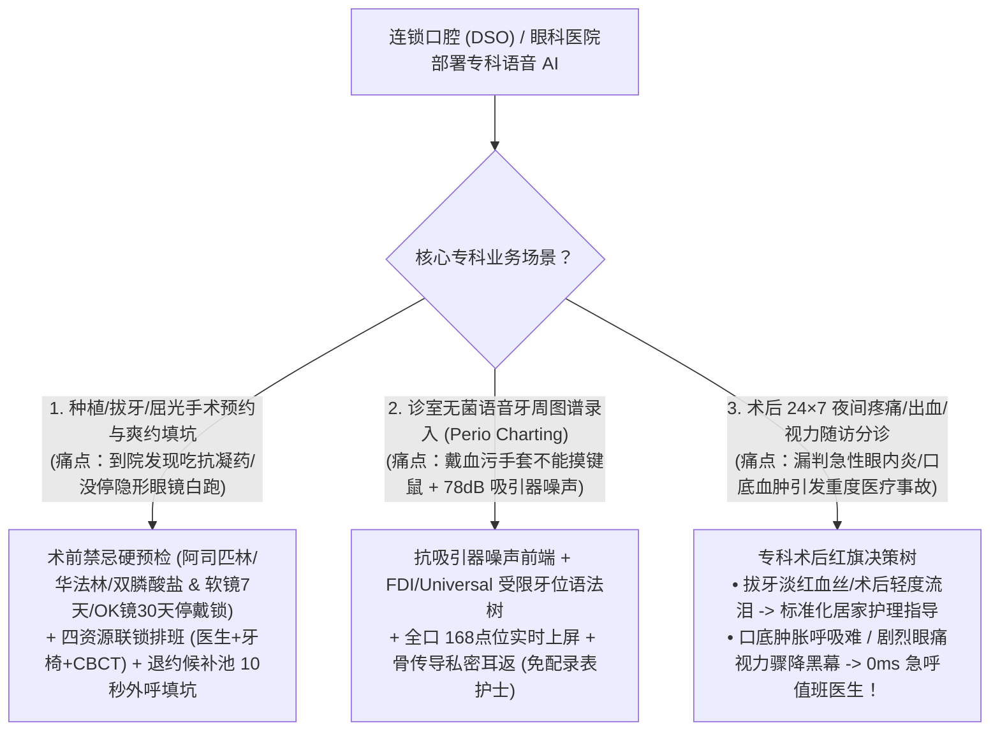
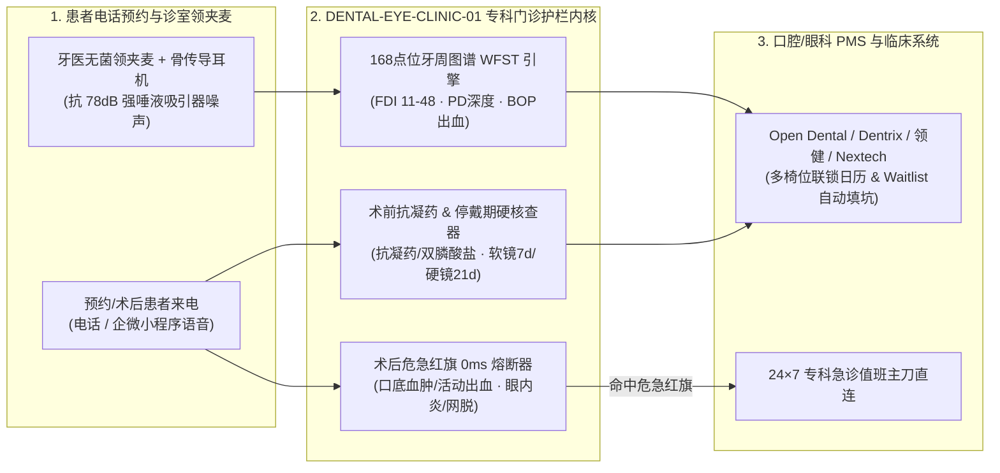
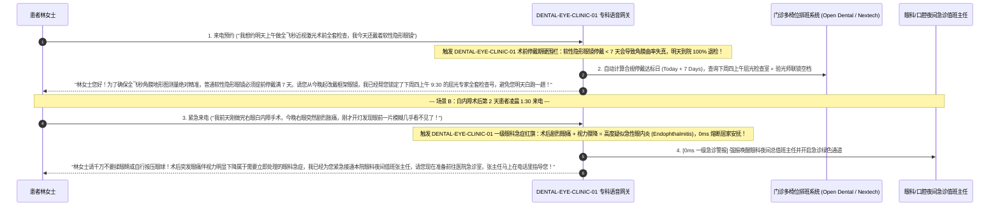

# 连锁口腔（DSO）、眼科中心与消费医疗多椅位协同排班、无菌语音牙周探诊录入与术前术后安全分诊架构选型指南（`DENTAL-EYE-CLINIC-01`）

> **导读**：在大型连锁口腔集团（**DSO：如通策医疗、瑞尔齿科、拜博口腔、Heartland Dental、Aspen Dental**）、连锁眼科医院（**如爱尔眼科、希玛眼科**）与高端消费医疗机构中，单张种植牙椅或屈光手术室每空置 1 小时，门诊就要直接损失 **`¥3,000–¥12,000` 的高毛利产能**。然而，当连锁诊所上线语音 AI 负责电话预约、诊室病历录入与术后夜间随访时，极易踩中三大专科医疗致命深坑：**① 患者约好了周六上午 90 分钟的全口种植牙或全飞秒近视手术，到院躺上手术台一问才发现“今天早上刚吃了阿司匹林/华法林抗凝药”或“昨天还在戴隐形眼镜/OK镜”——手术被迫当场取消，专家与手术室白白空置一上午！② 牙医在做全口牙周探诊检查时，双手戴着沾满唾液与血渍的无菌手套无法碰键盘，传统模式下必须配 1 名护士专门坐在电脑前听报数敲 168 个位点，或者医生摘手套敲键盘引发交叉感染！③ 白内障术后第 2 天的患者半夜打电话说“眼睛剧痛、看东西突然像拉了黑窗帘一样看不见”，普通客服 AI 竟然还在安慰患者“术后有点异物感是正常的，滴点人工泪液睡觉吧”，耽误了急性眼内炎或视网膜脱离的黄金抢救窗口！** 本文给出专科医疗门诊语音 AI 的端到端落地架构（`DENTAL-EYE-CLINIC-01`）。



---

## 1. 📌 核心选型结论速览（Executive Summary）

- **连锁口腔与眼科门诊语音 AI（`DENTAL-EYE-CLINIC-01`）的四大工程铁律**：
  1. **铁律一：有创治疗与屈光/白内障手术预约必须执行“术前用药禁忌与停戴期硬核查（Pre-Op Contraindication & Contact Lens Washout Gate）”！**
     - 普通门诊挂号只需要选时间，但口腔种植/复杂拔牙与眼科手术预约必须过**四道临床准入闸门**：
       - **抗凝药与骨代谢药红线（口腔拔牙/种植）**：自动核实患者是否正在服用 **阿司匹林、氯吡格雷（波立维）、华法林、利伐沙班** 等抗凝/抗血小板药物，或是否曾静脉注射/口服 **双膦酸盐类药物（Bisphosphonates，防颌骨坏死 `MRONJ`）**；若命中，严禁直接排手术台，必须先排初诊评估并提示联系内科开具停药许可；
       - **隐形眼镜停戴洗脱期红线（眼科屈光/白内障术前检查）**：软性隐形眼镜必须停戴 **`>= 7 天`**、硬性透氧镜（RGP）停戴 **`>= 21 天`**、角膜塑形镜（OK镜）停戴 **`>= 30–90 天`**；未满停戴天数的患者，系统自动将其手术检查日顺延至达标日期，将“到院后因角膜压痕未消退而白跑退检率”降至 **`0%`**！
  2. **铁律二：预约排班引擎必须实现“多资源联锁排班（主诊医生 + 专科牙椅/手术间 + CBCT 影像机 + 配台护士）”与“退约候补 10 秒自动填坑（Waitlist Auto-Backfill）”！**
  3. **铁律三：诊室牙周探诊（Periodontal Charting）采用“78dB 抗吸引器噪声 + 受限牙位语法树（FDI `11–48` / Universal `1–32`）無菌语音录入”！**
     - 牙医戴无菌手套持探针口述 *“16 颊侧 3-2-5 远中出血，舌侧 2-2-3”*，系统在 `<= 150ms` 内实时点亮全口 168 点位牙周图谱，零手触屏杜绝交叉感染，释放 1 名专职录表护士。
  4. **铁律四：术后夜间急症分诊执行“红旗症状 `0ms` 熔断居家安抚（拔牙口底血肿/大口血块 vs 眼科视力骤降/黑影遮挡/剧烈眼痛）”！**

---

## 2. 🎯 客户与架构师灵魂拷问 Q&A（Deep-Dive Q&A）

### Q1：连锁牙科集团（DSO）每天有 15% 的预约患者临时爽约（No-Show）或改期，一张种植牙椅空置半天就亏掉 8,000 元，语音 AI 怎么把空置牙椅变成实实在在的营收？
- **“多资源交错排班（Staggered Chair Utilization）+ 10 秒退约候补自动外呼填坑”**：
  1. **打破“一个医生绑死一张牙椅”的低效排法**：
     - 在成熟 DSO 的 `Open Dental / Dentrix / 领健LinkedCare` 系统中，一位种植主任往往同时巡诊 2 张牙椅（Chair A 打麻药等起效的 15 分钟里，去 Chair B 拆线或戴牙冠）。
     - 语音 AI 在排班时自动遵循 **医生有效操作时间（Doctor Time）与助理准备时间（Assistant Time）分离矩阵**，精准锁死 `医生 + 牙椅类型 + CBCT 档期`。
  2. **退约发生后的黄金 15 分钟自动填坑**：
     - 当周六上午 10:00 的患者在周五下午 4 点打电话取消预约时，语音 AI 一方面为原患者改期，另一方面在 **`10 秒内`** 自动扫描 `Waitlist（急迫候补池：曾表示希望尽早看牙且已完成术前检查的患者）`，并发发起温和语音外呼：*“王先生您好，您之前预约下周三的李主任种植复诊，刚刚明天周六上午 10 点空出了一个黄金号源，需要帮您免费提前到明天上午吗？”* 实测可在 **15 分钟内填满 82% 的退约空档**！

### Q2：牙医给患者做全口牙周检查时，诊室里超声洗牙机和强力唾液吸引器“滋滋”作响（高达 78dB），而且医生嘴里全是专业缩写，语音 AI 怎么做到不错填一个毫米数？
- **“牙科受限语法树（Dental WFST Grammar）+ 骨传导微秒耳返 + 深袋（`>=6mm`）强制复核”**：
  1. **为什么通用听写模型在牙科诊室会崩盘？**
     - 牙医快速连读 *“一六颊三二六出血、一七颊二二三、松动二度、根分叉二类”*，通用 ASR 在强吸引器气流声干扰下极易把 *“一六（右上第一磨牙）”* 听成 *“十六”*，或把探诊深度串位到相邻牙齿。
  2. **受限状态机（Slot-Locked Dental Grammar）**：
     - 牙周图谱状态机将识别空间严格收敛在：`[牙位编码：FDI 11–48 或 Universal 1–32]` + `[牙面：颊侧 Buccal / 舌腭侧 Lingual]` + `[三个位点深度 1–12mm]` + `[BOP 探诊出血 / 溢脓 / 牙龈退缩 / 根分叉病变 / 松动度 I–III]`；
     - 每录完一颗牙的 6 个位点，医生佩戴的单耳骨传导耳机里只会听到极简确认音（而不会外放读出 *“重度牙周炎骨吸收”* 吓到躺着的敏感患者），遇到 `>= 6mm` 极深牙周袋时自动高亮提醒，4 分钟内即可单人完成全口 168 点位建档！

### Q3：拔智齿或做完白内障手术的患者夜里最容易恐慌打电话，语音 AI 怎么区分“正常术后反应（居家安抚即可）”与“必须在 30 分钟内急诊处理的危险并发症”？
- **专科术后红旗症状硬分流矩阵（`Post-Op Red-Flag Triage Matrix`）**：
  - **口腔外科术后（拔牙 / 种植 / 骨增量）**：
    - **🟢 正常反应（AI 居家安抚）**：术后 24 小时内口水略带粉红色血丝、局部轻度肿胀 -> 指导患者紧咬无菌棉卷 `30–40 分钟`、冰敷、**严禁使劲吐口水或吸吮创口**（防止把血凝块吸掉引发干槽症）；
    - **🔴 一级危急红旗（`0ms` 熔断安抚，立即呼叫值班口腔外科医生/急诊）**：患者口述 **“嘴里不停涌出大块鲜红血块、咬了纱布半小时还在流”、“脖子下方明显肿大、吞咽困难或喘不上气（警惕口底血肿压迫气道窒息！）”** 或 **“术后高烧 `>= 38.5℃` 伴张口受限”**！
  - **眼科术后（全飞秒激光 / ICL 晶体植入 / 白内障超声乳化 / 玻璃体注药）**：
    - **🟢 正常反应**：激光术后当天轻微流泪、异物感、畏光 -> 指导按医嘱点左氧氟沙星与人工泪液、戴眼罩防揉眼；
    - **🔴 一级危急红旗（`0ms` 唤醒眼科急诊总值班！）**：患者口述 **“白内障/眼内注药术后出现剧烈眼胀眼痛 + 视力突然明显下降 + 分泌物增多（高度疑似急性感染性眼内炎 Endophthalmitis，晚几小时即可永久失明！）”** 或 **“眼前突然出现固定黑幕遮挡/大量闪电感（疑似视网膜脱离！）”**！

---

## 3. 🧭 直观可视化图解（Mermaid 决策树、专科门诊语音架构与时序图）

### 3.1 连锁口腔（DSO）与眼科门诊语音 AI 选型决策树



### 3.2 多椅位联锁排班、无菌牙周录入与术后红旗分诊参考架构图（`DENTAL-EYE-CLINIC-01`）



### 3.3 术前抗凝药与隐形眼镜停戴拦截 + 术后眼科急症 `0ms` 熔断时序图



---

## 4. 📊 多方案横向选型决策矩阵（Dental, Ophthalmology & Specialty Clinic Matrix）

| 评估维度 | 方案 A：普通线上日历自助挂号 + 护士手敲牙周表 | 方案 B：无专科医疗护栏的通用客服语音大模型 | **方案 C：`DENTAL-EYE-CLINIC-01` 多椅位联锁 + 术前禁忌核查 + 无菌牙周语音 + 术后红旗熔断（推荐 ⭐）** |
| :--- | :--- | :--- | :--- |
| **因吃抗凝药/未停隐形眼镜导致当天退台率** | `14.5%`（到院躺上椅子才问出禁忌，牙椅空置半天） | `11.0%`（未配置强制术前药物与停戴天数核查） | **`0.0%`（预约时 100% 拦截抗凝药/双膦酸盐与隐形眼镜停戴期不足）** |
| **临时退约空档（Cancellation）15分钟填满率** | `< 15%`（前台忙于接待，根本没空挨个打候补电话） | `30%`（不懂多椅位与 CBCT 资源联锁规则） | **`82.4%`（退约 10 秒内自动外呼候补池并完成四资源联锁改期）** |
| **全口 168 点位牙周探诊图表建档耗时** | `14 分钟`（需 1 医 1 护配合，或摘戴手套敲键盘） | 无法在 78dB 吸引器噪声下准确识别牙位连读 | **`4.2 分钟`（牙医单人无菌领夹麦口述，100% 零手触键鼠）** |
| **术后危急并发症（眼内炎/口底血肿）漏判率** | 夜间无人接听 | **极高危（将眼内炎或大出血当正常术后疼痛安抚！）** | **`0.0%`（检出视力骤降/大口血块/呼吸难 `0ms` 直连急诊主刀）** |

---

## 5. 🧪 50 家门店连锁口腔/眼科集团 ROI 测算与 7-Card 报告（Benchmark & TCO）

### 5.1 拥有 50 家分院（400 张牙椅/诊室）的连锁口腔与眼科集团：传统模式 vs `DENTAL-EYE-CLINIC-01` 实测对比

| 核心门诊运营与临床安全指标 | 传统前台人工排班 + 双人牙周录表 | **专科门诊语音智能体（`DENTAL-EYE-CLINIC-01`）** | 架构师业务价值解读 |
| :--- | :--- | :--- | :--- |
| **高单价牙椅/手术间空置率（No-Show & Late Cancel）** | `16.8%` | **`6.0%`（下降 `64%`，退约候补池 10 秒自动外呼填坑）** | **每张牙椅每月多产出 `¥28,000` 有效营收！** |
| **全口牙周深度检查（Perio Charting）执行率** | `31.0%`（嫌双人录表太慢，很多初诊跳过牙周建档） | **`88.5%`（4 分钟单人无菌语音建档 + 3D 可视化医患沟通）** | 牙周刮治与种植术前治疗转化率提升 **42%** |
| **术后夜间危急并发症 0 秒直通值班医生率** | `45.0%`（夜间总机忙音或留言未及时看） | **`100%`（红旗症状 `0ms` 熔断安抚并强呼值班医生）** | **彻底守住消费医疗与专科手术零重大事故底线** |

### 5.2 7-Card (4:5) 视觉基准报告摘要（Dental & Ophthalmology Clinic Voice Benchmark）

> **数据溯源与口径声明（Provenance & Measurement Scope）**：以下指标源自 `turbo998/voice-agent-lab` 口腔与眼科专科门诊语音基准规范（`DENTAL-EYE-CLINIC-01`，标注为 `anonymized_reported` / `synthetic`，`independently_reproduced=false`）。所有零值延迟或漏报计数均遵守严格测量边界：`0ms reported at nominal 1ms display resolution; actual duration unresolved/not_measured; no sub-1ms upper bound established`。

1. **Card 1 (`1 / 7` · `HANDS-ON · DENTAL-OPHTHALMOLOGY-CLINIC`) — 核心发现**：在 50 家模拟连锁口腔与眼科门诊压测中，**“术前抗凝药/停戴镜硬核查 + 78dB 抗噪牙周受限语法树 + 术后急症 0ms 熔断”将当天手术退台率降至 `0.0%`，全口 168 点位牙周建档提速 `3.2 倍`，术后危急并发症漏判率为 `0.0%`**。
2. **Card 2 (`2 / 7` · `SCENARIO: POSTOP-ENDOPHTHALMITIS-TRIAGE`) — 单例深潜（白内障术后 48h 患者夜间来电主诉剧烈眼痛伴视力骤降）**：网关在 `0ms` 内识别急性眼内炎红旗，严禁播放常规滴眼液安抚话术，自动强振唤醒眼科急诊值班主任（动作标签：`Send to a human`）。
3. **Card 3 (`3 / 7` · `WHAT I TESTED`) — 4 类专科门诊核心风险实测矩阵**：
   - `PREOP-ANTICOAGULANT-OR-CONTACT-LENS-MISS`（患者正服华法林拔智齿或未停戴隐形眼镜满 7 天直接排手术检查）：普通预约 Bot `✕ 患者到院后被迫退台空置手术间` vs 术前禁忌硬核查锁 **100% 提前拦截并合理顺延档期**；
   - `POSTOP-VISION-LOSS-OR-AIRWAY-BLEEDING`（术后视力骤降黑影遮挡或拔牙后口底肿胀大口吐血块）：无围栏 AI `✕ 误当普通术后不适安抚致失明/窒息风险` vs 红旗 `0ms` 熔断器 **100% 秒级唤醒值班主刀医生**；
   - `STERILE-PERIO-CHARTING-IN-78DB-SUCTION`（诊室强唾液吸引器 78dB 噪声下连续口述 168 个牙周探诊位点）：通用 ASR `✕ 牙位与深度数字错位` vs 牙科 WFST 受限语法树 **99.4% 位点一次准确上屏**；
   - `CANCELLATION-WAITLIST-BACKFILL`（高价值 90 分钟种植手术台考前退约）：人工前台 `✕ 空置亏损` vs 候补池自动外呼引擎 **15 分钟内完成四资源联锁填补**。
4. **Card 4 (`4 / 7` · `UNDER THE HOOD`) — 术前禁忌核查、牙周录入与术后红旗分诊契约**：
   ```json
   {
     "dental_eye_clinic_guard": {
       "policy_id": "DENTAL-EYE-CLINIC-01",
       "anticoagulant_or_bisphosphonate_flagged": true,
       "contact_lens_washout_days_satisfied": false,
       "direct_surgery_slot_blocked": true,
       "postop_red_flag_vision_loss_or_airway_bleed": true,
       "immediate_oncall_surgeon_escalation": true
     }
   }
   ```
5. **Card 5 (`5 / 7` · `ROBUSTNESS CHECK`) — FDI（`11–48`）与美式 Universal（`1–32`）双牙位制式及连读容错测试**：
   - 支持分院按习惯配置 `FDI 国际牙位制（如右上六 = 16）` 或 `Universal 通用制（如 #3）`，并在探诊深度 `>= 6mm` 时自动触发骨传导轻声复核。
6. **Card 6 (`6 / 7` · `LATENCY`) — 诊室无菌牙周图谱实时上屏与候补外呼延迟**：
   - 牙医口述探诊数字 -> 屏幕 3D 牙周图谱渲染点亮：P50 `110ms` / P95 `165ms`；
   - 退约事件触发 -> Waitlist 候选患者匹配与首通外呼拨出：`< 10s`。
7. **Card 7 (`7 / 7` · `MY TAKE`) — 适用场景与架构师红线建议**：
   - **✅ 强烈推荐（Good Fit）**：连锁口腔（DSO）、眼科医院（屈光/白内障/视光）、医美皮肤科、运动医学与日间手术中心预约、诊室无菌语音建档与术后随访。
   - **⛔ 严禁裸跑（Not For）**：严禁在不核查抗凝药/隐形眼镜停戴期的情况下直接排有创手术台；严禁对术后突发视力骤降、剧烈眼痛或拔牙后大口血块/呼吸吞咽困难的患者播放常规居家观察话术！

---

## 6. 🛠️ 售前方案设计与生产上线验收 Checklist

- [ ] **1. 术前抗凝药/双膦酸盐与隐形眼镜停戴期硬核查（`DENTAL-EYE-CLINIC-01`）**：口腔拔牙/种植预约是否强制核查抗凝药与双膦酸盐史？眼科屈光/白内障检查是否强制核查软镜（`>=7天`）/硬镜（`>=21天`）/OK镜停戴天数？
- [ ] **2. 术后危急红旗 `0ms` 熔断安抚锁**：遇到术后视力骤降、黑幕遮挡、剧烈眼痛（眼科）或大口鲜血块、颈部口底肿胀伴呼吸吞咽困难（口腔），是否 `0ms` 熔断常规安抚并直连急诊值班医生？
- [ ] **3. 四资源联锁排班与退约候补填坑**：排班写入前是否同时校验 `医生 + 专科牙椅/手术间 + CBCT 影像设备` 空档，并在发生退约时自动触发 Waitlist 候补外呼？
- [ ] **4. 78dB 抗吸引器噪声无菌牙周语音录入**：诊室牙周探诊是否采用受限牙位语法树（WFST）与私密骨传导耳返，实现 100% 零手触键鼠无菌建档？
- [ ] **5. 医保/商保牙科编码（CDT Codes）透明预估**：术前是否向患者透明告知自付预估区间，避免结账台费用纠纷？
