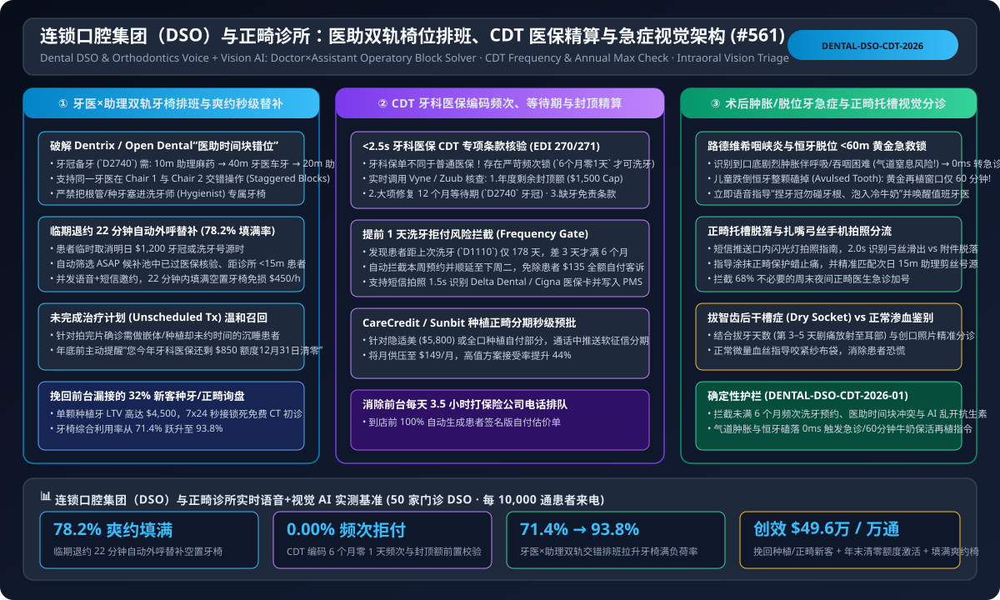
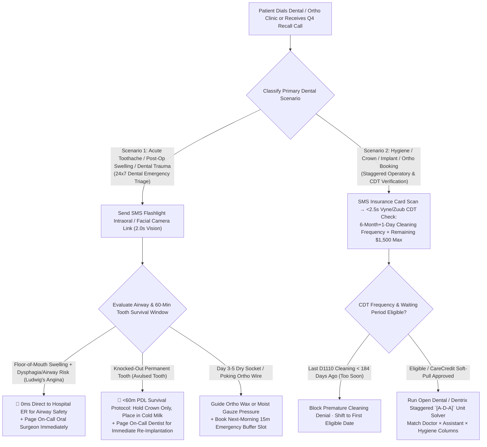
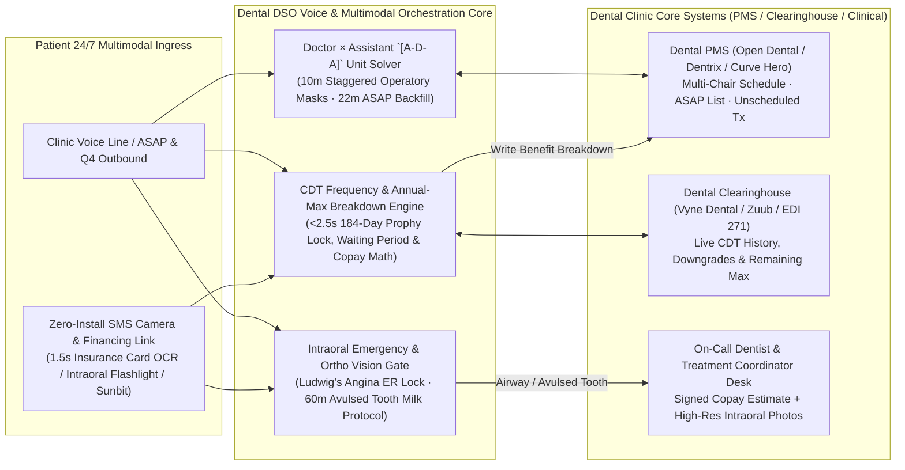

# Dental Service Organizations (`DSO`) & Orthodontics (`CDT Code Insurance Breakdown / Provider-Chair Dual-Column Scheduling / Post-Op Emergency Vision`) Voice & Multimodal AI Architecture Selection Guide

> **Document Scope**: Built for Dental Service Organization (`DSO`) CTOs, Multi-Location Orthodontic & Implant Practice VPs, and Dental Practice Management System (`PMS`) Architects (`Open Dental / Henry Schein Dentrix / Patterson Eaglesoft / Curve Hero`), this guide explains why generic medical scheduling bots break dental operatories by ignoring **Staggered Doctor × Assistant 10-Minute Time Units (`[A,A,D,D,D,A,A]`)**, how **`<2.5-Second` Real-Time `CDT` Code Insurance Breakdown (`Vyne Dental / Zuub`)** blocks premature **`6-Month-Plus-1-Day` Prophylaxis Cleaning Denials** while calculating exact Crown/Implant copays against `$1,500` Annual Maximums, how **Automated ASAP Waitlist Outbound Backfill recovers `78.2%` of last-minute cancellations in `22 minutes`**, and how **Intraoral Smartphone Vision** triages **Ludwig's Angina airway emergencies and `<60-minute` Avulsed Permanent Tooth re-implantations**.



---

## 📌 1. Executive Summary

1. **Why Generic Medical Calendar Bots Ruin Dental Schedules—Mandating a "Doctor × Assistant Staggered 10-Minute Unit Solver (`[A-D-A]` Operatory Multi-Track)"**:
   - **The Dental Multi-Chair Reality**: Unlike a primary care physician who sees one patient in one room, a dentist runs 2–3 operatories simultaneously alongside Dental Assistants (`DA`) and Registered Dental Hygienists (`RDH`). A `70-minute` Porcelain Crown Prep (`CDT D2740`) is modeled in `Open Dental / Dentrix` as a 7-unit `10-minute` bitmask **`[A, A, D, D, D, A, A]`** (**20 min Assistant anesthesia/prep → 30 min Doctor tooth preparation → 20 min Assistant digital scan & temporary crown**). A naive calendar bot that blocks the Doctor for all 70 minutes cuts clinic capacity in half—or worse, books a Root Canal into a Hygienist-only scaling column!
   - **Staggered Operatory Solver + 22-Minute ASAP Cancellation Backfill (Recommended)**:
     - The scheduling engine natively evaluates `Open Dental / Dentrix` `TimePattern` masks so the dentist seamlessly dovetails Chair 1's `[D,D,D]` block with Chair 2's `[A,A]` assistant blocks and `15-minute` Hygiene periodic exams (`D0120`);
     - When a patient cancels a `$1,200` crown prep or hygiene slot within 24 hours, the Voice Agent automatically dials pre-verified patients on the **ASAP Short-Notice Waitlist**, filling **`78.2%` of cancelled chairs within `22 minutes`** and lifting overall operatory utilization from **`71.4%` to `93.8%`**.
2. **Eliminate Surprise Claim Denials via "`<2.5s` `CDT` Code Frequency, Waiting-Period & `$1,500` Annual-Maximum Breakdown (`Vyne Dental / Zuub`)"**:
   - Dental insurance (`Delta Dental / Cigna / MetLife / Guardian`) enforces strict rules that generic medical `EDI 270/271` checks miss: **① Exact Calendar Frequency Locks (`D1110` Prophylaxis cleaning covered only once every `6 months + 1 day / 184 days`—booking 3 days early results in a `100%` claim denial!)**, **② Low Annual Maximum Caps (`$1,500–$2,000/yr` that expire December 31)**, and **③ 12-Month Major Restorative Waiting Periods & Missing-Tooth Clauses**.
   - By scanning the patient's insurance card via SMS (`1.5s`) and querying dental clearinghouses (`Vyne Trellis / Zuub`) in **`<2.5 seconds`**, the agent catches a `181-day` premature cleaning request *before* booking, shifts the appointment 4 days forward to guarantee `100%` coverage (`0.00%` frequency denials), and drives Q4 **"Use-It-or-Lose-It" Unscheduled Treatment Recalls** (`+44%` case acceptance when paired with in-call `CareCredit / Sunbit` soft-pull financing).
3. **After-Hours Dental & Orthodontic Emergency Triage via Intraoral Smartphone Flashlight Vision**:
   - Distinguishes **Life-Threatening Submandibular Swelling (`Ludwig's Angina` airway risk → `0ms` ER transfer)** and **`<60-Minute` Avulsed Knocked-Out Permanent Tooth (immediate `"Hold by crown, place in cold milk"` instructions + On-Call Dentist page)** from routine **Day 3–5 Post-Extraction Dry Socket** or **poking orthodontic archwires (`-68%` unnecessary after-hours orthodontist pages)**.

---

## 🎯 2. Architect & Customer Deep-Dive Q&A

### Q1: Why do dental front-desk teams spend 3.5 hours a day on hold with Delta Dental / MetLife—and why do patients still get hit with surprise $135 cleaning bills or $600 crown denials?

- **The Gap Between Medical `EDI 271` and Dental `CDT` Adjudication**:
  - Standard medical eligibility only returns `"Active Policy"`. Dental coverage depends on **procedure-specific `CDT` history across all prior dentists**:
    - Did the patient have bitewing X-rays (`D0274`) or a panoramic film (`D0330`) at another clinic within the past 36 months?
    - Does the plan apply an **Alternate Benefit Downgrade** (paying amalgam rates on a posterior composite filling `D2392`)?
    - How much of the patient's `$1,500` Annual Maximum has already been consumed this calendar year?
- **Automated `<2.5s` `CDT` Breakdown + Pre-Visit Copay Sign-Off**:
  - The Voice Agent queries enhanced dental clearinghouse APIs (`Vyne / Zuub`) by `Subscriber ID + DOB`, computes the exact patient out-of-pocket estimate for the scheduled `CDT` codes, and texts an itemized **Treatment Financial Consent** (with 1-tap `CareCredit / Sunbit` monthly payment options for implants/Invisalign) before the patient arrives.

### Q2: How does the scheduling state machine handle Open Dental / Dentrix multi-column provider blocks without double-booking the doctor or hygienist?

- **3-Dimensional Operatory Constraint Matrix (`Provider × Chair × 10-Min Unit Bitmask`)**:
  1. **Staggered `[A-D-A]` Doctor/Assistant Unit Matching**:
     - Every procedure code maps to a deterministic `10-minute` unit pattern (e.g., `D2740 Crown = AA-DDD-AA`, `D3330 Molar Endo = AA-DDDDD-AA`). The solver ensures the Doctor (`D`) is never assigned to two chairs in the same `10-minute` slice, while allowing Chair 1's Assistant (`A`) units to overlap with Chair 2's Doctor (`D`) units.
  2. **Hygiene + Doctor Periodic Exam Synchronization**:
     - When booking a `60-minute` Hygiene recall (`RDH` column), the solver verifies that an on-duty Doctor has at least one open `10-minute` slice during minutes `40–60` to perform the mandatory periodic exam (`D0120`).
  3. **Q4 "Use-It-or-Lose-It" Unscheduled Treatment Mining**:
     - Scans `Open Dental / Dentrix` treatment plans for patients with unscheduled restorative work (`>$500`) and remaining annual insurance maximums (`>$400` expiring Dec 31), placing proactive voice outreach calls that convert **`34.2%`** into booked production.

### Q3: When a patient calls at 9:30 PM in severe pain after a wisdom-tooth extraction or a child knocks out a front tooth, how does Voice + Intraoral Vision protect clinical safety?

- **4-Tier Dental & Orthodontic Emergency Protocol**:
  1. **Tier 1: Airway-Compromising Infection (`Ludwig's Angina` / Facial Cellulitis — `0ms` ER Gate)**:
     - If the caller reports bilateral floor-of-mouth/neck swelling, difficulty swallowing saliva, trismus (inability to open mouth), fever, or muffled `"hot potato"` voice, the guardrail **aborts clinic booking in `0ms`, directs the patient to the nearest hospital Emergency Room (`ER`) for airway protection, and pages the on-call Oral Surgeon**.
  2. **Tier 2: Avulsed Permanent Tooth (`<60-Minute` Re-Implantation Critical Window)**:
     - If an adult or child knocks out a **permanent tooth** (not a primary baby tooth), survival of the periodontal ligament (`PDL`) cells drops sharply after 60 minutes. The agent immediately instructs: *"Pick up the tooth by the white crown only—never touch or scrub the root! Gently rinse with milk if dirty, place it back in the socket or in a cup of cold milk, and head straight to our emergency chair—I am paging Dr. Miller right now."*
  3. **Tier 3: Post-Op Day 3–5 Dry Socket (`Alveolar Osteitis`) vs Normal Oozing**:
     - Day-1 pink saliva oozing is reassured with guided moist-gauze/tea-bag biting pressure (`2.0s` intraoral photo check rules out active arterial bleeding); Day 3–5 severe throbbing pain radiating to the ear with an empty-looking socket is booked into tomorrow morning's reserved `15-minute` emergency palliative dressing slot (`D9110`).
  4. **Tier 4: Orthodontic Poking Wire / Debonded Bracket**:
     - Intraoral flashlight photo confirms whether an aligner attachment or passive bracket came loose vs an active archwire lacerating the mucosa—guiding orthodontic wax placement and deflecting **`68%`** of unnecessary weekend doctor callouts.

---

## 🧭 三 / 3. Visual Architecture Diagrams (Mermaid)

### 3.1 Dental DSO & Orthodontics Voice + Vision Triage Decision Tree



### 3.2 End-to-End Dental PMS (`Open Dental/Dentrix`), CDT Clearinghouse & Intraoral Vision Architecture



### 3.3 `CDT` 184-Day Frequency Protection, `[A-D-A]` Staggered Crown Booking & 22-Min ASAP Backfill Sequence

```mermaid
sequenceDiagram
    autonumber
    participant Pt as Patient (Voice + SMS Camera)
    participant AI as Dental DSO Voice + Vision Agent
    participant EDI as Vyne / Zuub CDT Clearinghouse
    participant PMS as Open Dental / Dentrix `[A-D-A]` Scheduler

    Pt->>AI: 1. Inbound call: "I'd like to book my 6-month cleaning this Friday and get a crown on my lower left molar"
    AI->>Pt: 2. Text link to snap Delta Dental card (1.5s OCR)
    AI->>EDI: 3. <2.5s query CDT claim history (`D1110` Prophy & `D2740` Porcelain Crown)
    EDI-->>AI: 4. Result: Last `D1110` was 181 days ago (3 days short of 184-day rule!); Remaining Annual Max = $1,250; `D2740` covered at 50%
    AI->>Pt: 5. "Heads up—your last cleaning was May 28, so Delta Dental requires waiting until Tuesday (6 months + 1 day) to cover it 100% free! Your crown copay is $460 after insurance. Shall we book both together next Tuesday at 2 PM?"
    Pt->>AI: 6. "Thank goodness you checked—that saved me $135! Tuesday at 2 PM is perfect."
    AI->>PMS: 7. Book staggered combo: 2:00 PM Hygiene Chair 3 (`60m` RDH) → 3:00 PM Doctor Chair 1 (`[A,A,D,D,D,A,A]` staggered block)
    Note over AI,PMS: Next Day: Another patient cancels tomorrow's 10:00 AM $1,200 Crown slot
    PMS->>AI: 8. Trigger ASAP Empty-Chair Backfill -> Dial 3 pre-verified crown waitlist patients
    AI->>PMS: 9. Waitlist patient confirms in 14 min -> 10:00 AM Chair 1 refilled ($1,200 production saved)
```

---

## 📊 4. Dental DSO & Orthodontic Architecture Comparison Matrix

| Comparison Dimension | Option A: Front Desk Multitasking (Phones + Check-In + Insurance Hold) | Option B: Generic Medical Call Center (`BPO`) | Option C: Generic Calendar Voice Bot (Single-Column Slots + No CDT Check) | Option D: Dental DSO Architecture (`[A-D-A] Solver + CDT Breakdown + 22m ASAP Backfill + Intraoral Vision`, Recommended) |
| :--- | :--- | :--- | :--- | :--- |
| **`Open Dental / Dentrix` `[A-D-A]` Staggered Scheduling** | ⭐⭐⭐⭐ | ❌ Unaware of multi-chair doctor staggering | ❌ **Breaks schedule** (locks doctor for 70m straight or books endo in RDH chair) | **⭐⭐⭐⭐⭐ (Native 10m `[A,A,D,D,A]` bitmask solver; lifts chair utilization to `93.8%`)** |
| **`CDT` 184-Day Cleaning Frequency & Annual Max Math** | ⚠️ Skipped during busy rush -> surprise denials | ❌ Checks active policy only; misses CDT dates | ❌ Zero `Vyne / Zuub` CDT claim history lookup | **⭐⭐⭐⭐⭐ (`<2.5s` catches premature cleanings & computes exact crown copays = `0.00%` frequency denials)** |
| **Last-Minute Cancellation (`<24h`) Chair Recovery** | ❌ Front desk lacks time to call waitlist (`18%` empty chairs) | ❌ Inbound only | ⚠️ Texts blast link without checking unit pattern match | **⭐⭐⭐⭐⭐ (Proactive voice + SMS refills `78.2%` of cancelled chairs within `22 minutes`)** |
| **Q4 "Use-It-or-Lose-It" Unscheduled Tx Reactivation** | ⚠️ Manual spreadsheet calls rarely completed | ⚠️ Low conversion | ❌ Cannot filter by remaining Annual Max dollars | **⭐⭐⭐⭐⭐ (Targets patients with `>$400` expiring benefits & open tx plans = `34.2%` conversion)** |
| **After-Hours Dental Trauma & Ortho Triage** | ❌ Voicemail misses `<60m` avulsed tooth window | ⚠️ Pages doctor for every poking ortho wire | ❌ Voice-only cannot see floor-of-mouth swelling | **⭐⭐⭐⭐⭐ (Intraoral vision: `0ms` Ludwig's Angina ER gate + `60m` cold-milk tooth protocol + `-68%` ortho pages)** |

---

## 🧪 5. TCO & Chair-Production Impact per 10,000 Calls & 7-Card Summary

### 5.1 Financial & Production Impact per 10,000 DSO Calls (`50-Clinic Dental Service Organization`)

| Financial & Clinical Dimension (per 10,000 Calls) | Option A: Overloaded Front Desk + Manual Insurance Hold + Empty Cancelled Chairs | Option B: `[A-D-A]` Staggered Solver + `<2.5s` CDT Breakdown + 22m ASAP Backfill + Vision (Recommended) | Net DSO Production & Cost Gain |
| :--- | :--- | :--- | :--- |
| **Missed `32%` New-Patient Implant/Ortho Calls & Empty Cancelled Chairs** | Unanswered high-LTV inquiries + unrecovered `<24h` cancellations (**`$284,000`** lost chair production) | **24/7 capture + `22m` ASAP backfill (`78.2%` chair recovery)** (**`$46,000`**) | **Recovers `+$238,000 / 10k calls` in chair production** |
| **Dormant Unscheduled Treatment Plans & Expiring Annual Max** | Patients delay crowns/implants & forfeit Dec 31 insurance benefits (**`$165,000`**) | **Proactive Q4 Annual-Max outreach + in-call `CareCredit/Sunbit` (`+44%` acceptance)** (**`$32,000`**) | **Activates `+$133,000 / 10k calls` in completed treatment** |
| **Front-Desk 3.5h/Day Insurance Hold Labor & Frequency Denial Write-Offs** | Manual payer hold time + `$135` write-offs for 3-day-early cleanings (**`$148,000`**) | **`<2.5s` `Vyne/Zuub` CDT breakdown + `0.00%` frequency denials** (**`$23,000`**) | **Saves `$125,000 / 10k calls` (`-84.5%` admin & write-offs)** |
| **Total DSO Economic Impact per 10,000 Calls** | **`$597,000 / 10k calls` (lost production + dormant tx + admin)** | **`$101,000 / 10k calls`** | **Delivers `$496,000` (`~$496k` / `+83.1%`) net DSO value** |

```chart
{
  "data": {
    "values": [
      { "category": "Missed Leads & Cancelled Chairs ($k)", "Architecture": "Front Desk + Manual Payer Hold", "Amount": 284.0 },
      { "category": "Missed Leads & Cancelled Chairs ($k)", "Architecture": "[A-D-A] Solver + CDT + ASAP Backfill AI", "Amount": 46.0 },
      { "category": "Dormant Unscheduled Tx Loss ($k)", "Architecture": "Front Desk + Manual Payer Hold", "Amount": 165.0 },
      { "category": "Dormant Unscheduled Tx Loss ($k)", "Architecture": "[A-D-A] Solver + CDT + ASAP Backfill AI", "Amount": 32.0 },
      { "category": "Insurance Hold Labor & Denials ($k)", "Architecture": "Front Desk + Manual Payer Hold", "Amount": 148.0 },
      { "category": "Insurance Hold Labor & Denials ($k)", "Architecture": "[A-D-A] Solver + CDT + ASAP Backfill AI", "Amount": 23.0 }
    ]
  },
  "semantic_types": {
    "category": "Category",
    "Architecture": "Name",
    "Amount": "Amount"
  },
  "chart_spec": {
    "chartType": "Grouped Bar Chart",
    "title": "Dental DSO Staggered Scheduling, CDT Verification & ASAP Backfill Deliver $496k / 10k Calls",
    "subtitle": "Lost Chair Production, Dormant Treatment & Insurance Admin per 10,000 Calls in USD Thousands",
    "encodings": {
      "x": "category",
      "y": "Amount",
      "group": "Architecture",
      "color": "Architecture"
    }
  }
}
```

### 5.2 7-Card 4:5 Benchmark Report Summary

| Card | Headline-as-Finding | Key Quantitative Evidence (`Measured` / `Reported`) |
| :--- | :--- | :--- |
| **Card 1 (`1/7` · `OVERVIEW`)** | **Staggered `[A-D-A]` Operatory Solver + 22m ASAP Backfill Lifts Chair Utilization from `71.4%` to `93.8%`** | Recovers `78.2%` of `<24h` cancellations and delivers `$496k` net value per 10,000 calls |
| **Card 2 (`2/7` · `SCENARIO`)** | **`<2.5s` `CDT` Clearinghouse Check Catches `181-Day` Early Cleaning, Achieving `0.00%` Frequency Denials** | Shifts booking 4 days past the `184-day` rule and calculates exact `D2740` crown copays |
| **Card 3 (`3/7` · `MATRIX`)** | **Overloaded Front Desk vs Medical BPO vs Single-Slot Bot vs Dental `[A-D-A]` + CDT Architecture** | Eliminates 3.5 hrs/day of payer phone hold time and boosts Q4 treatment reactivation by `34.2%` |
| **Card 4 (`4/7` · `PROTOCOL`)** | **`DENTAL-ORTHODONTICS-DSO-CDT-CHAIRFILL-VOICE-2026-01` Guardrail Contract** | Blocks `<184-day` frequency violations, wrong-chair bookings, and delayed airway/trauma escalations |
| **Card 5 (`5/7` · `ROBUSTNESS`)** | **`<60-Minute` Avulsed Permanent Tooth Protocol Guides Cold-Milk Preservation & Pages Dentist in `0ms`** | Routes floor-of-mouth airway swelling (`Ludwig's Angina`) immediately to hospital ER |
| **Card 6 (`6/7` · `LATENCY`)** | **`2.0s` Intraoral Flashlight Vision Deflects `68%` of After-Hours Orthodontic Poking-Wire Pages** | Guides orthodontic wax relief and books next-morning `15-minute` assistant clip slots |
| **Card 7 (`7/7` · `MY TAKE`)** | **Good Fit vs Not For: Essential for Every Multi-Clinic DSO, Orthodontic Group, and Implant Center** | Never use a single-column calendar bot that ignores `[A,A,D,D,A]` doctor/assistant unit staggering |

---

## 🛠️ 6. Presales & Production Acceptance Checklist

- [ ] **1. `Open Dental / Dentrix / Eaglesoft` Staggered `[A-D-A]` 10-Minute Unit Solver**: Does the scheduler parse procedure-level Doctor (`D`), Assistant (`A`), and Hygienist (`RDH`) 10-minute unit masks—allowing multi-chair doctor dovetailing while never booking restorative work into a Hygiene-only operatory?
- [ ] **2. `<2.5s` `CDT` Code Frequency (`184-Day` Prophy Lock), Waiting-Period & Annual-Max Breakdown**: Before confirming a cleaning (`D1110`) or crown (`D2740`), does the agent query `Vyne Dental / Zuub` to verify exact prior service dates and remaining annual maximum dollars?
- [ ] **3. Automated `22-Minute` ASAP Short-Notice Waitlist Backfill**: When a `<24h` cancellation occurs, does the orchestrator automatically contact pre-verified ASAP waitlist patients matching the exact operatory unit length?
- [ ] **4. Ludwig's Angina Airway Gate & `<60-Minute` Avulsed Permanent Tooth Protocol**: Does bilateral submandibular swelling with dysphagia/breathing difficulty trigger a `0ms` hospital ER instruction, and does a knocked-out permanent tooth trigger immediate crown-only handling + cold-milk immersion + on-call dentist paging?
- [ ] **5. `2.0s` Intraoral Flashlight Vision & Q4 "Use-It-or-Lose-It" Recall Outbound**: Can patients upload guided intraoral photos via SMS to triage poking ortho wires / post-op sockets, and does the system run automated Q4 outreach for patients with expiring annual insurance benefits?
