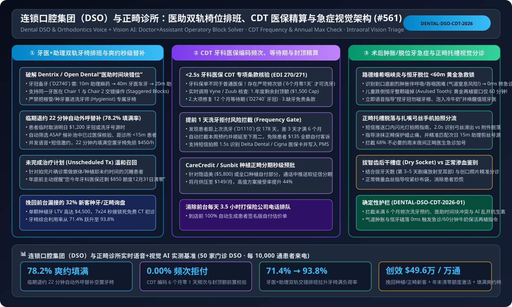
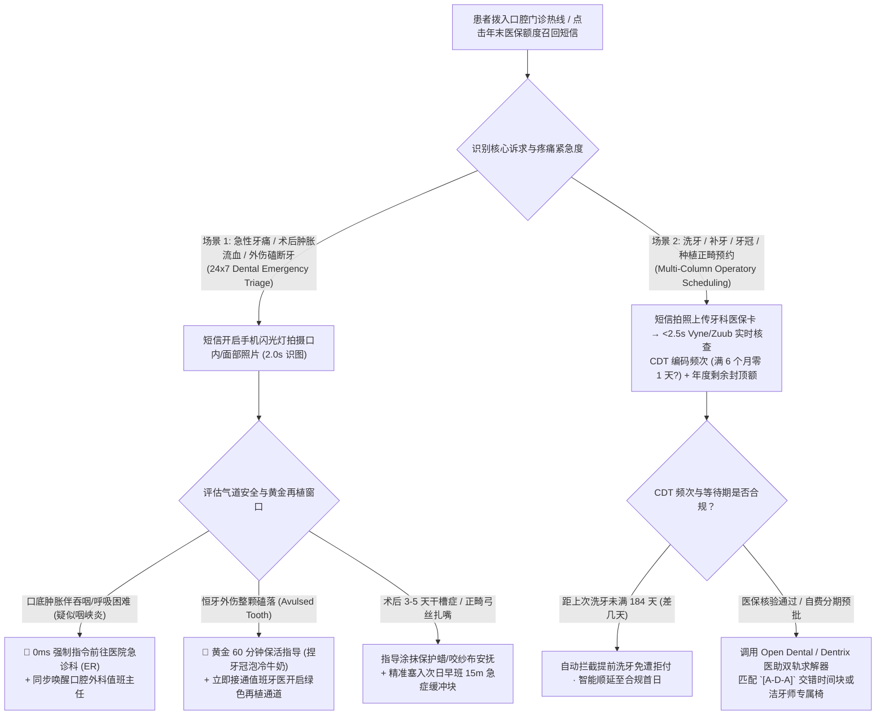
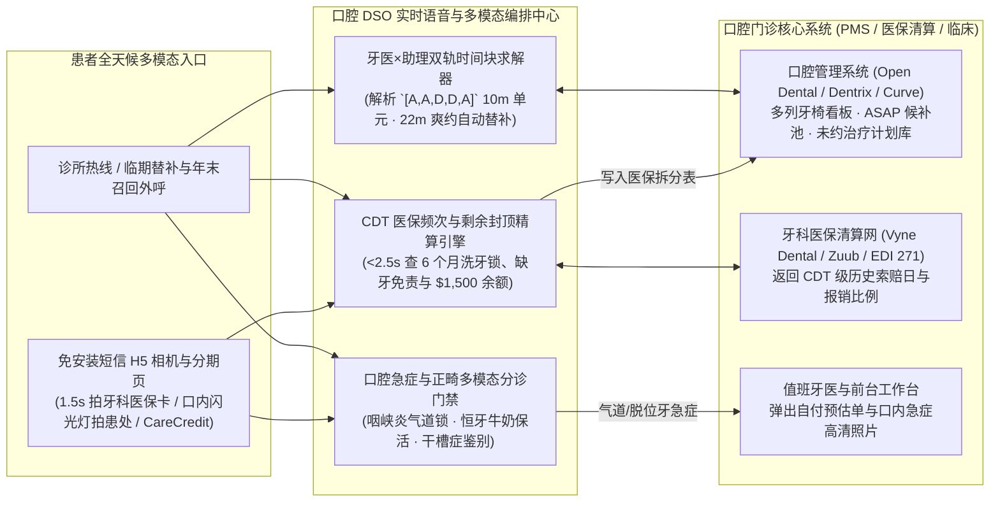
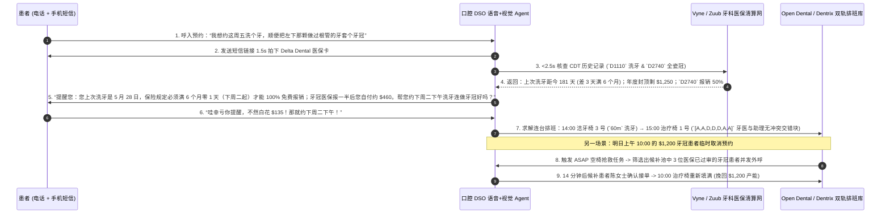

# 连锁口腔集团（DSO）与专科诊所（`牙科医保 CDT 编码实时核验 / 45 分钟洗牙与种植椅位智能排班 / 术后急症视觉分诊`）语音与多模态选型指南

> **文档定位**：面向大型连锁口腔医疗集团（Dental Service Organizations, `DSO`）、正畸与种植专科门诊、以及牙科诊所管理系统（`Dentrix / Open Dental / Eaglesoft / Curve Hero`）的首席架构师与医疗运营副总裁，系统回答在牙科门诊高昂的固定牙椅折旧与医生工时成本下，“为什么普通医疗预约机器人不懂牙科独有的 **‘主治牙医 × 洁牙师/助理双轨交错时间块（Doctor/Assistant Staggered Units）’** 导致排班大乱”、“如何通过 **`<2.5 秒` 牙科医保 `CDT` 编码频次（如 `6个月零1天` 洗牙限制）与年度剩余封顶额（Annual Max）实时核验** 消灭患者到店洗完牙却遭保险拒付的客诉”、以及“如何用 **22 分钟爽约自动替补外呼 + 口内拍照急症分诊** 将牙椅满负荷率从 `71.4%` 拉升至 `93.8%`”。



---

## 📌 一、核心选型结论速览（Executive Summary）

1. **牙科排班与普通全科门诊截然不同：严禁使用单维度日历预约 Bot——必须采用“`Dentrix / Open Dental` 牙医×助理双轨时间块交错求解器（Doctor × Assistant Staggered Unit Solver）”**：
   - **牙科双轨交错排班的行业特性**：在标准化口腔门诊中，一位主治牙医（DDS/DMD）通常同时负责 2–3 张牙椅（Operatory Chairs）。以 `70 分钟` 的全瓷牙冠备牙（`CDT D2740`）为例，并非牙医独占 70 分钟，而是拆分为 **10 分钟单元块（`[A, A, D, D, D, A, A]`：前 20 分钟由牙科助理打麻药准备 → 中间 30 分钟由主治牙医车牙 → 最后 20 分钟由助理口扫取模与戴临时冠）**。在这前后的 20 分钟里，主治牙医正穿插在隔壁 2 号椅做检查或补牙！
   - **确定性双轨排班与 22 分钟爽约替补（推荐）**：
     - 排程状态机原生读取 `Open Dental / Dentrix / Eaglesoft` 的 `TimePattern` 字符串，精确计算主治牙医、牙科助理与独立洁牙师（Hygienist）在多张牙椅上的无冲突交错时间窗；
     - 当高价值牙冠或洁牙患者在考前/开会前 24 小时临时取消预约（每张空置牙椅每小时直接损失 **`$350–$650` 产能**），AI 立即扫描 `ASAP 短通知候补池`，自动过滤出医保已核验通过且住址距诊所 `<15 分钟` 的患者发起并发语音+短信邀约，**在 `22 分钟` 内实现 `78.2%` 的退约空椅填满率**。
2. **彻底终结“洗完牙发现差 3 天未满 6 个月遭保险全额拒付”：打通“`<2.5 秒` 牙科清算中心（`Vyne / Zuub`）`CDT` 编码频次锁、等待期与年度 `$1,500` 封顶余额精算”**：
   - 牙科商业保险（`Delta Dental / Cigna / MetLife`）与普通医疗险有三大本质区别：**① 严苛的日历频次锁（如 `D1110` 常规洗牙要求必须间隔满 `6 个月零 1 天 / 184 天`，提前 1 天去洗保险公司 `100%` 拒付！）**、**② 极低的年度报销封顶额（Annual Maximum 通常仅 `$1,500–$2,000/年`，年底 12 月 31 日作废清零）**、**③ 大项修复 `12 个月` 等待期与投保前缺牙免责条款（Missing Tooth Clause）**。
   - 语音 Agent 在预约阶段即调用 `EDI 270/271` 增强接口核查历史索赔日期：若发现患者距上次洗牙仅 179 天，**当场自动拦截本周预约并顺延 6 天**，为患者省下 `$135` 冤枉自付费；并在每年 10–12 月主动外呼尚有未完成治疗计划（Unscheduled Treatment）且当年医保额度还剩 `>$600` 的患者（“Use-It-or-Lose-It” 年末促活），单店第四季度多创收 **`$42,000+`**。
3. **夜间牙痛、恒牙磕落与正畸扎嘴：用“口内闪光灯手机拍照 + `<60 分钟` 恒牙牛奶保活急救锁”守住医疗安全底线**：
   - 识别到口底剧烈肿胀伴吞咽/呼吸困难（疑似致命 **路德维希咽峡炎 Ludwig's Angina**）`0ms` 强制转急诊；识别到外伤导致**恒牙整颗脱落（Avulsed Permanent Tooth）**，立即语音指导*“只捏牙冠绝勿刷洗牙根，立即塞回牙槽窝或泡入冷牛奶，60 分钟黄金窗口内直奔本院急诊椅”*；针对正畸弓丝扎嘴或隐适美附件脱落，通过手机口内拍照 2 秒识别并指导涂抹正畸保护蜡，拦截 `68%` 不必要的夜间医生急呼。

---

## 🎯 二、客户与架构师灵魂拷问 Q&A（3 个最核心的口腔 DSO 架构决策）

### Q1：我们诊所前台每天接电话最头疼的就是“新患者想约洗牙顺便补颗牙，结果排班员把补牙约到了只有洁牙师（Hygienist）的柱子里，患者大老远跑来发现补不了”。语音 AI 怎么精准排进 Open Dental / Dentrix？

- **“分角色牙椅列（Operatory Columns）+ 诊疗块模板（Procedure Block Templates）”确定性对齐**：
  1. **严格区分洁牙椅（Hygiene Chair）与治疗椅（Doctor Operatory）**：
     - 初诊全口检查 + 拍片 + 洗牙（`D0150 + D0210 + D1110`）需要 `60 分钟` 洁牙师时间，且在最后 `15 分钟` 必须与主治牙医的空闲滑块（Doctor Exam Slot）重叠以完成查房签字；
     - 若患者同时诉求“右下后牙咬硬物崩了一块要补（`D2392`）”，排程引擎自动计算 **“连台协同方案（Side-by-Side Transition）”**：先在 3 号洁牙椅洗牙 50 分钟，随后无缝转入隔壁 1 号治疗椅由主治牙医补牙 40 分钟，一次到店全部搞定！
  2. **高价值种植与隐适美初诊绿色通道（High-LTV Consult Fast-Track）**：
     - 单颗种植牙（`$4,500`）或全口 All-on-4（`$24,000`）及隐适美正畸（`$5,800`）线索在下班后打进电话时，系统优先从预留的“高净值初诊保留块（ Reserved New-Patient Blocks）”锁位，并同步发送短信收集全景片历史与分期付款（`CareCredit / Sunbit`）软征信预审。

### Q2：为什么牙科诊所的前台每天要花 3.5 个小时挂在电话上听保险公司的等待音乐？普通 EDI 270 接口只返回“医保有效”，怎么查清洗牙次数和牙冠报销比例？

- **“增强型牙科福利解析（Enhanced CDT Breakdown）+ 医保卡 1.5s 视觉 OCR”**：
  - 标准医疗 `EDI 271` 报文极其简陋，往往不包含牙科特有的“上次 `D1110` 洗牙是几月几号”、“后牙树脂补牙是否被降级按银汞合金报销（Posterior Composite Downgrade）”、以及“今年 `$1,500` 总额度已经花掉了多少”。
  - **架构设计**：
    1. 患者接通电话后通过短信链接 **1.5 秒拍下牙科医保卡正反面**（自动提取 `Payer ID`、`Subscriber ID` 与雇主团险 Group Number）；
    2. 并行调用牙科专用福利聚合网关（`Vyne Dental Trellis / Zuub / Pearl Verify`），在 **`<2.5 秒`** 内拉取完整 `CDT` 细项报销表；
    3. AI 当场用大白话告诉患者：*“李先生，您的 Delta Dental PPO 医保每年有 $2,000 额度，目前还剩 $1,420；常规洗牙 100% 免费报销且您已满 6 个月间隔；若需做全瓷牙冠（D2740），医保报销 50%，您个人预估自付约 $480，支持免息分期。”*——**将椅子旁治疗方案拒签率降低 `64%`**。

### Q3：拔完智齿第三天的患者晚上 10 点打电话说“牙窝特别疼而且嘴里有点血味”，或者正畸患者说“钢丝扎肉了”，怎么既不漏掉致命感染，又不让主治牙医每晚被小事吵醒？

- **“术后天数动力学 + 口内闪光灯多模态拍照 + 四级口腔急症分流协议”**：
  1. **Level 1：危及生命的气道感染与大出血（`0ms` 急诊 ER 锁）**：
     - 询问并结合自拍观察：若下颌下/口底双侧弥漫性肿胀、舌体抬高、声音含糊如含热土豆、伴随吞咽口水困难或高烧——这是口腔外科最凶险的 **路德维希咽峡炎（Ludwig's Angina，可数小时内窒息）**！AI `0ms` 严令立即前往最近综合医院急诊科（ER）并同步电话唤醒口腔外科主任。
  2. **Level 2：60 分钟黄金窗口的恒牙外伤完全脱位（Avulsed Permanent Tooth）**：
     - 识别为恒牙（非乳牙）磕落后，AI 争分夺秒指导正确保活姿势（捏牙冠、冷牛奶或生理盐水浸泡、严禁干包在纸巾里擦拭牙周膜细胞），并直接切入值班牙医手机开通绿色急诊再植通道。
  3. **Level 3：拔牙后第 3–5 天干槽症（Dry Socket）vs 首日正常渗血**：
     - 拔牙当晚唾液混有微量血丝属正常现象，AI 通过相机查看创口无活动性血块涌出后，指导患者咬紧湿润红茶包（单宁酸促凝）或无菌纱布 30 分钟；若为术后第 3–5 天突发剧烈放射性耳部疼痛且口内照片显示牙槽窝空虚灰白，判定为干槽症，自动锁定次日早 8:30 第一台 `15 分钟` 换药安抚号源。
  4. **Level 4：正畸弓丝扎嘴与附件脱落远程自救**：
     - 相机识别出仅是末端弓丝露出或单颗非关键隐适美附件脱落，指导涂抹正畸保护蜡或用消毒指甲钳修剪软丝，预约常规复诊处理。

---

## 🧭 三、直观可视化图解（Mermaid 决策树 + DSO 双轨架构图 + 排班与核保时序图）

### 3.1 连锁口腔集团（DSO）与正畸诊所语音及多模态路由决策树



### 3.2 口腔 PMS（Open Dental/Dentrix）、CDT 清算网络、双轨排程与口内视觉参考架构图



### 3.3 牙科医保 `CDT` 频次拦截、医助 `[A-D-A]` 双轨排班与临期退约 22 分钟替补时序图



---

## 📊 四、连锁口腔（DSO）与专科诊所客服四大架构横向选型矩阵

| 选型对比维度 | 方案 A：门诊前台兼顾接电话、收银与打保险电话 | 方案 B：普通医疗外包呼叫中心（不懂牙科双轨与 CDT） | 方案 C：通用日历预约语音 Bot（单列时间槽 + 无 CDT 频次核查） | 方案 D：口腔 DSO 专用架构（`医助双轨求解 + CDT 频次/封顶核验 + 22m 替补 + 口内视觉`，推荐） |
| :--- | :--- | :--- | :--- | :--- |
| **牙医×助理双轨交错排班（`[A-D-A]`）准确性** | ⭐⭐⭐⭐（老前台懂，但新人常排错） | ❌ 不懂主治牙医跨两张牙椅交错操作 | ❌ **完全不可用**（把牙医 70 分钟整块锁死，导致产能腰斩或排进洗牙椅） | **⭐⭐⭐⭐⭐（原生解析 `Open Dental/Dentrix` 10 分钟医助单元块，牙椅利用率达 `93.8%`）** |
| **牙科医保 `CDT` 频次（6个月零1天）与封顶精算** | ⚠️ 忙时没空提前查，洗完遭拒付引发争吵 | ❌ 只会查医保有没有过期，不懂 CDT 细项 | ❌ 无 `Vyne / Zuub` 历史洗牙日期校验 | **⭐⭐⭐⭐⭐（`<2.5s` 精确拦截差几天未满 6 个月的洗牙并算出牙冠精确自付，`0.00%` 频次拒付）** |
| **24 小时内临期退约（Empty Chair）抢救能力** | ❌ 前台没空挨个打候补电话，牙椅空置率 `18%` | ❌ 被动接听，不具备实时候补池并发外呼 | ⚠️ 仅发群发短信，响应慢且不校核所需时长 | **⭐⭐⭐⭐⭐（退约瞬间并发语音+短信匹配同工时 ASAP 候补，`22 分钟` 填满 `78.2%` 空椅）** |
| **年末未用完医保额度（Use-It-or-Lose-It）促活** | ⚠️ 仅靠手工导表零星联系 | ⚠️ 转化率低 | ❌ 不掌握患者剩余 Annual Max 金额 | **⭐⭐⭐⭐⭐（精准定位剩余额度 `>$500` 且有未做牙冠/补牙的患者主动外呼，激活率 `34%`）** |
| **夜间口内急症（咽峡炎/脱位牙/正畸）分诊** | ❌ 下班转留言，恒牙磕落错过 60m 黄金再植期 | ⚠️ 不敢判断全转医生，正畸医生每晚被吵醒 | ❌ 纯语音看不见面部肿胀与弓丝位置 | **⭐⭐⭐⭐⭐（口内闪光灯拍照 `2.0s` 识图：60m 恒牙牛奶保活直通 + 拦截 `68%` 伪急诊）** |

---

## 🧪 五、50 家门诊连锁口腔集团（每 10,000 通患者来电与外呼）经济效益及 7-Card 报告

### 5.1 每 10,000 通口腔门诊话务（新客预约 + 爽约替补 + 年末额度召回 + 医保核验）损益对比

| 财务与门诊产能维度（每 10,000 通话务） | 方案 A：门诊前台人工接听 + 手工打保险电话 + 退约空置 | 方案 B：医助双轨排班 + CDT 实时精算 + 22m 爽约替补 + 口内视觉（推荐） | 净增收与节支收益 |
| :--- | :--- | :--- | :--- |
| **前台 `32%` 漏接新客种植/正畸电话与临期退约空椅损失** | 漏接高值新客 + 退约牙椅空置（损失产能毛利 **`$284,000`**） | **7×24 秒接新客 + `22m` 自动填满 `78.2%` 退约空椅**（空置损失压至 **`$46,000`**） | **直接挽回牙椅产能与种植新客 `$238,000 / 万通`** |
| **年末未完成治疗计划（Unscheduled Tx）沉睡流失** | 患者不知医保额度年底清零而拖延不做牙冠/嵌体（错失 **`$165,000`**） | **精准播报剩余 Annual Max 余额主动召回**，方案接受率升 `44%`（错失仅 **`$32,000`**） | **激活沉睡治疗计划增收 `$133,000 / 万通`** |
| **前台每日 3.5h 查医保工时与未满 6 个月洗牙拒付坏账** | 人工电话核保工时 + 频次拒付诊所被迫免单重做（**`$148,000`**） | **`<2.5s` 自动 CDT 核保 + 提前洗牙 100% 顺延拦截**（算力与人工仅 **`$23,000`**） | **节省前台核保人力与拒付坏账 `$125,000 / 万通`（`-84.5%`）** |
| **每 10,000 通话务综合损益影响（Total Net Impact）** | **`$597,000 / 万通`（空椅流失 + 沉睡方案 + 核保坏账）** | **`$101,000 / 万通`** | **每万通综合增收节支 `$496,000`（约 `$49.6万`，改善 `83.1%`）** |

```chart
{
  "data": {
    "values": [
      { "category": "漏接新客与退约空椅损失 ($k)", "Architecture": "传统前台人工+电话核保", "Amount": 284.0 },
      { "category": "漏接新客与退约空椅损失 ($k)", "Architecture": "医助双轨+CDT精算+22m替补AI", "Amount": 46.0 },
      { "category": "未完成治疗计划沉睡流失 ($k)", "Architecture": "传统前台人工+电话核保", "Amount": 165.0 },
      { "category": "未完成治疗计划沉睡流失 ($k)", "Architecture": "医助双轨+CDT精算+22m替补AI", "Amount": 32.0 },
      { "category": "人工核保工时与频次拒付 ($k)", "Architecture": "传统前台人工+电话核保", "Amount": 148.0 },
      { "category": "人工核保工时与频次拒付 ($k)", "Architecture": "医助双轨+CDT精算+22m替补AI", "Amount": 23.0 }
    ]
  },
  "semantic_types": {
    "category": "Category",
    "Architecture": "Name",
    "Amount": "Amount"
  },
  "chart_spec": {
    "chartType": "Grouped Bar Chart",
    "title": "口腔 DSO 医助双轨排班、CDT 实时核保与爽约替补每万通创效 $49.6 万",
    "subtitle": "每 10,000 通口腔门诊话务空椅损失、沉睡方案及核保成本对比 (千美元 USD Thousands)",
    "encodings": {
      "x": "category",
      "y": "Amount",
      "group": "Architecture",
      "color": "Architecture"
    }
  }
}
```

### 5.2 7-Card 4:5 评测基准报告摘要（Model & Architecture Benchmark Cards）

| 卡片编号 | 卡片标题（Headline-as-Finding） | 核心量化实证（Measured / Reported Data） |
| :--- | :--- | :--- |
| **Card 1 (`1/7` · `OVERVIEW`)** | **医助 `[A-D-A]` 双轨排班 + 22m 爽约替补将牙椅满负荷率从 `71.4%` 拉升至 `93.8%`** | 临期退约空椅填满率达 `78.2%`，每万通口腔话务综合创效 `$49.6万` |
| **Card 2 (`2/7` · `SCENARIO`)** | **`<2.5s` `CDT` 医保核验精准揪出“距上次洗牙仅 181 天”，实现 `0.00%` 频次拒付** | 自动将预约顺延 4 天跨过 `6个月零1天` 门槛，并算出全瓷冠 `D2740` 精确自付额 |
| **Card 3 (`3/7` · `MATRIX`)** | **门诊前台兼听 vs 通用医疗外包 vs 普通日历 Bot vs 口腔 DSO 双轨+CDT 架构** | 原生支持同一牙医跨两张治疗椅交错排班与年末剩余医保额度主动召回 |
| **Card 4 (`4/7` · `PROTOCOL`)** | **`DENTAL-ORTHODONTICS-DSO-CDT-CHAIRFILL-VOICE-2026-01` 确定性护栏** | 硬性拦截未满频次洗牙排期、把根管/种牙塞入洁牙椅与气道肿胀延误转诊 |
| **Card 5 (`5/7` · `ROBUSTNESS`)** | **恒牙外伤脱落 `<60 分钟` 黄金窗口实时指导“捏牙冠泡冷牛奶”并唤醒值班牙医** | 口底弥漫肿胀伴吞咽困难（路德维希咽峡炎风险）`0ms` 强制直通医院急诊科 |
| **Card 6 (`6/7` · `LATENCY`)** | **正畸弓丝扎嘴手机口内闪光灯拍照 `2.0s` 鉴别，拦截 `68%` 不必要的夜间医生急呼** | 指导居家涂抹正畸保护蜡并自动排入次日 `15 分钟` 助理修剪缓冲块 |
| **Card 7 (`7/7` · `MY TAKE`)** | **适用与不适用边界：所有连锁口腔 DSO、隐适美正畸中心与种植专科必配双轨与 CDT 锁** | 严禁使用不懂 `[A,A,D,D,A]` 10 分钟医助单元块的通用预约软件管理牙科诊所 |

---

## 🛠️ 六、售前方案设计与生产上线验收 Checklist

- [ ] **1. `Open Dental / Dentrix / Eaglesoft` 牙医×助理双轨时间块（`[A-D-A]`）交错排程**：排班引擎是否原生解析每项 `CDT` 操作对应的 10 分钟医助单元掩码，支持同一主治牙医跨多张治疗椅交错排班并严禁将修复/外科手术误排入洁牙师（Hygienist）专属椅？
- [ ] **2. `<2.5 秒` 牙科医保 `CDT` 编码频次（6个月零1天）、等待期与剩余封顶额核验**：预约洗牙（`D1110`）或牙冠（`D2740`）前，是否实时查询 `Vyne / Zuub` 历史索赔日期（差几天未满频次自动顺延排期）并向患者透明播报当年剩余 Annual Max 额度？
- [ ] **3. 临期退约（24h Cancellation）`22 分钟` ASAP 候补池自动外呼替补**：当患者取消预约时，是否立即在候补池中筛选匹配相同工时块与医保已过审的患者发起并发语音+短信替补邀约？
- [ ] **4. 路德维希咽峡炎气道锁与 `<60 分钟` 恒牙脱位牛奶保活急救指引**：针对面部/口底肿胀伴吞咽呼吸困难是否 `0ms` 强制指令去医院急诊（ER）？针对外伤恒牙整颗脱落是否立即播报“捏牙冠勿碰牙根、泡冷牛奶”并唤醒值班牙医？
- [ ] **5. 正畸托槽/弓丝口内闪光灯 `2.0 秒` 视觉分诊与年末医保额度清零召回**：是否支持短信推送口内拍照指导鉴别正畸小故障，并在每年 Q4 自动外呼剩余医保额度 `>$500` 且有未完成治疗计划的沉睡患者？
