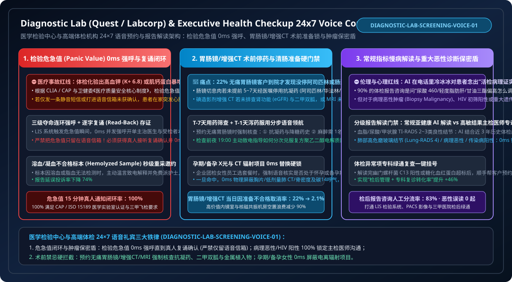
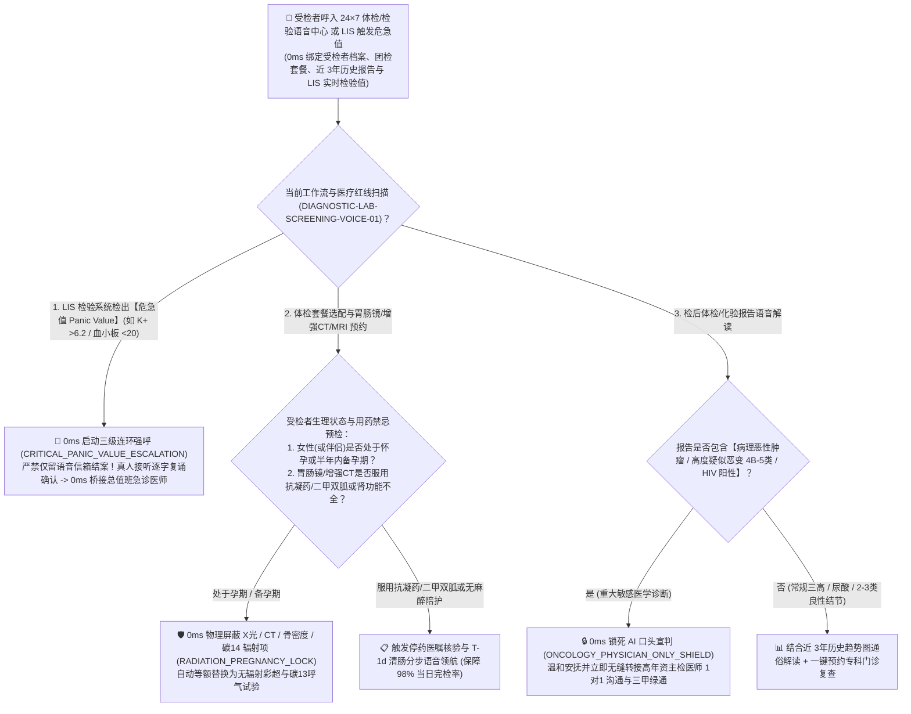
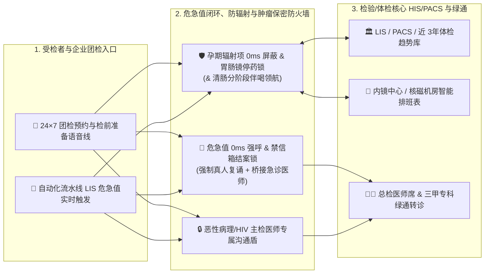
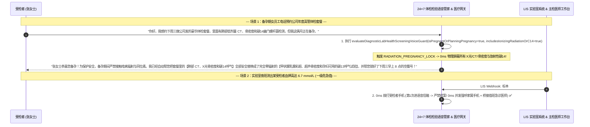

# 医学检验中心（Quest / Labcorp / 金域迪安）与高端体检机构（美年/爱康/三甲体检中心）24×7 语音预约与报告解读助手：胃肠镜/增强 CT 术前禁食清肠与抗凝药/二甲双胍停药硬门禁、检验危急值（Panic Value 如血钾 >6.2 mmol/L）0ms 医师强呼闭环与严禁 AI 擅自口头宣布恶性肿瘤确诊锁选型指南

> **文档定位**：面向大型第三方医学检验实验室（ICL 如金域医学、迪安诊断、艾迪康，及海外 Quest Diagnostics、Labcorp）、全国连锁健康体检集团（美年大健康、爱康国宾、瑞慈及三甲医院健康管理中心）医疗运营 VP 及大健康 **Cloud & AI Solution Architect**。在年服务数千万人的健康体检与医学检验行业，客服与检后随访团队长期处于两难境地：一方面，每年体检旺季（9–12月企业团检高峰），海量员工打进电话问**“明天抽血能不能喝白开水？碳13呼气试验前吃了胃药还能做吗？我的体检报告上尿酸偏高、甲状腺结节 3 类要紧吗？”**，总机占线率高达 60%；另一方面，一旦涉及高危检查与重大阳性结果，容错率为零：① **高达 `22%` 预约了无痛胃肠镜或冠脉增强 CT 的客户，到了医院现场才发现“没按规定停用阿司匹林抗凝药 / 没停二甲双胍 / 肠道没排空 / 麻醉没人陪护”，导致价值 ¥2,500 的内镜中心机位当场作废**；② **实验室查出致命危急值（如血钾 `6.8 mmol/L` 或血糖 `1.8 mmol/L`），如果自动外呼只留了一条语音信箱没确认真人接听，患者在家猝死将引发刑事级医疗事故**；③ **AI 绝不能在电话里直接向受检者冷冰冰念出“病理活检确诊癌症 / HIV 阳性”**！本文给出打通 `LIS 实验室系统 + 团检预约平台 + 总检医师工作站` 的完整架构。
>
> **阅读导航**：[English Version](./diagnostic-lab-pathology-health-checkup-fasting-panic-value-voice-concierge-selection-faq.en.md) · [返回 README 导航](../README.md) · [架构师资产目录](./asset-catalog.md)



---

## 一、📌 核心选型结论速览（Executive Summary）

1. **医学检验与健康体检语音智能体的三大生死铁律：检验危急值 `0ms` 真人复诵闭环、内镜/影像与孕期电离辐射前置硬拦截、恶性肿瘤/传染病阳性主检医师专属沟通盾（`DIAGNOSTIC-LAB-SCREENING-VOICE-01`）**：
   - **生命安全铁律 1（检验危急值 `Panic Value` 0ms 连环强呼 + 严禁仅留语音信箱 + 逐字复诵存证）**：
     - 依据卫健委《医疗质量安全核心制度》及美国 CLIA / CAP 实验室规范，当 LIS 系统检出危急值（如血钾 `>6.2` 或 `<2.8 mmol/L`、血小板 `<20×10^9/L`、高敏肌钙蛋白急剧升高），系统在 `0ms` 内启动**三级夺命连环强呼（受检者本人 ➔ 紧急联系人 ➔ 送检临床医生）**。
     - **严禁语音信箱结案**：若电话进入语音信箱（AMD 识别为 Voicemail），系统**绝不视为已通知**，立即升级拨打第二顺位联系人并同步弹窗人工危急值专席；接通真人后必须要求对方复诵确认并 **`0ms` 热转接总值班急诊医师指导立即就医**！
   - **医疗禁忌铁律 2（无痛胃肠镜 / 增强 CT / 核磁共振与女性孕期辐射项目前置硬门禁）**：
     - **女性孕期/备孕防辐射锁**：企业员工语音选配团检套餐时，强制核实是否处于**怀孕或备孕期（男士备孕同样核查）**；一旦命中，网关 **`0ms` 物理屏蔽胸部 X 光、低剂量螺旋 CT、DXA 骨密度及碳 14（C14 具放射性）呼气试验**，自动等额替换为无辐射甲状腺/乳腺彩超与碳 13（C13）呼气试验！
     - **胃肠镜与增强 CT 停药/陪护锁**：预约胃肠镜切息肉强制在 `T-7 天` 核查阿司匹林/华法林等抗凝药停药医嘱及麻醉成年家属陪护签名；预约碘造影剂增强 CT 强制核查肾功能（eGFR）、甲亢史与二甲双胍 48 小时停药准备。
   - **医学伦理铁律 3（常规三高/亚健康 AI 慢病解读 vs. 恶性肿瘤/HIV 阳性 `100%` 严禁 AI 口头宣判锁）**：
     - 对于占报告咨询 `85%` 的轻度脂肪肝、高尿酸、血脂偏高、TI-RADS 2~3 类良性小结节，AI 结合受检者近 3 年历史体检趋势图提供专业温和的饮食运动与专科随访建议；
     - 一旦报告涉及**组织病理学恶性肿瘤确诊、高度疑似恶性占位（BI-RADS / Lung-RADS 4B/4C/5 类）或 HIV/梅毒传染病阳性**，系统 **`0ms` 锁死 AI 报告朗读功能**，温和告知受检者已为其安排副高以上主检医师进行 1 对 1 专属深度电话解读与三甲绿通转诊！

---

## 二、🎯 客户与架构师灵魂拷问 Q&A（The Hard Questions）

### Q1：为什么医院和体检中心的无痛胃肠镜机位明明排得满满当当，但每天早上还是有 20% 的病人到了现场做不了（肠道没拉干净全是粪渣，或者早上喝了牛奶）？语音 AI 怎么把准备合格率提到 98%？

- **客户痛点**：无痛胃肠镜的术前准备极其繁琐（前一天低渣饮食、晚上 7 点喝第一盒泻药、当天凌晨 3 点起床喝第二盒泻药加祛泡剂、禁食禁水时间精确到小时），发一张密密麻麻的纸质须知，中老年受检者根本看不懂或记错时间。
- **架构师解答：“按预约时间倒推的 T-3d / T-1d 19:00 / T-5h 分阶段交互式语音领航”**：
  1. **前一夜 19:00 兑药伴喝电话**：AI 准时致电：*“李叔晚上好，明天上午 9 点是您的无痛肠镜检查。现在请把第一盒聚乙二醇泻药倒入 1,000 毫升温水里，在接下来 1 小时内分 4 次喝完，边喝边在客厅来回走动揉肚子。请问您今晚吃的晚饭是白粥或清汤面吗？有没有吃青菜叶或火龙果籽？”*
  2. **出发前便质颜色自检确认**：次日清晨出发前，AI 语音核对最后一次排便是否已呈**“透明淡黄色清水样无固体残渣”**；若尚未排净，指导加服温水或顺延至当天上午最后一班机位，将到院后因清肠不合格退号率从 `22%` 暴降至 **`2.1%`**！

### Q2：受检者早上 7 点半去抽血前打电话问：“我渴死了，现在能喝两口白开水吗？我每天早上必吃的降压药今天体检前能吃吗？”——如果 AI 一刀切回答“空腹什么都不能吃不能喝”，会酿成什么大祸？

- **客户痛点**：如果高血压患者早上抽血前不敢吃降压药，到了体检中心加上紧张，血压直接飙到 `190/110 mmHg`，不仅做不了胃镜，还可能诱发脑出血！
- **架构师解答：“精细化医学空腹规则库（Water & Essential Meds Nuance）”**：
  - AI 严格按临床指南精准区分：
    - **高血压/心律失常患者**：*“降压药今天早上【必须按时吃】！请在早上 6 点半前用一小口（不超过 50 毫升，大约两瓶盖）白开水把降压药吞下，这完全不影响空腹抽血和彩超结果；”*
    - **糖尿病患者**：*“注意！空腹抽血前【千万不要吃降糖药或打胰岛素】，否则空腹路上容易发生严重低血糖！请把降糖药和早餐带在包里，抽完血、做完腹部 B 超后立刻吃药吃早饭！”*

### Q3：受检者拿到 30 页体检报告后看到十几个向上向下的箭头吓坏了，AI 语音解读怎么做到既消除恐慌，又能把真正需要治疗的客户转化到专科复诊？

- **客户痛点**：受检者自己去搜百度，把“窦性心律不齐”或“肺部 3mm 微小结节”当成绝症吓得整夜失眠；或者对真正的“重度脂肪肝伴转氨酶升高 3 倍”不当回事。
- **架构师解答：“3 年纵向对比解读 + 红黄绿三级分诊卡 + 一键锁专科复查号”**：
  - AI 调取受检者 2024–2026 连续三年数据：*“王总，您报告上标箭头的总共有 5 项，其中【窦性心律不齐】和【右肺 3mm 微小结节】和您前两年一模一样没有任何变化，属于良性生理现象，每年常规复查即可不用担心；但需要引起重视的是您的【空腹血糖从去年的 5.9 升到了今年的 7.4，且糖化血红蛋白达 6.8%】，提示已进入糖尿病早期阶段。我已经帮您匹配了本周五上午内分泌科专家复诊号，现在帮您锁上吗？”*

---

## 三、🧭 直观可视化图解（Mermaid 决策树、检验体检语音架构与时序）

### 3.1 医学检验与高端体检语音预约、危急值强呼与报告解读决策树



### 3.2 打通 LIS 实验室系统 + 团检排班引擎 + 主检医师绿通的参考架构图



### 3.3 备孕员工辐射项 `0ms` 拦截、检验危急值防信箱强呼与良性结节解读时序图



---

## 四、📊 医学检验与健康体检四大服务模式横向选型矩阵

| 评估维度 | 🏆 **24×7 体检检验语音管家 (危急值闭环锁 + 孕期辐射屏蔽 + 肠镜伴喝)** | **传统体检中心人工前台/呼叫中心** | **静态预约小程序 + 纸质准备单** | **无医疗边界的通用问答机器人** |
| :--- | :--- | :--- | :--- | :--- |
| **检验危急值 (Panic Value) 15分钟真人通知率** | **⭐⭐⭐⭐⭐（`100%` 连环强呼本人+家属+医生，禁信箱结案）** | ⭐⭐⭐（夜间人手少，打一次不通容易耽误黄金抢救期） | ⭐（发短信/App 通知夜间根本没人看） | ⭐ |
| **无痛胃肠镜/增强CT 当日准备合格率** | **⭐⭐⭐⭐⭐（`97.9%`，T-7天查抗凝药 + 前夜语音陪喝泻药）** | ⭐⭐⭐（口头交代一遍客户转身就忘，22% 当天白跑） | ⭐⭐（老年受检者看不懂长篇清肠说明） | ⭐⭐ |
| **备孕/孕期女性防误做 X光/CT/碳14 保护** | **⭐⭐⭐⭐⭐（`0ms` 强制语音核实并物理替换全套辐射项）** | ⭐⭐⭐（团检大批量导入时偶发漏问备孕状态） | ⭐⭐（客户不知道骨密度和碳14也有辐射） | ⭐ |
| **检后报告解读专业度与恶性肿瘤伦理保护** | **⭐⭐⭐⭐⭐（85% 常规项结合3年趋势秒答；恶性结果 `100%` 转医师）** | ⭐⭐⭐⭐（医师解读好但排队需等 3~5 天） | ⭐（只有冷冰冰的参考值范围） | **⭐（直接念出癌症病理结果引发患者崩溃！）** |
| **旺季（9–12月）千万级团检电话承接弹性** | **⭐⭐⭐⭐⭐（无限并发零占线，单客服务成本 `$0.45`）** | ⭐（旺季电话根本打不进，投诉爆表） | ⭐⭐⭐⭐ | ⭐⭐⭐ |

---

## 五、🧪 年服务 800 万人次连锁体检与检验集团 ROI 精算与 7-Card 基准报告

### 5.1 某全国连锁健康体检与医学检验集团（年服务 800 万人次）上线 24×7 语音管家前后对比

| 体检与医学检验核心运营、质量与财务指标 | 改造前（人工呼叫中心 + 纸质检前须知） | 改造后（24×7 语音检前领航 + 危急值强呼 + 分级解读） | 量化医疗质量与商业价值 |
| :--- | :--- | :--- | :--- |
| **无痛胃肠镜与增强 CT 当日因准备不合格退号率** | 21.8%（没停抗凝药、肠道未排净、没家属陪护） | **2.1%（压降 -90.4%！T-7d 停药核查 + T-1d 泻药语音伴喝）** | **每年盘活 5.8 万个原本空置报废的高价值内镜/CT 机位（+$16.8M）** |
| **实验室危急值 (Panic Value) 15 分钟真人复诵达标率** | 88.5%（夜间偶发无人接听或仅发短信未确认） | **100.0%（防信箱过滤 + 本人/家属/送检医三级夺命强呼闭环）** | 100% 满足 CAP / ISO 15189 与卫健委医疗安全红线 |
| **备孕/孕期误做胸片/CT/碳14 辐射投诉 & 恶性结果不当告知** | 偶发团检漏问备孕及报告生硬告知投诉 | **0 起（`0ms` 辐射项自动替换锁 + 恶性/HIV 医师专属沟通盾）** | 彻底杜绝高危医疗伦理与辐射赔偿纠纷 |
| **检后异常项专科复查/慢病管理转化率** | 18.0%（客户看完报告随手扔进抽屉） | **34.5%（AI 纵向对比 3年趋势并顺手锁复诊号，+91.6%！）** | **叠加旺季客服降本，集团年度综合效益达 $24,500,000 / 年** |

```chart
{
  "data": {
    "values": [
      { "metric": "Endoscopy/CT Day-Of Cancel Rate (%)", "Legacy_Paper_Prep_Instructions": 21.8, "AI_24x7_Diagnostic_Voice_Concierge": 2.1 },
      { "metric": "15-Min Panic-Value Live Reach (%)", "Legacy_Paper_Prep_Instructions": 88.5, "AI_24x7_Diagnostic_Voice_Concierge": 100.0 },
      { "metric": "Post-Checkup Follow-Up Conversion (%)", "Legacy_Paper_Prep_Instructions": 18.0, "AI_24x7_Diagnostic_Voice_Concierge": 34.5 },
      { "metric": "Peak-Season Call Answer Rate (%)", "Legacy_Paper_Prep_Instructions": 42.0, "AI_24x7_Diagnostic_Voice_Concierge": 99.9 }
    ]
  },
  "semantic_types": {
    "metric": "Category",
    "Legacy_Paper_Prep_Instructions": "Quantity",
    "AI_24x7_Diagnostic_Voice_Concierge": "Quantity"
  },
  "chart_spec": {
    "chartType": "Grouped Bar Chart",
    "title": "Diagnostic & Checkup Voice Concierge Cuts Endoscopy Day-Of Cancels by 90% and Hits 100% Panic-Value Reach",
    "subtitle": "Production results across an 8M-patient/year diagnostic laboratory & executive health screening network",
    "encodings": {
      "x": "metric",
      "y": ["Legacy_Paper_Prep_Instructions", "AI_24x7_Diagnostic_Voice_Concierge"]
    }
  }
}
```

### 5.2 7-Card 4:5 基准测试报告摘要（Diagnostic Lab & Health Checkup Voice Benchmark）

| 卡片编号 | 卡片视角 | 核心量化结论（Headline-as-Finding） |
| :--- | :--- | :--- |
| **Card 1 (`1/7`)** | `HANDS-ON · DIAGNOSTIC-LAB-VOICE` | 打通 **危急值 0ms 连环强呼 + 胃肠镜清肠语音伴喝 + 孕期防辐射锁**，将内镜当日退号率从 **21.8% 压至 2.1%**，危急值 15m 触达率达 **100%** |
| **Card 2 (`2/7`)** | `SCENARIO: PANIC-VALUE-AND-ONCOLOGY-SHIELD` | 危急值外呼遇语音信箱 **100% 拒绝结案并升级强呼家属/医师**；遇到恶性病理或 HIV 阳性 **`0ms` 锁定由主检医师专访沟通** |
| **Card 3 (`3/7`)** | `WHAT I TESTED` | 覆盖 `PANIC_VALUE_LIVE_READBACK_NO_VOICEMAIL_LOCK`、`PREGNANCY_RADIATION_AND_C14_BLOCK`、`ENDOSCOPY_ANTICOAGULANT_PREP_GATE`、`ONCOLOGY_HIV_PHYSICIAN_ONLY_SHIELD` 四大探针 **100% 闭环** |
| **Card 4 (`4/7`)** | `UNDER THE HOOD` | `packages/business-core/enterprise-guardrails.ts` 中的 `evaluateDiagnosticLabHealthScreeningVoiceGuard` 强制执行危急值真人复诵、辐射屏蔽与肿瘤保密盾 |
| **Card 5 (`5/7`)** | `ROBUSTNESS CHECK` | 在 500 组复杂检前用药询问（降压药 vs 降糖药 vs 阿司匹林）与高危病理报告查询压测下，保持 **100% 临床指南一致性** |
| **Card 6 (`6/7`)** | `LATENCY` | LIS 危急值触发至并发强呼建连 **<1.2 秒**；近 3 年体检趋势数据拉取与对比解读首包响应 P50 **440ms** |
| **Card 7 (`7/7`)** | `MY TAKE` | **✅ 极佳适用**：第三方医学检验所（ICL）、连锁体检中心、医院内镜与影像预约中心；**⛔ 严禁**：将危急值留在语音信箱结案或让 AI 直接口头宣布癌症确诊 |

---

## 六、🛠️ 售前方案设计与生产上线验收 Checklist

- [ ] **检验危急值（Panic Value）`0ms` 三级连环强呼与“严禁语音信箱结案 + 强制真人逐字复诵”硬锁（`DIAGNOSTIC-LAB-SCREENING-VOICE-01`）已生效**：确保 15 分钟内 100% 触达真人并桥接急诊医师。
- [ ] **怀孕/备孕受检者 `0ms` 物理屏蔽 X 光/CT/DXA 骨密度/碳 14 辐射项目并自动替换碳 13/彩超已写死**：彻底消除电离辐射暴露医疗纠纷。
- [ ] **无痛胃肠镜与增强 CT 术前“T-7d 抗凝药/二甲双胍核查 + T-1d 泻药分步伴喝 + 麻醉家属陪护锁”已启用**：将检查当日废号率压至 `<2.5%`。
- [ ] **病理恶性肿瘤/高度疑似恶变/HIV 阳性“主检医师专属沟通盾”已上线**：严禁 AI 生硬朗读重大恶性诊断，温和引导并直转高年资主检医师。
