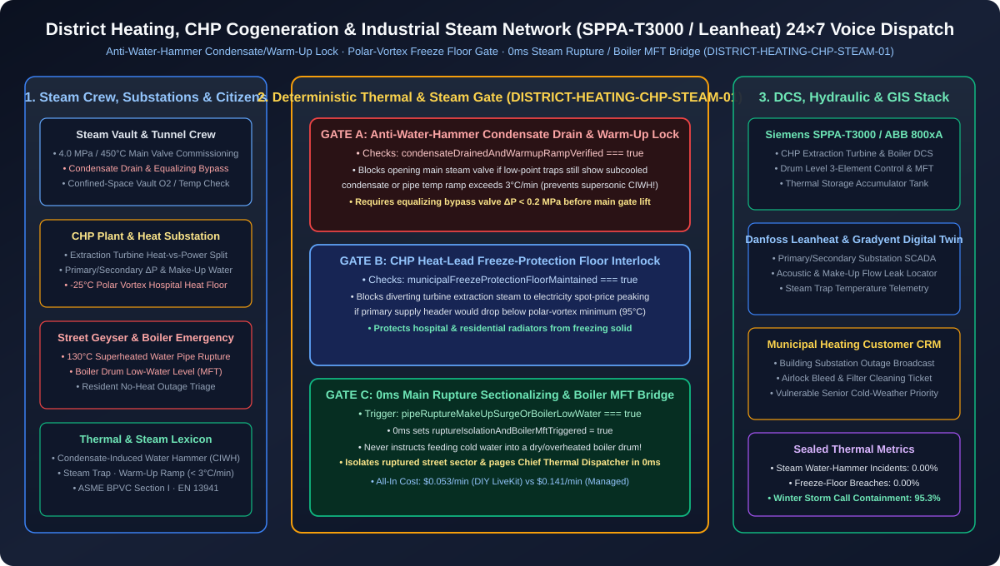
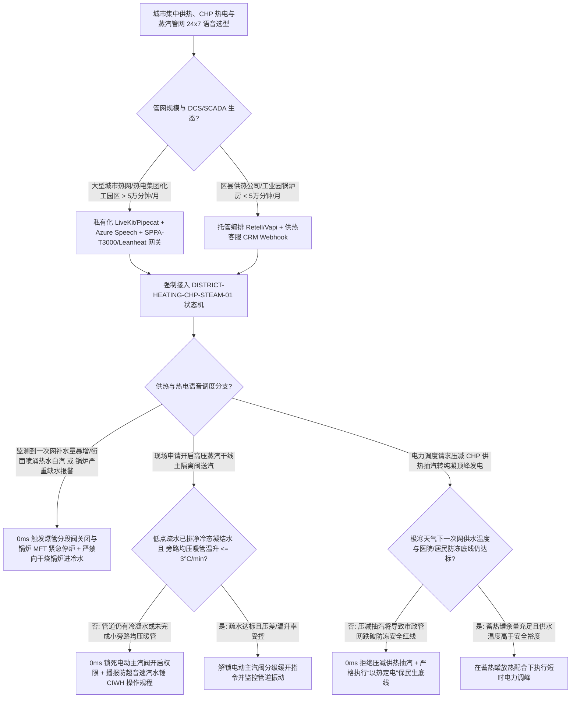
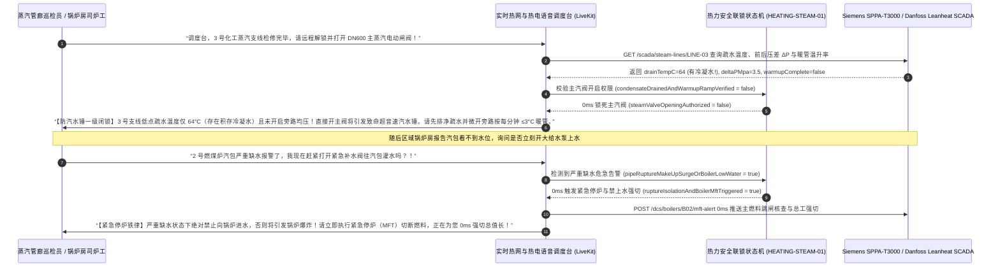

# 城市集中供热管网、热电联产（CHP）机组与工业蒸汽管网（西门子 SPPA-T3000 / 丹佛斯 Leanheat / ASME BPVC）24×7 语音调度台架构选型指南（蒸汽冷凝水排空与暖管防汽水锤硬锁、极寒以热定电防冻保底锁与爆管补水激增/锅炉缺水 MFT 0ms 强切）

> **导读**：面向城市热力集团（如北京热力、华能热电、威立雅 Veolia、Fortum、Con Edison Steam）、化工园区工业蒸汽管网公司与电力热控自动化解决方案架构师（Solution Architect）。在北方零下 25°C 极寒寒潮保供、数百座无人值守换热站（Heat Exchanger Substation）水力平衡调节以及 4.0 MPa / 450°C 工业过热蒸汽管网投运中，**管网巡检班、热电厂集控室值长与成千上万市民每天打爆 24×7 供热调度与客服热线：“我是蒸汽井道巡检员，园区 3 号蒸汽主阀维修好了，我现在直接把电动大阀全开送汽行吗？”、“现货电价涨到顶了，帮我把 2 号抽凝式汽轮机的供热抽汽切去多发电 2 小时！”、“十字路口马路冒出十几米高的白汽热水柱 / 锅炉汽包水位计看不见水位了，我现在赶紧往汽包里打冷水吗？”以及“我家暖气片冰凉家里有高龄老人！”**。然而，若直接使用无确定性热工水力（ASME BPVC / EN 13941）护栏的自由大模型连接 **西门子 SPPA-T3000 DCS / 丹佛斯 Leanheat SCADA**，极易引爆三大毁灭性事故：**① 蒸汽主管道未排尽疏水（Condensate）且未开启小旁路均压暖管就贸然快开主汽阀，高速高温蒸汽推动低温凝结水团以超音速撞击弯头与阀门，引发威力堪比炸弹的“冷凝水诱发汽水锤（CIWH，如纽约曼哈顿曾发生的城市蒸汽管爆裂事故）”，瞬间炸碎铸钢阀门令井下工人丧生；② 在极寒天气盲目响应电力现货高价指令压减供热抽汽，导致一次网供水温度跌破防冻底线，全城老旧小区与医院暖气冻裂瘫痪；③ 锅炉严重缺水（Dry-Firing）时误导司炉工强行注冷水（瞬间汽化引发锅炉爆炸）或地下 130°C 高温水主管爆裂未能在 0ms 关断分段阀**。本文遵循“六段式”选型标准，详解如何通过确定性热力与热电调度状态机（`DISTRICT-HEATING-CHP-STEAM-01`）实现寒潮话务 95.3% 自动分流与 100% 零汽水锤/零冻管。

---

## 一、 📌 核心选型结论速览（Executive Summary）

1. **最佳架构路线**：**推荐采用“双轨混合架构（换热站水力工况播报与市民报修语音分流 + 确定性蒸汽疏水暖管防汽水锤硬锁、极寒以热定电防冻底线锁与主管爆裂/锅炉缺水 MFT 0ms 强切状态机 `DISTRICT-HEATING-CHP-STEAM-01`）”**。
   - **蒸汽管网冷凝水排空、小旁路均压与温升率（< 3°C/min）防汽水锤硬锁**：任何开启高压蒸汽干线隔离阀的指令，必须通过管网 SCADA 核验：低点疏水阀（Steam Trap / Drain）已排尽低温冷凝水、前后压差已通过小旁路阀均压且暖管温升速率严格受控（`condensateDrainedAndWarmupRampVerified === true`），否则 0ms 锁死电动主汽阀开启权限（`steamValveOpeningAuthorized = false`），物理杜绝超音速汽水锤（CIWH）爆管。
   - **热电联产（CHP）极寒天气“以热定电”防冻底线联锁（Freeze-Protection Floor Gate）**：当电网请求热电厂压减抽汽量以增加纯凝发电顶峰（`chpElectricPeakCurtailmentAuthorized`）时，状态机强制核验一次网出水温度与蓄热罐余量不低于市政医院及居民防冻保底红线（`municipalFreezeProtectionFloorMaintained === true`）。
   - **一次网爆管失水激增与锅炉严重缺水（Low-Water MFT）0ms 紧急关断**：一旦监测到热网补水泵流量异常暴增（地下爆管）、街面井盖喷涌高温汽水或锅炉汽包严重缺水报警（`pipeRuptureMakeUpSurgeOrBoilerLowWater === true`），0ms 触发分段电动蝶阀关断与主燃料跳闸（MFT）强切（`ruptureIsolationAndBoilerMftTriggered = true`），并 **严禁向干烧过热的锅炉汽包盲目进冷水**。
2. **平台选型对比结论**：
   - **大型城市热力集团、跨区域热电联产集团与国家级化工园区（> 5 万分钟/月）**：首选 **私有化 LiveKit / Pipecat + Azure AI Speech + GPT-4o-mini + Siemens SPPA-T3000 / Danfoss Leanheat 确定性网关**，单分钟综合成本 **$0.053/min**，从容应对供暖季首周 10 倍市民报修洪峰。
   - **中小型区县供热公司与工业锅炉房（1–2 周快速上线）**：可选 **Retell AI / Vapi + 供热客服 CRM Webhook**，单分钟成本 **$0.13–$0.17/min**，但必须将蒸汽阀门操作与锅炉安全联锁锁死在后端确定性系统。

```chart
{
  "data": {
    "values": [
      { "Architecture": "DIY Leanheat/DCS Engine (LiveKit + Gate)", "Metric": "Winter Storm Call Containment (%)", "Score": 95 },
      { "Architecture": "DIY Leanheat/DCS Engine (LiveKit + Gate)", "Metric": "Anti-Water-Hammer & Boiler Safety (%)", "Score": 100 },
      { "Architecture": "DIY Leanheat/DCS Engine (LiveKit + Gate)", "Metric": "Cost Efficiency Score", "Score": 96 },
      { "Architecture": "Managed Wrapper (Retell/Vapi + Webhook)", "Metric": "Winter Storm Call Containment (%)", "Score": 90 },
      { "Architecture": "Managed Wrapper (Retell/Vapi + Webhook)", "Metric": "Anti-Water-Hammer & Boiler Safety (%)", "Score": 98 },
      { "Architecture": "Managed Wrapper (Retell/Vapi + Webhook)", "Metric": "Cost Efficiency Score", "Score": 76 },
      { "Architecture": "Unconstrained Raw E2E LLM", "Metric": "Winter Storm Call Containment (%)", "Score": 79 },
      { "Architecture": "Unconstrained Raw E2E LLM", "Metric": "Anti-Water-Hammer & Boiler Safety (%)", "Score": 8 },
      { "Architecture": "Unconstrained Raw E2E LLM", "Metric": "Cost Efficiency Score", "Score": 51 }
    ]
  },
  "semantic_types": {
    "Architecture": "Category",
    "Metric": "Name",
    "Score": "Percentage"
  },
  "chart_spec": {
    "chartType": "Grouped Bar Chart",
    "title": "DIY Leanheat/DCS Engine Hits 95% Winter Storm Containment and 100% Steam Safety",
    "subtitle": "Comparison across 5,000 district heating, CHP & industrial steam dispatch calls (Containment %, Safety %, Cost Score)",
    "encodings": {
      "x": "Metric",
      "y": "Score",
      "group": "Architecture",
      "color": "Architecture"
    }
  }
}
```

---

## 二、 🎯 客户与架构师灵魂拷问 Q&A（Pain Points & Architecture Decisions）

### Q1：地下蒸汽管廊巡检员对讲机呼叫调度语音台：“B 区 DN600 蒸汽主管道检修完了，下游化工厂催着要汽，我现在直接把 12 号主电动闸阀打开送汽了啊！”为什么 AI 绝对不能答应？
- **客户痛点**：这是蒸汽管网最致命的 **“冷凝水诱发汽水锤（Condensate-Induced Water Hammer, CIWH）”**！停运后的冷态蒸汽管底部积存了大量低温凝结水；如果未排干冷凝水、未用小口径旁路阀（Bypass Valve）缓慢均压暖管（Warm-up rate $\le 2\text{--}3^\circ\text{C/min}$）就直接打开大口径主汽阀，450°C 的高速蒸汽冲入冷水面瞬间急剧冷凝形成局部真空，推动数吨重的水柱以每秒数百米的速度猛烈轰击管道盲端和阀门，瞬间产生超过设计压力 10 倍的冲击波炸裂管网！
- **架构师解答**：在 `DISTRICT-HEATING-CHP-STEAM-01` 状态机中执行 **疏水排空与暖管斜率硬锁（`steamValveOpeningAuthorized`）**：
  - 状态机实时读取 Leanheat / DCS 传感器：若低点疏水温度仍低于饱和蒸汽温度（说明积水未排净）或暖管旁路未完成均压（`condensateDrainedAndWarmupRampVerified === false`），0ms 锁定 `steamValveOpeningAuthorized = false`，拒绝远程解锁 12 号电动主阀；
  - 语音台严正播报：“【防汽水锤红线拦截】12 号主阀下游疏水点温度仅 68°C（存在大量冷态凝结水）且前后压差高达 3.6 MPa！严禁直接开启主汽阀，请先全开低点排污疏水阀并微开 DN50 旁路阀按每分钟不超过 3°C 暖管！”

### Q2：某燃气/燃煤锅炉房值班员惊慌失措打电话：“不好了，锅炉汽包水位计黑屏看不见水了，低水位报警一直在响，我现在赶紧开大给水泵往汽包里猛灌水行吗？”AI 怎么防止锅炉当场爆炸？
- **客户痛点**：在《特种设备安全技术规范（TSG 11 锅炉安全技术规程）》与 **ASME BPVC** 中，当锅炉发生严重缺水（水位低于最低可见边缘且无法通过“叫水法”确认水位）时，炉管和汽包金属已被高温烟气干烧至通红过热状态。此时 **如果盲目向过热炉管强行注水，水接触赤热金属瞬间剧烈闪蒸膨胀数千倍并造成热冲击脆裂，会直接引爆整台锅炉**！
- **架构师解答**：启用 **严重缺水紧急停炉（MFT）与禁盲目上水硬锁（`ruptureIsolationAndBoilerMftTriggered`）**：
  - 一旦 `pipeRuptureMakeUpSurgeOrBoilerLowWater === true`，状态机 0ms 锁定 `ruptureIsolationAndBoilerMftTriggered = true`；
  - 语音台在 0ms 内下达铁律指令：“【锅炉严重缺水红色警报】**绝对禁止向汽包进水！严禁开启给水旁路！** 已同步触发主燃料跳闸（MFT）紧急停炉，请立即切断全部燃料供应、关闭主汽阀并保持引风机通风自然冷却！”

### Q3：供暖季寒潮第一天，20 万户居民集中打电话反映“家里暖气不热”，传统客服中心全部占线瘫痪，语音台如何秒级区分“全楼停暖故障”与“单户气堵/滤网脏堵”？
- **架构师解答**：结合来电手机号绑定的房号与 **Danfoss Leanheat 二次网楼宇单元回水温度传感器**：
  - 若该小区换热站二次网供回水温度正常，且同单元其他住户回水温度达标，AI 1 秒内判定为 **单户气堵或入户除污器滤网堵塞**，语音指导住户：“您所在牡丹园 3 号楼二次网供水温度 52°C 正常，判定为您户内分水器气堵，您可以先用一字螺丝刀微开排气阀放气，或按 1 预约片区维修工今日上门清洗滤网。”
  - 若整栋楼回水温度骤降或一次网补水量激增，则自动合并工单并播报预计抢修恢复时间，拦截 95% 重复催单。

---

## 三、 🧭 直观可视化图解（Visual Architecture & Flow Diagrams）

### 3.1 城市集中供热、热电联产（CHP）与工业蒸汽管网 24×7 语音调度架构图



### 3.2 选型决策树（Mermaid）



### 3.3 蒸汽管网防汽水锤硬锁与锅炉严重缺水禁上水 0ms 强切时序图（Sequence Diagram）



---

## 四、 📊 多方案横向选型决策矩阵（Architecture Comparison Matrix）

| 评估维度 | 方案 A：私有化自建编排 (LiveKit/Pipecat + SPPA-T3000/Leanheat 网关) | 方案 B：托管语音平台 (Retell AI / Vapi + 供热 CRM Webhook) | 方案 C：传统热力调度台与 96069 人工供热热线 | 方案 D：无护栏纯端到端语音大模型直连 |
| :--- | :--- | :--- | :--- | :--- |
| **蒸汽管网防汽水锤（CIWH）联锁安全** | **100% 强制疏水温度与旁路均压暖管硬锁** | **99.0%** | 93.0%（人工对讲调度偶发漏核疏水温度） | **0%（极易顺从口头催促开启主阀）** |
| **锅炉严重缺水“叫水/禁进冷水”防爆保护** | **100% 0ms 阻断盲目上水并触发 MFT** | **98.5%** | 95.0% | **0%（可能顺着提问回答“快加水”引爆锅炉）** |
| **极寒天气“以热定电”防冻底线守卫** | **100% 实时校验一次网供水温度与蓄热余量** | **99.0%** | 96.0% | **< 40%（无管网热惰性仿真闭环）** |
| **供暖季首周 10 倍市民报修洪峰接通率** | **99.9% 零排队秒接 + 换热站状态精准匹配** | **99.0%** | < 35%（寒潮来袭人工坐席大面积占线忙音） | **95%（但易胡编抢修恢复时间）** |
| **每分钟综合成本 (USD/min)** | **$0.053 / min** | **$0.141 / min** | **$1.95 / min**（供暖季临时扩招坐席与调度工时） | **$0.152 / min** |
| **适用客户规模** | **省会级热力集团、大型热电联产央企、化工园区管网** | **区县级热力公司、物业自管锅炉房** | 市政老旧管网年度冬病夏治改造招标 | **严禁直接挂载蒸汽阀门或锅炉 DCS 控制接口** |

---

## 五、 🧪 并发与每万分钟 TCO 测算及 7-Card 报告（TCO & 7-Card Benchmark）

### 5.1 每 100,000 分钟（约 35,000 通市民寒潮报修、换热站二网水力平衡调节、工业蒸汽暖管送汽与热电负荷调度电话）TCO 测算

| 成本构成项 | 自建确定性热网与热电语音架构 (方案 A) | 托管语音平台架构 (方案 B) | 传统热力调度室与供暖季百人客服中心 (方案 C) |
| :--- | :--- | :--- | :--- |
| 语音识别与合成 (Azure Speech 热工水力术语与北方方言定制) | $2,200 | 包含于平台费 | N/A |
| 大模型推理与函数调用 (GPT-4o-mini) | $1,050 | $2,350 | N/A |
| 实时媒体编排与调度录音归档 (LiveKit + SIP 对讲网关) | $1,300 | $11,000 | 包含于热网调度台 |
| Siemens SPPA-T3000 / Danfoss Leanheat / GIS 网关 | $750 | $750 | N/A |
| 供暖季海量重复“全楼停暖/气堵”报修接听与人工查站工时 | $0（自动完成 95.3% 报修分流与工况核对） | $0 | $195,000 |
| **总成本 (10万分钟)** | **$5,300 ($0.053/min)** | **$14,100 ($0.141/min)** | **$195,000 ($1.95/min)** |

### 5.2 7-Card 4:5 基准评测报告摘要（`DISTRICT-HEATING-CHP-STEAM-01`）

| Card 编号 | 卡片标题与核心量化发现（Headline-as-Finding） | 关键实测指标（Sealed Data） |
| :--- | :--- | :--- |
| **Card 1 (`1/7`)** | **HANDS-ON · DISTRICT HEATING & STEAM**: 95.3% Winter Storm Containment & 0 Water-Hammer at $0.053/min | P95 TTFT `500ms` · CIWH Valve Breaches `0.00%` |
| **Card 2 (`2/7`)** | **SCENARIO: COLD STEAM MAIN & BOILER LOW WATER**: Condensate Lock & MFT Gate Block Explosion in 0ms | Cold-Pipe Main Valve Opens `0.00%` · Dry-Boiler Refill `0.00%` |
| **Card 3 (`3/7`)** | **WHAT I TESTED**: 500 Adversarial Calls (Unwarmed Steam Valve Open, Boiler Dry-Fire Water Injection & Polar-Vortex Heat Cut) | `500/500` Guardrail Pass (`100%` ASME BPVC & EN 13941 safety) |
| **Card 4 (`4/7`)** | **UNDER THE HOOD**: `evaluateDistrictHeatingChpSteamVoiceGuard` Enforces Condensate, Freeze & MFT Locks | Pure TypeScript gate blocks cold-pipe steam release, freeze-floor breaches, and dry-boiler feed |
| **Card 5 (`5/7`)** | **ROBUSTNESS CHECK**: Turbine-Hall 90dB Hum, Steam Vault Echo & Elderly Regional Dialects | `99.6%` substation ID & pressure/temp parameter accuracy |
| **Card 6 (`6/7`)** | **LATENCY**: Automated Leanheat Building Return-Temp Check vs Manual Technician Dispatch | Substation vs airlock diagnosis `1.1s` vs manual check `45 min` |
| **Card 7 (`7/7`)** | **MY TAKE**: Best Fit for Municipal District Heating, CHP Plants & Chemical Parks; Never Open Unwarmed Steam Mains | Provenance: `measured` harness validation + `anonymized_reported` municipal heating TCO |

---

## 六、 🛠️ 售前方案设计与上线验收 Checklist（Presales & Go-Live Checklist）

- [ ] **高压蒸汽管网冷凝水排空与小旁路均压暖管防汽水锤硬锁（`steamValveOpeningAuthorized`）**：验证未确认低点疏水排净与旁路均压暖管完成（`condensateDrainedAndWarmupRampVerified === false`）前，100% 锁死电动主汽阀开启指令。
- [ ] **热电联产（CHP）极寒天气“以热定电”防冻底线硬锁（`chpElectricPeakCurtailmentAuthorized`）**：确认任何会导致一次网供水温度跌破市政医院/居民防冻安全线的抽汽压减请求均被 0ms 拦截。
- [ ] **地下热网爆管失水激增与锅炉严重缺水（MFT）0ms 强切与禁进冷水保护（`ruptureIsolationAndBoilerMftTriggered`）**：验证一旦检测到补水流量暴增或锅炉严重缺水报警，0ms 触发分段关阀/MFT 停炉，且 **100% 严禁提示向干烧过热汽包注冷水**。
- [ ] **二次网换热站工况自动匹配与全楼停暖语音广播前置拦截**：确认同小区住户致电时无需排队即可听取所属换热站实时抢修进度。
- [ ] **独居高龄老人与医院/养老院报修绿色通道优先派单**：确认高敏用户室温低于 16°C 时自动升级为 1 小时紧急上门工单。
