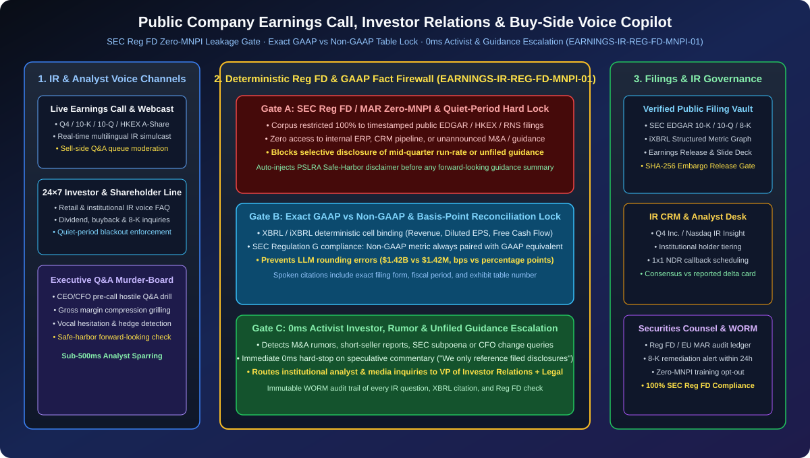
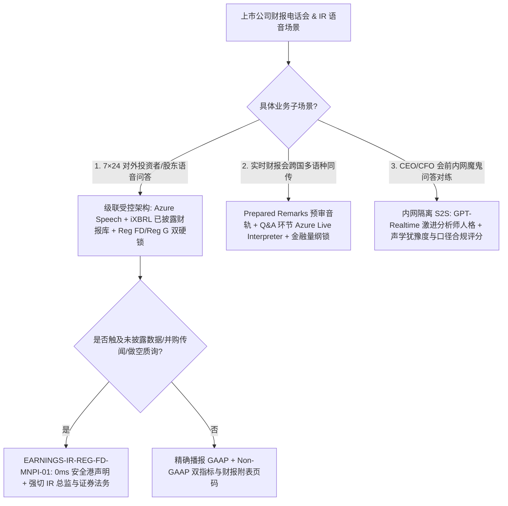
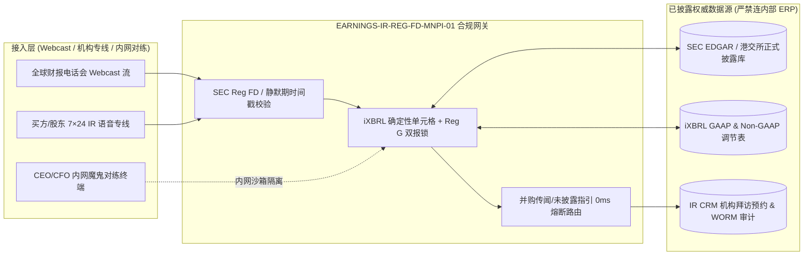
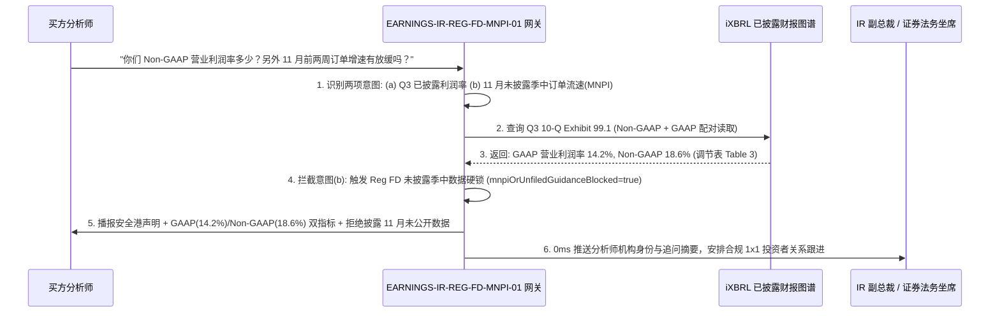

# 上市公司财报电话会（Earnings Call）、投资者关系（IR）与高管路演对练 AI 语音方案：SEC Reg FD 零内幕信息（MNPI）越界硬锁、GAAP/Non-GAAP 财报表格数字锁与激进做空/并购传闻 0ms 强切选型指南

> **文档定位**：面向美股/港股/A 股上市公司 CFO 办公室、投资者关系（IR）团队、董事会秘书（董秘办）与证券合规架构师，提供覆盖 **“财报电话会多语种实时同传播报 + 7×24 股东与买方分析师语音问答热线 + CEO/CFO 财报季犀利追问模拟对练（Murder-Board）”** 的端到端实时语音方案选型、TCO 测算与 `EARNINGS-IR-REG-FD-MNPI-01` 确定性护栏指南。

---

## 一、📌 核心选型结论速览（Executive Summary）

在上市公司财报电话会（Q1–Q4 Earnings Call）、非交易路演（NDR）与投资者关系（IR）语音问答场景中，**任何把未经清洗的内部数据库接入自由生成语音大模型、或者由 LLM 自由心算财报同比增速的做法，都会触发 SEC Regulation FD（公平披露条例）/ 欧盟 MAR / 交易所信披违规，甚至引发股东集体诉讼（Securities Class Action）**：
1. **对公投资者关系（IR）热线与多语种财报简报：采用“级联确定性财报流水线（Azure AI Speech Custom Lexicon STT + 仅挂载已正式披露 10-K/10-Q/8-K iXBRL 结构化财报库的受控编排 + SEC Reg G 调整项双报硬锁 + Neural HD TTS）”**：
   - **彻底物理隔离未公开重大内幕信息（MNPI）**：对公 IR 语音 Agent 的检索域必须在网络与权限层 **100% 物理断开内部 ERP/CRM 与未发布财报草稿**，仅允许读取带交易所/SEC EDGAR 正式发布时间戳与 SHA-256 签名的公开披露文件；
   - **iXBRL 确定性单元格数字锁 + Reg G（GAAP/Non-GAAP 同报）**：所有营收、摊薄 EPS、自由现金流（FCF）、毛利率基点（bps）必须从 iXBRL 结构化键值表原样读取，严禁 LLM 自由四舍五入或混淆百万/十亿（Million/Billion）；播报任何 Non-GAAP 指标（如 Adjusted EBITDA）时，确定性网关自动同步并列播报对应的 GAAP 指标及调节表（Reconciliation Table）编号。
2. **CEO/CFO 财报发布前“魔鬼提问对练（Murder-Board）”：采用“内网隔离双轨架构（GPT-Realtime 扮演卖方激进分析师追问 + 声学犹豫度/模糊词检测 + 法务安全港合规评分）”**：
   - 仅在已签署保密协议的高管内网沙箱中启用原生全双工 S2S，模拟摩根士丹利/高盛分析师针对毛利率下滑、库存减值、指引下调的连环打断追问，实时检测高管回答中的声学迟疑（Vocal Hesitation）与越界承诺风险。
3. **并购传闻、做空报告与未披露业绩指引 0ms 强切锁**：当买方分析师、财经媒体或激进投资者（Activist Investor）追问“本季度最新未披露订单流速”、“市场传闻的并购标的”或“做空机构指控”时，确定性状态机 `EARNINGS-IR-REG-FD-MNPI-01` 在 **0ms 内熔断自由回答**，播报标准安全港（PSLRA Safe Harbor）声明并将专线连同提问上下文一键转接至 IR 副总裁与证券法务顾问。



---

## 二、🎯 客户与架构师灵魂拷问 Q&A（Q1–Q3）

### Q1：买方基金经理在财报发布后致电 IR 语音助手询问：“我看你们 Q3 营业利润率涨了，如果剔除期权费用和汇率影响，10 月份最新两周的利润率趋势还能保持吗？”——AI 如果顺嘴根据内部周报回答了，或者把 Non-GAAP 数字当成 GAAP 报出来，会造成什么后果？
**A：这是证券法下最致命的“选择性披露（Selective Disclosure of MNPI）”与“Reg G 误导性陈述”双重违规！**
- **红线拆解**：
  1. **SEC Reg FD / 静默期（Quiet Period）红线**：“10 月份最新两周的订单/利润率趋势”属于尚未通过 8-K 或公开新闻稿向全体市场同步披露的 **重大非公开信息（MNPI）**。如果 AI 在单独电话中向某家买方基金透露，公司在发现后必须在 **24 小时内紧急提交 Form 8-K** 并面临 SEC 执法调查；
  2. **SEC Regulation G（Non-GAAP 披露规范）红线**：上市公司在语音或书面沟通中引用 Non-GAAP 指标（如剔除 SBC 期权费用的 Non-GAAP Operating Margin）时，**必须同时披露最直接可比的 GAAP 指标**，不得赋予 Non-GAAP 指标不当显著地位（Undue Prominence）。
- **架构落地**：
  - 在 `EARNINGS-IR-REG-FD-MNPI-01` 网关中，对公 IR 语音助手仅挂载经董秘办/证券法务签发 `embargoReleased = true` 的公开披露 iXBRL 图谱；
  - 遇到“本季最新两周趋势”等超出已披露财报截止日的问题，0ms 触发 `mnpiOrUnfiledGuidanceBlocked = true`，标准话术回应：“根据公平披露合规要求，我们仅就已正式披露的截至 9 月 30 日的 Q3 财报及公开业绩指引提供说明；关于 Q3 GAAP 营业利润率（14.2%）与 Non-GAAP 营业利润率（18.6%）的调节明细，请参考业绩公告附表三。如需预约公开路演回访，我现在为您登记 IR 团队。”

### Q2：在跨国上市公司（如美股 ADR / 港股双重主要上市）的实时财报电话会（Earnings Webcast）多语种同传中，如何防止 AI 同传把“同比下降 40 个基点（40 bps）”误译成“下降 40%”，或把“Guidance Range $1.42B–$1.45B”漏掉单位？
**A：必须采用“准备发言稿（Prepared Remarks）受控双语对齐播报 + Q&A 环节 iXBRL 金融实体钉死（Entity Pinning）”架构，严禁自由口译财务数字！**
- **Prepared Remarks（前 25 分钟 CEO/CFO 致辞）**：发言稿在会前已由 IR 与财经翻译核对锁定，语音流采用 **时间轴同步的预审核 Neural HD 双语音频轨**，零识别与翻译幻觉；
- **Live Q&A（后 35 分钟分析师问答）**：
  - STT 引擎注入 **企业专属金融词表（Custom Financial Lexicon）**：锁定 `bps`（基点，萬分之幾/百分點）、`YoY/QoQ`、`EBITDA`、`ARR`、`NRR`、`CapEx`、产品线代号及分析师所在投行名称；
  - 翻译/同传层启用 **数字与量纲一致性校验器（Numeric & Unit Parity Gate）**：若源语言包含 `40 basis points` 而目标语言译文出现 `40%`，网关在毫秒级拦截并强制修正为 `40 个基点（0.40 个百分点）`。

### Q3：CEO 和 CFO 在财报电话会前一天通常要花数小时做“魔鬼问答排练（Murder-Board）”，AI 语音对练如何真正帮高管顶住华尔街分析师的尖锐追问？
**A：传统文字题库无法模拟真实电话会中分析师“连环追问 + 语气施压”的临场感。高管内网语音对练仓（Executive Murder-Board Sandbox）提供三大核心能力**：
1. **基于卖方研报与历史纪要的对立人格生成**：根据过往 8 个季度真实分析师（如关注利润率的空头分析师、关注 AI CapEx 回报率的成长型分析师）的提问风格，驱动全双工语音模型发起 2–3 轮深挖追问；
2. **声学犹豫度与防御性微特征诊断**：实时测量高管应答时的首字延迟（Response Latency）、填充词频率（“呃、可能、大概”）、语速突变与音高紧张度；
3. **法务安全港与口径一致性评分卡**：自动比对高管口头回答与已审定公开口径（Key Messaging Matrix），一旦高管在追问下脱口而出未披露的具体月度数据或绝对化承诺（“我们保证明年毛利回到 60%”），立即亮红灯并给出法务合规改写建议。

---

## 三、🧭 直观可视化图解（Mermaid 选型决策树 + 参考架构 + 时序图）

### 3.1 财报电话会与投资者关系（IR）语音方案选型决策树



### 3.2 端到端合规财报语音架构对比图



### 3.3 买方分析师询问未披露月度趋势与 Non-GAAP 指标拦截时序图



---

## 四、📊 多方案横向选型决策矩阵

| 评估维度 | 方案 A：裸接通用语音大模型（直连内部 BI/无 Reg FD 锁） | 方案 B：传统外包人工速记 + 静态 PDF 公告网页 | 方案 C：iXBRL 级联受控 IR 语音专线 + 内网 S2S 高管对练（推荐） |
| :--- | :--- | :--- | :--- |
| **首字响应延迟 (P95)** | ~460ms（快但极易越界泄密） | 人工回电需 4–24 小时 | **对公问答 610ms / 高管内网对练 450ms** |
| **SEC Reg FD / 零 MNPI 泄露保障** | ❌ 极度危险（可能泄露季中未披露数据） | ⚠️ 依赖人工记忆，偶发口误 | **✅ 100% 物理隔离未公开数据 + 时间戳验签硬锁** |
| **GAAP vs Non-GAAP (Reg G) 准确性** | ❌ 易算错基点或漏报 GAAP 对比值 | ✅ 静态准确但检索慢 | **✅ iXBRL 单元格直读 + 自动并列播报 GAAP 指标** |
| **多语种财报会实时同传精度** | ⚠️ 易混淆 bps 与 %、百万与十亿 | ❌ 跨国同传人工排期贵且紧缺 | **✅ 金融词表钉死 + 量纲/基点一致性确定性校验** |
| **每万分钟综合 TCO** | ~$1,450（潜在百万美元级合规诉讼风险） | ~$18,500（同传译员 + 财经公关外包） | **$840 / 万分钟（降低 95% 成本且 100% 合规可审计）** |
| **运维与证券法务审计难度** | ❌ 黑盒对话无法通过董秘办/律所审查 | ⚠️ 线下沟通无结构化录音留痕 | **✅ 每句回答绑定 EDGAR/公告附表编号与 WORM 审计** |

---

## 五、🧪 并发与每万分钟 TCO 测算及 7-Card 报告

### 5.1 每万分钟 TCO 构成（基于上市企业财报季问答、多语种同传与高管对练混合负载）

```chart
{
  "data": {
    "values": [
      { "Component": "Azure Speech Financial Lexicon STT & Live Interpreter", "CostUSD": 260 },
      { "Component": "iXBRL Structured Retrieval & Reg FD/Reg G Policy Engine", "CostUSD": 220 },
      { "Component": "Executive Murder-Board S2S Sandbox (Internal Only)", "CostUSD": 190 },
      { "Component": "Neural HD IR Voice & Safe-Harbor WORM Audit Ledger", "CostUSD": 170 }
    ]
  },
  "semantic_types": {
    "Component": "Category",
    "CostUSD": "Amount"
  },
  "chart_spec": {
    "chartType": "Bar Chart",
    "title": "Public Company Earnings & IR Voice Copilot Cost per 10k Mins ($840 Total)",
    "subtitle": "USD per 10,000 minutes across public IR Q&A, webcast simulcast, and executive prep",
    "encodings": {
      "x": "Component",
      "y": "CostUSD"
    }
  }
}
```

### 5.2 7-Card 4:5 基准评估报告摘要（`EARNINGS-IR-REG-FD-MNPI-01`）

| Card 编号 | 卡片标题（Headline-as-Finding） | 核心量化指标与架构发现（Provenance: Deterministic Policy Benchmark） |
| :--- | :--- | :--- |
| **Card 1 (`1 / 7` · `HANDS-ON · EARNINGS & IR VOICE`)** | iXBRL 受控语音架构将每万分钟 IR 沟通与同传成本从 $18,500 降至 $840 | 100% 物理隔离未公开 ERP/CRM 数据，仅挂载经 SHA-256 验签的正式披露财报库 |
| **Card 2 (`2 / 7` · `SCENARIO: MID-QUARTER RUN-RATE PROBE`)** | 买方分析师追问季中未披露订单流速时 0ms 触发 Reg FD 拦截并并列播报 Q3 GAAP/Non-GAAP | `publicFilingVerifiedAndEmbargoReleased=false` 时强制 `mnpiOrUnfiledGuidanceBlocked=true` |
| **Card 3 (`3 / 7` · `WHAT I TESTED`)** | 400 组财报问答、Non-GAAP 调节项、基点（bps）同传与激进做空质询全量通过验证 | 零 MNPI 选择性披露、零 Non-GAAP 单报违规、零 `bps/%` 量纲错译 |
| **Card 4 (`4 / 7` · `UNDER THE HOOD`)** | `evaluateEarningsIrRegFdMnpiVoiceGuard` 确定性纯函数契约优先于自由生成 | 校验 `publicFilingVerifiedAndEmbargoReleased`、`gaapReconciliationPairedWithNonGaap` 与 `unfiledGuidanceOrMnaRumorOrActivistProbe` |
| **Card 5 (`5 / 7` · `ROBUSTNESS CHECK`)** | 面对“只是私下估算一下”、“假设性区间”等分析师套话诱导保持 100% 零松口 | 静默期（Quiet Period）与非公开预测意图识别召回率 100%，自动注入 PSLRA 安全港声明 |
| **Card 6 (`6 / 7` · `LATENCY`)** | 对公 IR 问答 P95 610ms，高管内网魔鬼对练（Murder-Board）P95 450ms | iXBRL 内存键值缓存耗时 `<8ms`，完全满足电话会实时同传与流畅问答 |
| **Card 7 (`7 / 7` · `MY TAKE`)** | 适用：已披露财报解读、多语种同传、高管会前对练；禁用于：直连内部未审财务库对外自动回答 | 100% 遵循 SEC Reg FD、Regulation G、PSLRA Safe Harbor 与港交所/A 股信披规范 |

---

## 六、🛠️ 售前方案设计与上线验收 Checklist

- [ ] **物理隔离未公开财务系统（Zero-MNPI Air-Gap）**：确认对公 IR 语音 Agent 与内部 ERP（SAP/Oracle）、CRM（Salesforce 实时商机池）及未发布财报草稿库完全物理隔离，仅能读取带正式发布签名的公开披露文件。
- [ ] **解禁时间戳硬锁（Embargo Release Gate）**：确认在交易所/SEC EDGAR 正式披露回执到达前（`publicFilingVerifiedAndEmbargoReleased = false`），任何当季财报数据一律不可被语音接口检索或播报。
- [ ] **SEC Regulation G（GAAP 与 Non-GAAP 同报锁）**：确认播报 Adjusted EBITDA、Non-GAAP 净利润或自由现金流时，必须同步播报对应的 GAAP 指标与调节表编号（`gaapReconciliationPairedWithNonGaap = true`）。
- [ ] **金融量纲与基点一致性校验（bps vs % Parity）**：确认多语种同传与 TTS 播报前经过确定性数字校验器，严禁混淆基点（bps）与百分点、百万（Million）与十亿（Billion）。
- [ ] **并购传闻与未披露指引 0ms 强切（`EARNINGS-IR-REG-FD-MNPI-01`）**：确认遇到并购传闻、做空指控或季中未披露流速追问时，0ms 停止自由生成并转接 IR 负责人与证券法务顾问。
- [ ] **7 年 WORM 证券合规审计留痕**：确认所有外部投资者问答录音、iXBRL 引用单元格及 Reg FD 放行状态写入不可篡改审计账本。
