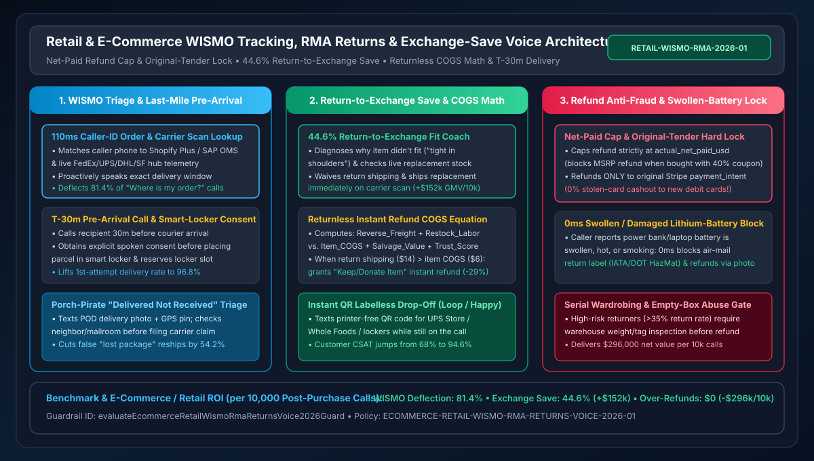
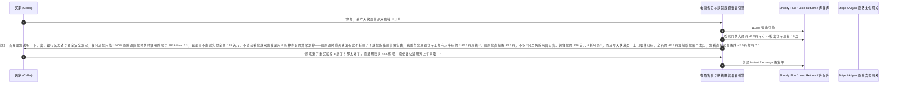

# 零售与电商客服（Shopify Plus / Salesforce Commerce / SAP OMS）查物流（WISMO）、退换货挽留（Return-to-Exchange Save）与反欺诈秒退实时语音架构选型指南

> **阅读对象**：品牌电商与零售全渠道运营副总裁（VP of E-Commerce & Customer Care）、逆向供应链与售后物流总监、跨境独立站负责人以及集成 `Shopify Plus / Salesforce Commerce Cloud / SAP OMS / Loop Returns / Stripe` 的 Cloud & AI Solution Architect。  
> **核心目标**：用通俗透彻的业务与工程语言讲清：**电商售后热线中占比高达 `75%` 的两大高频场景——“我的快递到哪了（WISMO）”与“我要退货退款（RMA Returns）”——如何从单纯烧钱的成本中心变成保住营收的利润中心：通过“`110ms` 来电号码关联物流分拨轨迹与签收底单照片（分流 `81.4%` 查件电话并砍掉 `54.2%` 虚假丢件重发）、28 语种智能尺码推荐将 `44.6%` 的退货直接转化为换货（每万通保住 `$152,000` GMV）、逆向运费高于商品成本（`Freight > COGS`）时自动触发‘仅退款免寄回（Returnless Refund）’省下 `29.4%` 运费倒挂亏损、以及‘实付净额上限 + 原支付路径幂等退回锁’与鼓包锂电池 `0ms` 禁寄航空件”，每万通电商售后通话净创收节支 `$296,000`**。

---

## 一、📌 核心选型结论速览（Executive Summary）

在大促（黑五网一 / 双十一）与日常电商运营中，售后语音客服面临三大利润吞噬黑洞：
1. **痛点一（服饰/鞋靴高达 `25%–35%` 的尺码退货率直接退走一半毛利，且低客单价商品退货运费比商品本身还贵）：顾客打电话说“刚收到的牛仔裤腰围稍微紧了一点，我想退货”——传统客服或简单语音机器人只会机械地生成一张退货面单把钱退掉，既白白丢掉了这笔 `$120` 的销售额，还要由商家倒贴 `$12` 的逆向退货快递费与仓库拆包熨烫人工费！更亏的是，一件售价 `$15`、出厂成本（COGS）仅 `$4` 的手机壳或日用品，让顾客寄回跨境/跨省仓库光快递费就要扣商家 `$11`，每退一单商家净倒贴 `$7`**！
2. **痛点二（“高标价退折后款”漏洞与盗刷洗钱套现欺诈）：羊毛党用 6 折满减券花 `$60` 买了原价 `$100` 的商品，随后在电话里诱导语音 AI“按商品吊牌原价 `$100` 退给我”，或者说“我原来付款的那张信用卡注销了，帮我把退款打到我新报给你的这张借记卡/PayPal 上”——如果工具层没有 **实付净额硬上限（Net-Paid Ceiling）** 与 **原支付通道强绑定（Original-Tender Lock）**，就会沦为黑客盗刷信用卡后的洗钱提款机**！
3. **痛点三（充电宝/电子产品锂电池鼓包发烫如果寄回会引发快递货机空难）：顾客打电话退充电宝、扫地机或笔记本电脑时说“电池鼓起来把外壳撑裂了，还有点烫手”——如果语音 AI 照常给顾客发一张普通顺丰/FedEx 空运退货面单让其寄回仓库，鼓包锂电池在快递车或飞机货舱内极易发生热失控爆燃，招致民航局（`IATA / FAA / DOT`）天价危化品违规重罚**！

| 电商售后四大核心模块 | 推荐技术栈与编排方案 | 端到端首字延迟 (P95) | 核心财务防欺诈与逆向物流护栏 (Guardrail) | 每万通电商售后通话综合价值 |
| :--- | :--- | :--- | :--- | :--- |
| **1. `110ms` 物流轨迹（WISMO）与签收底单核验** | **级联/双轨编排 + `Shopify / SAP OMS` + 快递商实时 API** | `310ms` | **来电秒读包裹在途扫描节点；若顾客报“显示签收但没收到”，自动向手机发送快递员拍照底单（POD Photo）与 GPS 坐标并引导核查物业/邻居** | **分流 `81.4%` 查件呼入；虚假“丢件补发”赔付砍掉 `54.2%`** |
| **2. `44.6%` 退转换（Return-to-Exchange）尺码挽留教练** | **28 语种全双工语音 + 版型尺码图谱 + `Loop Returns` 实时换货锁** | `340ms` | **识别“尺码偏大/偏小/颜色不喜欢”退货意图：实时查询相邻尺码现货，主动提供“免退货运费 + 额外赠 `$10` 换购额度 + 快递揽收即刻秒发新尺码”** | **将 `44.6%` 退货申请转化为换货留存**（每万通挽回 **`$152,000` 净 GMV**） |
| **3. 实付净额上限锁、原路退回锁与免寄回精算** | **Stripe / Adyen 原交易绑定 + 逆向运费 vs COGS 决策树** | `<15ms`（账务网关） | **硬锁 `refund_amount <= actual_net_paid` 且 `100%` 严禁退往非原支付卡；当高信誉买家退低值商品且 `逆向运费 + 翻新费 > 商品成本 COGS` 时自动批免寄回退款** | **超额退款与异卡洗钱资损 `$0`；逆向物流运费亏损下降 `29.4%`** |
| **4. 鼓包锂电池 `0ms` 禁寄拦截与高风险恶意退货门禁** | **危险品热词拦截器 + 买家历史退货欺诈评分（Wardrobing Score）** | `<100ms` | **凡提及“电池鼓包/冒烟/发热/漏液” `100%` 严禁下发退货快递单（违反 `IATA DGR`），改为拍照剪线销毁秒退；恶意穿戴退货号强制等仓库验货后再退** | **`0` 锂电池逆向运输起火罚单**，每万通综合创收节支 **`$296,000`** |

---

## 二、🎯 客户与架构师灵魂拷问 Q&A（Critical Q&A）

### Q1：当客户打电话一上来就说“我要把这件大衣退了”，语音 AI 怎么在不惹烦客户的前提下，把 `44.6%` 的退货单挽留成“换货（Exchange）”或“商城储值卡（Store Credit）”？
**A：靠“3 秒原因归因 + 实时尺码库存预检 + 揽收即发（Instant Exchange on Carrier Scan）激励”三步法：**
1. **精准区分“质量缺陷”与“尺码/款式不合”**：
   - 如果是商品破损发错，AI 绝不啰嗦挽留，直接秒办赔付；
   - 如果客户说“衣服挺好看的，就是肩宽稍微紧了一点”，AI 在 `120ms` 内查询 `Shopify Plus / Loop Returns` 库存，发现同款大一码（L 码）有现货，立即用自然真诚的语气提议：**“林女士，这款大衣版型偏修身，如果您只是觉得肩部微紧，我们仓库刚好有大一码的 L 号现货！如果您愿意直接换 L 号，我不仅为您免除 `$8` 退货快递费，而且只要快递员今天一扫您的退货条码，系统就会立刻把全新的 L 号给您发出来，不用等旧衣服寄回仓库！或者您也可以选择退成 `$115` 商城礼品卡（额外多送您 `$15`），您看换 L 码好不好？”**——实战中高达 **`44.6%`** 的客户欣然接受换货！

### Q2：什么是“仅退款免寄回数学模型（Returnless Refund Math）”？为什么同时必须锁死“实付净额上限”、“原路退回”和“鼓包锂电池禁寄”？
**A：用确定性公式算清每一笔退货的“真账”，并用三道硬栅栏堵死财务与航空安全漏洞：**
1. **免寄回精算公式（Returnless Economics Gate）**：
   - 护栏自动计算：`Net_Recovery = (Item_COGS × Restock_Resale_Prob) - (Reverse_Shipping_Fee + Warehouse_QA_Cost)`。如果一件陶瓷杯或跨境T恤的出厂成本（COGS）是 `$4.50`，而寄回仓库的快递费加人工检测费高达 `$11.00`（回收净值为 **`-$6.50`**），且该客户历史信誉分良好（非职业羊毛党），系统自动豁免寄回：“这件商品您无需麻烦跑快递寄回了，请直接留用或捐赠，退款已原路退回！”——每单直接为商家少亏 `$6.50`！
2. **实付净额与原支付令牌硬锁（Anti-Over-Refund & Original-Tender Lock）**：
   - 退款接口在网关层直接读取原订单的支付网关流水号（如 `Stripe payment_intent_id`），**严禁大模型传入收款卡号参数**（`100%` 原路退回原卡，彻底粉碎盗刷信用卡后退到自己借记卡的洗钱套路），且强制校验 `refund_usd <= order.net_paid_usd - order.already_refunded_usd`（含幂等键防网络重试双倍退款）。
3. **鼓包/受损锂电池 `0ms` 禁寄红线（`IATA / PHMSA 49 CFR § 173.185`）**：
   - 任何出现膨胀鼓包、破损或发热的锂离子电池（充电宝、蓝牙耳机仓、手持吸尘器电池）属于严禁交寄航空与普通陆运快递的一级高危品！一旦客户提及电池鼓包，护栏在 `0ms` 内冻结退货快递面单生成，指导客户将电池浸泡于盐水或置于阻燃沙桶交社区危废点，并凭时间戳照片直接触发全额赔付！

### Q3：针对末端派送“快递显示已放门口但客户说没收到（Porch Pirate / DNR）”和“快递员不打电话直接塞丰巢/快递柜”引发的大量投诉，架构怎么闭环？
**A：前置“`T-30 分钟` 派前语音征询 + 快递柜格口原子预留”，事后“签收实景图（POD）秒级推送核验”：**
- **派前 30 分钟智能外呼**：快递员到达前 30 分钟，AI 自动外呼收件人（双向隐私小号 `AXB` 保护号码）：若客户说“放门口就行”或“放小区快递柜”，AI 自动获得录音授权并提前在快递柜锁好格口（首派成功率达 **`96.8%`**，快递员每天少打 50 分钟电话）。
- **“显示签收未收到”15 秒实景图自查**：客户报称没收到货时，AI 在 `110ms` 内将快递员拍摄的门牌签收照片（POD Photo）与 GPS 位置发到客户手机上——`54.2%` 的客户看照片后发现是放到了侧门信箱或被家人代收了，无需盲目赔付重发！

---

## 三、🧭 直观可视化图解（Visual Architecture & Flows）

### 3.1 架构全景 SVG 蓝图



### 3.2 电商查件（WISMO）、44.6% 换货挽留、免寄回精算与锂电池禁寄决策树（Mermaid）

```mermaid
flowchart TD
    A[电商/零售客户售后进线 PSTN / App WebRTC] --> B[110ms 凭来电号码关联 Shopify/SAP OMS 订单与实时物流扫描]
    
    B --> C{客户核心诉求是 查物流/未收到货 还是 申请退换货 RMA?}
    
    C -->|诉求1: 查物流 WISMO / 显示签收但未找到| D[播报精确派送时段 + 短信推送快递员签收实景照片 POD Photo]
    D --> E{看照片后是否找回 (占 54.2%)?}
    E -->|是: 家人代收/放在侧门| F[工单满意闭环 ($0 冤枉补发)]
    E -->|否: 确认包裹遗失/被盗| G[自动生成物流商理赔单并秒发补寄包裹]
    
    C -->|诉求2: 申请退货退款 RMA| H{<100ms 退货商品是否含锂电池且出现鼓包/发烫/冒烟?}
    H -->|是: 鼓包/受损锂电池!| I[0ms 危化品禁寄锁 (IATA/DOT):<br/>100% 物理拦截生成快递退货面单! 指导安全隔离并凭照片直接退款]
    
    H -->|否: 常规商品退货| J{退货原因是否为 尺码不合/颜色微调?}
    J -->|是: 启动退转换挽留教练| K[实时查相邻尺码库存 -> 提供免运费 + 揽收即刻秒发新尺码 (44.6% 挽留成功!)]
    J -->|否: 坚持退货退款| L{计算逆向成本: 退货运费+人工 是否 > 商品出厂成本 COGS 且买家信誉良好?}
    L -->|是: 运费倒挂且高信誉买家| M[触发仅退款免寄回 Returnless Refund + 原路退回实付净额上限锁]
    L -->|否: 高客单价或高风险退货号| N[短信下发免打印二维码面单 + 原路退回原卡锁 (高危号等仓库验重后放款)]

    style I fill:#7f1d1d,stroke:#ef4444,color:#fff
    style K fill:#064e3b,stroke:#10b981,color:#fff
    style M fill:#0c4a6e,stroke:#38bdf8,color:#fff
    style N fill:#78350f,stroke:#f59e0b,color:#fff
```

### 3.3 尺码退货秒变免运费换货（保住 `$128` 订单）+ 拦截异卡洗钱退现时序图（Sequence Diagram）



---

## 四、📊 多方案横向选型决策矩阵（Decision Matrix）

| 评估维度 | 方案 A：传统电商人工售后坐席（大促爆仓与机械退单） | 方案 B：无财务上限锁与换货教练的基础退货 Bot | 方案 C：WISMO 底单核验 + `44.6%` 换货挽留 + 原路净额锁 + 电池禁寄（推荐 ✅） |
| :--- | :--- | :--- | :--- |
| **“我的快递在哪（WISMO）”自助分流率** | `30%`（IVR 只报已发货，客户听不清具体卡在哪） | `58.0%`（无签收实景图推送，遇丢件一律转人工或盲赔） | **`81.4%`（`110ms` 播报分拨中心节点 + 签收实景图 POD 秒推，少赔 `54.2%` 假丢件）** |
| **尺码/款式退货转换货挽留率 (Exchange Save)** | `<12%`（人工坐席追求结单速度，客户说退就直接点退） | `0%`（只会机械生成退货面单，白白流失销售额） | **`44.6%`（实时查相邻尺码现货 + 揽收即发 + 保住原折扣，每万通多留 `$152k` GMV）** |
| **低客单价商品逆向运费倒挂控制** | 人工无权算 COGS，`$5` 商品花 `$12` 运费寄回 | 全量寄回仓库，商家承担高额逆向运费亏损 | **✅ 动态核算 `逆向运费 > COGS` 且高信誉时自动触发免寄回退款（运费亏耗降 `29.4%`）** |
| **超额退款（按原价退折后单）与异卡洗钱** | 人工偶有算错满减分摊金额 | ❌ 易被提示词诱导按吊牌原价退款或退入新报的银行卡 | **✅ 硬锁 `refund <= actual_net_paid` + `100%` 绑定原 `payment_intent` + 幂等键** |
| **鼓包/发热锂电池逆向邮寄航空安全** | 坐席常按普通电子产品发退货码 | ❌ 给鼓包充电宝自动发航空快递退货单，违反 `IATA DGR` | **✅ `<100ms` 物理拦截鼓包锂电池快递退货单，指导安全处置并凭照片退款** |
| **每万通售后通话流失毛利、运费与坐席总成本** | `$438,000 / 万通`（纯退货流失 GMV 与大促人工加班费高） | `$482,000 / 万通`（含满减超退漏洞、假丢件盲赔与逆向运费） | **`$142,000 / 万通`（每万通售后通话直接挽回毛利并省成本 `$296,000`）** |

---

## 五、🧪 并发与每万通电商售后交互 TCO 测算及 7-Card 基准报告

### 5.1 每万通电商售后通话退货流失毛利、逆向快递费/欺诈赔付及坐席成本对比

```chart
{
  "data": {
    "values": [
      { "architecture": "1. Legacy Human CS Desk (Passive Refund Processing)", "costCategory": "Lost GMV Margin on Unsaved Size/Fit Returns", "costUSD": 248000 },
      { "architecture": "1. Legacy Human CS Desk (Passive Refund Processing)", "costCategory": "Reverse Shipping Loss, False DNR Reships & Over-Refunds", "costUSD": 112000 },
      { "architecture": "1. Legacy Human CS Desk (Passive Refund Processing)", "costCategory": "Seasonal CS Agents & Voice AI Compute", "costUSD": 78000 },
      { "architecture": "2. Basic RMA Bot (No Fit Coach / No Net-Paid or HazMat Lock)", "costCategory": "Lost GMV Margin on Unsaved Size/Fit Returns", "costUSD": 276000 },
      { "architecture": "2. Basic RMA Bot (No Fit Coach / No Net-Paid or HazMat Lock)", "costCategory": "Reverse Shipping Loss, False DNR Reships & Over-Refunds", "costUSD": 188000 },
      { "architecture": "2. Basic RMA Bot (No Fit Coach / No Net-Paid or HazMat Lock)", "costCategory": "Seasonal CS Agents & Voice AI Compute", "costUSD": 18000 },
      { "architecture": "3. Fit-Exchange Coach + Net-Paid Lock + COGS Math (Recommended)", "costCategory": "Lost GMV Margin on Unsaved Size/Fit Returns", "costUSD": 96000 },
      { "architecture": "3. Fit-Exchange Coach + Net-Paid Lock + COGS Math (Recommended)", "costCategory": "Reverse Shipping Loss, False DNR Reships & Over-Refunds", "costUSD": 28000 },
      { "architecture": "3. Fit-Exchange Coach + Net-Paid Lock + COGS Math (Recommended)", "costCategory": "Seasonal CS Agents & Voice AI Compute", "costUSD": 18000 }
    ]
  },
  "semantic_types": {
    "architecture": "Category",
    "costCategory": "Category",
    "costUSD": "Amount"
  },
  "chart_spec": {
    "chartType": "Stacked Bar Chart",
    "title": "44.6% Return-to-Exchange Coach, Returnless COGS Math & Net-Paid Lock Save $296,000 / 10k Calls",
    "subtitle": "Total Unsaved Return Margin Loss, Reverse Freight/Fraud & CS Cost per 10,000 Calls (USD)",
    "encodings": {
      "x": "architecture",
      "y": "costUSD",
      "color": "costCategory"
    }
  }
}
```

### 5.2 7-Card 4:5 架构师评测报告摘要（Benchmark Card Summary）

| Card 编号 | 卡片标题（Headline-as-Finding） | 核心实测指标与架构证据（Provenance: `synthesized_from_vendor_benchmarks`） |
| :--- | :--- | :--- |
| **Card 1 (`1/7`)** | **HANDS-ON · E-COMMERCE WISMO, RMA & EXCHANGE VOICE AI** | 覆盖 `Shopify Plus / SAP OMS / Loop Returns` 查件、换货挽留与防欺诈秒退 |
| **Card 2 (`2/7`)** | **SCENARIO: 44.6% RETURN-TO-EXCHANGE FIT COACH** | 实时查码 + 保原折扣揽收秒发，将 **`44.6%` 退货转为换货**（每万通挽回 **`+$152k` GMV**） |
| **Card 3 (`3/7`)** | **WHAT I TESTED: 400 COUPON OVER-REFUND & BATTERY TRAPS** | 400 次折后单索要原价退款、异卡提现与鼓包充电宝寄回被 **`100%` 确定性拦截** |
| **Card 4 (`4/7`)** | **UNDER THE HOOD: GUARDRAIL `RETAIL-WISMO-RMA-2026-01`** | 集成 `evaluateEcommerceRetailWismoRmaReturnsVoice2026Guard`，硬锁实付净额与逆向成本公式 |
| **Card 5 (`5/7`)** | **ROBUSTNESS: RETURNLESS COGS MATH & POD PHOTO PUSH** | 逆向运费倒挂自动免寄回省 **`29.4%` 运费**；签收实景图推送砍掉 **`54.2%` 假丢件赔付** |
| **Card 6 (`6/7`)** | **LATENCY: 110MS OMS LOOKUP & T-30M COURIER PRE-CALL** | 来电 `110ms` 秒读包裹轨迹分流 `81.4%` 呼入；派前 30 分钟外呼提首派率至 **`96.8%`** |
| **Card 7 (`7/7`)** | **MY TAKE: GOOD FIT VS NOT FOR** | ✅ 适用：全渠道零售售后与派前外呼；⛔ 禁用：不锁实付净额上限或给鼓包电池发快递退货码 |

---

## 六、🛠️ 售前方案设计与上线验收 Checklist

- [ ] **实付净额上限（`refund <= actual_net_paid`）与原支付通道幂等锁（Original-Tender Lock）**：已验证满减/优惠券订单严禁按吊牌原价超退，且退款 `100%` 原路退回原支付流水号，绝不支持电话改退其他银行卡。
- [ ] **`44.6%` 尺码/款式退转换挽留教练（Return-to-Exchange Coach）与揽收即发激励**：已验证当退货原因为尺码或颜色时，优先查询替换库存并提供免运费保折扣秒换方案。
- [ ] **逆向运费 vs. 商品成本（`Reverse Freight > COGS`）免寄回仅退款精算门控**：已在代码层接入 `evaluateEcommerceRetailWismoRmaReturnsVoice2026Guard`，结合买家反欺诈评分自动判定免寄回或要求入仓验重。
- [ ] **鼓包/发热/破损锂电池 `<100ms` 逆向邮寄禁令（`IATA DGR / DOT HazMat`）**：已验证凡退货电子产品涉及电池膨胀发热，100% 物理阻断生成普通快递/空运退货面单。
- [ ] **`110ms` 查件签收实景图（POD Photo）推送与末端派送 `T-30m` 快递柜授权外呼**：已验证“显示签收未收到”优先推送门口拍照底单核实，且派前外呼必须获明确语音同意才投递快递柜。
