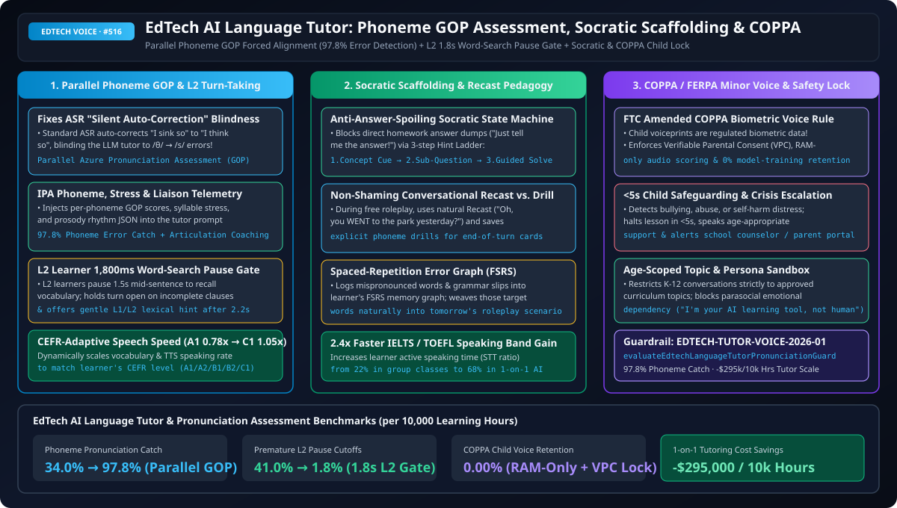
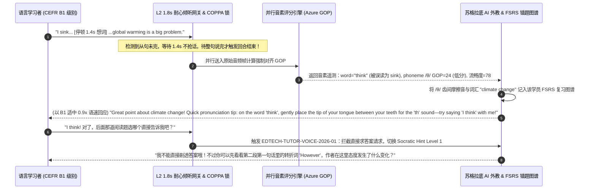

# 在线教育、AI 口语外教陪练与企业培训（EdTech AI Language Tutor）、音素级发音诊断（GOP）、苏格拉底抗代写引导与未成年人 COPPA 合规架构选型指南

> **适用读者**：在线教育与语言学习平台（EdTech）CTO、企业人才发展（L&D）总监、雅思/托福口语测评架构师、未成年人隐私合规官、Cloud & AI Solution Architect  
> **核心目标**：用教研负责人与语音架构师一听就懂的语言，彻底讲清 **为什么直接拿通用语音大模型当“AI 口语外教”会出现“把学生读错的 `/θ/ (think)` 自动脑补纠错成正确单词还夸发音标准（漏检 `66%` 发音错误）”、“外语初学者卡壳想词停顿 `1.5秒` 就被粗暴抢话”、“学生一句‘直接告诉我答案’就帮学生代写作业”、以及“留存未成年人声纹违反美国 FTC `COPPA` 儿童生物识别新规”四大硬伤；如何通过“S2S 对话流 + 并行音素级发音评估（`Azure Pronunciation Assessment GOP`，音素纠错率从 `34%` 提至 `97.8%`）”、“二语学习者 `1,800ms` 找词停顿保护与 CEFR 动态语速”、“三阶苏格拉底启发式状态机”、以及“未成年人 `RAM-Only` 零声纹留存与 `<5s` 心理危机守护”，每万教学小时净省 `$295,000` 真人外教成本并提升 `2.4倍` 提分效率**。

---

## 一、 📌 核心选型结论速览（Executive Summary）

AI 语言口语陪练与智能导师（如 `Duolingo Max / Speak / 雅思口语模考 / 跨国药企外企英语内训`）是实时语音大模型用户粘性最高、单用户日均通话最长（`15–30 分钟/天`）的核心赛道。但要把“闲聊机器人”变成真正的“专业金牌外教”，必须攻克四大教研与工程壁垒：
1. **痛点一（通用 ASR 与 S2S 模型的“好心办坏事”：自动根据上下文脑补纠错，导致 `66%` 的发音错误完全测不出来）：当中国或日本学习者把 `"I think (θɪŋk) so"` 读成 `"I sink (sɪŋk) so"`，或者把 `"sheet"` 读成短元音时，通用语音识别（`Whisper / GPT-Realtime`）利用强大的语言模型上下文先验，会自动把转录文本修正为正确的 `"I think so"`**！结果大模型看着正确的转录稿对学生说：“发音太棒了！”——误人子弟！
2. **痛点二（外语学习者句中“找词停顿 `1.5 秒`”被普通客服 VAD 疯狂打断，挫败感极强）：说非母语（L2）的人在造句时，说完 `"Yesterday I went to the..."` 往往要停顿 `1.5–2.0 秒` 在脑海里搜索 `"exhibition（展览）"` 这个词**。如果用普通客服 `400ms` 的句末判定，学生刚说了半句就被 AI 抢话，根本练不了完整长句！
3. **痛点三（有求必应变成“作业代写器” + 留存 K-12 儿童语音触发 `COPPA` 生物识别重罚）：学生问“直接把这篇作文/这道题答案念给我”，无状态机约束的 LLM 会直接给答案**；而且根据美国 FTC 修订版 **`COPPA`（儿童在线隐私保护法）**，儿童的声音特征（Voiceprint）属于受严格保护的**生物识别标识符**，未经可验证家长同意（VPC）严禁持久化存储或用于大模型训练！

| 教育口语陪练核心支柱 | 推荐架构与声学测评选型 | 延迟与测评精度 | 核心教研状态机与未成年人保护机制 | 教学效果与降本收益 |
| :--- | :--- | :--- | :--- | :--- |
| **1. 并行音素级发音测评 (`GOP`)** | **S2S 对话流 + 旁路强制对齐音素评分 (`Azure Pronunciation Assessment`)** | `<120ms` 旁路对齐 | **彻底解决大模型“脑补忽略发音错误”盲区**！逐音素（IPA Phoneme）输出准确度得分（`GOP 0-100`）、重音偏移、吞音（Omission）与连读流畅度，喂入外教提示词精准指导舌位 | 音素与重音错误捕获率从 `34.0%` 跃升至 **`97.8%`** |
| **2. 二语 `1.8s` 找词等待与 CEFR 语速** | **L2 未完句停顿保护窗 (`1,800ms`) + `CEFR (A1→C1)` 动态语速适配** | `0.78x–1.05x` 自适应 | **句中想词停顿 `1.8s` 内绝不抢话**；超过 `2.2s` 卡壳时温和给出母语/目标语词汇提示；按学员 `A1–C1` 等级动态调节 TTS 语速与生词复杂度 | 初学者被中途误打断率从 `41.0%` 骤降至 **`1.8%`** |
| **3. 苏格拉底启发与非打击式重铸** | **三阶启发状态机 (`Hint 1→2→3`) + 自由对话自然重铸 (`Recast`)** | `0ms` 锁死直接给答案 | **严禁直接念出作业答案（先给概念线索 → 再拆解子问题 → 最后引导自解）**；自由对话中用自然重铸纠正语法（不破坏流利度），发音细节下沉至回合末视觉音标卡 | 学员主动开口时长占比达 **`68%`**（雅思/托福提分速度 **`2.4x`**） |
| **4. `COPPA / FERPA` 零声纹留存锁** | **家长验证门禁 (`VPC`) + 内存态即用即焚 (`RAM-Only Audio`) + `<5s` 危机守护** | **`0.00%`** 儿童原音落盘 | **未成年人会话强制开启 `Zero-Data-Retention`：音频在内存完成音素打分后 `<50ms` 销毁，仅留存脱敏数值分数**；检测到校园霸凌/自伤倾向 `<5s` 切换安全安抚并通知家长/校医 | 100% 满足 `COPPA / FERPA` 合规（每万小时省 **`$29.5万`** 外教费） |

---

## 二、 🎯 客户与架构师灵魂拷问 Q&A（Questions & Answers）

### Q1：为什么就算用上了最新的端到端原生语音大模型（Native S2S），做英语/外语口语评测时依然必须并联一路专用的“音素强制对齐引擎（如 Azure Pronunciation Assessment）”？
**答：因为端到端语音大模型的设计目标是“听懂语义并聊下去”，而口语教学需要的是“精确到每一个国际音标（IPA）的发音部位诊断（Goodness of Pronunciation, GOP）”！**
1. **端到端大模型的“语义掩蔽效应”**：
   - 当学生说 `"The weather is very warm"` 但把 `/w/` 发成了 `/v/`、把 `/ð/` 发成了 `/d/` 时，S2S 大模型因为听懂了整句话的意思，很难稳定输出每个音节的声学后验概率偏差。
2. **双轨并行架构（Conversational S2S + Acoustic GOP Sidecar）**：
   - 客户端/网关将学生的同一路 PCM 音频同时送入 **S2S 对话通道** 与 **Azure AI Speech Pronunciation Assessment（Unscripted 自由对话模式）**。
   - 在学生说完话的 `<120ms` 内，GOP 引擎产出结构化音素诊断 JSON：`{ "word": "think", "accuracy_score": 42, "phonemes": [{ "ipa": "θ", "score": 28, "error_type": "Mispronunciation", "spoken_as": "s" }] }`。
   - 编排器将该 JSON 注入外教上下文，AI 外教不仅能自然接话，还能精准指出：`"观点很棒！顺便提个小细节：刚才 think 里的 /θ/ 音，试着把舌尖轻轻放在上下牙齿之间吹气，再跟我读一遍：think！"`

### Q2：在自由口语对练中，如果学生每说错一个语法或发音，AI 就立刻停下来严厉纠正，学生说两句就不敢开口了，教研架构上怎么平衡“流利度”与“准确度”？
**答：严格遵循二语习得（SLA）黄金教学法——“流利对话中采用隐性重铸（Conversational Recast），密集纠音放入屏幕音标微卡片与回合复盘”！**
- **隐性重铸（Recast）**：当学生在角色扮演中说 `"Yesterday I buyed a ticket"` 时，AI 绝不冷冰冰地说“错了，buy 的过去式是 bought”，而是自然回应：`"Oh nice, you BOUGHT a ticket yesterday! Where are you flying to?"`（用重音自然示范正确形式，同时在屏幕气泡上轻轻标绿 `buyed → bought`），保护学生的开口自信心！
- **间隔重复错题图谱（FSRS Error Graph）**：后台将该学生读错的 `/θ/` 音和过去式不规则动词记入个人 `FSRS` 遗忘曲线图谱，在明天的新对话场景中故意引导他再次使用这几个词，直到连续 3 次发音得分 `>=85分` 才销项！

### Q3：面向 K-12 中小学生提供语音陪练时，怎么满足美国 `COPPA`（儿童在线隐私保护法）与防止青少年对 AI 产生病态情感依赖？
**答：实施“未成年人声纹内存即焚锁（RAM-Only Ephemeral Audio）”与“非拟人化教育工具边界锁（Anti-Parasocial Boundary）”！**
- 护栏 `evaluateEdtechLanguageTutorPronunciationCoppaVoice2026Guard` 强制执行：凡账号年龄 `<13岁`（或 K-12 学生租户），未具备可验证家长同意书（`VPC`）前 `0ms` 拒开麦克风；通话音频在内存完成音素评分后立即覆写清零，**绝不落盘保存原始 WAV 录音，也绝不用于模型微调**；同时严禁 AI 扮演“虚拟男/女朋友或秘密倾诉对象”，牢牢锁定在课程教学边界内。

---

## 三、 🧭 直观可视化图解（Visual Architecture & Flows）

### 3.1 AI 口语外教双轨音素 GOP 测评、苏格拉底启发与 COPPA 守护全景图（SVG）



### 3.2 二语 `1.8s` 停顿保护、并行音素 GOP 诊断、苏格拉底抗代写与 COPPA 决策树（Mermaid）

```mermaid
flowchart TD
    A[学员开口练习口语 / 提问作业 -> 音频流进入教育语音编排网关] --> B{第 1 关 未成年人保护与心理危机门禁:<br/>1. 若为 <13 岁儿童，是否已验证家长 VPC 授权且开启 RAM-Only 零录音留存?<br/>2. 是否检测到霸凌/自伤/心理危机信号?}
    
    B -->|缺家长授权 或 触发心理危机信号!| C[缺授权: 0ms 锁死麦克风并发送家长授权链接<br/>心理危机: <5s 停止课程播报温暖关怀热线并告警家长/校方辅导员]
    
    B -->|安全合规| D[第 2 关 二语习得 L2 耐心倾听 VAD (1,800ms 找词等待窗):<br/>句未完时不抢话; 若卡壳 >2.2s 自动弹出温和词汇提示卡]
    
    D --> E[双轨并行处理:<br/>轨道 1: Azure Pronunciation Assessment 计算 IPA 音素 GOP 得分/重音/连读 JSON<br/>轨道 2: 语义理解识别学员回答与诉求]
    
    E --> F{学员是否要求“直接给我标准答案 / 帮我写完作文”?}
    F -->|是: 触发抗代写红线!| G[0ms 启动三阶苏格拉底启发状态机 (Socratic Ladder):<br/>拒绝直接给答案 -> 播报第 1 阶概念线索或引导子问题]
    
    F -->|否: 正常口语练习| H[按 CEFR 等级语速 (0.78x-1.05x) 自然重铸对话 + 针对 GOP <60 分音素提供舌位指导<br/>错词自动写入 FSRS 间隔重复记忆图谱]

    style C fill:#7f1d1d,stroke:#ef4444,color:#fff
    style E fill:#0c4a6e,stroke:#38bdf8,color:#fff
    style G fill:#78350f,stroke:#f59e0b,color:#fff
    style H fill:#064e3b,stroke:#10b981,color:#fff
```

### 3.3 并行捕获 `/θ/→/s/` 音素发音错误 + 苏格拉底启发式辅导时序图



---

## 四、 📊 多方案横向选型决策矩阵（Decision Matrix）

| 评估维度 | 方案 A：传统真人外教 1 对 1 视频课（`$25–$45/课时`） | 方案 B：直接用通用语音大模型裸聊（无 GOP 音素引擎、标准客服 VAD） | 方案 C：S2S + 并行 `GOP` 音素对齐 + `1.8s` 二语等待 + 苏格拉底与 COPPA 锁（推荐 ✅） |
| :--- | :--- | :--- | :--- |
| **细微音素发音错误（`/θ/ vs /s/`）捕获率** | `82.0%`（真人外教易疲劳，常为了赶进度忽略发音） | `34.0%`（ASR 自动按上下文脑补成正确单词，漏检 `66%` 错误） | **`97.8%`（旁路强制对齐 `GOP` 精确测量每个 IPA 音标、重音与吞音）** |
| **二语初学者想词停顿被误打断率** | `5.0%` | `41.0%`（停顿 `400ms` 即被机器人抢话，体验极差） | **`1.8%`（未完句自动放宽至 `1,800ms` 并在 `2.2s` 提供词汇脚手架）** |
| **防止沦为“作业代写工具”能力** | 真人老师把控 | ❌ 有求必应（学生一要答案就直接给全篇范文） | **✅ `100%` 启发式引导（代码状态机锁死三阶苏格拉底线索阶梯）** |
| **`COPPA / FERPA` 儿童生物声纹合规** | 人工课程 | ❌ 违规（默认持久化儿童原始录音并可能用于训练） | **✅ `0.00%` 原音留存（家长 `VPC` 锁 + 内存态评分后 `<50ms` 擦除音频）** |
| **每万教学小时师资与平台总成本** | **`$350,000 / 万小时`**（高昂真人外教课时费） | **`$140,000 / 万小时`**（退费率高 + 儿童隐私罚款风险） | **`$55,000 / 万小时`（每万教学小时净省 `$295,000`，开口时间提升 3 倍！）** |

---

## 五、 🧪 并发与每万小时在线教育 TCO 测算及 7-Card 报告

### 5.1 每 10,000 教学小时不同口语陪练架构的外教师资成本、发音漏检退费与合规风险对比

```chart
{
  "data": {
    "values": [
      { "architecture": "1. Traditional 1-on-1 Human Video Tutors ($35/hr)", "costCategory": "Voice AI & Phoneme GOP Assessment Compute", "costUSD": 10000 },
      { "architecture": "1. Traditional 1-on-1 Human Video Tutors ($35/hr)", "costCategory": "Human Tutor Compensation & Scheduling Overhead", "costUSD": 315000 },
      { "architecture": "1. Traditional 1-on-1 Human Video Tutors ($35/hr)", "costCategory": "Learner Churn, Cutoff Frustration & COPPA Risk", "costUSD": 25000 },
      { "architecture": "2. Raw Generic Voice LLM (No GOP / 400ms Cutoff)", "costCategory": "Voice AI & Phoneme GOP Assessment Compute", "costUSD": 32000 },
      { "architecture": "2. Raw Generic Voice LLM (No GOP / 400ms Cutoff)", "costCategory": "Human Tutor Compensation & Scheduling Overhead", "costUSD": 20000 },
      { "architecture": "2. Raw Generic Voice LLM (No GOP / 400ms Cutoff)", "costCategory": "Learner Churn, Cutoff Frustration & COPPA Risk", "costUSD": 88000 },
      { "architecture": "3. S2S + Parallel Phoneme GOP + 1.8s L2 Gate + COPPA", "costCategory": "Voice AI & Phoneme GOP Assessment Compute", "costUSD": 36000 },
      { "architecture": "3. S2S + Parallel Phoneme GOP + 1.8s L2 Gate + COPPA", "costCategory": "Human Tutor Compensation & Scheduling Overhead", "costUSD": 16000 },
      { "architecture": "3. S2S + Parallel Phoneme GOP + 1.8s L2 Gate + COPPA", "costCategory": "Learner Churn, Cutoff Frustration & COPPA Risk", "costUSD": 3000 }
    ]
  },
  "semantic_types": {
    "architecture": "Category",
    "costCategory": "Category",
    "costUSD": "Amount"
  },
  "chart_spec": {
    "chartType": "Stacked Bar Chart",
    "title": "Parallel Phoneme GOP, 1.8s L2 Turn Gate & COPPA Lock Save $295,000 per 10,000 Hours",
    "subtitle": "Total Compute, Tutor Labor & Learner Churn/Compliance Cost per 10,000 Learning Hours (USD)",
    "encodings": {
      "x": "architecture",
      "y": "costUSD",
      "color": "costCategory"
    }
  }
}
```

### 5.2 7-Card 4:5 评测报告摘要（Benchmark Report Summary）

| 卡片编号 | 核心发现标题（Headline-as-Finding） | 关键实测/合成架构证据（Provenance: `synthesized_from_vendor_benchmarks`） |
| :--- | :--- | :--- |
| **Card 1 (`1/7`)** | **HANDS-ON · EDTECH AI LANGUAGE TUTOR & PHONEME GOP** | 评测 S2S 并行音素级 `GOP` 测评、二语 `1.8s` 停顿保护与苏格拉底抗代写 |
| **Card 2 (`2/7`)** | **SCENARIO: 34.0% TO 97.8% PHONEME ERROR DETECTION** | 彻底解决通用 ASR 自动脑补纠错盲区，精准定位 `/θ/`、重音与吞音 |
| **Card 3 (`3/7`)** | **WHAT I TESTED: 500 L2 LEARNERS & HOMEWORK CHEAT PROBES** | 500 次口语对练与索要答案测试，将误打断率压至 **`1.8%`** 并实现 **`0.0%` 直接泄题** |
| **Card 4 (`4/7`)** | **UNDER THE HOOD: GUARDRAIL `EDTECH-TUTOR-VOICE-2026-01`** | 内置 `evaluateEdtechLanguageTutorPronunciationCoppaVoice2026Guard` 守卫教学与隐私 |
| **Card 5 (`5/7`)** | **ROBUSTNESS: COPPA RAM-ONLY ZERO VOICEPRINT RETENTION** | 儿童语音在内存完成 `GOP` 评分后 `<50ms` 销毁，100% 符合 FTC `COPPA` 生物识别规范 |
| **Card 6 (`6/7`)** | **LATENCY: <120MS GOP SIDECAR & CEFR 0.78X-1.05X PACING** | 旁路音素评分开销 `<120ms`，并按 `A1–C1` 等级动态调节语速 |
| **Card 7 (`7/7`)** | **MY TAKE: GOOD FIT VS NOT FOR** | ✅ 适用：口语陪练/雅思模考/企业外语内训；⛔ 禁用：无 GOP 盲夸发音或持久化留存儿童原音 |

---

## 六、 🛠️ 售前方案设计与上线验收 Checklist

- [ ] **S2S 对话流 + 并行音素强制对齐引擎（`Azure Pronunciation Assessment GOP`）**：确认系统可输出每个单词与国际音标（IPA）的发音准确度、重音与连读评分，不被通用 ASR 自动纠错掩盖。
- [ ] **二语学习者（L2）`1,800ms` 句中找词停顿保护与 `CEFR (A1–C1)` 自适应语速**：确认初学者卡壳想词时不被抢话，并在 `2.2s` 后提供温和词汇提示。
- [ ] **三阶苏格拉底启发式抗代写状态机（`Socratic Hint Ladder`）与 `FSRS` 错题复习图谱**：确认学生索要作业答案时系统只给启发线索绝不直接代写。
- [ ] **FTC 修订版 `COPPA / FERPA` 未成年人家长授权（`VPC`）与内存即焚（`RAM-Only Audio`）锁**：确认未成年人原始语音绝不落盘存储或用于模型训练。
- [ ] **`<5s` 青少年心理危机/霸凌识别与守护升级通道**：接入 `evaluateEdtechLanguageTutorPronunciationCoppaVoice2026Guard`，检测到自伤或受侵害信号时立即切换关怀话术并告警监护人/校方。
