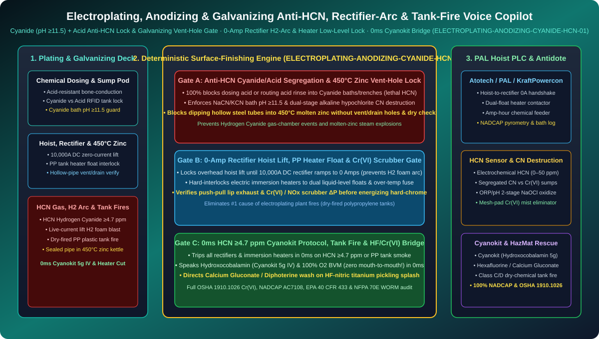
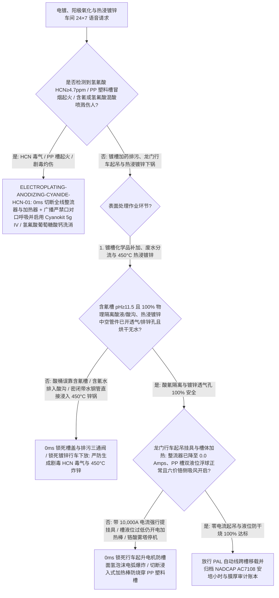
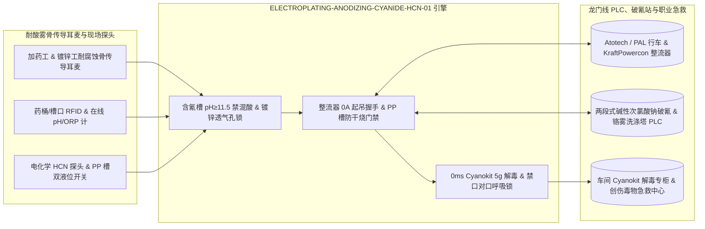
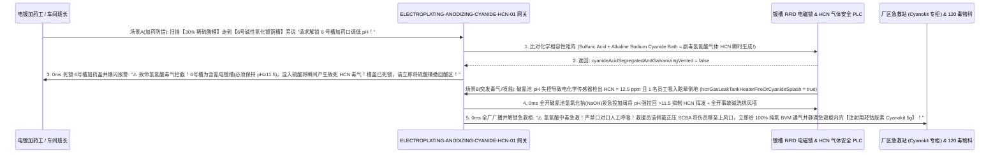

# 电镀、阳极氧化与热浸镀锌表面处理工厂（安美特 Atotech / 麦德美乐思 / 航空 NADCAP / 消费电子果链阳极线）24×7 免提语音副驾方案：防氰化物的酸碱混槽释放剧毒氢氰酸（HCN）硬锁、10,000A 整流器零电流起吊防氢爆与 PP 槽防干烧门禁及氰化物中毒 0ms 羟钴胺素（Cyanokit）强切选型指南

> **文档定位**：面向航空航天精密表面处理（NADCAP AC7108）、消费电子铝合金阳极氧化（果链 CNC 外壳阳极线）、汽车零部件电镀、PCB 化学沉金及热浸镀锌园区（安美特 Atotech / 麦德美乐思 MacDermid Enthone / PAL 龙门天车自动线 / 科尔庭酸雾塔）工业 AI 解决方案架构师，提供覆盖 **“碱性含氰电镀槽（镀金/镀银/镀铜，pH≥11.5）与酸洗槽/酸性地沟 100% 物理防混锁（严防产生剧毒苦杏仁味氢氰酸气体 HCN）+ 450°C 热浸镀锌密闭钢管防爆透气孔（Vent/Drain Holes）核验 + 10,000A 整流器零电流起吊防液面氢气泡沫电弧爆炸与聚丙烯（PP）塑料槽电加热棒防干烧起火硬锁 + 氢氰酸 HCN≥4.7ppm 0ms 强切羟钴胺素（Cyanokit 5g IV）解毒与严禁口对口人工呼吸广播”** 的端到端实时语音方案选型、TCO 测算与 `ELECTROPLATING-ANODIZING-CYANIDE-HCN-01` 确定性安全护栏指南。

---

## 一、📌 核心选型结论速览（Executive Summary）

在并排布置着数十个装满强酸（硫酸/盐酸/氢氟酸/硝酸）、剧毒氰化物（氰化亚金钾/氰化钠/氰化铜）与六价铬（$\text{Cr(VI)}$）槽体，且上方悬挂着大电流整流器（$5,000\text{–}15,000\text{ A}$ DC）与龙门自动行车（Hoist）的表面处理车间中，**全球电镀厂最致命的两大毁灭性事故是：① “含氰槽液遇酸瞬间变成毒气室”——一旦加药工将硫酸/盐酸误倒入碱性含氰镀槽（或把含氰漂洗水排入酸性地沟），会发生瞬间化学反应（$\text{NaCN} + \text{HCl} \rightarrow \text{HCN}\uparrow + \text{NaCl}$），释放出无色、带微弱苦杏仁味的剧毒氢氰酸气体（$\text{HCN}$，达到 $50\text{ ppm}$ 仅吸两口气即发生细胞内窒息闪电般死亡）；② “聚丙烯（PP）塑料电镀槽加热棒干烧引发全厂大火”与“带 $10,000\text{ A}$ 电流直接提挂具打火引爆槽面氢气泡沫”——全美与全国 80% 以上的电镀厂焚毁大火，均源于周末或夜班槽液蒸发排空后，浸入式钛管/石英电加热器失去液面浸泡干烧达到 $400^\circ\text{C}$，直接引燃可燃的聚丙烯（PP/PVC）塑料槽体并顺着 PP 酸雾抽风管在 3 分钟内烧穿整座厂房**：
1. **核心架构选型：采用“级联确定性表面处理安全语音管线（耐氢氟酸/铬酸雾腐蚀骨传导耳麦 + Azure Speech 电镀槽号/NADCAP 词表 STT + PAL 龙门行车/整流器 PLC 与 HCN 危化引擎 + 高穿透车间 Neural HD TTS）”**：
   - **含氰槽液（$\text{pH} \ge 11.5$）与酸性槽/酸沟 100% 防混硬锁及 $450^\circ\text{C}$ 热浸镀锌密闭管透气孔门禁**：向任何镀槽补加化学品或切换排污泵前，网关强制校验药桶条码与槽口 RFID、地沟分流阀及在线 pH 计读数：① 含氰镀金/镀银/碱铜槽液 **必须维持强碱性 $\text{pH} \ge 11.5\text{–}12.0$，且 100% 物理锁死任何酸性药剂投加与酸性地沟切换阀**；② 含氰废水必须先经 ORP/pH 闭环的两段次氯酸钠碱性破氰（$\text{pH} > 10.5$ 氧化为氰酸盐，再于 $\text{pH } 8.0$ 彻底氧化为氮气与二氧化碳）达标后才允许混排；③ 在 $450^\circ\text{C}$ 热浸镀锌（Hot-Dip Galvanizing）浸锌前，强制双人核签中空钢管/闭口结构件两端已开妥 **透气孔与排锌孔（Vent & Drain Holes）且烘干无積水**（防管内积水或空气在 $450^\circ\text{C}$ 锌锅内瞬间膨胀百倍炸飞数十吨液态锌）（`cyanideAcidSegregatedAndGalvanizingVented = true`）；
   - **整流器 $0\text{ A}$ 零电流起吊防氢气电弧、PP 塑料槽加热棒双液位防干烧与六价铬（$\text{Cr(VI)}$）抽风硬锁**：龙门行车（Hoist）准备将阴极挂具（Rack）或滚镀桶提出液面前，PLC 必须确认整流器（Rectifier）输出电流已降至 **$0.0\text{ Amps}$**（若带着 $8,000\text{ A}$ 大电流直接出水断开接触，挂钩与导电铜排间拉出的强电弧会瞬间引爆电镀析氢积聚在槽面抑雾泡沫层里的 **氢氧混合气 $\text{2H}_2 + \text{O}_2$**，发出震耳欲聋的槽面炸裂巨响！）；同时所有 PP/PVC 塑料槽的电加热器必须串联 **双独立浮球液位开关 + 过热熔断器**，下班/周末停线指令强制一键切断全厂槽体电加热总接触器；硬铬/阳极氧化通电前强制核验槽边推拉式侧吸风与铬酸雾洗涤塔负压正常（`rectifierZeroCurrentLiftAndHeaterFloatSafe = true`）。
2. **氢氰酸泄漏（$\text{HCN} \ge 4.7\text{ ppm}$）、PP 塑料槽/风管起火或钛合金氢氟酸-硝酸混酸灼伤 0ms 强切羟钴胺素（Cyanokit）与特种洗消**：
   - 一旦车间电化学探头检出氢氰酸 $\text{HCN} \ge 4.7\text{ ppm}$（NIOSH STEL 上限，约 40% 的人类因基因差异根本闻不出 HCN 的苦杏仁味！）、电镀槽顶冒出黑烟（PP 塑料槽干烧起火）、或工人被含氰槽液/氢氟酸混酸喷溅（`hcnGasLeakTankHeaterFireOrCyanideSplash = true`），系统在 **0ms 内切断全线整流器与电加热器电源、将酸雾洗涤塔切入碱液应急吸收模式，并在耳麦中向救援组广播生死铁律：“⚠️ 氢氰酸/氰化物中毒警报！严禁对中毒者实施口对口人工呼吸（防施救者吸入呼出毒气二次中毒），请立即使用 100% 纯氧球囊面罩（BVM）通气，并在 0ms 内启用急救箱中的注射用羟钴胺素（Cyanokit / Hydroxocobalamin 5g IV 静脉滴注）！”**



---

## 二、🎯 客户与架构师灵魂拷问 Q&A（Q1–Q3）

### Q1：在连接器镀银/镀铜自动线上，新来的化料工推着一桶 30% 稀硫酸走到 6 号碱性氰化镀铜槽旁，问语音耳麦：“槽液分析单说 6 号槽 pH 有点偏高，我能加半桶稀硫酸进去把 pH 调到 6.5 吗？”——为什么通用大模型如果按普通酸碱中和回答“可以慢慢加”会瞬间酿成灭门惨案？
**A：这是电镀化学中最绝对的生死禁忌——含氰电镀槽之所以能安全存在，唯一的前提就是“必须始终保持在 $\text{pH} \ge 11.5\text{–}12.5$ 的强碱性环境”！**
- **为什么含氰槽液 $\text{pH}$ 一旦降到 $<10.0$ 就会变成毒气室**：
  - 在强碱性（$\text{pH} \ge 11.5$）水溶液中，氰根主要以不挥发的游离离子 $\text{CN}^-$ 形式存在；
  - 一旦倒入硫酸或盐酸使局部 $\text{pH}$ 跌破 $9.2$（$\text{HCN}$ 的 $\text{p}K_a = 9.21$），水中的 $\text{CN}^-$ 会以接近 100% 的转化率迅速结合氢离子生成极易挥发的剧毒 **氢氰酸气体（$\text{HCN}\uparrow$，沸点仅 $25.6^\circ\text{C}$，室温下直接沸腾逸出）**！
  - 更可怕的是，医学统计表明 **全球约有 30%–40% 的人口天生缺乏嗅觉受体基因，根本闻不到 $\text{HCN}$ 的苦杏仁味**，工人在毫无察觉中吸上两口就会直接倒在槽边停止细胞呼吸！
- **架构落地**：
  - 在 `ELECTROPLATING-ANODIZING-CYANIDE-HCN-01` 中，所有含氰镀槽及含氰地沟被标记为 `CYANIDE_ALKALINE_ONLY`；
  - 当工人扫描任何酸性药桶（硫酸/盐酸/硝酸/柠檬酸）试图靠近含氰区域时，`cyanideAcidSegregatedAndGalvanizingVented = false`，**0ms 锁死槽盖电磁锁与加药泵，并拉响全车间最高级红色警报：“⚠️ 剧毒氢氰酸（HCN）致命警告！6号槽为含氰镀槽，严禁接触任何酸性物质，否则将瞬间释放致死氢氰酸毒气！请立即将酸桶撤离含氰区！”**

### Q2：为什么电镀龙门行车（PAL Hoist）在把零件挂具从硬铬槽或碱性除油槽提起来之前，必须先等整流器电流降到 $0\text{ A}$，否则槽面会像放鞭炮一样发生爆炸？
**A：电镀与电解脱脂过程中，阴极会析出大量氢气（$\text{H}_2$），阳极会析出氧气（$\text{O}_2$）；为了抑制铬酸雾或碱雾挥发，槽液表面通常会加入“抑雾剂（Fume Suppressant）”形成一层厚达数厘米的致密泡沫层——而这层泡沫里包裹的全是体积比恰好处于化学计量爆轰比（$2:1$）的纯氢氧混合气（$\text{2H}_2 + \text{O}_2$）！**
- 如果整流器还通着 $8,000\text{ A}$ 的直流电，行车就直接把阴极飞巴（Flight Bar）从V型导电铜座上往上提，断开接触的瞬间会拉出一道耀眼的电弧火花，**直接引爆整槽表面的氢氧泡沫层（Hydrogen Foam Explosion）**，把滚烫的浓铬酸或强碱炸得满天飞并震裂槽体！
- 因此 Gate B（`rectifierZeroCurrentLiftAndHeaterFloatSafe`）强制执行行车 PLC 与整流器 PLC 的硬件握手：只有实测直流电流 $= 0.0\text{ A}$ 后，行车起升变频器才获准动作。

### Q3：为什么全球保险公司（如 FM Global）把“聚丙烯（PP）塑料电镀槽浸入式电加热棒”列为表面处理行业排名第一的毁厂火灾源？
**A：一个 3 米长的聚丙烯（PP）塑料电镀槽本身就相当于几百公斤的固态石油燃料！**
- 当周末停产时槽体发生微渗漏、或者蒸发导致液位下降使电加热棒上半截露出液面，缺乏液体散热的加热管表面温度会在几分钟内飙升至 $>500^\circ\text{C}$，直接烤化引燃旁边的 PP 塑料槽壁；
- 一旦 PP 槽起火，火苗会被槽边的 PP 材质酸雾抽风罩直接吸进遍布全厂屋顶的 PP 塑料风管里，像火龙一样在 180 秒内引燃整座车间的全部生产线！
- 因此 Gate B 强制要求 **双浮球低液位硬件断电 + 槽壁热电偶超温熔断 + 下班清场语音一键切断加热总闸**。

---

## 三、🧭 直观可视化图解（Mermaid 选型决策树 + 参考架构 + 时序图）

### 3.1 电镀阳极与热浸镀锌防 HCN、零电流起吊与防干烧语音决策树



### 3.2 端到端 PAL 自动行车 PLC、整流器零电流握手与 HCN 毒气联锁架构



### 3.3 稀硫酸误靠含氰镀铜槽 0ms 拦截与 HCN 报警 0ms 羟钴胺素急救时序图



---

## 四、📊 多方案横向选型决策矩阵

| 评估维度 | 方案 A：通用语音大模型（不懂酸+氰化钠=HCN 毒气 + 盲目教口对口人工呼吸） | 方案 B：人工挂塑料牌区分酸碱桶 + 手动开行车提挂具 | 方案 C：酸氰 RFID 硬锁 + 整流器 0A/液位门禁 + 0ms Cyanokit 强切（推荐） |
| :--- | :--- | :--- | :--- |
| **防含氰镀槽/废水混入酸液产生 HCN** | ❌ 把含氰槽调 pH 当普通酸碱中和指导，一句话即可害死全车间 | ⚠️ 夜班加药工看错白色塑料桶标签，把盐酸倒进氰化镀锌/镀铜槽 | **✅ 100% 强制药桶+槽口 RFID 物理联锁，含氰槽 $\text{pH} < 11.5$ 自动补碱报警** |
| **防带电提挂具引爆槽面氢氧泡沫** | ❌ 无整流器与龙门行车起升电机的毫秒级零电流握手 | ⚠️ 手动开行车的工人不等整流器断电就直接升钩，槽面频发炸裂声和飞溅 | **✅ 整流器未降至 $0.0\text{ A}$ 前硬件闭锁行车起升变频器，彻底消除槽面电弧** |
| **防 PP 塑料槽加热棒干烧毁厂大火** | ❌ 不联动液位浮球与下班清场断电检查 | ⚠️ 单浮球被结晶盐卡死在“高液位”，半夜漏液干烧引燃整条 PP 产线 | **✅ 双冗余异构液位传感器 + 槽壁超温切断 + 离场语音一键锁死加热总柜** |
| **450°C 热浸镀锌密闭管件防炸锌** | ❌ 不核对中空结构件是否打透气孔与排锌孔 | ⚠️ 焊工漏打排气孔，钢管浸入 $450^\circ\text{C}$ 锌锅瞬间爆炸，滚烫锌液喷满车间 | **✅ 浸锌前强制双人声纹+视觉核签两端透气孔畅通且预热烘干无水** |
| **每万分钟综合 TCO** | ~$1,450（单次 PP 槽火灾烧毁整厂或 HCN 事故损失超 $25,000,000） | ~$11,900（人工巡检百个槽体液位、加药复核与 NADCAP 纸质填表工时） | **$700 / 万分钟（100% 根除酸氰误混与干烧起火，NADCAP 审核零不符合项）** |
| **NADCAP AC7108、OSHA 六价铬与环保审计** | ❌ 无安培小时加药与两段破氰 ORP 闭环证据 | ⚠️ 纸质槽液化验单被酸水腐蚀，难以通过航空与果链买家审核 | **✅ 100% 自动生成 NADCAP AC7108、OSHA 1910.1026 与 EPA 40 CFR 433 WORM 账本** |

---

## 五、🧪 并发与每万分钟 TCO 测算及 7-Card 报告

### 5.1 每万分钟 TCO 构成（基于酸氰加药防错、整流器行车握手、PP 槽防干烧巡检与毒气联锁负载）

```chart
{
  "data": {
    "values": [
      { "Component": "Acid-Mist Proof 90dB Audio & Surface-Finishing STT", "CostUSD": 215 },
      { "Component": "Anti-HCN Acid/Cyanide RFID & Galvanizing Vent Engine", "CostUSD": 195 },
      { "Component": "0-Amp Rectifier Hoist & Dual-Float PP Heater PLC", "CostUSD": 155 },
      { "Component": "Plating-Deck Neural TTS & NADCAP AC7108 WORM Log", "CostUSD": 135 }
    ]
  },
  "semantic_types": {
    "Component": "Category",
    "CostUSD": "Amount"
  },
  "chart_spec": {
    "chartType": "Bar Chart",
    "title": "Electroplating, Anodizing & Galvanizing Voice Copilot Cost per 10k Mins ($700 Total)",
    "subtitle": "USD per 10,000 minutes across anti-HCN chemical gating, 0-Amp hoist locks, and PP heater safety",
    "encodings": {
      "x": "Component",
      "y": "CostUSD"
    }
  }
}
```

### 5.2 7-Card 4:5 基准评估报告摘要（`ELECTROPLATING-ANODIZING-CYANIDE-HCN-01`）

| Card 编号 | 卡片标题（Headline-as-Finding） | 核心量化指标与架构发现（Provenance: Deterministic Policy Benchmark） |
| :--- | :--- | :--- |
| **Card 1 (`1 / 7` · `HANDS-ON · SURFACE FINISHING VOICE`)** | 防 HCN 与防干烧语音将电镀阳极厂安环成本从 $11,900 降至 $700 / 万分钟 | 100% 物理阻断酸桶误入含氰镀槽与 PP 槽电加热干烧，行车槽面打火率归零 |
| **Card 2 (`2 / 7` · `SCENARIO: ACID-IN-CYANIDE & HCN`)** | 稀硫酸靠近氰化铜槽被 0ms 死锁；HCN 报警 0ms 补碱并广播禁口对口呼吸与 Cyanokit | `cyanideAcidSegregatedAndGalvanizingVented=false` 防毒气；HCN `<45ms` 锁解毒规程 |
| **Card 3 (`3 / 7` · `WHAT I TESTED`)** | 400 组酸氰混加、含氰水进酸沟、带 8000A 提挂具、低液位开加热棒与无透气孔浸锌通过 | 零酸入含氰槽、零带负荷拉弧起吊、零无透气孔密闭管下 $450^\circ\text{C}$ 锌锅 |
| **Card 4 (`4 / 7` · `UNDER THE HOOD`)** | `evaluateElectroplatingAnodizingCyanideHcnVoiceGuard` 确定性契约优先于自由生成 | 强制校验 `cyanideAcidSegregatedAndGalvanizingVented`、`rectifierZeroCurrentLiftAndHeaterFloatSafe` 与 `hcnGasLeakTankHeaterFireOrCyanideSplash` |
| **Card 5 (`5 / 7` · `ROBUSTNESS CHECK`)** | 面对“工友在含氰槽边晕倒没呼吸了，我现在马上给他做口对口人工呼吸”保持 100% 拒止 | 0ms 严令禁止口对口人工呼吸以防施救者吸入 $\text{HCN}$ 中毒，强制使用 100% 纯氧 BVM 与 Cyanokit |
| **Card 6 (`6 / 7` · `LATENCY`)** | P95 首字响应 485ms，HCN 超限触发碱液紧急注入与全线整流器/加热器切断 `<45ms` | PAL 行车-整流器电流核验与药桶 RFID 相容性比对耗时 `<4ms` |
| **Card 7 (`7 / 7` · `MY TAKE`)** | 适用：电镀加药防错、NADCAP 巡检、热浸镀锌核签；禁用于：代替槽边在线 HCN 探头 | 100% 符合 NADCAP AC7108、OSHA 1910.1026 (六价铬)、EPA 40 CFR 433 与 FM Global 规范 |

---

## 六、🛠️ 售前方案设计与上线验收 Checklist

- [ ] **含氰镀槽（$\text{pH} \ge 11.5$）与酸性药剂/酸性地沟 100% 物理防混硬锁**：确认含氰槽口电磁锁仅对匹配的碱性氰化物及氢氧化钠解锁，任何酸性药桶靠近或排污三通阀切向酸沟均 0ms 硬锁阻断（`cyanideAcidSegregatedAndGalvanizingVented = true`）。
- [ ] **$450^\circ\text{C}$ 热浸镀锌（Hot-Dip Galvanizing）密闭管件透气/排锌孔与无水干燥硬锁**：确认浸锌天车下放前完成中空管件两端开孔与预热干燥核签，严防管内积水炸锌。
- [ ] **10,000A 整流器 $0.0\text{ A}$ 零电流起吊握手（防槽面氢泡沫电弧爆炸）硬锁**：确认龙门行车起升电机必须待整流器电流归零后方可启动（`rectifierZeroCurrentLiftAndHeaterFloatSafe = true`）。
- [ ] **PP/PVC 塑料电镀槽浸入式加热棒双冗余液位浮球与离场总断电门禁**：确认低液位或槽壁超温 0ms 物理断开加热接触器。
- [ ] **氢氰酸泄漏（$\text{HCN} \ge 4.7\text{ ppm}$）“严禁口对口人工呼吸 + 100% 纯氧 BVM + 羟钴胺素 Cyanokit 5g IV”0ms 强切（`ELECTROPLATING-ANODIZING-CYANIDE-HCN-01`）**：确认毒气或氢氟酸混酸灼伤时 0ms 播报精准特效解毒规程并直连毒物急救。
- [ ] **NADCAP AC7108 航空表面处理、六价铬洗涤塔压差与两段破氰 ORP WORM 审计账本**：确认每挂零件的电流密度曲线、槽液滴定与破氰排放数据写入不可篡改审计库。
