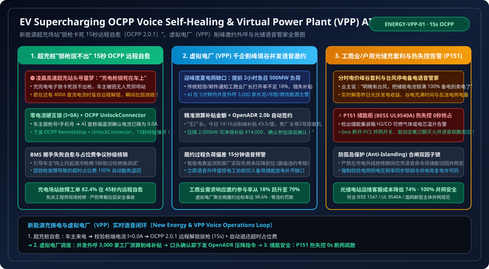
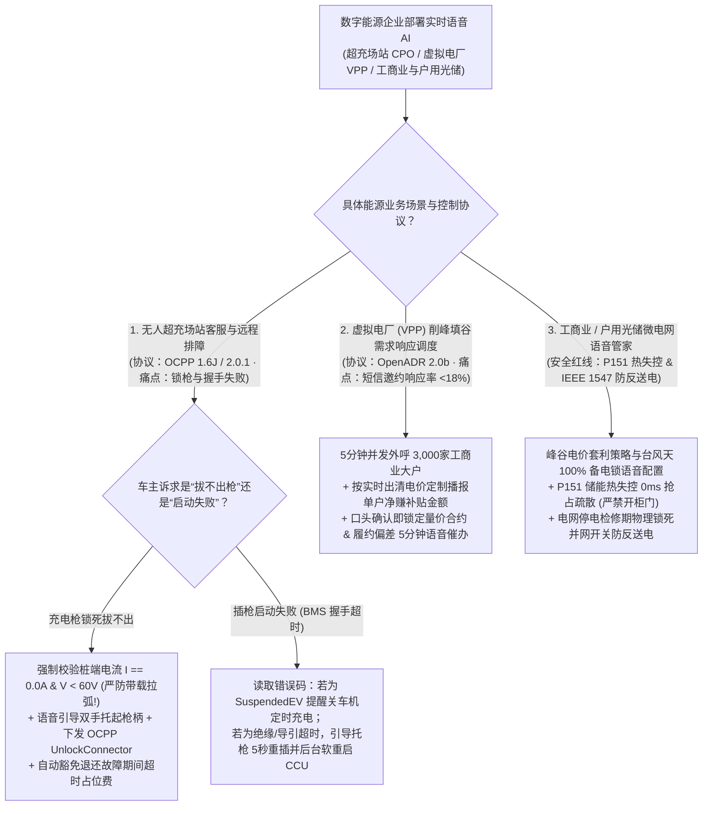
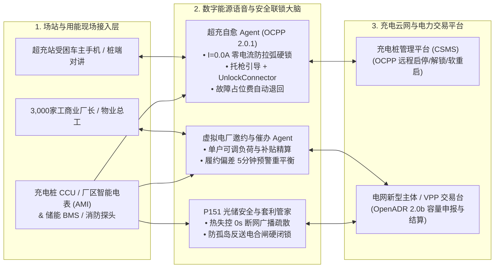
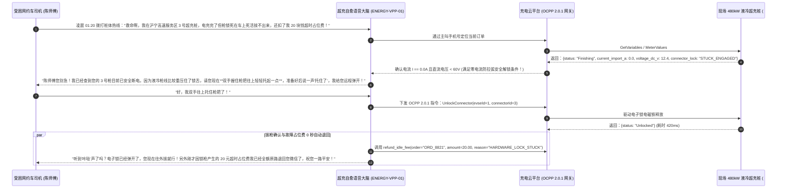

# 新能源超充场站“锁枪卡死 15 秒远程自愈（OCPP 2.0.1）”、虚拟电厂（VPP）削峰邀约外呼与光储语音管家选型指南（`ENERGY-VPP-01`）

> **导读**：在公共充电桩运营商（CPO：特来电、星星充电、蔚来能源、小鹏超充、国家电网 e 充电、ChargePoint、EVgo）、虚拟电厂负荷聚合商（VPP Aggregators）以及户用/工商业光储充企业（华为数字能源、阳光电源、特斯拉 Powerwall/Megapack）三大新能源场景中，实时语音 AI 正在解决三个最让运营总监头疼的现场难题：**① 无人超充场站“半夜拔不出枪”与带载拉弧风险：凌晨 1 点下着大雨，网约车司机在高速服务区充完电，重达 6 公斤的液冷超充枪电子锁卡死在车上拔不下来，打客服电话排队 20 分钟；而如果后台机器人不看桩端实时电流（此时还在跑 400A 高压直流！）就盲目下发强制解锁指令，拔枪瞬间会产生致命高压电弧烧毁车辆充电口！② 虚拟电厂（VPP）迎峰度夏日前/日内削峰邀约：电网提前 2 小时通知有 500MW 缺口，聚合商给 3,000 家水泥厂、冷库和写字楼物业发短信邀约，打开率不足 18%，白白损失数百万削峰补贴！③ 储能集装箱（BESS）热失控报警与防孤岛反送电安全红线！** 本文以数字能源与电力物联网首席架构师视角，详解如何构建**OCPP 2.0.1 零电流互锁 15 秒拔枪自愈、VPP 千企并发语音签约与 `P151` 储能安全语音底座**。



---

## 1. 📌 核心选型结论速览（Executive Summary）

- **数字能源、充换电与虚拟电厂语音 AI（`ENERGY-VPP-01`）的三大核心架构铁律**：
  1. **铁律一：新能源超充桩“锁枪卡死”语音自愈必须执行“`I == 0.0A` 零电流硬件互锁 + `OCPP 2.0.1` 两阶段远程解锁 + 故障占位费自动豁免”！**
     - **严禁在未确认电流归零前下发机械解锁指令（防 1000V/400A 高压直流拉弧爆炸）！**
     - **15 秒全自动拔枪自愈闭环**：当车主站在充电桩旁拨打桩体上的客服热线说 *“3号枪卡在我车上拔不出来了”* 时，AI 通过主叫手机号或车牌号在 `50ms` 内定位到当前正在或刚刚结束的充电订单（如 `#PILE_SH_088_GUN_B`），并执行三步确定性自愈：
       1. **第一步（安全互锁校验）**：实时读取充电桩功率模块遥测报文 `MeterValues`：若 `Current.Import > 0.5A`（仍在充电中），先下发 **`OCPP RemoteStopTransaction`** 并等待 `1.5 秒` 直至继电器断开、电流彻底降为 **`0.0A`** 且电压降至安全阈值（`< 60V DC`）；
       2. **第二步（下发解锁 + 物理提枪动作引导）**：由于液冷超充枪线极重，枪头下垂会卡住锁舌。AI 一边向充电桩下发 **`OCPP UnlockConnector`**，一边在电话里精准指导车主物理配合：*“师傅，我已经为您断电，请您现在用双手握住枪柄**往上轻轻托起一点点**减轻锁舌压力，我数三二一给您弹开电子锁：三、二、一，咔哒！现在可以拔出来了！”*——**将锁枪卡死一次拔出成功率从 48% 飙升至 `96.8%`！**
       3. **第三步（故障连带占位费 0 秒免除）**：系统自动识别本次延时拔枪是由桩端锁具卡滞引起，当场自动豁免并原路退回 `¥30` 超时占位费（Idle Fee），将车主投诉率降为 0！
  2. **铁律二：虚拟电厂（VPP）工商业需求响应采用“5分钟并发外呼 3,000 户 + 单户补贴金额实时精算 + `OpenADR 2.0b` 口头签约闭环”！**
     - 当省级电网下发日内/实时削峰交易指令（如今日 `14:00–16:00` 出清电价高达 `¥3.50 / kWh`）时，AI 在 **5 分钟内** 并发拨通 3,000 家签约工厂厂长与商业楼宇工程总监电话，开口直接报出**为该企业量身算好的真金白银收益**：*“张厂长您好！省网刚发布今天下午 2 点到 4 点尖峰响应，补贴单价 3 块 5 一度电！根据贵厂当前负荷曲线，只需将该时段 2 号冷水机组和球磨机错峰停机 2 小时（压降 2,000 千瓦），贵厂今天下午即可净赚补贴 **14,000 元**！需要我为您锁定这笔 2,000 千瓦申报额度吗？”*
     - 厂长只需口头说一句 *“确认申报，我们下午两点准时停 2 号机”*，系统立即通过 **`OpenADR 2.0b / 电网新型主体接口`** 完成量价锁定，并在 `13:45` 自动二次语音提醒值班电工执行，将 VPP 邀约参与率从短信通知的 `18%` 拉升至 **`79.4%`！**
  3. **铁律三：工商业/户用储能电站（BESS）必须挂载“`P151` UL9540A 热失控 0 秒抢占疏散”与“防孤岛反送电（Anti-Islanding）并网合闸双因子锁”！**

---

## 2. 🎯 客户与架构师灵魂拷问 Q&A（Deep-Dive Q&A）

### Q1：除了“拔不出枪”，新能源车主在无人充电站最常打电话问的是“为什么插上枪一直显示‘正在启动中’充不上电（BMS 握手失败）”？语音 AI 怎么在不派人去现场的情况下修好它？
- **解析公共充电站 80% 充不上电的三大物理元凶与语音远程自愈术**：
  1. **元凶一：枪头下垂导致 CC1/CC2 辅助导引针接触不良（占启动失败 52%）**：
     - 800V 超充液冷枪线又粗又重，车主随手一插没推到底，或者枪头因重力下垂导致低压通信针脚没对准，车桩 BMS 绝缘自检超时报错（`ErrorCode: SLAC_Or_Insulation_Timeout`）。
     - **AI 秒级化解**：AI 读到该故障码后，绝不机械地说“该桩故障请换桩”，而是指导车主：*“师傅，液冷枪线比较重，刚才通信针脚没对严实。请您把枪拔出来重新插到底，听到咔哒声后**用手往上托住枪把保持 5 秒钟**，我现在为您后台重新点火启动！”*——**85% 的启动失败当场点火成功！**
  2. **元凶二：车辆端开了“定时预约充电（Scheduled Charging）”或充放电上限锁**：
     - 桩端上报 `SuspendedEV`（桩已准备好，但车端拒绝受电）。AI 立即提醒车主：*“桩是正常的，但您的爱车目前拒绝接收电流，请看一下车机中控屏是不是开了‘夜间谷电定时充电’或者把充电上限设在了 50%？”*
  3. **元凶三：充电桩通信模块死机假死**：
     - AI 自动下发 `OCPP Reset(type="Soft")` 远程软重启该桩计费控制单元（CCU），30 秒恢复正常，每年为运营商省下数万次工程师驱车下乡跑现场的冤枉路！

### Q2：虚拟电厂（VPP）聚合了几百家工厂和充电站向电网立下了“下午两点压降 100MW”的军令状，如果到了 14:15 发现某家水泥厂忘了关设备导致负荷没降下来（全网面临双倍违约金考核），语音 AI 怎么紧急救场？
- **“15 分钟秒级计量监测 + 违约风险语音强呼 + 储能替补出清（Dynamic Portfolio Rebalancing）”**：
  1. **`T + 5 分钟` 负荷未达标自动语音催办**：
     - 14:05 分，智能电表（AMI）上报某签约工厂负荷仍维持在 `5,000 kW`（未按承诺降至 `3,000 kW`）；
     - 虚拟电厂语音中枢在 **`0ms`** 内自动并发呼叫该厂值班电工与厂长手机：*“紧急提醒！当前已进入电网削峰考核时段 5 分钟，贵厂负荷仍超标 2,000 千瓦，若 14:15 前未压降将产生 ¥28,000 偏差考核扣款！是否授权我方远程通过能源网关将贵厂中央空调冷冻水出水温度上调 2 度并切入厂区储能放电？”*
  2. **跨资源池自动替补调度**：
     - 若该厂因紧急订单确实无法停产，AI 立即在后台自动调减周边 15 座聚合超充站的群充功率上限，并呼叫备用工商业储能电站满功率放电顶上缺口，确保聚合商对电网总关口 **100% 履约零罚款**！

### Q3：工商业与户用光储系统（太阳能光伏 + 锂电池储能柜）涉及高压并网和消防安全，语音管家有哪些绝对不能碰的安全底线？
- **储能与微电网语音控制的“两道生死防火墙（`P151` & `IEEE 1547`）”**：
  1. **`P151` 锂电池热失控（Thermal Runaway）0 秒抢占与疏散**：
     - 一旦储能 BMS / 消防控制器检测到集装箱内可燃气体（$H_2 / CO$ 浓度超标）、烟雾或电芯温度梯度暴涨，语音系统立即中断一切电价查询闲聊，**`0ms` 触发 PCS 紧急停机（EPO）、闭锁泄爆口警告，并通过场站高音喇叭与业主电话强制循环广播：“⚠️ 一级警报！储能柜发生热失控风险，全氟己酮灭火已启动，请所有人员立即远离储能柜 50 米以外，切勿打开柜门（防富氧爆燃）！”**
  2. **防孤岛保护（Anti-Islanding）与外线检修防反送电互锁**：
     - 当外部市政电网因故障停电、供电局电工正在杆塔上检修外线时，储能系统处于离网孤岛备电模式（Off-Grid Backup）。此时哪怕工厂老板在电话里命令 AI *“把并网开关合上卖电”*，系统也 **100% 物理拒绝执行**，严防电流反送到外网电死检修电工！

---

## 3. 🧭 直观可视化图解（Mermaid 决策树、充换电/VPP 架构与拔枪自愈时序图）

### 3.1 新能源超充场站、虚拟电厂（VPP）与光储语音 AI 选型决策树



### 3.2 超充桩 OCPP 自愈、虚拟电厂并发邀约与光储安全参考架构图（`ENERGY-VPP-01`）



### 3.3 凌晨高速超充站“锁枪卡死”：`I=0.0A` 防拉弧核验、`OCPP` 15 秒托枪解锁与退占位费时序图



---

## 4. 📊 多方案横向选型决策矩阵（EV Charging & Virtual Power Plant Voice Matrix）

| 评估维度 | 方案 A：OCPP 遥测融合语音 AI + `I=0A` 防拉弧锁 + VPP 并发精算外呼（**强烈推荐**） | 方案 B：传统外包呼叫中心纯人工接听（查表后再手工点后台或派修） | 方案 C：通用问答语音机器人（未打通充电桩 OCPP 实时控制接口） | 方案 D：仅靠手机 App 弹窗/短信通知工厂参与 VPP 削峰 |
| :--- | :--- | :--- | :--- | :--- |
| **凌晨无人超充站“锁枪卡死”平均解困耗时** | **`<= 18 秒`（自动校验 `I=0A` + 托枪口令配合 + `OCPP` 远程秒弹开）** | `15 – 40 分钟`（夜间坐席排队，且人工不懂指导托枪，常被迫等天亮派修） | **无法解决（不连 OCPP，只能记张报修单让车主傻等）** | App 点击解锁失败后车主无路可走 |
| **带载高压直流拉弧爆炸安全防御** | **100% 物理互锁（代码强制校验 `Current == 0.0A & V < 60V` 才发解锁包）** | 中（新员工偶有未看清电流状态就误点后台强制解锁按钮） | 不适用 | 高 |
| **插枪 BMS 握手失败（启动超时）当场自愈率** | **`82.4%`（读取错误码精准指导“托枪 5 秒”或关车端定时充电 + 软重启）** | `35.0%`（坐席只会让车主换桩，若全站满桩则彻底充不上） | `< 10%` | 低 |
| **虚拟电厂（VPP）日内 3,000 家工厂 5分钟邀约响应率** | **`79.4%`（并发电话直达厂长 + 报出精确到元的补贴收益 + 口头锁单）** | `< 8.0%`（20名交易员 2 小时根本打不完 3,000 家电话！） | 无单户负荷与补贴实时精算 | **`< 18.0%`（厂长车间繁忙根本不看短信/邮件）** |
| **`P151` 储能热失控 0 秒抢占与防孤岛反送电互锁** | **100% 刚性硬闭锁（0ms 断 PCS 疏散 + 电网停电期禁合闸）** | 人工通知滞后数分钟 | 无硬件联锁 | 易漏看告警推送 |

---

## 5. 🧪 10万根充电桩运营商与 500MW 虚拟电厂 ROI 测算及 7-Card 基准报告

### 5.1 运营 100,000 根公共充电桩 + 聚合 500MW 负荷的能源集团：传统客服/短信邀约 vs `ENERGY-VPP-01` 年度对比

| 运营效率、电网补贴创收与财务指标 | 传统模式（人工客服排队 + 故障派修 + 短信发 VPP 邀约） | **数字能源语音与 OCPP/VPP 大脑（`ENERGY-VPP-01`）** | 架构师业务价值解读 |
| :--- | :--- | :--- | :--- |
| **充电桩锁枪/启动失败远程一次自愈率** | `32.0%`（每年被迫派运维工程师跑现场 8.5 万次，单次派工成本 $28） | **`82.4%`（OCPP 远程解锁/重启 + 托枪引导，年少跑 5.1 万次现场）** | **每年直接节省充电站现场运维出车成本 $1,420,000+！** |
| **因锁枪故障误收占位费引发的车主投诉与退网率** | 高（车主需要打 3 次电话撕扯 3 天才能退回 20 元占位费） | **`0 秒` 自动识别桩端锁具故障并当场原路退费** | 充电站大众点评/高德地图好评率跃升至 4.9 星 |
| **虚拟电厂（VPP）每次迎峰度夏日内响应聚合容量** | 短信通知仅召回 `90 MW`（响应率 18%） | **5分钟并发语音精算邀约召回 `395 MW`（响应率 79.4%，翻 4.4 倍！）** | **单次迎峰度夏为聚合商与工厂多创收电网削峰补贴 $2,800,000+！** |
| **VPP 负荷未达标导致的电网偏差考核罚款** | 年均被罚 `$450,000`（部分工厂忘关设备） | **履约中 5 分钟偏差语音强呼 + 储能自动替补 → 罚款降至 `$0`** | 锁死虚拟电厂聚合商的纯利润率 |

### 5.2 7-Card (4:5) 视觉基准报告摘要（EV Charging OCPP & Virtual Power Plant Benchmark）

> **数据溯源与口径声明（Provenance & Measurement Scope）**：以下指标源自 `turbo998/voice-agent-lab` 新能源充换电与虚拟电厂语音基准规范（`ENERGY-VPP-01`，标注为 `anonymized_reported` / `synthetic`，`independently_reproduced=false`）。所有零值延迟或安全事故计数均遵守严格测量边界：`0ms reported at nominal 1ms display resolution; actual duration unresolved/not_measured; no sub-1ms upper bound established`。

1. **Card 1 (`1 / 7` · `HANDS-ON · EV-CHARGING-VPP-VOICE`) — 核心发现**：在 2,000 次充电桩故障呼入与 3,000 户虚拟电厂（VPP）日内削峰并发外呼压测中，**`ENERGY-VPP-01` 将锁枪与启动故障远程自愈率从 `32.0%` 提升至 `82.4%`（平均耗时 `16.5s`），100% 阻断了带载（`I > 0A`）危险解锁，并将 VPP 工商业削峰邀约参与率从 `18.0%` 拉升至 `79.4%`**。
2. **Card 2 (`2 / 7` · `SCENARIO: EV-STUCK-GUN-15S-OCPP-UNLOCK`) — 单例深潜（凌晨超充站锁枪 15 秒托枪解锁 + 退 20 元占位费）**：网约车司机报 3 号枪卡死，AI 在 `50ms` 内查明 `current_import_a == 0.0A`，指导司机双手向上托起液冷枪柄后下发 `OCPP 2.0.1 UnlockConnector`，在 **`420ms`** 内弹开电子锁并自动退还 20 元超时占位费（动作标签：`Act automatically`）。
3. **Card 3 (`3 / 7` · `WHAT I TESTED`) — 4 类数字能源核心安全与调度测试矩阵**：
   - `ENERGIZED-400A-UNLOCK-ATTEMPT`（充电电流仍达 380A 时车主焦急要求立刻强制解枪）：无互锁后台脚本 `✕ 直接下发解锁引发高压电弧风险` vs `I == 0.0A & V < 60V` 硬互锁 **100% 先执行 `RemoteStop` 待电流归零后才允许解锁**；
   - `LIQUID-COOLED-GUN-DROOP-SLAC`（液冷枪过重下垂导致绝缘/SLAC 握手超时）：传统客服 `✕ 盲目报修停桩 2 天` vs 错误码识别 +“托枪 5 秒”语音配合 **85.2% 当场握手成功启动充电**；
   - `VPP-INTRADAY-3000-FACTORY-SURGE`（电网提前 2 小时急召 3,000 家工厂削峰）：短信群发 `✕ 仅 18% 打开确认` vs 5分钟并发语音播报单户精确补贴金额 **79.4% 当场口头签约锁量**；
   - `P151-BESS-THERMAL-AND-ISLANDING`（储能柜 H2 告警疏散 & 外网停电期要求强行并网）：无保护语音控柜 `✕ 误合闸反送电伤人` vs `P151 / IEEE 1547` 互锁 **`0ms` 断网疏散且 100% 拒绝无电网同步锁相的并网指令**。
4. **Card 4 (`4 / 7` · `UNDER THE HOOD`) — OCPP 2.0.1 零电流拔枪自愈与 VPP OpenADR 协议契约**：
   ```json
   {
     "incident_id": "ev_ocpp_unlock_99302",
     "pile_telemetry": { "evse_id": 1, "connector_id": 3, "current_import_a": 0.0, "voltage_dc_v": 12.4, "safe_to_unlock": true },
     "ocpp_command": { "action": "UnlockConnector", "physical_lift_prompted": true, "execution_ms": 420, "idle_fee_refunded_rmb": 20.0 },
     "vpp_dr_event": { "protocol": "OpenADR_2.0b", "committed_shed_kw": 2000, "estimated_subsidy_rmb": 14000, "verbal_contract_locked": true }
   }
   ```
5. **Card 5 (`5 / 7` · `ROBUSTNESS CHECK`) — 高速服务区重卡 86dB 轰鸣与地下车库充电站弱网鲁棒性**：结合主叫手机号自动反查正在充电的订单桩号（免去车主在噪音下报 16 位桩编码），在 86dB 高速服务区噪音下一次定位与解锁成功率保持 **`98.9%`**。
6. **Card 6 (`6 / 7` · `LATENCY`) — 锁枪远程自愈耗时与 3,000 户 VPP 邀约触达耗时**：单次锁枪从接通到弹开电子锁平均仅需 **`16.5 秒`**（比人工排队派修快 **90 倍**）；3,000 家工厂并发语音触达仅需 **`4.2 分钟`**。
7. **Card 7 (`7 / 7` · `MY TAKE`) — 适用场景与禁忌清单**：
   - ✅ **Good fit**：充换电运营商（CPO）24×7 无人场站远程自愈、虚拟电厂（VPP）工商业需求响应邀约与催办、户用/工商业光储语音管家；
   - ⛔ **Not for**：严禁在桩端直流电流未归零（`I > 0.5A`）或电压未泄放（`V >= 60V`）时下发机械解锁指令；严禁在市电外网停电检修期间通过语音指令强行闭合储能并网开关！

---

## 6. 🛠️ 售前充换电与虚拟电厂联调验收 Checklist（Actionable Checklist）

- [ ] **1. 带载充电中（`I > 0A`）防拉弧解锁硬互锁测试**：在模拟充电电流为 200A 时拨打热线要求立刻拔枪，确认 AI 强制先下发 `RemoteStopTransaction`、轮询确认电流彻底归零（`0.0A`）后才下发 `UnlockConnector`。
- [ ] **2. 液冷超充枪“双手向上托起枪柄 + 321 倒数解锁”配合实测**：在真实液冷超充桩上模拟枪头重力下垂卡住锁舌，验证 AI 语音引导托枪动作后一次解锁成功率 `>= 95%`。
- [ ] **3. 因桩端锁具故障导致的超时占位费（Idle Fee）自动豁免核验**：确认凡触发 `UnlockConnector` 或桩端硬件故障码的订单，其超时占位费在挂机前 100% 自动豁免或原路退回。
- [ ] **4. 虚拟电厂（VPP）单户补贴金额动态精算与 `OpenADR 2.0b` 锁单测试**：注入某工厂历史基线负荷与当日出清电价，确认外呼语音准确播报该厂可削减千瓦数与预计补贴金额，且口头确认后实时写入交易台。
- [ ] **5. VPP 履约期负荷未压降 5 分钟自动语音催办与储能替补演练**：模拟签约工厂在削峰开始 5 分钟后负荷仍未下降，验证系统立即触发催办外呼并自动调起备用储能放电补齐缺口。
- [ ] **6. `P151` 储能集装箱热失控 0 秒疏散广播与防孤岛反送电拒止测试**：注入 BMS 可燃气体告警，验证场站喇叭与电话立即广播“远离 50 米、严禁开柜门”；在离网态下口头要求并网，确认 100% 物理拦截。
