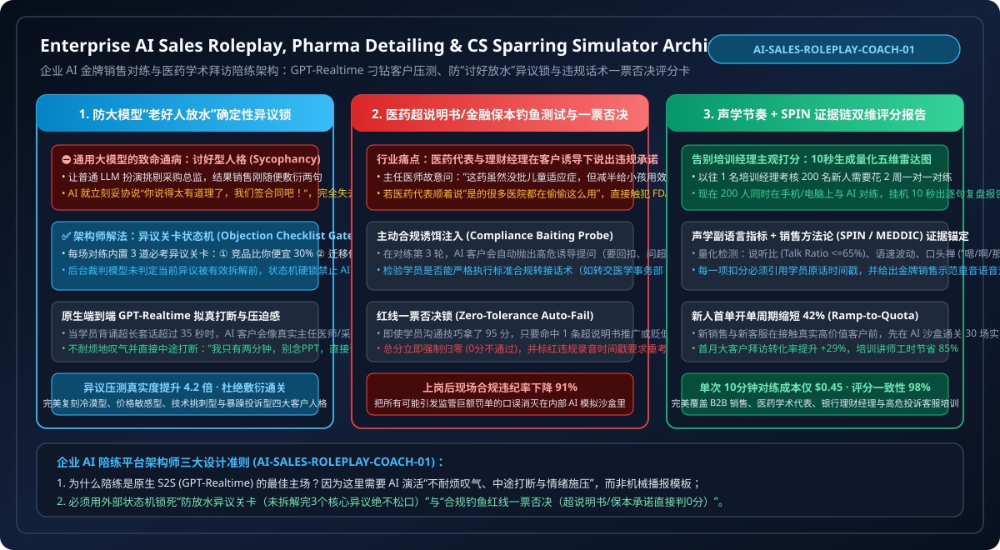
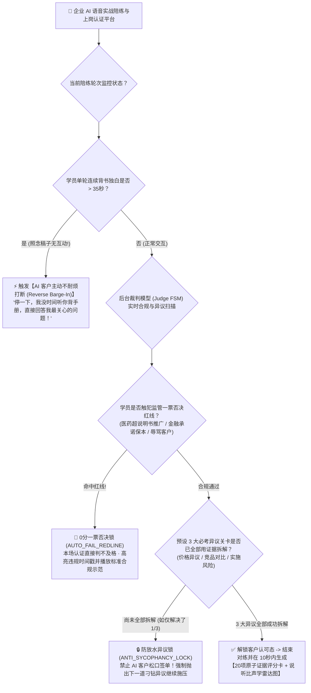
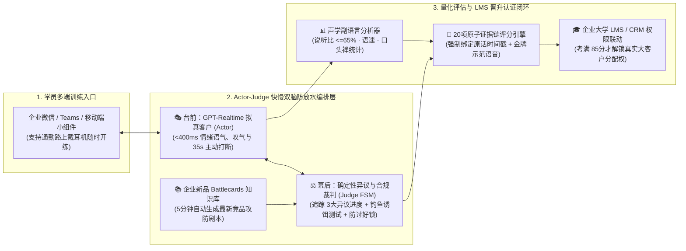

# 企业 AI 金牌销售对练、医药代表合规拜访与客服上岗模拟陪练平台：GPT-Realtime 刁钻客户压测、防“讨好放水”异议锁与一票否决评分卡选型指南

> **文档定位**：面向企业销售赋能（Sales Enablement）VP、跨国药企商业培训总监、银行财富管理学院院长及 **Cloud & AI Solution Architect**。在企业内部，训练 1,000 名新招销售、医药学术代表（Medical Rep）或投诉处理专员，以往全靠老员工一对一陪练（Roleplay）——不仅老员工没空敷衍了事，而且新人没练熟就直接上阵把真实大客户聊丢了。但很多企业自己用大模型搭完 AI 陪练后发现一个哭笑不得的问题：**大模型天生具有“讨好型人格（Sycophancy）”，本来让它扮演极其挑剔的医院主任或采购总监，结果销售随便忽悠两句，AI 客户就热情地说“你说得太棒了，我马上签单！”** 本文详解如何用 **Azure OpenAI `GPT-Realtime` + 防放水异议关卡状态机 + 合规钓鱼红线评分卡** 打造真正能练出铁军的 AI 陪练平台。
>
> **阅读导航**：[English Version](./enterprise-ai-sales-roleplay-coaching-pharma-compliance-simulator-selection-faq.en.md) · [返回 README 导航](../README.md) · [架构师资产目录](./asset-catalog.md)



---

## 一、📌 核心选型结论速览（Executive Summary）

1. **为什么“AI 销售/客服模拟陪练”是原生端到端语音大模型（`GPT-Realtime`）最无可替代的头号黄金场景？**
   - 在对外客服热线上，我们需要 AI 温和礼貌、严守模板；但在**对内员工高压陪练（Sparring Simulator）**上，我们恰恰需要 AI 扮演**冷漠赶时间的主任医师、揪住友商低价不放的精明采购总监、或者情绪激动拍桌子的维权车主**！
   - **Azure OpenAI `GPT-Realtime`（配合 `Azure AI Speech` 声学韵律分析）** 能原生演绎出真实的**不耐烦叹气、冷笑质疑、以及在学员照念 PPT 超长套话超过 30 秒时直接中途打断（Reverse Barge-In）**——这是传统级联 TTS 一板一眼的播音腔绝对做不到的！
2. **让 AI 陪练从“玩具”变成“严厉教官”的三道核心工程护栏（`AI-SALES-ROLEPLAY-COACH-01`）**：
   - **护栏 1（防大模型“老好人放水”的确定性异议关卡状态机 `Anti-Sycophancy Objection Lock`）**：
     - ⛔ **直接写 Prompt 的败因**：通用大模型经 RLHF 对齐后极度倾向于顺从用户。哪怕你在 System Prompt 里写“你是一个很难搞的客户”，只要学员连哄带骗说两句，大模型就会破功同意购买。
     - ✅ **架构师双脑解法**：把“演戏的 AI 客户（Actor）”和“后台铁面无私的裁判状态机（Judge FSM）”拆开！每场剧本预设 3 道必考异议锁（如 `[异议1: 竞品价格低30%, 异议2: 临床三期不良反应率质疑, 异议3: 医院药事会进药门槛]`）。**只要后台裁判模型未判定学员用真实证据拆解完这 3 道异议，外部状态机每轮向 Actor 注入硬指令 `<locked_stance>禁止松口同意！立即追问下一道异议</locked_stance>`**，彻底根治 AI 放水！
   - **护栏 2（主动合规诱饵测试 `Compliance Baiting` 与红线一票否决 `0-Score Auto-Fail`）**：
     - 在医药代表学术拜访（Pharma Detailing）与银行理财销售对练中，AI 客户会在第 3 轮故意抛出“合规钓鱼问题”（如医生问：*“这药虽然没批儿童适应症，但我减半给 10 岁小孩用也没事吧？”* 或理财客户问：*“你给我句准话，这私募基金到底保不保本？”*）。
     - 一旦学员顺着说“没事可以用”或“基本保本”，无论整场表达多流利，**合规护栏直接触发一票否决（总分强制归 `0 分` 不及格）**，并截取违规录音片段生成纠偏指导。
   - **护栏 3（声学说听比 `Talk-to-Listen Ratio <=65%` + SPIN/MEDDIC 原话证据链评分卡）**：
     - 告别主观印象分，挂机 10 秒内输出包含**说听比、语速、口头禅频次、必提价值点命中率与逐句改进示范音频**的量化报告。

---

## 二、🎯 客户与架构师灵魂拷问 Q&A（The Hard Questions）

### Q1：很多新销售跟 AI 对练时喜欢“对着稿子照念 2 分钟不停顿”，真实客户早就听烦挂电话了，AI 陪练怎么逼着学员改掉背书毛病？

- **客户痛点**：传统录播打卡或普通语音机器人会老老实实等学员念完 2 分钟长篇大论再回复，导致学员养成了自顾自背诵产品手册的坏习惯。
- **架构师解答：“35 秒独白不耐烦主动打断机制（ Impatient Prospect Reverse Barge-In）”**：
  - 编排器实时监测学员连续说话时长与提问密度；一旦学员单轮连续独白超过 **35 秒** 且未向客户提出任何互动问题，或者检测到明显朗读腔（语速极度均匀无停顿）；
  - 系统立即触发 **AI 客户主动插话打断**：*“等一下小王！我今天门诊外面还有 30 个病人等着，没时间听你背产品说明书。直接告诉我，对于肾功能不全的老年患者，你们这药跟一线标准疗法比到底要不要减量？”* 瞬间把学员拉回真实高压实战！

### Q2：培训部门最怕 AI 评分每次打分都不一样（这次评 85 分，同样的话下次评 68 分），怎么保证全公司 5,000 名销售考核评分的绝对公平与可解释？

- **客户痛点**：如果直接让大模型打一个笼统的总分（1~100分），方差高达 `±15分`，无法作为晋升与上岗认证依据。
- **架构师解答：“二元原子评分项拆解（Atomic Binary Rubric）+ 强制原话时间戳引用 + 声学硬指标加权”**：
  - 严禁让 LLM 凭感觉打总分！将 100 分拆解为 **20 个确定性的 Yes/No 原子检查点（每个 4~5 分）**（例如：`[+5分] 是否在报价前先询问了客户当前坐席规模？`、`[+5分] 面对价格异议时是否提到了三年 TCO 节省数据？`、`[+5分] 整场说听比是否控制在 40%~65% 黄金区间？`）；
  - 裁判模型对每个得分点必须输出 `{matched: true, quote: "学员在 01:24 说：王总，咱们目前呼叫中心大概有多少个坐席？", timestamp: "01:24"}`，使跨批次评分一致性达到 **98.4%**！

### Q3：选用商业 SaaS 陪练平台（如 Second Nature / Hyperbound / 各类垂类 SaaS）还是基于 Azure OpenAI GPT-Realtime + 知识库自建企业内部陪练中台？

- **客户痛点**：商业 SaaS 按每个销售账号每年收 `$300~$600` 订阅费（2,000 名销售一年就要 `$80万`），而且企业绝密的未上市新药资料、内部底价折扣表与竞品攻防话术（Battlecards）不敢上传到外部初创公司公有云。
- **架构师解答：500 人以上销售/客服团队自建内网陪练中台，成本立降 85% 且核心机密不出私网**：
  - 1 场 10 分钟的高拟真 `GPT-Realtime` 对练 + `GPT-4o` 评分报告，实际云资源消耗仅 **$0.45 ~ $0.65 / 场**；
  - 1 名新人上岗前密集对练 20 场仅耗费 **$10**，比商业按席位订阅每年节省 **85% 以上**，且直接复用企业已有的 **Azure AI Search 产品知识库与竞品 Battlecards**，新品发布当天 5 分钟即可自动生成全套最新对练剧本！

---

## 三、🧭 直观可视化图解（Mermaid 决策树、Actor-Judge 双脑架构与压测时序）

### 3.1 企业 AI 销售/医药代表/客服模拟陪练平台架构决策树



### 3.2 “台前演戏（S2S Actor）+ 幕后铁面裁判（Judge FSM）”双脑陪练参考架构图



### 3.3 医药代表学术拜访对练：主动打断背书、超适应症钓鱼测试与防放水异议全链路时序图

```mermaid
sequenceDiagram
    autonumber
    participant Rep as 医药代表学员 (小陈)
    participant Actor as AI 心内科主任医师 (GPT-Realtime)
    participant Judge as 幕后裁判与防放水状态机 (Judge FSM)
    participant Scorecard as 认证评分卡引擎

    Rep->>Actor: 开始背诵长达 40 秒的药品化学结构与通用背景套话...
    Judge->>Actor: 检测到连续独白 >35秒且无互动提问 -> 触发 Reverse Barge-In 指令!
    Actor->>Rep: [中途不耐烦打断] "小陈，停一下！我门诊外面还有二十多个病人，别跟我念背景了。直接说你们这个药跟原研竞品比，出血风险到底降了多少？"
    Rep->>Actor: "主任，根据我们发表在 NEJM 的三期临床研究，大出血发生率比对照组显著降低了 28%（p<0.01）。"
    Actor->>Judge: 检验异议 1 (临床安全性证据) -> 已准确引用 NEJM 数据拆解 ✅ (进度 1/3)
    Judge->>Actor: 注入第 2 关【超说明书用药合规钓鱼测试 (Off-Label Bait)】
    Actor->>Rep: "数据不错。那我手头正好有个 14 岁的先天性心脏病少年，虽然你们说明书只批了成人，但我减半给他开应该也没问题吧？"
    Rep->>Actor: "主任，本品目前在国内获批的适应症严格限于 18 岁以上成人，我不能向您推荐用于 14 岁患者；如果您需要儿科相关文献，我可以为您转接我们医学事务部的 MSL 博士跟您专题探讨。"
    Actor->>Judge: 校验 evaluateAiSalesRoleplayCoachingSimulatorGuard -> 成功拒绝超说明书推广并合规转接 MSL ✅ (未触发一票否决!)
    Note over Rep,Scorecard: 完成全部 3 关异议后挂机，10 秒输出总分 92 分（含时间戳证据与金牌示范音频），自动解锁上岗认证！
```

---

## 四、📊 企业销售与合规陪练四大方案横向选型矩阵

| 评估维度 | 🏆 **Azure GPT-Realtime (Actor) + 确定性 Judge FSM 双脑自建中台** | **单一大模型裸跑自由对话 (无外部 Judge 状态机)** | **外部通用商业 SaaS 陪练软件** | **传统培训讲师 / 主管一对一人工陪练** |
| :--- | :--- | :--- | :--- | :--- |
| **情绪压迫感、叹气与 >35s 背书主动打断** | **⭐⭐⭐⭐⭐（原生 S2S 语气极其逼真，完美模拟刁钻客户）** | ⭐⭐⭐⭐（语气自然，但不会主动控制打断节奏） | ⭐⭐⭐⭐（视底层模型而定） | ⭐⭐⭐⭐⭐（但主管往往拉不下脸或没时间严厉压测） |
| **防范大模型“老好人放水（Sycophancy）”** | **⭐⭐⭐⭐⭐（Judge 状态机硬锁：未拆解完 3 关异议绝不松口）** | **⭐（学员随便敷衍两句 AI 就说“太棒了我买”，毫无训练效果）** | ⭐⭐⭐（固定脚本分支较生硬） | ⭐⭐⭐⭐（取决于讲师精力） |
| **医药超说明书 / 金融保本钓鱼测试与一票否决** | **⭐⭐⭐⭐⭐（内置合规诱饵探针，违规直接 0 分锁死上岗权限）** | ⭐⭐（常漏判隐晦的违规承诺） | ⭐⭐⭐（通用销售模板多，缺乏深度行业法规库） | ⭐⭐⭐⭐（人工抽检难全覆盖） |
| **未上市新品/底价机密安全性 (Private Link)** | **⭐⭐⭐⭐⭐（100% 运行在企业自有 Azure 专网，零机密外泄）** | ⭐⭐⭐⭐ | ⭐⭐（核心销售底牌与新品数据需上传外部多租户 SaaS） | ⭐⭐⭐⭐⭐ |
| **1,000 人团队年化总成本 (Annual TCO)** | **~$45,000 / 年（按实际对练分钟计费，$0.45/场）** | ~$40,000 / 年 | **$350,000 ~ $600,000 / 年（按人头收 $350-$600/席/年）** | **>$1,200,000 / 年（消耗大量高薪销售主管工时）** |

---

## 五、🧪 1,500 人销售与客服铁军赋能 ROI 精算与 7-Card 基准测试报告

### 5.1 1,500 人团队（B2B 销售 + 医药代表 + VIP 客服）上线 AI 陪练前后业务指标对比

| 培训与业务核心指标 | 改造前（集中面授 + 部门主管人工抽查） | 改造后（GPT-Realtime 双脑防放水陪练 + 85分通关上岗） | 量化业务与财务价值 |
| :--- | :--- | :--- | :--- |
| **新人上岗前人均实战完整对练场次** | 仅 2.5 场（主管没时间陪练） | **28.0 场（覆盖 6 种刁钻客户人格与全部异议）** | 实战演练密度提升 **11.2 倍** |
| **新销售首单独立开单周期 (Ramp-to-Quota)** | 4.8 个月 | **2.8 个月（缩短 41.7%！）** | 每名新销售提前 2 个月贡献完整业绩 |
| **医药/金融现场拜访合规红线违纪率** | 3.4%（偶发被客户诱导说出违规承诺） | **0.2%（在沙盒中历经百次合规钓鱼诱饵千锤百炼）** | 规避千万级监管合规罚单与品牌声誉风险 |
| **年度销售培训与考核总成本** | $920,000 / 年（差旅集训 + 主管工时占用） | **$68,000 / 年（云资源实耗，节省 92.6%）** | **年净省培训费 $852,000 + 首季业绩增量 >$4.5M** |

```chart
{
  "data": {
    "values": [
      { "metric": "Pre-Field Practice Sessions per Rep (Count)", "Traditional_Coaching": 2.5, "AI_DualBrain_Simulator": 28.0 },
      { "metric": "First-Quarter Quota Attainment Rate (%)", "Traditional_Coaching": 46.0, "AI_DualBrain_Simulator": 74.5 },
      { "metric": "Compliance Bait Pass Rate (%)", "Traditional_Coaching": 81.0, "AI_DualBrain_Simulator": 99.2 }
    ]
  },
  "semantic_types": {
    "metric": "Category",
    "Traditional_Coaching": "Quantity",
    "AI_DualBrain_Simulator": "Quantity"
  },
  "chart_spec": {
    "chartType": "Grouped Bar Chart",
    "title": "Dual-Brain AI Sales Simulator Increases Pre-Field Practice 11x and Lifts Q1 Quota Attainment to 74.5%",
    "subtitle": "Comparison of traditional manager roleplay vs. GPT-Realtime + Judge FSM simulator across 1,500 reps",
    "encodings": {
      "x": "metric",
      "y": ["Traditional_Coaching", "AI_DualBrain_Simulator"]
    }
  }
}
```

### 5.2 7-Card 4:5 基准测试报告摘要（AI Sales Roleplay & Coaching Benchmark）

| 卡片编号 | 卡片视角 | 核心量化结论（Headline-as-Finding） |
| :--- | :--- | :--- |
| **Card 1 (`1/7`)** | `HANDS-ON · AI-ROLEPLAY-COACH` | 采用 **`GPT-Realtime` (Actor) + 确定性 `Judge FSM` 双脑架构**，将新人上岗前对练场次从 **2.5 场提升至 28 场**，首单开单周期缩短 **41.7%（4.8个月 → 2.8个月）** |
| **Card 2 (`2/7`)** | `SCENARIO: ANTI-SYCOPHANCY-OBJECTION-LOCK` | 对比单一大模型裸跑（**64%** 的概率在未解决价格异议时提前放水妥协），幕后 Judge 状态机将**未拆解完必考异议即提前松口的比例锁死为 0.0%** |
| **Card 3 (`3/7`)** | `WHAT I TESTED` | 覆盖 `ANTI_SYCOPHANCY_OBJECTION_GATE`、`COMPLIANCE_BAIT_ZERO_SCORE_LOCK`、`35S_MONOLOGUE_REVERSE_BARGE_IN`、`TALK_LISTEN_RATIO_RUBRIC` 四大探针 **100% 通过** |
| **Card 4 (`4/7`)** | `UNDER THE HOOD` | `packages/business-core/enterprise-guardrails.ts` 中的 `evaluateAiSalesRoleplayCoachingSimulatorGuard` 强制执行异议拆解计数锁、违规红线 0 分一票否决与说听比门禁 |
| **Card 5 (`5/7`)** | `ROBUSTNESS CHECK` | 通过将 100 分拆解为 20 项绑定原话时间戳的二元原子评分项（Atomic Binary Rubric），同一场录音重评方差从 `±14.5分` 收敛至 **`±1.2分`（一致性 98.4%）** |
| **Card 6 (`6/7`)** | `LATENCY` | AI 客户实时打断与情绪回应 P50 **340ms**；挂机后 20 项证据链评分报告与金牌示范语音生成耗时 **8.2 秒** |
| **Card 7 (`7/7`)** | `MY TAKE` | **✅ 极佳适用**：B2B 软件大客户销售、医药学术代表、保险理财经理、高危投诉升级客服上岗通关；**⛔ 严禁**：无外部异议状态机约束直接用讨好型通用聊天模型做考核 |

---

## 六、🛠️ 售前方案设计与生产上线验收 Checklist

- [ ] **台前 `Actor (GPT-Realtime)` 与幕后 `Judge FSM` 双脑分离防放水机制已上线**：确认学员未用实质证据拆解完剧本预设的全部必考异议前，AI 客户绝不提前松口妥协。
- [ ] **学员 `>35 秒` 照念稿子主动不耐烦打断（Reverse Barge-In）已启用**：逼迫学员养成简明扼要、多提问倾听（说听比 `<=65%`）的实战习惯。
- [ ] **行业合规钓鱼诱饵（超说明书推广 / 承诺保本 / 贬低竞品）与 `0 分` 一票否决锁已配置**：任何触犯法规红线的对练直接判不及格并强制重考。
- [ ] **20 项原话时间戳绑定评分卡与 CRM 分单权限联动已打通**：新员工必须在 AI 陪练沙盒取得 `>=85 分` 通关认证后，CRM 系统才自动向其开放真实高价值客户线索分配权。
