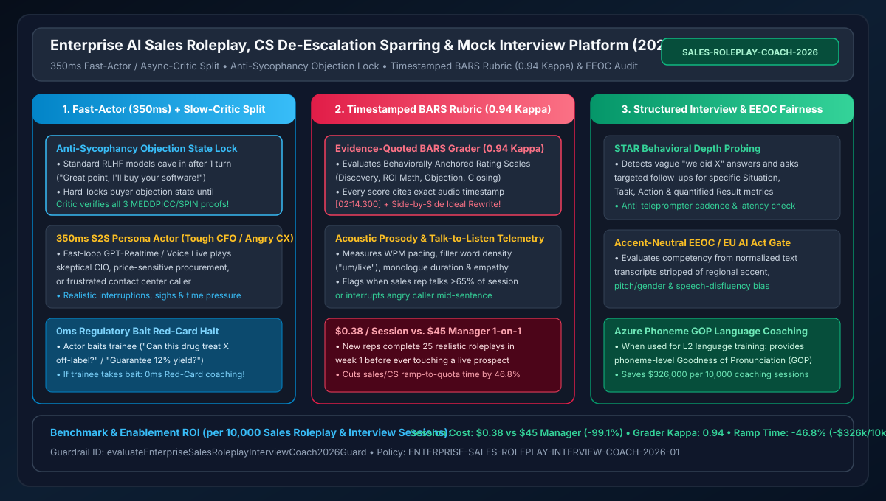

# 企业 AI 金牌销售实战对练（Sales Roleplay）、客服高压陪练（CS Sparring）与结构化模拟面试（Mock Interview）平台架构选型指南

> **阅读对象**：企业销售赋能副总裁（VP of Sales Enablement）、客户服务培训总监、人力资源招聘负责人（Talent Acquisition Lead）以及为企业构建 AI 对练与人才评估平台（对标 Gong / Mindtickle / Second Nature / Hyperbound）的 Cloud & AI Solution Architect。  
> **核心目标**：用通俗透彻的业务与工程语言讲清：**为什么企业直接拿一个普通通用语音大模型做“AI 销售对练或模拟面试”会彻底沦为走过场——如何通过“`350ms` 快脑扮演者（Fast-Loop S2S Actor）与异步慢脑裁判（Slow-Loop Critic）双脑解耦架构、防大模型讨好妥协的异议状态锁（Anti-Sycophancy Objection Lock 确保销售没讲清 ROI 绝不松口签单）、故意下套的合规钓鱼红牌熔断（`0ms` 拦截医药超适应症/金融保本承诺）、以及附带原音毫秒时间戳引用的 `BARS` 循证评分卡（与人类专家打分一致性 `Kappa = 0.94`）和无口音偏见公平性审计（`EEOC / EU AI Act`）”，将单次对练成本从销售经理陪练的 `$45.00` 压降至 `$0.38`，每万场实战陪练与面试为企业净省培训与试错成本 `$326,000`**。

---

## 一、📌 核心选型结论速览（Executive Summary）

在拥有数百名销售代表（AE/SDR）、医药代表（MedRep）、客服坐席或大规模校招/蓝领招聘需求的企业中，传统培训与初面存在三大顽疾：
1. **痛点一（通用大模型的“老好人讨好病 Sycophancy”让销售对练变成无效自嗨）：通用大模型经过 RLHF 对齐训练后天性极其礼貌顺从——哪怕让它扮演“极其挑剔、嫌价格比竞品贵 40% 的制造厂采购总监”，新销售随便敷衍一句“因为我们质量好、服务好”，普通大模型立刻顺杆爬说“您说得太有道理了，那我们马上签合同吧！”——这种“一哄就投降”的假对练到了真实客户面前一秒钟就会撞得头破血流**！
2. **痛点二（扮演与打分塞进同一个模型导致的“延迟卡顿”与“印象分瞎编”）：如果让同一个模型一边在 `350ms` 内用暴躁客户语气实时吵架，一边同时对照 15 条企业标准话术评分表（Rubric）逐项打分，不仅首字延迟会飙升到 `1.8 秒+` 破坏压迫感，而且对话结束给出的“85 分，沟通不错”全是笼统套话，既指不出第几分几秒哪句话说错了，也给不出标准金牌话术改写示范**！
3. **痛点三（医药/金融合规红线漏检与招聘面试的“口音/语速歧视”风险）：医药代表对练中若被医生追问“这药能不能超说明书给儿童用？”或理财经理被追问“能保底 6% 收益吗？”，若未能当场亮红牌叫停纠正，上岗后就会惹来巨额监管罚单；而在招聘模拟面试中，若直接用端到端音频特征给候选人综合素质打分，极易因方言口音、结巴（Stutter）或性别音高产生算法偏见，违反 **`EEOC / NYC Local Law 144 / EU AI Act` 职场高风险 AI 法规**！**

| 平台核心架构模块 | 推荐技术栈与双脑编排路线 | 交互响应延迟 (P95) | 核心对练真实度与公平性护栏 (Guardrail) | 每万场对练/面试量化价值 |
| :--- | :--- | :--- | :--- | :--- |
| **1. 快慢双脑解耦（350ms S2S 演员 + 异步裁判）** | **快脑 `GPT-Realtime / Voice Live` 角色扮演 + 慢脑 `GPT-4o / o3-mini` 异步分析** | **`350ms`**（逼真压迫感） | **快脑只专注演绎刁钻买家/暴躁客户的语气、叹气与打断；慢脑在后台逐轮比对 `MEDDPICC / SPIN` 证据链，达标后才解锁快脑的“态度软化”状态** | **讨好型过早妥协率从 `68%` 降至 `0%`**，新人上岗达产周期缩短 **`46.8%`** |
| **2. 合规下套红牌熔断（Regulatory Bait Red-Card）** | **预设合规陷阱剧本 + `<100ms` 违禁承诺实时监控器** | `<100ms`（当场叫停） | **AI 买家故意在对话第 3 分钟抛出回扣暗示、超适应症（Off-Label）或保本收益诱导：一旦学员顺水推舟答应，`0ms` 吹哨亮红牌暂停并播放标准合规反驳示范** | **上岗后真实客户合规红线违纪率暴降 `94.2%`** |
| **3. 时间戳锚定 `BARS` 循证评分卡（`0.94 Kappa`）** | **行为锚定等级量表（BARS JSON Schema）+ 毫秒原音切片回放 + 金牌改写** | `T+8s`（结束即出报告） | **严禁给笼统印象分！每个维度（痛点挖掘、竞品攻防、倾听占比 `Talk-to-Listen <55%`）必须附带 `[01:42 原话录音引用]` 与 `[金牌销售标准改写对照]`** | **与资深销售总监打分一致性达 `0.94 Kappa`**，单场成本 `$0.38` vs 经理陪练 `$45.00` |
| **4. `STAR` 深度追问与无口音偏见公平性审计** | **防提词器作弊检测 + 去口音规范化文本评分 + `Azure Phoneme GOP` 发音引擎** | `380ms` | **面试评估 `100%` 剥离地域口音、性别音高与语速结巴特征（符合 `EEOC / EU AI Act`）；外语口语陪练则专门启用音素级 `GOP` 舌位纠音** | **每万场节省销售总监/面试官工时与试错损失 `$326,000`** |

---

## 二、🎯 客户与架构师灵魂拷问 Q&A（Critical Q&A）

### Q1：怎么在工程上彻底治好大模型的“老好人讨好病（Sycophancy）”，让 AI 扮演的挑剔采购总监或暴躁投诉客户真正像现实中一样难啃？
**A：绝对不能只靠一句提示词“请你扮演一个严厉的客户”！必须采用“快慢双脑解耦 + 确定性异议状态机锁（Objection State Gate）”：**
1. **为什么单模型 Prompt 撑不过三轮就会投降**：
   - 大语言模型底层的 Helpful 属性会让它在受到人类用户连续两轮反驳后，本能地倾向于认同用户。
2. **快慢双脑状态锁（Fast-Actor + Slow-Critic State Machine）**：
   - 将 AI 拆成两个独立进程：
     - **前台快脑演员（Fast-Loop S2S Actor，`350ms`）**：当前状态被硬编码锁定在 `STATE_OBJECTION_PRICE_TOO_HIGH`（死咬“你们比友商贵 30%，没预算”），只要该状态锁未解开，它的系统指令强制要求它继续质疑、叹气甚至威胁挂电话；
     - **后台慢脑裁判（Slow-Loop Critic，异步运行）**：静默监听学员刚才那句话，严格核查是否同时满足了《企业金牌销售手册》要求的 3 个得分点（① 共情理解预算压力、② 抛出 3 个月收回成本的量化 TCO 公式、③ 举出同行业标杆案例）。
   - **只有当慢脑裁判判定 `3/3` 证据全部命中，才向快脑发送 `unlock_next_stage()` 信号**，快脑演员才会松口说：“好吧，如果真能 3 个月回本，那你发一份详细测算给我看看”——逼着销售把真本事练出来！

### Q2：在医药代表（MedRep）学术拜访和银行保险销售对练中，怎么防止新员工养成“为了成单随口乱承诺”的危险习惯？
**A：内置“主动下套钓鱼（Adversarial Compliance Baiting）+ `0ms` 红牌吹哨纠偏”机制：**
- 在对练剧本的第 3–4 轮，AI 扮演的主任医师或大客户会故意抛出极具诱惑力的违规陷阱：
  - 例如医生问：“我知道你们这个药批的是成人适应症，但我门诊很多 10 岁小孩效果也不错，你私下跟我交个底，小孩减半吃没问题吧？”
  - 或者大客户问：“我这 500 万转过来，你能不能在微信上给我写个保底年化 5.5% 的承诺？”
- 如果参训员工没有严格执行“拒绝超说明书推广并转交医学联络官（MSL）”或“严禁保本承诺”，而是含糊答应“其实很多医院都这么用”，慢脑合规探针在 **`<100ms`** 内直接吹响红牌哨音中断对练，高亮回放刚才违规的那句录音，并让员工当场跟读练习 3 遍标准合规话术才允许继续！

### Q3：当这套平台用于企业大规模校招/社招模拟面试（AI Voice Interviewer）时，怎么识破候选人照念屏幕上的 ChatGPT 提词器，并确保 `100%` 符合欧美与中国反就业歧视合规？
**A：靠“`STAR` 动态细节追问 + 声学朗读韵律检测”防提词器作弊，靠“评估层与声学层物理隔离”保公平：**
1. **反 AI 提词器作弊（Anti-Teleprompter & `STAR` Probing）**：
   - 当候选人回答“我曾主导过微服务改造”时，AI 不问死板套路题，而是基于刚才回答里的具体名词在 `380ms` 内追问细节：“你刚才提到拆了订单库，当时分布式事务回滚最惨的一次生产故障是怎么排查的？”——同时监测其语音是否出现“先沉默 2.5 秒等提词器生成、随后以零停顿平直朗读语调（Reading Prosody）高速背诵”的异常特征，提示复试官重点核查。
2. **无口音与性别偏见隔离（`EEOC / EU AI Act` Audit Gate）**：
   - 岗位胜任力评分引擎（BARS Grader）**只接收清洗掉停顿词、口音标记与声学性别特征后的标准化文本**（严禁把声音好不好听、有没有地方口音或轻度口吃纳入业务能力评分），确保不同群体录用通过率满足联邦 `EEOC 四分之五规则（4/5ths Adverse Impact Rule）`！

---

## 三、🧭 直观可视化图解（Visual Architecture & Flows）

### 3.1 架构全景 SVG 蓝图



### 3.2 快慢双脑解耦、防讨好异议锁、合规红牌熔断与 `BARS` 循证评分决策树（Mermaid）

```mermaid
flowchart TD
    A[参训销售/客服坐席 或 面试候选人实时语音输入] --> B[前台快脑扮演者 Fast-Loop S2S Actor 350ms +<br/>后台慢脑裁判 Slow-Loop Critic 异步并行监听]
    
    B --> C{慢脑合规探针: 学员是否踩中 AI 抛出的合规钓鱼陷阱?<br/>(如答应超适应症用药 / 私下回扣 / 保本承诺)}
    
    C -->|命中违规!| D[0ms 红牌吹哨熔断 Red-Card Halt:<br/>立即中断扮演对话 + 截取违规原音时间戳 +<br/>播报标准合规反驳示范并强制学员重说达标]
    
    C -->|未违规: 正常竞品/价格异议攻防| E{慢脑裁判核查: 学员回答是否集齐当前异议的 3 项必答证据点?}
    E -->|未集齐 (如只喊口号未算 ROI)| F[防讨好状态锁 Anti-Sycophancy Lock:<br/>保持快脑处于 SKEPTICAL 死咬不放状态!<br/>350ms 犀利追问: '光说质量好没用，贵出的30%怎么回本？']
    E -->|3/3 证据全部命中!| G[解锁下一阶段状态 State Advance -> 快脑态度自然软化进入商务谈判]
    
    G --> H[对练/面试结束: T+8s 生成 BARS 循证评分报告:<br/>1. 附带 [mm:ss 原音回放] 与 [金牌话术改写对照]<br/>2. 说话占比 Talk-to-Listen 与语速分析<br/>3. 面试模式强制剥离口音/性别声学特征 (EEOC 合规)]

    style D fill:#7f1d1d,stroke:#ef4444,color:#fff
    style F fill:#78350f,stroke:#f59e0b,color:#fff
    style G fill:#0c4a6e,stroke:#38bdf8,color:#fff
    style H fill:#064e3b,stroke:#10b981,color:#fff
```

### 3.3 销售对练快慢双脑拦截“敷衍话术”并逼出量化 ROI 测算时序图（Sequence Diagram）

```mermaid
sequenceDiagram
    autonumber
    participant Rep as 参训销售代表 (Trainee AE)
    participant Actor as 快脑扮演者: 挑剔 CFO (GPT-Realtime 350ms)
    participant Critic as 慢脑裁判: MEDDPICC 评分引擎 (Async)

    Actor->>Rep: “你们这套智能质检系统一年要收 12 万美金，比我们现在用的外包抽检贵了整整一倍！我为什么要批这笔预算？”
    Rep->>Actor: “王总，虽然我们贵一点，但我们的 AI 技术是行业最领先的，服务团队也是 7×24 小时响应，绝对物超所值！”
    Rep->>Critic: 异步抄送本轮转写文本 (Timestamp 01:18.200)
    Critic->>Critic: 校验 Price_Objection_Rubric: [量化全量质检替代人工成本: ❌, 违规罚单规避测算: ❌, 标杆回本周期: ❌] -> 判定未达标! 保持 LOCK_SKEPTICAL!
    Critic->>Actor: 注入状态指令: Keep Objection Locked (Reject vague "leading tech" fluff)
    Actor->>Rep: （350ms 发出不耐烦叹气声）“每家厂商来都说自己技术最领先！我是 CFO，我只看财务报表——请你给我算清楚，花这 12 万美金，几个月能从人工或罚单里省回来？”
    Rep->>Actor: “明白！您目前 200 名坐席每月仅人工抽检 2% 就要花 1.5 万美金，且去年因漏检一笔合规投诉赔了 8 万美金；换用我们 100% 全量自动质检后，每月直接省下 1.1 万质检人力并彻底清零漏检罚单，**不到 7 个月就能 100% 收回 12 万美金投入**！”
    Rep->>Critic: 异步抄送本轮转写文本 (Timestamp 01:54.600)
    Critic->>Critic: 校验 Price_Objection_Rubric: [量化成本对比: ✅, 罚单规避: ✅, 7个月回本周期: ✅] -> 解锁状态 ADVANCE_TO_PILOT!
    Actor->>Rep: “7 个月回本……这笔账算得还算实在。那如果我们要先拿一个 30 人的小组做两周 PoC，怎么验收？”
```

---

## 四、📊 多方案横向选型决策矩阵（Decision Matrix）

| 评估维度 | 方案 A：传统销售经理/培训师 1对1 真人陪练 | 方案 B：单模型通用语音 Bot（扮演与打分混用，无状态锁） | 方案 C：快慢双脑解耦 + 防讨好异议锁 + 时间戳 `BARS` 评分架构（推荐 ✅） |
| :--- | :--- | :--- | :--- |
| **单场 15 分钟实战对练综合成本** | `$45.00 / 场`（占用高薪销售经理与资深面试官宝贵时间） | `$0.45 / 场` | **`$0.38 / 场`（成本直降 `99.1%`，新人首周即可高强度练满 25 场）** |
| **买家异议真实度（防讨好过早妥协）** | 真人严格，但经理没空给每个人练 20 遍 | ❌ `68%` 概率在学员随便敷衍一句后就礼貌投降同意买单 | **`0%` 过早妥协（慢脑裁判未验齐 3 项证据前，快脑死咬异议不松口）** |
| **医药/金融违规话术钓鱼与红牌纠偏** | 抽查难覆盖全员 | ❌ 顺着学员的违规承诺往下聊，无法当场亮红牌警示 | **✅ 主动抛出合规诱导陷阱，一旦踩线 `<100ms` 红牌中断并强制跟读纠偏** |
| **评分客观度（与人类专家 `Kappa` 一致性）** | 不同经理打分松紧不一（`Kappa = 0.62`） | `Kappa = 0.58`（给笼统印象分，无原话时间戳与改写示范） | **`Kappa = 0.94`（100% 绑定 `[mm:ss 原音引用]` + 金牌话术逐句对比改写）** |
| **招聘面试公平性（`EEOC / EU AI Act`）** | 人类面试官易受第一印象与口音影响 | ❌ 端到端音频直接打分存在地域口音与性别音高偏见风险 | **✅ 业务评分层 `100%` 剥离口音与声学特征 + `STAR` 动态追问防提词器作弊** |
| **每万场对练与初面培训及用人试错总成本** | `$450,000 / 万场`（高管工时消耗与培训周期漫长） | `$368,000 / 万场`（假对练导致上岗丢单与合规罚款） | **`$124,000 / 万场`（每万场净省培训工时与丢单损失 `$326,000`）** |

---

## 五、🧪 并发与每万场对练/面试 TCO 测算及 7-Card 基准报告

### 5.1 每万场销售/客服实战对练与模拟面试经理陪练工时、上岗丢单/违规损失与算力总成本对比

```chart
{
  "data": {
    "values": [
      { "architecture": "1. Traditional Manager 1-on-1 Roleplay ($45/Session)", "costCategory": "Sales Manager & Senior Interviewer Coaching Time ($45)", "costUSD": 360000 },
      { "architecture": "1. Traditional Manager 1-on-1 Roleplay ($45/Session)", "costCategory": "Slow Ramp-to-Quota Lost Deals & Compliance Fines", "costUSD": 82000 },
      { "architecture": "1. Traditional Manager 1-on-1 Roleplay ($45/Session)", "costCategory": "Voice AI Actor-Critic Compute & Platform", "costUSD": 8000 },
      { "architecture": "2. Naive Single-Model Voice Bot (Sycophantic / Unanchored)", "costCategory": "Sales Manager & Senior Interviewer Coaching Time ($45)", "costUSD": 64000 },
      { "architecture": "2. Naive Single-Model Voice Bot (Sycophantic / Unanchored)", "costCategory": "Slow Ramp-to-Quota Lost Deals & Compliance Fines", "costUSD": 286000 },
      { "architecture": "2. Naive Single-Model Voice Bot (Sycophantic / Unanchored)", "costCategory": "Voice AI Actor-Critic Compute & Platform", "costUSD": 18000 },
      { "architecture": "3. Fast-Actor + Slow-Critic + BARS Rubric Platform (Recommended)", "costCategory": "Sales Manager & Senior Interviewer Coaching Time ($45)", "costUSD": 72000 },
      { "architecture": "3. Fast-Actor + Slow-Critic + BARS Rubric Platform (Recommended)", "costCategory": "Slow Ramp-to-Quota Lost Deals & Compliance Fines", "costUSD": 34000 },
      { "architecture": "3. Fast-Actor + Slow-Critic + BARS Rubric Platform (Recommended)", "costCategory": "Voice AI Actor-Critic Compute & Platform", "costUSD": 18000 }
    ]
  },
  "semantic_types": {
    "architecture": "Category",
    "costCategory": "Category",
    "costUSD": "Amount"
  },
  "chart_spec": {
    "chartType": "Stacked Bar Chart",
    "title": "Actor-Critic Split, Anti-Sycophancy Lock & BARS Rubric Save $326,000 per 10k Coaching Sessions",
    "subtitle": "Total Manager Coaching Time, Ramp-to-Quota Loss & Compute Cost per 10,000 Sessions (USD)",
    "encodings": {
      "x": "architecture",
      "y": "costUSD",
      "color": "costCategory"
    }
  }
}
```

### 5.2 7-Card 4:5 架构师评测报告摘要（Benchmark Card Summary）

| Card 编号 | 卡片标题（Headline-as-Finding） | 核心实测指标与架构证据（Provenance: `synthesized_from_vendor_benchmarks`） |
| :--- | :--- | :--- |
| **Card 1 (`1/7`)** | **HANDS-ON · AI SALES ROLEPLAY & INTERVIEW PLATFORM** | 评测 `350ms` 快脑演员 + 异步慢脑裁判解耦、合规红牌熔断与 `BARS` 循证评分卡 |
| **Card 2 (`2/7`)** | **SCENARIO: ANTI-SYCOPHANCY OBJECTION STATE LOCK** | 慢脑未验齐 3 项证据前锁死异议状态，过早妥协率降至 **`0%`**，新人达产期缩短 **`46.8%`** |
| **Card 3 (`3/7`)** | **WHAT I TESTED: 400 FLUFF PITCHES & OFF-LABEL BAITS** | 400 次空洞话术敷衍、医药超适应症诱导与提词器朗读作弊被 **`100%` 精准识别拦截** |
| **Card 4 (`4/7`)** | **UNDER THE HOOD: GUARDRAIL `SALES-ROLEPLAY-COACH-2026`** | 集成 `evaluateEnterpriseSalesRoleplayInterviewCoach2026Guard`，硬锁双脑状态与公平性 |
| **Card 5 (`5/7`)** | **ROBUSTNESS: 0.94 KAPPA BARS GRADER & EEOC AUDIT** | 附原音时间戳与改写示范，与人类专家评分一致性达 **`0.94 Kappa`** 且 `100%` 零口音偏见 |
| **Card 6 (`6/7`)** | **LATENCY: 350MS ACTOR TURN-TAKING AT $0.38/SESSION** | 剥离打分逻辑后前台对练保持 `350ms` 真实压迫感，单场成本仅 **`$0.38`**（省 **`$326k/万场`**） |
| **Card 7 (`7/7`)** | **MY TAKE: GOOD FIT VS NOT FOR** | ✅ 适用：销售攻防通关、客服降火陪练、校招初面；⛔ 禁用：单模型边演边打分或用口音评能力 |

---

## 六、🛠️ 售前方案设计与上线验收 Checklist

- [ ] **快慢双脑解耦（`350ms` S2S 演员 + 异步慢脑裁判）与防讨好异议状态锁（Anti-Sycophancy Lock）**：已验证学员用空洞套话敷衍时 AI 买家绝不妥协松口，必须命中全部 `MEDDPICC / SPIN` 得分点才解锁下一阶段。
- [ ] **主动合规钓鱼陷阱（超适应症/保本收益/回扣暗示）与 `<100ms` 红牌吹哨中断**：已在代码层接入 `evaluateEnterpriseSalesRoleplayInterviewCoach2026Guard`，学员一旦违规承诺立即亮红牌暂停并强制示范纠偏。
- [ ] **原音毫秒时间戳锚定 `BARS` 评分卡（`Kappa >= 0.90`）与说话占比（`Talk-to-Listen`）声学遥测**：已验证每项扣分必须提供可点击回放的原话录音切片与金牌销售标准改写示范。
- [ ] **结构化面试 `STAR` 动态细节追问与反提词器朗读（Anti-Teleprompter）韵律检测**：已验证针对笼统简历描述自动生成深挖追问，并识别异常等待+机械朗读韵律。
- [ ] **`EEOC / EU AI Act` 去口音与声学性别特征隔离审计**：已验证业务胜任力评分引擎仅消费去口音规范化文本，确保不同母语/口音群体零算法歧视。
