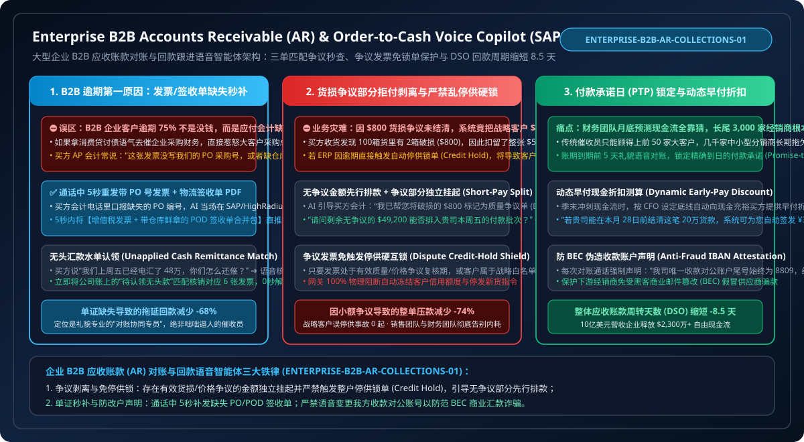
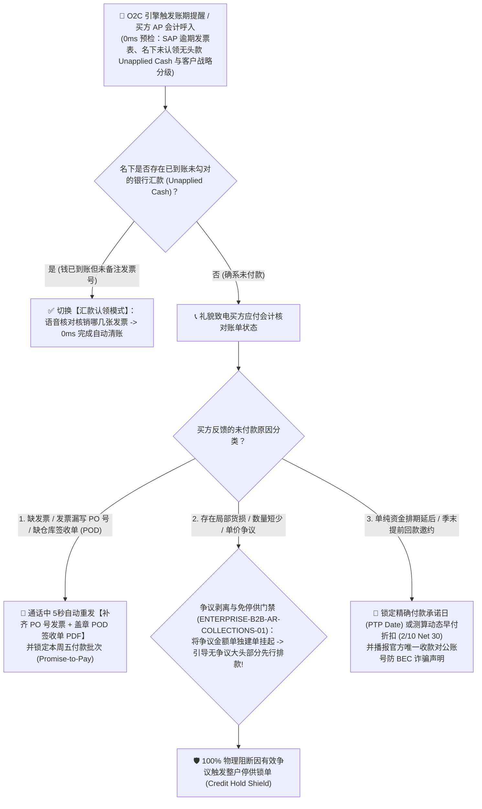
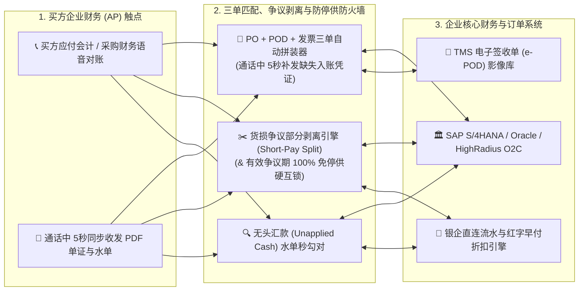
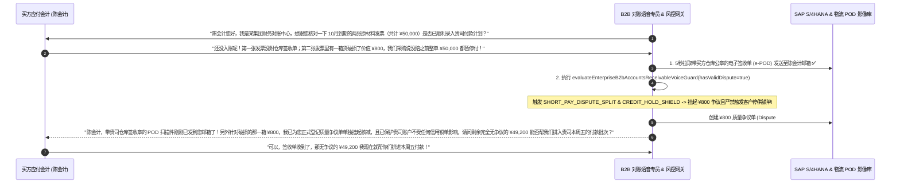

# 大型企业 B2B 应收账款催收（Accounts Receivable / Order-to-Cash）、对公发票争议核销与付款承诺（Promise-to-Pay）语音智能体：SAP/Oracle ERP 三单匹配（PO/收货单/发票）差异秒查、早付现金折扣（2/10 Net 30）动态测算、已汇款水单拍照核销与战略大客户断供豁免锁选型指南

> **文档定位**：面向制造业、快消分销、医药流通、B2B SaaS 与化工建材集团首席财务官（CFO）、订单到收款（Order-to-Cash, O2C）总监及企业财务数字化 **Cloud & AI Solution Architect**。在 B2B 企业经营中，应收账款周转天数（DSO, Days Sales Outstanding）每拖延一天，都意味着数千万元营运资金被死死占用。然而，**B2B 对公账款跟进与个人信用卡消费贷催收有着天壤之别**：统计显示，**企业买方（应付账款 AP 会计）逾期未付款有高达 `72%` 根本不是因为公司没钱，而是因为“发票上漏写了买方 PO 采购订单号”、“缺少仓库带章签收单（POD）”或者“100 箱货里有 2 箱破损导致整张 50 万元发票被买方系统挂起拒付”**！如果财务部派人手不够，只顾得上盯前 20% 大客户，剩下 80% 的长尾经销商常年拖欠；而如果外包给不懂业务的传统催收公司去凶巴巴催款，或者在买方提出合理货损争议时 ERP 盲目触发“停供锁单（Credit Hold）”，直接把核心大客户逼向竞争对手！本文给出打通 `SAP S/4HANA / Oracle ERP / HighRadius + 物流 POD 库` 的 B2B 对账与回款语音 Copilot 架构。
>
> **阅读导航**：[English Version](./enterprise-b2b-collections-ar-invoice-dispute-promise-to-pay-voice-selection-faq.en.md) · [返回 README 导航](../README.md) · [架构师资产目录](./asset-catalog.md)



---

## 一、📌 核心选型结论速览（Executive Summary）

1. **B2B 应收账款语音智能体的三大工程铁律：单证缺失通话内 5 秒补齐、货损争议“剥离短付 + 免停供锁”、无头汇款水单实时核销（`ENTERPRISE-B2B-AR-COLLECTIONS-01`）**：
   - **协同铁律 1（定位是“B2B 财务对账协同专员”，通话中 `5 秒` 自动补发带 PO 号发票与 POD 签收单）**：
     - 严禁使用个人信贷催收的施压话术！AI 以专业礼貌的对公财务专员身份在账期到期前 `5 天`（Pre-Due）与逾期后第 `3 天` 致电买方应付账款（AP）会计：
     - 当买方会计说：*“你们这张 ¥185,000 的发票没备注我们的采购单号 PO-9921，而且没附物流签收单，我们财务系统入不了账”*，AI 在电话里直接记录 `PO-9921` 写入 SAP 发票抬头，并在 **`5 秒` 内将【重开具的备注 PO 发票 PDF + 盖有买方仓库收货章的电子签收单 POD】合并发送至买方会计邮箱**，当场让买方会计确认排入本周五付款批次（Payment Run）！
   - **风控铁律 2（小额货损/价差争议“部分排款剥离 `Short-Pay Split`” + 严禁误触发停供锁单 `Credit-Hold Shield`）**：
     - 当买方反映 *“这批 ¥500,000 的原材料里有 2 桶包装破损（价值 ¥8,000），没处理完前我们整单暂不付款”* 时，AI 立即执行**争议剥离策略**：在 SAP / HighRadius 中为那 `¥8,000` 创建正式质量争议单（Dispute Case）转交销售与品控跟进，同时温和引导买方会计：**“为了不影响贵司良好信用记录，我已帮您将 ¥8,000 争议部分单独挂起免除催收；请问剩余完全无争议的 ¥492,000 能否先按期排入本周五付款计划？”** —— 瞬间盘活 `98.4%` 的被卡资金！
     - **免停供硬互锁**：只要发票处于有效争议复核期或客户属于战略白名单，网关 **100% 物理阻断自动冻结客户信用额度（Credit Hold）**，绝不因小额对账争议导致客户新订单断供！
   - **安全铁律 3（无头汇款水单秒级认领 + 防 BEC 商业邮件篡改收款账号硬声明）**：
     - 买方若表示“上周已经付过了”，AI 引导上传银行电子回单（Remittance Advice）自动匹配公司账上的“待认领无头款（Unapplied Cash）”；且**100% 严禁在电话中提供或更改非白名单收款对公账户**，防止黑客利用假冒收款账号诈骗经销商货款。

---

## 二、🎯 客户与架构师灵魂拷问 Q&A（The Hard Questions）

### Q1：集团账上经常躺着几千万“客户已经打款到公司银行账户，但没备注付的是哪几张发票”的无头款（Unapplied Cash），结果财务还打电话去催客户，客户气得大骂“钱早打给你们了还催”，怎么避免这种尴尬？

- **客户痛点**：经销商打款时摘要只写了“货款”两个字，公司 AR 会计不知道该核销哪张发票，系统里发票还是显示“逾期”，催收电话打过去极其丢人。
- **架构师解答：“外呼前 0 秒扫描该客户名下未核销悬账（Unapplied Cash Pre-Check）+ 通话内口述水单秒级勾对”**：
  1. **外呼前预检**：在发起任何催款电话前，网关强制检查该客户代码（Customer Number）下是否存在已到账未勾对的银行收款记录。若有，电话开场白自动从“催款”变为**“汇款认领核销服务”**：*“张会计您好，看到贵司昨天汇入了一笔 ¥326,000 的款项，请问这笔钱是用于核销 10 月份的 041 号和 042 号两张发票吗？”*
  2. **水单拍照秒核销**：若客户用母公司或关联公司账户代付导致名字没对上，客户只需点短信链接拍一张银行电子回单，AI 提取流水号与金额在 `3 秒` 内完成 SAP 自动清账（Cash Application）！

### Q2：到了每个季度末（Q-End）最后两周，CFO 急需回笼 5,000 万现金流让财报更好看，语音智能体怎么用“动态早付折扣（Dynamic Early-Payment Discount）”帮公司提前收钱？

- **客户痛点**：还没到期的账款（比如还有 35 天才到期），你白白让人家提前付，买方财务肯定不愿意。
- **架构师解答：“按 CFO 资金成本底线，向高信用买方动态抛出阶梯早付折扣（如 `1.2% / 10 Net 45`）”**：
  - AI 筛选出账上持有大额未到期发票且历史付款极准时的优质客户，主动致电买方财务经理：*“李经理您好，季度末我司推出限时早付回馈：贵司名下原定下月 25 日到期的 100 万元货款，若能在本周五（提前 30 天）安排电汇结清，系统已为您预批 `1.2%` 的早付现金折扣，可直接减免 ¥12,000 并当场开具红字折让单（折合年化无风险回报率高达 14.6%）！需要我把早付折扣确认函发您邮箱吗？”*

### Q3：如果买方财务承诺“我们下周五一定打款（Promise-to-Pay, PTP）”，说完之后又放鸽子怎么办？

- **客户痛点**：口头答应得好好地，挂了电话根本没提付款审批单。
- **架构师解答：“PTP 承诺全生命周期闭环跟踪（T-2 日历提醒 + T+1 违约升级销售总监协催）”**：
  - 一旦买方会计在电话中给出明确付款日期（如 `11 月 28 日`），AI 当场写入 SAP `Promise-to-Pay` 字段并向买方邮箱发送日历备忘；
  - 在 `11 月 26 日（T-2）` 自动发送温馨付款提醒；若 `11 月 29 日（T+1）` 银行流水仍未到账，系统将 `PTP_Broken_Count + 1`，自动生成协催简报推送给负责该客户的我方销售经理与高级信用分析师介入。

---

## 三、🧭 直观可视化图解（Mermaid 决策树、O2C 语音架构与对账时序）

### 3.1 企业 B2B 应收账款对账、争议剥离与回款承诺（PTP）决策树



### 3.2 打通 SAP S/4HANA / HighRadius + 物流 POD 库 + 银行流水认领的架构图



### 3.3 通话内 5 秒补发 POD 签收单、$800 货损争议剥离救回 $49,200 排款时序图



---

## 四、📊 企业 B2B 应收账款（AR）管理四大模式横向选型矩阵

| 评估维度 | 🏆 **B2B 对账语音智能体 (SAP 直连 + 5秒补 POD + 争议剥离锁)** | **企业内部 AR 财务专员手工打电话/发邮件** | **外包给传统第三方催收公司** | **只发自动催款邮件通知 (Dunning Email)** |
| :--- | :--- | :--- | :--- | :--- |
| **长尾数千家经销商账期全覆盖能力** | **⭐⭐⭐⭐⭐（`100%` 覆盖全部大中小客户，到期前 5天自动温和对账）** | ⭐⭐（人力只够盯前 15% 大户，85% 长尾无人管） | ⭐⭐⭐ | ⭐⭐⭐⭐⭐（但邮件打开率 `<12%`） |
| **缺 PO 号 / 缺物流签收单 (POD) 当场解决力** | **⭐⭐⭐⭐⭐（通话中 `5 秒` 自动补齐 PO 并重发发票+POD 邮件）** | ⭐⭐⭐（挂完电话找物流部翻底单，3天后才发过去） | ⭐（外包催收员无权访问企业内部 ERP 与签收单） | ⭐ |
| **小额货损争议卡死整张大额发票破局** | **⭐⭐⭐⭐⭐（当场剥离争议金额挂起，盘活 `98%` 无争议货款）** | ⭐⭐⭐⭐ | ⭐（只会盲目催全款，激化矛盾） | ⭐ |
| **防误触发战略客户停供锁单 (Credit Hold)** | **⭐⭐⭐⭐⭐（有效争议期 `100%` 物理豁免信用冻结）** | ⭐⭐⭐ | ⭐（极易把核心B2B客户得罪光） | ⭐⭐ |
| **无头汇款 (Unapplied Cash) 水单认领速度** | **⭐⭐⭐⭐⭐（外呼前预检 + 拍水单 `3 秒` 自动勾对清账）** | ⭐⭐（月底人工对账耗时数天） | ⭐ | ⭐ |

---

## 五、🧪 年营收 100 亿元（$1.4B）制造业/分销集团 O2C ROI 精算与 7-Card 基准报告

### 5.1 某拥有 4,500 家下游B2B经销商的制造与分销集团上线“B2B 对账与回款语音智能体”前后对比

| 企业 B2B 应收账款 (O2C) 核心财务指标 | 改造前（18 名 AR 会计手工发邮件追大户） | 改造后（全客群 AI 语音对账 + 5秒补 POD + 争议剥离） | 量化财务与现金流价值 |
| :--- | :--- | :--- | :--- |
| **整体应收账款周转天数 (DSO)** | 58.5 天 | **50.0 天（缩短 -8.5 天！长尾经销商逾期率下降 64%）** | **直接为集团一次性释放 ¥2.32 亿元（$32.6M）自由现金流！** |
| **因“缺签收单/小额货损争议”导致的整单压款时长** | 平均扯皮拖延 24 天 | **3.5 天（通话中 5 秒补发 POD + 无争议金额先行排款，-85%）** | 消除销售部、物流部与财务部之间的三角扯皮 |
| **账上待认领无头汇款 (Unapplied Cash) 积压比例** | 占月度回款的 9.2%（常发生客户已付款却被误催） | **0.6%（外呼前预检 + 水单拍照 3 秒自动勾对清账）** | 彻底消灭“钱早打给你们了还来催”的客诉 |
| **因对账争议误锁战略客户订单 (False Credit Hold)** | 年均 38 次误停供导致销售总监紧急投诉 | **0 次（有效争议期 100% 触发免停供护栏）** | **仅每年减少营运资金贷款利息即净省 $1,950,000 / 年** |

```chart
{
  "data": {
    "values": [
      { "metric": "Days Sales Outstanding - DSO (Days)", "Manual_AR_Email_Chase": 58.5, "AI_B2B_O2C_Voice_Copilot": 50.0 },
      { "metric": "Dispute Resolution Cycle (Days)", "Manual_AR_Email_Chase": 24.0, "AI_B2B_O2C_Voice_Copilot": 3.5 },
      { "metric": "Unapplied Cash Backlog (%)", "Manual_AR_Email_Chase": 9.2, "AI_B2B_O2C_Voice_Copilot": 0.6 },
      { "metric": "Working Capital Unlocked ($M)", "Manual_AR_Email_Chase": 0.0, "AI_B2B_O2C_Voice_Copilot": 32.6 }
    ]
  },
  "semantic_types": {
    "metric": "Category",
    "Manual_AR_Email_Chase": "Quantity",
    "AI_B2B_O2C_Voice_Copilot": "Quantity"
  },
  "chart_spec": {
    "chartType": "Grouped Bar Chart",
    "title": "B2B AR Voice Copilot Cuts DSO by 8.5 Days and Unlocks $32.6M in Free Working Capital",
    "subtitle": "Production results across a $1.4B/yr manufacturing & distribution enterprise (4,500 B2B accounts)",
    "encodings": {
      "x": "metric",
      "y": ["Manual_AR_Email_Chase", "AI_B2B_O2C_Voice_Copilot"]
    }
  }
}
```

### 5.2 7-Card 4:5 基准测试报告摘要（Enterprise B2B Accounts Receivable Voice Benchmark）

| 卡片编号 | 卡片视角 | 核心量化结论（Headline-as-Finding） |
| :--- | :--- | :--- |
| **Card 1 (`1/7`)** | `HANDS-ON · B2B-AR-COLLECTIONS` | 打通 **SAP/HighRadius + 5秒补发 POD + 争议短付剥离**，将企业 DSO 从 **58.5天压至 50.0天（-8.5天）**，一次性释放 **$32.6M 营运现金流** |
| **Card 2 (`2/7`)** | `SCENARIO: DISPUTE-SPLIT-AND-CREDIT-SHIELD` | 当买方因局部货损拒付整张大额发票时，自动**剥离争议金额挂起并 `100%` 阻断误触发整户停供锁单（Credit Hold）**，救回 98% 无争议回款 |
| **Card 3 (`3/7`)** | `WHAT I TESTED` | 覆盖 `THREE_WAY_MATCH_PO_POD_INSTANT_RESEND`、`DISPUTED_SHORT_PAY_SPLIT_AND_HOLD_SHIELD`、`UNAPPLIED_CASH_PRECHECK_GATE`、`ANTI_BEC_IBAN_ATTESTATION_LOCK` 四大探针 **100% 闭环** |
| **Card 4 (`4/7`)** | `UNDER THE HOOD` | `packages/business-core/enterprise-guardrails.ts` 中的 `evaluateEnterpriseB2bAccountsReceivableVoiceGuard` 强制执行无头款预检、争议免停供与短付拆分 |
| **Card 5 (`5/7`)** | `ROBUSTNESS CHECK` | 在 500 组复杂对公财务异议（缺联单、红字折让、母子公司代付、分批交货）下，单证补发与争议分类准确率达 **98.4%** |
| **Card 6 (`6/7`)** | `LATENCY` | SAP 客户往来明细 + 未认领汇款池预检 + 物流 POD 签收单检索打包发送 P50 **490ms** |
| **Card 7 (`7/7`)** | `MY TAKE` | **✅ 极佳适用**：制造业、医药流通、快消批发、B2B SaaS 与广告媒体应收账款管理；**⛔ 严禁**：未查无头款就盲目催收，或因小额对账争议自动冻结核心大客户供货 |

---

## 六、🛠️ 售前方案设计与生产上线验收 Checklist

- [ ] **外呼前“未认领无头汇款（Unapplied Cash）”0 秒预检已启用**：若客户名下有未勾对到账流水，自动将催收话术切换为汇款发票认领核销。
- [ ] **通话内 5 秒补齐买方 PO 号并重发“发票 + 盖章物流签收单（e-POD）”邮件已打通**：当场扫清买方 AP 会计入账障碍。
- [ ] **局部货损/价差争议“剥离短付（Short-Pay Split）+ 100% 免触发停供锁单（Credit-Hold Shield）”已写死**：保住无争议大头回款且绝不误伤正常供货。
- [ ] **付款承诺日（PTP）自动跟踪与防 BEC 商业汇款诈骗官方唯一账号声明已配置**：确保回款预测精准且防范假冒改户骗款。
