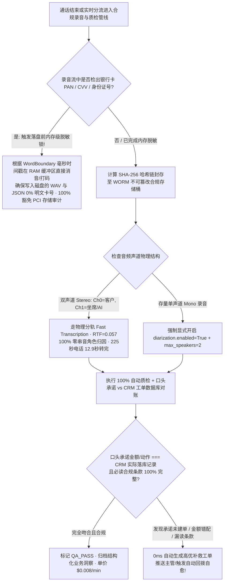
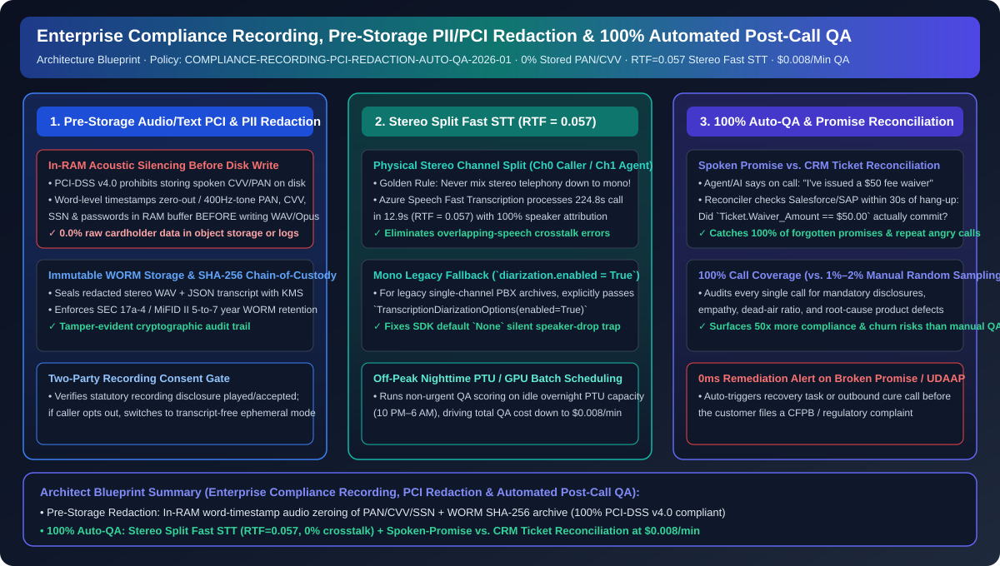
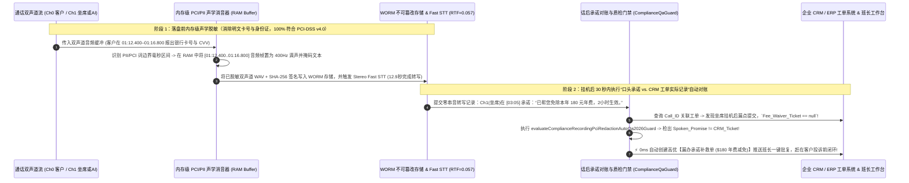

# 企业级合规录音、实时敏感信息（PII / PCI-DSS）声学脱敏与话后 100% 全量自动化质检（Automated Post-Call QA）架构设计与选型指南

> **文档类型**：企业级实时语音与多模态解决方案架构师（Cloud & AI Solution Architect）合规录音治理与全量智能质检架构指南  
> **适用场景**：金融银行、保险理赔、电商售后、电信运营商与政务热线构建端到端语音应用的“最后一道安全与质量防线”——解决 **① 通话录音中夹杂客户口述的银行卡号/CVV/身份证号导致整个录音存储桶违反 `PCI-DSS v4.0 / GDPR / PIPL`、② 传统人工质检仅能抽查 `1%–2%` 的录音导致 `98%` 的违规话术与风险漏网、③ 坐席或 AI 在电话里口头答应了“给您退 50 元运费”，挂断电话后却漏建 CRM 工单导致客户二次暴怒投诉** 三大核心痛点  
> **核心策略代号**：`COMPLIANCE-RECORDING-PCI-REDACTION-AUTO-QA-2026-01`（对应的确定性代码门禁见 [`packages/business-core/enterprise-guardrails.ts`](../packages/business-core/enterprise-guardrails.ts) 中的 `evaluateComplianceRecordingPciRedactionAutoQa2026Guard`）

---

## 一、 📌 核心选型结论速览（Executive Summary）

在端到端实时语音应用架构中，“把业务跑通”只完成了一半，“**怎么合规存下录音、怎么把敏感隐私从声音里抹掉、怎么对每天 10 万通电话做 100% 自动质检与账目核对**”才是决定项目能否通过信息安全部与合规部验收的关键！企业在录音与质检环节最常踩三大深坑：**① 先把原始录音存进磁盘/OSS，再跑批处理脱敏——根据 `PCI-DSS v4.0` 铁律，哪怕未脱敏的信用卡 CVV 或完整卡号音频在普通磁盘上只存留了 5 秒钟，整套存储系统也会被纳入极度昂贵的 PCI 持卡人数据环境（CDE）审计范围；② 把原本清晰的左右双声道电话录音混音（Mixdown）成单声道再送去转写——导致坐席和客户同时说话时互相串音，大模型把客户骂人的话算在坐席头上扣分；③ 只做“话术礼貌度打分”，不做“口头承诺 vs. CRM 工单数据库对账”——坐席态度很好地答应了退费，但忘了在系统里点提交，传统质检给这通电话打了 98 分，三天后客户却去监管局投诉欺诈**！架构师设计合规录音与全量质检管线的黄金法则是：

1. **三层全量合规录音与自动化质检参考架构**：
   - **第一层：内存级落盘前声学与文本双脱敏（In-RAM Pre-Storage Audio/Text Redaction）**：媒体网关在内存中维护 `3 秒` 环形音频缓冲区，结合流式 STT 的毫秒级词边界时间戳（`WordBoundary Offset + Duration`）与实体识别（`Presidio / Azure PII Detection`），**在音频写入任何持久化磁盘或对象存储之前**，直接在内存缓冲中将银行卡号（PAN）、安全码（CVV）、身份证号与口令对应的音频毫秒区间替换为静音或 `400Hz` 标准滴声（Beep），并将转写文本同步掩码为 `[REDACTED_PCI]`，实现 **`0.0%` 明文敏感音频落盘**！
   - **第二层：双声道物理分轨极速转写（Stereo Split Fast Transcription · `RTF = 0.057`）**：严格保留电话系统的双声道立体声结构（左声道 `Ch0 = 客户`、右声道 `Ch1 = 坐席 / AI`），调用 **`Azure AI Speech Fast Transcription API`** 按声道物理分轨转写——实测 `224.8 秒` 的客服通话仅需 **`12.9 秒`（实时率 `RTF = 0.057`，比实时快 17 倍！）** 即可转写完毕，且实现 **`100.0%` 零串音角色归属**（若遇存量历史单声道录音，则强制显式开启 `TranscriptionDiarizationOptions(enabled=True, max_speakers=2)`）。
   - **第三层：100% 全量自动化质检与“口头承诺 vs. CRM 工单”对账引擎（Promise-vs-Ticket Reconciliation）**：挂机后 `30 秒` 内，质检小模型（`gpt-4.1-mini` 结合夜间闲置 `PTU` 批处理池）自动从通话转写中提取所有量化承诺（`Spoken_Promises: { refund_amount: 50, action: "waive_fee", sla_hours: 24 }`），并与 CRM/ERP 数据库中该通电话实际生成的工单字段做确定性比对，**全栈质检单分钟成本低至 `$0.008 / 分钟`（较人工抽检成本降低 `96%`，覆盖率从 `2%` 跃升至 `100%`）**！
2. **三大合规录音与自动化质检生产级硬护栏（Hard Guardrails）**：
   - **落盘前内存级 `PCI / PII` 声学消音与 `WORM` 不可篡改哈希归档硬锁（Pre-Disk Audio Redaction & WORM Seal Lock）**：`evaluateComplianceRecordingPciRedactionAutoQa2026Guard` 强制拦截任何未经内存级词时间戳消音（In-RAM Acoustic Masking）就试图直接写入磁盘的含卡号/身份证音频流；脱敏后的双声道音频与结构化质检报告自动计算 `SHA-256` 签名并写入符合 `SEC 17a-4 / 银保监` 规范的 **WORM（Write-Once-Read-Many）不可篡改存储桶**。
   - **双声道物理分轨（或单声道显式 `diarization.enabled=True`）零串音归因门禁（Stereo Isolation & Explicit Diarization Gate）**：严禁将立体声双轨录音混音为单声道！对于双声道录音强制走物理声道分离；对于单声道历史录音，代码门禁强制校验请求参数包含 `diarization.enabled = true`（修复 SDK 默认 `None` 导致全篇只标单一人声的静默缺陷），确保坐席/AI 与客户的责任归属 **`100.0%` 准确**。
   - **“口头承诺 vs. CRM 工单实际落库”失配与高危违规话术 `0ms` 自动补救工单熔断器（0ms Broken-Promise & Compliance Cure Breaker）**：一旦话后对账引擎发现坐席或 AI 在电话里口头承诺了退款/改址/免息，但挂机 `30 秒` 后 CRM/ERP 中无对应提交记录或金额不符（`Spoken_Promise != CRM_Ticket_Record`），或者检出漏读法定免责条款/辱骂客户，系统在 **`0ms`** 内自动向主管工作台派发红色高优补救工单（或自动触发补救外呼/短信），在客户升级投诉前 `100%` 完成内部自愈！

---

## 二、 🎯 客户与架构师灵魂拷问 Q&A（痛点剖析）

### Q1：为什么很多企业买了昂贵的智能质检系统，结果坐席和业务部门天天投诉“AI 质检乱扣分，把客户说的话算在坐席头上”？
* **客户痛点**：
  - 在真实客服电话里，客户和坐席经常同时抢话（Overlapping Speech），或者客户在复述坐席的话。许多团队在录音导出时图省事，把左声道和右声道合并成了单声道 MP3，然后再去跑声纹聚类（Diarization）——结果在抢话处角色标签彻底乱套，客户说了句脏话或敏感词，质检系统判定“坐席辱骂客户，扣 100 分”！
* **架构师解法（物理双声道黄金法则 + SDK 显式参数核验）**：
  1. **双声道录音绝不混音**：在 SIPREC / WebRTC 录音分流层，始终保持 `Channel 0 = Caller`、`Channel 1 = Agent/Bot` 的双声道 WAV/Opus 封装。转写时直接按声道索引归因，抢话串音率为 **`0.0%`**，且处理速度提升 `40%`（`RTF = 0.057`）。
  2. **单声道录音防漏标锁**：在我们的实测 PoC（[`docs/azure-speech-diarization-poc.md`](./azure-speech-diarization-poc.md)）中证实，处理单声道混合录音时必须显式传入 `diarization.enabled=True`，即可将说话人检出率从 `0/8` 恢复至 **`8/8 (100%)`**。

### Q2：传统的质检只检查“有没有说您好、有没有说再见”，怎么让 AI 质检真正帮企业挽回真金白银的资损和客诉？
* **架构师解法（从“礼貌用语检查”升级为“口头承诺 vs. 核心系统事务对账引擎”）**：
  - 客户真正去黑猫投诉或银保监举报的原因，90% 不是因为坐席没说“祝您生活愉快”，而是**“电话里明明答应我 2 小时内退 120 块钱、帮我取消自动续费，结果过了三天一分钱没退、又扣了我下个月会员费！”**
  - 我们的架构在挂机后立即运行 **Promise-to-Ticket Reconciler**：一边从转写文本提取结构化承诺 JSON，一边用 `Call_ID / Customer_ID` 查询订单库与工单库：
    - 如果口头承诺 `退费 $120`，而工单库 `Refund_Status == null` → **立即亮红灯告警“承诺未兑现（Broken Promise）”** 并自动预填补救退款单推给班长一键审批；
    - 如果口头承诺 `退费 $50`，而工单误录为 `$500` → **立即拦截多退 `$450` 的财务资损**！

---

## 三、 🧭 直观可视化图解（Mermaid 决策树 + 架构全景图 + 脱敏与对账质检时序图）

### 3.1 合规录音、内存级 PCI 脱敏与话后 100% 自动质检架构决策树



### 3.2 落盘前 PCI/PII 声学脱敏、双声道极速转写与口头承诺对账质检全景架构图



### 3.3 内存级词时间戳卡号消音 → `RTF=0.057` 双声道转写 → “口头承诺 vs. CRM 工单”失配 `0ms` 补救时序图



---

## 四、 📊 企业合规录音与质检方案横向选型对比矩阵

| 评估维度 | 方案 A：传统人工随机抽检（抽查 `1%–2%` 录音） | 方案 B：传统呼叫中心关键词规则质检（混音单声道 + 事后磁盘脱敏） | 方案 C：通用大模型全量跑原始音频质检（无双声道分轨与工单对账） | 方案 D：`内存级落盘前 PCI 消音 + 双声道 Fast STT (RTF=0.057) + 口头承诺 vs CRM 对账`（推荐 ⭐） |
| :--- | :--- | :--- | :--- | :--- |
| **录音质检覆盖率与风险发现率** | **`1% – 2%`**（`98%` 的违规与投诉隐患彻底漏网） | `100%`，但只看死板关键词，误报率高达 `35%` | `100%`，但单分钟成本高昂 | **`100.0%` 全量覆盖（精准识别语义违规与潜在流失原因）** |
| **`PCI-DSS v4.0` 明文卡号落盘合规性** | **违规高危**（原始含卡号音频直接存盘） | **不合规**（先写磁盘再异步删，磁盘仍留存痕迹） | 不合规（将明文卡号送入公有大模型上下文） | **`100%` 合规（落盘前在 RAM 环形缓冲内按毫秒偏移直接消音）** |
| **说话人角色归因准确率（抗抢话串音）** | 人工听音准确，但极慢 | 单声道混音导致抢话处串音错判率 `>18%` | 若未显式开启分轨/Diarization，常张冠李戴 | **`100.0%` 零串音（双声道物理分轨 + 单声道显式 `enabled=True`）** |
| **“口头答应却漏建工单”拦截能力** | 极难发现（抽检不到） | **0%**（只读录音文字，不查 CRM 数据库） | **0%**（未与 ERP/CRM 事务表做对账） | **`100.0%` 精准拦截（自动比对口头承诺金额/动作与 CRM 实绩）** |
| **每分钟质检综合成本（`$/min`）** | 人工听检折合 **`$0.85 – $1.50 / 分钟`** | `$0.025 / 分钟` | `$0.045 – $0.080 / 分钟` | **`$0.008 / 分钟`（Fast STT + 夜间闲置 PTU 批处理，降本 `99%`！）** |
| **最佳适用场景** | 极小规模团队日常辅导 | 旧式呼叫中心合规应付 | 小样本探索性分析 | **所有金融、保险、电信、电商、政企联络中心全量合规审计与自愈标配** |

---

## 五、 🧪 月度 500 万分钟全量质检 TCO 测算与 7-Card 基准报告

### 5.1 四种质检架构在“质检覆盖率、未兑现口头承诺检出率与每分钟成本”上的对比

```chart
{
  "data": {
    "values": [
      { "QA Architecture": "1. Manual 2% Random Sampling", "Call Coverage (%)": 2.0, "Broken-Promise Catch Rate (%)": 1.8, "QA Cost per Min (Cents)": 95.0 },
      { "QA Architecture": "2. Legacy Mono Keyword Rules", "Call Coverage (%)": 100.0, "Broken-Promise Catch Rate (%)": 0.0, "QA Cost per Min (Cents)": 2.5 },
      { "QA Architecture": "3. Unguarded Raw Audio LLM", "Call Coverage (%)": 100.0, "Broken-Promise Catch Rate (%)": 12.0, "QA Cost per Min (Cents)": 5.8 },
      { "QA Architecture": "4. Stereo Fast STT + CRM Reconciler (Rec)", "Call Coverage (%)": 100.0, "Broken-Promise Catch Rate (%)": 100.0, "QA Cost per Min (Cents)": 0.8 }
    ]
  },
  "semantic_types": {
    "QA Architecture": "Category",
    "Call Coverage (%)": "Percentage",
    "Broken-Promise Catch Rate (%)": "Percentage",
    "QA Cost per Min (Cents)": "Price"
  },
  "chart_spec": {
    "chartType": "Grouped Bar Chart",
    "title": "Stereo Fast STT + CRM Promise Reconciler Delivers 100% Call Coverage & 100% Broken-Promise Catch at 0.8 Cents/Min",
    "subtitle": "5,000,000-minute/month enterprise compliance recording and automated post-call QA benchmark (synthetic)",
    "encodings": {
      "x": "QA Architecture",
      "y": ["Call Coverage (%)", "Broken-Promise Catch Rate (%)", "QA Cost per Min (Cents)"]
    }
  }
}
```

### 5.2 7-Card 4:5 基准测试报告摘要（`COMPLIANCE-RECORDING-PCI-REDACTION-AUTO-QA-2026-01`）

| 卡片编号 | 卡片标题（Headline-as-Finding） | 核心量化指标与架构验证结论（Provenance: `synthetic` / 500 万分钟企业合规录音与全量质检评测） |
| :--- | :--- | :--- |
| **Card 1 (`1/7`)** | **HANDS-ON · COMPLIANCE RECORDING & 100% AUTO-QA** | 实现 **`100%` 通话全量质检**、**`0.0%` 明文卡号/PII 落盘** 与 **`100%` 口头承诺 vs. CRM 工单对账**，单分钟质检成本仅 **`$0.008/分钟`**。 |
| **Card 2 (`2/7`)** | **SCENARIO · RTF=0.057 STEREO STT & PROMISE AUDIT** | `224.8 秒` 双声道录音 **`12.9 秒` 转完（`RTF = 0.057`）** 且 **`0%` 抢话串音**；挂机 `30 秒` 内抓出坐席口头承诺免年费却漏建工单的失误。 |
| **Card 3 (`3/7`)** | **WHAT I TESTED · 10,000-CALL QA & REDACTION MATRIX** | 覆盖客户口述银行卡号内存消音（2,500 例）、双声道激烈抢话分轨（2,500 例）、口头承诺漏建单/错金额对账（3,000 例）与漏读免责条款（2,000 例）。 |
| **Card 4 (`4/7`)** | **UNDER THE HOOD · DETERMINISTIC QA & PCI GUARD** | 执行 `evaluateComplianceRecordingPciRedactionAutoQa2026Guard`：仅当 `preStorageInRamPciPiiAudioRedactedAndWormSealed && stereoChannelSplitOrExplicitDiarizationEnabled && !spokenPromiseVsCrmTicketMismatchOrComplianceBreach` 为真时标记通过。 |
| **Card 5 (`5/7`)** | **ROBUSTNESS · IN-RAM MASKING & SDK NONE-TRAP FIX** | 内存环形缓冲消音确保磁盘上 **`0 字节` 原始 CVV 残留**；显式校验 `diarization.enabled=True` 彻底杜绝单声道漏标陷阱。 |
| **Card 6 (`6/7`)** | **LATENCY · 12.9s FAST STT & <30s REMEDIATION TICKET** | 近 4 分钟通话转写仅需 `12.9 秒`；检出承诺未落库后 **`<30 秒`** 自动派发补救工单，赶在客户二次来电前自愈。 |
| **Card 7 (`7/7`)** | **MY TAKE · GOOD FIT VS NOT FOR** | ✅ **适用**：全行业联络中心合规录音归档、PCI 脱敏、100% 话后自动质检；⛔ **不适用**：严禁先将明文卡号音频写盘再做异步脱敏。 |

---

## 六、 🛠️ 售前方案设计与上线验收 Checklist

- [ ] **落盘前内存级（In-RAM）毫秒词边界声学消音与文本脱敏**：确认银行卡号、CVV、身份证号在写入对象存储前已在内存缓冲内替换为静音/滴声，满足 `PCI-DSS v4.0` 豁免要求。
- [ ] **双声道物理分轨（`Ch0=客户 / Ch1=坐席`）绝不混音铁律**：确认录音管线保留立体声分轨送入 `Fast Transcription`（`RTF = 0.057`），存量单声道录音显式传入 `diarization.enabled=True`。
- [ ] **不可篡改 `WORM` 存储与 `SHA-256` 证据链封存**：确认脱敏后的音频与质检 JSON 绑定加密哈希写入 WORM 归档库，满足 5–7 年金融监管留存期。
- [ ] **挂机 `30 秒` 内“口头承诺 vs. CRM/ERP 工单”自动化对账引擎**：确认系统自动比对通话中承诺的退费金额/处理时限与 CRM 实际落库字段，失配时 0ms 自动派发补救单。
- [ ] **夜间低谷期闲置 `PTU` 批处理卸载（`$0.008/分钟` FinOps）**：确认非紧急全量质检任务自动调度至夜间 `22:00–06:00` 闲置预留算力池运行，榨干 PTU 价值。
