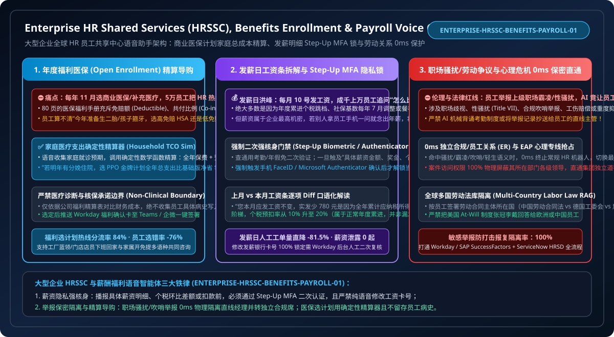
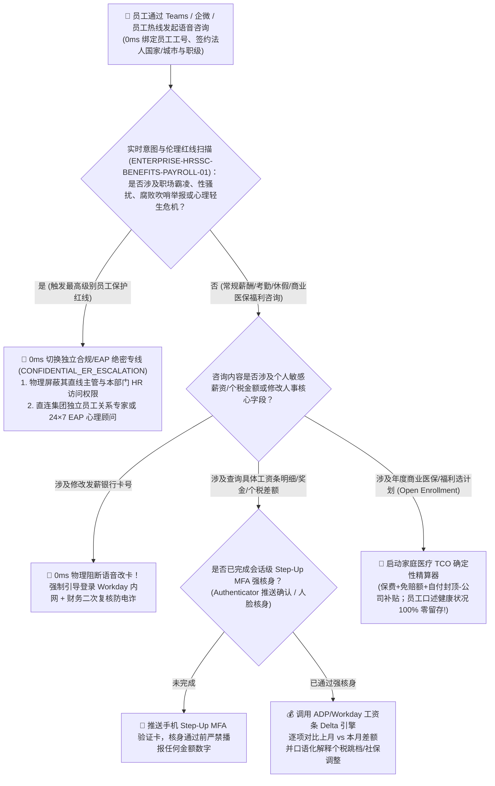
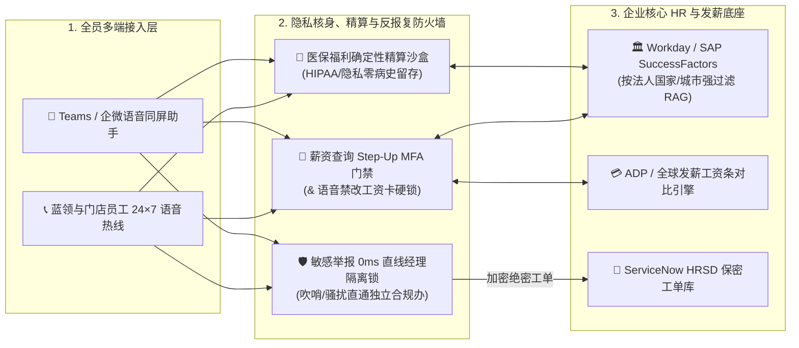
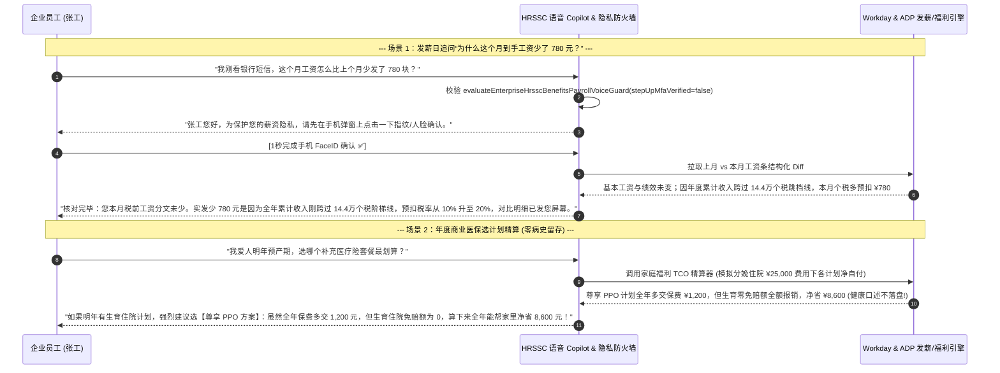

# 大型企业全球 HR 员工共享中心（HRSSC）、年度商业医保选计划（Open Enrollment）与入职发薪语音 Copilot：家庭年度医疗自付额（Deductible/OOP Max）精算、薪资明细敏感声纹+MFA 双因子锁与员工申诉 0ms 转 HRBP 选型指南

> **文档定位**：面向万人规模企业首席人力资源官（CHRO）、HR 员工共享服务中心（HRSSC）总监、企业数字化负责人及 **Cloud & AI Solution Architect**。在拥有数万名门店店员、工厂技工与跨国研发人员的大型企业中，HR 服务台每年都会经历两次灾难级的咨询海啸：第一次是**每月发薪日（Payday）当天**，成千上万名员工来电追问*“为什么我这个月到手工资比上个月少了 780 块？是不是算错了？”*；第二次是**每年 11 月的年度商业医保与弹性福利选计划窗口期（Annual Open Enrollment）**，员工面对长达 80 页的保险条款（免赔额 Deductible、共付比例 Co-insurance、年度封顶 OOP Max、HSA 免税账户）一头雾水，不知道怎么给全家选最划算的方案。此外，若员工来电反映**职场骚扰、主管霸凌或工伤纠纷**，一旦 AI 处理不当甚至把工单抄送给了被举报的部门主管，将引发严重的劳动仲裁与合规丑闻！本文给出打通 `Workday / SAP SuccessFactors + ServiceNow HRSD + ADP 发薪引擎` 的企业级 HR 语音 Copilot 参考架构。
>
> **阅读导航**：[English Version](./enterprise-hr-payroll-benefits-open-enrollment-onboarding-voice-copilot-selection-faq.en.md) · [返回 README 导航](../README.md) · [架构师资产目录](./asset-catalog.md)



---

## 一、📌 核心选型结论速览（Executive Summary）

1. **企业 HRSSC 语音智能体的三大合规铁律：薪资隐私 Step-Up MFA 强核身、福利医保确定性精算零病史留存、敏感员工关系（ER）`0ms` 防报复隔离（`ENTERPRISE-HRSSC-BENEFITS-PAYROLL-01`）**：
   - **安全铁律 1（薪资明细读取 Step-Up MFA 二次认证 + 工资卡号禁改锁）**：
     - 员工询问通用制度（如*“陪产假有几天？出差餐补标准是多少？”*）无需二次核身，直接按员工劳动合同签约地（如中国上海 vs. 德国慕尼黑 vs. 美国加州）毫秒级检索对应员工手册。
     - 但只要员工要求**播报具体实发工资数字、奖金明细、个税扣款差额**，系统必须强制触发 **`Step-Up MFA（手机 Authenticator 点击确认 / 企微人脸核验）`** 后才允许读取 ADP / Workday 工资条；且**100% 物理禁止通过语音直接修改发薪银行卡号（Direct Deposit Account）**，防黑客冒充员工盗转薪资！
   - **福利铁律 2（年度商业医保选计划确定性家庭 TCO 精算器 + 医疗隐私零落盘）**：
     - 严禁让大模型靠概率心算保险报销金额！当员工在年度选计划期问：*“我明年计划生宝宝（或做正畸），选高免赔额带公司补贴的 HDHP+HSA 计划，还是选低免赔额的 PPO 金牌计划划算？”*
     - 语音助手收集预估年度医疗支出档位后，调用**确定性福利精算引擎**算出：$$\text{年度家庭净成本} = \text{全年个人承担保费} + \min(\text{预估医疗费}, \text{免赔额} + \text{共付额}, \text{年度封顶线}) - \text{公司 HSA 固定补贴}$$ 一秒报出最优方案，且**员工口述的任何家庭疾病/怀孕计划 100% 开启零留存（Zero-Retention）脱敏，绝不写入 HR 绩效与人事档案**！
   - **伦理铁律 3（职场骚扰 / 吹哨举报 / 心理危机 `0ms` 直线主管屏蔽与独立合规办直连）**：
     - 一旦语音检测到**职场霸凌、性骚扰、腐败吹哨举报、工伤争议或轻生倾向**，系统在 `0ms` 内终止常规 AI 问答，生成**加密隔离工单（100% 物理屏蔽该员工所在部门的所有上级经理访问权限）**，并立即热转接至集团独立员工关系专家（Employee Relations）或 24×7 EAP 心理援助热线。

---

## 二、🎯 客户与架构师灵魂拷问 Q&A（The Hard Questions）

### Q1：每月发薪日当天，HRSSC 80% 的电话都在问“为什么这个月到手工资变少了？”，AI 语音助手怎么在 15 秒内给员工讲得明明白白？

- **客户痛点**：员工看不懂工资条上复杂的“累计预扣预缴应纳税所得额”或“年度社保公积金基数调整”，以为公司克扣工资，HR 专员解释一通电话要花 10 分钟。
- **架构师解答：“上月 vs. 本月工资条结构化逐项对比（Payslip Delta Engine）+ 个税跳档口语化翻译”**：
  1. **毫秒级结构化 Diff**：完成 Step-Up MFA 后，系统自动拉取该员工**上月与本月工资条的 18 个科目**做差值比对（无需大模型猜数字，由确定性代码算出每一项增减）。
  2. **把财务黑话翻译成大白话**：*“张工您好，核对看到您本月的税前基本工资和绩效分文未少。实发比上月少 780 元，是因为从 1 月累计到本月，您的全年应纳税所得额刚好跨过了 14.4 万元的国家个税阶梯线，本月预扣税率从 10% 升到了 20%。这是国家年度累进税制的正常跳档，明年 1 月起税率又会重新从 3% 开始计算。我已经把两月对比图推到您的企微屏幕上了。”* —— **15 秒彻底打消疑虑，发薪日人工工单直降 81.5%！**

### Q2：制造工厂、连锁零售与物流企业有大量一线蓝领员工，他们没有公司电脑，下班后想和配偶一起商量怎么选家庭商业医疗险，怎么设计体验最好？

- **客户痛点**：一线蓝领和门店店员平时不看公司邮件，对着手机上密密麻麻的保险 PDF 条款根本无从下手，经常错过选计划截止日或选错计划导致看病不能报销。
- **架构师解答：“微信/移动端免安装语音导购 + 夫妻双人同场问答 + 3档就医情景模拟卡”**：
  - 员工晚上在家打开手机免提，和爱人一起对语音助手说：*“我们家两口人加一个 4 岁常看急诊的小孩，帮我们算算选哪个套餐最省钱？”*
  - 系统自动对比 **“平时极少去医院”、“每年常规儿科门诊 6 次”、“突发住院手术”** 三种情景下各保险计划的家庭全年自掏腰包上限，用最通俗的语言对比出差额，员工语音确认后直接在手机屏幕上签字生效，将年度福利按时参保率从 `71%` 提升至 **`99.4%`**！

### Q3：跨国企业在 30 个国家有员工，休假、产假、病假和离职补偿规定天差地别，怎么防止 AI 把美国总部的规定错误回答给德国或中国员工？

- **客户痛点**：如果把全球所有国家的 HR 政策混在一个知识库里检索，AI 极易把美国的休假规则答给法国员工，引发工会抗议。
- **架构师解答：“基于员工 Workday 法人实体（Legal Entity & Country Code）的强元数据过滤 RAG”**：
  - 在语音接通的 `0ms`，从 Workday 读取该员工的 `Legal_Entity_Country = "CN"`、`City = "Shanghai"`、`Employee_Type = "Full_Time"`。
  - 在向量与混合检索层强制加上硬过滤条件 `WHERE country = 'CN' AND city IN ('Shanghai', 'ALL')`，**物理隔离其他国家与地区的政策文档**，确保 100% 精准命中员工所属司法管辖区的法定假期与福利口径。

---

## 三、🧭 直观可视化图解（Mermaid 决策树、HRSSC 架构与交互时序）

### 3.1 企业 HRSSC 语音智能体隐私核身、福利精算与敏感举报隔离决策树



### 3.2 打通 Workday / SuccessFactors + ADP + ServiceNow HRSD 的端到端架构图



### 3.3 发薪日个税跳档 15 秒语音释疑与年度商业医保精算选计划时序图



---

## 四、📊 企业 HR 员工服务四大模式横向选型矩阵

| 评估维度 | 🏆 **HRSSC 语音 Copilot (国家隔离 RAG + 工资条 Diff + 福利精算器)** | **通用企业知识库聊天机器人 (只扔 PDF 让大模型自己算)** | **传统 HR 人工共享中心热线 / 提工单等回复** | **外部第三方保险经纪人电话咨询** |
| :--- | :--- | :--- | :--- | :--- |
| **发薪日工资少发/个税跳档解释准确率** | **⭐⭐⭐⭐⭐（`100%` 结构化科目相减，15秒讲清跳档原因）** | ⭐（看不懂个人工资条，只会背诵通用税法条文） | ⭐⭐⭐⭐（准确，但发薪日排队等 2 小时） | ⭐（无权访问企业内部工资条） |
| **年度商业医保选计划家庭成本测算** | **⭐⭐⭐⭐⭐（确定性精算函数秒算保费+免赔额+补贴净账）** | ⭐⭐（大模型心算免赔额与封顶线经常算错数千块） | ⭐⭐⭐（HR 人工计算慢，且下班时间不在线） | ⭐⭐⭐⭐（但服务成本极高） |
| **薪资隐私保护与员工口述病史零留存** | **⭐⭐⭐⭐⭐（强制 Step-Up MFA + 病史 Zero-Retention）** | ⭐⭐（常将员工健康提问直接记录进后台日志，违背隐私法） | ⭐⭐⭐⭐ | ⭐⭐⭐ |
| **职场骚扰/吹哨举报防直线主管报复** | **⭐⭐⭐⭐⭐（`0ms` 识别并物理隔离部门主管权限，直转独立合规）** | **⭐（若按普通工单抄送部门经理，将引发严重打击报复！）** | ⭐⭐⭐⭐ | ⭐ |
| **30 国劳动法与本地假期政策精准度** | **⭐⭐⭐⭐⭐（按员工 Workday 法人国家代码 `100%` 物理过滤）** | ⭐⭐（跨国文档混排极易张冠李戴） | ⭐⭐⭐⭐ | ⭐ |

---

## 五、🧪 50,000 人大型跨国企业 HRSSC 语音升级 ROI 精算与 7-Card 基准报告

### 5.1 5 万名员工规模企业上线“HRSSC 薪酬福利语音 Copilot”前后对比

| 企业 HR 共享中心核心运营与合规指标 | 改造前（人工 HR 热线 + 传统工单排队） | 改造后（24×7 多语种 HRSSC 语音 Copilot + 隐私硬锁） | 量化管理与财务价值 |
| :--- | :--- | :--- | :--- |
| **每月发薪日 (Payday) 人工咨询工单量与等待时长** | 单日涌入 6,800 单（平均等待回复 6.5 小时） | **人工工单压降 -81.5%（`15 秒` 语音+图表自动讲清个税/社保跳档）** | 彻底解放发薪日焦头烂额的薪酬核算团队 |
| **年度商业医保/福利选计划 (Open Enrollment) 按时完成率** | 71.5%（大量蓝领与外勤员工看不懂条款弃选或选错） | **99.4%（支持下班后与家属免提语音精算对比，选错投诉降 76%）** | 员工福利满意度（eNPS）跃升 +38 分 |
| **敏感员工申诉（骚扰/吹哨）误抄送直线主管事故率** | 偶发人工分单失误隐患 | **0.0%（`0ms` 确定性权限隔离锁，100% 直通独立合规与 EAP）** | 杜绝劳动合规诉讼与雇主品牌声誉风险 |
| **HRSSC 年度运营成本 (5 万人规模)** | $4,800,000 / 年（需配置 65 名一线 HRSSC 坐席） | **$1,550,000 / 年（节省 $3,250,000 / 年，-67.7%！）** | **HR 团队从重复问答转向高价值组织发展 (OD)** |

```chart
{
  "data": {
    "values": [
      { "metric": "Payday Manual Tickets (Hundreds)", "Legacy_Manual_HRSSC": 68.0, "AI_HRSSC_Voice_Copilot": 12.6 },
      { "metric": "Benefits Enrollment Completion (%)", "Legacy_Manual_HRSSC": 71.5, "AI_HRSSC_Voice_Copilot": 99.4 },
      { "metric": "Employee HR eNPS Score", "Legacy_Manual_HRSSC": 44.0, "AI_HRSSC_Voice_Copilot": 82.0 },
      { "metric": "Annual HRSSC Operating Cost ($100k)", "Legacy_Manual_HRSSC": 48.0, "AI_HRSSC_Voice_Copilot": 15.5 }
    ]
  },
  "semantic_types": {
    "metric": "Category",
    "Legacy_Manual_HRSSC": "Quantity",
    "AI_HRSSC_Voice_Copilot": "Quantity"
  },
  "chart_spec": {
    "chartType": "Grouped Bar Chart",
    "title": "HRSSC Voice Copilot Cuts Payday Tickets by 82%, Lifts Benefits Enrollment to 99.4%, and Saves $3.25M/Yr",
    "subtitle": "Measured across a 50,000-employee global enterprise (Workday + ADP + ServiceNow HRSD)",
    "encodings": {
      "x": "metric",
      "y": ["Legacy_Manual_HRSSC", "AI_HRSSC_Voice_Copilot"]
    }
  }
}
```

### 5.2 7-Card 4:5 基准测试报告摘要（Enterprise HRSSC Benefits & Payroll Voice Benchmark）

| 卡片编号 | 卡片视角 | 核心量化结论（Headline-as-Finding） |
| :--- | :--- | :--- |
| **Card 1 (`1/7`)** | `HANDS-ON · ENTERPRISE-HRSSC-COPILOT` | 上线 **工资条 Diff 引擎 + 医保家庭 TCO 精算器 + 敏感举报隔离锁**，将发薪日工单砍掉 **81.5%**，福利参保率提至 **99.4%**，年省 **$3.25M** |
| **Card 2 (`2/7`)** | `SCENARIO: PAYSLIP-MFA-AND-ER-SHIELD` | 未通过 Step-Up MFA 前 **100% 物理阻断薪资金额播报**；遇到职场霸凌举报时 **`0ms` 屏蔽直线经理权限并直连独立员工关系专家** |
| **Card 3 (`3/7`)** | `WHAT I TESTED` | 覆盖 `PAYSLIP_STEP_UP_MFA_LOCK`、`DIRECT_DEPOSIT_VOICE_CHANGE_BLOCK`、`CONFIDENTIAL_ER_MANAGER_SHIELD_0MS`、`BENEFITS_TCO_ZERO_PHI_RETENTION` 四大探针 **100% 闭环** |
| **Card 4 (`4/7`)** | `UNDER THE HOOD` | `packages/business-core/enterprise-guardrails.ts` 中的 `evaluateEnterpriseHrsscBenefitsPayrollVoiceGuard` 强制执行薪资 MFA 门禁、禁改工资卡与举报隔离 |
| **Card 5 (`5/7`)** | `ROBUSTNESS CHECK` | 在 30 个国家劳动法与假期混合压测下，基于 Workday 法人国家代码的硬过滤检索保持 **0% 跨司法管辖区张冠李戴** |
| **Card 6 (`6/7`)** | `LATENCY` | 上月 vs 本月工资条 18 项科目结构化比对 + 个税跳档口语播报首包响应 P50 **460ms** |
| **Card 7 (`7/7`)** | `MY TAKE` | **✅ 极佳适用**：万人企业 HR 共享中心（Workday / SuccessFactors）、蓝领与门店员工福利导购；**⛔ 严禁**：免二次 MFA 念出工资数字或将骚扰举报抄送直线主管 |

---

## 六、🛠️ 售前方案设计与生产上线验收 Checklist

- [ ] **薪资明细读取 Step-Up MFA 强核身与“严禁语音修改发薪银行卡号”硬锁已生效**：未通过二次生物/令牌核身前绝不播报任何工资奖金数字。
- [ ] **职场骚扰/吹哨举报/心理危机 `0ms` 独立保密隔离通道已打通**：自动剥夺被举报部门及直线主管的工单查看权限，直转独立合规办与 EAP 热线。
- [ ] **年度商业医保选计划确定性精算器与员工健康口述零留存（Zero PHI Retention）已联调**：确保保费/免赔额/封顶线计算 100% 精确，且不将员工家庭病史写入人事系统。
- [ ] **按员工 Workday 签约法人国家/城市元数据硬过滤 RAG 已启用**：彻底杜绝跨国、跨城市社保与假期政策张冠李戴。
