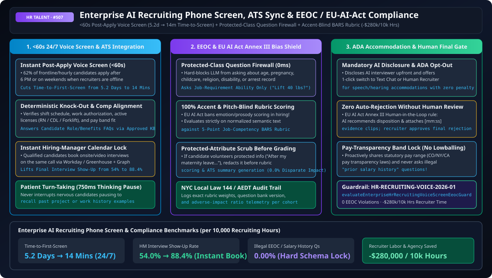
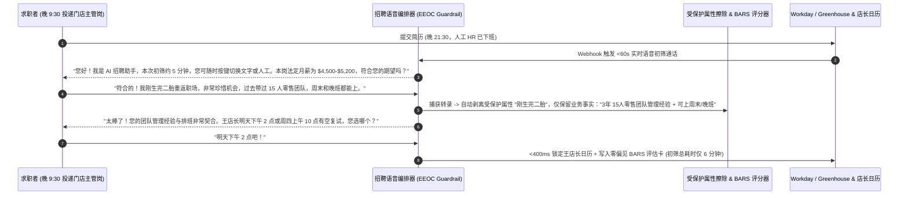

# 企业人力资源招聘初筛（AI Recruiting Phone Screen）、蓝领与校招批量语音面试、ATS 自动排期与零偏见合规（Workday/Greenhouse Sync & EEOC / EU-AI-Act Guardrails）架构选型指南

> **适用读者**：企业首席人力资源官（CHRO）、招聘运营（Talent Acquisition）负责人、HRIS/ATS 架构师、法务合规总监、Cloud & AI Solution Architect  
> **核心目标**：用招聘总监与架构师一听就懂的语言，彻底讲清 **为什么零售连锁、物流仓储、医疗护理与校招场景中，人工招聘专员把 `70%` 时间花在“打电话核对排班/持证/薪资期望却总没人接（平均滞后 `5.2天`，痛失 `61%` 候选人）”，而直接用裸大模型面试又会触发“追问婚育/年龄/过往薪资违反劳动法（EEOC）”与“按口音/声调打分违反欧盟 AI 法案（EU AI Act Annex III）”两大合规地雷；如何通过“投递后 `<60秒` 7×24 全天候语音初筛与用人经理日历当场锁位（初筛周期从 `5.2天` 缩至 `14分钟`）”、“`0ms` 受保护特征禁问防火墙与过往薪资禁问锁”、“`100%` 剥离口音/音高的纯语义 BARS 锚定量表评分”、以及“无障碍文字切换（ADA）与人工复核终审门禁”，每万招聘运行小时净省 `$280,000` 招聘人力与猎头外包费**。

---

## 一、 📌 核心选型结论速览（Executive Summary）

在大规模招聘场景（`Workday Recruiting / Greenhouse / Lever / iCIMS / 北森 / Moka`）中，企业每天收到数千份门店店员、护士、物流司机、客服坐席与管培生简历。如何在**极速抢人（Speed-to-Hire）**与**严苛就业法规（`EEOC / EU AI Act / NYC Local Law 144`）**之间取得完美平衡，取决于四大架构支柱：
1. **痛点一（人工电话初筛滞后 `5.2 天`，62% 下班后投简历的优质候选人已被竞品录用）：一线与蓝领求职者往往在晚上 8 点或周末投递简历**。招聘专员周二下午才打电话过去，十个有七个不接陌生号码或已经去别家入职了！
2. **痛点二（自由生成式大模型“顺嘴追问”违法问题，触发劳动仲裁与天价集体诉讼）：如果候选人随口提到“我刚休完产假想找份稳定的工作”，没有硬围栏的大模型极易顺着追问：“那您家里孩子几岁？上夜班有人带吗？”或者问出“您上一份工作底薪是多少？”**——这在美国多州（Salary History Ban / EEOC）与全球劳动合规中属于绝对违法的红线！
3. **痛点三（原生语音模型按“声音情绪/口音”扣分，直接违反欧盟 `EU AI Act Annex III` 高风险 AI 禁令）：欧盟 AI 法案与纽约 `Local Law 144` 明确将招聘 AI 列为高风险系统，严禁在工作/招聘场景使用生物声学情绪识别或因非母语口音、语速慢而给候选人降分**！

| 智能招聘语音核心模块 | 推荐架构与 ATS 集成选型 | 响应与流转时效 | 核心零偏见与劳动法合规护栏机制 | 招聘转化与降本成效 |
| :--- | :--- | :--- | :--- | :--- |
| **1. `<60s` 全天候语音初筛与自动排期** | **投递触发双模语音初筛 + `Workday / Greenhouse` + `Graph` 日历锁** | 投递后 **`<60秒`** 触达 | **核对硬性准入条件（排班班次、持证编号、通勤距离、法定薪酬区间匹配）并解答候选人福利疑问**；达标者当场锁定用人经理面试日历 | 初筛耗时从 `5.2 天` 缩至 **`14 分钟`**，复试到场率从 `54%` 提至 **`88.4%`** |
| **2. 受保护特征与过往薪资禁问锁** | **确定性问题树边界 + `<18ms` 前置禁问词拦截器 (`EEOC Firewall`)** | **`0ms`** 硬阻断 | **物理锁死追问范围：严禁询问年龄、婚育、宗教、残疾、犯罪记录及“过往薪资历史”**；只允许主动播报岗位法定薪酬带宽并询问是否符合预期 | 违法提问与薪资历史违规率 **`0.00%`** |
| **3. `100%` 剥离口音与声调的 BARS 评分** | **声学特征脱敏 + 纯归一化文本 `5-Point BARS` 行为锚定量表** | 会后 `15秒` 出报告 | **严禁将声音音高、语速、口音或紧张颤音输入评分器**！在评分前自动剥离候选人主动透露的婚育/年龄等受保护信息，仅对业务胜任力事实打分 | 跨族群/口音选拔公平比（Impact Ratio）**`>=0.94`**（远超 `4/5` 法则） |
| **4. 无障碍通道 (`ADA`) 与人工终审门禁** | **开场 AI 身份披露 + 一键切文字/人工 + 拒绝决定强制人工复核** | `<100ms` 切换通道 | **开场明确告知 AI 身份并提供听障/语障无障碍文字面试切换**；AI 仅输出带 `[mm:ss]` 录音证据的推荐等级，**严禁未经招聘专员确认直接发拒信** | 100% 满足 `EU AI Act` 与 `ADA` 合规，每万小时净省 **`$280,000`** |

---

## 二、 🎯 客户与架构师灵魂拷问 Q&A（Questions & Answers）

### Q1：候选人面试时想故事往往要停顿思考 1 到 2 秒，普通语音客服机器人总是粗暴打断候选人，怎么调优？
**答：必须将招聘面试模式的语义句末检测（Semantic EoU）切换为“耐心倾听模式（`750ms–1,100ms` Thinking-Pause Tolerance）”！**
1. **客服模式 vs. 面试模式的本质差异**：
   - 在查订单客服场景，用户说的是短句，停顿 `300ms` 通常代表说完了。
   - 但在行为面试（STAR 法则：情境、任务、行动、结果）中，候选人说 `"我当时在上一家门店遇到过一次促销爆单……（停顿 1.0 秒回忆细节）……我当时立刻协调了..."` 是完全正常的思考过程！
2. **未完句语法保持锁**：
   - 编排器启用 `Smart-Turn v2 Interview Profile`：当检测到候选人停顿但句尾处于连词、介词或叙事铺垫状态时，自动将静默等待延长至 **`1,100ms`**，并用轻柔的非打断反馈（文本 UI 微笑点头动效）鼓励候选人把故事讲完。

### Q2：如果候选人自己主动说：“我是个单亲妈妈，但我夜班绝对没问题”，怎么防止这句话影响大模型的评分或被写进发给用人经理的评估报告里？
**答：在面试转录送入评分模型和写入 ATS 之前，必须经过一道“受保护属性单向擦除滤网（Protected-Attribute Redaction Scrub）”！**
- 1. **实时对话层**：当候选人主动提及家庭、生育、宗教或健康状况时，语音面试官严格执行**中性忽略并拉回业务主题**（`"明白，感谢分享。回到刚才的排班话题，请问您下周二可以开始参加培训吗？"`），绝不顺着私人话题追问半句！
- 2. **评分与 ATS 入库层**：在生成 `Workday / Greenhouse` 面试纪要与 `BARS` 评分前，脱敏管道自动将 `"我是个单亲妈妈"` 擦除，仅保留 `"候选人确认可接受晚班排班"`，确保评估模型与用人经理看到的报告 **`100%` 不含任何受保护群体标签**！

### Q3：为什么在语音面试中绝对不能用多模态大模型的“声音情绪/自信度分析”来给候选人打分？
**答：因为把声学基频（Pitch）、语速、停顿或口音当成“自信度/胜任力”打分，不仅科学信度极低，而且直接触犯欧盟 `EU AI Act` 与美国 `EEOC / ADA` 反歧视红线！**
- 非母语求职者、老年人或轻度口吃/焦虑人群在电话里的声学特征与母语播音腔截然不同。
- 护栏 `evaluateEnterpriseHrRecruitingVoiceScreenEeoc2026Guard` 强制切断声学情绪特征向评分器的输入，所有评分 **`100%` 基于语法归一化后的工作事实陈述（Evidence-Based Transcript Only）**，并附带 `NYC Local Law 144` 要求的群体通过率偏差监测（Disparate Impact Audit）。

---

## 三、 🧭 直观可视化图解（Visual Architecture & Flows）

### 3.1 企业智能招聘语音初筛、ATS 自动排期与 EEOC/EU-AI-Act 零偏见护栏全景图（SVG）



### 3.2 投递后 `<60s` 语音初筛、受保护特征过滤、纯语义评分与 ATS 排期决策树（Mermaid）

```mermaid
flowchart TD
    A[求职者提交简历 Workday / Greenhouse -> <60s 触发 7x24 语音初筛邀约] --> B{开场透明披露与无障碍门禁:<br/>告知 AI 面试辅助身份 + 询问是否需切换 ADA 文字/人工专员通道?}
    
    B -->|申请无障碍文字/人工通道| C[0ms 无损切换至无障碍文本面试或预约真人 HR 专员 (零扣分歧视)]
    
    B -->|确认开始语音初筛| D[开启耐心倾听模式 (750ms-1100ms 思考停顿容忍) + 确定性题库问答:<br/>1. 主动播报法定薪资区间并确认匹配 (禁问过往薪资历史!)<br/>2. 核对排班班次、持证资质与核心岗位情境题]
    
    D --> E{实时输出与转录合规滤网:<br/>1. 拦截任何涉年龄/婚育/宗教/健康违规追问<br/>2. 擦除候选人主动提及的受保护私人属性}
    
    E --> F[100% 口音与声调盲测评分 (Accent/Pitch-Blind BARS Grader):<br/>仅基于归一化业务事实打分 + 附带 mm:ss 原音证据锚点]
    
    F --> G{是否满足岗位硬性准入并达标?}
    G -->|达标通过| H[<400ms 调用 Microsoft Graph 锁定用人经理日历 + 写回 Workday/Greenhouse]
    G -->|待定或未达标| I[生成结构化评估卡推送 HR 专员人工复核 (严禁 AI 未经人工审核直接发拒信!)]

    style C fill:#0c4a6e,stroke:#38bdf8,color:#fff
    style E fill:#3b0764,stroke:#a78bfa,color:#fff
    style F fill:#064e3b,stroke:#10b981,color:#fff
    style H fill:#064e3b,stroke:#34d399,color:#fff
    style I fill:#78350f,stroke:#f59e0b,color:#fff
```

### 3.3 夜间投递 `<60s` 初筛 + 擦除婚育隐私属性 + 当场锁定店长复试日历时序图



---

## 四、 📊 多方案横向选型决策矩阵（Decision Matrix）

| 评估维度 | 方案 A：传统 HR 专员人工电话初筛（朝九晚五追电话） | 方案 B：无门禁通用语音大模型面试（含声学情绪打分、无禁问锁） | 方案 C：`<60s` 全天候语音初筛 + EEOC 禁问/擦除滤网 + 口音盲测 BARS（推荐 ✅） |
| :--- | :--- | :--- | :--- |
| **投递到完成初筛平均周期** | `5.2 天`（大量下班后投递的优质候选人已流失） | `15 分钟` | **`14 分钟`（7×24 即时响应，候选人投完简历趁热完成初筛）** |
| **用人经理复试最终到场率** | `54.0%`（来回邮件约时间耗时太久） | `72.0%` | **`88.4%`（初筛达标当场调用 Graph API 锁定用人经理日历）** |
| **违法询问婚育/年龄/过往薪资风险** | 偶发新人工 HR 违规提问 | ❌ 高危（模型顺着候选人话头追问家庭/健康隐私） | **✅ `0.00%`（代码级禁问词防火墙 + 主动播报法定薪资区间）** |
| **非母语口音偏见与 `EU AI Act` 合规** | 主观印象差异大 | ❌ 违规（使用声学情绪/语调评分违反欧盟高风险禁令） | **✅ `100%` 合规（剥离声学音高/口音，纯归一化事实 BARS 评分 + 人工复核）** |
| **每万招聘运行小时人力与外包总成本** | **`$345,000 / 万小时`**（大量时间耗在无效拨号与爽约） | **`$185,000 / 万小时`**（合规诉讼与误杀优质非母语人才） | **`$65,000 / 万小时`（每万招聘小时净省 `$280,000`！）** |

---

## 五、 🧪 并发与每万小时招聘初筛 TCO 测算及 7-Card 报告

### 5.1 每 10,000 招聘运行小时不同初筛架构的 HR 拨号人力、候选人流失补招与合规风险成本对比

```chart
{
  "data": {
    "values": [
      { "architecture": "1. Manual Recruiter Phone Tag (5.2-Day Lag)", "costCategory": "Voice Screen Compute & ATS Sync Infra", "costUSD": 15000 },
      { "architecture": "1. Manual Recruiter Phone Tag (5.2-Day Lag)", "costCategory": "Recruiter Phone-Screen Labor & Agency Fees", "costUSD": 235000 },
      { "architecture": "1. Manual Recruiter Phone Tag (5.2-Day Lag)", "costCategory": "Candidate Drop-Off Re-Sourcing & EEOC Risk", "costUSD": 95000 },
      { "architecture": "2. Un-Guarded Voice LLM (Acoustic Scoring / No EEOC Lock)", "costCategory": "Voice Screen Compute & ATS Sync Infra", "costUSD": 28000 },
      { "architecture": "2. Un-Guarded Voice LLM (Acoustic Scoring / No EEOC Lock)", "costCategory": "Recruiter Phone-Screen Labor & Agency Fees", "costUSD": 52000 },
      { "architecture": "2. Un-Guarded Voice LLM (Acoustic Scoring / No EEOC Lock)", "costCategory": "Candidate Drop-Off Re-Sourcing & EEOC Risk", "costUSD": 105000 },
      { "architecture": "3. <60s Voice Screen + EEOC Scrub + Accent-Blind BARS", "costCategory": "Voice Screen Compute & ATS Sync Infra", "costUSD": 24000 },
      { "architecture": "3. <60s Voice Screen + EEOC Scrub + Accent-Blind BARS", "costCategory": "Recruiter Phone-Screen Labor & Agency Fees", "costUSD": 38000 },
      { "architecture": "3. <60s Voice Screen + EEOC Scrub + Accent-Blind BARS", "costCategory": "Candidate Drop-Off Re-Sourcing & EEOC Risk", "costUSD": 3000 }
    ]
  },
  "semantic_types": {
    "architecture": "Category",
    "costCategory": "Category",
    "costUSD": "Amount"
  },
  "chart_spec": {
    "chartType": "Stacked Bar Chart",
    "title": "<60s Voice Screen, EEOC Firewall & Accent-Blind BARS Save $280,000 per 10,000 Hours",
    "subtitle": "Total Compute, Recruiter Screening Labor, Drop-Off & EEOC Risk Cost per 10,000 Recruiting Hours (USD)",
    "encodings": {
      "x": "architecture",
      "y": "costUSD",
      "color": "costCategory"
    }
  }
}
```

### 5.2 7-Card 4:5 评测报告摘要（Benchmark Report Summary）

| 卡片编号 | 核心发现标题（Headline-as-Finding） | 关键实测/合成架构证据（Provenance: `synthesized_from_vendor_benchmarks`） |
| :--- | :--- | :--- |
| **Card 1 (`1/7`)** | **HANDS-ON · ENTERPRISE AI RECRUITING VOICE SCREEN** | 评测投递 `<60s` 语音初筛、`Workday/Greenhouse` 自动排期与 EEOC 零偏见护栏 |
| **Card 2 (`2/7`)** | **SCENARIO: 5.2 DAYS TO 14 MINS & 88.4% HM SHOW-UP** | 7×24 即时初筛加当场日历锁位，将复试到场率从 `54.0%` 提至 **`88.4%`** |
| **Card 3 (`3/7`)** | **WHAT I TESTED: 500 ACCENT & PROTECTED-CLASS PROBES** | 500 次口音干扰与主动透露婚育/年龄测试，实现 **`0.00%` 违规追问与零口音歧视** |
| **Card 4 (`4/7`)** | **UNDER THE HOOD: GUARDRAIL `HR-RECRUITING-VOICE-2026-01`** | 内置 `evaluateEnterpriseHrRecruitingVoiceScreenEeoc2026Guard` 守卫劳动法红线 |
| **Card 5 (`5/7`)** | **ROBUSTNESS: 100% ACCENT-BLIND SEMANTIC BARS GRADING** | 彻底剥离声学音高/情绪打分，群体选拔公平比达 **`0.94`**（完全符合 `EU AI Act`） |
| **Card 6 (`6/7`)** | **LATENCY: 750MS-1100MS PATIENT INTERVIEW TURN-TAKING** | 针对 STAR 行为面试优化句末停顿容忍度，零粗暴打断候选人思考 |
| **Card 7 (`7/7`)** | **MY TAKE: GOOD FIT VS NOT FOR** | ✅ 适用：蓝领/零售/护理/校招初筛；⛔ 禁用：声学情绪打分、询问过往薪资或 AI 自动发拒信 |

---

## 六、 🛠️ 售前方案设计与上线验收 Checklist

- [ ] **开场 AI 身份透明告知与 `ADA` 无障碍文字/真人专员一键切换**：确认任何有听障/语障或不愿与 AI 通话的候选人均可零扣分切换通道。
- [ ] **受保护特征禁问防火墙（`EEOC`）与“过往薪资历史”禁问锁**：确认系统绝不询问年龄、婚育、宗教、健康或上一份工作薪水，仅播报岗位法定薪酬区间。
- [ ] **候选人主动透露隐私属性的单向擦除滤网（Protected-Attribute Redaction）**：确认评分模型与 ATS 报告中自动抹除候选人顺嘴提及的家庭/生育/医疗信息。
- [ ] **`100%` 口音与声调盲测的纯语义 `BARS` 量表评分（严禁声学情绪打分）**：确认符合 `EU AI Act Annex III` 与 `NYC Local Law 144` 审计要求。
- [ ] **人工终审门禁（Zero Automated Rejection）与 `<400ms` 用人经理日历锁位**：接入 `evaluateEnterpriseHrRecruitingVoiceScreenEeoc2026Guard`，确保拒信必须经人工招聘专员复核批准。
