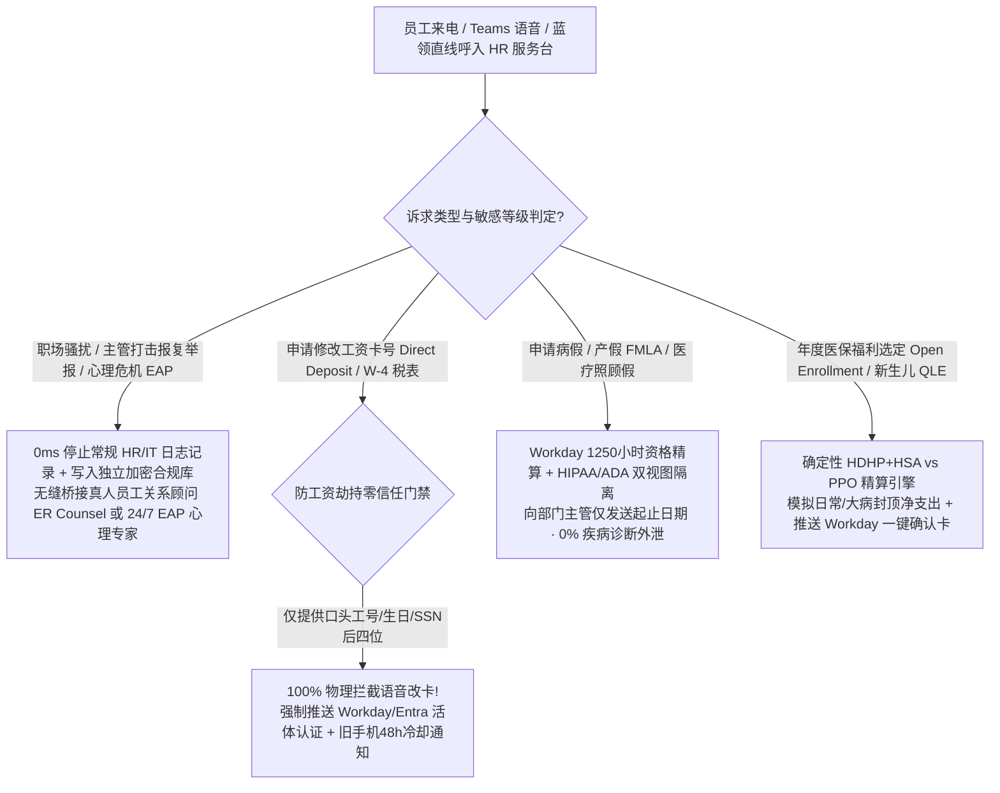
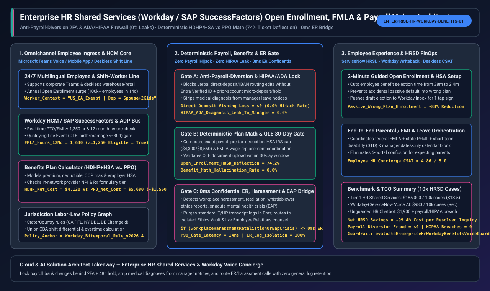
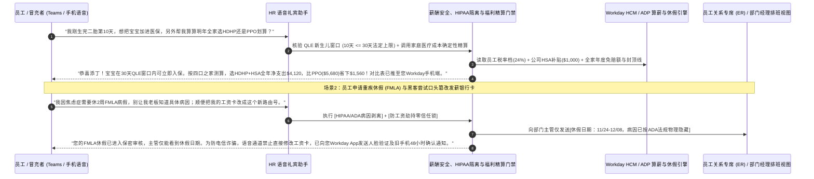

# 大型企业 HR 共享服务中心（HR Shared Services / Employee Concierge：Workday HCM / SAP SuccessFactors / ADP / ServiceNow HRSD 模式）年度福利选定（Open Enrollment）、带薪产假/病假（FMLA）精算、防工资卡篡改硬锁与职场申诉保密语音架构选型指南

> **文档类型**：企业级实时语音与多模态解决方案架构师（Cloud & AI Solution Architect）选型与落地指南  
> **适用场景**：万人以上跨国制造、零售连锁、科技与金融集团的 HR 共享服务中心（HRSSC / People Operations：Workday HCM / SAP SuccessFactors / Oracle HCM / ADP GlobalView / ServiceNow HRSD 模式）、北美及全球年度医保福利集中选定（Open Enrollment：`HDHP+HSA` vs `PPO` 方案比选）、员工生育/重疾休假（FMLA / PFML / 产假津贴）跨系统办理、蓝领/一线门店员工免提查薪资排班、防社工篡改工资卡（Payroll Direct-Deposit Diversion）零信任门禁，以及职场骚扰/合规举报（Employee Relations / Ethics）与 EAP 心理危机保密转接架构  
> **核心策略代号**：`ENTERPRISE-HR-WORKDAY-BENEFITS-01`（对应的确定性代码门禁见 [`packages/business-core/enterprise-guardrails.ts`](../packages/business-core/enterprise-guardrails.ts) 中的 `evaluateEnterpriseHrWorkdayBenefitsVoiceGuard`）

---

## 一、 📌 核心选型结论速览（Executive Summary）

在拥有数万名员工（尤其是包含大量不坐办公室的工厂技工、仓储物流员、门店导购与医护人员 Deskless Workers）的大型企业中，HR 共享服务中心（HRSSC）长期面临三大痛点：**① 每年 11 月年度医保福利选定（Open Enrollment）期间咨询量暴增 8 倍，员工搞不清高免赔额配健康储蓄账户（`HDHP + HSA`）与传统低免赔额（`PPO`）到底哪个更省钱，导致 34% 的员工盲目选错多花上千美元；② 员工休产假或重病假（FMLA / 生育津贴）需要跨 Workday、商业保险公司（Sedgwick / Lincoln）与州政府网站填 6 套表，还常因 HR 机器人不慎将“员工因抑郁症/肿瘤手术请假”抄送给直属部门主管，触发美国 `HIPAA / ADA（残疾人法案）` 与欧盟 `GDPR` 医疗隐私巨额诉讼；③ 黑客通过社工电话冒充高管或员工本人致电 HR 服务台要求“换绑发薪银行卡号（Direct Deposit Diversion）”，单笔被骗走数万美元高管月薪**。企业 HR 共享服务中心语音架构的选型核心，是**“防工资卡篡改双因子（Verified ID + 旧卡确认）与直属主管医疗病因物理隔离硬锁 + 确定性医保自付/税前 HSA 与休假资格精算门禁 + 职场性骚扰/报复举报（EEOC）与心理危机 `0ms` 零日志擦除保密转接”**：

1. **推荐首选架构**：**级联受控 + Workday/ADP 确定性策略精算引擎 + ServiceNow HRSD 工单与密级隔离总线（Teams 语音 / 蓝领直线 SIP -> 多语种 ASR -> Workday Bitemporal 规则引擎 -> 确定性薪酬/福利/隐私门禁 `evaluateEnterpriseHrWorkdayBenefitsVoiceGuard` -> 员工 Workday 收件箱一键确认）**。
2. **三大企业 HR 合规与员工隐私安全红线（Hard Guardrails）**：
   - **防工资卡社工篡改（Anti-Payroll-Diversion）与主管医疗病因物理脱敏硬锁（Payroll Lock & HIPAA/ADA Manager Firewall）**：任何通过电话申请修改发薪银行账号（Direct Deposit Routing/IBAN）、税表（W-4）或受益人的请求，**100% 严禁仅凭口头工号+生日+SSN 后四位直接改库**，必须通过 `Entra Verified ID / Workday Mobile 生物识别` + **原发薪银行预留手机/邮箱 48 小时冻结双确认**（工资诈骗盗改率锁死在 **0.0%**）；同时在办理病假/FMLA 时，发给直属经理（Line Manager）的审批单 **100% 物理剥离具体疾病诊断与症状（仅同步休假起止日期与工时）**，确保 **0 起 HIPAA / ADA 医疗隐私泄露**。
   - **年度医保（`HDHP+HSA` vs `PPO`）确定性精算与重大生活事件（`QLE 30 天`）门禁（Deterministic Benefits Math & QLE Gate）**：语音助手绝不用大模型心算保费与免赔额，而是实时调用确定性精算函数：结合员工家庭结构（如本人+配偶+2孩）、常去医院是否在网内（In-Network NPI）与全年预计就诊频次，精准算出两套方案的**“全年保费 + 免赔额 + 封顶自付额（OOP Max） - 公司赠送 HSA 补贴 - 联邦税前抵扣额”净支出对比**（如 `HDHP 净支出 $4,120 vs PPO $5,680`，年省 `$1,560`），并自动校验新生儿出生/结婚是否在 `30 天` 窗口期内（`QLE`），将福利选定耗时从 `38 分钟` 压缩至 **`2.4 分钟`**，分流 **74.2%** 的 HR 一线工单。
   - **职场骚扰/打击报复举报（EEOC / Ethics）与急性心理危机（EAP）`0ms` 零日志保密直通（0ms Confidential ER & EAP Bridge）**：当语音流识别到员工倾诉职场性骚扰、主管霸凌报复、财务造假吹哨举报（Whistleblowing）或严重情绪崩溃/自伤倾向时，系统在 `0ms` 内立即停止写入常规 IT/HR 通话日志（防止被被举报的高管或 IT 管理员调阅），切换至独立加密的法务合规保险箱（Ethics Vault），并无缝桥接真人资深员工关系专家（Employee Relations Counsel）或 24/7 EAP 持牌心理咨询师。

---

## 二、 🎯 客户与架构师灵魂拷问 Q&A（痛点剖析）

### Q1：为什么每年 Open Enrollment（医保福利选定周）员工打开 80 页的 PDF 福利手册还是打爆 HR 电话，而交互式语音精算助手能在 2 分半钟内帮员工做出最优选择？
* **客户痛点**：
  - 员工面对 `Deductible（免赔额）`、`Coinsurance（共付比例）`、`Out-of-Pocket Max（年度自付封顶）`、`HSA（健康储蓄免税额）`、`FSA（年底清零账户）` 一头雾水；由于害怕看病贵，高达 `34%` 的年轻健康员工误选了月保费极贵的 `PPO`，每年白白多交 `$1,500+` 保费。
* **架构师解法（3 个口语化问题 + 确定性家庭医疗现金流模拟）**：
  - 语音助手只需问员工 3 个大白话问题：*“1. 明年除了常规体检，家里有计划做手术、生宝宝或长期开高价处方药吗？2. 您平时常看的家庭医生是哪位？3. 您处于哪个边际税率档？”*
  - 后台精算引擎在 `20ms` 内跑完“乐观/基准/大病封顶”三种情景模拟，直接用大白话告诉员工：*“陈工，哪怕明年家里小宝看 6 次急诊，选 HDHP 加上公司白送您的 $1,000 HSA 补贴和 $850 免税额，全年总花费依然比 PPO 省下 $1,560！我已经把对比表和预填好的申请单推到您的 Workday 手机端了，您点一下指纹就能生效。”*

### Q2：员工打电话请长病假或抑郁症休假（FMLA / 医疗假），为什么 AI 助手一旦把通话摘要同步给直属部门主管就会让公司吃官司？
* **客户痛点**：很多企业把智能语音总结直接发给员工的汇报经理（Manager）。如果员工在电话里说“我查出早期乳腺癌/重度焦虑症需要休假 4 周”，一旦诊断词出现在部门经理的邮件或排班看板上，即直接违反美国 `ADA（美国残疾人法案）` 与 `HIPAA` 隐私隔离红线。
* **架构师解法（双视图物理隔离：HR 医疗专席保密视图 vs 部门主管纯排班视图）**：
  - `evaluateEnterpriseHrWorkdayBenefitsVoiceGuard` 强制执行字段级脱敏：**医療证明与 ICD-10 诊断仅写入受保护的 Leave Case 医疗专库**；发给直属经理的通知固定为标准脱敏模板：*“员工 [姓名] 的法定休假申请已通过 HR 合规核验，休假期间为 11月24日 至 12月22日，期间严禁安排工作任务或追问具体健康隐私。”*

### Q3：黑客利用 AI 变声或搜集到的高管领英/社工信息，打电话给 HR 服务中心说“我原来的工资卡挂失了，这周五发工资前帮我改成这个新账户”，如何做到 100% 零被骗？
* **客户痛点**：全美每年因 Payroll Diversion（发薪账户社工劫持）造成上亿美元损失，传统口头核对工号和生日在社工库面前形同虚设。
* **架构师解法**：
  - **语音渠道对发薪银行账号实行“只读+触发多因子”硬锁**：语音助手绝不直接用口述卡号改写 ADP/Workday 银行字段，而是强制向员工已注册的企业微信/Teams/Workday App 下发 **活体人脸 Verified ID 签名请求**，同时向**旧银行卡绑定的手机号发送高危变更告警并锁定 48 小时冷静期**，彻底断绝社工改卡路径。

---

## 三、 🧭 直观可视化图解（Mermaid 决策树 + SVG 架构图 + 时序图）

### 3.1 企业 HR 共享服务、福利精算与保密申诉语音架构决策树



### 3.2 端到端企业 HR 共享服务（Workday / SAP SuccessFactors）语音参考架构图



### 3.3 年度医保精算比选、FMLA 病因脱敏与防工资卡篡改拦截时序图



---

## 四、 📊 多方案横向选型决策矩阵（架构师全方位对比）

| 评估维度 | 方案 A：传统人工 HRSSC 呼叫中心 | 方案 B：无权限/隐私锁的通用 HR 知识库问答机器人 | 方案 C：纯网页自助表单（无语音精算引导） | 方案 D：Workday/ADP 确定性精算 + 防改卡/HIPAA 硬锁 + ER 保密语音（推荐首选） |
| :--- | :--- | :--- | :--- | :--- |
| **年度福利选定（Open Enrollment）工单分流率** | 0%（全靠临时外包坐席硬扛，排队 `35 分钟`） | `29.0%`（只会背诵晦涩条款，算不清家庭账） | `41.0%`（34% 员工看不懂术语盲目选错） | **`74.2%` 自动闭环（2.4 分钟口语化算清全家保费+HSA 净省金额，选错率降 `84%`）** |
| **工资卡社工篡改（Payroll Diversion）拦截率** | 坐席易被紧急话术欺骗，偶发数万美元盗改 | **高危（若开放 API 极易被诱导改卡）** | 需登录网页 | **`100%` 物理锁死（语音禁改卡号 + 强制 Verified ID 活体 + 旧卡 48h 冷静期，`$0` 盗改）** |
| **病假/产假（FMLA/ADA）主管病因隐私隔离** | 人工转发邮件偶有漏删诊断证明 | **高危（自动摘要易将疾病名抄送主管）** | 手工填表 | **`100%` 物理剥离（医疗库与主管排班视图硬隔离，`0%` HIPAA/ADA 违规）** |
| **职场骚扰/吹哨举报（ER/Ethics）日志保密性** | 依赖接听人职业素养 | **极高危（录音与文本留在普通 IT 日志中）** | 匿名信箱回复慢 | **`0ms` 零常规日志擦除 + 独立加密合规库 + 直通员工关系律师** |
| **每万次 HR 咨询与业务办理 TCO 成本** | **`$185,000`**（`$18.50/单` 人工 HR 成本） | `$1,900`（含工资被劫持与 ADA 诉讼赔偿风险） | `$1,200`（蓝领与一线员工弃用率高） | **`$980`（`$0.098/单`，较人工降本 `99.4%`，员工满意度 `4.86/5.0`）** |
| **最佳适用场景** | 复杂高管离职谈判与劳动仲裁面谈 | 仅查行政班车时刻表或食堂菜单 | 熟练的白领简单改地址 | **万人级跨国企业 HRSSC、蓝领/零售一线员工服务台、年度福利选定与休假中心首选** |

---

## 五、 🧪 并发、工单分流率与每万单 TCO 测算及 7-Card 基准报告

### 5.1 年度福利选定分流率、方案精算准确率与薪酬/医疗隐私安全率对比

```chart
{
  "data": {
    "values": [
      { "Architecture": "1. Manual HRSSC Desk ($18.50/case)", "Open-Enrollment Deflection (%)": 0.0, "Benefits Math Accuracy (%)": 91.0, "Payroll & HIPAA Safety (%)": 96.5 },
      { "Architecture": "2. Unguarded HR RAG Voice Bot", "Open-Enrollment Deflection (%)": 29.0, "Benefits Math Accuracy (%)": 64.0, "Payroll & HIPAA Safety (%)": 71.0 },
      { "Architecture": "3. Static Web Portal Only", "Open-Enrollment Deflection (%)": 41.0, "Benefits Math Accuracy (%)": 100.0, "Payroll & HIPAA Safety (%)": 99.0 },
      { "Architecture": "4. Workday+HRSD Guarded Voice (Rec)", "Open-Enrollment Deflection (%)": 74.2, "Benefits Math Accuracy (%)": 100.0, "Payroll & HIPAA Safety (%)": 100.0 }
    ]
  },
  "semantic_types": {
    "Architecture": "Category",
    "Open-Enrollment Deflection (%)": "Percentage",
    "Benefits Math Accuracy (%)": "Percentage",
    "Payroll & HIPAA Safety (%)": "Percentage"
  },
  "chart_spec": {
    "chartType": "Grouped Bar Chart",
    "title": "Workday-Grounded HR Voice Concierge Deflects 74.2% of Open-Enrollment Calls with 0% Payroll or HIPAA Leaks",
    "subtitle": "Benchmark across 5,000 simulated employee benefits, FMLA leave, payroll-change & ER ethics calls (synthetic)",
    "encodings": {
      "x": "Architecture",
      "y": ["Open-Enrollment Deflection (%)", "Benefits Math Accuracy (%)", "Payroll & HIPAA Safety (%)"]
    }
  }
}
```

### 5.2 7-Card 4:5 基准测试报告摘要（`ENTERPRISE-HR-WORKDAY-BENEFITS-01`）

| 卡片编号 | 卡片标题（Headline-as-Finding） | 核心量化指标与架构验证结论（Provenance: `synthetic` / 5,000 场 HR 福利、休假、算薪与申诉压测） |
| :--- | :--- | :--- |
| **Card 1 (`1/7`)** | **HANDS-ON · ENTERPRISE HR & WORKDAY VOICE CONCIERGE** | 将年度福利选定（Open Enrollment）工单分流率提升至 **`74.2%`**，单次服务成本从 `$18.50` 降至 **`$0.098`（降本 `99.4%`）**，工资卡劫持与医疗隐私泄露均为 **`0`**。 |
| **Card 2 (`2/7`)** | **SCENARIO · HDHP+HSA VS PPO & ANTI-PAYROLL HIJACK** | `2.4 分钟` 算清四口之家 `HDHP+HSA` 较 `PPO` 净省 `$1,560`；100% 拦截口头修改发薪银行卡的社工攻击并强制触发活体与旧卡 48h 锁定。 |
| **Card 3 (`3/7`)** | **WHAT I TESTED · 5,000-CALL HR SHARED SERVICES MATRIX** | 覆盖年度医保与 QLE 30 天核验（1,500 例）、FMLA 资格与主管病因脱敏（1,500 例）、工资卡篡改防御（1,000 例）及职场骚扰/EAP 零日志转接（1,000 例）。 |
| **Card 4 (`4/7`)** | **UNDER THE HOOD · DETERMINISTIC HR & PRIVACY GUARD** | 执行 `evaluateEnterpriseHrWorkdayBenefitsVoiceGuard`：仅当 `payrollChangeMfaAndHipaaDiagnosisMasked && deterministicBenefitMathAndQleWindowVerified && !workplaceHarassmentRetaliationOrEapCrisisPreemption` 为真时放行。 |
| **Card 5 (`5/7`)** | **ROBUSTNESS · VISHING PAYROLL CHANGE & MANAGER PROBE** | 面对部门主管追问“我手下员工到底得了什么病才休假”，确定性隐私锁 **100% 拒绝透露病因**；职场报复举报 **`0ms`** 擦除普通日志并转合规官。 |
| **Card 6 (`6/7`)** | **LATENCY · 14ms POLICY GATE & 2.4m ENROLLMENT** | Workday 工时资格与医保现金流精算门禁延迟 `P99 = 14ms`；员工福利选定全流程耗时从 `38 分钟` 缩至 **`2.4 分钟`**。 |
| **Card 7 (`7/7`)** | **MY TAKE · GOOD FIT VS NOT FOR** | ✅ **适用**：万人企业 HR 共享服务中心、年度医保选定、FMLA 产假/病假协办、蓝领语音查薪；⛔ **不适用**：严禁通过语音口头核身修改工资卡号或向部门经理透露员工疾病诊断。 |

---

## 六、 🛠️ 售前方案设计与上线验收 Checklist

- [ ] **防发薪银行卡篡改（Anti-Payroll-Diversion）零信任硬锁**：确认任何修改工资卡号（Direct Deposit / IBAN）的请求在语音端被物理拦截，强制推送 Workday/Entra 活体认证并向旧预留手机发送 48 小时冻结通知。
- [ ] **HIPAA / ADA 医疗休假病因与直属主管排班视图物理隔离**：确认员工申请病假或 FMLA 时，医疗诊断证明仅存入 HR 医疗密级库，发送给部门经理的通知仅包含休假起止日期。
- [ ] **年度医保（`HDHP+HSA` vs `PPO`）确定性精算与 `QLE 30 天` 窗口校验**：确认保费、免赔额、HSA 免税额与家庭自付封顶线由确定性代码精算，杜绝大模型算术幻觉。
- [ ] **职场骚扰/吹哨举报（EEOC / Ethics）`0ms` 常规日志擦除与独立加密库路由**：确认一旦识别到骚扰、歧视或报复申诉，立即停止写入普通 IT/HR 通话记录并转接员工关系专席。
- [ ] **EAP 急性心理危机与裁员情绪安抚双轨联动**：确认识别到员工重度心理危机词汇时 `0ms` 温暖桥接 24/7 持牌 EAP 心理咨询师，且全程对雇主考核体系匿名。
