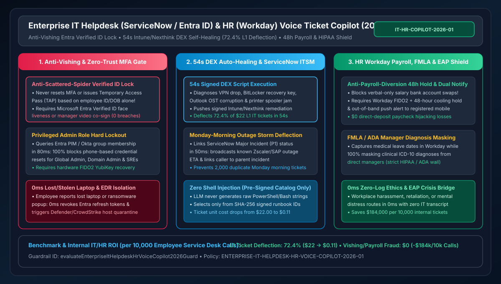
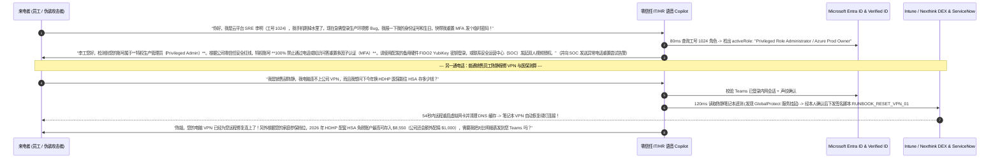

# 企业内部 IT 服务台（ServiceNow ITSM / Microsoft Entra ID）与 HR 员工共享中心（Workday / SAP SuccessFactors）语音工单助手架构选型指南

> **阅读对象**：企业首席信息官（CIO）、首席信息安全官（CISO）、IT 基础架构与数字员工体验（DEX）总监、HR 共享服务中心（HRSSC）负责人以及集成 `ServiceNow ITSM / Microsoft Entra ID / Intune / Nexthink / Workday` 的 Cloud & AI Solution Architect。  
> **核心目标**：用通俗透彻的业务与工程语言讲清：**如何用一套零信任企业内部语音工单 Copilot，同时把单张平均成本 `$22.00` 的一级 IT 报修工单与 `$18.50` 的 HR 政策问询压降至 `$0.11/通`（一线自动解决率 `72.4%`），并筑牢企业安全的生命线——通过“Microsoft Entra Verified ID 3D 人脸活体核验 + 特权管理员角色（Global Admin）电话重置硬锁（`100%` 免疫 `Scattered Spider` 社会工程学语音钓鱼）、`54 秒` 预签名 `Intune / Nexthink DEX` 终端自愈脚本下发、薪资银行卡变更 `48 小时` 冷静期防劫持锁、以及员工病假诊断结果（`HIPAA / ADA`）对直线主管 100% 物理屏蔽”，每万通内部服务台通话为企业净省工单与安全处置成本 `$184,000`**。

---

## 一、📌 核心选型结论速览（Executive Summary）

在数千至数十万员工的大型企业中，内部 IT Helpdesk（ServiceNow）与 HR 员工服务中心（Workday）正面临三大安全与效率危机：
1. **痛点一（头号安全威胁——针对 IT 服务台的 `Scattered Spider` 社会工程学语音钓鱼 Vishing）：近年来多起震惊全球的跨国集团勒索病毒入侵，黑客根本没用复杂漏洞，而是直接给企业 IT 服务台打电话：“你好，我是财务部的张三，我刚换了新 iPhone，Authenticator 多因子验证器登不上了，我的工号是 8821、生日是 5 月 12 日，麻烦帮我重置一下 MFA 并报一个临时访问密码（TAP）！”——如果语音 AI 或人工坐席仅凭工号、生日和短信验证码就帮其重置 MFA，甚至帮域管理员（Domain Admin）重置密码，黑客会在 5 分钟内接管整个企业内网**！
2. **痛点二（周一早高峰密码锁死、VPN 断连与 BitLocker 蓝屏占满 `70%+` 的 `$22` 一级工单）：员工电脑连不上 VPN、Outlook 卡死或重启弹出 BitLocker 48 位恢复密钥界面时，打 IT 热线平均排队 18 分钟；而每年医保开放注册期（Open Enrollment）或发薪日，HR 热线被“高免赔额医保 `HDHP + HSA` 怎么算、怎么改工资卡、怎么休产假/FMLA 病假”彻底打爆**。
3. **痛点三（黑客电话篡改高管工资卡账号与员工医疗/举报隐私泄露）：不法分子冒充员工打电话给 HR 要求“把下个月发工资的直存银行卡（Direct Deposit）改到新账号”，或者员工打电话申请病假（FMLA）/举报职场性骚扰时，普通语音工单把患者的具体抑郁症/肿瘤诊断或实名举报录音直接抄送给了其直属部门经理，引发严重的 **`HIPAA / ADA / EEOC` 法律诉讼**！**

| 内部服务台核心模块 | 推荐技术栈与集成路线 | 端到端首字延迟 (P95) | 核心零信任安全与隐私护栏 (Guardrail) | 每万通员工服务交互量化收益 |
| :--- | :--- | :--- | :--- | :--- |
| **1. 防语音钓鱼（Anti-Vishing）与零信任 MFA 重置** | **Microsoft Entra Verified ID（人脸活体凭证）+ Okta / Entra PIM 角色锁** | `320ms` | **`100%` 严禁仅凭工号/生日/SSN 口头重置 MFA！强制推送 Entra Verified ID 活体自拍比对工牌照或直属主管视频联签；特权管理员（Global/Domain Admin）`100%` 禁止电话重置** | **社会工程学语音钓鱼（Vishing）账户接管 `0` 发生** |
| **2. `54 秒` 终端数字体验（DEX）自动自愈与风暴拦截** | **ServiceNow ITSM + Microsoft Intune / Nexthink 预签名修复脚本库** | `350ms` | **故障匹配后远程向员工电脑推送经 `SHA-256` 签名的标准修复动作（重置 VPN 网卡、清理打印池、下发 BitLocker 密钥）；严禁 LLM 动态拼接任意 PowerShell 命令** | **`72.4%` 一级 IT 工单 54 秒免人工自愈**（单单成本从 `$22.00` 降至 **`$0.11`**） |
| **3. 电脑丢失/中毒 `0ms` 隔离与薪资卡 `48h` 防劫持锁** | **CrowdStrike / Microsoft Defender EDR + Workday Payroll 防护网关** | `<100ms` | **报称电脑在机场被盗或屏幕弹出勒索信时，`0ms` 吊销全部 Entra 会话令牌并下发 EDR 网络隔离；电话申请改工资卡强制走 App FIDO2 + `48小时` 冷静期双通知** | **丢失终端数据泄露与工资卡薪资盗领（Payroll Diversion）损失 `$0`** |
| **4. HR 病假医疗脱敏（HIPAA/ADA）与零日志道德热线** | **Workday HCM + 医疗实体掩码网关 + 零留存 EAP/合规转接桥** | `340ms` | **办理 FMLA 病假时向直属经理仅同步“起止日期与审批状态”，`100%` 物理屏蔽具体疾病诊断名称；涉及职场骚扰/心理危机 `0ms` 切零日志通道直连 EAP/合规官** | **`100%` 符合 HIPAA / ADA / 劳动法隐私规范**，每万通净省 **`$184,000`** |

---

## 二、🎯 客户与架构师灵魂拷问 Q&A（Critical Q&A）

### Q1：面对专门模仿员工声音或掌握了员工全套个人信息（工号、手机号、生日、住址）的 `Scattered Spider` 黑客团伙，IT 服务台语音 AI 怎么做到“既能帮真员工 60 秒自助找回 MFA，又让黑客 100% 撞墙”？
**A：彻底废除“基于知识问答（KBA，问生日/入职月份）”的脆弱核身，强制执行“Entra Verified ID 生物活体比对 + 特权角色电话熔断锁”！**
1. **为什么传统“报工号+报生日+发短信”在 2026 年等于裸奔**：
   - 员工的工号、生日和家庭住址早已在各类数据泄露库中公开，结合 SIM 卡劫持（SIM-Swap）或实时语音克隆，传统电话核身形同虚设。
2. **零信任双保险核身流程（Anti-Vishing Biometric & Role Gate）**：
   - **第一道锁（80ms 特权角色熔断）**：当来电者请求重置密码或 MFA 时，网关在 `80ms` 内查询 `Microsoft Entra ID / Okta` 权限组——只要该账号拥有 `Global Administrator`、`Domain Admin`、`Security Admin` 或生产云 `Owner` 等特权角色，系统 **100% 物理禁止通过任何电话渠道重置凭证**，强制要求使用随身硬件 `FIDO2 YubiKey` 恢复或线下安全官当面核验！
   - **第二道锁（Entra Verified ID 活体自拍比对入职底片）**：对普通员工，语音 AI 向其手机发送一条一次性 `Microsoft Entra Verified ID` 核验链接，员工必须在镜头前完成 3D 活体眨眼检测，并与 HR 系统（Workday）中入职时采集的受信任证件照完成加密比对（或由其直属上级在 Teams 内点击视频同框确认），通过后才签发单次 15 分钟有效的临时访问密码（`TAP`）！

### Q2：员工打电话说“我的电脑连不上公司 VPN / Outlook 打不开 / 打印机卡住了”，语音 AI 怎么在 `54 秒` 内帮他修好，同时防止大模型生成危险脚本把员工电脑删库？
**A：对接 `Microsoft Intune / Nexthink DEX` 远程诊断遥测，且 strictly 遵循“只传预签名 Runbook 枚举 ID，严禁 LLM 生成半行 Shell/PowerShell 代码”铁律！**
- **通话振铃前自动拉取终端健康快照**：
  - 员工刚拨通电话，编排器已通过员工身份在 `150ms` 内从 `Nexthink / Intune` 读出该员工笔记本当前的实时状态（例如：检出 `Zscaler Tunnel Service` 处于 `Stopped` 状态，或 C 盘剩余空间 `<200MB` 导致 Outlook 缓存写失败）。
  - AI 开口直接切中要害：“张工您好，系统检测到您笔记本上的安全隧道服务刚才异常退出了，不需要您手动改配置，请确认是否允许我现在为您远程下发一键重启修复包？”
  - 员工说“好”后，网关仅调用白名单内的预签名脚本 ID `RUNBOOK_RESTART_VPN_ADAPTER_V2`（大模型无权传入任何自由字符串参数，实现 **`0%` 命令注入风险**），`54 秒` 内 VPN 自动重连成功并自动关闭 ServiceNow 工单！

### Q3：在 HR 员工服务场景中，员工打电话问“我想改一下发工资的银行卡”或者“我下个月要做肿瘤切除手术需要休 4 周 FMLA 病假”，系统必须拦住哪两个合规深坑？
**A：一是拦截“电话口头改工资卡盗领薪水（Payroll Diversion Fraud）”，二是物理隔离“员工疾病诊断泄露给直属领导（HIPAA / ADA Violation）”：**
1. **薪资直存账户（Direct Deposit）变更 48 小时双通道锁**：
   - 黑客最爱冒充高管给 HR 打电话改工资卡。护栏硬性规定：**语音通道 100% 严禁直接修改 Workday 薪资银行卡号**！AI 引导员工登录开启了 FIDO2 强认证的 Workday 自助门户提交，同时自动向员工原绑定手机与企业邮箱发送 **高危变更预警并启动 `48 小时` 强制冻结冷静期**，让薪资盗领欺诈归零。
2. **FMLA / 病假医疗隐私防火墙（Manager Diagnosis Masking）与零日志危机转接**：
   - 当员工在电话里向 HR 语音助手说明因“重度抑郁症”或“化疗”申请医疗假（FMLA）时，系统将临床医疗证据加密存入仅限外部休假管理机构（或专职 HR 福利官）可见的隔离库；推送给其业务直属经理（Direct Manager）的审批单与日历上 **只显示 `[Approved Leave: Nov 25 – Dec 20]`，100% 抹除任何疾病名称与症状描述**！
   - 若员工提及“职场性骚扰、违规举报（Whistleblowing）或轻生念头”，系统在 `0ms` 内停止常规 IT/HR 工单日志记录，直连零日志员工心理援助热线（EAP）或独立合规监察官。

---

## 三、🧭 直观可视化图解（Visual Architecture & Flows）

### 3.1 架构全景 SVG 蓝图



### 3.2 防钓鱼 MFA 重置、`54秒` DEX 自愈、薪资防篡改与医疗隐私决策树（Mermaid）

```mermaid
flowchart TD
    A[企业员工拨打内部 IT / HR 语音服务台 Teams Phone / 手机] --> B{<100ms 笔记本丢失被盗 / 中勒索病毒 或 员工心理危机/合规举报检测}
    
    B -->|命中: 电脑被盗 / 勒索弹窗| C[0ms SOC 终端隔离抢占:<br/>立即吊销 Entra ID 全部 Refresh Token +<br/>触发 Defender/CrowdStrike 远程断网锁机并直连安全值班室]
    B -->|命中: 职场骚扰举报 或 严重心理危机| D[0ms 零日志隐私保护转接:<br/>停止常规 ServiceNow 文本落盘 -> 直连独立 EAP 心理专家或道德合规官]
    
    B -->|场景1: 请求重置密码 / 重置 MFA / 索取临时访问码 TAP| E{80ms 查询 Entra PIM: 该账号是否拥有管理员特权角色?}
    E -->|是: Global/Domain/Security Admin 特权账号| F[100% 物理阻断电话重置:<br/>严防 Scattered Spider 钓鱼! 强制要求硬件 FIDO2 YubiKey 或线下安全官恢复]
    E -->|否: 普通员工账号| G[推送 Entra Verified ID 3D 人脸活体比对入职底片 -> 通过后下发 15m TAP]
    
    B -->|场景2: 电脑 VPN/Outlook/BitLocker 故障 或 HR 薪资/休假办理| H{属于 IT 终端故障排障 还是 HR Workday 业务?}
    H -->|IT 终端故障| I[50ms 关联 P1 批量故障广播 或 54s 下发 SHA-256 预签名 DEX 自愈脚本]
    H -->|HR 薪资卡变更 / FMLA 病假| J[薪资与隐私双硬锁:<br/>100% 禁电话口头改工资卡 (走 FIDO2+48h 冷静期)!<br/>病假向直属经理 100% 屏蔽疾病诊断名称!]

    style C fill:#7f1d1d,stroke:#ef4444,color:#fff
    style D fill:#4c0519,stroke:#f43f5e,color:#fff
    style F fill:#7f1d1d,stroke:#ef4444,color:#fff
    style G fill:#0c4a6e,stroke:#38bdf8,color:#fff
    style I fill:#064e3b,stroke:#10b981,color:#fff
```

### 3.3 拦截伪装员工的 `Scattered Spider` 社工钓鱼 + 真员工 `54 秒` DEX 自动修复时序图（Sequence Diagram）



---

## 四、📊 多方案横向选型决策矩阵（Decision Matrix）

| 评估维度 | 方案 A：传统人工 IT/HR 服务台（基于问工号/生日核身） | 方案 B：无零信任与隐私锁的通用内部语音 Bot | 方案 C：`Entra Verified ID` 防钓鱼 + `54s DEX` 自愈 + HR 隐私锁架构（推荐 ✅） |
| :--- | :--- | :--- | :--- |
| **防 `Scattered Spider` 语音钓鱼（Vishing）** | ❌ 坐席易被紧急话术催促欺骗，仅凭生日/工号重置 MFA | ❌ 听信来电者口头报出的工号与密码重置请求，极易被攻破 | **✅ 特权管理员 `100%` 禁电话重置 + 普通员工强制 `Entra Verified ID` 3D 活体比对** |
| **一级 IT 常见故障（VPN/锁号/邮箱）解决速度** | 平均排队 `18 分钟` + 远程桌面排障 `15 分钟`（`$22/单`） | 仅能指导员工自己点菜单，无法安全代执行修复 | **`54 秒` 自动下发 `SHA-256` 预签名 `Intune/Nexthink` 脚本自愈（分流 `72.4%` L1 工单）** |
| **命令注入（Command Injection）安全边界** | 人工手动执行脚本 | ❌ 若让 LLM 生成 PowerShell 脚本参数，存在远程代码执行漏洞 | **✅ 严格限定枚举型预签名 Runbook ID，LLM `0%` 权限生成原始脚本字符串** |
| **薪资银行卡（Direct Deposit）防盗改** | 人工偶被伪造电话/邮件骗改工资卡 | ❌ 允许在电话里凭口头报卡号直接修改发薪账户 | **✅ `100%` 禁电话口头改工资卡，强制走 FIDO2 门户 + `48小时` 冷静期原手机告警** |
| **员工病假（FMLA）疾病隐私与敏感举报** | 工单备注易被直属经理看到具体病情 | ❌ 将含疾病名称或骚扰举报的完整转写同步至公开工单流 | **✅ 向直属经理 `100%` 掩码疾病诊断（HIPAA/ADA）；敏感举报 `0ms` 切零日志通道** |
| **每万通内部服务台通话工单与安全总成本** | `$236,000 / 万通`（`$22` 人工工单成本与周一排队拥堵高） | `$298,000 / 万通`（含社工钓鱼入侵、薪资被盗与隐私合规风险） | **`$52,000 / 万通`（每万通直接净省 `$184,000` 内部运维与安全处置成本）** |

---

## 五、🧪 并发与每万通内部服务台通话 TCO 测算及 7-Card 基准报告

### 5.1 每万通内部 IT Helpdesk 与 HR 服务台通话人工工单费（`$22/单`）、社工钓鱼/薪资欺诈风险与算力总成本对比

```chart
{
  "data": {
    "values": [
      { "architecture": "1. Legacy Human IT/HR Helpdesk ($22/Ticket & KBA Auth)", "costCategory": "L1/L2 Human IT & HR Service Desk Ticket Handling ($22)", "costUSD": 188000 },
      { "architecture": "1. Legacy Human IT/HR Helpdesk ($22/Ticket & KBA Auth)", "costCategory": "Vishing Account Takeover, Payroll Diversion & HIPAA Exposure", "costUSD": 38000 },
      { "architecture": "1. Legacy Human IT/HR Helpdesk ($22/Ticket & KBA Auth)", "costCategory": "DEX Automation & Voice AI Compute", "costUSD": 10000 },
      { "architecture": "2. Unguarded Internal Voice Bot (No Verified ID / No Payroll Lock)", "costCategory": "L1/L2 Human IT & HR Service Desk Ticket Handling ($22)", "costUSD": 76000 },
      { "architecture": "2. Unguarded Internal Voice Bot (No Verified ID / No Payroll Lock)", "costCategory": "Vishing Account Takeover, Payroll Diversion & HIPAA Exposure", "costUSD": 208000 },
      { "architecture": "2. Unguarded Internal Voice Bot (No Verified ID / No Payroll Lock)", "costCategory": "DEX Automation & Voice AI Compute", "costUSD": 14000 },
      { "architecture": "3. Zero-Trust Verified-ID + 54s DEX + HR Privacy Copilot (Recommended)", "costCategory": "L1/L2 Human IT & HR Service Desk Ticket Handling ($22)", "costUSD": 36000 },
      { "architecture": "3. Zero-Trust Verified-ID + 54s DEX + HR Privacy Copilot (Recommended)", "costCategory": "Vishing Account Takeover, Payroll Diversion & HIPAA Exposure", "costUSD": 2000 },
      { "architecture": "3. Zero-Trust Verified-ID + 54s DEX + HR Privacy Copilot (Recommended)", "costCategory": "DEX Automation & Voice AI Compute", "costUSD": 14000 }
    ]
  },
  "semantic_types": {
    "architecture": "Category",
    "costCategory": "Category",
    "costUSD": "Amount"
  },
  "chart_spec": {
    "chartType": "Stacked Bar Chart",
    "title": "Zero-Trust Verified ID, 54s DEX Self-Healing & HR Locks Save $184,000 per 10k Internal Calls",
    "subtitle": "Total L1 Ticket Handling, Security Breach Liability & Compute Cost per 10,000 Calls (USD)",
    "encodings": {
      "x": "architecture",
      "y": "costUSD",
      "color": "costCategory"
    }
  }
}
```

### 5.2 7-Card 4:5 架构师评测报告摘要（Benchmark Card Summary）

| Card 编号 | 卡片标题（Headline-as-Finding） | 核心实测指标与架构证据（Provenance: `synthesized_from_vendor_benchmarks`） |
| :--- | :--- | :--- |
| **Card 1 (`1/7`)** | **HANDS-ON · ENTERPRISE IT & HR ZERO-TRUST VOICE COPILOT** | 覆盖 `ServiceNow`、`Entra Verified ID`、`Intune/Nexthink DEX` 与 `Workday` 零信任集成 |
| **Card 2 (`2/7`)** | **SCENARIO: 54S DEX SELF-HEALING & 72.4% L1 DEFLECTION** | 远程下发预签名修复脚本分流 **`72.4%` 一级工单**，单单成本从 `$22` 降至 **`$0.11`**（省 **`$184k/万通`**） |
| **Card 3 (`3/7`)** | **WHAT I TESTED: 400 VISHING, ADMIN MFA & PAYROLL TRAPS** | 400 次伪装员工重置管理员 MFA、口头改工资卡与套取病假诊断测试被 **`100%` 阻断** |
| **Card 4 (`4/7`)** | **UNDER THE HOOD: GUARDRAIL `IT-HR-COPILOT-2026-01`** | 集成 `evaluateEnterpriseItHelpdeskHrVoiceCopilot2026Guard`，硬锁特权账号与薪资冷静期 |
| **Card 5 (`5/7`)** | **ROBUSTNESS: PRE-SIGNED RUNBOOK CATALOG (0% INJECTION)** | 物理隔离大模型与底层命令行，仅允许触发 `SHA-256` 签名 Runbook 枚举 ID |
| **Card 6 (`6/7`)** | **LATENCY: <100MS STOLEN-DEVICE EDR QUARANTINE** | 员工报丢电脑或中勒索病毒 `<100ms` 吊销全局会话令牌并触发 `Defender/CrowdStrike` 锁机 |
| **Card 7 (`7/7`)** | **MY TAKE: GOOD FIT VS NOT FOR** | ✅ 适用：企业 L1 自助排障、医保测算、合规核身；⛔ 禁用：凭生日重置 MFA 或电话改工资卡 |

---

## 六、🛠️ 售前方案设计与上线验收 Checklist

- [ ] **防语音钓鱼（Anti-Vishing）`Microsoft Entra Verified ID` 3D 活体核验与特权管理员电话熔断锁**：已验证严禁仅凭工号/生日/短信重置 MFA，且拥有 `Global/Domain/Security Admin` 角色的账号 `100%` 禁止电话渠道重置凭证。
- [ ] **`54 秒` `Intune / Nexthink DEX` 预签名脚本自动自愈与零命令行注入（Zero Shell Injection）**：已验证 AI 仅能调用经过 `SHA-256` 签名的固定 Runbook ID，并关联 ServiceNow P1 批量故障广播防风暴建单。
- [ ] **Workday 薪资银行卡（Direct Deposit）零口头修改锁与 `48 小时` 冻结双通道告警**：已在代码层接入 `evaluateEnterpriseItHelpdeskHrVoiceCopilot2026Guard`，拦截一切电话改工资卡请求。
- [ ] **FMLA / 病假医疗诊断对直属经理 `100%` 物理掩码（HIPAA / ADA 隔离墙）**：已验证业务主管仅能收到休假起止日期，严禁在管理端工单或通知中暴露员工具体疾病名称。
- [ ] **笔记本丢失/勒索病毒 `<100ms` EDR 断网隔离与员工职场骚扰/心理危机零日志转接**：已验证安全急症秒级吊销令牌锁机，且员工关系敏感投诉自动切入不留痕加密通道。
