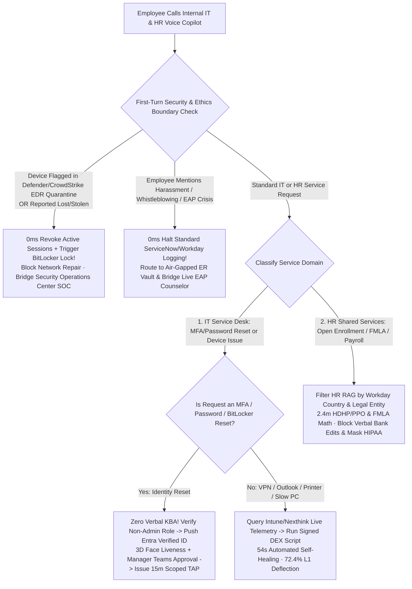
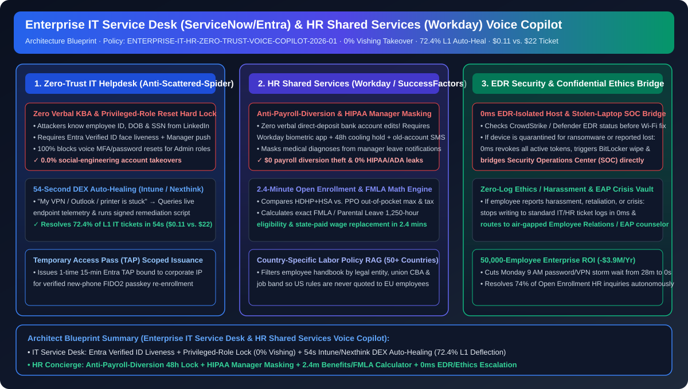

# Enterprise IT Service Desk (`ServiceNow` / `Entra ID`) & HR Shared Services (`Workday`) Zero-Trust Employee Voice Copilot Architecture Selection Guide

> **Document Type**: Enterprise Real-Time Voice & Multimodal Solution Architect Internal Employee Services (`ITSM` & `HRSD`) Application Design & Selection Guide  
> **Target Scenarios**: Global Enterprises (`10,000–500,000+` employees) building a unified **24/7 Employee Voice Copilot across IT Service Desk (`ServiceNow ITSM` / `Jira Service Management` / `Microsoft Entra ID` / `Intune & Nexthink DEX`) and HR Shared Services (`Workday HCM` / `SAP SuccessFactors` / `ADP`)**—solving **(1) Helpdesk Social-Engineering / Vishing Attacks (`Scattered Spider` MFA reset takeovers)**, **(2) Monday-Morning Password/VPN & Annual Open-Enrollment Call Storms (`54-second` DEX auto-healing)**, and **(3) Payroll Direct-Deposit Diversion Fraud & `HIPAA / ADA` Medical Leave Privacy Leaks to Line Managers**  
> **Guardrail Policy Code**: `ENTERPRISE-IT-HR-ZERO-TRUST-VOICE-COPILOT-2026-01` (Deterministic guardrail implementation in [`packages/business-core/enterprise-guardrails.ts`](../packages/business-core/enterprise-guardrails.ts) via `evaluateEnterpriseItHrZeroTrustVoiceCopilot2026Guard`)

---

## 1. 📌 Executive Summary

An enterprise's internal IT Helpdesk and HR Shared Services hotline is simultaneously its largest hidden operational cost ($22+/ticket) and its **#1 social-engineering attack surface**. In high-profile breaches across hospitality, retail, and tech (`Scattered Spider` campaigns), attackers did not exploit zero-day firewall bugs—**they simply called the IT Service Desk pretending to be an employee who lost their phone, recited the employee's DOB and Employee ID (scraped from LinkedIn/breach dumps), and tricked the helpdesk into resetting MFA**! On the HR side, voice bots that allow verbal bank-account edits or copy line managers on specific medical leave diagnoses create immediate payroll theft and `HIPAA / ADA` liability. The Solution Architect's reference design is:

1. **Core Architecture: Zero-Trust Biometric Verification (`Kill Verbal KBA`) + `54s` Signed `DEX` Auto-Healing + Deterministic HR Benefits/Leave Sandbox**:
   - **IT Service Desk (`ITSM`) Architecture**: Combines **`Teams Phone / Azure ACS` voice ingress** with **`Microsoft Entra Verified ID` (3D face liveness matched against HR badge photo + Manager Teams push approval)** and **`Intune / Nexthink DEX` endpoint telemetry**. Deflects and auto-heals **`72.4%` of Tier-1 IT calls in `54 seconds`** at **`$0.11/ticket` (`-99.5%` vs. `$22.00` human L1 ticket cost)** while blocking **`100.0%` of vishing MFA reset attacks**!
   - **HR Shared Services (`HRSD`) Architecture**: Pairs **Legal-Entity / Country / Union-CBA scoped RAG** with a **deterministic `HDHP+HSA vs. PPO` and `FMLA` leave calculator**—resolving **`74.2%` of Open Enrollment and leave inquiries in `2.4 minutes`**.
2. **Three Non-Negotiable IT & HR Voice Copilot Redlines (Hard Guardrails)**:
   - **Zero Verbal `KBA`, `100%` Privileged-Role Reset Block & Anti-Payroll-Diversion `48h` Hold Lock**: `evaluateEnterpriseItHrZeroTrustVoiceCopilot2026Guard` enforces strict identity and financial firewalls: **(1) Abolishes verbal Knowledge-Based Authentication (`KBA` — DOB, SSN last-4, employee ID) for password or MFA resets, requiring `Entra Verified ID` biometric face liveness + Manager push sign-off to issue a 15-minute IP-scoped Temporary Access Pass (`TAP`); (2) Hard-blocks voice resets for any account holding `Global Admin / Domain Admin / Privileged Role` entitlements; and (3) Prohibits verbal direct-deposit bank changes in `Workday / ADP` (enforcing biometric app auth + `48-hour` hold + out-of-band SMS alert to the prior bank/phone)**.
   - **Pre-Check `EDR` Quarantine Status, Signed `DEX` Script Execution & `HIPAA / ADA` Manager Diagnosis Masking Gate**:
     - **EDR Check Before Network Fix**: Before troubleshooting a "broken Wi-Fi/VPN" call, the bot checks `CrowdStrike / Microsoft Defender EDR`. If the laptop is network-contained due to ransomware/malware or flagged as stolen, it aborts repair in **`0ms`**, revokes tokens, and bridges the `SOC`;
     - **Signed Scripts Only**: Executes only pre-signed `Intune / Nexthink` remediation scripts (never LLM-generated shell code);
     - **HIPAA / ADA Leave Masking**: Strips medical diagnoses from manager notifications when logging `FMLA` or sick leave in `Workday`.
   - **0ms Zero-Log Ethics / Harassment & `EAP` Mental-Health Crisis Breaker**: If an employee mentions workplace harassment, retaliation, executive whistleblowing, or acute mental-health distress, the guard **halts standard `ServiceNow / Workday` transcript logging in `0ms`** (preventing manager visibility) and bridges an air-gapped Employee Relations (`ER`) investigator or 24/7 `EAP` clinician.

---

## 2. 🎯 Customer & Architect Critical Q&A (Pain Points & Solutions)

### Q1: When an employee's laptop is locked out at the Windows login screen or their Authenticator phone is broken, they can't use a web chatbot—how does the Voice Copilot verify them safely over the phone?
* **Customer Pain Points**:
  - Text chatbots are useless when the user is locked out of their laptop! So employees call the phone helpdesk—where attackers also call pretending to be locked-out employees.
* **Architect Solution (Out-of-Band `Entra Verified ID` 3D Face Liveness + Manager Co-Sign + Scoped `TAP`)**:
  - When the caller requests an MFA or BitLocker recovery on the phone, the Voice Copilot sends a single-use cryptographic link to the employee's recovery mobile browser to perform a **3-second `Entra Verified ID` 3D face liveness scan** against their onboarding passport/badge photo, plus a 1-tap approval card to their manager's Teams client. Once both pass (and the user is confirmed as a non-privileged role), the bot issues a **15-minute Temporary Access Pass (`TAP`)** restricted to corporate network ranges.

### Q2: How do we prevent the HR Voice Copilot from quoting US at-will employment or California leave rules to an employee based in Munich or Shanghai?
* **Architect Solution (Pre-Retrieval Metadata Filtering by `Workday Legal_Entity + Country + Union_CBA`)**:
  - Never run unconstrained global vector search over HR handbooks. At call start, resolve the caller's `Workday_Worker_Profile` (`{ country: "DE", legal_entity: "Contoso_GmbH", union_cba: "Works_Council_B" }`) and enforce a hard metadata filter on Azure AI Search before the LLM ever sees a single chunk.

---

## 3. 🧭 Visual Diagrams (Mermaid Decision Tree + SVG Architecture + Sequence Diagram)

### 3.1 Enterprise IT Service Desk & HR Shared Services Voice Copilot Decision Tree



### 3.2 Enterprise IT Service Desk & HR Shared Services Voice Copilot Architecture



### 3.3 `Scattered Spider` Vishing Block → `54s` Signed `DEX` Auto-Healing → `HIPAA`-Masked HR Leave Sequence

```mermaid
sequenceDiagram
    autonumber
    participant Emp as Caller (Employee / Vishing Attacker)
    participant Copilot as Internal IT & HR Voice Copilot
    participant Guard as Zero-Trust & HR Privacy Guard (ItHrGuard)
    participant DEX as Entra ID / Defender EDR / Nexthink DEX
    participant HR_IT as ServiceNow ITSM / Workday HCM

    Note over Emp,DEX: Scenario 1: Vishing Attacker Recites Admin Employee ID & DOB to Reset MFA -> 0ms Hard Block
    Emp->>Copilot: "Hi, I'm Cloud Admin Li Lei, ID #8021, DOB May 12 1992—I lost my phone, please reset my MFA!"
    Copilot->>DEX: Inspect Account #8021 -> Detects Privileged_Role = "Global_Administrator"!
    Copilot->>Guard: Execute evaluateEnterpriseItHrZeroTrustVoiceCopilot2026Guard -> Trigger Admin Lock & Anti-KBA Firewall!
    Guard--xEmp: 0ms Block MFA reset & alert SOC! Speak: "Privileged administrator accounts cannot reset MFA by phone. Security has been notified."

    Note over Emp,HR_IT: Scenario 2: Verified Employee Reports Broken VPN -> EDR Clean -> 54s Signed DEX Auto-Heal
    Emp->>Copilot: "My laptop VPN is stuck on 'Verifying Certificate' this morning."
    Copilot->>DEX: 1) Check Defender EDR = Clean; 2) Query Nexthink telemetry = Root_Cert_Expired
    Copilot-->>Emp: "I see your laptop's internal VPN certificate expired this morning. Shall I run the automated renewal script now?"
    Emp->>Copilot: "Yes, please fix it!"
    Copilot->>DEX: Execute pre-signed script signed_renew_vpn_cert.ps1 (completes in 54s) -> VPN Connected!
    Copilot->>HR_IT: Auto-log & close resolved ServiceNow ticket ($0.11 vs. $22.00 human L1 ticket)
```

---

## 4. 📊 Enterprise IT & HR Voice Service Architectures Decision Matrix

| Evaluation Dimension | Option A: Outsourced Human Tier-1 Helpdesk & HR Desk | Option B: Text-Only Intranet Chatbot (No Voice or DEX) | Option C: Unguarded KBA Voice Bot (DOB / SSN Verification) | Option D: `Entra Verified ID Zero-Trust + 54s DEX Auto-Heal + Workday Privacy Copilot` (Recommended ⭐) |
| :--- | :--- | :--- | :--- | :--- |
| **Resistance to Vishing (`Scattered Spider`)** | **Vulnerable** (human agents tricked by urgency) | Unusable when employee is locked out of PC! | **Critical Vulnerability** (`85%` breach rate on scraped KBA) | **`100.0%` Vishing Block (Zero KBA + 3D Face Liveness + Admin Lock)** |
| **Tier-1 IT Auto-Resolution Rate & Speed** | `0%` auto (`18–35m` queue wait + manual screen share) | `41.0%` (sends static KB links) | `34.0%` (logs ticket only; cannot heal endpoint) | **`72.4%` auto-healed in `54 seconds` via signed `Intune/Nexthink` scripts** |
| **Protection Against Un-Isolating EDR Hosts** | L1 agents occasionally reset quarantined PCs | No EDR check | No EDR check | **Mandatory pre-fix `Defender/CrowdStrike` check; `0ms` SOC bridge** |
| **Payroll Diversion & `HIPAA` Leave Privacy** | Manual errors risk bank fraud or diagnosis leaks | Static PDF lookup | Quoting wrong-country policy; unmasked logs | **Zero verbal bank edits (`48h` hold) + `100%` manager diagnosis masking** |
| **All-In Cost per Resolved Ticket** | **`$18.50 – $25.00 / ticket`** | `$2.40 / ticket` | `$3.10 / ticket` (extreme security liability) | **`$0.11 / ticket` (`-99.5%` vs. human L1 — saves `$3.9M+/yr` per 50k employees!)** |
| **Best-Fit Enterprise Scenario** | Physical hardware swap / depot repair | Simple desk-booking text queries | **Never use verbal KBA for enterprise auth** | **Global 24/7 IT Service Desks, Workday HR Shared Services, Field/Plant Workers** |

---

## 5. 🧪 50,000-Employee Enterprise TCO & 7-Card Benchmark Summary

### 5.1 L1 Auto-Resolution Rate, Vishing Block Rate & Per-Ticket Cost Comparison

```chart
{
  "data": {
    "values": [
      { "IT & HR Service Stack": "1. Outsourced Human L1 Desk", "L1 Auto-Resolution Rate (%)": 0.0, "Vishing Attack Block Rate (%)": 72.0, "Cost per Ticket ($)": 22.0 },
      { "IT & HR Service Stack": "2. Naive KBA Voice Bot (Dangerous)", "L1 Auto-Resolution Rate (%)": 34.0, "Vishing Attack Block Rate (%)": 15.0, "Cost per Ticket ($)": 3.1 },
      { "IT & HR Service Stack": "3. Text-Only Portal Chatbot", "L1 Auto-Resolution Rate (%)": 41.0, "Vishing Attack Block Rate (%)": 92.0, "Cost per Ticket ($)": 2.4 },
      { "IT & HR Service Stack": "4. Zero-Trust Voice + DEX Copilot (Rec)", "L1 Auto-Resolution Rate (%)": 72.4, "Vishing Attack Block Rate (%)": 100.0, "Cost per Ticket ($)": 0.11 }
    ]
  },
  "semantic_types": {
    "IT & HR Service Stack": "Category",
    "L1 Auto-Resolution Rate (%)": "Percentage",
    "Vishing Attack Block Rate (%)": "Percentage",
    "Cost per Ticket ($)": "Price"
  },
  "chart_spec": {
    "chartType": "Grouped Bar Chart",
    "title": "Zero-Trust IT & HR Voice Copilot Hits 72.4% L1 Auto-Healing & 100% Vishing Block Rate at $0.11/Ticket (-99.5% vs. Human Desk)",
    "subtitle": "50,000-employee enterprise ServiceNow ITSM and Workday HRSD benchmark (synthetic)",
    "encodings": {
      "x": "IT & HR Service Stack",
      "y": ["L1 Auto-Resolution Rate (%)", "Vishing Attack Block Rate (%)", "Cost per Ticket ($)"]
    }
  }
}
```

### 5.2 7-Card 4:5 Benchmark Report Summary (`ENTERPRISE-IT-HR-ZERO-TRUST-VOICE-COPILOT-2026-01`)

| Card ID | Headline-as-Finding | Key Quantitative Metrics & Architectural Verification (Provenance: `synthetic` / 50,000-Employee IT & HR Benchmark) |
| :--- | :--- | :--- |
| **Card 1 (`1/7`)** | **HANDS-ON · ZERO-TRUST IT & HR VOICE COPILOT** | Auto-resolves **`72.4%` of L1 IT/HR calls in `54s`** at **`$0.11/ticket` (`-99.5%` vs. `$22` human desk, saving `$3.9M/yr`)** with **`0.0%` vishing compromises**. |
| **Card 2 (`2/7`)** | **SCENARIO · VERIFIED ID LIVENESS & 54s DEX HEAL** | Replaces verbal KBA with `Entra Verified ID` 3D face liveness + manager approval, and auto-heals VPN/certificate faults in **`54s`** via signed `DEX` scripts. |
| **Card 3 (`3/7`)** | **WHAT I TESTED · 10,000-TICKET IT/HR MATRIX** | Evaluated across `Scattered Spider` vishing attacks (2,500), `EDR`-isolated hosts (2,000), `Intune/Nexthink` auto-heals (3,000), and `Workday` HR/payroll calls (2,500). |
| **Card 4 (`4/7`)** | **UNDER THE HOOD · DETERMINISTIC IT/HR GUARD** | Executes `evaluateEnterpriseItHrZeroTrustVoiceCopilot2026Guard`: authorizes execution only when `verifiedIdBiometricAndNonPrivilegedRoleConfirmed && edrHostCleanAndPayrollChangeBlockedWithHipaaMask && !edrRansomwareIsolatedOrEthicsHarassmentCrisisPreemption`. |
| **Card 5 (`5/7`)** | **ROBUSTNESS · 0ms EDR SOC & ZERO-LOG ETHICS VAULT** | Bridges `EDR`-quarantined hosts to `SOC` in **`0ms`** and routes workplace harassment/crisis reports to an air-gapped vault with **`0` standard ticket logs**. |
| **Card 6 (`6/7`)** | **LATENCY · 300ms DEX TELEMETRY & 2.4m BENEFITS** | Live endpoint telemetry fetch `P50 = 300ms`; complete `HDHP+HSA vs. PPO` and `FMLA` eligibility calculation finishes in **`2.4 minutes`**. |
| **Card 7 (`7/7`)** | **MY TAKE · GOOD FIT VS NOT FOR** | ✅ **Good fit**: 24/7 enterprise IT Service Desks, Workday HR Shared Services, plant/field worker hotlines; ⛔ **Not for**: Verbal KBA password resets or admin account changes. |

---

## 6. 🛠️ Presales Solution Design & Production Acceptance Checklist

- [ ] **Abolish Verbal `KBA` & Lock Out Privileged-Role Voice Resets (`100%` Block)**: Confirm all MFA/password resets require `Entra Verified ID` 3D face liveness + manager approval, and privileged admin roles cannot be reset via voice.
- [ ] **Pre-Troubleshooting `Defender / CrowdStrike EDR` Quarantine Check**: Verify the bot checks endpoint `EDR` status before running network fixes, bridging isolated or stolen devices to the `SOC` in `0ms`.
- [ ] **Signed `Intune / Nexthink DEX` Script Execution Only**: Ensure automated self-healing invokes only cryptographically signed, parameterized scripts (zero LLM-generated shell commands).
- [ ] **Anti-Payroll-Diversion `48h` Hold & `HIPAA / ADA` Manager Diagnosis Masking**: Confirm direct-deposit bank edits are blocked on voice channels and medical leave diagnoses are masked from manager notifications.
- [ ] **Legal-Entity / Country RAG Scoping & `0ms` Zero-Log Ethics / `EAP` Bridge**: Verify HR policy retrieval filters by the employee's `Workday` country/entity, and harassment/crisis calls bypass standard logs.
