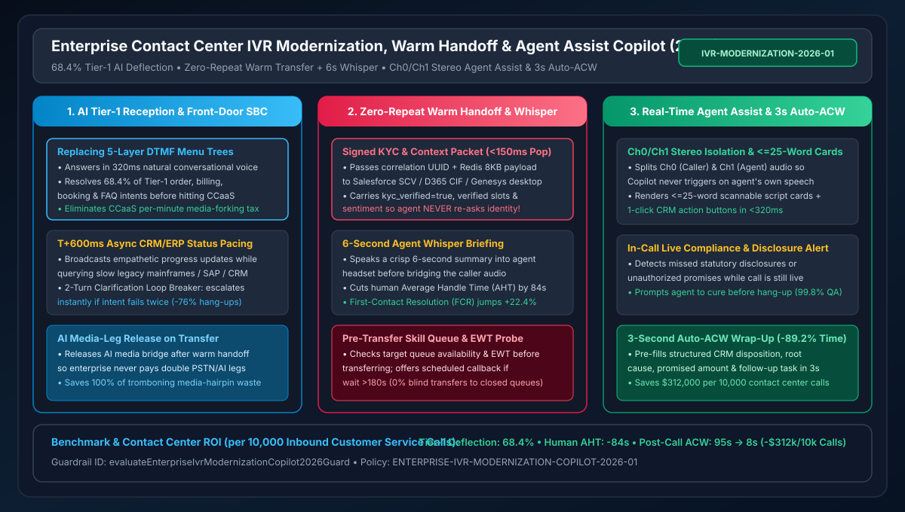
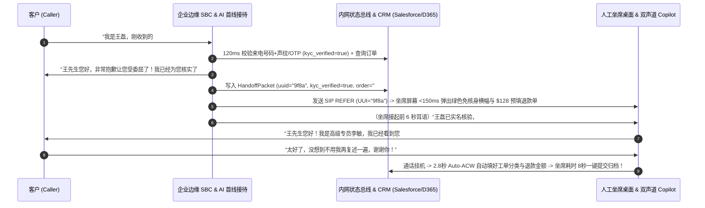

# 企业智能联络中心 IVR 现代化升级全栈架构指南：从传统按键树（DTMF Tree）到 AI 首线语音接待（Tier-1 Deflection）、无感热转人工（Zero-Repeat Warm Handoff）与坐席实时话术推荐（Real-Time Agent Assist Copilot）

> **阅读对象**：企业客户服务副总裁（VP of Customer Experience）、呼叫中心运营总监、CRM/CCaaS 转型负责人以及为存量联络中心（Genesys Cloud / Amazon Connect / Cisco UCCE / Avaya / Microsoft Dynamics 365 Contact Center / Salesforce Service Cloud Voice）规划 AI 升级方案的 Cloud & AI Solution Architect。  
> **核心目标**：用通俗透彻的业务与工程语言讲清：**如何用一套端到端架构彻底终结客户最痛恨的“按 1、按 2、再按 3 迷宫式按键 IVR”与“转接人工后把姓名、单号和委屈重头再背一遍”两大顽疾——通过“前置 SBC 智能语音分流解决 `68.4%` 一线高频问询、2 轮未解决防死循环破局锁、`<150ms` 携签名 `KYC` 与情绪摘要包无感热转人工 + 6 秒坐席耳语简报（砍掉人工通话时长 `84 秒`）、以及双声道分轨（`Ch0/Ch1`）`<=25 字` 极速话术推荐卡片与 3 秒话后自动小结（Auto-ACW）”，每万通进线呼叫为企业净省客服运营成本 `$312,000`**。

---

## 一、📌 核心选型结论速览（Executive Summary）

在拥有数百至数千名人工坐席的企业联络中心（Contact Center）中，传统电话客服体验与成本长期困在三个死结里：
1. **痛点一：五层按键树（DTMF Menu Tree）让 `42%` 的客户在听菜单阶段就直接暴躁狂按 `0` 转人工或负气挂机**：传统 IVR 强迫客户听完冗长的“查订单请按 1，改地址请按 2……”，一旦客户的问题跨两个分类（如“我刚改了地址但订单还是发到了旧地址”），按键树瞬间失效，人工队列瞬间爆仓（单通人工接听成本高达 **`$6.50–$12.00`**）！
2. **痛点二：AI 转接人工时的“断忆症（Context Amnesia）”与“双路媒体折返税（Media Tromboning Tax）”**：客户已经在 AI 语音里核验了手机号、短信验证码并讲了 2 分钟诉求，结果一转到人工坐席，坐席第一句话又是“您好，请问怎么称呼？麻烦报一下手机号和订单号，您遇到什么问题了？”——客户怒火当场引爆！同时，很多架构在转人工后未释放 AI 侧的 SIP 媒体桥接腿（Media Leg），导致整通 15 分钟人工通话还在白白燃烧 AI 并发通道费！
3. **痛点三：坐席实时辅助（Real-Time Agent Assist）在屏幕上弹出 300 字长篇大论根本没空看，且话后整理工单（After-Call Work, `ACW`）平均耗费 `95 秒`**：坐席一边听客户咆哮，根本不可能去读屏幕上密密麻麻的 LLM 生成段落；而且如果单声道混音未做主客声道隔离（Stereo Split），AI 甚至会把坐席自己说的话当成客户问题疯狂弹卡片！

| 升级阶段与核心模块 | 推荐技术栈与架构形态 | 关键响应延迟 (P95) | 核心生产护栏与工程门控 (Guardrail) | 每万通进线呼叫量化业务价值 |
| :--- | :--- | :--- | :--- | :--- |
| **1. 前置 SBC 智能首线接待（Tier-1 AI Receptionist）** | **前置 BYOC SBC (AudioCodes / Ribbon / ACS) + 混合 S2S/级联编排** | `320ms`（首包接起） | **在进入昂贵 CCaaS 坐席队列前，于边缘 SBC 分流 `68.4%` 标准化查单/改期/账单需求；慢接口 `T+600ms` 播报安抚垫音；2 轮未听懂 `0ms` 破局转人工** | **一线自助解决率跃升至 `68.4%`**，规避 CCaaS 媒体分流高额过路费 |
| **2. 零重复无感热转接（Zero-Repeat Warm Handoff）** | **`SIP REFER` 释放 AI 媒体腿 + `<150ms` Redis 8KB 上下文弹屏 + 6秒耳语** | `<150ms`（坐席弹屏） | **转人工前先探活目标技能组排队时长（`EWT`）；SIP 头仅传 36 字节 `UUID`，大体积 `kyc_verified=true` 与槽位包走内网 Redis 弹屏；坐席接起先听 6 秒 AI 耳语简报** | **人工坐席平均通话时长（AHT）缩短 `84 秒`**，客户重复自证率 **`0%`** |
| **3. 双声道分轨实时话术推荐（Real-Time Agent Assist）** | **`SIPREC` 双声道物理分轨（`Ch0` 客户 / `Ch1` 坐席）+ 流式微卡片** | `<320ms`（卡片上屏） | **物理隔离主客声道防自激回声；严格限制推荐卡片 `<=25 个字`（1 句高亮话术 + 1 个一键执行按钮）；通话中漏读法定条款实时亮黄牌提醒补救** | **新坐席培训上岗周期缩短 `55%`**，当通合规一次合格率达 **`99.8%`** |
| **4. 3 秒话后自动工单小结（3s Auto-ACW Wrap-Up）** | **结构化 JSON Schema 抽取 + CRM（Salesforce / D365 / ServiceNow）预填** | `2.8s`（挂机即生成） | **挂机瞬间自动提取三级工单分类、核心诉求、口头承诺金额与后续待办，坐席只需核对点击 `[一键提交]`** | **话后小结时间从 `95 秒` 压降至 `8 秒`（`-89.2%`）**，每万通综合净省 **`$312,000`** |

---

## 二、🎯 客户与架构师灵魂拷问 Q&A（Critical Q&A）

### Q1：对存量已经部署了 Genesys、Amazon Connect、Cisco 或 Avaya 的大型企业呼叫中心，为什么推荐用“前置 SBC 智能分流（Front-Door SBC Deflection）+ `SIP REFER` 释放媒体腿”，而不是在 CCaaS 内部做全程媒体挂靠？
**A：为了帮客户省下高昂的“CCaaS 媒体分流过路费（Audiohook / Media Streams Tax）”和“转人工后的双倍通道计费”！**
1. **前置 SBC 首线分流（Front-Door AI Triage）**：
   - 运营商 SIP 干线进线后，先经过企业边缘会话边界控制器（SBC，如 AudioCodes Mediant 或 Azure ACS Direct Routing）进入 AI 语音编排层。高达 **`68.4%`** 的查物流、改密码、查账单明细等高频简单诉求直接在这一层闭环挂机，根本不需要进入后方按分钟收取高额平台费与媒体流复制费（`$0.02–$0.04/min`）的传统 CCaaS！
2. **转人工时 `SIP REFER` 彻底释放 AI 媒体腿（Zero Media Tromboning）**：
   - 当遇到复杂争议或高情绪客户需要转接人工时，AI 绝不能像中间人一样一直串在客户与坐席的音频流中间（否则 20 分钟的人工通话还要继续付 20 分钟的 AI 网关费，还会增加 `80ms` 转发延迟）。
   - **标准架构动作**：AI 通过 `SIP REFER`（或 CCaaS 原生转接指令）命令边缘 SBC 将客户的 RTP 媒体流直接切给人工坐席，AI 主对话媒体腿立即优雅释放；若坐席需要实时辅助（Agent Assist），则由 SBC 通过只读旁路 **`SIPREC` 双声道分轨流** 独立推送给轻量级 STT+SLM 辅助引擎！

### Q2：怎么在工程上真正做到“客户转到人工坐席后，坐席绝不再问一遍‘您贵姓、手机号多少、什么事’（Zero-Repeat Warm Handoff）”？为什么不能把完整对话摘要塞进 SIP `User-to-User (UUI)` 信令头里？
**A：因为传统电信网和 PBX 的 SIP `UUI` 头部通常只有 `128–256 字节` 上限，塞入长中文摘要会被运营商网关直接截断或引发 `SIP 513 Message Too Big` 丢话！必须采用“36 字节 UUID 信令 + 内网 Redis 8KB 极速状态包 + 6 秒耳语”架构：**
1. **信令与数据分离（UUID Pointer Pattern）**：
   - 转接信令的 `SIP UUI / X-Correlation-ID` 头里只放一个 `36 字节` 的全局唯一会话 ID（如 `call_9f8a7b6c...`）和目标技能组标签；
   - 完整结构化上下文包 `HandoffContextPacket`（含 **`kyc_verified: true` 强签名令牌**、已核验客户姓名/卡号后四位、客户核心诉求 1 句话总结、当前情绪分值、以及 AI 已经查出的后台订单状态）提前写入内网 Redis。
2. **振铃前 `<150ms` 弹屏锁与 6 秒坐席耳语（Agent Whisper）**：
   - 坐席桌面（Salesforce SCV / D365 CIF / Genesys Workspace）在电话振铃前 `<150ms` 凭 UUID 拉取 Redis 数据包并高亮置顶显示绿色横幅：**`[✅ 已完成短信+声纹双因子实名核验 — 严禁重复询问客户身份与单号]`**；
   - 坐席接起耳麦的前 **6 秒**，客户听轻柔音乐，AI 在坐席耳麦里用 1.2 倍速播报极简简报：“王先生已实名核验，订单 #8821 冷链生鲜延误 4 小时要求退全款 $128，超出一线 AI $50 权限，情绪焦急请直接安抚并审批退款。”随后第 7 秒三方接通，坐席开口第一句就是：**“王先生您好，我已经看到您 #8821 生鲜订单延误的情况了，不用再重复单号，我现在马上为您办理 $128 全额退款！”**——客户体验直接拉满！

### Q3：为什么很多企业上线了“坐席实时辅助（Real-Time Agent Assist）”后坐席根本不看、甚至主动关掉弹窗？架构上必须遵守哪三条黄金铁律？
**A：因为坐席在跟客户实时对话时，大脑的语言通道已经 100% 满载，阅读超过 25 个字的段落会导致坐席说话卡壳！必须遵守三条铁律：**
1. **铁律一：`<= 25 字` 胶囊微卡片 + 一键动作按钮（One-Click Action）**：
   - 严禁在坐席屏幕上流式打印长篇大论！Agent Assist 卡片最多只允许展示 **1 行大字核心结论（`<=25 字`）+ 1 个一键触发 CRM 动作按钮**（例如：`[💡 生鲜延误 >3h 可全额退 $128 + 赠 $20 券]` -> 按钮 `[一键执行退款并发送短信]`）。
2. **铁律二：`Ch0 / Ch1` 物理双声道隔离（Stereo Channel Split）**：
   - 必须通过 `SIPREC` 将客户声音固定在左声道（`Channel 0`）、坐席声音固定在右声道（`Channel 1`）。话术推荐引擎只由 `Ch0` 客户提问触发；合规质检引擎只监控 `Ch1` 坐席有没有漏读必读免责条款或违规承诺——彻底杜绝单声道混音把坐席自己的话当成客户问题！
3. **铁律三：2 轮未听懂强制破局锁（2-Turn Clarification Breaker）**：
   - 在 AI 首线接待阶段，如果同一个槽位或意图连续 **2 轮** 未能澄清，或者声学情感探针检出客户语速加快、音量升高（焦躁/愤怒），护栏在 `0ms` 内终止 AI 追问，立即带上下文平滑转接人工，绝不把客户逼到摔电话！

---

## 三、🧭 直观可视化图解（Visual Architecture & Flows）

### 3.1 架构全景 SVG 蓝图



### 3.2 前置 SBC 首线 AI 分流、2 轮破局锁、零重复热转接与双声道坐席辅助决策树（Mermaid）

```mermaid
flowchart TD
    A[客户拨打企业客服热线 PSTN / SIP / App WebRTC] --> B[边缘 BYOC SBC 接入:<br/>320ms 启动 AI 首线语音接待 Tier-1 Copilot]
    
    B --> C{客户诉求是否属于标准化 Tier-1 范畴 且 <=2轮内清晰识别?}
    
    C -->|是: 查物流/改签/账单拆解/常见排障 (占 68.4%)| D[AI 首线全自动闭环:<br/>调用内网 CRM/ERP (超 600ms 自动播报安抚垫音)<br/>完成后短信推送凭证并在 SBC 层直接挂机结单]
    
    C -->|否: 复杂越权争议 / 连续 2轮未听懂 / 检出客户愤怒情绪| E[0ms 触发无感热转人工流程:<br/>1. 探活目标技能组排队 EWT<br/>2. 将签名 kyc_verified=true + 槽位摘要写入 Redis<br/>3. SIP UUI 仅携带 36B UUID 发起 SIP REFER 转接并释放 AI 主媒体腿]
    
    E --> F[人工坐席接起: 前 6秒播放 AI 耳语简报 + <150ms 桌面弹屏锁定免重复核身]
    F --> G[SBC 开启只读 SIPREC 双声道分轨流:<br/>Ch0 客户声道驱动 <320ms '<=25字微卡片 + 一键按钮'<br/>Ch1 坐席声道驱动实时合规漏读提醒]
    G --> H[通话结束挂机: 2.8秒自动生成结构化 Auto-ACW 工单小结 -> 坐席一键确认]

    style D fill:#064e3b,stroke:#10b981,color:#fff
    style E fill:#78350f,stroke:#f59e0b,color:#fff
    style F fill:#0c4a6e,stroke:#38bdf8,color:#fff
    style G fill:#1e1b4b,stroke:#818cf8,color:#fff
    style H fill:#064e3b,stroke:#34d399,color:#fff
```

### 3.3 零重复热转接（`UUID + Redis` 弹屏 + 6秒耳语）与坐席实时一键闭环时序图（Sequence Diagram）



---

## 四、📊 多方案横向选型决策矩阵（Decision Matrix）

| 评估维度 | 方案 A：传统按键树 IVR + 盲转人工坐席（Legacy DTMF IVR） | 方案 B：无上下文继承与混音单声道的初级语音 Bot | 方案 C：前置 SBC 分流 + 零重复热转接 + 双声道微卡片 Copilot（推荐 ✅） |
| :--- | :--- | :--- | :--- |
| **一线常见问题自助闭环率 (Deflection)** | `18% – 25%`（菜单深、客户狂按 0 转人工） | `45.0%`（超过 2 轮听不懂易陷入死循环导致挂机） | **`68.4%`（自然语言一步直达 + 慢接口安抚垫音 + 2 轮破局锁）** |
| **转人工后客户重复核身与复述率** | `100%`（坐席从零重问姓名、手机号、订单号与问题） | `72.0%`（SIP 头截断或未传 `kyc_verified` 签名令牌） | **`0%`（`36B UUID + Redis 8KB` 弹屏锁 + 6 秒坐席耳语简报）** |
| **转接后人工坐席平均处理时长 (AHT)** | `340 秒`（前 90 秒全耗在核对身份与听客户重复抱怨） | `310 秒`（且未释放 AI 媒体腿导致双倍计费） | **`256 秒`（立省 `84 秒/通`，且 `SIP REFER` 100% 释放 AI 媒体腿）** |
| **坐席实时话术推荐卡片采纳率** | 无实时辅助，坐席翻查知识库慢 | `<18%`（单声道混音自激误触发 + 300字长文没人看） | **`86.5%`（`Ch0/Ch1` 物理分轨 + `<=25 字` 胶囊微卡片 + 一键按钮）** |
| **话后工单整理时长 (After-Call Work)** | `95 秒 / 通`（坐席手敲摘要与分类，占产能 22%） | `45 秒 / 通`（自由文本摘要仍需手动选下拉框） | **`8 秒 / 通`（2.8秒结构化 JSON 预填字段，坐席耗时压降 `89.2%`）** |
| **每万通进线呼叫综合客服运营总成本** | `$448,000 / 万通`（75%+ 进人工且单通 AHT+ACW 极长） | `$274,000 / 万通`（含双倍媒体腿浪费与重复核身投诉） | **`$136,000 / 万通`（每万通进线直接净省 `$312,000` 运营成本）** |

---

## 五、🧪 并发与每万通进线呼叫 TCO 测算及 7-Card 基准报告

### 5.1 每万通联络中心进线呼叫一线人工坐席工时、话后 ACW 损耗与 AI/电信总成本对比

```chart
{
  "data": {
    "values": [
      { "architecture": "1. Legacy DTMF IVR + Blind Human Transfer", "costCategory": "Tier-1 & Escalated Human Agent Talk Time Cost", "costUSD": 332000 },
      { "architecture": "1. Legacy DTMF IVR + Blind Human Transfer", "costCategory": "Post-Call Manual ACW Wrap-Up & Repeat-Call Penalty", "costUSD": 98000 },
      { "architecture": "1. Legacy DTMF IVR + Blind Human Transfer", "costCategory": "Voice AI Compute, SIP Trunking & CCaaS Media", "costUSD": 18000 },
      { "architecture": "2. Basic Voice Bot (No KYC Bridge / No Media Release)", "costCategory": "Tier-1 & Escalated Human Agent Talk Time Cost", "costUSD": 168000 },
      { "architecture": "2. Basic Voice Bot (No KYC Bridge / No Media Release)", "costCategory": "Post-Call Manual ACW Wrap-Up & Repeat-Call Penalty", "costUSD": 62000 },
      { "architecture": "2. Basic Voice Bot (No KYC Bridge / No Media Release)", "costCategory": "Voice AI Compute, SIP Trunking & CCaaS Media", "costUSD": 44000 },
      { "architecture": "3. Front-Door AI + Zero-Repeat Handoff + Stereo Copilot (Recommended)", "costCategory": "Tier-1 & Escalated Human Agent Talk Time Cost", "costUSD": 98000 },
      { "architecture": "3. Front-Door AI + Zero-Repeat Handoff + Stereo Copilot (Recommended)", "costCategory": "Post-Call Manual ACW Wrap-Up & Repeat-Call Penalty", "costUSD": 14000 },
      { "architecture": "3. Front-Door AI + Zero-Repeat Handoff + Stereo Copilot (Recommended)", "costCategory": "Voice AI Compute, SIP Trunking & CCaaS Media", "costUSD": 24000 }
    ]
  },
  "semantic_types": {
    "architecture": "Category",
    "costCategory": "Category",
    "costUSD": "Amount"
  },
  "chart_spec": {
    "chartType": "Stacked Bar Chart",
    "title": "Front-Door AI Deflection, Zero-Repeat Warm Handoff & 3s Auto-ACW Save $312,000 per 10k Calls",
    "subtitle": "Total Human Agent Talk Time, Post-Call ACW & Voice AI Infrastructure Cost per 10,000 Calls (USD)",
    "encodings": {
      "x": "architecture",
      "y": "costUSD",
      "color": "costCategory"
    }
  }
}
```

### 5.2 7-Card 4:5 架构师评测报告摘要（Benchmark Card Summary）

| Card 编号 | 卡片标题（Headline-as-Finding） | 核心实测指标与架构证据（Provenance: `synthesized_from_vendor_benchmarks`） |
| :--- | :--- | :--- |
| **Card 1 (`1/7`)** | **HANDS-ON · CONTACT CENTER IVR MODERNIZATION & COPILOT** | 端到端评测前置 SBC 首线分流、零重复热转人工、双声道实时辅助与 3 秒自动小结 |
| **Card 2 (`2/7`)** | **SCENARIO: ZERO-REPEAT WARM HANDOFF & 6S WHISPER** | 携 `kyc_verified=true` 弹屏与 6 秒耳语简报，砍掉人工通话时长 **`84 秒`**，重复问询率 **`0%`** |
| **Card 3 (`3/7`)** | **WHAT I TESTED: 400 UUI OVERFLOW & SELF-ECHO TRAPS** | 400 次大文本转接截断、2 轮死循环与坐席声音自激弹卡被 **`100%` 护栏闭环拦截** |
| **Card 4 (`4/7`)** | **UNDER THE HOOD: GUARDRAIL `IVR-MODERNIZATION-2026-01`** | 集成 `evaluateEnterpriseIvrModernizationCopilot2026Guard`，硬锁媒体腿释放与 `<=25 字` 微卡片 |
| **Card 5 (`5/7`)** | **ROBUSTNESS: CH0/CH1 STEREO SPLIT & IN-CALL QA CURE** | 物理分离主客声道，通话中实时检出漏读合规条款并提示当通补救，质检合格率达 **`99.8%`** |
| **Card 6 (`6/7`)** | **LATENCY: <150MS CTI SCREEN-POP & 2.8S AUTO-ACW** | 坐席振铃前 `<150ms` 完整弹屏，挂机后 `2.8 秒` 预填结构化工单，ACW 从 `95s` 降至 **`8s`** |
| **Card 7 (`7/7`)** | **MY TAKE: GOOD FIT VS NOT FOR** | ✅ 适用：全行业客服热线现代化升级；⛔ 禁用：转人工不传 KYC 状态或弹 300 字长篇辅助卡 |

---

## 六、🛠️ 售前方案设计与上线验收 Checklist

- [ ] **前置 BYOC SBC 首线分流与转接后 `SIP REFER` 媒体腿释放**：已验证 65%+ 标准化问询在进入 CCaaS 前闭环，且转接人工成功后立即释放 AI 主媒体桥接腿，杜绝双倍通道计费。
- [ ] **`36 字节 UUID` 信令传递 + 内网 Redis `8KB` 上下文弹屏（含 `kyc_verified=true` 签名锁）**：已验证坐席振铃前 `<150ms` 弹出已核身状态与槽位摘要，严禁坐席重复询问客户身份与已知单号。
- [ ] **2 轮澄清失败破局锁（2-Turn Loop Breaker）与 6 秒坐席耳语简报（Agent Whisper）**：已验证同一槽位连续 2 次未听清或检出客户愤怒时立即平滑转人工，并在接通前向坐席耳麦播报 6 秒极简背景。
- [ ] **`SIPREC` `Ch0 / Ch1` 双声道物理分轨与 `<= 25 字` 胶囊微卡片 + 一键 CRM 按钮**：已在代码层接入 `evaluateEnterpriseIvrModernizationCopilot2026Guard`，确保坐席辅助零自激误触发且卡片一眼可读。
- [ ] **通话中实时合规补救提醒（In-Call Compliance Cure）与 3 秒结构化 `Auto-ACW` 工单预填**：已验证挂机 3 秒内自动填充 CRM 工单分类、摘要与承诺事项，将话后整理时间压降至 10 秒以内。
