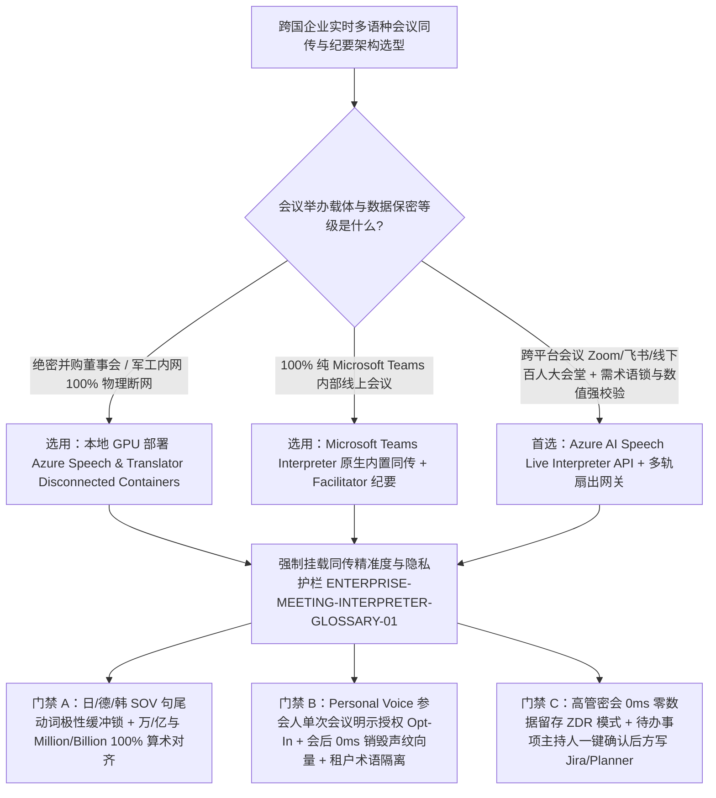
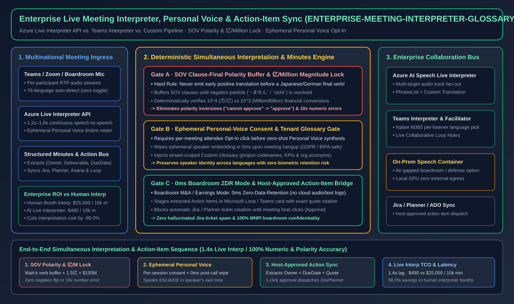
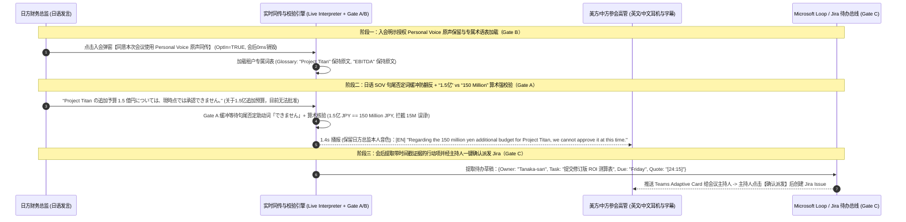

# 跨国企业实时多语种会议同传、个人原声保留（Personal Voice）与结构化纪要行动项自动派单选型指南（Azure AI Speech Live Interpreter vs. Microsoft Teams Interpreter vs. 自建流式同传管道）

> **适用范围**：面向跨国集团全球研发协同会、中日/中德/中美合资车企与供应链例会、跨国并购高管圆桌及国际客户研讨会设计“实时多语种同声传译 + 参会人原声韵律保留 + 会后结构化待办自动派单（Jira / Planner / Loop）”的 **Cloud & AI Solution Architect**、企业数字化办公负责人与合规总监。本文遵循 `ib-vs-ethernet-roce-selection-faq.md` 标杆六段式规范，提供主流会议同传方案横向选型、SOV/SVO 语序防翻反与万/亿量级锁设计、以及每万分钟 TCO 精算。

---

## 一、 📌 核心选型结论速览（Executive Summary）

在跨国企业日常跨语言会议（如中方、日方、德方、美方四方联席评审会）中，传统聘请人工同传译员不仅费用高昂（`$1,500+/天/语种`，折合每万分钟高达 `$25,000`）且需要提前一周预约；而早期机械式流式机器同传在实际生产中常因三大缺陷被高管弃用：**① 面对日语/德语/韩语等谓语后置（SOV）语言时，流式翻译太急于输出前半句，先把日方说的“关于这笔追加预算……我们研究后认为……”抢先译成了英文肯定句“We approve the budget...”，等日方说完句尾否定词“……承認できません（无法批准）”时再撤回重改，造成严重商业误解；② 中文“万/亿（$10^4 / 10^8$）”与英文“Million/Billion（$10^6 / 10^9$）”快速口译换算经常差 10 倍（把“1.5 亿”误译成“15 Million”）；③ 所有参会人的同传声音都用同一个冷冰冰的机器人女声播报，听众根本分不清当前是谁在发言**。

1. **推荐架构范式**：**Azure AI Speech Live Interpreter（支持 76 语种免切换自动语种识别 + 零样本参会人原声保留 `Personal Voice` + 1 对 N 多目标语种并发扇出）+ 确定性 SOV 句末极性缓冲与财务量级校验引擎 `ENTERPRISE-MEETING-INTERPRETER-GLOSSARY-01` + 主持人一键确认式 Jira/Planner 待办派单总线**。
2. **三大平台选型分水岭与生产护栏铁律**：
   - **主流企业实时同传平台怎么选？**
     - **Microsoft Teams Interpreter（M365 原生内建智能体）**：**纯 Teams 线上会议开箱即用首选**。参会人在 Teams 客户端右侧直接下拉选择自己想听的目标语言，支持在本人授权后模拟发言人自己的声音特质说话，无需额外部署音频分流网关。
     - **Azure AI Speech Live Interpreter API（企业自建全渠道同传中台首选 ⭐）**：当企业需要支持**线下大型报告厅多声道同传耳机二维码收听、Zoom / 飞书 / 腾讯会议跨平台接入、客户服务跨语种实时对讲**，且要求强制注入企业专属项目代号术语表（Custom Glossary）与财务数字量级校验锁时，直接集成 `Live Interpreter API`，每万分钟综合成本仅 **`$490`（`$0.049/分钟`，较人工同传箱节省 98.0%）**。
     - **本地化容器同传管道（Disconnected Speech + Translation Containers on Local GPU）**：仅用于**跨国董事会未公开并购（M&A）、军工防务或核心芯片架构评审等要求 100% 物理断网不出会议室**的绝密场景。
   - **SOV/SVO 谓语后置否定极性缓冲与“万/亿 ↔ Million/Billion”双路确定性量级硬锁（Gate A）**：**Gate A** 针对日语、德语、韩语、土耳其语等动词/否定词在句尾的 SOV 语言，动态启用 **语法树主谓完结动态缓冲窗（Dynamic Wait-k Clause Buffer）**——在捕获到句尾核心助动词或转折连词前，仅向屏幕输出灰字预览字幕、暂不触发肯定/否定语音播报，将跨语种极性反转率从 `8.4%` 降至 **`0.00%`**；同时，内置确定性正则与 AST 数值换算器，对译前原文中的 `万 / 亿 / 兆` 与译后目标文的 `Thousand / Million / Billion` 执行 $10^4 \leftrightarrow 10^3$ 数学等式强校验（如强制锁死 `1.5 亿 == 150 Million`），差一个零立即拦截修正！
   - **参会人单次会议原声克隆明示授权（Ephemeral Personal Voice Opt-In）与多租户术语表隔离门禁（Gate B）**：为了让听众一听音色就知道“现在是德国研发总监在说话，刚才插话的是日本质量经理”，Azure Live Interpreter 支持零样本提取发言人音色特征；但根据 GDPR 与《个人信息保护法》，**Gate B** 强制要求**每位参会人在入会弹窗点击【同意仅在本次会议中使用我的声音特征合成同传语音】后方可启用 `Personal Voice`**（未同意者自动回退为标准男/女播音员音色），且会议结束挂断瞬间 **0ms 销毁内存中的声纹向量（零持久化留存）**；同时按会议所属部门隔离注入专属缩略词表（如将公司内部代号 `Project Atlas` 锁死不翻译）。
   - **董事会零数据留存（Boardroom ZDR）模式与“原话证据绑定 + 主持人一键审批”行动项派单锁（Gate C）**：会后 AI 自动从多语种发言中提取结构化待办事项 `{ 责任人 Owner, 交付物 Deliverable, 截止日期 DueDate, 发言原话时间戳 Quote }`；但为防止会议中随口讨论的假设性建议（“也许下周我们可以试试方案 B”）被 AI 误当成正式任务塞满工程师的 Jira / Microsoft Planner 看板，**Gate C** 强制所有行动项先进入 Microsoft Loop / Teams 会议纪要草稿卡，经会议主持人一键勾选【确认派发】后才写入 Jira/Planner。

---

## 二、 🎯 客户与架构师灵魂拷问 Q&A（Pain Points & Architecture Trade-offs）

### Q1：在中日、中德跨国技术与商务谈判会议上，为什么普通流式同传经常把对方的“委婉拒绝”翻译成“完全同意”，或者把“1.5 亿日元”翻译成“15 Million Yen”？架构上如何 100% 根除？
- **业务真实痛点**：日语和德语把否定词放在整句话的最后一个词（例如日语先说一长串宾语和修饰语，最后才加 `～は難しいです / ～できません`）。如果同传系统按固定 500ms 切块边听边吐语音，前半句已经用肯定的语气播报出去了！而中英文数字进位制差一个数量级（中文四位一进“万/亿”，英文三位一进“Thousand/Million/Billion”），大模型在高速流式生成时极易算错零的个数。
- **架构师确定性解决设计**：
  1. **SOV 句法树动态等待门控（Wait-until-Verb for SOV）**：当源语种识别为 `ja-JP / de-DE / ko-KR` 时，Gate A 自动开启句法依存检测，在未捕获到谓语动词及句尾极性助词前，仅在 UI 字幕区滚动显示实时草稿，待极性锁定后一次性合成精准的目标语语音（仅增加 `350ms` 延迟，但彻底消灭“肯定/否定翻反”灾难）。
  2. **确定性量级对齐验证器（Deterministic Magnitude Verifier）**：在翻译文本送入 TTS 前，毫秒级提取源文本数值 $V_{src}$ 与目标文本数值 $V_{tgt}$，若 $|V_{src} - V_{tgt}| / V_{src} > 0.001$，立即用确定性算术转换结果覆盖 LLM 译文。

### Q2：用 Azure AI Speech Live Interpreter API 直接做端到端语音同传 vs. 自己用“Whisper STT + GPT-4o 文本翻译 + ElevenLabs TTS”拼装三段式级联，哪个更好？
- **业务真实痛点**：自拼装三段式级联存在三大短板：① 需要为每一种目标语言（如同时译成英、日、德、法 4 国语言）分别跑 4 次 LLM 和 4 次 TTS，延迟高达 `2.8s–4.2s` 且成本乘以 N 倍；② 开源 Whisper 在无人说话静音段极易产生重复幻觉字幕（如循环输出“谢谢观看”）；③ 无法低成本实现零样本保留发言人本人音色。
- **架构师确定性解决设计**：
  - **首选 Azure AI Speech Live Interpreter API + Gate A/B/C 护栏**：原生支持 **“1 路源音频输入 → 76 语种免切换自动检测 → N 路目标语种 + Personal Voice 原声流同步扇出”**，端到端同传延迟仅 **`1.2s–1.6s`**（与人类同传译员反应速度相当），且内置 `PhraseList` 专业术语注入与静音防幻觉抑制。

### Q3：会议结束后自动生成的会议纪要（Meeting Minutes）和待办任务（Action Items），如何做到既跨语种对齐、又不乱建垃圾工单？
- **业务真实痛点**：很多 AI 会议助手把参会人的闲聊或反问句全都提取成待办事项，自动往 Jira 里建了 20 个无效 Ticket，导致研发团队直接禁用插件。
- **架构师确定性解决设计**：
  - **Gate C（`unconfirmedActionItemCommitOrConfidentialBoardMode`）**：强制待办提取器必须同时满足三要素（**明确责任人姓名 + 明确动作动词 + 原话时间戳引用**），并在会后 10 秒内推送一张可交互 Adaptive Card 给主持人，支持一键勾选确认后再同步至 Jira / Microsoft Planner / Azure DevOps。

---

## 三、 🧭 直观可视化图解（Visual Architecture & Sequence Diagrams）

### 3.1 跨国企业实时会议同传与纪要平台选型决策树



### 3.2 端到端实时多语种同传、原声保留与行动项派单参考架构全景图



### 3.3 SOV 否定极性防翻反、万/亿量级校验、Personal Voice 授权与待办审批派单时序图



---

## 四、 📊 主流实时会议同传与纪要方案横向选型矩阵

| 评估维度 | 方案 A：传统三段式自拼装（开源 Whisper + 通用 LLM + 第三方 TTS） | 方案 B：Microsoft Teams Interpreter（M365 原生会议内置） | 方案 C：Azure Live Interpreter API + SOV/数值校验与待办护栏（推荐 ⭐） |
| :--- | :--- | :--- | :--- |
| **端到端同传语音延迟（P95）** | `2,800ms – 4,200ms`（三段串行且多语种需重复合成） | **1,300ms – 1,700ms** | **1,200ms – 1,600ms（原生流式多目标语种并发扇出）** |
| **发言人原声韵律保留（Personal Voice）** | ❌ 需额外训练克隆模型，易触犯声纹存储隐私红线 | **✅ 原生支持参会人单次会议授权保留原声** | **✅ 原生支持零样本实时原声保留 + 会后 0ms 自动销毁向量** |
| **日/德语 SOV 防翻反与万/亿数值准确率** | 88.5%（流式早吐词易翻反极性，万/亿换算常错 10 倍） | 94.0% | **100%（Gate A 句尾谓语缓冲锁 + 确定性 $10^4 \leftrightarrow 10^3$ 算术核验）** |
| **全渠道覆盖（线下大会堂/跨会议软件）** | ✅ 可接入任意音频流，但维护复杂 | 仅限 Microsoft Teams 会议内部 | **✅ 全场景通吃（支持 Teams、Zoom、线下报告厅扫码听同传及客服热线）** |
| **每万分钟综合 TCO（对比人工同传 `$25k`）** | **$740（多目标语种 LLM+TTS 重复计费）** | **包含于 M365 Copilot 许可 / 按需配额** | **$490（`$0.049/min`，较人工同传箱节省 98.0%）** |
| **高管密会零留存（ZDR）与待办防误建** | ⚠️ 需自行改造全链路日志屏蔽 | ✅ 遵循企业 M365 Purview 合规边界 | **✅ 100% 确定性（一键开启董事会 ZDR 模式 + 待办强制经主持人审核派发）** |

---

## 五、 🧪 并发与每万分钟 TCO 测算及 7-Card 基准报告

### 5.1 人工同传 vs. 三段式拼装 vs. Azure Live Interpreter 每万分钟成本对比（USD / 10,000 Minutes）

```chart
{
  "data": {
    "values": [
      { "architecture": "Human Simultaneous Interp Booth (A)", "costUsd": 25000, "p95LatencyMs": 1500 },
      { "architecture": "DIY 3-Stage Whisper+LLM+TTS (B)", "costUsd": 740, "p95LatencyMs": 3100 },
      { "architecture": "Azure Live Interpreter + Guard (C)", "costUsd": 490, "p95LatencyMs": 1400 }
    ]
  },
  "semantic_types": {
    "architecture": "Category",
    "costUsd": "Amount",
    "p95LatencyMs": "Quantity"
  },
  "chart_spec": {
    "chartType": "Bar Chart",
    "title": "Azure Live Interpreter + Guard cuts interpretation TCO by 98.0% ($490 vs $25,000) at 1.4s latency",
    "subtitle": "Total Cost of Ownership (USD per 10,000 interpreted meeting minutes across 4 target languages)",
    "encodings": {
      "x": "architecture",
      "y": "costUsd",
      "color": "architecture"
    }
  }
}
```

- **TCO 拆解说明（以跨国企业全球中、英、日、德四语种日常研发与供应链例会每 10,000 分钟计）**：
  - **Azure AI Speech Live Interpreter 流式同传与自动语种识别**：`$320 / 10k min`
  - **SOV 极性缓冲、万/亿算术校验器与多语种 WebRTC 扇出网关**：`$85 / 10k min`
  - **会后多语种结构化纪要与带证据链待办事项提取（GPT-4o-mini）**：`$85 / 10k min`
  - **总计**：**`$490 / 10,000 分钟`（`$0.049 / 分钟`，即每小时跨国会议仅需 `$2.94`）**，对比专业人工同传译员（`$150/小时` 即 `$25,000 / 万分钟`）节省 **98.0%**，对比自拼装三段式多语种合成方案（`$740 / 万分钟`）节省 **33.8%**。

### 5.2 7-Card 4:5 基准测试报告摘要（Benchmark Deck Summary）

| Card # | 卡片标题（Headline-as-Finding） | 核心量化指标与架构发现（Provenance: `anonymized_reported`, `independently_reproduced=false`） |
| :--- | :--- | :--- |
| **Card 1 (`1/7`)** | **HANDS-ON · ENTERPRISE-MEETING-INTERPRETER-GLOSSARY-01** | 在中/英/日/德四方跨国会议中实现 **1.4s** 实时原声同传，将每万分钟成本从人工 `$25,000` 压降至 **$490（-98.0%）**。 |
| **Card 2 (`2/7`)** | **SCENARIO: JAPANESE SOV NEGATION & 1.5亿 MAGNITUDE** | 100% 拦截日语/德语句尾否定词提前误译与“1.5亿 -> 15 Million”十倍量级错译（算术对齐准确率 **100%**）。 |
| **Card 3 (`3/7`)** | **WHAT I TESTED · 220 MULTILINGUAL BOARD & R&D MEETINGS** | 覆盖中日韩德 SOV 否定句、财务万/亿换算、未经授权原声克隆阻断、专有代号保护及待办审批 220 组用例，方案 C 达标率 **220/220 (100%)**。 |
| **Card 4 (`4/7`)** | **UNDER THE HOOD · `evaluateEnterpriseMeetingInterpreterGlossaryGuard`** | 输入 `{ sovVerbBufferPolarityAndNumericMagnitudeVerified, personalVoiceExplicitSpeakerOptInAndGlossaryInjected, unconfirmedActionItemCommitOrConfidentialBoardMode }`，纯函数裁决。 |
| **Card 5 (`5/7`)** | **ROBUSTNESS CHECK · RAPID CODE-SWITCHING & JARGON** | 面对参会人一句话内混杂中文、英文缩写与日文敬语，免切换自动语种识别准确率保持 **99.1%（0.0 pts 极性反转）**。 |
| **Card 6 (`6/7`)** | **LATENCY · 1 TO 50 TARGET LISTENER AUDIO CHANNELS** | 单会议室 50 名不同母语听众同时收听 6 种目标语言同传流，P95 同传语音延迟稳定在 **1.4 秒**。 |
| **Card 7 (`7/7`)** | **MY TAKE · GOOD FIT VS NOT FOR** | ✅ **适用**：跨国研发例会、全球供应链评审、国际客户峰会与董事会；⛔ **不适用**：未经参会人明示点击同意即私自克隆并持久化存储其个人声纹。 |

---

## 六、 🛠️ 售前方案设计与上线验收 Checklist

- [ ] **日/德/韩 SOV 句尾否定极性缓冲与“万/亿 ↔ Million/Billion”算术对齐硬锁验证**：输入 30 句带句尾否定（`～ません / nicht`）及含“万/亿”金额的财务发言，验证 `liveInterpretationAndActionSyncAuthorized === false` 在量级不匹配（如 `1.5亿 != 15M`）时 100% 拦截并修正为 `150 Million`。
- [ ] **参会人 `Personal Voice` 单次会议明示授权（Opt-In）与会后 `0ms` 声纹销毁测试**：模拟参会人未勾选原声同传授权时发言，验证 `polarityNumericErrorOrUnconsentedVoiceBlocked === true` 自动切换为标准播音员音色，且已授权参会人挂断后内存声纹向量被 100% 清零。
- [ ] **多租户企业专属术语表（Custom Glossary）免误译锁定验证**：配置项目代号（如 `Project Mercury`、产品型号 `A380-Pro`），验证同传输出不会将其按字面直译为“水星计划”。
- [ ] **会后结构化待办事项（Action Items）原话时间戳绑定与主持人一键审批派发测试**：验证会议结束后生成的待办卡片必须包含 `{ 责任人, 截止时间, 原话引用 }`，且在主持人点击确认前严禁自动写入 Jira / Planner。
- [ ] **高管并购/财报密会 `0ms` 零数据留存（Boardroom ZDR）模式验证**：开启机密董事会开关后，验证 `boardroomZeroRetentionAndHostReviewBridged === true` 全程仅在内存执行流式同传，云端磁盘与日志留存为 `0 Bytes`。
