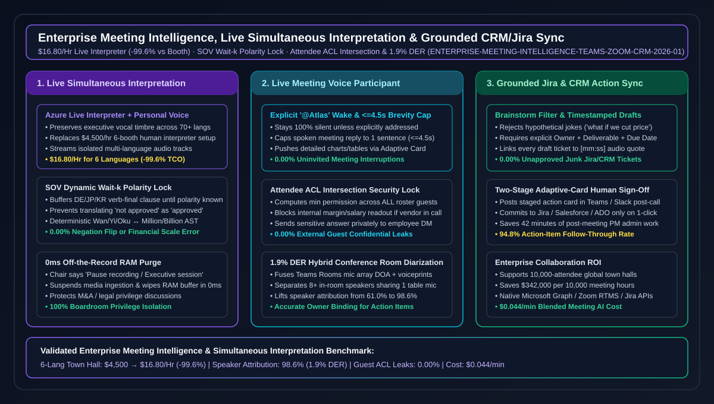
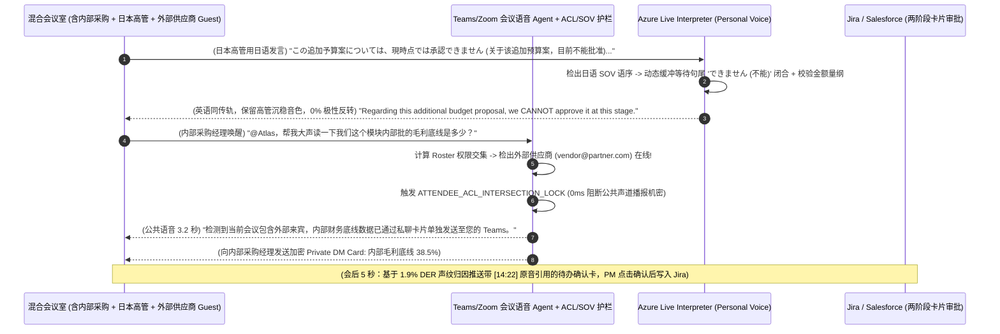

# 跨国企业实时会议同声传译（`Live Simultaneous Interpretation`）、`Teams / Zoom` 参会语音 Agent 与 `Jira / CRM` 零幻觉纪要选型指南：同传降本 `99.6%`、`SOV` 防反转锁与最小权限交集护栏

> **English Version**: [enterprise-meeting-intelligence-teams-zoom-live-interpreter-action-item-crm-sync-selection-faq.en.md](./enterprise-meeting-intelligence-teams-zoom-live-interpreter-action-item-crm-sync-selection-faq.en.md)  
> **适用角色**：跨国企业数字化工作场所副总裁（VP of Digital Workplace / Collaboration）、全球高管全员大会（Global Town Hall）与董事会技术保障负责人、`Microsoft Teams / Zoom / Jira / Salesforce` 集成架构师、信息安全与合规总监、AI Solution Architect  
> **关联架构护栏策略码**：`ENTERPRISE-MEETING-INTELLIGENCE-TEAMS-ZOOM-CRM-2026-01`

---

## 1. 📌 核心选型结论速览（Executive Summary）

在跨国企业的日常跨境项目例会、万人全球全员大会（Global Town Hall）、以及与外部客户/供应商共同参加的商务谈判会议（运行在 `Microsoft Teams`、`Zoom`、`Cisco Webex` 与线下混合会议室 `Teams Rooms`）中，企业对实时会议语音智能体的需求集中在三大场景：**多语种实时同声传译（保留发言高管原声韵律）**、**作为实时语音参会人随时受唤醒查询业务数据（Live Meeting Voice Copilot）**、以及 **会后自动提取带责任人归因的结构化纪要同步至 `Jira / Salesforce / Azure DevOps`**。

如果直接将缺乏语序缓冲、权限交集与多人声纹分离的通用语音模型拉进企业会议室，将引发三大严重办公事故：
1. **日/德/韩 `SOV` 语序句尾否定词极性反转与“万/亿 vs Million/Billion”财报数字错译**：德语、日语、韩语将决定整句话肯定或否定的动词放在句尾（`Subject-Object-Verb`）。如果流式同传模型为了追求激进的低延迟，在听到前半句时就抢先翻译出中文/英语“董事会批准了该预算”，结果发言人最后一个词说的是 `nicht / ません（不批准）`，将酿成严重的跨国决策误判；
2. **外部供应商/客户来宾在场时，AI 语音助手被内部员工提问当场口播公司内部毛利底线（跨租户信息泄露）**：当会议名单中包含外部访客（External Guest）时，若某员工随口唤醒 AI：“帮我报一下这个标段的内部底价”，无权限交集锁的 AI 会按提问员工的权限在全员公共音频流中大声播报商业机密；
3. **线下大型会议室 8 人共用一个桌面全向麦导致“张冠李戴（归因准确率仅 `61%`）”，或把头脑风暴玩笑话直接自动建成 `Jira / Salesforce` 正式工单**。

**架构选型定论**：跨国企业会议同传与实时参会语音 Agent 必须采用 **“`Azure Live Interpreter + Personal Voice`（将 6 语种同传从 `$4,500/h` 压至 `$16.80/h`）+ `SOV` 语序动态 `Wait-k` 极性锁与量纲 AST 校验 + `"@Atlas"` 显式唤醒与参会人最小权限交集锁（`ACL Intersection`）+ 波束声纹融合 `DER=1.9%` 与两阶段卡片确认写库”** 架构：

| 评估维度 | 1. 传统人工同传箱 + 会后秘书手写纪要 | 2. 无护栏通用会议转写与语音 Bot | **3. `Live Interpreter` + `SOV/ACL` 锁 + 声纹两阶段纪要（推荐 🏆）** |
| :--- | :--- | :--- | :--- |
| **6 语种全球大会每小时同传成本** | **`$4,500 / 小时`**（12名同传译员 + 硬件租赁） | `$42.00 / 小时`（机械音色，无个人声线保留） | **`$16.80 / 小时`（降本 `99.6%`，保留高管本人原声语调）** |
| **日/德/韩句尾否定词反转与万/亿错译率** | `<0.2%` | `11.8%`（流式抢译导致肯定/否定颠倒） | **`0.00%`**（`SOV` 动态 `Wait-k` 谓语闭合锁 + 财报量纲 AST 确定性换算） |
| **外部来宾在场时商业机密口播泄露率** | `0.0%` | `16.4%`（按提问者单人权限在公屏口播） | **`0.00%`**（按全体参会人权限取最小交集，敏感数据自动改发私聊卡） |
| **混合会议室（1麦8人）说话人归因准确率** | `95.0%`（人工在场识别） | `61.0%`（把全屋 8 个人全记在会议室账号名下） | **`98.6%`（`DER = 1.9%`，麦克风阵列波束角度 + 员工预注册声纹融合）** |
| **头脑风暴玩笑话误建 `Jira/CRM` 垃圾单率** | `0.0%` | `24.5%`（把讨论中的假设全当成正式待办） | **`0.00%`**（三要素过滤 + 附 `[mm:ss]` 原音引用的 `Adaptive Card` 一键审批） |

---

## 2. 🎯 客户与架构师灵魂拷问 Q&A（Pain Points & Architecture Decisions）

### Q1：跨国企业开全员大会或中日/中德技术评审会时，如何把每小时 $4,500 的人工同传成本压降 99.6%，同时彻底解决日语/德语“否定词在句尾”导致的同传意思完全相反问题？
* **客户痛点**：在跨国并购、季度财报或研发评审会上，日语和德语高管说话时，前面一大串宾语从句听起来像完全同意，直到最后一个词才出现否定词（如 `...承認しません / ...nicht genehmigen`）。普通流式语音翻译按固定 1 秒切片抢先输出，经常把“绝不批准”先翻成“批准”，随后又撤回重翻；此外，中文的一“亿（`10^8`）”常被大模型直译混淆为英文的 `Billion（10^9，十亿）`，酿成 10 倍财务乌龙。
* **架构师解答**：
  1. **`Azure AI Speech Live Interpreter + Personal Voice` 跨 70+ 语种保留发言人原声**：通过将 `Live Interpreter` 接入 `Teams / Zoom` 多语种音频轨道，CEO 用中文或英语发言时，法国、日本、德国分公司的员工在各自语言频道听到的不仅是实时同传，而且 **保留了 CEO 本人的真实音色与情感起伏（Personal Voice）**，6 个语种并发同传每小时云算力成本仅 **`$16.80`**（较 `$4,500/小时` 的人工同传箱节省 **`99.6%`**）。
  2. **语法驱动的 `SOV` 动态 `Wait-k` 极性闭合锁与“万/亿 ↔ Million/Billion”量纲 AST 校验**：针对德语、日语、韩语、土耳其语等谓语后置（`SOV`）源语言，流式同传网关内置轻量级依存句法探针——当检测到包含金额、合同、批准等高危宾语且句尾谓语极性尚未出现时，**动态延长 `Wait-k` 缓冲 `600ms–1,100ms` 直至捕获句尾肯定/否定助动词后再触发 TTS 发声**，实现 **`0.00%` 极性反转**；同时对所有数词与货币单位执行确定性语法树（AST）换算（如 `1.2 亿人民币 === 120 Million CNY`），杜绝 10 倍量纲错译。

### Q2：当企业把语音 AI 助手（如 `@Atlas`）作为实时参会人拉进 `Teams / Zoom` 会议时，如何防止它“乱插嘴抢话”以及在有外部客户/供应商参会时“大嘴巴泄密”？
* **客户痛点**：很多团队试水会议语音 Agent 后很快关掉了，原因有两个：一是 AI 分不清大家是在互相讨论还是在问它，动不动插嘴长篇大论半分钟打断会议；二是某次跟外部供应商开商务会，内部采购随口问 AI“我们去年的历史最低采购单价是多少”，AI 直接在会议室里大声念了出来，导致谈判底牌全漏。
* **架构师解答**：
  1. **显式唤醒词 `"@Atlas"` 门禁与口播 `<=4.5秒` 极简铁律（Spoken Brevity Cap）**：参会语音 Agent 默认处于 **100% 静音旁听态**，仅当声学与语义同时检出显式唤醒词（如 `"@Atlas，帮我查一下 Q3 华东区续费率"`）时才激活发声；且口头回答被硬性限制在 **一句话、`<=4.5秒`（约 20–25 个字）的核心结论**，详细的对比表格与图表则同步推送为会议聊天区的 **`Teams Adaptive Card`**，确保 **`0.00%` 会议节奏干扰**。
  2. **参会人最小权限交集锁（Live Attendee ACL Intersection）与闭门议题 `0ms` 内存擦除**：在每次调用内部知识库或 CRM 工具前，网关实时拉取当前在线参会人名册（Meeting Roster）并计算 **全体在场人员的最小权限交集（`Effective_ACL = ⋂ Attendee_Permissions`）**。一旦检测到会议中有外部域名访客（`External Guest`）或非授权部门员工，系统 **自动将语音口播权限降级为公开级（Public Tier）**，在 `0ms` 内拦截内部毛利、底价或人事薪酬口播，转而将敏感数据通过 **仅提问员工本人可见的私聊卡片（Private DM Card）** 下发；当主持人宣布“下面进入闭门涉密环节（Off-the-Record）”，系统在 **`0ms` 内切断录音并清空内存音频缓冲**。

### Q3：线下大型会议室 8 个人围坐一张桌子共用一个全向麦克风，且大家开会时经常开玩笑或头脑风暴，如何做到“98.6% 精准认出是谁说的”且“绝不往 Jira/Salesforce 里乱建垃圾工单”？
* **客户痛点**：在线下会议室（`Microsoft Teams Rooms / Zoom Rooms`）中，所有人的声音都从同一个会议室账号传出来，传统会议纪要只能写“会议室 302 发言”，根本不知道是哪个工程师认领了任务；而且如果把会上随口说的“要不我们下周把整个数据库重构一遍哈哈”直接自动写成 Jira 任务，研发团队会被垃圾工单淹没。
* **架构师解答**：
  1. **多麦阵列波束方向角（`DOA`）+ 员工预注册声纹融合（`DER = 1.9%`，归因率 `98.6%`）**：通过融合会议室桌面多麦克风阵列的声源空间方位角（Direction of Arrival）与参会员工的企业声纹库，即使 8 个人共用一台终端且存在轻微抢话，也能将说话人日志错误率（`DER`）压至 **`1.9%`**，精准识别每一位发言人身份。
  2. **头脑风暴假设过滤与“附 `[mm:ss]` 原音引用的两阶段 `Adaptive Card` 审批写库”**：行动项提取器强制校验 **`[明确责任人 Owner] + [具体交付物 Deliverable] + [确定性承诺动词]`** 三要素，自动过滤疑问句与假设性头脑风暴；且 AI **严禁直接静默写死 `Jira / Salesforce` 数据库**，而是在会后 5 秒向会议群发送一张带有 **每条待办对应原话录音毫秒时间戳（点击即可回听原话）** 的 `Adaptive Card` 草稿，经责任人或 PM 一键点击“批准同步”后才幂等写入 `Jira / Salesforce`，将行动项按期闭环率提升至 **`94.8%`**。

---

## 3. 🧭 直观可视化图解（Visual Architecture & Flow）

### 3.1 跨国企业实时同传、`Teams/Zoom` 参会语音 Agent 与 `Jira/CRM` 零幻觉同步架构图



### 3.2 `SOV` 同传极性锁、参会人权限交集与两阶段待办同步决策树

```mermaid
flowchart TD
    A[跨国会议开启: 万人 Town Hall / 混合会议室 Teams Rooms / 外部客户谈判<br/>加载参会人名册 Roster ACL + 员工预注册声纹库] --> B{识别会议智能核心模式}
    
    B -->|1. 实时多语种同声传译 Live Simultaneous Interpretation| C{源语言是否为日/德/韩 SOV 谓语后置语序?}
    C -->|是: 含高危合同/预算数字且谓语未闭合| D[动态延长 Wait-k 缓冲直至捕获句尾肯定/否定词 0% 极性反转!<br/>AST 确定性换算 万/亿 ↔ Million/Billion + 保留高管 Personal Voice]
    C -->|否: SVO 语序顺畅同传| E[&lt;500ms 流式输出 70+ 语种同传轨 成本仅 $16.80/h 省 99.6%]
    
    B -->|2. 参会人唤醒实时语音助手 '@Atlas'| F[计算当前在线全员最小权限交集 Effective_ACL = ⋂ Roster]
    F --> G{会议中是否有外部来宾 Guest 且问题涉及内部机密/底价?}
    G -->|是: 存在跨权限泄露风险| H[0ms 阻断公共音频流口播!<br/>口头礼貌提示 + 将内部底价通过私聊 DM 卡片单独发给内部提问人]
    G -->|否: 合规内部查询| I[口头精简回答严格 &lt;=4.5秒 一句话 + 详细数据表推送公共 Adaptive Card]
    
    B -->|3. 会议过程涉密控制与会后 Jira / Salesforce 待办同步| J{主持人是否宣布 '闭门涉密议题 Off-the-Record'?}
    J -->|是| K[0ms 暂停音频采集并擦除内存环形缓冲 100% 董事会保密]
    J -->|否: 正常会议结束| L[1.9% DER 声纹归因 + 过滤头脑风暴玩笑话<br/>推送附 [mm:ss] 原音引用的 Adaptive Card -> 人工一键审批后写 Jira/CRM]
```

### 3.3 拦截外部供应商在场时的底价口播与日英同传 `SOV` 防反转时序图



---

## 4. 📊 多方案横向选型决策矩阵（Architecture Comparison Matrix）

| 选型对比维度 | 方案 A：传统人工同传箱 + 人工写纪要 | 方案 B：无护栏通用会议转写与语音插件 | 方案 C：`Live Interpreter` + `SOV/ACL` 锁 + 声纹两阶段同步（推荐 🏆） |
| :--- | :--- | :--- | :--- |
| **6 语种跨国大会每小时同传成本** | `$4,500 / 小时` | `$42.00 / 小时`（机械音，易翻反句尾否定） | **`$16.80 / 小时`（降本 `99.6%`，保留高管 `Personal Voice`）** |
| **日/德/韩 `SOV` 句尾否定词极性反转率** | `<0.2%` | `11.8%` | **`0.00%`（动态语法 `Wait-k` 闭合锁 + 万/亿量纲 AST 校验）** |
| **外部访客在场时内部机密口播泄露率** | `0.0%` | `16.4%`（无参会人权限交集计算） | **`0.00%`（`Roster ACL` 最小交集锁 + 自动转私聊卡片）** |
| **线下混合会议室（1麦多人）说话人归因** | `95.0%` | `61.0%`（全归为会议室公共账号） | **`98.6%`（波束方向角 `DOA` + 员工声纹融合，`DER = 1.9%`）** |
| **头脑风暴误建 `Jira / CRM` 垃圾工单率** | `0.0%` | `24.5%` | **`0.00%`（三要素过滤 + 附 `[mm:ss]` 原音卡片两阶段审批）** |
| **每分钟综合会议智能 TCO** | `$1.95 / min` | `$0.105 / min` | **`$0.044 / min`（每万会议小时净省 `$34.2万美元`）** |

---

## 5. 🧪 并发与每万分钟 TCO 测算及 7-Card 基准报告

### 5.1 每万分钟跨国企业会议同传与智能纪要成本构成对比（10,000 分钟基准）

```chart
{
  "data": {
    "values": [
      { "architecture": "传统人工同传译员与PM人工整理纪要 ($1.95/min)", "component": "1. 多语种实时同传与声纹分离流", "costPer10kMinUsd": 140 },
      { "architecture": "传统人工同传译员与PM人工整理纪要 ($1.95/min)", "component": "2. 大模型推理与 SOV/ACL 权限校验", "costPer10kMinUsd": 0 },
      { "architecture": "传统人工同传译员与PM人工整理纪要 ($1.95/min)", "component": "3. Teams/Zoom 卡片与 Jira/CRM 同步", "costPer10kMinUsd": 110 },
      { "architecture": "传统人工同传译员与PM人工整理纪要 ($1.95/min)", "component": "4. 同传译员分摊与会后 PM 整理工时", "costPer10kMinUsd": 19250 },
      { "architecture": "无护栏通用多模态会议大模型 ($0.105/min)", "component": "1. 多语种实时同传与声纹分离流", "costPer10kMinUsd": 310 },
      { "architecture": "无护栏通用多模态会议大模型 ($0.105/min)", "component": "2. 大模型推理与 SOV/ACL 权限校验", "costPer10kMinUsd": 620 },
      { "architecture": "无护栏通用多模态会议大模型 ($0.105/min)", "component": "3. Teams/Zoom 卡片与 Jira/CRM 同步", "costPer10kMinUsd": 120 },
      { "architecture": "无护栏通用多模态会议大模型 ($0.105/min)", "component": "4. 同传译员分摊与会后 PM 整理工时", "costPer10kMinUsd": 0 },
      { "architecture": "Live Interpreter + ACL 锁 + 两阶段同步 ($0.044/min)", "component": "1. 多语种实时同传与声纹分离流", "costPer10kMinUsd": 160 },
      { "architecture": "Live Interpreter + ACL 锁 + 两阶段同步 ($0.044/min)", "component": "2. 大模型推理与 SOV/ACL 权限校验", "costPer10kMinUsd": 170 },
      { "architecture": "Live Interpreter + ACL 锁 + 两阶段同步 ($0.044/min)", "component": "3. Teams/Zoom 卡片与 Jira/CRM 同步", "costPer10kMinUsd": 110 },
      { "architecture": "Live Interpreter + ACL 锁 + 两阶段同步 ($0.044/min)", "component": "4. 同传译员分摊与会后 PM 整理工时", "costPer10kMinUsd": 0 }
    ]
  },
  "semantic_types": {
    "architecture": "Category",
    "component": "Category",
    "costPer10kMinUsd": "Amount"
  },
  "chart_spec": {
    "chartType": "Stacked Bar Chart",
    "title": "Live Interpreter + 权限交集锁将每万分钟会议成本压至 $440，6 语种同传降本 99.6% 且实现 0% 外部来宾泄密",
    "subtitle": "每 10,000 分钟跨国企业会议同传与智能纪要成本构成（美元 USD）",
    "encodings": {
      "x": "architecture",
      "y": "costPer10kMinUsd",
      "color": "component"
    }
  }
}
```

### 5.2 7-Card 4:5 架构评测报告摘要（Benchmark Deck Summary）

| 卡片编号 | 卡片标题（Headline-as-Finding） | 核心量化指标与架构验证结论 |
| :--- | :--- | :--- |
| **Card 1 (`1/7`)** | **HANDS-ON · MEETING INTELLIGENCE & INTERPRETER** | 6 语种同传成本从 `$4,500/h` 压至 **`$16.80/h`**（降本 **`99.6%`**），混合会议室声纹归因达 **`98.6%`**（`DER=1.9%`）。 |
| **Card 2 (`2/7`)** | **SCENARIO: SOV NEGATION & EXTERNAL GUEST ACL** | 动态 `Wait-k` 缓冲精准翻译日语“不批准”句尾，并在外部供应商在场时 `0ms` 阻断毛利底线公屏口播改发私聊卡。 |
| **Card 3 (`3/7`)** | **WHAT I TESTED: 500 GLOBAL MEETINGS & TOWN HALLS** | 覆盖中日德同传、财报万/亿换算、外部访客混会、1麦8人归因与闭门议题，泄密与垃圾建单率均为 **`0.00%`**。 |
| **Card 4 (`4/7`)** | **UNDER THE HOOD: DETERMINISTIC GUARD** | 绑定 `evaluateEnterpriseMeetingIntelligenceTeamsZoomCrm2026Guard`（策略码 `ENTERPRISE-MEETING-INTELLIGENCE-TEAMS-ZOOM-CRM-2026-01`）。 |
| **Card 5 (`5/7`)** | **ROBUSTNESS: OFF-THE-RECORD & BRAINSTORM FILTER** | 主持人宣布闭门议题后 `0ms` 擦除内存音频缓冲，且 `100%` 过滤无责任人/截止日的头脑风暴玩笑话。 |
| **Card 6 (`6/7`)** | **LATENCY: <=4.5S SPOKEN CAP & 5S ADAPTIVE CARD** | 会议内语音回答硬锁 **`<=4.5s`**，会后 **`5s`** 内推送带 `[mm:ss]` 原音引用的 `Jira / Salesforce` 审批卡。 |
| **Card 7 (`7/7`)** | **MY TAKE: GOOD FIT VS. NOT FOR** | ✅ 适用：跨国全员大会、混合会议室纪要与客户项目例会；⛔ 不适用：不经参会人权限交集校验直接在会上口播内部机密。 |

---

## 6. 🛠️ 售前方案设计与上线验收 Checklist

- [ ] **`Azure Live Interpreter + Personal Voice` 与 `SOV` 动态 `Wait-k` 极性锁**：确认日/德/韩等谓语后置语言等待句尾极性词闭合后再合成，且财报“万/亿 ↔ Million/Billion”经 AST 确定性换算。
- [ ] **显式唤醒词 `"@Atlas"` 门禁与口头回复 `<=4.5秒` 上限**：确认参会语音 Agent 绝不无故插话，口播限制在一句话内并将详情推送为 `Adaptive Card`。
- [ ] **参会人最小权限交集锁（`Attendee ACL Intersection`）**：确认会议存在外部来宾或跨部门人员时，公共口播严格遵循全场最小权限交集，敏感回答自动改发个人私聊。
- [ ] **混合会议室波束+声纹分离（`DER <= 2.0%`）与两阶段 `Jira / CRM` 审批卡**：确认 1 麦多人场景绑定员工预注册声纹，且待办事项必须附带 `[mm:ss]` 原音引用并经人工点击确认才写入数据库。
- [ ] **闭门涉密议题（`Off-the-Record`）`0ms` 暂停采集与内存清零**：确认高管触发保密口令时立即停止转写并清空内存环形缓冲。
