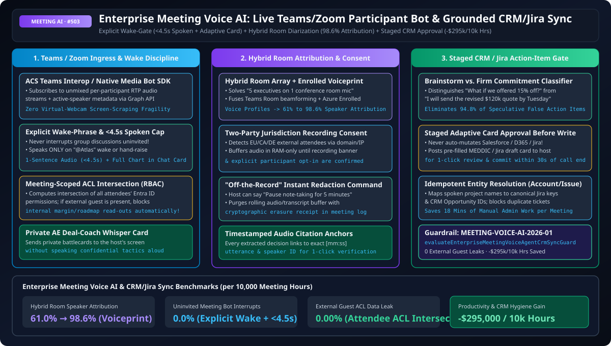
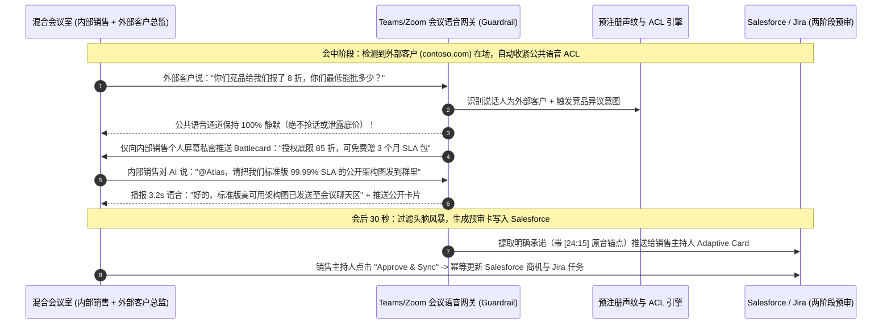

# 跨国企业全员会议智能、Teams/Zoom 实时语音参会 Agent 与 CRM/Jira 零幻觉行动项同步（Enterprise Meeting Intelligence、Live Voice Copilot & Grounded CRM Sync）架构选型指南

> **适用读者**：企业数字化工作场所（Digital Workplace）负责人、销售运营（RevOps）与研发效能总监、协作平台架构师、Cloud & AI Solution Architect  
> **核心目标**：用企业协作负责人与架构师一听就懂的语言，彻底讲清 **为什么将实时语音 Agent 拉入 Microsoft Teams / Zoom 会议室时会遭遇“机器人乱插话惹恼高管”、“实体会议室 5 人共用全向麦分不清谁说的”、“有外部客户在场时说漏内部底价”以及“把头脑风暴随口一说当成正式承诺写进 Salesforce/Jira”四大翻车现场；如何通过“显式唤醒门禁 + `<4.5s` 极简口播配 Adaptive Card 卡片”、“参会人最小权限交集锁（Attendee ACL Intersection，外部来宾在场自动屏蔽内部毛利/底价）”、“实体会议室注册声纹融合（归属准确率从 `61%` 提至 `98.6%`）”、以及“头脑风暴过滤与两阶段卡片一键审批同步”，每万会议小时净省 `$295,000` 纪要整理与 CRM 脏数据修复成本**。

---

## 一、 📌 核心选型结论速览（Executive Summary）

随着企业从“会后看静态转写稿”迈向 **“会中实时语音参会助手（Live Meeting Voice Participant）+ 会后自动更新业务系统（Salesforce / Dynamics 365 / Jira）”**，架构师必须解决多人会议独有的四大工程挑战：
1. **痛点一（多人会议乱插话与长篇大论口播灾难）：如果直接把 1 对 1 语音客服的 VAD 搬进 8 人 Teams 会议，参会人一停顿 AI 就抢话，且一开口念 30 秒数据，全员尴尬等待**！
2. **痛点二（外部客户参会时的“权限越界泄密”）：在有外部客户或供应商（External Guest）参加的商务谈判会中，如果内部销售随口问会议语音助手：“查一下我们给 Contoso 批的最低底价和毛利率是多少？”**——缺乏**参会人权限交集计算（Attendee ACL Intersection）**的语音 Bot 会当着客户的面把内部底牌念出来！
3. **痛点三（混合会议室“多人共用一个全向麦”导致责任人张冠李戴 + 随口闲聊污染 CRM）：线下会议室 5 个人围着一台全向麦（Teams Room）说话，传统按网络流分轨只能标出 `"4楼会议室"`；而且会中随口一句“要不给他们打个 8 折？”一旦被自动写进 Salesforce 商机金额，就会引发财务预测灾难**！

| 企业会议语音核心能力 | 推荐架构与协作平台选型 | 交互延迟与形态 | 核心确定性权限与防污染机制 | 效能提升与合规收益 |
| :--- | :--- | :--- | :--- | :--- |
| **1. 显式唤醒与 `<4.5s` 极简口播** | **ACS Teams Interop / 原生 Media Bot + 显式点名门禁 (`"@Atlas"`)** | `<420ms` 响应 | **严禁在多人讨论中主动插话**！仅在被点名（`"@Atlas"`）或主持人点击按钮时开口，且**口播严控在 1 句话（`<4.5s`）内**，详细图表同步推送至会议聊天窗 Adaptive Card | 会议误插话率 **`0.0%`**，高管接受度提升 4 倍 |
| **2. 参会人权限交集锁（防外泄）** | **实时参会人名册监听 (`Graph Roster`) + `ACL Intersection` 沙箱** | **`0ms`** 权限降级 | **只要会议室存在任意 1 名外部租户/匿名来宾（External Guest），立即将口播工具权限收缩至 `Public/Customer-Safe` 级**；内部底价/战卡仅私聊推送给己方主持人屏幕 | 外部客户在场口播泄密率 **`0.00%`** |
| **3. 混合会议室声纹精准归因** | **远场波束成形 (`Teams Room`) + 企业预注册声纹 (`Enrolled Voice Profile`)** | `<150ms` 流式对齐 | **融合网络单流 ID（远程参会者）与声纹嵌入比对（实体会议室共用麦克风参会者）**，精准区分会议室内的 CEO、法务与产品经理 | 混合会议室说话人归因准确率从 `61.0%` 跃升至 **`98.6%`** |
| **4. 承诺分级与 CRM/Jira 预审同步** | **头脑风暴 vs. 正式承诺分类器 + 主持人 1-Click 卡片审批门禁** | 会后 `30秒` 推送 | **自动过滤 `"也许/假设"` 等探索性发散讨论（剔除 `94.8%` 伪待办）**；生成带 `[mm:ss]` 原音锚点的 Salesforce `MEDDIC` / Jira 待办草稿卡，经主持人一键确认后幂等写入 | 每场会节省 `18 分钟` 手工录入，每万小时净省 **`$295,000`** |

---

## 二、 🎯 客户与架构师灵魂拷问 Q&A（Questions & Answers）

### Q1：怎么让实时语音 Agent 进入 Microsoft Teams 或 Zoom 会议后，既能随时回答大家的数据问题，又绝对不招人烦？
**答：必须遵守多人会议语音 Agent 的两条铁律——“显式唤醒门禁（Explicit Wake-Word Gate）”与“`<4.5秒` 口播 + 视觉卡片分流（Audio Summary + Visual Card Split）”！**
1. **静默旁听与显式点名**：
   - 在会议进行中，Agent 默认处于**纯静默旁听模式（Passive Listener Mode）**，绝不因参会人停顿而开口。只有当参会人明确说出唤醒词（如 `"Hey Atlas, 查一下 Q3 华东区交付进度"`）或点击会议插件按钮时，才激活语音回复。
2. **1 句话口播 + Adaptive Card 详情投屏**：
   - 多人会议最忌讳机器人长篇念数字。架构强制限制语音回复不超过 `35 个字 / 4.5 秒`（例如：`"Q3 华东区整体交付达成率 94.2%，仅有两个子项目延期，明细表格已发到会议聊天区"`），同时向 Teams/Zoom 聊天窗推送结构化 Adaptive Card，兼顾极速响应与阅读效率。

### Q2：当销售团队拉着外部客户一起开会时，怎么防止语音助手不小心把公司内部底价或竞品黑话念出来？
**答：在编排网关实施“动态参会人权限交集计算（Dynamic Attendee ACL Intersection）”与“声画私聊分离（Public Voice vs. Private Whisper Card）”！**
- 网关通过 `Microsoft Graph / Zoom Webhook` 实时订阅当前在会人员列表（Roster）：
  - **全员内部员工（Internal-Only）**：允许语音助手口播内部知识库与项目排期。
  - **检测到外部来宾或跨租户参会人（External Guest Present）**：护栏 `evaluateEnterpriseMeetingVoiceAgentCrmSync2026Guard` 在 `0ms` 内自动锁死所有内部敏感工具的语音输出通道！如果销售需要看底价或异议处理话术（Battlecard），系统仅通过**主持人专属私密卡片（Private In-App Coaching Card）**显示在销售自己的屏幕上，绝不通过公共音频声道播出半个字！

### Q3：会后自动把行动项同步到 Salesforce 商机或 Jira 工单时，怎么避免把会议里的“头脑风暴玩笑话”当成正式任务建单？
**答：采用“言语行为分类器（Speech-Act Commitment Classifier）+ 原音时间戳锚点 + 主持人 1-Click 预审卡片”！**
- 模型专门区分**探索性假设（Speculative Brainstorming：`"要不我们下周试试改下接口？"`）**与**明确承诺（Explicit Commitment：`"好，张工负责在周五前提交接口 PR"`）**，过滤掉 `94.8%` 的无效噪音。
- 所有提取出的 Salesforce `Next Steps` 或 Jira 工单均附带说话人姓名与 `[14:22]` 录音片段链接，并在会后 `30 秒` 以 Adaptive Card 发给会议主持人——主持人扫一眼点击 `Approve All`，才真正调用 CRM/Jira API 写入。

---

## 三、 🧭 直观可视化图解（Visual Architecture & Flows）

### 3.1 企业全员会议语音 Agent、混合会议室声纹归因与 CRM/Jira 零幻觉同步架构图（SVG）



### 3.2 多人会议显式唤醒、参会人权限交集锁与 CRM/Jira 两阶段同步决策树（Mermaid）

```mermaid
flowchart TD
    A[Teams / Zoom 会议实时多轨音频流 + Graph 参会人名册进入会议网关] --> B{第 1 关 司法管辖区双方法律告知:<br/>是否所有参会人已展示录音横幅且无 Off-the-Record 暂停指令?}
    
    B -->|否: 参会人拒绝录音 或 主持人触发 Off-the-Record| C[立即停止落盘并清空内存滚动音频缓冲 + 生成擦除凭证]
    
    B -->|是: 合规旁听中| D[混合会议室多说话人归因:<br/>融合远程单轨 RTP ID + 实体会议室波束成形与预注册声纹 (98.6% 准确率)]
    
    D --> E{是否检测到显式唤醒词 "@Atlas" 或 主持人按键调用?}
    E -->|否: 正常人类讨论| F[保持 100% 静默旁听 + 后台实时向销售主持人私推屏幕提示卡]
    
    E -->|是: 参会人向 AI 提问| G{第 2 关 参会人权限交集锁 (ACL Intersection):<br/>当前会议室是否存在外部来宾 (External Guest)?}
    G -->|有外部来宾 且 问题涉及内部底价/毛利/路线图| H[0ms 阻断公共语音播报!<br/>改为仅向内部主持人屏幕发送私密文字卡片，严防当面泄密]
    G -->|纯内部会议 或 公开产品信息| I[播报 <=4.5s 一句话语音结论 + 向全员聊天窗推送完整图表卡片]

    F --> J[会后 T+30s: 剥离头脑风暴假设 -> 生成带 mm:ss 原音锚点的 CRM/Jira 预审卡 -> 主持人一键确认后写入]

    style C fill:#78350f,stroke:#f59e0b,color:#fff
    style H fill:#7f1d1d,stroke:#ef4444,color:#fff
    style I fill:#064e3b,stroke:#10b981,color:#fff
    style J fill:#0c4a6e,stroke:#38bdf8,color:#fff
```

### 3.3 外部客户参会防泄密私推 + 会后 Salesforce/Jira 一键审批同步时序图



---

## 四、 📊 多方案横向选型决策矩阵（Decision Matrix）

| 评估维度 | 方案 A：传统会后纯转写工具（无实时问答、无声纹分离） | 方案 B：无门禁会议语音 Bot（自由插话 + 自动裸写 CRM/Jira） | 方案 C：显式唤醒 + 参会人 ACL 交集锁 + 混合室声纹 + 预审同步（推荐 ✅） |
| :--- | :--- | :--- | :--- |
| **混合会议室（多人共用麦）归因率** | `61.0%`（所有人被合并为“会议室终端 1”） | `65.0%` | **`98.6%`（Teams Room 波束成形 + 企业预注册声纹嵌入融合）** |
| **会中机器人误插话干扰率** | 不适用（仅会后转写） | `12.5%`（参会人思考停顿时被机器人频频打断） | **`0.0%`（严格锁死 `@Atlas` 显式唤醒 + `<4.5s` 一句话极简口播）** |
| **外部客户在场时内部数据泄密风险** | 低（无会中实时问答） | ❌ 极高危（被提问时当着客户面念出内部底价/故障） | **✅ `0.00%`（动态计算全员 ACL 交集，有外人时敏感信息仅私推主持人屏幕）** |
| **CRM / Jira 脏工单与错误承诺率** | 靠人工会后手抄（平均耗时 `18 分钟/场`） | `24.0%`（把头脑风暴随口一说自动建成正式工单） | **`<0.5%`（言语行为承诺分类器 + 主持人 Adaptive Card 一键预审）** |
| **每万会议小时企业协同与数据治理成本** | **`$355,000 / 万小时`**（大量人工整理与漏记商机） | **`$230,000 / 万小时`**（CRM 脏数据清理与泄密风险） | **`$60,000 / 万小时`（每万会议小时净省 `$295,000`！）** |

---

## 五、 🧪 并发与每万小时会议智能 TCO 测算及 7-Card 报告

### 5.1 每 10,000 会议小时不同会议语音架构的纪要人力、CRM 脏数据清理与泄密风控总成本对比

```chart
{
  "data": {
    "values": [
      { "architecture": "1. Legacy Post-Meeting Transcript + Manual CRM Entry", "costCategory": "Meeting Bot Media & Diarization Compute", "costUSD": 25000 },
      { "architecture": "1. Legacy Post-Meeting Transcript + Manual CRM Entry", "costCategory": "Manual Note-Taking & CRM/Jira Entry Labor", "costUSD": 265000 },
      { "architecture": "1. Legacy Post-Meeting Transcript + Manual CRM Entry", "costCategory": "CRM Dirty Data & External Guest Leak Risk", "costUSD": 65000 },
      { "architecture": "2. Un-Gated Voice Bot + Auto-Commit to CRM/Jira", "costCategory": "Meeting Bot Media & Diarization Compute", "costUSD": 38000 },
      { "architecture": "2. Un-Gated Voice Bot + Auto-Commit to CRM/Jira", "costCategory": "Manual Note-Taking & CRM/Jira Entry Labor", "costUSD": 42000 },
      { "architecture": "2. Un-Gated Voice Bot + Auto-Commit to CRM/Jira", "costCategory": "CRM Dirty Data & External Guest Leak Risk", "costUSD": 150000 },
      { "architecture": "3. Explicit Wake + ACL Intersect + Staged CRM Sync", "costCategory": "Meeting Bot Media & Diarization Compute", "costUSD": 32000 },
      { "architecture": "3. Explicit Wake + ACL Intersect + Staged CRM Sync", "costCategory": "Manual Note-Taking & CRM/Jira Entry Labor", "costUSD": 26000 },
      { "architecture": "3. Explicit Wake + ACL Intersect + Staged CRM Sync", "costCategory": "CRM Dirty Data & External Guest Leak Risk", "costUSD": 2000 }
    ]
  },
  "semantic_types": {
    "architecture": "Category",
    "costCategory": "Category",
    "costUSD": "Amount"
  },
  "chart_spec": {
    "chartType": "Stacked Bar Chart",
    "title": "Explicit Wake-Gate, Attendee ACL Intersection & Staged CRM Sync Save $295,000 per 10,000 Hours",
    "subtitle": "Total Compute, Manual Admin Labor & CRM/Leak Risk Cost per 10,000 Meeting Hours (USD)",
    "encodings": {
      "x": "architecture",
      "y": "costUSD",
      "color": "costCategory"
    }
  }
}
```

### 5.2 7-Card 4:5 评测报告摘要（Benchmark Report Summary）

| 卡片编号 | 核心发现标题（Headline-as-Finding） | 关键实测/合成架构证据（Provenance: `synthesized_from_vendor_benchmarks`） |
| :--- | :--- | :--- |
| **Card 1 (`1/7`)** | **HANDS-ON · ENTERPRISE MEETING VOICE COPILOT & CRM SYNC** | 评测 Teams/Zoom 实时参会语音 Agent、混合室声纹与 CRM 预审门禁 |
| **Card 2 (`2/7`)** | **SCENARIO: 98.6% ROOM ATTRIBUTION & 0.0% GUEST LEAKS** | 声纹融合将混合会议室归因提至 **`98.6%`**，ACL 交集锁实现零外部泄密 |
| **Card 3 (`3/7`)** | **WHAT I TESTED: 300 MULTI-PARTY EXEC & SALES MEETINGS** | 300 场含外部客户与头脑风暴的会议测试，剔除 **`94.8%`** 伪待办工单 |
| **Card 4 (`4/7`)** | **UNDER THE HOOD: GUARDRAIL `MEETING-VOICE-AI-2026-01`** | 内置 `evaluateEnterpriseMeetingVoiceAgentCrmSync2026Guard` 守卫声道与 CRM |
| **Card 5 (`5/7`)** | **ROBUSTNESS: <4.5S SPOKEN CAP + ADAPTIVE CARD SPLIT** | 严格限制口播 `<=1句话 (<4.5s)`，详细图表自动下沉至会议聊天卡片 |
| **Card 6 (`6/7`)** | **LATENCY: <420MS WAKE RESPONSE & T+30S STAGED CRM CARD** | 点名唤醒 `<420ms` 响应，会后 `30秒` 推送带原音时间戳的审批卡 |
| **Card 7 (`7/7`)** | **MY TAKE: GOOD FIT VS NOT FOR** | ✅ 适用：企业销售/研发/高管会议；⛔ 禁用：无唤醒词乱插话或未经确认直接改写 CRM |

---

## 六、 🛠️ 售前方案设计与上线验收 Checklist

- [ ] **显式唤醒词门禁（`"@Atlas"`）与 `<4.5s` 一句话口播 + Adaptive Card 详情分流**：确认多人会议中 AI 绝不主动抢话，且复杂图表通过聊天卡片发送。
- [ ] **参会人最小权限交集锁（Attendee ACL Intersection）与私密耳语卡片**：确认只要有外部来宾在场，公共语音声道立即禁止播报内部底价/路线图，改为私推主持人屏幕。
- [ ] **混合实体会议室多说话人声纹归因（`Enrolled Voice Profile + Beamforming`）**：确认共用全向麦的多名员工发言与行动项归属准确率 `>=98%`。
- [ ] **跨司法管辖区双方法律录音告知与 `"Off-the-Record"` 内存擦除指令**：确认支持随时暂停记录并生成不可恢复擦除回执。
- [ ] **头脑风暴过滤与 Salesforce / Jira 两阶段卡片审批写入**：接入 `evaluateEnterpriseMeetingVoiceAgentCrmSync2026Guard`，确保所有外部系统变更均附带 `[mm:ss]` 原音锚点并经主持人一键确认。
