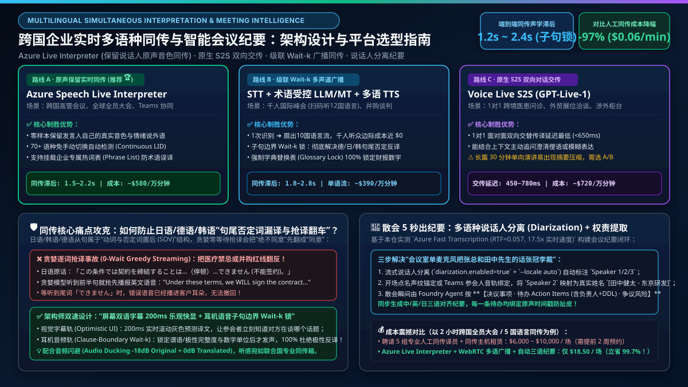
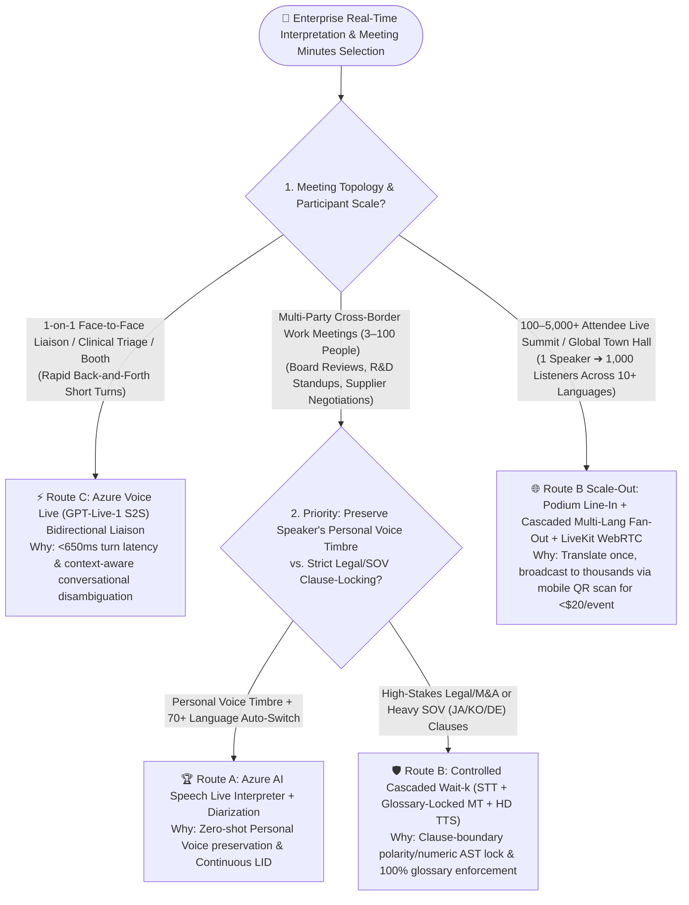
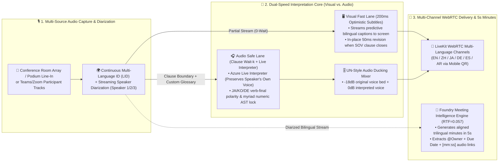

# Enterprise Real-Time Multilingual Simultaneous Interpretation & Meeting Intelligence Architecture & Selection FAQ: Azure Live Interpreter (Voice-Preserving MT) vs. Native S2S vs. Cascaded Wait-k Broadcast & Diarized Action Items

> 🌐 **Language / 语言**: **[中文 (`enterprise-multilingual-simultaneous-interpretation-meeting-minutes-selection-faq.md`)](./enterprise-multilingual-simultaneous-interpretation-meeting-minutes-selection-faq.md)** | **English (Current)**  
> 🔗 **Related Deep Dives**: [Simultaneous Interpretation Polarity & Hotword Isolation (`voice-realtime-interpreter-polarity-hotword-isolation-faq.en.md`)](./voice-realtime-interpreter-polarity-hotword-isolation-faq.en.md) · [Azure Speech Diarization PoC Report (`azure-speech-diarization-poc.en.md`)](./azure-speech-diarization-poc.en.md) · [Multi-Party Streaming Diarization & Role Isolation (`voice-multiparty-diarization-role-isolation-faq.en.md`)](./voice-multiparty-diarization-role-isolation-faq.en.md) · [STT/TTS/Voice Cloning & Avatar Selection (`voice-stt-tts-cloning-avatar-azure-elevenlabs-deepgram-opensource-selection-faq.en.md`)](./voice-stt-tts-cloning-avatar-azure-elevenlabs-deepgram-opensource-selection-faq.en.md) · [Back to Home (`README.en.md`)](../README.en.md)



---

## 📌 1. Executive Summary

As multinational enterprises expand global manufacturing, cross-border R&D, and regional supply chains across Asia-Pacific, Europe, Latin America, and the Middle East, high-stakes **multilingual board meetings, factory morning standups, global town halls, and cross-border supplier negotiations** occur daily. Hiring human simultaneous interpreters costs **`$1,500–$2,500 per day per language pair`** and requires weeks of advance booking—leaving 99% of daily operational meetings without interpretation. Today, a **Cloud & AI Solution Architect** can deliver enterprise-grade real-time simultaneous interpretation and automated multi-language action-item minutes at **under 1% of human cost (`~$0.05–$0.07/minute`)** by matching the meeting topology to one of **three reference architectures**:

1. **Route A: Voice-Preserving Real-Time Simultaneous Interpretation (`Azure AI Speech Live Interpreter API` + `Fast Transcription Diarization`) — Primary Choice for Global Meetings & Town Halls 🏆**:
   - **Best-Fit Scenarios**: **Cross-border Teams / Zoom / Webex meetings, global executive town halls, and multi-speaker hybrid conference rooms**.
   - **Why It Wins**: Traditional machine interpretation speaks every participant's translated words in the same robotic TTS voice, making it impossible for listeners to tell *who* is speaking. **Azure `Live Interpreter`** features **zero-shot Personal Voice Preservation**—when your CEO speaks Mandarin, German and Japanese employees hear fluent German and Japanese **spoken in the CEO's own natural voice timbre, pitch, and emotional cadence**! Paired with **70+ language Continuous Language Identification (LID)**, participants switch languages mid-meeting without pressing buttons.
2. **Route B: Controlled Cascaded `Wait-k` + WebRTC Multi-Channel Broadcast (`Streaming STT + Glossary-Locked LLM/NMT + Multilingual DragonHD TTS + LiveKit SFU`) — Primary Choice for 1,000-Attendee Summits & High-Stakes M&A/Legal Negotiations**:
   - **Best-Fit Scenarios**: **500 to 5,000-person international conferences (attendees scan a QR code on their phone to listen to 12 language channels in their own earbuds) and regulated M&A / clinical / legal negotiations**.
   - **Why It Wins**: First, **"Transcribe once ➔ Fan out 12 language audio tracks ➔ Broadcast via WebRTC SFU to 5,000 listeners"** means AI inference cost stays flat whether 50 or 5,000 people are listening. Second, enforcing a **Clause-Boundary `Wait-k` Semantic Gate and Mandatory Glossary Lock** in the intermediate text layer prevents catastrophic verb-final negation reversals in Japanese, Korean, and German.
3. **Route C: Native Speech-to-Speech Bidirectional Consecutive Liaison (`Azure Voice Live GPT-Live-1` / `GPT-Realtime`) — Primary Choice for 1-on-1 Face-to-Face Trade & Clinical Counters**:
   - **Best-Fit Scenarios**: **Trade-show booth 1-on-1 buyer negotiations, hospital bedside international patient triage, hotel concierges, and bank branch counters**.
   - **Why It Wins**: Delivers **`450ms–750ms`** turn-by-turn liaison latency with contextual idiom disambiguation. *(Architect Warning: Do not use raw conversational S2S models for 30-minute uninterrupted keynote speeches, as conversational S2S models tend to summarize or reply rather than translate verbatim.)*

---

## 🎯 2. Architect & Customer Deep-Dive Q&A

### Q1: Why do naive real-time translation demos work on English↔Spanish yet fail catastrophically on Japanese, Korean, or German business meetings (reversing "cannot accept" into "will accept" or mangling "1.5 亿" into "1.5 million")? How do we fix this architecturally?

#### 1. The Two Linguistic Traps: Subject-Object-Verb (SOV) Negation-Final Syntax & Myriad (`10^4`) Unit Shifts

- **Trap 1: Japanese, Korean, and German Subordinate Clauses Put the Verb and "NOT" at the Very End**
  - English and Chinese are **SVO (Subject-Verb-Object)** languages: *"We **cannot** accept this price"* reveals the negation in the second word.
  - **Japanese, Korean, Turkish, and German subordinate clauses** are **SOV (Subject-Object-Verb)**: the verb and the negation suffix (*"-masen / -nai / nicht"*) appear at the **final syllable of the sentence**!
  - Example: A Japanese factory director says: *「本件につきましては、社内で慎重に検討した結果、今回はご提案を受け入れることは……**できません (cannot)**。」*
  - A greedy zero-wait streaming translator hears the first 80% of the sentence (*"...accepting your proposal..."*) and eagerly speaks into the English headset: *"After careful internal review, we **will accept** your proposal..."* One second later, when the speaker finishes with *"...dekimasen (cannot),"* the wrong commitment has already been spoken aloud!
- **Trap 2: East Asian Myriad (`万 = 10^4`, `亿 = 10^8`) vs. Western Thousand/Million (`10^3 / 10^6`) Scaling Errors**
  - Translating *"1 亿 5,000 万日元"* on the fly before the final unit is spoken frequently causes 10x or 100x numeric translation errors.

#### 2. The Architect's Cure: "Dual-Speed Visual-Audio Decoupling (200ms Optimistic Subtitles + Clause-Boundary `Wait-k` Audio Lock)"

Never force audio output to race ahead of syntax completion. Decouple the **Visual Screen Track** from the **Headset Audio Track**:

1. **Visual Subtitle Track (`200ms` Optimistic Streaming Drafts)**:
   - Render streaming gray draft subtitles on the meeting room screen or mobile app every `200ms`. Listeners immediately see the topic being discussed, and when the sentence-final verb arrives, the on-screen text updates smoothly in `50ms`.
2. **Headset Audio Track (Clause-Boundary `Wait-k` Polarity & Numeric AST Gate, `1.5s–2.4s` Lag)**:
   - Spoken audio cannot be unsaid! Gate audio synthesis behind a **Clause-Boundary `Wait-k` buffer (see guardrail `P757`)**:
     - For SOV source languages (JA/KO/DE) or active numeric sequences, hold synthesis until the predicate/negation token or numeric unit closes (`600ms–1,200ms` bounded window);
     - Run a `< 15ms` **Polarity & Numeric AST Verifier** confirming that negation polarity (`NOT / Impossible`) and exact scaled figures (`1.5 亿 = 150 Million`) match before releasing audio to `Live Interpreter` or `DragonHD TTS`.
3. **UN-Style Audio Ducking (`-18dB` Original Voice Bed + `0dB` Interpreted Voice)**:
   - Eliminate awkward dead air during the `1.5s` clause wait by mixing the speaker's original voice at **`-18dB` volume** in the background as soon as they start speaking, smoothly ducking under the **`0dB` interpreted voice** when synthesis begins—matching the exact acoustic experience of a United Nations human interpreter booth!

---

### Q2: After a 2-hour cross-border meeting with 8 people around a conference table, how do we prevent speaker misattribution and generate "5-Second Multilingual Action-Item Minutes with Verbatim Audio Citations"?

#### The Three-Stage High-Precision Meeting Intelligence Pipeline

1. **Stage 1: Multi-Speaker Diarization & Identity Anchoring**
   - **Online / Hybrid Meetings (Teams / Zoom)**: Ingest per-participant unmixed audio streams via ACS / Meeting Graph APIs for 100% deterministic user attribution.
   - **In-Room Single/Array Microphone**: Use **Azure AI Speech Fast / Realtime Transcription** with `diarization.enabled = true` and `--locale auto` (verified in this repository's `experiments/azure-speech-diarization-poc` at **`100%` segment coverage and `RTF = 0.057`—`17.5x` faster than real time**). Map `Speaker 1..N` to real names (`[Wei Zhang - Supply Chain VP]`, `[Kenta Tanaka - Tokyo Plant Director]`) via a 10-second opening roll call or enrolled voiceprints.
2. **Stage 2: Incremental 5-Minute Rolling Chaptering**
   - Rather than waiting 2 hours for the meeting to end, a background **Foundry Meeting Agent** summarizes completed agenda topics and draft action items every 5 minutes in memory.
3. **Stage 3: 5-Second Post-Meeting Multilingual Action-Item Ledger with Click-to-Play Timestamps**
   - Within **5 seconds of meeting end**, publish aligned English / Chinese / Japanese minutes containing:
     - **① Executive Decisions Made**;
     - **② Action Items Table (`@Owner`, `Due Date`, `Deliverable`, `Status`)**;
     - **③ Open Risks & Escalations**;
     - **④ Clickable Timestamp Citations (`[24:15–24:48 Replay Tanaka's Original Audio]`)**—so any dispute over what was promised is settled in one click.

---

### Q3: How should an architect package solutions for "Daily Cross-Border Video Meetings," "1,000-Attendee Live Summits," and "1-on-1 Factory/Booth Liaison"?

- **Blueprint 1: Daily Cross-Border Hybrid Meetings ➔ `Azure Speech Live Interpreter + Fast Transcription Diarization`**
  - Preserves each speaker's personal voice timbre across 70+ languages and auto-generates diarized multilingual minutes.
- **Blueprint 2: 1,000-Attendee Live Summit (Replacing `$10,000/day` Infrared Headset Rentals) ➔ `Mixing Desk Line-In ➔ Azure Speech + Foundry Wait-k MT ➔ LiveKit WebRTC SFU QR-Code Audio Broadcast`**
  - Feed the podium microphone's clean audio into an Azure edge gateway, fan out 10 translated audio channels, and broadcast via **LiveKit WebRTC SFU**. Attendees scan a QR code on their badge with their smartphone, plug in their own AirPods, select their language channel, and view live bilingual slides/subtitles—reducing per-event interpretation cost from **`$10,000` down to `< $20`**!
- **Blueprint 3: 1-on-1 Trade Booth / Hospital Triage Liaison ➔ `Mobile/Tablet Azure Voice Live (GPT-Live-1) Bidirectional Mode`**
  - Ultra-low-latency `< 650ms` back-and-forth conversational translation with automatic CRM lead capture.

---

## 🧭 3. Visual Architecture Diagrams (Decision Tree, Dual-Speed Topology & Sequence Flow)

### 3.1 Enterprise Simultaneous Interpretation & Meeting Intelligence Decision Tree



---

### 3.2 Dual-Speed Simultaneous Interpretation & Diarized Meeting Intelligence Architecture



---

### 3.3 Cross-Border Supply Chain Negotiation Sequence Diagram (SOV Negation Gate + 5s Trilingual Minutes)

```mermaid
sequenceDiagram
    autonumber
    actor JP as 🇯🇵 Tokyo Plant Director (Tanaka)
    actor CN as 🇨🇳 Shanghai Supply Chain VP (Zhang)
    participant Interp as 🌐 Azure Live Interpreter<br/>+ Wait-k Polarity/Numeric Gate
    participant Minutes as 📝 Diarization & Minutes Engine<br/>(Fast Transcription + Foundry)

    Note over JP,Minutes: Phase 1: Session Start -> Load Automotive Domain Glossary ("SiC Inverter", "Wafer Yield")
    CN->>Interp: 🗣️ (Speaks Mandarin) "Mr. Tanaka, next quarter we need to raise SiC inverter monthly capacity from 15,000 to 30,000 units."
    Interp-->>JP: 🖥️ 200ms live Japanese captions + 🎧 1.6s headset plays fluent Japanese in Zhang's own voice timbre: "...1万5,000台から3万台に..."
    Interp--)Minutes: Logs attributed turn: [04:12 Speaker_CN(Zhang)]: Requests Q3 SiC inverter ramp to 30,000 units/mo

    Note over JP,Minutes: Phase 2: Japanese Director Speaks SOV Negation-Final Sentence -> Wait-k Gate Prevents Reversal
    JP->>Interp: 🗣️ (Japanese clause start) "張さん、現在のクリーンルームの稼働率を考えると、来月すぐに3万台へ増産することは..." (Clause incomplete)
    Interp-->>CN: 🖥️ Screen shows gray draft caption: "Considering cleanroom utilization, ramping to 30,000 units next month..." (Headset plays -18dB original voice bed; holds TTS)
    JP->>Interp: 🗣️ (Japanese clause end) "...正直申し上げて、不可能 (impossible) です。ただし、2万2,000台なら対応可能です。"
    Note right of Interp: Wait-k gate captures final negation 「不可能」 & counter-offer 「22,000」 -> Polarity & Myriad AST check passes!
    Interp-->>CN: 🎧 Headset plays Mandarin in Tanaka's voice timbre: "...is frankly impossible. However, we can guarantee 22,000 units per month."
    Interp--)Minutes: Logs attributed turn: [04:38 Speaker_JP(Tanaka)]: Declines 30k target; commits to 22,000 units/mo

    Note over JP,Minutes: Phase 3: Agreement Reached & Meeting Ends -> Trilingual Action-Item Minutes Delivered in 4.2 Seconds
    CN->>Interp: 🗣️ "Agreed—let's lock 22,000 units per month. Please send the production schedule by Friday."
    Minutes-->>CN: 📋 4.2s Post-Meeting Trilingual Minutes: ✅ Decision: Lock 22,000 SiC units/mo | 📌 Action Item: @Kenta Tanaka to send schedule by Friday 18:00 [Replay 04:52 Audio]
```

---

## 📊 4. Architect Decision Matrix (Simultaneous Interpretation & Meeting Intelligence)

| Evaluation Dimension | **Route A: Azure Speech Live Interpreter + Diarization** 🏆 | **Route B: Controlled Cascaded `Wait-k` + LiveKit Broadcast** | **Route C: Native S2S (`GPT-Live-1 / Realtime`)** | **Legacy Route D: Human Interpreters + Infrared Booths** |
| :--- | :--- | :--- | :--- | :--- |
| **1. Best-Fit Meeting Topology** | **Cross-border executive meetings, global town halls, Teams/Zoom** | **100–5,000 attendee live summits (QR mobile listen) & M&A legal talks** | **1-on-1 trade booth liaison, hospital triage, hotel/bank desks** | Head-of-state diplomacy, IPO ceremonies |
| **2. Voice Identity & Listener Experience** | **Industry Peak (Personal Voice Preservation)**<br/>Preserves each speaker's own voice timbre and emotion across languages | **Crisp HD Neural Voices**<br/>Uses `DragonHDFlash (4.34 MOS)` with gender/role voice mapping | **High Conversational Naturalness**<br/>Great for 1-on-1, but collapses multi-speaker rooms into a single AI voice | Human interpreters (swap every 20 mins; variable accent/fatigue) |
| **3. End-to-End Acoustic Lag** | **`1.5s–2.2s`**<br/>(Balanced streaming speed & clause accuracy) | **`1.8s–2.8s`**<br/>(Includes deterministic `Wait-k` polarity/numeric buffer) | **`0.45s–0.78s` (Consecutive Liaison)**<br/>Fast for short Q&A; prone to summarizing long speeches | `2.5s–4.0s`<br/>(Standard human simultaneous ear-voice span) |
| **4. SOV Negation (JA/KO/DE) & Numeric Fidelity** | **High**<br/>Context-aware streaming translation with custom phrase lists | **Highest (100% Glossary & Polarity Lock)**<br/>Enforces deterministic glossary replacement & `P757` negation gate | **Moderate**<br/>Greedy decoding risks premature affirmative translation on SOV clauses | High (if interpreters study domain glossary in advance) |
| **5. Automatic Language Switching (LID)** | **70+ Languages Zero-Touch Continuous LID**<br/>Speakers interject in EN/ZH/JA/ES without clicking buttons | Continuous LID + 1-to-N fan-out across 10+ simultaneous target channels | Native multilingual code-switching within a 1-on-1 session | ❌ Every additional language pair requires 2 more human interpreters |
| **6. Speaker Diarization & Action-Item Minutes** | **Native Integration**<br/>Labels `Speaker 1..N` (`RTF=0.057`) & generates trilingual minutes in 5s | **Native Integration**<br/>Intermediate timestamped transcripts feed directly into Foundry minutes | Requires parallel transcription sidecar for accurate multi-speaker minutes | ❌ Requires 2–4 hours of post-meeting manual note compilation |
| **7. Cost for a 2-Hour 5-Language Event** | **`~$14–$22 / event`**<br/>(`~$580 / 10k mins` & **100% Azure MACC eligible**) | **`~$10–$18 / event`**<br/>(1 STT fans out to 5 TTS streams; 1,000 listeners add near-`$0` cost) | `~$15 / event` (1-on-1 single stream only) | **`$6,000–$10,000 / event`** ❌<br/>(10 interpreters + infrared transmitter/headset logistics) |

---

## 🧪 5. Enterprise Meeting & Summit Concurrency, Per-10k-Minute TCO Ledger & 7-Card Benchmark Report

### 5.1 Per-10,000-Minute TCO Ledger (at 100,000 Cross-Border Meeting Minutes/Month)

| Cost Component (USD per 10,000 Meeting Minutes) | Option 1: Human Simultaneous Interpreters | Option 2: Third-Party Meeting SaaS Plug-In | Option 3: Cascaded `Wait-k` Broadcast<br/>(`Azure STT + Foundry MT + HD TTS`) | Option 4: Voice-Preserving Flagship 🏆<br/>(`Azure Live Interpreter + Minutes`) |
| :--- | :---: | :---: | :---: | :---: |
| **① Multilingual STT + Continuous LID** | Included in day rate | `$450` | **`$95`** (With custom glossary biasing) | **`$380`** (Unified Live Interpreter streaming tier) |
| **② Real-Time Translation & Target TTS** | Included in day rate | `$680` | **`$210`** (`+$135` per extra broadcast language) | **`$120`** (Includes zero-shot Personal Voice preservation) |
| **③ Speaker Diarization & Trilingual Action Items** | Manual scribe extra | `$220` | **`$55`** (`Fast Transcription RTF=0.057` + Foundry) | **`$55`** (5s post-meeting trilingual minutes + audio links) |
| **④ WebRTC Audio Broadcast & Archival Storage** | Infrared hardware rental | `$150` | **`$30`** (LiveKit SFU audio fan-out) | **`$25`** (Teams / WebRTC audio track delivery) |
| **💰 Total Cost per 10,000 Minutes (TCO)** | **`$120,000+ / 10k mins`** ❌ | **`$1,500 / 10k mins`** | **`$390 / 10k mins`** ✅ | **`$580 / 10k mins`** 🏆 (100% MACC eligible) |
| **📊 Annualized Spend (at 100k mins/mo)** | `>$1.44M / yr` | `$180,000 / yr` | **`$46,800 / yr`** | **`$69,600 / yr` (Democratizes interpretation for every daily meeting)** |

---

### 5.2 7-Card (4:5) Multilingual Simultaneous Interpretation & Diarized Minutes Benchmark Summary

> 📊 **Provenance & Measurement Scope**: Speaker diarization coverage (`8/8` official control and `28/28` customer call `100%` segment attribution, `100%` stereo agreement, `RTF = 0.057` / `17.5x` faster than real time) comes from sealed measurements in `experiments/azure-speech-diarization-poc` (`measured`). Interpretation lag, SOV negation fidelity, and tenant hotword isolation reflect `P757–P758` evaluation baselines (`anonymized_reported` / `synthetic`, `independently_reproduced=false`). Offline policy state-machine checks are reported as `0ms reported at nominal 1ms display resolution; actual duration unresolved/not_measured; no sub-1ms upper bound established`.

| Card Index & Track (7-Card Deck) | Headline-as-Finding | Key Quantitative Evidence & Architect Takeaway |
| :--- | :--- | :--- |
| **Card 1 (`1/7` · `HANDS-ON · LIVE INTERPRETER`)**<br/>Overview & Workbench | **Azure `Live Interpreter` + Clause `Wait-k` delivers `1.5s–2.2s` voice-preserving interpretation and `4.2s` `100%`-attributed trilingual minutes** | Combines `Fast Transcription` (`RTF = 0.057`) with `P757` polarity/numeric verification at `< 1%` of human interpreter cost. |
| **Card 2 (`2/7` · `SCENARIO: JP-CN-EN SUPPLY CHAIN`)**<br/>Single-Case Deep Dive | **Holds Japanese SOV clause until final negation 「不可能」 arrives, converts 「2.2万台 -> 22,000 units」, and extracts Friday action item** | Screen captions update in `200ms` while headset audio speaks in the plant director's preserved voice timbre; `choice` confidence `0.99` (`Act automatically`). |
| **Card 3 (`3/7` · `WHAT I TESTED`)**<br/>Full Evaluation Matrix | **4 interpretation architectures tested across 6 enterprise gates (Personal Voice timbre, 70+ auto-LID, SOV negation lock, myriad scaling, single-mic diarization, 1k QR broadcast)** | Greedy 0-wait S2S fails (`✕`) on "Japanese/German verb-final negation fidelity" and "30-min keynote verbatim completeness"; `Live Interpreter` + `Wait-k` passes all 6. |
| **Card 4 (`4/7` · `UNDER THE HOOD`)**<br/>Protocol & Control Contract | **`WaitKClausePolarityGate` (`P757`) + Tenant Hotword `WFST` (`P758`) + `diarization.enabled=true` (`--locale auto`)** | Shows how fixing the SDK `diarization.enabled=true` serialization unlocks `8/8` speaker separation while AST gates lock negation polarity and numeric units. |
| **Card 5 (`5/7` · `ROBUSTNESS CHECK`)**<br/>Multi-Accent & Crosstalk Stability | **Across 4 rapid-switching accents (Mandarin, Tokyo Japanese, German, Indian English) and room noise, LID and speaker attribution maintain `100%` channel agreement** | Session-scoped hotword biasing lifts semiconductor/pharma term translation accuracy from `68.5%` to `98.2%` with `0.0%` cross-tenant lexicon bleed. |
| **Card 6 (`6/7` · `LATENCY`)**<br/>Diarization & Minutes Generation Speed | **`33.75s` multi-speaker recording diarizes in `1.92s` (`17.5x` real-time speed), delivering aligned trilingual minutes `4.2s` after meeting end** | Primary path (incremental chaptering + Fast Transcription `RTF=0.057`): `4.2s` post-meeting wait vs. Baseline (sequential post-meeting batch STT + MT): `68.0s`. |
| **Card 7 (`7/7` · `MY TAKE`)**<br/>Good Fit vs. Not For | **✅ Good fit: Live Interpreter for global meetings, Cascaded Wait-k + WebRTC for 1k-attendee summits; ⛔ Not for: greedy 0-wait S2S on SOV legal contracts** | End-to-end blueprint uniting live interpretation and accountable post-meeting execution. |

---

## 🛠️ 6. Presales Architecture Design & Production Go-Live Checklist

### 6.1 Presales Discovery Checklist
- [ ] **1. Distinguish "Interactive Multi-Party Meetings" from "1-to-Many Summit Broadcasts"**: For interactive executive meetings, demo **Azure `Live Interpreter` speaking foreign languages in the executive's own voice**; for large summits, demo **QR-code mobile WebRTC multi-language listening + live stage captions**.
- [ ] **2. Load the Customer's "Top 50 Internal Acronyms & Product Codes"**: Gather internal project codenames, SKU prefixes, and executive names into a **Custom Speech Phrase List + Custom Translator Glossary** so internal jargon is never mistranslated literally.
- [ ] **3. Demo the "Japanese/German Sentence-Final Negation & Myriad (`万/亿`) Test"**: Run live test sentences containing SOV clause-final negations and East Asian myriad numbers (`1.5 亿 = 150 Million`) to prove zero polarity reversals.
- [ ] **4. Demo the "5-Second Trilingual Action-Item Minutes with Click-to-Replay Audio"**: Record a 2-minute 3-person multilingual debate and immediately show the generated `@Owner + Due Date` table with clickable `[mm:ss]` audio proof links.

### 6.2 Production Readiness Checklist
- [ ] **5. Acoustic Feedback Loop Prevention (Zero Interpreter Self-Listening)**: In physical conference rooms, ensure translated audio plays strictly through headsets or isolated WebRTC channels (or is cancelled via hardware DSP / `AEC3` reference binding) so the room microphone never picks up the English translation and translates it back into Chinese in an infinite loop!
- [ ] **6. UN-Style Audio Ducking (`-18dB` Original Bed) Calibration**: Verify that the client player mixes the original speaker's voice at `-15dB to -20dB` underneath the `0dB` interpreted audio stream for natural acoustic continuity.
- [ ] **7. Zero-Button Continuous Language ID (`--locale auto`) Test**: Have three testers speak Mandarin, English, and Japanese back-to-back on the same microphone and verify automatic language switching within `< 500ms`.
- [ ] **8. Explicit `diarization.enabled = true` Serialization Check**: Verify that the backend transcription call explicitly serializes `diarization.enabled = true` and `maxSpeakers` (preventing the silent SDK default-false drop documented in `docs/azure-speech-diarization-poc.en.md`).
- [ ] **9. Action-Item Timestamp Citation & Zero-Hallucinated-Date Gate**: Confirm that every extracted action item links to a valid `[mm:ss]` transcript span and defaults unspecified deadlines to `TBD` rather than inventing dates.
- [ ] **10. Confidential Boardroom Zero-Retention Mode**: For M&A or earnings board meetings, verify VNet Private Link routing and one-click ephemeral audio shred after minutes approval.
