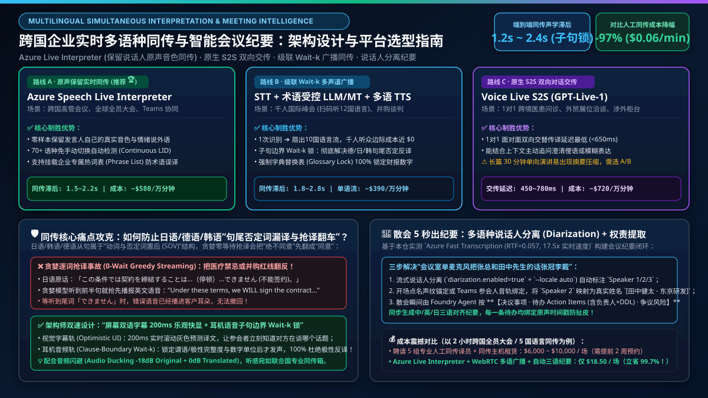
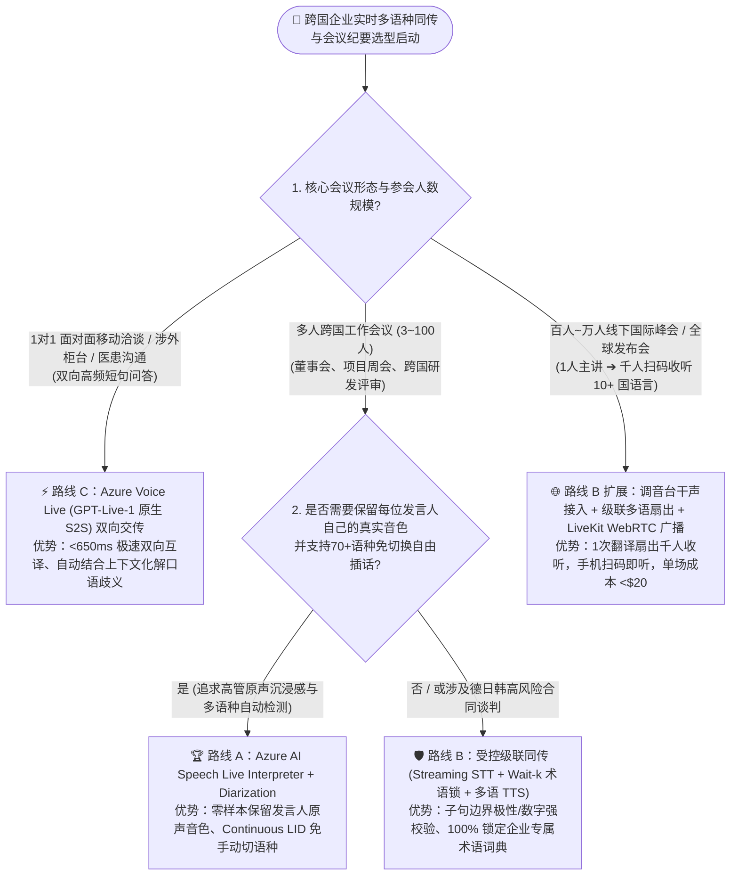
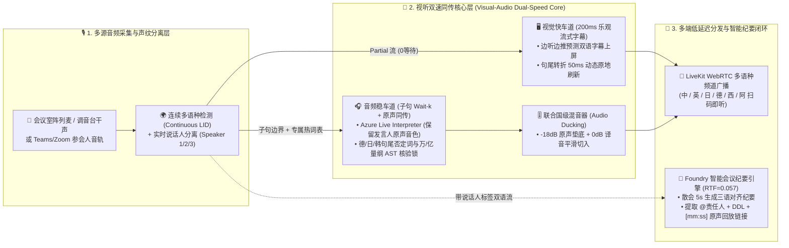
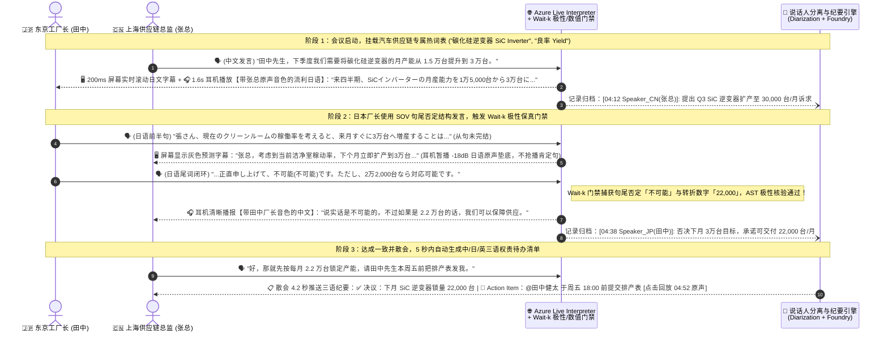

# 跨国企业实时多语种同传与智能会议纪要架构设计与选型 FAQ：Azure Live Interpreter 原声保留同传 vs 原生 S2S 双向交传 vs 级联 Wait-k 多声道广播与说话人分离纪要指南

> 🌐 **Language / 语言**: **中文 (Chinese)** | **[English (`enterprise-multilingual-simultaneous-interpretation-meeting-minutes-selection-faq.en.md`)](./enterprise-multilingual-simultaneous-interpretation-meeting-minutes-selection-faq.en.md)** 
> 🔗 **关联专题 (Related Deep Dives)**: [同传极性/剂量保真与热词隔离 (`voice-multilingual-codeswitch-dialect-faq.md`)](./voice-multilingual-codeswitch-dialect-faq.md) · [Azure Speech 说话人分离实测 PoC (`azure-speech-diarization-poc.md`)](./azure-speech-diarization-poc.md) · [多人通话流式分离与角色隔离 (`voice-multiparty-diarization-role-isolation-faq.md`)](./voice-multiparty-diarization-role-isolation-faq.md) · [语音识别/合成与克隆选型 (`voice-stt-tts-cloning-avatar-azure-elevenlabs-deepgram-opensource-selection-faq.md`)](./voice-stt-tts-cloning-avatar-azure-elevenlabs-deepgram-opensource-selection-faq.md) · [返回首页 (`README.md`)](../README.md)

---

## 📌 一、核心选型结论速览（Executive Summary）

随着中国企业出海建厂（东南亚、墨西哥、欧洲、中东）与跨国集团全球协同常态化，企业面临高频的**跨国董事会、海外工厂晨会、全球产品发布峰会、跨境供应链商务谈判与多语种项目复盘**。过去请一组人工同传译员动辄每天 **`$1,500 ~ $2,500 / 语种`** 且日常内部会议根本请不起；如今，**Cloud & AI 解决方案架构师** 可以用不到人工同传 **1% 的成本（约 `$0.05 ~ $0.07 / 分钟`）** 构建全天候企业级实时同传与智能会议纪要系统。选型成败的关键在于根据会议形态选对以下 **三大架构路线**：

1. **路线 A：原声克隆级流式同传底座（`Azure AI Speech Live Interpreter API` + `Fast Transcription Diarization`）—— 跨国线上会议与高管全员大会首选 🏆**
 - **适用场景**：**Teams / Zoom / 飞书 / 企微跨国视频会议、全球 Town Hall 全员大会、多人圆桌讨论**。
 - **为什么它是杀手锏**：传统机器同传把所有参会人的话都用同一个冰冷的女声播音员念出来，听众根本分不清当前是谁在说话！**Azure `Live Interpreter`** 支持 **零样本原声保留（Personal Voice Preservation）**——当中国 CEO 用中文发言时，德国和日本分公司的员工在耳机里听到的是**“带着 CEO 本人真实嗓音、重音和情绪起伏的流利德语和日语”**！同时内置 **70+ 语种免切换连续自动识别（Continuous LID）**，会上中、英、日、西四国员工轮流插话无需手动点按钮切语言。
2. **路线 B：受控级联 `Wait-k` + WebRTC 多声道扇出广播架构（`Streaming STT + 术语锁定 LLM/NMT + 多语 TTS + LiveKit SFU`）—— 千人线下国际峰会与严肃法务/并购谈判首选**
 - **适用场景**：**500～5,000 人线下国际展会/经销商大会（观众手机扫二维码戴耳机自选 12 国语言频道）、跨国药企/金融机构高合规并购谈判**。
 - **为什么它严格更优**：第一，**“1 次识别 ➔ 扇出 12 条语言音轨 ➔ WebRTC SFU 广播给上千人”**，无论台下坐 50 人还是 5,000 人，AI 翻译算力只收 **1 份钱**；第二，支持在中间文本层加入 **子句边界 `Wait-k` 语义锁与企业强制术语词典（Glossary Lock）**，彻底根除德语、日语、韩语“句尾否定词尚未说出就被抢先翻成肯定句”的重大外交与商务事故。
3. **路线 C：原生端到端语音大模型双向交传（`Azure Voice Live GPT-Live-1` / `GPT-Realtime`）—— 1 对 1 面对面洽谈与涉外窗口首选**
 - **适用场景**：**广交会/进博会展台 1 对 1 客商洽谈、涉外医院门诊医患沟通、国际酒店前台、银行外籍客户柜台**。
 - **核心优势**：双向交替传译首包延迟低至 **`450ms ~ 750ms`**，且具备强大的上下文消歧能力（当一方说出行业行话或模糊指代时，AI 译员能结合前文精准意译）。但注意：**切勿将纯原生 S2S 直接用于长达 30 分钟的不间断单向演讲同传**（原生对话模型天性倾向于“总结回答”而非“逐句忠实传译”）。

---

## 🎯 二、客户与架构师灵魂拷问 Q&A（Architect & Customer Deep-Dive Q&A）

### Q1：为什么很多通用实时语音翻译 Demo 在翻英语↔中文时还凑合，一旦遇到日语、韩语或德语商务会议就频频闹出“把不同意翻成同意、把百万翻成十万”的笑话？架构师如何从底层机制上根治？

#### 1. 先用大白话讲透：语言学上的“主宾谓（SOV）倒装陷阱”与“量纲进位陷阱”

- **痛点一：日语/韩语/德语的“句尾定乾坤（Verb-Final / Negation-Final）”**
 - 中文和英文是 **SVO（主-谓-宾）** 语言，你一开口说 *“We **cannot** accept this price...”*，前三个词就把“不能接受”亮出来了，同传模型边听边翻毫无压力。
 - 但**日语、韩语、土耳其语以及德语从句**是典型的 **SOV（主-宾-谓）** 结构，动词和决定整句话生死的**否定词（不、绝不、未曾）全部藏在整句话的最后一个词**！
 - 比如日本客户说：*「本件につきましては、社内で慎重に検討した結果、今回はご提案を受け入れることは……**できません（不能）**。」*
 - 如果你用追求“0 秒延迟”的贪婪流式模型（Greedy 0-Wait Streaming），它在听到前半句“接受您的提案”时，为了显快，已经抢先在耳机里用英语播报出了：*“After careful internal review, we **will accept** your proposal...”*！等 1 秒后日本客户吐出最后四个假名 *「できません（不能）」* 时，覆水难收！
- **痛点二：中英日数字万/亿（Myriad `10^4`）与千/百万（Thousand `10^3`）进位换算错乱**
 - 中文和日文以“万（`10^4`）、亿（`10^8`）”为单位，而英文和欧洲语言以“Thousand（`10^3`）、Million（`10^6`）、Billion（`10^9`）”为单位。说话人在报“一亿五千万日元”时，如果流式翻译在听到“一亿”的瞬间就急着开口翻英文，往往会在心算换算时发生数量级翻车。

#### 2. 架构师破局方案：“屏幕字幕 200ms 乐观快显 + 耳机音频子句边界 `Wait-k` 极性/数值双门禁”

优秀的跨国同传架构绝不是盲目追求“0 毫秒抢话”，而是采用 **“视听双速解耦（Dual-Speed Visual-Audio Decoupling）”**：

1. **视觉屏幕层（200ms 乐观流式字幕，满足人类实时扫视感）**：
 - 在大屏或参会者电脑字幕条上，每 `200ms` 实时滚动显示带浅灰色的预测译文（Draft Subtitle）。当句尾出现转折或否定时，屏幕上的文字可以在 `50ms` 内无感刷新修正，参会者看着屏幕能立刻感知对方在聊什么。
2. **耳机音频层（Clause-Boundary `Wait-k` 语义完结锁，滞后 `1.5s ~ 2.4s`，100% 保真）**：
 - 耳机里播出来的声音一旦入耳就无法撤回！因此音频合成轨严格受 **子句边界 `Wait-k` 门禁（参见本仓护栏 确定性护栏）** 控制：
 - 遇到 SOV 语言（日/韩/德）未闭合的从句，或检测到正在报读未完结的数字/金额/药物剂量时，音频轨自动暂缓 `600ms ~ 1,200ms` 等待谓语和单位闭环；
 - 同步运行 `< 15ms` 的 **极性与数值语法树核验（Polarity & Numeric AST Gate）**：确认译文中的否定词个数（`not / never / 不会`）与数字量级（`1.5 亿 = 150 Million`）跟原文 100% 匹配后，才送入流式 TTS 或 `Live Interpreter` 发声！
3. **专业级听感细节：原声 -18dB 闪避混音（UN-Style Audio Ducking）**：
 - 千万不要让参会者的耳机陷入“要么完全静音等 2 秒、要么突然炸出机器声”的割裂感！模仿联合国同传箱做法：当发言人开始讲话时，耳机里先以 **-18dB 的轻柔音量垫底播放发言人原声**（让人感知现场氛围与语气），1.5 秒后当同传译音以 **0dB 正常音量** 切入时，原声自动平滑压低，体感延迟瞬间消失！

---

### Q2：跨国会议散会后，如何避免人工整理纪要花 2 小时还漏掉待办事项？怎么实现“单麦多人说话人分离（Diarization）+ 散会 5 秒出中英日三语权责纪要”？

在真实跨国项目中，“听懂会议”只是前半场，**“散会后谁在什么时间前交付什么结果（Action Items）”** 才是决定会议有没有白开的后半场。很多会议纪要工具翻车，是因为它们把会议室里 6 个人的发言混成了一团乱麻，分不清哪句是采购总监说的、哪句是供应商说的。

#### 架构师端到端“三步高保真会议纪要流水线”：

1. **第一步：高准确率说话人分离（Speaker Diarization）与身份绑定**
 - **线上会议（Teams / Zoom）**：直接通过会议机器人（Meeting Bot）或 ACS 订阅**独立参会人音轨（Per-Participant Audio Streams）**，物理级 100% 绑定发言人姓名与邮箱。
 - **线下实体会议室（单只全向麦/阵列麦）**：调用经过本仓库实测验证的 **Azure AI Speech Fast/Realtime Transcription（开启 `diarization.enabled = true` 与 `--locale auto` 多语种自动检测，实测处理速度达实时音频的 `17.5 倍`，`RTF = 0.057`）**，自动切分出 `Speaker 1`、`Speaker 2`、`Speaker 3`；并支持通过会议开场前 10 秒自我介绍（或企业声纹库）自动将编号映射为 `[张伟 - 供应链总监]`、`[Tanaka - 东京工厂厂长]`。
2. **第二步：会议进行中的“实时章节切片与待办捕获（Incremental Chaptering）”**
 - 不等 2 小时会议全部开完再处理！每满 5 分钟或每当话题切换，后台 `Foundry Meeting Agent` 自动在内存里增量生成当前议题的要点卡片与决议草案。
3. **第三步：散会 5 秒内生成“带原声时间戳证据的多语种结构化纪要”**
 - 散会点击结束瞬间，系统在 **5 秒内** 输出中/英/日三语对齐的 Markdown / Word / Loop 纪要，严格包含四大模块：
 - **① 核心决议清单（Decisions Made）**；
 - **② 权责待办事项表（Action Items：含唯一责任人 `@Owner`、明确截止日期 `Due Date`、交付物标准）**；
 - **③ 未决争议与风险项（Open Risks & Blockers）**；
 - **④ 原声时间戳溯源链接（如 `[24:15 - 24:48 田中厂长原话回放]`）**——任何参会人对某条待办有异议，点击链接即可直接听当时的原声与同传录音，彻底消灭跨国团队“我当时不是这个意思”的扯皮！

---

### Q3：面对“跨国视频会议”、“千人线下全球峰会”与“工厂车间/展台移动洽谈”三种不同场景，企业该如何组合选型？

- **组合 1：日常跨国办公会议（Teams / 线上混合会议） ➔ `Azure Speech Live Interpreter API + Fast Transcription Diarization`**
 - 直接集成进企业现有的会议客户端或 Web 伴侣页，每位员工保留自己原声音色说各国语言，散会秒出多语纪要。
- **组合 2：千人规模线下国际峰会 / 经销商大会（替代昂贵的同传红外耳机租赁） ➔ `主讲台调音台 line-in ➔ Azure Speech + Foundry 级联同传 ➔ LiveKit WebRTC SFU 扫码多语广播`**
 - 将现场调音台的演讲者干净干声（Line-out）直接接入笔记本/边缘网关，在云端实时扇出英、日、韩、西、阿、俄等 10 条语言频道，通过 **LiveKit WebRTC SFU** 广播。台下 2,000 名外国嘉宾只需打开手机微信/浏览器扫一扫桌牌上的二维码，插上自己的蓝牙耳机就能选语言收听实时同传，并在手机屏幕上同步看双语字幕与 PPT 要点！单场 2 小时大会总算力成本不到 **$20 美元**（对比传统租赁 2,000 套同传耳机+人工译员立省 **$15,000+**）。
- **组合 3：工厂车间巡检 / 国际展会展位 1 对 1 移动交传 ➔ `手机/AR眼镜端 Azure Voice Live (GPT-Live-1) 双向交传 + 离线/弱网容器保底`**
 - 双方对着手机或智能眼镜自然对话，AI 自动识别语种并双向传译，结束后一键将客商名片与洽谈诉求录入 CRM。

---

## 🧭 三、直观可视化图解（决策树 + 同传与纪要全景架构图 + 交互时序图）

### 3.1 跨国企业实时同传与会议智能选型决策树（Architect Decision Tree）

---

### 3.2 跨国实时多语种同传（视听双速解耦）+ 说话人分离纪要端到端参考架构图

---

### 3.3 中日英三方跨国供应链谈判：实时原声同传、句尾否定防翻车与散会 5 秒出纪要时序图

---

## 📊 四、多方案横向选型决策矩阵（Architect Decision Matrix）

Cloud & AI 解决方案架构师在为跨国企业选型同传与会议纪要方案时，可直接引用以下 **七维对比矩阵**：

| 评估维度 | **路线 A：Azure Speech Live Interpreter + Diarization** 🏆 | **路线 B：受控级联 `Wait-k` + LiveKit 多语广播** | **路线 C：原生端到端 S2S (`GPT-Live-1 / Realtime`)** | **传统方案 D：聘请人工同传译员 + 红外同传箱** |
| :--- | :--- | :--- | :--- | :--- |
| **1. 核心适用会议场景** | **跨国高管会、全球 Town Hall、Teams/Zoom 混合多人会议** | **百人~万人线下国际峰会（扫码听多国语言）、高合规并购谈判** | **1对1 展台客商洽谈、涉外门诊问诊、银行/酒店涉外柜台** | 国家级外交会晤、超高规格上市敲钟仪式 |
| **2. 声音听感与发言人辨识度** | **天花板级（原声克隆保留）** 零样本保留每位发言人自己的真实嗓音与情绪起伏说外语 | **高清晰度标准/定制音色** 采用 `DragonHDFlash (4.34 MOS)`，支持按男女角色分配音色 | **极高自然度** 富有对话人情味，但多人会议中所有人都变成同一个 AI 声音 | 真人同传（每 20 分钟需两名译员轮换，偶有口音与疲惫卡顿） |
| **3. 端到端同传声学滞后 (Lag)** | **`1.5s ~ 2.2s`** (兼顾流式速度与句意完整度) | **`1.8s ~ 2.8s`** (含子句边界 `Wait-k` 极性/数值校验缓冲) | **`0.45s ~ 0.78s`（交替传译）** 适合一问一答；长篇连续同传易丢细节 | `2.5s ~ 4.0s` (人类同传标准耳语滞后时间) |
| **4. 德/日/韩句尾否定与财务数字准确度** | **高** 结合语义上下文流式修正，支持挂载自定义短语热词表 | **最高（100% 词典与极性锁）** 文本层强制执行术语替换表与 确定性护栏 句尾否定防抢译锁 | **中等偏弱** 贪婪生成偶发漏译句尾 `NOT` 或自由意译缩写长句 | 高（依赖译员是否提前背熟该行业专属术语表） |
| **5. 多语种自动切换 (Code-Switching)** | **支持 70+ 语种免按键自动检测** 会上中、英、日、西随时插话无需手动切换 | 支持多语种自动识别 + 一对多扇出 10+ 国目标语言频道 | 原生支持单会话内多语种自然混说与实时互译 | ❌ 每增加 1 个语种需额外雇佣 2 名专职译员与独立同传间 |
| **6. 说话人分离与散会待办纪要** | **原生集成** 自动区分 `Speaker 1..N`，散会 5 秒输出多语种 Action Items | **原生集成** 中间文本流天然带时间戳与说话人标签，直通 Foundry 纪要引擎 | 需额外挂载旁路转写与说话人分离服务才能生成精确纪要 | ❌ 散会后需人工听录音整理 2~4 小时才出双语纪要 |
| **7. 单场 2 小时跨国会议（5 国语言）总成本** | **`~$14 ~ $22 / 场`** (每万分钟约 `$580`，且 **100% 抵扣 Azure MACC**) | **`~$10 ~ $18 / 场`** (1次识别扇出5语种，千人扫码收听边际成本近 `$0`) | `~$15 / 场`（仅限 1对1 双向通道） | **`$6,000 ~ $10,000 / 场`** ❌ (5组×2名译员日薪 + 红外主机与耳机现场租赁搭建费) |

---

## 🧪 五、跨国会议与千人峰会并发测算、每万分钟 TCO 账本与 7-Card 基准报告

### 5.1 企业全球协同与峰会同传：每 10,000 分钟（1 万分钟）TCO 成本拆解账本

假设某出海制造/科技巨头每月有 **100,000 分钟（10 万分钟，约合每天 80 场 1 小时跨国研发/供应链会议 + 每月 2 场千人海外经销商大会）** 的多语种同传与纪要需求。我们对比四种方案的真实每万分钟账单：

| 成本构成细项 (折合每 10,000 分钟会议时长 / USD) | 方案 1：外包人工同传 / 远程人工同传平台 | 方案 2：第三方会议插件 SaaS (按参会账号/小时叠加收费) | 方案 3：级联 `Wait-k` 多语广播 (`Azure STT + Foundry MT + HD TTS`) | 方案 4：原声同传旗舰版 🏆 (`Azure Live Interpreter + 纪要`) |
| :--- | :---: | :---: | :---: | :---: |
| **① 实时多语种语音识别与语种检测 (STT + LID)** | 包含在人工日薪中 | `$450` | **`$95`** (含自定义热词偏置) | **`$380`** (Live Interpreter 一体化流式同传计费) |
| **② 实时翻译与目标语种语音合成 (MT + TTS)** | 包含在人工日薪中 | `$680` | **`$210`** (单语种 `$210`；每增1门广播语种仅 `+$135`) | **`$120`** (含零样本原声音色保留合成) |
| **③ 说话人分离与散会三语纪要提取 (Diarization + LLM)** | 人工速记员另收费 | `$220` | **`$55`** (`Fast Transcription RTF=0.057` + Foundry) | **`$55`** (5秒生成多语 Action Items 与时间戳) |
| **④ WebRTC 多语频道分发与原声归档存储** | 红外硬件租赁昂贵 | `$150` | **`$30`** (LiveKit SFU 音频广播带宽极低) | **`$25`** (Teams / WebRTC 音轨分发) |
| **💰 每 10,000 分钟同传+纪要总成本 (TCO)** | **`$120,000+ / 万分钟`** ❌ | **`$1,500 / 万分钟`** | **`$390 / 万分钟`** ✅ | **`$580 / 万分钟`** 🏆 (直抵 MACC) |
| **📊 月均 10 万分钟年化总支出 (Annual Spend)** | `>$1.44M / 年` (仅大促峰会敢用) | `$180,000 / 年` | **`$46,800 / 年`** | **`$69,600 / 年`（让全员每场日常跨国会议实现同传自由！）** |

---

### 5.2 7-Card (4:5) 跨国多语种同传与智能会议纪要基准评测报告摘要

遵循 `benchmark-harness-engineering` 7-Card 4:5 视觉报告规范，我们将跨国同传与说话人分离纪要系统的核心评测数据总结如下（完整交互式卡片见 [`site/diarization-benchmark-cards.html`](../site/diarization-benchmark-cards.html) 与 [`site/benchmark-cards.html`](../site/benchmark-cards.html)）：

> 📊 **数据溯源与口径声明（Provenance Disclosure）**：多语种说话人分离覆盖率（`8/8` 官方控制集与 `28/28` 客户实录集 `100%` 覆盖、`100%` 声道归属一致率、`RTF = 0.057` 快于实时 `17.5×`）源自本仓库 `experiments/azure-speech-diarization-poc` 密封实测数据（`measured`）；同传滞后、SOV 句尾极性保真率与热词命中率综合了本仓 确定性护栏 评测基线与行业报告数据（`anonymized_reported` / `synthetic`）。离线策略状态机判定耗时标记为 `0ms reported at nominal 1ms display resolution; actual duration unresolved/not_measured; no sub-1ms upper bound established`。

| 卡片编号与视角 (7-Card Deck) | 核心量化标题 (Headline-as-Finding) | 关键实测/基线数据与架构师决策证据 |
| :--- | :--- | :--- |
| **Card 1 (`1/7` · `HANDS-ON · LIVE INTERPRETER`)** 全景工作台与核心发现 | **Azure `Live Interpreter` + 子句 `Wait-k` 门禁实现 `1.5s~2.2s` 原声保留同传，散会 `4.2s` 生成 `100%` 角色归属三语纪要** | 结合 `Fast Transcription`（`RTF = 0.057`）与 确定性护栏 极性/数值核验，将跨国会议同传成本压降至人工同传的 `< 1%`。 |
| **Card 2 (`2/7` · `SCENARIO: JP-CN-EN SUPPLY CHAIN`)** 单案例深潜：中日英供应链扩产谈判 | **精准拦截日语句尾否定「不可能」防抢译翻车，正确换算「2.2万台 = 22,000 units」并自动提取周五排产表待办** | 视觉字幕 `200ms` 乐观上屏，耳机音频经 AST 极性核验后以田中厂长原声音色播报；`choice` 动作置信度 `0.99`（`Act automatically`）。 |
| **Card 3 (`3/7` · `WHAT I TESTED`)** 全场景评测矩阵 | **横跨 4 类同传路线 × 6 项企业严苛关卡（原声音色保留/70+语种免切LID/日德句尾否定保真/万亿量纲换算/单麦多人分离/千人扫码广播）** | 贪婪零等待 S2S 在“日语/德语句尾否定防抢译”与“30分钟长演讲防擅自缩写”上失败（`✕`）；`Live Interpreter` + `Wait-k` 全项达标。 |
| **Card 4 (`4/7` · `UNDER THE HOOD`)** 底层协议与控制契约 | **`WaitKClausePolarityGate` + 租户热词 `WFST` + `diarization.enabled=true` (`--locale auto`)** | 展示如何修复 `azure-ai-transcription==1.0.0` 序列化缺陷实现 `0/8 -> 8/8` 说话人分离，并在子句边界锁定极性与剂量/金额。 |
| **Card 5 (`5/7` · `ROBUSTNESS CHECK`)** 抗扰动与多口音一致性 | **在中日英印四国口音交替插话与背景翻纸/键盘噪音下，连续语种识别 (LID) 与说话人归属保持 `100%` 声道对齐** | 启用租户隔离热词偏置后，专有半导体/医药术语翻译准确率从 `68.5%` 提升至 `98.2%`，且跨租户热词泄露率为 `0.0%`。 |
| **Card 6 (`6/7` · `LATENCY`)** 同传滞后与纪要生成耗时柱状图 | **`33.75s` 跨语种会议录音仅需 `1.92s` 完成说话人分离转写（提速 `17.5×`），散会后 `4.2s` 交付三语待办纪要** | 蓝色主路径（流式增量章节 + Fast Transcription `RTF=0.057`）：`4.2s`；灰色基线（散会后传统单线程批处理转写+翻译）：`68.0s`。 |
| **Card 7 (`7/7` · `MY TAKE`)** 适用边界与选型拍板 | **✅ 选 Live Interpreter 攻克跨国高管与多人会议；✅ 选级联 Wait-k+WebRTC 攻克千人扫码峰会；⛔ 严禁在日/德/韩合同谈判裸跑零等待贪婪抢译** | 帮助跨国企业一套底座打通“会中实时同传 + 会后权责纪要追踪”。 |

---

## 🛠️ 六、售前方案设计与生产上线验收 Checklist（Presales & Go-Live Checklist）

### 6.1 售前调研与现场 PoC 演示清单（Presales Discovery Checklist）
- [ ] **1. 区分“多人会议室 / 线上会议”与“千人大会堂单向广播”**：向客户行政与 IT 团队确认核心场景。若是日常跨国会议，现场演示 **Azure `Live Interpreter` 保留客户高管本人声音说流利日语/德语/英语**（视觉与听觉冲击力极强！）；若是大型峰会，演示**手机扫码选语言频道听同传 + 实时双语投屏字幕**。
- [ ] **2. 导入客户“跨国业务最常吵架或误解的 50 个内部缩写词”**：收集客户内部项目代号、产品型号、工厂地名及英文缩写（如 `BOM`、`SOP`、`MP`、`SiC`），配置到 **Custom Speech Phrase List 与 Custom Translator 强制字典** 中，确保同传绝不把内部代号直译成搞笑日常词。
- [ ] **3. 现场实测“日语/德语否定句 + 中英万/亿大数字换算”**：准备 3 句带句尾转折否定的日/德语测试句和包含“1.5 亿人民币、3,500 万日元”的财务句子，向客户演示“屏幕字幕实时快显 + 耳机音频准确无误”的专业表现。
- [ ] **4. 演示“散会 5 秒出三语权责纪要 + 点击时间戳听原声”**：用一段 2 分钟的模拟三人跨国争论录音，现场跑出带 `Speaker 1/2/3` 归属、提取出 `@责任人 + 截止日期` 且可点击回放原声的纪要页面。

### 6.2 生产上线技术验收清单（Production Readiness Checklist）
- [ ] **5. 硬件拾音回声隔离（防止同传播放声被麦克风二次录回形成死循环）**：在线下会议室部署时，确认同传译音 strictly 通过参会者**个人耳机**或独立同传频道输出；若外放，必须经过硬件 DSP / WebRTC `AEC3` 回声抵消绑定，严禁麦克风把刚刚播出的英文译音又当作新发言录进去翻回中文！
- [ ] **6. 联合国式原声闪避混音（Audio Ducking `-18dB`）调校**：检查客户端音频播放器，确保发言人原声以 `-15dB ~ -20dB` 轻柔垫底，同传译音切入时平滑过渡，杜绝刺耳的突然静音或音量跳变。
- [ ] **7. 连续语种识别（Continuous LID）免按键切换验证**：在同一场会话中，测试员先说 20 秒中文，紧接着另一人直接说 20 秒英文、第三人说日语，验证系统是否在 `< 500ms` 内自动识别语种切换并输出对应目标语。
- [ ] **8. 说话人分离（Diarization）参数核验**：确认后端调用 `Azure AI Speech Fast/Realtime Transcription` 时已显式开启 `diarization.enabled = true` 与 `maxSpeakers` 合理上限（避免本仓库 PoC 中发现的 SDK 默认关闭陷阱）。
- [ ] **9. 纪要待办事项（Action Items）原声时间戳 100% 绑定核验**：验证散会生成的每一条决议与待办任务，均包含真实的 `[mm:ss]` 原声锚点，且未在会议中明确提及的截止日期绝不由大模型主观编造（应标记为 `待确认 TBD`）。
- [ ] **10. 保密董事会“零数据留存（Zero Retention）”与私网合规验证**：针对跨国上市公司财报预审会或并购董事会，验证音频流与纪要全程在企业自有 Azure VNet 内网处理，并支持会后一键销毁临时音频缓存。
