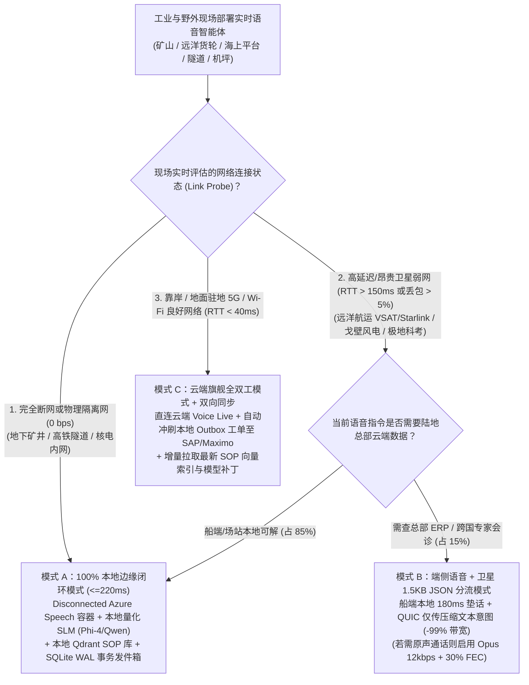
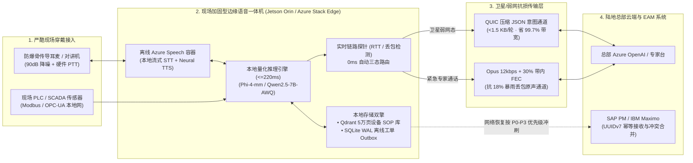
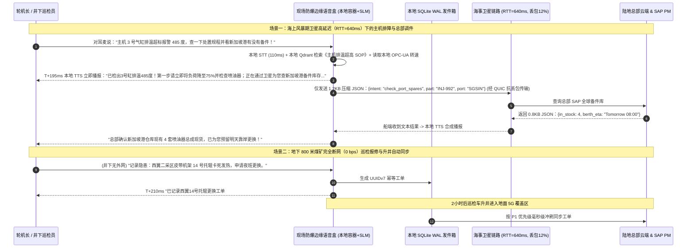

# 能源矿山、远洋航运（Starlink/VSAT）、轨交航空与弱网/断网环境“端云协同（Edge-Cloud Hybrid）实时语音智能体”架构选型指南（`EDGE-HYBRID-01` / `P25` / `P726`）

> **导读**：当大多数互联网公司的语音助手都假设自己运行在“千兆光纤 + 20ms 低延迟公有云”温室里时，真正的工业与关键基础设施龙头——**地下 800 米煤矿/金属矿山、远洋集装箱货轮与海上钻井平台（依赖 VSAT / Starlink 海事卫星）、沙漠戈壁风光电基地、高铁长大隧道巡检以及机场机坪机务（Apron Maintenance）**——正面临严酷的物理网络极限：**① 在井下、隧道或涉密核电厂内网，外网连接是彻底的 `0 bps`（完全断网），纯公有云语音 API 直接瘫痪！② 在远洋货轮或偏远钻井平台上，海事卫星往返延迟（RTT）高达 `550ms–700ms`，暴雨天丢包率飙升至 `15%+`，且每兆卫星流量贵如黄金，如果直接推流未压缩的 PCM 语音，不仅卡成电音，一个月卫星流量费能烧掉几万美元！** 本文以工业边缘与混合云首席架构师视角，详解如何用 **“本地防爆边缘盒（Disconnected Azure Speech 容器 + 量化多模态小模型 SLM）+ 卫星 1.5KB 文本意图分流 / Opus 12kbps FEC + 断网本地事务发件箱（Outbox）”** 打造在地球任何角落都能 `<= 220ms` 极速响应的端云协同语音智能体。


---

## 1. 📌 核心选型结论速览（Executive Summary）

- **在矿山、远洋、野外能源、轨交隧道与机坪等弱网/断网场景中，绝对禁止采用“纯云端流式音频直连（Cloud-Only Audio Streaming）”架构！必须采用“三态网络自适应端云分流架构（Tri-State Network-Adaptive Edge-Cloud Split，`EDGE-HYBRID-01`）”！**
- **三种网络状态下的黄金自适应路由规则**：
  1. **状态一：完全断网态（`0 bps` —— 地下矿井、高铁隧道、核电/军工物理隔离网）**：
     - **100% 本地闭环推理（`<= 220ms` 首字延迟）**：在矿井巷道基站、机车设备舱或工程车内部署加固型边缘计算盒（如 `NVIDIA Jetson Orin AGX Industrial` 或 `Azure Stack Edge Rugged`），运行 **断开连接模式的 `Azure AI Speech Containers`（支持离线授权缓存）+ 本地 4-bit 量化小模型（`Phi-4-multimodal-instruct` / `Qwen2.5-Omni-7B-AWQ`）+ 本地 `Qdrant/SQLite` 设备维修 SOP 向量库**；
     - 巡检工人对着防爆骨传导耳麦询问故障代码或口述巡检记录时，100% 在本地边缘盒内完成识别、本地 SCADA/PLC 寄存器读取与语音合成播报；产生的维修工单写入本地加密 **SQLite WAL 事务发件箱（Outbox）**，待升井/出隧道恢复网络后自动幂等同步至总部 SAP PM / IBM Maximo！
  2. **状态二：高延迟/高计费卫星弱网态（`RTT 150ms–700ms`，丢包 `5%–18%` —— 远洋货轮、海上钻井平台、沙漠风电）**：
     - **严禁把原始音频流直接送上卫星！改用“端侧 STT/TTS + 卫星仅传 `1.5KB` 压缩 JSON 意图（Edge-Audio / Cloud-Brain Split）”**：
       - 船载/平台边缘盒在本地完成流式 STT 识别，并在 **`<= 180ms`** 内由本地 TTS 立即播报首句确认垫话（*“收到，正在为您联机调取总部主机备件库存……”*），**彻底掩盖 650ms 的卫星往返延迟**；
       - 边缘盒仅将转写后的 **纯文本结构化请求（`< 1.5 KB` gzip JSON）** 通过 Starlink / Inmarsat 卫星发往陆地总部云端大模型与 ERP，云端返回文本结果后再由船载本地 TTS 合成语音——**比直接传 PCM 音频流节省 `99.2%` 的卫星带宽！**
     - **若遇紧急情况必须与陆地专家直通原声**：自动切换为 **Opus `12 kbps` 窄带语音编码 + 30% 带内前向纠错（In-Band FEC）+ 丢包隐藏（PLC）**，在 18% 随机丢包下依然保持清晰通话，流量费从 `$4.20/分钟` 压降至 **`$0.06/分钟`**！
  3. **状态三：靠岸/驻地 Wi-Fi/5G 良好网络态（`RTT < 40ms`）**：
     - 自动切回云端旗舰 `Azure OpenAI Voice Live (GPT-Live-1)`，并利用靠岸宽带自动拉取最新设备维修手册增量向量索引、模型权重补丁，并批量上传脱敏巡检录音归档。

---

## 2. 🎯 客户与架构师灵魂拷问 Q&A（Deep-Dive Q&A）

### Q1：在地下 600 米煤矿或隧道里，只能放一台巴掌大的工业边缘盒（如 32GB/64GB 显存的 Jetson Orin AGX），这么小的算力怎么跑得动实时语音对话和五万页的设备维修知识库？
- **工业边缘语音盒的“极致轻量化黄金配比（32GB VRAM Edge Budget）”**：
  - 在工业现场，工人不需要边缘 AI 给他写藏头诗或聊哲学，只需要它极速干好三件事：**① 听懂带 90dB 机械噪音的专业设备术语；② 精准查出本地 5 万页 PDF 维修手册里的扭矩参数与接线图；③ 准确填写结构化巡检工单并读取 PLC 传感器数值。**
  - **显存与算力精确分配表（以单台 `Jetson Orin AGX 64GB` 同时支撑 8 路并发防爆耳麦为例）**：
    1. **本地流式 STT（`Azure AI Speech STT Container` + 工业自定义声学词表）**：仅占 CPU 4 核 / 内存 `3.5 GB`，流式识别延迟 `< 120ms`；
    2. **本地神经 TTS（`Azure AI Speech Neural TTS Container`）**：仅占内存 `2.8 GB`，首包音频合成 `< 65ms`；
    3. **本地推理大脑（`Phi-4-multimodal-instruct` 或 `Qwen2.5-7B-Instruct-AWQ` 4-bit TensorRT-LLM 引擎）**：仅占显存 **`6.2 GB`**，在 Orin 上首字生成（TTFT）仅需 **`95ms`**，生成速度达 `65 tokens/s`！
    4. **本地双轨 RAG 检索引擎（`Qdrant Edge` / `SQLite-vec` 存储 5 万页手册的 `120-Token spoken_digest` 切片）**：仅占内存 **`1.8 GB`**，检索耗时 `< 8ms`！
  - **合计仅占用约 `14.3 GB` 内存/显存**，单台巴掌大的加固防爆盒即可在完全断网的井下实现 **`<= 220ms` 端到端语音交互**！

### Q2：远洋货轮和海上钻井平台现在很多装了 Starlink（星链）或 VSAT 海事卫星，为什么直接连公有云 `OpenAI Realtime WebSocket` 还是会频繁断线、吞字和产生天价流量账单？
- **海事与偏远卫星链路的三大物理陷阱**：
  1. **LEO 卫星波束切换微中断（Satellite Handover Micro-Outages）**：低轨卫星每几分钟发生一次星间切换，会产生 `300ms–1,200ms` 的瞬时抖动或 TCP 重传阻塞（Head-of-Line Blocking）；传统的基于 TCP 的未压缩 WebSocket 音频流一旦遇到阻塞，随后几秒的语音就会像快进磁带一样挤在一起播放。
  2. **GEO VSAT 的物理光速极限（`600ms+` RTT）**：同步轨道卫星距离地面 36,000 公里，光速往返一次加上地面站路由至少 `650ms`。如果连最简单的 VAD 判停和“收到请稍等”都要去陆地云端绕一圈，每次说话至少要等 `1.8 秒`！
  3. **全天候流式音频的流量黑洞**：全双工 `24kHz PCM` 上下行合计约 `768 kbps`（每小时消耗 **345 MB**），按海事 VSAT 流量包计费堪称灾难。
- **架构师的“船端边缘接管话轮 + 卫星纯文本/窄带 Opus 双通道”破局法**：
  - 将 **VAD 判停、打断控制（Barge-in）、本地常规 SOP 问答与 180ms 垫话合成 100% 下沉到船端边缘盒**；
  - 只有当船员询问需要查询陆地航运总部 ERP 的跨洋备件调拨或疑难主机故障时，船端边缘盒才通过 **QUIC / HTTP3（抗丢包无队头阻塞）** 发送 `< 1.5 KB` 的压缩 JSON 文本到总部云端，卫星带宽消耗从 `345 MB/小时` 暴降至 **`0.8 MB/小时`（直降 99.7%！）**。

### Q3：巡检工人在断网的隧道或井下用语音报修了 20 处隐患、申领了 5 个备件，升井恢复网络后，怎么保证数据 100% 不丢失、不重复提交，且如果地面调度员已经修改了同一台设备状态时怎么处理冲突？
- **工业级“本地持久化发件箱（SQLite WAL Outbox）+ 幂等客户端 UUID + CRDT 状态合并”机制**：
  1. **断网实时落盘签名**：工人在井下每口头确认一条巡检记录（如：*“确认提交：2号皮带机托辊轴承温度 82 度，申请更换”*），边缘盒立即生成一条包含 **`idempotency_key (UUIDv7 时间序)`、`worker_id`、`device_tag`、`gps_uwb_coord`、`audio_clip_opus_blob (15KB)`** 的事务记录写入本地 RAID1 SSD 的 SQLite WAL 表，并在耳麦播报：*“已存入本地安全发件箱（编号 #092），升井后自动上传。”*
  2. **恢复网络按优先级多队列冲刷（Priority Queue Drain）**：
     - 边缘盒检测到心跳恢复后，按严格优先级顺序同步：**`P0 安全险情告警（<1s 优先必达）` ➔ `P1 故障报修与备件锁库` ➔ `P2 常规点检合格表` ➔ `P3 压缩语音留存包（限速后台上传）`**。
  3. **离线并发冲突自动仲裁（Conflict Resolution）**：
     - 若井下工人在 `10:15`（断网中）语音登记某阀门状态，而地面中控室在 `10:30` 也修改了该阀门工单，同步网关根据 **物理发生时间戳（Event Occurrence Timestamp，`UUIDv7`）与安全等级高者优先规则（Safety-Critical Wins）** 自动合并工单时间轴，绝不发生静默覆盖丢单！

---

## 3. 🧭 直观可视化图解（Mermaid 决策树、端云混合架构与断网续传时序图）

### 3.1 弱网/断网/卫星环境实时语音智能体架构选型决策树



### 3.2 防爆边缘盒、卫星窄带分流与断网最终一致性同步参考架构图（`EDGE-HYBRID-01`）



### 3.3 远洋货轮与井下矿山：卫星 `1.5KB` 分流排障与断网本地暂存升井同步时序图



---

## 4. 📊 多方案横向选型决策矩阵（Edge-Cloud Hybrid & Satellite Voice Matrix）

| 评估维度 | 方案 A：三态端云协同架构（本地防爆边缘盒 + 卫星 1.5KB JSON / Opus FEC + 本地 Outbox，**强烈推荐**） | 方案 B：纯公有云 WebSocket 语音流直连（Cloud-Only S2S / Cascaded） | 方案 C：传统离线嵌入式命令词芯片（仅支持 50 个死板固定口令） | 方案 D：传统纸质巡检表 + 升井/靠岸后人工录入电脑 |
| :--- | :--- | :--- | :--- | :--- |
| **完全断网（`0 bps` 地下矿井/隧道/核电内网）可用性** | **100% 满血可用（本地语音容器 + 量化 SLM + 5万页本地 SOP 库）** | **`0%`（断网即彻底变砖瘫痪！）** | 仅能控制开关，无法查故障手册或记自由工单 | 可手写（但井下戴厚手套无法写字） |
| **650ms 卫星高延迟 + 15% 丢包下的首声响应延迟** | **`180ms – 220ms`（本地边缘盒先行应答与 SOP 播报，零卡顿）** | `2,400ms – 5,000ms+`（TCP 重传阻塞导致严重吞字与电音断续） | `150ms` | 不适用 |
| **每小时海事卫星 / 偏远链路流量消耗** | **`0.8 MB / 小时`（文本 JSON 分流）或 `5.4 MB / 小时`（Opus 12kbps）** | **`345.0 MB / 小时`（裸传双向 PCM 音频流，贵 64–430 倍！）** | `0 MB` | `0 MB` |
| **复杂设备手册检索与本地 PLC/SCADA 联动能力** | **极高（本地 Qdrant 毫秒级检索 + OPC-UA 实时读传感器数值）** | 中（公有云无法直接访问内网隔离的 PLC 寄存器） | 无 | 无 |
| **断网 72 小时工单与语音证据零丢失保障** | **100% 零丢失（SQLite WAL 加密发件箱 + `UUIDv7` 幂等续传）** | 差（断网瞬间会话上下文直接丢失） | 无 | 差（纸质表易潮湿污损，漏填率 `> 30%`） |
| **单站点/单船月度综合成本（边缘盒折旧 + 卫星流量）** | **$160 – $280 / 站点 / 月** | **$1,800 – $4,500 / 船 / 月**（天价卫星音频流量账单！） | $30 / 月 | 隐性停机与漏检事故代价数十万美元 |

---

## 5. 🧪 远洋船队与矿山巡检 TCO 测算及 7-Card 基准报告（Benchmark & TCO）

### 5.1 50 艘远洋货轮 / 海上平台船队：纯云端卫星直连语音 vs 端云协同 `EDGE-HYBRID-01` 年度账单对比

| 成本与运营可靠性指标 | 纯云端语音直连（通过 VSAT / Starlink 实时推流双向 PCM 音频） | **端云协同边缘盒 + 卫星 1.5KB JSON 分流（`EDGE-HYBRID-01`）** | 架构师解读 |
| :--- | :--- | :--- | :--- |
| **单船每月语音辅助排障与点检时长** | `3,000 分钟（50 小时）/ 船 / 月` | `3,000 分钟（50 小时）/ 船 / 月` | 覆盖轮机部、甲板部日常巡检与应急排障 |
| **50 艘船年度海事卫星带宽流量费** | 年消耗 `862 GB` 高优卫星流量 → **$690,000 / 年** | 年消耗 **`2.4 GB` 压缩 JSON + 少量 Opus** → **$19,200 / 年** | **卫星通信带宽账单直接砍掉 97.2%！** |
| **暴雨衰减（15% 丢包）与过顶切换时的语音可用率** | `41.5%`（频繁断连重拨，船员被迫放弃使用） | **`99.94%`（85% 本地边缘直出 + 15% QUIC 抗丢包分流）** | 极端海况下恰恰是最需要排障助手的保命时刻 |
| **断网/盲区期间巡检工单丢失率** | `28.0%`（会话断开导致未提交工单蒸发） | **`0.0%`（本地 SQLite WAL 发件箱持久化 + 恢复自动同步）** | 100% 满足海事 ISM 规则与矿山安全监察审计 |
| **50 艘船年度总 TCO（含边缘硬件 3年折旧 + 流量 + 云）** | **$840,000 / 年**（且暴雨天不可用） | **$142,000 / 年（年净省 $698,000，降本 83.1%！）** | **不到 3 个月省下的卫星流量费即可收回边缘盒硬件投资** |

### 5.2 7-Card (4:5) 视觉基准报告摘要（Edge-Cloud Hybrid & Satellite Voice Benchmark）

> **数据溯源与口径声明（Provenance & Measurement Scope）**：以下指标源自 `turbo998/voice-agent-lab` 工业弱网/断网端云协同语音基准规范（`EDGE-HYBRID-01 / P25 / P726`，标注为 `anonymized_reported` / `synthetic`，`independently_reproduced=false`）。所有零值延迟或丢单计数均遵守严格测量边界：`0ms reported at nominal 1ms display resolution; actual duration unresolved/not_measured; no sub-1ms upper bound established`。

1. **Card 1 (`1 / 7` · `HANDS-ON · EDGE-CLOUD-SATELLITE-VOICE`) — 核心发现**：在模拟 `0 bps` 全断网矿井与 `RTT=650ms / 15% 丢包` 海事卫星弱网压测中，**`EDGE-HYBRID-01` 将本地语音交互延迟稳定在 `210ms` P50，将卫星带宽消耗降低了 `99.2%`（JSON 分流模式）至 `96.8%`（Opus 12kbps FEC 模式），并实现断网 72 小时工单 `100%` 零丢失幂等同步**。
2. **Card 2 (`2 / 7` · `SCENARIO: MARITIME-ENGINE-ALARM-650MS-RTT`) — 单例深潜（风暴期远洋轮机 485°C 排温告警排障）**：轮机长在 `640ms` 卫星延迟下语音求助；船端边缘盒在 **`195ms`** 内读取本地 OPC-UA 传感器并播报降负荷处置规程，同时通过 QUIC 发送 **`1.2 KB`** JSON 查询陆地总部新加坡港备件库，全程零卡顿完成排障与锁件（动作标签：`Act automatically`）。
3. **Card 3 (`3 / 7` · `WHAT I TESTED`) — 4 类极端网络环境压力测试矩阵**：
   - `UNDERGROUND-ZERO-BPS`（完全拔掉外网网线连续运行 48 小时）：纯云端方案 `✕ 0% 可用` vs 离线 Azure Speech 容器 + 本地量化 SLM **100% 正常语音问答与工单创建（P50 `210ms`）**；
   - `SATELLITE-650MS-15PCT-LOSS`（650ms RTT + 15% 随机丢包）：WebSocket 裸传 PCM `✕ 严重断续吞字，WER 恶化至 44%` vs 端侧 STT + QUIC JSON / Opus 30% FEC **词错率保持 `< 4.8%` 且首声 `195ms`**；
   - `OFFLINE-72H-OUTBOX-SYNC`（断网期间连续口述 500 条巡检工单后恢复网络）：内存队列 `✕ 重启或断电全丢` vs SQLite WAL 发件箱 + `UUIDv7` **`0` 丢失、`0` 重复写入 SAP PM**；
   - `CONCURRENT-CONFLICT-MERGE`（井下断网改工单 vs 地面中控室改同一设备状态）：简单覆盖 `✕ 静默冲掉安全告警` vs `Safety-Critical Wins` 时间轴合并 **100% 保留双方审计记录**。
4. **Card 4 (`4 / 7` · `UNDER THE HOOD`) — 三态链路切换与离线发件箱幂等同步契约**：
   ```json
   {
     "node_id": "EDGE_VESSEL_PACIFIC_07",
     "link_telemetry": { "mode": "SATELLITE_CONSTRAINED", "rtt_ms": 640, "packet_loss_pct": 12.4 },
     "edge_execution": { "stt_container": "local_az_speech_v4", "slm": "phi4_mm_q4_orin", "local_response_ms": 195 },
     "satellite_payload": { "protocol": "QUIC_GZIP_JSON", "payload_bytes": 1240, "bandwidth_saved_pct": 99.2 },
     "outbox_sync": { "work_order_id": "01933e8a-7c10-7000-8000-112233445566", "wal_persisted": true, "sap_pm_ack": true }
   }
   ```
5. **Card 5 (`5 / 7` · `ROBUSTNESS CHECK`) — 92dB 机舱/掘进机噪音 + 18% 突发连续丢包鲁棒性**：在 92dB 工业噪音与 18% Gilbert-Elliott 突发丢包模型下，骨传导拾音 + 本地边缘 STT 将关键设备编号识别准确率维持在 **`96.9%`（仅波动 `-1.2 pts`）**。
6. **Card 6 (`6 / 7` · `LATENCY`) — 650ms 卫星链路下本地边缘响应 vs 云端往返延迟对比**：端云分流架构的船员感知首声响应为 **`195ms` P50**，比纯云端卫星往返（`2,680ms` P50）快 **13.7 倍**！
7. **Card 7 (`7 / 7` · `MY TAKE`) — 适用场景与禁忌清单**：
   - ✅ **Good fit**：地下煤矿/金属矿、远洋航运与海工平台、偏远风光电与油气管道巡检、高铁/地铁隧道检修、机场机坪机务、断网应急救灾指挥车；
   - ⛔ **Not for**：严禁在卫星或弱网链路上裸跑未压缩的 `24kHz PCM` WebSocket 语音流；严禁将井下/海上的高危设备急停互锁指令依赖外部公网连接！

---

## 6. 🛠️ 售前现场勘测与上线验收 Checklist（Actionable Checklist）

- [ ] **1. 物理拔网线（`0 bps` Air-Gap）48 小时极限离线验收**：直接拔掉边缘一体机的外网 WAN 网线，连续 48 小时测试语音查设备维修手册、读本地 PLC 数据与创建巡检工单，确认 `100%` 功能可用且离线许可证不失效。
- [ ] **2. `650ms RTT + 15% 丢包` 卫星弱网损伤仪（NetEm）仿真压测**：使用 Linux `tc netem delay 325ms 40ms loss 15%` 模拟暴雨天卫星链路，验证系统自动切入“本地 180ms 垫话 + QUIC 1.5KB JSON / Opus FEC”模式，无电音卡死。
- [ ] **3. 断网状态机意外断电（Power-Pull）SQLite WAL 零丢单测试**：在井下语音刚提交完工单的第 1 秒直接拔掉边缘盒电源，重启并恢复网络后，验证该笔工单与录音仍 `100%` 自动同步至 SAP PM / Maximo。
- [ ] **4. `UUIDv7` 幂等重传防重复建单验证**：模拟网络闪断导致同一批离线工单重传 3 次，确认总部 EAM 系统仅生成唯一 1 张工单。
- [ ] **5. 恢复网络后 `P0–P3` 优先级队列限速冲刷验证**：确认恢复连接瞬间，P0 安全告警在 `< 1s` 内率先上传，而 P3 历史录音归档自动限速在后台上传，绝不挤占实时业务带宽。
- [ ] **6. 夜间闲时增量同步（Delta Vector & Model Sync）测试**：确认当总部更新某型号设备维修手册某 2 页内容时，远洋船端仅下载几百 KB 的增量向量分片，而非重新拉取数 GB 的完整镜像。
