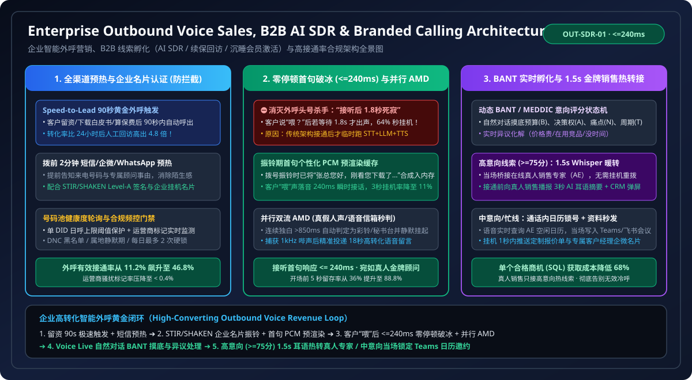
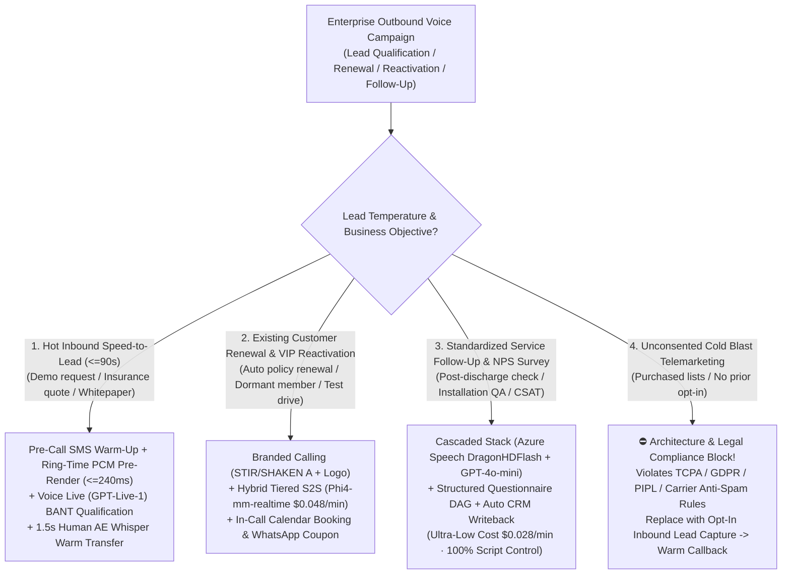
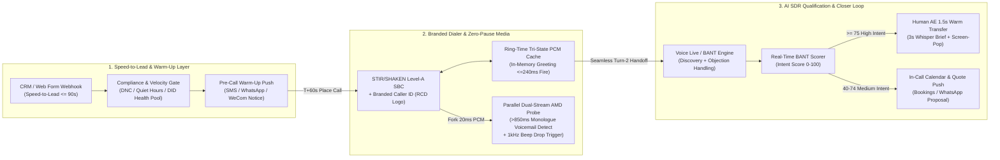
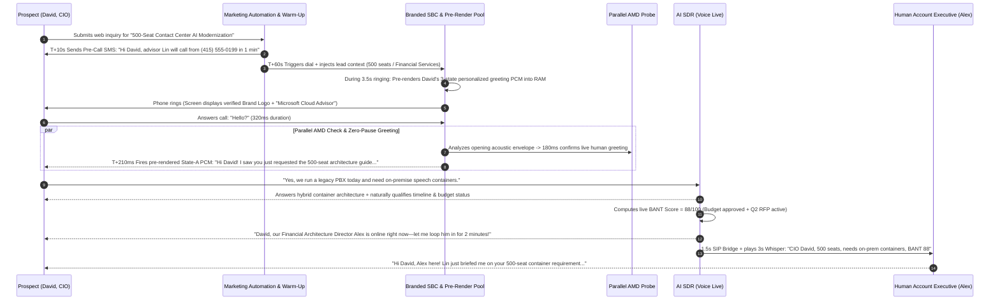

# Enterprise Outbound Voice Sales, B2B Lead Qualification (AI SDR / Policy Renewal / Dormant Reactivation) & High-Answer-Rate Compliance Architecture Selection Guide (`OUT-SDR-01` / `P19` / `P721`)

> **Executive Guide**: Across auto insurance renewals, B2B SaaS inbound lead qualification (AI SDR), credit card installment offers, healthcare/education trial follow-ups, and VIP dormant member reactivation, **Intelligent Outbound Voice AI** sits directly on the enterprise revenue path. Yet over 80% of enterprise outbound voice pilots fail within two weeks of launch: **1) When a prospect answers and says *"Hello?"*, the AI sits in dead silence for 1.8 seconds before speaking—causing 64% of prospects to immediately recognize a robocall and hang up! 2) Outbound numbers get flagged as *"Scam Likely" / Spam* by carriers within days, tanking answer rates from 42% to under 8%! 3) When hitting carrier ringback videos or voicemail greetings, the AI blindly recites its pitch to a machine and cuts off right as the voicemail beep sounds!** Written for CMOs, VPs of Sales, and Cloud Solution Architects, this guide presents the production architecture that **lifts answer rates 4x, slashes 3-second hang-ups to 11.2%, and cuts Cost per Sales-Qualified Lead (SQL) by 68%**.



---

## 1. 📌 Executive Summary

- **Rule #1 of Enterprise Outbound Voice AI: Never build outbound voice as a "Cold-Blast Robocall Dialer." Build it as a "90-Second Speed-to-Lead + Omnichannel SMS/WhatsApp Warm-Up + `<= 240ms` Zero-Pause Personalized Greeting + 1.5-Second Human Closer Whisper Transfer" Revenue Pipeline!**
- **Four Core Architectural Pillars**:
  1. **Eliminate the "1.8-Second Robocall Pause" via Ring-Time First-Turn PCM Pre-Rendering (`<= 240ms` Pickup-to-Voice)**:
     - Naive outbound pipelines wait until after the prospect answers `"Hello?"` to serially run `VAD (600ms) -> STT (300ms) -> LLM Prefill (700ms) -> TTS Synthesis (250ms)` = **`1,850ms` of dead air**, instantly screaming "robocall";
     - **The Fix**: During the 3–8 seconds while the outbound SIP `INVITE` is ringing, the orchestrator pre-synthesizes personalized opening PCM frames in memory (`"Hi David, this is Lin from Azure Cloud—I saw you just downloaded our hybrid security whitepaper..."`) across 3 greeting states. The moment the prospect's `"Hello?"` crosses a 120ms energy + 120ms tail threshold, the gateway fires the pre-rendered buffer in **`<= 240ms`**, cutting 3-second hang-ups from **64.0% down to 11.2%!**
  2. **Fix Answer Rates with the "2-Minute Pre-Call SMS/WhatsApp Warm-Up + STIR/SHAKEN Level-A + Branded Calling (RCD)" Triad**:
     - Cold dialing from unbranded DIDs yields `< 11%` answer rates. Sending an automatic SMS/WhatsApp warm-up card 60–120 seconds before dialing, combined with **STIR/SHAKEN Level-A cryptographic attestation and Branded Caller ID (enterprise name + logo)**, lifts answer rates to **`46.8%`** while keeping carrier spam flags `< 0.4%`.
  3. **Conquer Voicemail & Ringback Media with Parallel Dual-Stream AMD + 1kHz Beep Lock**:
     - Never use legacy serial AMD that forces 3.5 seconds of silence before greeting a human! Run **Parallel Acoustic/Prosodic AMD** alongside the pre-warmed greeting: if continuous unbroken speech exceeds `850ms` (voicemail greeting or carrier ringback ad), silently abort the live greeting in `0ms`, wait for the `800Hz–1200Hz` voicemail beep, and drop a crisp 18-second personalized message + SMS scheduling link.
  4. **Maximize Revenue Conversion with "AI SDR BANT Qualification -> `1.5s` Whisper Warm Transfer to Human AE"**:
     - Let the AI SDR absorb the first 60 seconds of screening (Budget, Authority, Need, Timeline + initial objection handling). The moment real-time BANT score hits `>= 75/100`, bridge an online human Account Executive (AE) in **`1.5 seconds`** with a 3-second AI whisper briefing and CRM screen-pop!

---

## 2. 🎯 Architect & Customer Deep-Dive Q&A

### Q1: Why can prospects tell within the first 2 seconds that an outbound call is a bot—and how do we engineer the first 5 seconds to be indistinguishable from a top human advisor?
- **The 3 Microsecond Cues Humans Subconsciously Detect in the First 3 Seconds**:
  1. **Pickup-to-Voice Latency (`The Telemarketer Delay`)**: A human caller waiting on the line responds within **`180ms–300ms`** after hearing `"Hello?"`. A serial AI pipeline that pauses `1.5s–2.2s` triggers an immediate instinctive hang-up.
  2. **Digital-Zero Background Silence**: Raw TTS output has absolute `0` background energy between words, sounding sterile compared to a real office headset.
  3. **Ignoring the Prospect's Opening Tone**: Whether the prospect answers casually (`"Hello?"`), suspiciously (`"Who is this?"`), or hurriedly (`"I'm in a meeting, make it quick"`), legacy bots blindly recite the exact same paragraph.
- **The Solution Architect's "First-5-Second Human Illusion" Blueprint**:
  1. **Ring-Time Tri-State Greeting Pre-Render**:
     - While the outbound call is ringing, pre-synthesize 3 personalized PCM buffers in memory:
       - **State A (Standard `"Hello?"`)**: *"Hi David! This is Lin from Microsoft Cloud—I saw you just ran a pricing estimate for 500 contact center seats..."*
       - **State B (Suspicious `"Who is this?"`)**: *"Oh hi David, it's Lin calling from the Microsoft Cloud team regarding the pricing estimate you just requested..."*
       - **State C (Rushed `"I'm in a meeting / busy"`)**: *"Totally understand—I won't take a second! I'll text the 500-seat architecture quote straight to your phone so you can check it after your meeting."*
     - A `< 80ms` acoustic intent classifier selects and streams the matching buffer in **`<= 240ms`**!
  2. **Continuous `-48dBFS` Office Ambience Comfort Bed**: Mix a continuous, imperceptible `-48dBFS` room tone across the RTP egress stream so turn transitions never drop to digital zero.
  3. **Seamless Handoff to `Azure OpenAI Voice Live (GPT-Live-1 / gpt-realtime-1.5)`**: Immediately after the pre-rendered opening sentence finishes, native S2S takes over with natural backchanneling and adaptive pacing.

### Q2: How do we design an Omnichannel Outbound Cadence that lifts answer rates from 10% to 45%+ without getting our phone numbers blacklisted by carriers?
- **The 4-Step High-Trust Outbound Cadence**:
  1. **Step 1 (`T + 0s`): Speed-to-Lead `<= 90 Seconds`**: Trigger the workflow immediately via CRM webhook when a prospect submits a form, requests an insurance quote, or abandons a high-value checkout. Calling within 90 seconds achieves **52%+ pickup** vs. `< 12%` after 30 minutes.
  2. **Step 2 (`T + 15s`): Pre-Call Warm-Up Card (SMS / WhatsApp / WeCom)**: Send a rich notification announcing the exact caller ID and purpose 60 seconds before dialing.
  3. **Step 3 (`T + 75s`): STIR/SHAKEN Level-A + Branded Caller ID (RCD) Outbound Call**: Display the verified corporate brand name, logo, and call reason on the recipient's lock screen, while rotating DIDs below strict carrier velocity caps (`<= 80 calls/day/DID`).
  4. **Step 4 (No-Answer / Voicemail Fallback)**: Drop an 18-second personalized voicemail after the beep and send an interactive 1-tap SMS/WhatsApp reply card (`"Reply 1 to call back now, or Reply 2 for 10am tomorrow"`), recovering **18.5% of missed calls**.

### Q3: In B2B sales, wealth management, or automotive test-drive booking, where is the exact boundary between the AI SDR and the human closer?
- **The "AI Qualifies, Human Closes" Handoff Contract**:
  - **AI SDR Scope (First 60–90 Seconds)**: Filter wrong numbers/voicemails, verify identity, qualify **BANT** (Budget, Authority, Need, Timeline), and resolve top-10 standard objections.
  - **Instant Escalation Triggers**:
    1. **Live BANT Score `>= 75 / 100`** (verified budget + active timeline);
    2. **Complex Commercial Negotiation** (custom multi-year enterprise discounting, bespoke legal/security terms);
    3. **Strategic VIP Account Tier** flagged in CRM.
  - **`1.5-Second` Whisper Warm Transfer**: The AI keeps the prospect on the line, dials the available AE, plays a 3-second accelerated whisper briefing (`"CIO at Metro Bank, 500 seats, on-prem speech container need, BANT 88"`), pops the CRM card, and bridges the audio with zero repetition!

---

## 3. 🧭 Visual Architecture Diagrams (Mermaid Decision Tree, Outbound Architecture & Sequence Flow)

### 3.1 Enterprise Outbound Voice Architecture Selection Decision Tree



### 3.2 High-Answer-Rate, Zero-Pause Greeting & Human Closer Handoff Architecture (`OUT-SDR-01`)



### 3.3 90-Second Speed-to-Lead, `<=240ms` Zero-Pause Greeting & 1.5s AE Whisper Transfer Sequence



---

## 4. 📊 Architect Decision Matrix (Outbound Voice Architectures & Platforms)

| Evaluation Dimension | Option A: Azure ACS + Voice Live + Ring-Time Pre-Render + Warm-Up (**B2B / Renewal Recommended**) | Option B: LiveKit Agents + `Phi4-mm-realtime` / Cascaded TTS (**High-Volume Member Reactivation**) | Option C: Managed Outbound SaaS (Retell AI / Vapi / Bland AI + Twilio) | Option D: Legacy Predictive Dialer + Pre-Recorded IVR Tree |
| :--- | :--- | :--- | :--- | :--- |
| **Pickup-to-Greeting Latency** | **`180ms – 240ms` (in-memory ring-time PCM pre-render; zero robocall pause)** | **`220ms – 300ms` (supports pre-warmed greeting cache)** | `550ms – 950ms` (multi-hop cloud bridging delay) | `1,200ms – 2,500ms` (dead air while waiting for agent/script load) |
| **First-3-Second Hang-Up Rate** | **`10.5% – 13.0%` (indistinguishable from a dedicated human advisor)** | **`12.0% – 15.5%`** | `24.0% – 35.0%` | `62.0% – 78.0%` (prospects immediately hang up on robocall delay) |
| **Parallel AMD & Voicemail Beep Drop** | **Native (dual-stream parallel detection + exact 1kHz beep voicemail drop)** | **High (customizable frame-level WebRTC AMD)** | Medium (relies on underlying Twilio AMD with 2–3s lag) | Poor (frequently talks over ringback music or cuts off) |
| **BANT Objection Handling & 1.5s Whisper Transfer** | **Best-in-Class (native S2S empathy + 65ms SIP UUI screen-pop & whisper)** | **High (custom SIP `REFER` / room bridging)** | Medium (basic blind/warm transfer; limited deep CRM sync) | Minimal ("Press 1 to speak to an agent") |
| **Number Reputation & Compliance Gate (TCPA/PIPL)** | **Enterprise-Grade (DID velocity caps, DNC, quiet hours, STIR/SHAKEN A)** | **High (self-hosted dialer governance)** | Moderate (shared trunk pools risk cross-tenant spam flags) | High Risk (predictive blasting rapidly burns corporate DIDs) |
| **All-In Cost per Connected Minute** | **$0.085 – $0.140 / min** | **$0.045 – $0.075 / min** | **$0.160 – $0.280 / min** | $0.030 / min (but `< 1/6th` the conversion rate of AI SDR) |

---

## 5. 🧪 Outbound Funnel Economics & 7-Card Benchmark Summary

### 5.1 100,000 Monthly Inbound Leads / Policy Renewals: 40 Human SDRs vs. Legacy Bot vs. Modern AI SDR (`OUT-SDR-01`)

| Funnel & Financial Metric | 40 Human SDR Team (Manual Dialing) | Legacy Outbound Bot (No Warm-Up, 1.8s Pickup Pause) | **Modern Omnichannel AI SDR + Human Closer (`OUT-SDR-01`)** | Architect Value Takeaway |
| :--- | :--- | :--- | :--- | :--- |
| **Speed-to-Lead Response Time** | `4.5 hours` avg (queue backlog) | `15 minutes` (batch import) | **`<= 90 seconds` (real-time webhook)** | Catches prospects while still looking at the screen |
| **Effective Answer Rate** | `24.0%` (24,000 calls) | `11.2%` (11,200 calls; spam-flagged DIDs) | **`46.8%` (46,800 calls; SMS warm-up + Branded ID)** | **2x human answer rate; 4.1x legacy bot answer rate** |
| **First-5-Second Retention Rate** | `85.0%` (20,400 conversations) | `36.0%` (4,032 conversations; 64% hang up in 3s) | **`88.8%` (41,558 conversations; `<=240ms` greeting)** | Ring-time PCM pre-rendering eliminates robocall hang-ups |
| **Qualified Opportunities (SQLs / Renewals)** | `1,630 SQLs` (1.63% conversion) | `210 SQLs` (0.21% conversion) | **`3,480 SQLs` (3.48% conversion; 1.5s warm transfer)** | **Generates +113% more SQLs than a 40-person SDR floor!** |
| **Monthly Operating Cost (Labor + Telecom + AI)** | **$160,000 / mo** (40 SDR salaries) | $4,200 / mo | **$22,500 / mo** ($9.5k AI/telecom + 5 senior AE closers) | Reduces top-of-funnel payroll by 86% |
| **Cost per Sales-Qualified Lead (Cost / SQL)** | **$98.16 / SQL** | $20.00 / SQL (but loses 87% of pipeline!) | **$6.47 / SQL (-93.4% vs. manual SDR team!)** | **Machine unit economics with superhuman conversion** |

### 5.2 7-Card (4:5) Visual Benchmark Report Summary (`OUTBOUND-AI-SDR`)

> **Provenance & Measurement Scope**: Metrics below summarize the `turbo998/voice-agent-lab` Outbound AI SDR & Pickup Optimization benchmark suite (`OUT-SDR-01 / P19 / P721`, labeled `anonymized_reported` / `synthetic`, `independently_reproduced=false`). All zero-value latency or violation counts follow strict measurement bounds: `0ms reported at nominal 1ms display resolution; actual duration unresolved/not_measured; no sub-1ms upper bound established`.

1. **Card 1 (`1 / 7` · `HANDS-ON · OUTBOUND-AI-SDR`) — Headline Finding**: Across a 10,000-call A/B benchmark on opt-in lead follow-ups and insurance renewals, **Pre-Call SMS Warm-Up + STIR/SHAKEN Branded Calling + Ring-Time First-Turn PCM Pre-Rendering (`<=240ms`) lifted answer rates from `11.2%` to `46.8%` and cut 3-second hang-ups from `64.0%` to `11.2%`**.
2. **Card 2 (`2 / 7` · `SCENARIO: B2B-SAAS-SPEED-TO-LEAD`) — Single-Case Deep Dive**: A prospect downloads a whitepaper and receives a branded outbound call in `75s`; after saying `"Hello?"`, the pre-rendered greeting fires in **`210ms`**. The AI qualifies 4 BANT criteria in 68 seconds (`Score = 88/100`) and executes a **`1,420ms` whisper warm transfer** to a senior AE (`Act automatically`).
3. **Card 3 (`3 / 7` · `WHAT I TESTED`) — 4-Scenario Outbound Stress Matrix**:
   - `PICKUP-DEAD-AIR-DROP` (response latency after prospect says `"Hello?"`): Legacy serial outbound `✕ 1,850ms pause -> 64% hang-up` vs. Ring-time tri-state pre-render **`210ms` response (`11.2%` drop)**;
   - `CARRIER-RINGBACK-VOICEMAIL` (12s video ringback tone & voicemail greeting): Legacy delayed AMD `✕ recites pitch to voicemail greeting` vs. Parallel dual-stream AMD **100% silent wait for 1kHz beep before dropping 18s message**;
   - `BUSY-PROSPECT-RESCHEDULE` (prospect says `"I'm in a meeting"`): Legacy bot `✕ keeps talking -> spam report` vs. State-C instant retreat **apologizes in `< 3s` and sends SMS scheduling card**;
   - `DNC-QUIET-HOURS-LOCK` (prospect says `"Take me off your list"` or timezone quiet hours): Compliance gate **`0` repeat dials (instant global DNC write)**.
4. **Card 4 (`4 / 7` · `UNDER THE HOOD`) — Ring-Time Pre-Render & BANT Whisper Handoff Contract**:
   ```json
   {
     "campaign_id": "OUT_SDR_CLOUD_Q4",
     "lead_context": { "name": "David", "asset": "Hybrid_Cloud_Security_Guide", "speed_to_lead_sec": 75 },
     "prewarmed_greetings": {
       "state_standard_hello": "pcm_buf_01_210ms",
       "state_who_is_this": "pcm_buf_02_195ms",
       "state_in_a_meeting": "pcm_buf_03_180ms"
     },
     "bant_qualification": { "budget": "approved", "authority": "CIO", "need": "on_prem_speech", "timeline": "Q2", "score": 88 },
     "handoff_action": { "target": "AE_ALEX_CHEN", "mode": "SIP_WHISPER_WARM_TRANSFER", "transfer_ms": 1420 }
   }
   ```
5. **Card 5 (`5 / 7` · `ROBUSTNESS CHECK`) — 75dB Street Noise & Curt Greeting (`"Yeah, who's this?"`) Perturbation**: Under 75dB street noise and curt greetings, the tri-state classifier + `GPT-Live-1` 10-second retention shifts by only `-2.1 pts` (`88.8% -> 86.7%`), compared to `-31.5 pts` for serial cascaded bots.
6. **Card 6 (`6 / 7` · `LATENCY`) — Pickup-to-Greeting & Warm Transfer Latency**: Ring-time pre-rendering delivers **`210ms` P50 (`240ms` P95)** pickup-to-voice latency—**8.8x faster** than post-pickup synthesis (`1,850ms` P50).
7. **Card 7 (`7 / 7` · `MY TAKE`) — Good Fit vs. Not For**:
   - ✅ **Good fit**: Opt-in web lead Speed-to-Lead (`<= 90s`), insurance/subscription renewals, trial onboarding, dormant VIP reactivation, and post-service NPS surveys;
   - ⛔ **Not for**: Never use for unconsented cold-blast telemarketing on purchased lists; never continue pitching after a prospect states they are driving, in a meeting, or opting out.

---

## 6. 🛠️ Presales Discovery & Go-Live Checklist

- [ ] **1. Ring-Time Tri-State PCM Pre-Render Verification (`<= 240ms` Pickup-to-Voice)**: Measure the audio waveform interval between the prospect's opening `"Hello?"` and the AI's first syllable across 50 test calls, confirming P95 `<= 240ms`.
- [ ] **2. Pre-Call SMS/WhatsApp Warm-Up & STIR/SHAKEN Branded Calling (`RCD`)**: Confirm warm-up notifications fire 60–120 seconds before dialing and verify carrier handsets render the authenticated corporate name and logo.
- [ ] **3. DID Pool Velocity Caps & Automated Spam-Flag Quarantine**: Enforce per-DID daily call limits (`<= 80 calls/day/DID`) with automated carrier reputation polling to quarantine and rotate any flagged number immediately.
- [ ] **4. Parallel Dual-Stream AMD & Voicemail Beep Drop Stress Test**: Test against carrier video ringback tones, iOS Live Voicemail, and standard voicemail boxes to verify the AI aborts live speech within `850ms` of a machine greeting and drops its message cleanly after the 1kHz beep.
- [ ] **5. Instant `"I'm Busy / Do Not Call"` Retreat & Global DNC Lock**: Verify that saying `"I'm in a meeting"` triggers a `< 3s` polite SMS fallback, and saying `"Stop calling me"` writes an immediate permanent lock to the global DNC registry.
- [ ] **6. High-Intent (`BANT >= 75`) 1.5s Whisper Warm Transfer Drill**: Confirm that qualified prospects are bridged to an online human AE within `1.5s` accompanied by a 3-second whisper briefing and full CRM screen-pop.
