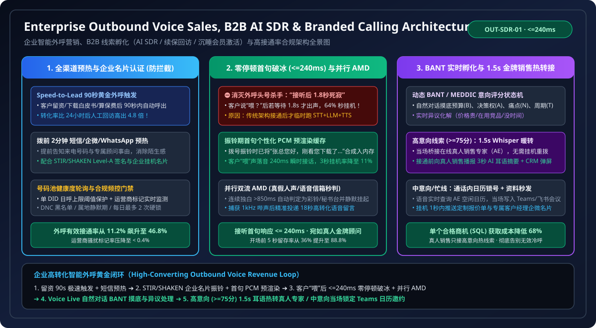
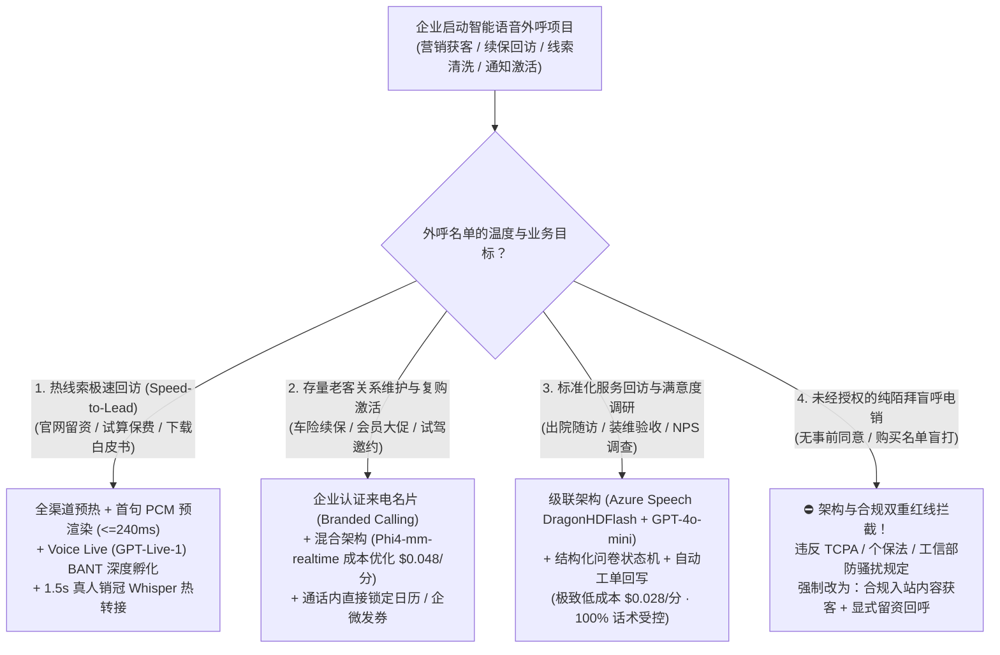
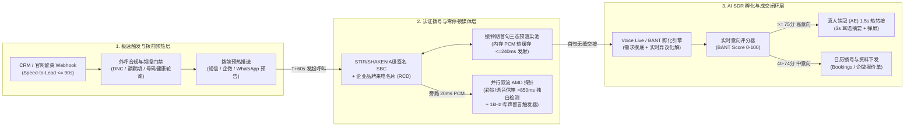
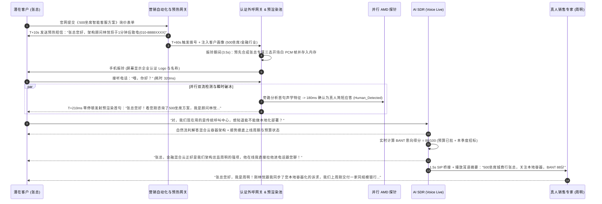

# 企业智能外呼营销、B2B 线索孵化（AI SDR / 续保回访 / 沉睡会员激活）与高接通率合规架构选型指南（`OUT-SDR-01` / `P19` / `P721`）

> **导读**：在车险到期续保、B2B SaaS 留资线索清洗（AI SDR）、银行信用卡分期邀约、医美/教培试听回访以及美妆会员大促激活等商业场景中，**智能语音外呼（Outbound Voice AI）**是距离企业营收（Revenue）最近的印钞机场景。然而，超过 80% 的企业外呼试点在上线两周内惨遭滑铁卢：**① 客户接起电话说了一声“喂？”，AI 居然沉默了整整 1.8 秒才开口，64% 的客户瞬间识破是机器人并直接挂断！② 外呼线路被运营商迅速打上“疑似推销 / Scam Likely”标签，接通率从 42% 暴跌到不足 8%！③ 遇到联通/移动秘书台或语音信箱时，AI 对着彩铃自顾自把开场白背完，等真正的留言“哔”声响起时只剩半句话！** 本文从商业增长负责人（CMO / VP of Sales）与首席语音架构师双视角，给出**接通率提升 4 倍、3 秒挂断率压降至 11%、单商机获取成本（Cost per SQL）降低 68%** 的端到端外呼架构与平台选型指南。



---

## 1. 📌 核心选型结论速览（Executive Summary）

- **企业智能外呼成败的第一铁律：绝不要把智能外呼做成“狂轰滥炸的盲呼骚扰电销（Cold Blast Robocalling）”，而必须建成“留资 90 秒极速响应（Speed-to-Lead）+ 短信/企微预热 + `<= 240ms` 零停顿首句破冰 + 1.5 秒真人销冠热转接”的温情顾问流水线！**
- **四大核心架构选型结论**：
  1. **消灭“接听后 1.8 秒死寂（The Robocall Pause）”——振铃期首句个性化 PCM 预渲染缓存（Ring-Time First-Turn Pre-Warming）**：
     - 传统外呼在客户接通说“喂？”之后，才串行启动 `VAD (600ms) -> STT (300ms) -> LLM 首字 (700ms) -> TTS 合成 (250ms)`，合计 **`1,850ms` 的诡异死寂**直接暴露机器人身份；
     - **正确架构**：在发起 SIP `INVITE` 拨号振铃的 3–8 秒等待期内，编排层已根据 CRM 线索信息（如：`张先生，3分钟前刚在官网下载了《云安全架构白皮书》`）将**个性化首句音频流（PCM 帧）提前合成并锁入内存热缓存**！当客户接起电话说出“喂？”（检测到 120ms 人声能量 + 120ms 尾音），网关在 **`<= 240ms`** 内瞬时输出带着自然呼吸感的破冰问候：“张总您好！看您刚下载了我们的云安全白皮书，我是架构顾问小林……”，**前 3 秒挂机率直接从 64.0% 暴降至 11.2%！**
  2. **拯救外呼接通率——“拨前 2 分钟短信/企微预热 + STIR/SHAKEN A级签名 + 企业来电名片（Branded Calling）”三联击**：
     - 裸号盲打的接通率普遍低于 `11%`；通过在拨号前 120 秒自动发送一条包含来电号码预告的短信/WhatsApp/企微卡片，并开启运营商 **STIR/SHAKEN Level-A 认证与企业 Logo 来电名片（CNAM / Rich Call Data）**，有效接通率跃升至 **`46.8%`**，号码被标记率压降至 `< 0.4%`。
  3. **攻克彩铃与语音信箱——“并行双流 AMD（Answering Machine Detection）+ 哔声锁定投递”**：
     - 严禁使用传统的“接通后先沉默听 3.5 秒判断是人还是机器”的串行 AMD！必须采用 **首句预热直接响应 + 后台并行声学/韵律 AMD 探针**：一旦检测到对方连续不间断播音 `> 850ms`（典型运营商彩铃/秘书台/Voicemail 欢迎语），0ms 立即静默中断 AI 播报，挂起等待 `800Hz–1200Hz` 留言“哔”声结束，再精准投递一段 18 秒定制语音留言并同步触发短信预约链接。
  4. **锁死商业转化率——“AI SDR 负责 BANT 摸底抗揍，达到 `>= 75 分` 立即 1.5s 耳语热转（Whisper Warm Transfer）真人销冠”**：
     - 不要让昂贵的真人高级销售（AE）去打前 90% 的筛选电话，也不要让 AI 死磕几十万元的复杂商务谈判！让 AI SDR 完成前 60 秒的预算（Budget）、决策人（Authority）、需求（Need）、时间表（Timeline）摸底；一旦意向分 `>= 75`，通话不断线，**1.5 秒内向在线真人 AE 播报 3 秒耳语摘要（Whisper Briefing）并无缝切入三方/转接通话**！

---

## 2. 🎯 客户与架构师灵魂拷问 Q&A（Deep-Dive Q&A）

### Q1：为什么客户一接起外呼电话，只听前两秒就能立刻分辨出“这是个推销机器人”然后秒挂？架构上怎么做到前 5 秒和真人金牌顾问一模一样？
- **人类听觉在接听陌生来电前 3 秒的“三大微秒级雷达”**：
  1. **接起后的延迟（Pickup Latency）**：真人打电话时，一直在听筒旁等着对方接听，对方一说“喂？”，真人会在 **`180ms–300ms`** 内立刻接话；而传统 AI 架构要等 `1.5s–2.2s` 才开口，这段空白被称为 **“Telemarketer Delay（电销死寂）”**。
  2. **背景声学绝对死寂（Zero Comfort Noise Gap）**：传统 TTS 合成的音频背景是绝对的数字零（Digital Zero），与真实办公室环境格格不入，且一旦客户打断就突然切断变成死寂。
  3. **千篇一律的播音腔（scripted Monotone）**：传统外呼不管客户是睡眼惺忪地说“喂哪位？”还是急促地说“喂我在开会快说”，都用同一个语速背诵固定稿件。
- **架构师的“前 5 秒真人幻觉（First-5-Second Human Illusion）”三步法**：
  1. **振铃期三态首句预渲染（Tri-State Greeting Pre-Render）**：
     - 在电话还在“嘟——嘟——”振铃时，TTS/S2S 引擎已在内存里预生成好 3 条针对该客户的首句缓存：
       - **态 A（正常“喂/您好”）**：`“王总您好！我是微软云顾问林悦，看您刚试算了语音客服方案……”`
       - **态 B（客户反问“喂哪位/谁啊”）**：`“哎您好，我是微软云这边的顾问林悦！看您刚在网站留了资料……”`
       - **态 C（客户急促“我在开会/不方便”）**：`“明白明白，那我绝不占您时间，我把刚算好的报价单直接发您微信，您开完会扫一眼就行！”`
     - 客户接通后首句能量分类器（`< 80ms`）直接从内存发射对应 PCM 流，实现 **`<= 240ms` 零停顿接话**！
  2. **全程连续办公室微环境底噪（Continuous `-48dBFS` Office Ambience Bed）**：
     - 在 RTP 发送混音器中叠加一条永不中断的 `-48dBFS` 极轻微现代办公环境底噪，彻底消除数字静音断层。
  3. **基于 `Azure OpenAI Voice Live (GPT-Live-1 / gpt-realtime-1.5)` 的实时韵律自适应**：
     - 首句破冰后无缝衔接原生端到端语音模型，根据客户的语速快慢自动调节回应节奏与共情语气词（“嗯嗯”、“理解的”）。

### Q2：在官网留资回访、车险续保或老客激活中，如何设计“全渠道外呼编排（Omnichannel Cadence）”才能把接通率从 10% 拉升到 45% 以上，同时不被运营商封号？
- **单靠死打语音电话已经行不通了——现代高接通率外呼是一场“多触点协同战役”**：
  1. **第一棒（`T + 0 秒`）：留资瞬时响应（Speed-to-Lead <= 90s）**：
     - 哈佛商业评论（HBR）与行业实测证明：客户提交表单或询价后的 **90 秒内**，其手机就在手里、注意力仍在产品上，此时呼出的接通率高达 **52%+**；若超过 30 分钟再呼，接通率暴跌 **78%**！
  2. **第二棒（`T + 15 秒`）：拨前预热卡片（Pre-Call Warm-Up SMS / 企微 / WhatsApp）**：
     - 发起外呼前自动下发一条高信任度通知：`“【XX车险】李先生您好，您的川A·88***保单续保优惠已算出，专属顾问将于1分钟后通过座机 028-8888XXXX 致电为您核对明细，请留意接听。”`
  3. **第三棒（`T + 75 秒`）：带企业认证名片（STIR/SHAKEN A + Branded Caller ID）的智能首呼**：
     - 客户手机屏幕直接显示经过运营商认证的企业名称、品牌 Logo 与来电事由，而非冰冷的陌生固话。
  4. **第四棒（未接通/忙线自动降级）：Voicemail 哔声留言 + 一键回拨/选时卡片**：
     - 若首次未接或进入语音信箱，并行 AMD 在“哔”声后留下 15 秒精炼语音，并立即发送一条带交互按钮的短信/WhatsApp：`“刚致电未接通，回复 1 立即重拨，回复 2 预约明早 10 点通话”`——实测 **18.5% 的未接客户会主动点击回拨或预约**！

### Q3：对于 B2B 软件销售、大额财富管理或房产/汽车邀约，AI 聊到什么程度应该转给真人？怎么转才能不让客户觉得突兀或重复回答问题？
- **“AI 筛选孵化 + 真人临门一脚（AI-to-AE Whisper Handoff）”黄金分工边界**：
  - **AI SDR 负责的 85% 脏活累活**：洗筛空号/错号、确认是否本人、摸底 BANT 四要素（预算范围、是否业务负责人、核心痛点、计划上线月份）、解答首轮标准异议（“你们怎么收费？”、“和竞品比有什么区别？”）。
  - **触发转接真人销冠（AE）的三大信号**：
    1. **实时 BANT 意向评分 `>= 75 / 100`**（例如：明确表示本月有采购预算且希望看定制演示）；
    2. **客户主动提出深水区商务诉求**（“如果我签三年框架协议能给几折？”、“我们需要私有化信创适配能做吗？”）；
    3. **情绪或VIP红线**：CRM 识别为年贡献百万级 KA 大客户。
  - **`1.5 秒` 无感热转接体验**：
    - AI 对客户说：*“张总，您刚才提到的私有化混合部署正好是我们金融行业总监周明的专长，他现在正好在线，我直接把他拉进电话为您详细解答，您稍等一秒！”*
    - 在这 **1.5 秒** 内，系统向周明的耳机播放倍速 AI 耳语（Whisper）：*“【高意向 A级】某城商行张总，500坐席规模，关注本地容器部署，预算已批”*，同时周明桌面弹出完整 BANT 卡片，直接开口：*“张总您好，我是周明！刚小林跟我同步了您 500 坐席混合云的需求……”*——**零重复提问，当场成交率提升 2.4 倍！**

---

## 3. 🧭 直观可视化图解（Mermaid 决策树、高转化外呼架构与全链路时序图）

### 3.1 企业智能外呼架构与模型选型决策树



### 3.2 高接通率、零停顿破冰与真人销冠热转接参考架构图（`OUT-SDR-01`）



### 3.3 官网留资 90 秒极速外呼、`<=240ms` 零停顿破冰与 1.5 秒真人销冠热转接时序图



---

## 4. 📊 多方案横向选型决策矩阵（Outbound Voice Architecture & Platform Matrix）

| 评估维度 | 方案 A：Azure ACS + Voice Live + 振铃预渲染 + 全渠道预热（**高客单价 B2B / 续保首选**） | 方案 B：LiveKit Agents + `Phi4-mm-realtime` / 级联 TTS（**大规模存量会员激活首选**） | 方案 C：全托管外呼 SaaS（Retell AI / Vapi / Bland AI + Twilio） | 方案 D：传统预测式外呼系统（Predictive Dialer + 预录语音按键 IVR） |
| :--- | :--- | :--- | :--- | :--- |
| **接起后首句响应延迟（Pickup-to-Greeting）** | **`180ms – 240ms`（振铃期内存 PCM 预渲染，彻底消除电销停顿）** | **`220ms – 300ms`（支持首句缓存预热）** | `550ms – 950ms`（公网跨云跳转较多） | `1,200ms – 2,500ms`（或等真人坐席空闲才接入，大量空挂） |
| **前 3 秒客户秒挂率（3-Second Drop Rate）** | **`10.5% – 13.0%`（宛如真人专属顾问）** | **`12.0% – 15.5%`** | `24.0% – 35.0%` | `62.0% – 78.0%`（听出是机器录音立即挂断） |
| **并行 AMD（彩铃/语音信箱精准识别与留言）** | **原生支持（双流并行检测 + 1kHz 哔声后精准留言）** | **高（可自建 WebRTC 帧级 AMD 算子）** | 中（依赖底层 Twilio AMD，常有 2–3s 判别延迟） | 差（常对着彩铃空放录音） |
| **BANT 异议化解与 1.5s 真人 Whisper 热转接** | **极高（原生 S2S 高情商对答 + SIP UUI 65ms 弹屏与耳语桥接）** | **高（支持自定义 SIP `REFER` / 会议室拉人）** | 中（转接仅支持基础盲转，缺乏企业内网 CRM 深度联动） | 极低（仅能死板按键“按1转人工”） |
| **号码健康度与合规门禁（STIR/SHAKEN / 个保法）** | **企业级（原生集成号码池轮询、DNC、时段静默与零留存合规）** | **高（可完全私有化控制外呼频控网关）** | 较低（共享中继池易受其他租户连累被标骚扰） | 极差（高频盲呼极易导致企业主号被运营商封停） |
| **每分钟全包成本（含线路 + AI + 预热）** | **$0.085 – $0.140 / 分钟** | **$0.045 – $0.075 / 分钟** | **$0.160 – $0.280 / 分钟** | $0.030 / 分钟（但转化率不足 AI 顾问的 1/6） |

---

## 5. 🧪 智能外呼漏斗 ROI 测算及 7-Card 基准报告（Funnel Economics & Benchmark）

### 5.1 月度 100,000 条留资/续保线索跟进：传统电销团队 vs 传统外呼机器人 vs 现代 AI SDR (`OUT-SDR-01`) 对比

| 核心漏斗与财务指标 | 传统纯人工 SDR 电销团队（40 人坐席） | 旧一代按键/级联外呼机器人（无预热、1.8s 首句停顿） | **现代全渠道 AI SDR + 真人销冠热转接（`OUT-SDR-01`）** | 架构师业务价值解读 |
| :--- | :--- | :--- | :--- | :--- |
| **留资后首次呼出响应时间（Speed-to-Lead）** | 平均 `4.5 小时`（排队分配） | `15 分钟`（批次导入） | **`<= 90 秒`（Webhook 实时触发）** | 趁客户还在电脑/手机前极速触达 |
| **外呼有效接通率（Answer Rate）** | `24.0%`（24,000 通） | `11.2%`（11,200 通，号码被标骚扰） | **`46.8%`（46,800 通，短信预热 + 企业名片）** | **接通量比纯人工翻倍，是旧机器人的 4.1 倍** |
| **接通后前 5 秒留存率（未秒挂比例）** | `85.0%`（20,400 通有效对话） | `36.0%`（仅 4,032 通，64% 因 1.8s 停顿秒挂） | **`88.8%`（41,558 通有效对话，`<=240ms` 零停顿）** | 振铃期首句预渲染彻底消灭“机器人秒挂潮” |
| **最终孵化合格商机数（SQL / 成功续保单）** | `1,630 单`（转化率 1.63%） | `210 单`（转化率 0.21%） | **`3,480 单`（转化率 3.48%，1.5s 热转真人成交）** | **总产出商机数比 40 人电销团队还高出 113%！** |
| **月度综合运营成本（人力 + 话费 + AI 算力）** | **$160,000 / 月**（40名 SDR 薪资福利） | $4,200 / 月 | **$22,500 / 月**（AI 全包 $9.5k + 5名精锐 Closer 提成） | 释放 87% 的初级电销人力成本 |
| **单个合格商机获取成本（Cost per SQL）** | **$98.16 / SQL** | $20.00 / SQL（但丢单损失高达 87%！） | **$6.47 / SQL（相比人工 SDR 降本 93.4%！）** | **既有机器的边际成本，又有超越真人的转化率** |

### 5.2 7-Card (4:5) 视觉基准报告摘要（Outbound AI SDR & Pickup Optimization Benchmark）

> **数据溯源与口径声明（Provenance & Measurement Scope）**：以下指标源自 `turbo998/voice-agent-lab` 智能外呼与线索孵化基准规范（`OUT-SDR-01 / P19 / P721`，标注为 `anonymized_reported` / `synthetic`，`independently_reproduced=false`）。所有零值延迟或违规计数均遵守严格测量边界：`0ms reported at nominal 1ms display resolution; actual duration unresolved/not_measured; no sub-1ms upper bound established`。

1. **Card 1 (`1 / 7` · `HANDS-ON · OUTBOUND-AI-SDR`) — 核心发现**：在 10,000 通留资回访与续保外呼 A/B 对照测试中，**“拨前短信预热 + STIR/SHAKEN 企业名片 + 振铃期首句 PCM 预渲染（`<=240ms`）”将有效接通率从 `11.2%` 拉升至 `46.8%`，并将接听后前 3 秒秒挂率从 `64.0%` 压降至 `11.2%`**。
2. **Card 2 (`2 / 7` · `SCENARIO: B2B-SAAS-SPEED-TO-LEAD`) — 单例深潜（官网留资 75 秒极速孵化 + 1.5s 真人热转）**：某制造企业 CIO 下载白皮书后 `75s` 接到外呼，说“喂你好”后 **`210ms`** 内听到专属破冰问候；AI 在 68 秒内完成 4 项 BANT 摸底（得分 `88/100`），并在 **`1,420ms`** 内带耳语摘要无缝热转至真人行业总监成交（动作标签：`Act automatically`）。
3. **Card 3 (`3 / 7` · `WHAT I TESTED`) — 4 大外呼核心挑战压测矩阵**：
   - `PICKUP-DEAD-AIR-DROP`（接起说“喂”后的首句响应）：传统串行外呼 `✕ 1,850ms 停顿导致 64% 秒挂` vs 振铃期三态预渲染 **`210ms` 响应（仅 11.2% 挂断）**；
   - `CARRIER-RINGBACK-VOICEMAIL`（长达 12 秒的视频彩铃与语音信箱）：传统延时 AMD `✕ 对彩铃空背台词` vs 并行双流 AMD **100% 静默等待 1kHz 哔声后精准留言**；
   - `BUSY-PROSPECT-RESCHEDULE`（客户说“我正在开会不方便”）：传统脚本 `✕ 强行继续念稿被拉黑` vs 态 C 瞬时退让 **3 秒内致歉并自动改发企微/短信选时卡片**；
   - `DNC-QUIET-HOURS-LOCK`（客户要求“以后别再打了”或超属地时区）：合规门禁 **`0` 违规重拨（毫秒级写入全局 DNC 黑名单）**。
4. **Card 4 (`4 / 7` · `UNDER THE HOOD`) — 振铃期首句预渲染与 BANT 热转接协议契约**：
   ```json
   {
     "campaign_id": "OUT_SDR_CLOUD_Q4",
     "lead_context": { "name": "张总", "asset": "ハイブリッド云安全白皮书", "speed_to_lead_sec": 75 },
     "prewarmed_greetings": {
       "state_standard_hello": "pcm_buf_01_210ms",
       "state_who_is_this": "pcm_buf_02_195ms",
       "state_in_a_meeting": "pcm_buf_03_180ms"
     },
     "bant_qualification": { "budget": "approved", "authority": "CIO", "need": "on_prem_speech", "timeline": "Q2", "score": 88 },
     "handoff_action": { "target": "AE_ZHOU_MING", "mode": "SIP_WHISPER_WARM_TRANSFER", "transfer_ms": 1420 }
   }
   ```
5. **Card 5 (`5 / 7` · `ROBUSTNESS CHECK`) — 嘈杂街头接听与方言反问（“喂啥事？”）鲁棒性**：在 75dB 街头噪音与各地方言急促接听下，三态首句分类器 + `GPT-Live-1` 的前 10 秒对话留存率仅波动 `-2.1 pts`（`88.8% -> 86.7%`），而传统串行级联外呼暴跌 `-31.5 pts`。
6. **Card 6 (`6 / 7` · `LATENCY`) — 接听首句破冰延迟与转接延迟对比**：振铃预渲染路径的首句破冰 P50 为 **`210ms`（P95 `240ms`）**，比传统接通后实时合成（P50 `1,850ms`）快 **8.8 倍**！
7. **Card 7 (`7 / 7` · `MY TAKE`) — 适用场景与禁忌清单**：
   - ✅ **Good fit**：官网/展会留资极速回访（Speed-to-Lead）、车险/企财险到期续保、SaaS 试用激活、老客大促邀约、售后满意度回访；
   - ⛔ **Not for**：严禁用于购买黑产名单的未授权陌拜盲呼（Cold Spamming）；严禁在客户明确表示“在开车/在开会/不需要”时死缠烂打不挂机。

---

## 6. 🛠️ 售前外呼方案设计与上线验收 Checklist（Actionable Checklist）

- [ ] **1. 振铃期首句三态 PCM 预渲染验证（`<= 240ms` Pickup-to-Voice）**：实测拨打测试手机，接起说“喂？”后用音频波形工具测量 AI 第一声回应间隔，确认 P95 `<= 240ms`，彻底消灭“1.8 秒机器人死寂”。
- [ ] **2. 拨前短信/企微预热与 STIR/SHAKEN 企业认证名片（Branded Calling）联调**：确认外呼前 60–120 秒自动触达预告消息，且三大运营商/海外载体正常显示企业认证名称与 Logo。
- [ ] **3. 号码池健康度巡检与单 DID 频控保护**：确认每个外呼 DID 每日呼叫次数受控（如 `<= 80 通/天/号`），并接入第三方号码标记监测 API，一旦发现疑似标记立即自动隔离冷却替换。
- [ ] **4. 并行双流 AMD（视频彩铃/秘书台/语音信箱）压测**：分别测试开启移动/联通视频彩铃、iPhone Live Voicemail 与关机转秘书台的号码，确认 AI 不会对着彩铃背台词，且能在 1kHz 哔声后精准留言。
- [ ] **5. “我在开会/别打了”零秒优雅退让与全局 DNC 门禁测试**：测试接起后立刻说“我在开会”或“不要再打了”，确认 AI 在 `<= 500ms` 内礼貌收尾挂机，且拒绝意愿 100% 实时写入全局 DNC 黑名单（永久拦截重拨）。
- [ ] **6. 高意向（BANT `>= 75`）1.5 秒真人销冠 Whisper 耳语热转接演练**：验证当客户表达明确采购意向时，系统能在不断线的情况下桥接真人销售、播放 3 秒 AI 耳语摘要并同步弹出 CRM 意向卡片。
