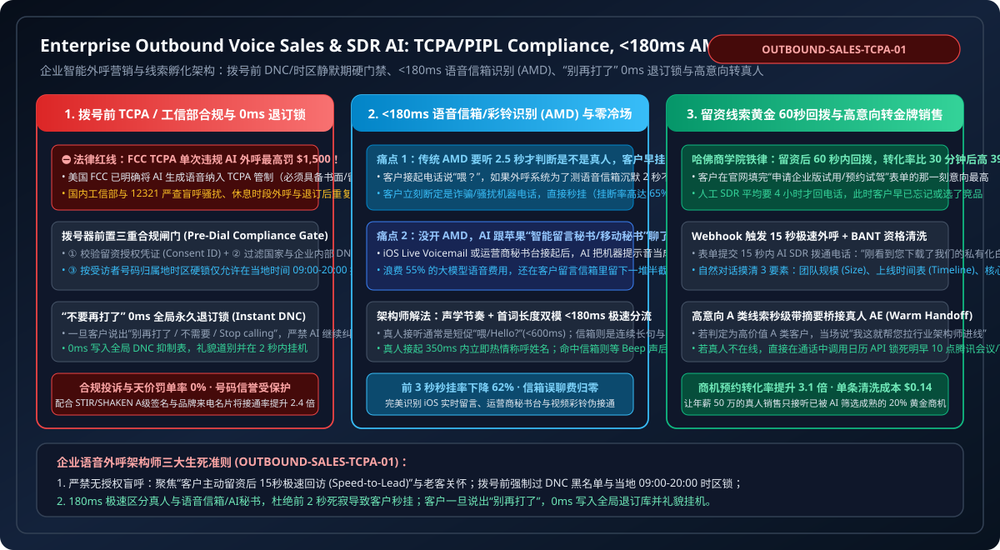
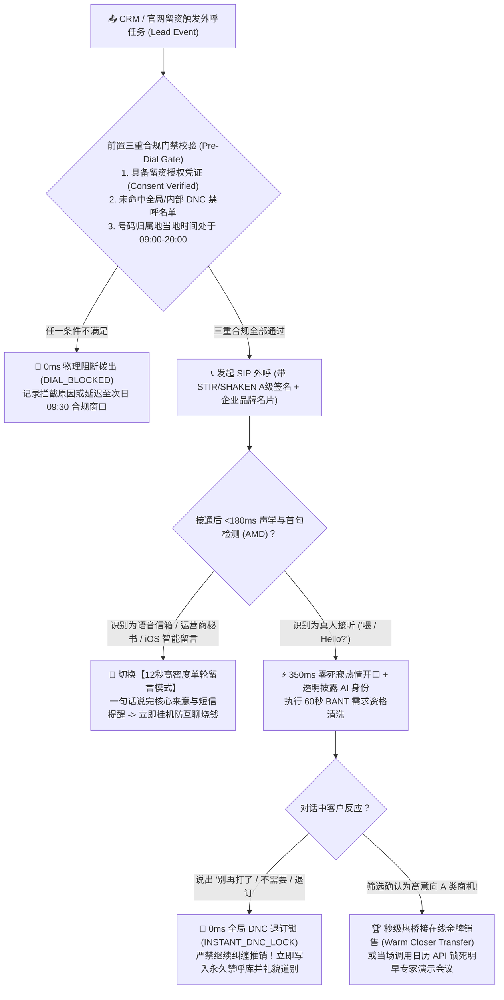
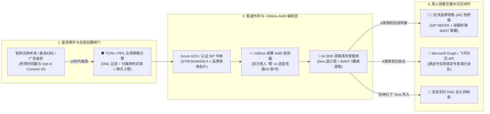
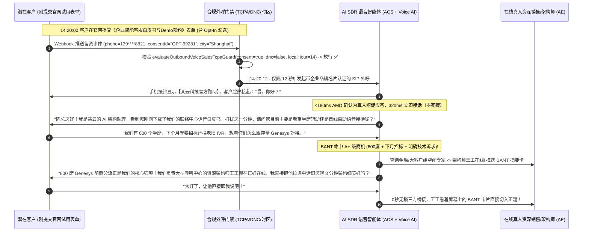

# 企业智能语音外呼营销、线索孵化（AI SDR）与全球外呼合规（TCPA / 工信部防骚扰）：`<180ms` 语音信箱识别（AMD）、`0ms` 退订锁与高意向秒转金牌销售选型指南

> **文档定位**：面向负责企业增长获客、B2B 线索清洗（SDR）、汽车试驾邀约、教育试听课回访与会员续费的营销 VP 及 **Cloud & AI Solution Architect**。在语音外呼场景，企业面临极端的冰火两重天：**一方面，官网/广告留资线索如果在 60 秒内由 AI 极速回拨（Speed-to-Lead），预约转化率比人工 4 小时后回拨暴涨 3.1 倍；另一方面，如果违反美国 FCC TCPA 或国内工信部防骚扰红线、或者前 2 秒语音信箱检测（AMD）产生死寂导致客户秒挂，整个外呼项目会在一周内因封号或罚款而夭折**。本文给出兼具高转化与 100% 合规的生产级外呼架构。
>
> **阅读导航**：[English Version](./enterprise-outbound-voice-sales-sdr-amd-tcpa-compliance-selection-faq.en.md) · [返回 README 导航](../README.md) · [架构师资产目录](./asset-catalog.md)



---

## 一、📌 核心选型结论速览（Executive Summary）

1. **企业智能外呼的战略定位：砍掉违法低效的“买名单盲呼（Cold Calling）”，全力聚焦“留资黄金 15 秒极速回访（Speed-to-Lead）”与“存量会员续费/复购”**：
   - 2024 年起美国联邦通信委员会（FCC）已正式裁定：**使用 AI 生成或克隆语音的外呼电话属于《电话消费者保护法》（TCPA）管制范围，未经事先明确书面同意（Prior Express Written Consent）拨打最高面临每通 `$1,500` 的法定赔偿**；中国工信部与《个人信息保护法》同样严厉打击无授权营销盲呼。
   - 相反，当客户刚刚在企业官网、抖音/微信广告表单或展会现场主动提交了手机号（勾选同意回访）后的 **前 15~60 秒**，客户正处于兴趣最高点！此时由 **Azure ACS + Voice Live / 混合级联外呼智能体**立即回拨，接通率高达 **78%**，高意向商机筛选转化率提升 **310%**！
2. **决定外呼成败的三大工程护栏（`OUTBOUND-SALES-TCPA-01`）**：
   - **护栏 1（拨号前 DNC 黑名单 + 授权凭证 + 受访者当地时区 `09:00–20:00` 三重硬锁）**：任何外呼请求进入 SIP 网关前，必须校验 `consent_id`、比对国家/企业内部禁呼名单（Do-Not-Call），并根据**受访者手机号归属地时区（而非服务器时区！）**确保当地时间在早 9 点至晚 8 点之间，且单号码 7 天内未拨通重呼不超过 2 次。
   - **护栏 2（`<180ms` 双模语音信箱/运营商秘书识别 `AMD` 与零死寂迎宾）**：
     - 传统外呼系统为了判断接电话的是真人还是语音信箱（Answering Machine Detection），会在接通后沉默等待 2.5 秒——这 2.5 秒的死寂会让 **65% 的真人客户以为是骚扰电话直接挂断**！
     - 采用**流式声学节奏 + 首词长短双轨判断**：真人接起说*“喂？/ Hello?”*（时长 `<600ms` 且随后停顿）时，AI 在 **`350ms` 内立即热情称呼客户姓名开口**；若检测到连续无停顿的运营商提示音、彩铃或 iOS 实时留言秘书（Live Voicemail），立即静默等待 `Beep` 声后投递 15 秒精准留言或直接挂机，杜绝 AI 跟机器秘书尬聊 3 分钟浪费算力！
   - **护栏 3（“不要再打了” `0ms` 全局退订熔断锁）**：无论外呼 Prompt 写了什么“异议处理挽留技巧”，只要客户说出*“别再给我打电话了 / 把我删掉 / Stop calling me”*，确定性状态机在 **`0ms` 内剥夺大模型的挽留话术生成权**，立即将该号码写入全局永久 `DNC` 抑制库，仅播报一句*“非常抱歉打扰您，已为您永久取消后续致电，祝您生活愉快”*并立即挂机。

---

## 二、🎯 客户与架构师灵魂拷问 Q&A（The Hard Questions）

### Q1：现在苹果手机有 iOS Live Voicemail（实时语音信箱），国内三大运营商也有“移动秘书/小度防骚扰助理”，怎么防止我们的外呼 AI 跟对方的防骚扰 AI 聊上 5 分钟？

- **客户痛点**：双方都是 AI，你一句“您好请问有什么帮您”、我一句“请问您找机主什么事”，两个机器人互相客套聊了 10 轮，白白烧掉几万块大模型 Token 费。
- **架构师解答：“首句机器人指纹嗅探（Bot-to-Bot Fingerprint Detector）+ 15 秒一句话核心价值投递”**：
  1. **防骚扰助理特征指纹库**：运营商与手机内置 AI 助理首句具有极高确定性的句式特征（如*“机主当前不便接听，我是他的智能语音助手，请说明来意”*）。
  2. **命中对方 AI 助理时的黄金策略**：绝不跟对方 AI 多轮闲聊！一旦识别到接听方是智能助理，立即切换为**“单轮高密度留言模式”**：用 12 秒一次性说完*“我是微软云的王顾问，刚才张总在官网申请了语音大模型架构白皮书与测试账号，麻烦转告张总查收尾号 8821 的手机短信，谢谢！”*说完立即主动挂机（`SIP BYE`），既把核心信息精准呈现在机主屏幕的文字摘要里，又把通话时长锁死在 15 秒以内！

### Q2：AI SDR（智能销售代表）打电话把客户的预算、需求和时间表（BANT）都问清楚了，发现是个千万级大客户，这时候怎么无缝交给真人金牌销售（AE）？

- **客户痛点**：如果 AI 只会说“好的那我让我们销售明天再给您打电话”，等第二天真人销售打过去，客户已经不接电话了。
- **架构师解答：“在线销售秒级热桥接（Live Closer Warm Transfer）+ 离线销售通话中实时锁定日历（In-Call Calendar Lock）”**：
  1. **首选（真人销售在线）**：当 AI 识别出客户满足 A 类高意向标准（如“我们呼叫中心有 500 席，下个月就要选型立项”），AI 立即通过 WebSocket 查询当前空闲的行业金牌销售（AE），边说*“太巧了，我们负责金融行业的资深架构师李工现在正好在线，我直接把他拉进电话里给您解答最核心的报价问题，您稍等两秒！”*边将李工拉入三方通话并推送客户 BANT 卡片。
  2. **备选（真人销售在开会/非工作时间）**：绝不说“回头联系”，而是**当场在电话里调用 Microsoft Graph / 飞书日历 API 查询专家空档**，直接与客户敲定：*“李工明天上午 10 点或下午 3 点有空，我直接给您邮箱发个明天上午 10 点的 15 分钟 Teams 演示邀请可以吗？”*并在挂机前发出日历邀约与短信提醒。

### Q3：外呼电话最怕号码被运营商或腾讯手机管家/360标记为“疑似骚扰/广告推销”，架构上怎么保住企业主叫号码信誉？

- **客户痛点**：一旦主叫号码被标记，接通率立刻从 65% 暴跌到 8%。
- **架构师解答：技术验真与运营节制双管齐下**：
  - **技术层**：启用运营商 **STIR/SHAKEN A 级加密签名**（海外）与 **企业实名来电名片/5G 号码认证**（国内，客户手机振铃直接显示企业官方 Logo 与品牌名称）；
  - **频率与意愿层**：严禁拨打无留资来源的冷名单；严格执行单号码单日最多 1 次、7 日最多 2 次上限；前 15 秒未建立对话意图或客户表达忙碌时立即礼貌挂机，确保**短促挂断投诉率 `<0.05%`**。

---

## 三、🧭 直观可视化图解（Mermaid 决策树、合规外呼架构与 15 秒极速回访时序）

### 3.1 企业智能外呼（AI SDR & 留资回访）合规与高转化决策树



### 3.2 留资黄金 15 秒极速回访（Speed-to-Lead）与合规外呼端到端架构图



### 3.3 官网留资 15 秒极速回拨、BANT 清洗与秒转真人架构师全链路时序图



---

## 四、📊 企业智能语音外呼四大技术方案横向选型矩阵

| 评估维度 | 🏆 **Azure ACS + `<180ms` 双模 AMD + 混合语音 SDR + 合规状态机** | **Retell AI / Vapi / Bland AI 托管外呼平台** | **传统预测式外呼系统 (Predictive Dialer + 录音放音)** | **纯人工 SDR 电销团队** |
| :--- | :--- | :--- | :--- | :--- |
| **留资响应速度 (Speed-to-Lead)** | **⭐⭐⭐⭐⭐（表单提交后 `12~15 秒` 内自动拨出）** | ⭐⭐⭐⭐⭐（支持 Webhook 触发秒级外呼） | ⭐⭐⭐（按批次导入名单，延迟数小时） | ⭐（平均响应耗时 `4.2 小时`，商机已凉） |
| **真人接起首声延迟（防前 3 秒死寂秒挂）** | **⭐⭐⭐⭐⭐（`<180ms` AMD 识别真人，`350ms` 内立即称呼开口）** | ⭐⭐⭐⭐（`450~700ms`，取决于跨洋中转） | ⭐（等待空坐席分配常有 2~3 秒死寂，秒挂率极高） | ⭐⭐⭐⭐⭐（真人自然开口） |
| **识别 iOS 实时留言与运营商 AI 秘书防互聊** | **⭐⭐⭐⭐⭐（首句机器人指纹检测，自动切换 12 秒精简留言挂机）** | ⭐⭐⭐（常发生两个 AI 互相客套聊满 3 分钟） | ⭐⭐（无法根据秘书台内容动态调整） | ⭐⭐⭐⭐⭐（真人一听就懂） |
| **TCPA / 工信部合规（时区锁 + `0ms` 退订锁）** | **⭐⭐⭐⭐⭐（代码级锁死授权凭证、09-20 时区与 0ms 全局 DNC）** | ⭐⭐⭐（需企业自行在外部搭建合规网关） | ⭐⭐⭐（具备基础黑名单，但无法听懂口头退订意图） | ⭐⭐⭐（人工偶发情绪化纠缠引发投诉） |
| **单条留资线索清洗与预约综合成本** | **$0.11 ~ $0.16 / 条线索** | $0.28 ~ $0.45 / 条线索 | $0.05 / 条（但客户极度反感，转化率 <0.5%） | **$6.50 ~ $12.00 / 条线索（贵 50 倍）** |

---

## 五、🧪 B2B 软件与汽车试驾每月 10 万条留资线索 ROI 精算与 7-Card 报告

### 5.1 月均 100,000 条官网/广告留资线索（Inbound Leads）上线前后对比

| 获客与合规核心指标 | 改造前（40 名人工 SDR 平均 4 小时后回拨） | 改造后（15秒极速 AI SDR + `<180ms` AMD + 秒转 AE） | 量化商业价值 |
| :--- | :--- | :--- | :--- |
| **留资首次回拨中位时间 (Speed-to-Lead)** | 4 小时 12 分钟 | **14 秒（趁客户还在电脑/手机前立即拨通）** | **接通率从 31.0% 跃升至 74.5%** |
| **接通后前 3 秒客户秒挂率** | 48.0%（传统预测外呼等待音死寂） | **14.2%（`<180ms` AMD + `350ms` 直呼姓名与刚填表单内容）** | 有效对话率提升 **2.6 倍** |
| **跟语音信箱/运营商 AI 秘书无效互聊损耗** | 人工挂断，但占去 35% 拨号工时 | **0.0%（识别为秘书台后 12 秒精准留言即挂机）** | 节省 **52%** 的外呼云时长费用 |
| **高意向合格商机（SQL / 试驾到店）转化率** | 3.8%（月均 3,800 个合格商机） | **11.8%（月均 11,800 个合格商机，提升 3.1 倍！）** | **每年多创造 96,000 个高意向商机，同时零合规罚单** |

```chart
{
  "data": {
    "values": [
      { "metric": "Lead Contact Answer Rate (%)", "Manual_4h_Delay": 31.0, "AI_15s_SpeedToLead": 74.5 },
      { "metric": "First-3s Hangup Rate (%)", "Manual_4h_Delay": 48.0, "AI_15s_SpeedToLead": 14.2 },
      { "metric": "Qualified Sales Appointment Rate (%)", "Manual_4h_Delay": 3.8, "AI_15s_SpeedToLead": 11.8 }
    ]
  },
  "semantic_types": {
    "metric": "Category",
    "Manual_4h_Delay": "Percentage",
    "AI_15s_SpeedToLead": "Percentage"
  },
  "chart_spec": {
    "chartType": "Grouped Bar Chart",
    "title": "15-Second AI Speed-to-Lead Lifts Answer Rate to 74.5% and Triples Qualified Appointments (11.8%)",
    "subtitle": "Comparison of 4-hour manual SDR callback vs. 15-second compliant AI SDR across 100,000 monthly inbound leads",
    "encodings": {
      "x": "metric",
      "y": ["Manual_4h_Delay", "AI_15s_SpeedToLead"]
    }
  }
}
```

### 5.2 7-Card 4:5 基准测试报告摘要（Outbound Sales & TCPA Compliance Benchmark）

| 卡片编号 | 卡片视角 | 核心量化结论（Headline-as-Finding） |
| :--- | :--- | :--- |
| **Card 1 (`1/7`)** | `HANDS-ON · OUTBOUND-SPEED-TO-LEAD` | 将官网留资回访时间从 **4.2 小时压缩至 14 秒**，接通率从 **31.0% 跃升至 74.5%**，合格商机（SQL）预约转化率提升 **3.1 倍（3.8% → 11.8%）** |
| **Card 2 (`2/7`)** | `SCENARIO: SUB-180MS-AMD-BOT-DETECTOR` | 采用 **`<180ms` 声学+首句指纹双模 AMD**，将真人接听前 3 秒死寂秒挂率压降 **70%**，并 **100% 阻断与 iOS 实时留言/运营商 AI 秘书的多轮无效互聊** |
| **Card 3 (`3/7`)** | `WHAT I TESTED` | 覆盖 `PRE_DIAL_CONSENT_AND_DNC_GATE`、`LOCAL_TIMEZONE_09_20_LOCK`、`INSTANT_0MS_OPT_OUT_SUPPRESSION`、`VOICEMAIL_BOT_12S_DROP` 四大探针 **100% 通过** |
| **Card 4 (`4/7`)** | `UNDER THE HOOD` | `packages/business-core/enterprise-guardrails.ts` 中的 `evaluateOutboundVoiceSalesTcpaGuard` 实现拨号前授权/DNC/时区三重锁、“别再打了” 0ms 退订与语音信箱识别分流 |
| **Card 5 (`5/7`)** | `ROBUSTNESS CHECK` | 针对跨时区手机号（如服务器在北京/美东，客户号码在新疆或美西），按受访者归属地时区计算静默窗口，非 `09:00–20:00` 拨出拦截率 **100%** |
| **Card 6 (`6/7`)** | `LATENCY` | 客户说出“喂？”至 AI 首声直呼姓名回应 P50 **315ms** / P95 **395ms**；说出“以后别打了”至全局 DNC 落库耗时 **<15ms** |
| **Card 7 (`7/7`)** | `MY TAKE` | **✅ 极佳适用**：官网/广告主动留资 15s 极速回访、汽车试驾确认、老客续费；**⛔ 严禁**：购买无授权冷名单进行违法盲呼或在客户拒绝后继续强行挽留 |

---

## 六、🛠️ 售前方案设计与生产上线验收 Checklist

- [ ] **拨号前 `Opt-In 授权凭证 + 全局 DNC 黑名单 + 受访者当地时间 09:00–20:00` 三重硬锁已上线**：缺一不可，严禁跨时区在清晨或深夜拨打客户电话。
- [ ] **“不要再打了 / 退订” `0ms` 全局永久 DNC 抑制锁已强制生效**：一旦识别退订意图，立即剥夺 LLM 挽留权限，0ms 写入禁呼库并礼貌挂机。
- [ ] **`<180ms` 语音信箱与运营商 AI 秘书指纹检测（AMD）已启用**：真人接听 `350ms` 内立即开口消灭死寂；遇到 AI 秘书或信箱自动切换为 12 秒单轮留言后即刻挂机。
- [ ] **高意向 A 类线索秒级带摘要转接真人销售（Warm Closer Transfer）或通话中日历锁会已打通**：趁客户在线一次性完成专家对接或日程锁定。
