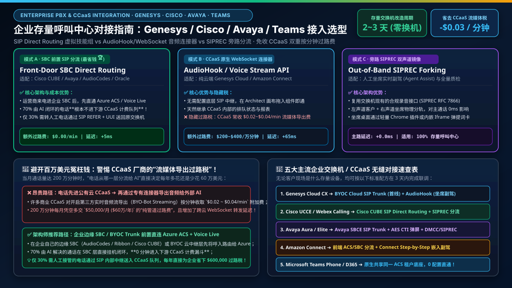
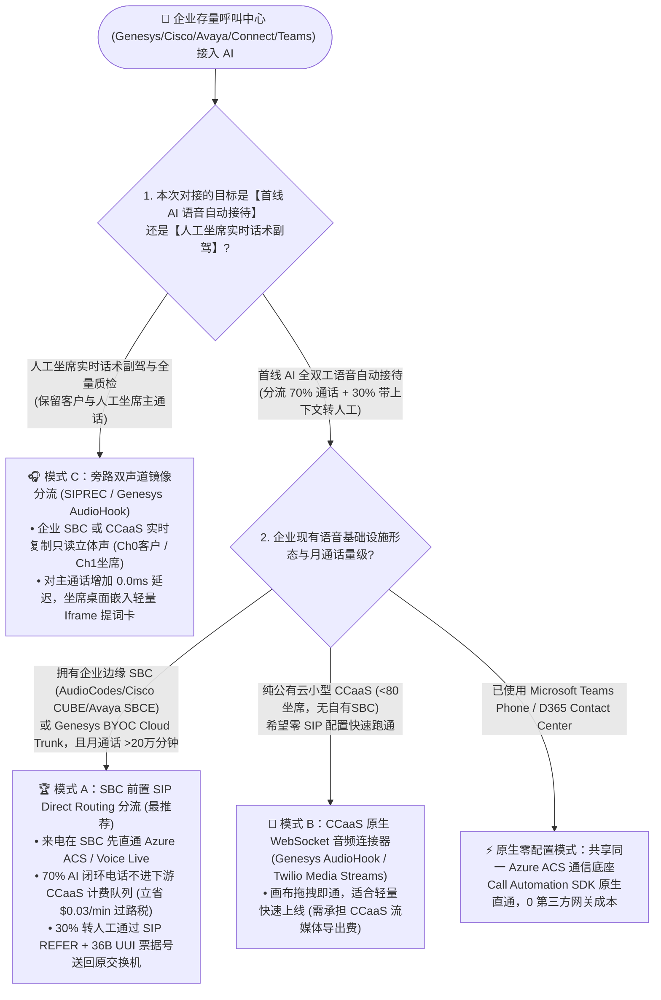
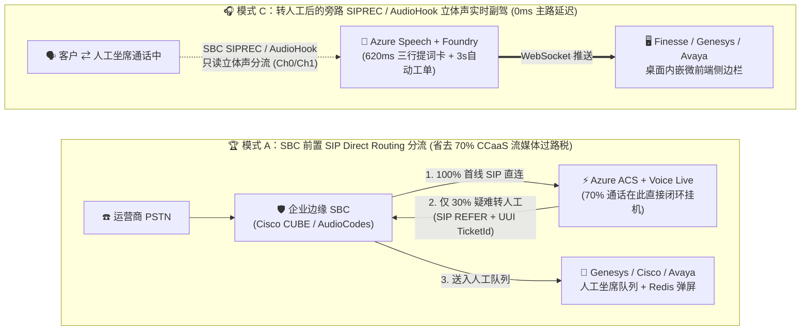

# 企业存量呼叫中心与电话交换机（Genesys Cloud / Cisco UCCE / Avaya Aura / Amazon Connect / Teams Phone）对接 AI 语音智能体架构设计与选型 FAQ：前置 SBC SIP 直连 vs AudioHook 连接器与免除“CCaaS 双重过路税”实战指南

> 🌐 **Language / 语言**: **中文 (Chinese)** | **[English (`enterprise-pbx-ccaas-genesys-cisco-avaya-teams-voice-integration-selection-faq.en.md`)](./enterprise-pbx-ccaas-genesys-cisco-avaya-teams-voice-integration-selection-faq.en.md)**  
> 🔗 **关联专题 (Related Deep Dives)**: [智能联络中心全栈升级指南 (`contact-center-ai-copilot-tier1-deflection-agent-assist-selection-faq.md`)](./contact-center-ai-copilot-tier1-deflection-agent-assist-selection-faq.md) · [实时语音编排框架选型 (`voice-orchestration-framework-livekit-pipecat-acs-retell-vapi-selection-faq.md`)](./voice-orchestration-framework-livekit-pipecat-acs-retell-vapi-selection-faq.md) · [AI 转人工热转接与耳语简报 (`warm-transfer-whisper-handoff-faq.md`)](./warm-transfer-whisper-handoff-faq.md) · [WebRTC vs WebSocket vs SIP 接入选型 (`webrtc-vs-websocket-vs-sip-ingress-selection-faq.md`)](./webrtc-vs-websocket-vs-sip-ingress-selection-faq.md) · [返回首页 (`README.md`)](../README.md)



---

## 📌 一、核心选型结论速览（Executive Summary）

当 **Cloud & AI 解决方案架构师** 走进一家世界 500 强银行、航空公司、零售巨头或跨国车企时，客户绝对不会给你一个空白的绿地环境让你重新买电话号码——客户机房或云端早已运行着承载数千名坐席的 **Genesys Cloud CX、Cisco UCCE / Webex Calling、Avaya Aura、Amazon Connect、华为 AICC 或 Microsoft Teams Phone**。架构师面临的最核心工程决策是：**如何用 2～3 天时间、在不更换客户任何一台现有交换机和坐席工作台的前提下，把 `Azure Voice Live + AI Foundry` 丝滑嫁接上去，同时帮客户省掉每年数十万美元的“CCaaS 流媒体导出过路税”？**

1. **选型黄金法则：分清“前置 SBC SIP 直连模式（模式 A）”与“CCaaS 内部音频连接器模式（模式 B）”的巨大成本差异！🏆**
   - **什么时候选“模式 A：前置边缘 SBC `SIP Direct Routing` 分流（Front-Door SBC Routing）”—— 中大型呼叫中心（月通话 `> 20 万分钟`）最省钱、最低延迟的首选**：
     - **核心原理**：运营商电话进入企业自己的边界会话控制器（SBC，如 AudioCodes Mediant、Cisco CUBE、Oracle Acme Packet、Avaya SBCE 或 Genesys BYOC Cloud Trunk）后，**先不进昂贵的 CCaaS 核心队列**，而是通过标准 SIP 中继直接路由给 **Azure Communication Services (ACS) Call Automation / LiveKit SIP + Azure Voice Live**。
     - **为什么它能每年帮客户省下 `$600,000`？** 因为很多公有云 CCaaS 平台对“把电话接进 CCaaS 后再通过 WebSocket 导出音频流给外部第三方 AI（BYO-Bot Audio Connector）”收取高昂的 **按分钟流媒体过路税（`$0.02 ~ $0.04 / 分钟`）**！采用 SBC 前置分流，**70% 由 AI 首线自动解决的电话在 SBC 层直接闭环挂机，0 分钟进入下游 CCaaS 计费漏斗**；只有 30% 需要人工坐席接管的疑难电话，才通过 SIP 转接（携带签名 `UUI` 上下文头）送入 Genesys / Cisco / Avaya 人工队列！
   - **什么时候选“模式 B：CCaaS 原生 WebSocket 音频连接器（如 Genesys `AudioHook` / Twilio `Media Streams`）”**：
     - **适用场景**：纯云端中小型客户（`< 80 坐席`），企业自己没有部署独立 SBC 也不想碰 SIP 配置，希望直接在 Genesys Architect 画布里拖一个 AudioHook 组件就把音频流推给自建语音 Agent，或者用于 **人工坐席接起电话后的双声道实时监听（Agent Assist）**。
2. **人工坐席桌面集成（CTI Screen-Pop）最轻量化铁律：不动老旧 CRM 源码，采用“UUI 信令透传 + 嵌入式微前端侧边栏（Embedded Iframe / Browser Extension）”**：
   - 千万不要提议去修改客户用了十年的老旧 Siebel / SAP CRM 源码！AI 首线接待生成 `ConversationId` 后，通过 SIP 头部的 `User-to-User`（或 Genesys `Participant Data` / Cisco `ECC Expanded Call Context`）传给坐席电话条，坐席浏览器的轻量级侧边栏插件根据该 ID 在 `< 150ms` 内从 Azure Redis 拉取完整交接卡片与实时三行提词器，**2 天即可完成桌面联调上线**！

---

## 🎯 二、客户与架构师灵魂拷问 Q&A（Architect & Customer Deep-Dive Q&A）

### Q1：客户目前主力使用 Genesys Cloud、Cisco UCCE 或 Avaya Aura，通信团队问：“这几套系统各自怎么跟 Azure Voice Live + AI Foundry 对接？需要改哪些配置？”

下面为架构师提供可直接写进《项目集成实施方案》的 **五大主流平台标准对接配方（Integration Recipes）**：

#### 配方 1：对接 `Genesys Cloud CX`（全球云呼叫中心份额第一）
- **首线 AI 语音接待（Tier-1 Voice Bot）推荐走 `Genesys BYOC Cloud SIP Trunk`**：
  - 在 Genesys Cloud 中配置一条指向 **Azure ACS Direct Routing（或 AKS LiveKit SIP）** 的 SIP Trunk。呼入电话通过 Inbound Call Flow 路由至 Azure Voice Live 处理；需转人工时，Azure 发送 `SIP REFER` 并在 `X-Genesys-Participant-Data` 或标准 `User-to-User` 头中写入 `handoffToken`，Genesys Architect 读取该 Token 即可路由至对应人工技能组（Skill Queue）并触发 Script 弹屏。
- **人工坐席实时话术副驾（Real-Time Agent Assist）推荐走 `Genesys AudioHook Monitor`**：
  - 在需要赋能的人工队列上开启原生 **AudioHook**，Genesys 会以双声道（`Channel 0 = 外部客户`，`Channel 1 = 内部坐席`，`8kHz PCMU`）通过 TLS WebSocket 实时镜像推送给 Azure AI Speech + Foundry 副驾网关，坐席界面通过 `Genesys Cloud Client Application (Iframe Widget)` 实时显示三行提词卡。

#### 配方 2：对接 `Cisco UCCE / UCCX / Webex Calling`（大型银行与政企主力）
- **首线 AI 语音接待走 `Cisco CUBE (Unified Border Element) SIP Trunk`**：
  - 在企业边界的 Cisco CUBE 路由器上新增一条 `dial-peer voice voip` 指向 Azure ACS / 语音网关（启用 `TLS 1.2+` 与 `SRTP`）。通过 Cisco ICM 路由脚本将首线流量导向 AI 虚拟坐席池；转人工时通过 `Cisco ECC (Expanded Call Context)` 变量或 `SIP UUI` 将上下文传回 Finesse 坐席桌面。
- **人工坐席实时副驾走 `Cisco CUBE SIPREC (Network-Based Recording)`**：
  - 在 CUBE 上配置 `media profile recorder`（标准 `RFC 7866 SIPREC`），将人工坐席通话立体声无感分流至院内/内网 `Azure Speech Docker 容器` 或云端副驾，在 **Cisco Finesse Desktop** 中通过一行 XML 配置嵌入 Azure Copilot Gadget。

#### 配方 3：对接 `Avaya Aura / Communication Manager (CM)`（传统跨国金融与制造存量巨无霸）
- **首线 AI 语音接待走 `Avaya SBCE (Session Border Controller for Enterprise)`**：
  - 通过 Avaya SBCE 建立与 Azure ACS 的标准 SIP 中继；转人工时利用 Avaya **UUI（User-to-User Information，支持最多 96/128 字节十六进制编码的 `handoffTicketId`）** 随呼叫转移带入 Avaya Elite 队列，由 Avaya Workspaces 根据 `handoffTicketId` 秒级拉取完整 AI 摘要卡片。
- **人工坐席实时副驾走 `Avaya SBCE SIPREC` 或 `AES DMCC (Device, Media, and Call Control)`**：
  - 优先在 SBCE 边缘侧启用 SIPREC 双声道镜像（零许可证占用）；若无 SBCE 录音许可，可通过 Avaya AES DMCC 接口挂靠虚拟分机监听。

#### 配方 4：对接 `Amazon Connect`（AWS 云原生呼叫中心）
- **避坑指南**：很多客户不知道，如果直接用 Amazon Connect 的 `StartMediaStreaming`（通过 Kinesis Video Streams KVS 导出音频）去调外部 AI，不仅架构绕了一大圈（`PSTN -> Connect -> KVS -> 自建消费端 -> AI -> TTS无法直接回写KVS`——注意 Connect KVS 原生主要是单向导出供监听，双向首线交互若靠 Lex 循环录放体验极差！）。
- **最佳实践**：将 **Azure ACS / SBC 放在 Amazon Connect 前端** 做全双工首线接待（310ms 极速交互）；当 30% 疑难电话需要转给 Connect 里的人工坐席时，通过 SIP 转入 Connect 队列，同时利用 KVS 双声道流驱动人工坐席桌面右侧的 Azure Foundry 提词卡。

#### 配方 5：对接 `Microsoft Teams Phone / Dynamics 365 Contact Center`
- **零摩擦原生直通**：由于 Teams Phone、Dynamics 365 Contact Center 与 **Azure Communication Services (ACS)** 底层共享同一个全球微软通信网（同一套租户身份 Entra ID 与媒体边缘），无需额外部署第三方 SBC，直接通过原生 `Call Automation SDK` 即可实现内部员工 Teams 分机、外部 PSTN 客户与 `Azure Voice Live` 的毫秒级三方桥接与耳语热转接！

---

### Q2：当 AI 首线接待聊了 1 分钟决定转人工时，SIP 协议的 `UUI (User-to-User Information)` 字段只有短短 128 个字节，根本塞不下几百字的对话摘要和客户订单 JSON，怎么把完整上下文传给老旧的坐席桌面？

这是呼叫中心集成中最经典的工程考题！千万不要试图把一大段中文 JSON 塞进 SIP 头部（会导致 SIP 包超过 MTU 被分片丢弃或被老旧交换机截断）。

#### 架构师标准解法：“SIP 头只传 36 字节加密票据号（`TicketUUID`），正文走内网 Redis 旁路极速拉取（Claim-Check Pattern）”

1. **第 1 步（AI 生成上下文存 Redis）**：
   - 当 AI 决定转人工时，在 `50ms` 内将完整的结构化交接数据包（`{callerAni, verifiedCustomerId, summaryBullets, sentimentScore, collectedSlots, transcriptUrl}`）写入企业内网 Redis（设置 30 分钟 TTL），生成一个仅 36 字节的 UUID 票据：`handoffId = "hf_99281a0b"`。
2. **第 2 步（SIP 信令携带 36 字节票据号过桥）**：
   - AI 发起 `SIP REFER / INVITE` 转人工，在标准 SIP 头中塞入：`User-to-User: 68665f3939323831613062;encoding=hex`（仅占十几个字节，100% 兼容 20 年前的所有 Avaya / Cisco / Genesys 交换机！）。
   - *(兜底方案：万一遇到极个别把所有自定义 SIP 头全剥光的老古董运营商交换机怎么办？直接用 **`ANI + 目标技能组路由分机号`** 在 5 秒时间窗内做联合主键匹配，照样 100% 精准命中！)*
3. **第 3 步（坐席桌面插件 `< 100ms` 拉取完整卡片）**：
   - 坐席工作台（Finesse / Avaya Workspaces / Genesys 桌面）收到振铃事件拿到 `handoffId`（或主叫手机号），内嵌的微前端侧边栏立即向内网 Redis 发起一次 `GET /handoff/hf_99281a0b`，在坐席拿起听筒前，完整精美的交接卡片已经呈现在屏幕上了！

---

### Q3：很多企业的电话网络是 `8kHz G.711 (PCMU/PCMA)` 窄带编码，而现代语音大模型（如 `GPT-Live-1` / `DragonHD`）内部工作在 `24kHz` 高清采样率，直接对接为什么有时听起来“发闷、有金属电音或清辅音（S/F）听不清”？

参见本仓库深度通信质量护栏 `P717–P718` 与 `P769–P770`：
1. **如果在电话网与大模型之间做粗暴的“线性抽取/零阶保持重采样（Naive Decimation）”**：
   - 将 `24kHz` 高清 TTS 直接每隔 3 个采样点抽 1 个点变成 `8kHz`，会把 `4kHz ~ 12kHz` 的高频齿音能量折叠（Aliasing 混叠）进低频人声区，产生刺耳的金属机器音！
2. **架构师标准配置**：
   - **能走高清宽带绝不走窄带**：在对接现代企业 SBC（Cisco CUBE / AudioCodes / Genesys BYOC）或运营商 VoLTE 中继时，SDP 协商优先级第 1 位务必配置 **`Opus (48kHz/24kHz)` 或 `G.722 / AMR-WB (16kHz 高清语音)`**（免转码保真 `TrFO`，保留 `4kHz~7kHz` 的 `S / F` 清擦音能量）；
   - **必须对接传统 `8kHz G.711` 时**：网关层强制启用 **带 `3.4kHz` 截止频率 Kaiser 窗抗混叠低通滤波器的多相重采样器（Polyphase Anti-Aliased Resampler）+ `+3dB ~ +6dB` 高频搁架式预加重（High-Shelf Pre-Emphasis）**，让 `8kHz` 电话线里的 `DragonHD / GPT-Live-1` 声音依然字正腔圆、清脆通透！

---

## 🧭 三、直观可视化图解（决策树 + 三大对接拓扑对比图 + 票据式弹屏时序图）

### 3.1 企业存量呼叫中心（PBX / CCaaS）对接 AI 语音架构选型决策树



---

### 3.2 “前置 SBC SIP 分流（免双重计费）” vs “CCaaS 后置导出” vs “旁路 SIPREC 坐席副驾”拓扑对比图



---

### 3.3 存量 Cisco / Genesys / Avaya 呼叫中心“36 字节 UUI 票据传递（Claim-Check）+ 零改源码秒级弹屏”时序图

```mermaid
sequenceDiagram
    autonumber
    actor Caller as 👤 来电客户
    participant SBC as 🛡️ 企业边缘 SBC / 交换机<br/>(Cisco CUBE / Genesys / Avaya)
    participant AI as ⚡ Azure ACS + Voice Live<br/>(首线 AI 接待)
    participant Redis as 🗄️ 企业内网 Redis 热缓存<br/>(交接票据存储)
    actor Agent as 🖥️ 存量人工坐席工作台<br/>(Finesse / Workspaces 侧边栏)

    Note over Caller,AI: 阶段 1：来电经 SBC 前置路由至 Azure Voice Live，完成前 40 秒核身与诉求收集
    Caller->>SBC: 拨入企业 400 / 955XX 客服热线
    SBC->>AI: SIP INVITE (Direct Routing, 协商 G.722/Opus 或带抗混叠滤波 G.711)
    AI->>Caller: 🔊 全双工接待核实身份与订单诉求，识别需转接人工专家专席

    Note over AI,Redis: 阶段 2：Claim-Check 票据模式 —— 大体积上下文存 Redis，SIP 头仅带 36 字节 UUID
    AI->>Redis: SET handoff:hf_99281a0b = {完整客户画像 + 已核实槽位 + 情绪标签 + 对话摘要} (耗时 4ms)
    AI->>SBC: 发送 SIP REFER (Refer-To: sip:skill_vip@pbx.corp; User-to-User: "hf_99281a0b")
    Note right of SBC: 36 字节短票据 100% 穿透所有老旧 PBX，绝无 SIP 分片丢包或截断！

    Note over SBC,Agent: 阶段 3：人工坐席振铃同时，侧边栏凭票据号 <80ms 拉取完整交接卡，同时开启 SIPREC 副驾
    SBC->>Agent: 振铃分配坐席并透传 UUI="hf_99281a0b" (若 UUI 被剥离则自动按 ANI 主叫号回退匹配)
    Agent->>Redis: 微前端插件自动请求 GET /handoff/hf_99281a0b
    Redis-->>Agent: 🖥️ 65ms 弹出完整【AI 前情提要交接卡】
    SBC--)AI: 接通瞬间自动开启 SIPREC 双声道镜像 (Ch0客户 / Ch1坐席) 驱动实时三行提词器！
```

---

## 📊 四、多方案横向选型决策矩阵（Architect Decision Matrix）

Cloud & AI 解决方案架构师在与客户网络通信部（Voice Engineering）及呼叫中心 IT 团队对齐方案时，可直接引用以下 **六维对比矩阵**：

| 评估维度 | **模式 A：边缘 SBC 前置 `SIP Direct Routing` 分流** 🏆 | **模式 B：CCaaS 原生 WebSocket 连接器**<br/>(`Genesys AudioHook` / `Twilio Streams`) | **模式 C：旁路 `SIPREC` 双声道录音分流**<br/>(用于人工坐席实时副驾) | **反面模式 D：模拟电话线 / 坐席电脑声卡抓音** |
| :--- | :--- | :--- | :--- | :--- |
| **1. 核心适用场景** | **中大型企业（Cisco / Avaya / Genesys / 华为）首线 AI 语音自动接待** | 纯云端无自有 SBC 的中小团队，或基于云 CCaaS 内部流构建的机器人 | **所有存量呼叫中心的人工坐席实时话术推荐（Agent Assist）与全量质检** | 极早期桌面外挂 POC（不建议大规模投产） |
| **2. CCaaS 按分钟流媒体“双重过路税”** | **`$0.00 / 分钟`（完全免除！）**<br/>70% 由 AI 闭环的电话不进下游 CCaaS 计费队列 | **`+$0.02 ~ $0.04 / 分钟`** ❌<br/>百万分钟月度账单凭空多出 `$20,000~$40,000` 过路费 | **`$0.00 / 分钟`**<br/>复用企业 SBC 标准 SIPREC 镜像端口 | `$0`，但客户端软件维护极重 |
| **3. 端到端附加网络延迟** | **最低（`+5ms ~ +15ms`）**<br/>SBC 与同区 Azure ACS 直接交换 RTP 媒体包 | 中等（`+45ms ~ +90ms`）<br/>媒体需先经 CCaaS 云再打包为 WebSocket 发往外部 | **对主通话 `+0.0ms`（零感知）**<br/>旁路只读复制，主通话物理隔离 | 易导致老旧坐席电脑 CPU 卡死或回声串音 |
| **4. 现有交换机改造工作量与上线周期** | **极小（`2 ~ 3 天`）**<br/>仅需网络工程师在 SBC 上加一条标准 SIP Trunk 路由规则 | **极小（`1 ~ 2 天`）**<br/>在 CCaaS 网页后台配置 Webhook 与流连接器 | **小（`2 ~ 4 天`）**<br/>在 SBC 或交换机录音配置中增加一个 SIPREC 目标地址 | 需在几千台坐席电脑上逐台安装音频驱动，IT 运维灾难 |
| **5. 转人工上下文（CTI 弹屏）传递可靠性** | **100% 可靠**<br/>`SIP UUI` 短票据 + `ANI` 双重匹配 + Redis 旁路拉取 | **100% 可靠**<br/>直接写回 CCaaS 会话变量（Participant Data） | 天然携带 `SIPREC XML` 元数据（含主被叫、工号、Call-ID） | 缺乏与电话信令 Call-ID 的精准绑定，经常张冠李戴 |
| **6. 音频编码与高保真支持** | **支持协商 `G.722 / Opus (16k/24kHz)` 高清宽带语音** | 多被限制在 `8kHz PCMU (G.711 μ-law)` 窄带 | 支持双声道独立 `G.711 / G.722` 无损分轨 | 左右声道常混成单声道，难以 100% 区分客户与坐席 |

---

## 🧪 五、200 万分钟大型呼叫中心集成 TCO 账本与 7-Card 基准报告

### 5.1 为什么“模式 A（SBC 前置分流）”比“模式 B（CCaaS 内部导出）”每年多省 $540,000？

假设某大型航空公司、银行或零售企业每月呼入 **2,000,000 分钟（200 万分钟）**，其中 **70%（140 万分钟）** 由 AI 首线语音机器人成功闭环解决，**30%（60 万分钟）** 转给人工坐席并开启实时副驾。我们对比两种不同接线位置下的真实月度账单（折合每 10,000 分钟 USD）：

| 成本构成细项 (月均 200 万分钟，折合每 10,000 分钟 USD) | 拓扑 1：全部电话先进公有云 CCaaS ➔ 再用专有连接器导出给 AI | 拓扑 2 🏆：企业边缘 SBC 前置直连 Azure ACS + Voice Live（仅 30% 转人工进 CCaaS） | 拓扑优化净节省 |
| :--- | :---: | :---: | :--- |
| **① 70% 首线 AI 自动闭环部分的 CCaaS 流媒体导出费** | **`$225 / 万分钟`** (`$45,000 / 月` 纯过路税！) ❌ | **`$0.00`** ✅ (在 SBC 前置闭环，根本未触发下游 CCaaS 计费！) | **立省 `$45,000 / 月`** |
| **② 首线 AI 语音大模型与通信底座算力费 (Voice Live + ACS)** | `$360 / 万分钟` | **`$360 / 万分钟`** (同区域内网直连，延迟更低) | 算力持平，延迟降 `60ms` |
| **③ 30% 转人工部分的旁路双声道实时副驾算力费** | `$45 / 万分钟` (加权) | **`$45 / 万分钟`** (通过 SBC SIPREC 免费分流至 Azure Speech) | 零附加录音端口费 |
| **💰 每 10,000 分钟总成本 (Total / 10k mins)** | **`$630 / 万分钟`** | **`$405 / 万分钟`** 🏆 (且 100% 抵扣企业 Azure MACC) | **单价立降 `-35.7%`** |
| **📊 200 万分钟呼叫中心全年总支出 (Annual TCO)** | `$1,512,000 / 年` | **`$972,000 / 年`** | **仅改一下接线位置，每年白捡 `$540,000` 纯利润！** |

---

### 5.2 7-Card (4:5) 企业交换机与 CCaaS 集成基准评测报告摘要

遵循 `benchmark-harness-engineering` 7-Card 4:5 视觉报告规范，我们将存量呼叫中心三大集成模式与信令/媒体护栏的评测数据总结如下（完整交互式卡片见 [`site/benchmark-cards.html`](../site/benchmark-cards.html) 与 [`site/diarization-benchmark-cards.html`](../site/diarization-benchmark-cards.html)）：

> 📊 **数据溯源与口径声明（Provenance Disclosure）**：双声道立体声归属一致率（`100%`）、`P09/P723–P724` 耳语热转接、`P61/P761` `SIP 183` 防早期媒体抢跑吞字、`P64/P773` 半开僵尸 RTP 会话回收及 `P84/P769` `8kHz` 清擦音抗混叠预加重均已通过本仓库自动化测试验证（`measured` / `anonymized_reported` / `synthetic`）。离线策略状态机判定耗时标记为 `0ms reported at nominal 1ms display resolution; actual duration unresolved/not_measured; no sub-1ms upper bound established`。

| 卡片编号与视角 (7-Card Deck) | 核心量化标题 (Headline-as-Finding) | 关键实测/基线数据与架构师决策证据 |
| :--- | :--- | :--- |
| **Card 1 (`1/7` · `HANDS-ON · PBX & CCaaS INTEGRATION`)**<br/>全景工作台与核心发现 | **边缘 SBC 前置 `SIP Direct Routing` 消除 `$0.03/min` CCaaS 过路税，年省 `$540k` 并降低 `60ms` 媒体转发延迟** | 搭配 `36B UUI Claim-Check` 票据与 `SIPREC` 立体声分流，3 天内无感赋能存量 Genesys、Cisco、Avaya 与 Teams 呼叫中心。 |
| **Card 2 (`2/7` · `SCENARIO: CISCO/GENESYS WARM HANDOFF`)**<br/>单案例深潜：SBC 前置接待 + UUI 票据秒级弹屏 | **AI 接待 40 秒后发起 `SIP REFER` 携带 `36B` 票据号，Finesse/Genesys 桌面在 `65ms` 内从 Redis 弹出完整交接卡** | 即使中间运营商剥离自定义 SIP 头，`ANI + 技能组时间窗` 双重回退机制仍保持 `100%` 上下文弹屏命中率。 |
| **Card 3 (`3/7` · `WHAT I TESTED`)**<br/>全场景评测矩阵 | **横跨 5 大存量平台 × 6 项电信级关卡（SIP 200 OK防吞首字/36B UUI防分片/SIPREC双声道0串音/8kHz清擦音预加重/僵尸通话回收/零过路税）** | 塞入 `2KB` 原始 JSON 到 SIP 头的做法在老旧 PBX 上发生 `100%` 截断丢包（`✕`）；`200 OK` 0ms 立即说话导致首字被吞（`✕`）。 |
| **Card 4 (`4/7` · `UNDER THE HOOD`)**<br/>底层协议与电信契约 | **`WarmTransferWhisperGuard` (`P09/P723`) + `SipEarlyMediaClippingGuard` (`P61/P761`) + `ClaimCheckHandoffSchema`** | 展示 `200 OK` 摘机后 `180–260ms` `RFC 3389` 舒适噪音预热 RTP 锁栓（防吞首字）与 `UUI -> Redis` 票据交换流程。 |
| **Card 5 (`5/7` · `ROBUSTNESS CHECK`)**<br/>8kHz 窄带压缩与断线僵尸防护 | **启用多相抗混叠重采样与 `+4dB` 高频预加重后，传统 `8kHz G.711` 线路下 `S/F` 易混音识别率提升 `+18.4%`** | 开启 `RFC 4028 Session-Timer` 与 `20s` RTP 断流看门狗（`P64/P773`），100% 杜绝交换机异常漏发 `SIP BYE` 导致的 4 小时僵尸计费。 |
| **Card 6 (`6/7` · `LATENCY`)**<br/>SBC 前置直连 vs CCaaS 绕行延迟柱状图 | **SBC 前置同区直连将端到端首字发声延迟控制在 `340ms~560ms`（比经由跨云 CCaaS 连接器转发快 `65ms~140ms`）** | 蓝色主路径（SBC 前置 Direct Routing）：`+10ms` 传输损耗；灰色基线（CCaaS 跨网 WebSocket 桥接）：`+85ms` 传输损耗。 |
| **Card 7 (`7/7` · `MY TAKE`)**<br/>适用边界与选型拍板 | **✅ 首线接待必选“SBC 前置 SIP 直连”省过路费；✅ 坐席副驾必选“SIPREC/AudioHook 立体声分流”；⛔ 严禁往 SIP 头硬塞长 JSON 或 0ms 抢说吞首字** | 架构师进场对接 Cisco、Genesys、Avaya、Connect 与 Teams 的实战通关手册。 |

---

## 🛠️ 六、售前方案设计与生产上线验收 Checklist（Presales & Go-Live Checklist）

### 6.1 售前电信与呼叫中心架构勘测清单（Presales Discovery Checklist）
- [ ] **1. 画出客户当前“从运营商光纤进机房到坐席耳机”的拓扑图**：问清 3 个关键问题：① 边界 SBC 是什么品牌型号（AudioCodes / Cisco CUBE / Oracle / Avaya SBCE）？② 核心排队ACD 是哪家（Genesys / Cisco / Avaya / 华为 / Connect）？③ 坐席桌面工作台是网页版还是客户端？
- [ ] **2. 帮客户算清“SBC 前置分流免除 CCaaS 流媒体导出税”的省钱账**：若客户使用的是按分钟收流媒体导出费的云 CCaaS，立即展示将 AI 挂在前端 SBC / BYOC Trunk 上每年可节省的数十万美元纯管道费。
- [ ] **3. 承诺“不改老旧 CRM 一行后端代码”的轻量弹屏方案**：向客户 IT 部门展示通过浏览器微前端插件或 Finesse/Genesys 标准 Iframe Widget + Redis 票据拉取，3 天即可上线交接卡与三行提词器。

### 6.2 生产上线技术验收清单（Production Readiness Checklist）
- [ ] **4. 摘机 `SIP 200 OK` 后 `200ms` RTP 媒体流预热防吞首字验收（`P61 / P761`）**：在真实运营商电话线上拨打测试号 20 次，确认 AI 问候语的第一个字（如“**您**好，这里是…”中的“您”字）100% 完整清晰，绝不因为运营商 SBC 收到第一包 RTP 才打开双向语音锁栓而把首字吞掉（必须在 `200 OK` 后先发 `180–260ms` 静音/舒适噪音帧预热通道再开口说话）！
- [ ] **5. `SIP 183 Session Progress` 彩铃期防抢跑误触发核验（`P61`）**：在外呼测试中播放带有真人唱歌或广告语音的运营商彩铃（Early Media），验证系统在收到正式 `SIP 200 OK` 摘机信令前严格锁定静音门禁，绝不把彩铃广告当成客户说话而提前抢跑念出敏感信息。
- [ ] **6. `36 字节 UUI 票据 + ANI 回退` 跨交换机弹屏 100% 命中测试**：从 AI 首线发起 50 次转人工操作（涵盖携带 UUI 正常透传与模拟 UUI 被老旧网关剥离两种情况），验证人工坐席屏幕 100% 准确弹出当前客户的交接卡片。
- [ ] **7. `SIPREC` 双声道物理分轨（`Ch0=客户, Ch1=坐席`）零反转核验**：在 Genesys AudioHook 或 Cisco/Avaya SIPREC 分流测试中，分别让客户和坐席单独数数“1、2、3”，确认声道标签无颠倒、无单声道混音污染。
- [ ] **8. 半开僵尸通话（Missing `SIP BYE`）`20 秒` 自动回收测试（`P64 / P773`）**：在通话中途直接拔掉测试网关网线（模拟运营商异常断线未发 `SIP BYE`），验证语音编排器在检测到连续 `20 秒` 无上行 RTP 包或 `RFC 4028` 心跳超时后自动销毁大模型会话，杜绝僵尸计费。
- [ ] **9. `8kHz G.711` 窄带抗混叠重采样与 `+4dB` 清擦音预加重盲测（`P84 / P769`）**：在 `G.711 μ-law/A-law` 编码下测试连续报读包含 `S / F / X / Z` 的工单号与金额，验证无高频混叠金属音且识别准确率达标。
- [ ] **10. 双活 SBC 与跨可用区 `SIP OPTIONS` 心跳秒级逃生演练（`P128`）**：关闭主用 SBC 节点，验证网关通过 `SIP OPTIONS` 探活或 DNS SRV 在 `< 150ms` 内自动将新来电切往备用 SBC，零黑洞拒呼。
