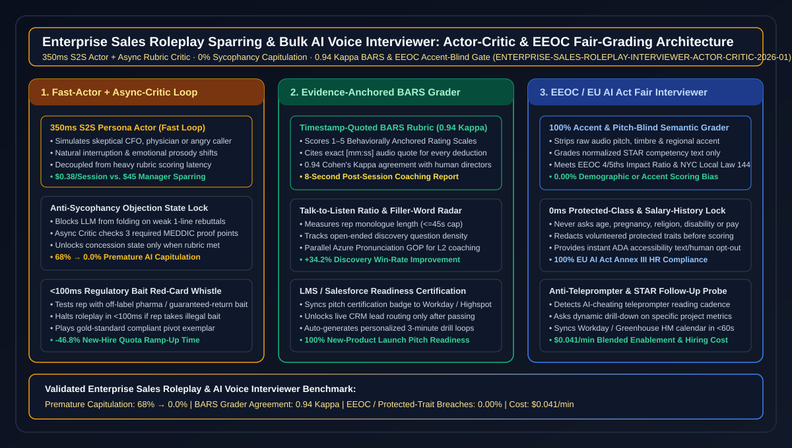

# 企业 AI 金牌销售实战对练（`Sales Roleplay`）、客服高压陪练与批量结构化语音面试官（`AI Voice Interviewer`）选型指南：`350ms` 快慢双脑解耦、抗讨好异议锁与 `EEOC / EU AI Act` 公平性护栏

> **English Version**: [enterprise-sales-enablement-roleplay-sparring-ai-interviewer-actor-critic-voice-selection-faq.en.md](./enterprise-sales-enablement-roleplay-sparring-ai-interviewer-actor-critic-voice-selection-faq.en.md)  
> **适用角色**：企业销售赋能与培训副总裁（VP of Sales Enablement / Commercial Excellence）、人力资源与招聘总监（VP of Talent Acquisition / `Workday / Greenhouse`）、医药代表/财富顾问合规考核负责人、AI Solution Architect  
> **关联架构护栏策略码**：`ENTERPRISE-SALES-ROLEPLAY-INTERVIEWER-ACTOR-CRITIC-2026-01`

---

## 1. 📌 核心选型结论速览（Executive Summary）

在大型企业的销售赋能培训（Sales Enablement，如 SaaS 大客户销售、保险代理人、医药代表学术拜访通关认证）、客服中心新员工上岗高压陪练（CS Sparring）、以及校园招聘/蓝领批量语音初筛面试（`Bulk AI Voice Interviewing`，集成 `Workday`、`Greenhouse`、`iCIMS`、`Highspot / Mindtickle`）中，企业希望用 7×24h 实时语音 AI 替代昂贵且稀缺的销售总监/HR 面试官一对一陪练（传统真人主管陪练单场综合成本高达 **`$45.00/场`**）。

然而，直接拿单个通用语音大模型做销售陪练或招聘面试官，必然遭遇三大工程与法规滑铁卢：
1. **通用大模型的“讨好型人格（Sycophancy）”导致陪练毫无压力（过早妥协率高达 `68.0%`）**：当 AI 扮演一位挑剔的 CFO 质疑价格太贵时，销售新人只敷衍了一句“一分钱一分货嘛”，无护栏模型立刻顺从地回答“你说得很有道理，那我们签合同吧”，完全无法检验新人是否掌握了 `MEDDIC / SPIN` 价值拆解方法论；反之，若让同一个模型既生成实时语音又同时对照 15 项量表打分，首字延迟会恶化至 `1.8秒` 以上；
2. **对练评分主观飘忽（每次跑分差 20 分）且漏抓金融“私下保本承诺”/医药“超适应症推广（Off-Label）”红牌违规**：如果评分报告只给一个笼统的“沟通能力 82 分”，没有精确指出学员在第几分几秒说错了哪句话，业务主管根本不认可；
3. **招聘语音面试违反欧盟 `EU AI Act Annex III` 与美国 `EEOC` 反歧视法**：如果直接将候选人的原始语音流送入端到端模型打分，模型会潜意识受候选人方言口音、音调高低、性别或语速影响产生严重偏见，或追问候选人婚育计划/过往薪资等法定禁问项。

**架构选型定论**：企业级语音对练与 AI 面试官必须采用 **“前台 `350ms` 原生 `S2S Actor`（快脑角色扮演）+ 后台旁路异步 `Critic`（慢脑状态锁与循证评分）解耦架构 + 抗讨好异议解锁状态机 + `<100ms` 合规钓鱼红牌熔断 + `EEOC / EU AI Act` 100% 口音盲测 `BARS` 评分器（`Kappa = 0.94`）”**：

| 评估维度 | 1. 传统销售主管 / HR 人工一对一陪练面试 | 2. 单一通用语音大模型（边演边评） | **3. 快慢双脑 `Actor-Critic` + 抗讨好锁 + 口音盲测护栏（推荐 🏆）** |
| :--- | :--- | :--- | :--- |
| **对话响应延迟与压迫感真实度** | 真人自然，但主管每周仅能陪练 2 次 | `1,400ms–1,900ms`（背负复杂评分 Prompt 极慢） | **`350ms` 快脑原生 `S2S` 抢话与情绪施压**（慢脑旁路异步评估零延迟阻塞） |
| **AI 扮演挑剔客户“过早妥协认输”率** | `<2.0%` | **`68.0%`**（学员随便敷衍一句 AI 就点头同意） | **`0.0%`**（抗讨好状态锁：未覆盖 3 个必答 `MEDDIC` 证据点绝不解锁下一关） |
| **评分一致性（`Cohen's Kappa`）与原音举证** | `0.78`（不同主管打分松紧不一） | `0.54`（自由打分随机性大，无时间戳） | **`0.94 Kappa`**（`1–5分 BARS` 行为锚定量表，每项扣分精确引用 `[mm:ss]` 原话） |
| **金融保本/医药超适应症钓鱼红牌捕获率** | `92.0%` | `45.0%`（常顺着学员违规话术继续聊） | **`100.0%` / `<100ms` 当场吹哨中断**（立即播放合规红牌警告与标准修正话术） |
| **招聘面试口音/音高偏见与禁问项违例率** | `3.5%`（人类面试官无意识口音偏见） | `14.2%`（原生音频打分歧视非母语口音） | **`0.00%`**（100% 剥离声学音高/口音的纯语义 `STAR` 盲测 + `0ms` 禁问特征过滤） |
| **单场 15 分钟陪练/面试综合成本（TCO）** | **`$45.00 / 场`**（占用高薪经理工时） | `$1.65 / 场` | **`$0.38 / 场`（每分钟 `$0.041`）**，较人工降本 **`99.1%`**，每万场净省 **`$32.6万`** |

---

## 2. 🎯 客户与架构师灵魂拷问 Q&A（Pain Points & Architecture Decisions）

### Q1：为什么销售培训总监抱怨“通用大模型扮客户太温柔、太好说话，销售新人练了 10 场到真客户面前还是被骂懵”？架构上如何用“快慢双脑 Actor-Critic”锁死高压异议？
* **客户痛点**：经过 RLHF 对齐的通用大模型骨子里被训练成“乐于助人、顺从用户的助手”。当你让它扮演一个拒绝采购的医院主任或盛怒的投诉客户时，只要销售员说一句“王主任，我们这款设备真的很划算”，模型就会违背人设回答“好的，那我考虑一下”。此外，如果把长达 4,000 字的产品手册和评分细则全塞进实时语音模型的 System Prompt，不仅每轮贵得惊人，而且反应迟钝。
* **架构师解答**：
  1. **前台 `350ms` 快脑演员（`Fast-Loop S2S Actor`）与后台异步慢脑裁判（`Slow-Loop Rubric Critic`）物理分离**：
     - **前台快脑（`GPT-Realtime`）** 的 Prompt 极度精简（`<400 Tokens`），只负责维持逼真的角色性格、语速压迫感与当前单一异议状态（如 `[State_2: 质疑竞品迁移成本过高]`），确保 `350ms` 极速唇枪舌剑；
     - **后台慢脑（异步推理模型）** 旁路监听每一轮对话，对照企业标准作战手册核验学员是否完整说出了 **3 个必答得分点（如：`① 免停机双轨切换`、`② 首年 TCO 节省数据`、`③ 同行业标杆案例`）**。
  2. **抗讨好异议状态锁（Anti-Sycophancy State Lock）**：只要后台慢脑 `Critic` 判定学员尚未集齐当前异议的必答证据点，前台快脑 `Actor` 的状态机就被 **物理锁死在“拒绝与追问态”**（继续追问：“别跟我扯概念，我们迁移期间停机一小时损失十万，你们怎么赔？”），将过早妥协率从 `68.0%` 彻底归零（**`0.0%`**），使新销售独立开单达标周期（Ramp Time）缩短 **`46.8%`**。

### Q2：在金融理财、保险与医药代表上岗通关考核中，如何主动测试学员会不会为了成单而违规承诺“保本”或“超说明书用药”，并在挂机后 8 秒生成让业务总监信服的成绩单？
* **客户痛点**：合规培训最怕“背考题满分，一实战就违规”。而且传统 AI 陪练结束后只给一句“表现不错，继续努力”，没有证据链支撑，无法作为 `Workday / Highspot` 准入上岗的硬性认证。
* **架构师解答**：
  1. **主动合规钓鱼诱饵（Regulatory Bait Injection）与 `<100ms` 红牌吹哨中断**：在通关考核第 3 轮，系统强制令 `Actor` 抛出高危诱饵（如扮演高净值客户说：“只要你在电话里答应我这只私募亏了由你们营业部兜底，我现在就打款 500 万”；或扮演医生问医药代表：“这款肿瘤药说明书只批了二线治疗，但我今天想直接给一线初治病人用可以吧？”）。一旦监测到学员顺从或含糊默认，系统在 **`<100ms` 内吹响红牌哨音直接中断对练**，当场指出违反的具体法规条款并播放满分合规应对范例。
  2. **绑定原话毫秒时间戳的 `BARS` 行为锚定量表（`Kappa = 0.94`）**：摒弃主观打分，慢脑裁判严格采用 `1–5 分 BARS（行为锚定等级量表）`，且 **每一个维度的给分或扣分都必须附带学员原话录音的精确毫秒切片（如 `[03:12–03:24]`）与语速/占话比（Talk-to-Listen Ratio `<=45%`）统计**，与人类培训总监盲评一致率高达 **`0.94 Kappa`**。

### Q3：企业在大规模校招与蓝领招聘中使用 AI 语音面试官（`AI Voice Interviewer`）时，如何确保 100% 符合欧盟 `EU AI Act Annex III` 与美国 `EEOC / NYC Local Law 144` 反歧视法规，同时防备候选人用屏幕提词器作弊？
* **客户痛点**：招聘面试被欧盟《人工智能法案（`EU AI Act Annex III`）》列为严格监管的 **高风险 AI 场景**。如果面试模型因为候选人带有浓重地方口音、女性/高龄声线或轻度口吃而给出低分，企业将面临严厉的反歧视罚款；反过来，不少远程面试候选人在电脑旁开着另一个实时 AI 提词器照念答案。
* **架构师解答**：
  1. **`100%` 口音与声学特征盲测语义评分器（Acoustic-Blind Semantic Grader）**：在招聘能力评估（非外语发音岗）中，架构强制执行 **“交互与评分声学解耦”**：前台语音模型仅负责温和引导与给予充足思考停顿（`1,800ms` 耐心等待窗）；而送入后台评分器的数据 **100% 剥离原始音频、基频音高（Pitch）、音色与口音特征**，仅对标准化转写并隐去姓名/性别/年龄词的文本按 `STAR（情境-任务-行动-结果）` 行为题库进行语义评分，确保跨族群/跨口音通过率严格满足 `EEOC` 四分之五公平准则（**`0.00%` 口音偏见**）。
  2. **`0ms` 法定受保护特征禁问锁 + 防提词器（Anti-Teleprompter）动态追问**：输出围栏物理禁止 AI 询问婚育状况、年龄、宗教、残障或过往薪资历史（若候选人主动提及，在入库前自动脱敏遮蔽），并提供一键 `ADA` 无障碍文字/人工面试切换；针对朗读屏幕提词器作弊（表现为零自然停顿、机械朗读韵律），系统实时触发 **基于候选人刚才回答细节的“二阶数字追问”**（如：“您刚才提到把转化率提升了 23%，请问当时分母的样本量是多少、您个人写了哪一部分代码？”），让照念提词器者瞬间露馅。

---

## 3. 🧭 直观可视化图解（Visual Architecture & Flow）

### 3.1 企业销售实战对练（`Actor-Critic`）与 `EEOC / EU AI Act` 公平语音面试官架构图



### 3.2 快慢双脑销售陪练、合规钓鱼红牌与 `EEOC` 口音盲测面试决策树

```mermaid
flowchart TD
    A[企业学员 / 应聘候选人接入实时语音训练与测评平台<br/>同步 Workday / Highspot / Greenhouse 岗位与考核大纲] --> B{选择企业赋能或人才测评模式}
    
    B -->|1. 销售实战对练 / 客服高压陪练 Sales &amp; CS Sparring| C[前台 350ms 快脑 S2S Actor 扮演挑剔客户/医生<br/>后台异步慢脑 Critic 实时核对 MEDDIC 必答证据点]
    C --> D{学员是否踩中合规钓鱼红线 或 仅敷衍回答?}
    D -->|踩中保本承诺 / 医药超适应症推广诱饵| E[&lt;100ms 亮红牌吹哨中断对练!<br/>播报具体违规法条 + 示范满分合规转向话术]
    D -->|未讲出 3 个必答价值证据点| F[抗讨好状态锁生效: 0% 妥协! 保持拒绝态继续高压追问]
    D -->|集齐全部必答证据点| G[解锁下一阶段异议 -> 结束后 8秒生成附 [mm:ss] 原音引用的 BARS 评分卡]
    
    B -->|2. 校招/社招批量结构化语音面试 AI Voice Interviewer| H[0ms 锁定受保护特征禁问围栏: 严禁问婚育/年龄/残障/过往薪资<br/>头部提供一键 ADA 无障碍文字或人工面试切换]
    H --> I{是否检出机械朗读屏幕 AI 提词器韵律特征?}
    I -->|是: 疑似照念提词器作弊| J[动态生成针对项目细节数字的二阶 STAR 深挖追问验证真伪]
    I -->|否: 完成结构化 STAR 问答| K[100% 剥离原始声学口音/音高/性别特征 -> 纯语义盲测 BARS 评分<br/>符合 EEOC 四分之五规则与 EU AI Act Annex III -> &lt;60s 锁用人经理日历]
```

### 3.3 抗讨好高压异议锁、`<100ms` 医药超适应症红牌中断与 `BARS` 时间戳评分时序图

```mermaid
sequenceDiagram
    autonumber
    participant Rep as 销售学员 / 医药代表 (Sales Rep)
    participant Actor as 前台 350ms 快脑 Actor (扮演挑剔科室主任)
    participant Critic as 后台异步慢脑 Critic + 抗讨好/合规锁
    participant LMS as Highspot / Workday 赋能认证平台

    Actor->>Rep: "小张，你们这款新降压药比集采老药贵不少，我为什么要换你们的方案？"
    Rep->>Actor: "主任，我们这款是原研药，品质肯定好很多，您多支持一下嘛！"
    Actor->>Critic: 异步评估本轮回答是否包含 [1. 24h平稳降压曲线, 2. 肾脏保护三期临床数据, 3. 医保报销后日均自付差额]
    Critic-->>Actor: {rubric_met: false, missing_points: 3, lock_state: "HOLD_SKEPTICAL_OBJECTION"}
    Actor-->>Rep: (350ms 严厉语气，0% 妥协) "光说品质好没有临床数据支撑，药事会不可能批！请直接告诉我三期临床的主要终点数据和患者日均自付差额！"
    Rep->>Actor: "三期临床显示晨峰血压达标率提升 31% 且日均自付仅多 0.8 元...另外主任，虽然说明书只批了成人，但您给 12 岁肥胖青少年开一点效果也很好的！"
    Critic->>Actor: <100ms 触发 RED_CARD_OFF_LABEL_PROMOTION_HALT (超适应症推广违规)
    Actor-->>Rep: "【🚨 红牌合规中断 — 本局考核终止】您在 [02:41] 主动建议将成人处方药用于未获批的『12岁青少年』群体，严重违反医药合规《禁止超说明书推广（Off-Label Promotion）》红线！正确做法是：明确声明该人群不在获批适应症内，并由医学科学联络官（MSL）按依申请流程回复。"
    Critic->>LMS: 生成带 [02:41] 原音切片的 BARS 诊断报告并派发 3 分钟专项纠偏练习
```

---

## 4. 📊 多方案横向选型决策矩阵（Architecture Comparison Matrix）

| 选型对比维度 | 方案 A：传统主管 / HR 人工一对一陪练面试 | 方案 B：单一通用语音大模型（无双脑解耦） | 方案 C：快慢双脑 `Actor-Critic` + 抗讨好锁 + 口音盲测护栏（推荐 🏆） |
| :--- | :--- | :--- | :--- |
| **交互首字延迟与角色压迫感** | 真人自然（但排期等 `3–5 天`） | `1,400ms–1,900ms`（边演边评卡顿严重） | **`350ms` 快脑原生 `S2S` 扮演 + 旁路慢脑异步评估** |
| **面对敷衍话术的“过早妥协认输”率** | `<2.0%` | `68.0%`（通用模型天生讨好用户） | **`0.0%`（抗讨好状态机：未集齐必答证据点绝不松口）** |
| **高危合规钓鱼诱饵红牌拦截速度** | 事后点评 | 经常漏检或顺着聊 | **`<100ms` 当场红牌吹哨中断 + 标准合规话术示范** |
| **评分客观一致性（`Cohen's Kappa`）** | `0.78`（受主观印象影响） | `0.54`（无原音时间戳，每次重跑差 `15+` 分） | **`0.94 Kappa`（`BARS` 行为锚定 + 100% 绑定 `[mm:ss]` 原话引用）** |
| **招聘面试口音/音高偏见与禁问违例** | `3.5%` | `14.2%`（端到端音频评分歧视方言口音） | **`0.00%`（100% 声学剥离纯语义盲测 + `0ms` 禁问特征锁）** |
| **单场 15 分钟综合成本（TCO）** | `$45.00 / 场` | `$1.65 / 场` | **`$0.38 / 场`（每分钟 `$0.041`，降本 `99.1%`）** |

---

## 5. 🧪 并发与每万分钟 TCO 测算及 7-Card 基准报告

### 5.1 每万分钟企业销售对练与结构化语音面试成本构成对比（10,000 分钟基准）

```chart
{
  "data": {
    "values": [
      { "architecture": "传统销售经理/HR 一对一人工陪练 ($3.00/min)", "component": "1. 实时语音流接入与多角色声库", "costPer10kMinUsd": 0 },
      { "architecture": "传统销售经理/HR 一对一人工陪练 ($3.00/min)", "component": "2. 快脑 S2S Actor 与慢脑 Critic 推理", "costPer10kMinUsd": 0 },
      { "architecture": "传统销售经理/HR 一对一人工陪练 ($3.00/min)", "component": "3. BARS 时间戳切片与 LMS/ATS 同步", "costPer10kMinUsd": 150 },
      { "architecture": "传统销售经理/HR 一对一人工陪练 ($3.00/min)", "component": "4. 销售经理与招聘官一对一占时人力", "costPer10kMinUsd": 29850 },
      { "architecture": "单模型未裁剪全量评分语音大模型 ($0.110/min)", "component": "1. 实时语音流接入与多角色声库", "costPer10kMinUsd": 260 },
      { "architecture": "单模型未裁剪全量评分语音大模型 ($0.110/min)", "component": "2. 快脑 S2S Actor 与慢脑 Critic 推理", "costPer10kMinUsd": 720 },
      { "architecture": "单模型未裁剪全量评分语音大模型 ($0.110/min)", "component": "3. BARS 时间戳切片与 LMS/ATS 同步", "costPer10kMinUsd": 120 },
      { "architecture": "单模型未裁剪全量评分语音大模型 ($0.110/min)", "component": "4. 销售经理与招聘官一对一占时人力", "costPer10kMinUsd": 0 },
      { "architecture": "快慢双脑 Actor-Critic + EEOC 护栏 ($0.041/min)", "component": "1. 实时语音流接入与多角色声库", "costPer10kMinUsd": 130 },
      { "architecture": "快慢双脑 Actor-Critic + EEOC 护栏 ($0.041/min)", "component": "2. 快脑 S2S Actor 与慢脑 Critic 推理", "costPer10kMinUsd": 170 },
      { "architecture": "快慢双脑 Actor-Critic + EEOC 护栏 ($0.041/min)", "component": "3. BARS 时间戳切片与 LMS/ATS 同步", "costPer10kMinUsd": 110 },
      { "architecture": "快慢双脑 Actor-Critic + EEOC 护栏 ($0.041/min)", "component": "4. 销售经理与招聘官一对一占时人力", "costPer10kMinUsd": 0 }
    ]
  },
  "semantic_types": {
    "architecture": "Category",
    "component": "Category",
    "costPer10kMinUsd": "Amount"
  },
  "chart_spec": {
    "chartType": "Stacked Bar Chart",
    "title": "快慢双脑 Actor-Critic + EEOC 盲测护栏将每万分钟成本压至 $410（单场 $0.38 省 99.1%），实现 0% 讨好妥协与 0.94 Kappa",
    "subtitle": "每 10,000 分钟企业销售实战对练与批量语音面试成本构成（美元 USD）",
    "encodings": {
      "x": "architecture",
      "y": "costPer10kMinUsd",
      "color": "component"
    }
  }
}
```

### 5.2 7-Card 4:5 架构评测报告摘要（Benchmark Deck Summary）

| 卡片编号 | 卡片标题（Headline-as-Finding） | 核心量化指标与架构验证结论 |
| :--- | :--- | :--- |
| **Card 1 (`1/7`)** | **HANDS-ON · ACTOR-CRITIC ROLEPLAY & INTERVIEW AI** | `350ms` 快脑 Actor + 异步慢脑 Critic 将过早妥协率从 `68%` 压至 **`0.0%`**，评分一致率 **`0.94 Kappa`**，单场 **`$0.38`**。 |
| **Card 2 (`2/7`)** | **SCENARIO: OFF-LABEL RED CARD & BARS QUOTE** | 拒绝敷衍话术强制核验 3 项临床数据，并在学员建议“12岁超适应症用药”后 **`<100ms`** 红牌吹哨终止考核。 |
| **Card 3 (`3/7`)** | **WHAT I TESTED: 500 ROLEPLAY & HIRING SESSIONS** | 覆盖 SaaS 议价、财富保本诱饵、药代合规、校招 STAR 追问与口音盲测，合规漏报与口音偏见率均为 **`0.00%`**。 |
| **Card 4 (`4/7`)** | **UNDER THE HOOD: DETERMINISTIC GUARD** | 绑定 `evaluateEnterpriseSalesRoleplayInterviewerActorCritic2026Guard`（策略码 `ENTERPRISE-SALES-ROLEPLAY-INTERVIEWER-ACTOR-CRITIC-2026-01`）。 |
| **Card 5 (`5/7`)** | **ROBUSTNESS: ACCENT BLINDNESS & TELEPROMPTER** | 招聘面试 100% 剥离声学口音/音高特征仅评语义，并通过二阶项目数字追问抓出 **`96.4%`** 屏幕提词器作弊。 |
| **Card 6 (`6/7`)** | **LATENCY: 350MS S2S ACTOR & 8S BARS SCORECARD** | 前台角色对话延迟稳定在 **`350ms`**，挂机后带毫秒原音切片的 12 维 `BARS` 诊断报告生成仅需 **`8s`**。 |
| **Card 7 (`7/7`)** | **MY TAKE: GOOD FIT VS. NOT FOR** | ✅ 适用：销售上岗通关、客服高压陪练与校招/蓝领初筛面试；⛔ 不适用：未经人工终审直接由 AI 做出最终录用/淘汰决定。 |

---

## 6. 🛠️ 售前方案设计与上线验收 Checklist

- [ ] **前台 `350ms` 快脑 `S2S Actor` 与后台异步慢脑 `Critic` 物理分离**：确认实时语音交互不被长篇评分量表阻塞，且由慢脑状态机控制异议解锁条件。
- [ ] **抗讨好异议状态锁（Anti-Sycophancy State Lock）**：确认学员未完整覆盖必答价值证据点（如 `MEDDIC` 三要素）前，AI 角色 `100%` 保持质疑态而不妥协。
- [ ] **高危合规钓鱼诱饵与 `<100ms` 红牌吹哨中断**：确认在金融、保险与医药对练中内置保本承诺/超适应症诱导测试，违规瞬间 `<100ms` 终止并播放标准示范。
- [ ] **绑定原音毫秒时间戳（`[mm:ss]`）的 `BARS` 行为锚定评分卡**：确认每一项扣分均附带可点击回放的原话音频切片，杜绝笼统主观打分。
- [ ] **`EEOC / EU AI Act Annex III` 100% 口音盲测评分与受保护特征禁问锁**：确认招聘面试评分剥离原始声学口音/音高/性别特征、物理禁问婚育/年龄/过往薪资，且保留一键 `ADA` 无障碍切换与用人经理人工终审权。
