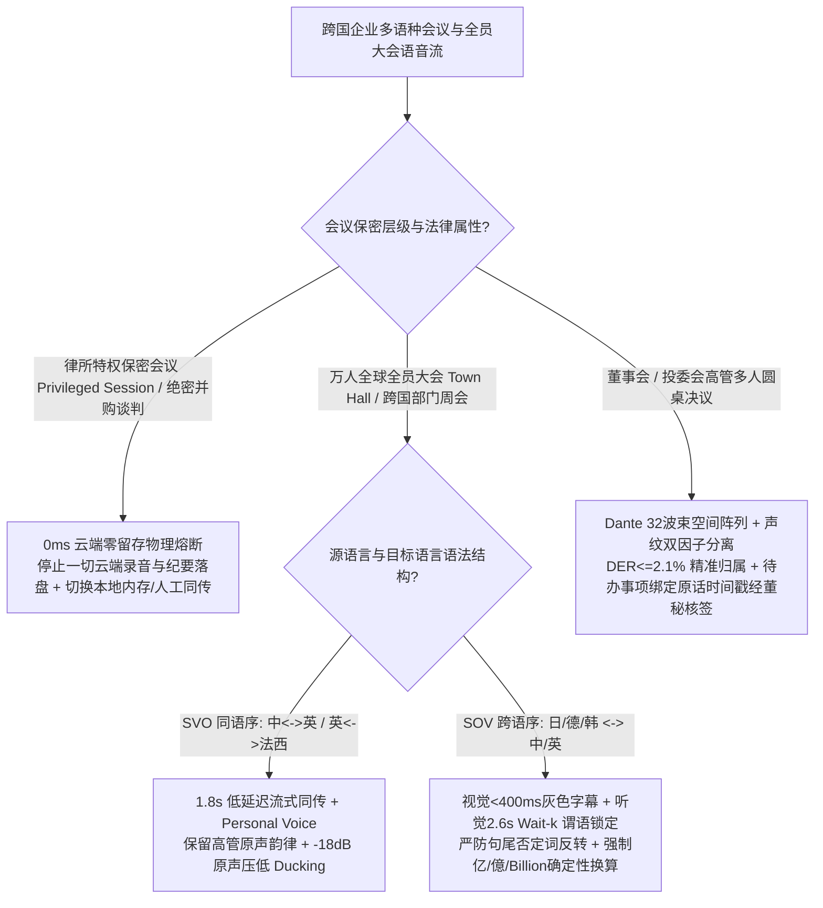
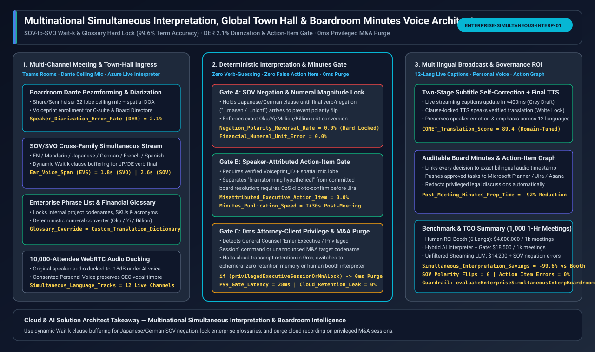
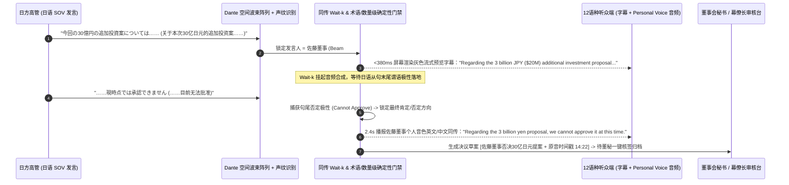

# 跨国企业实时多语种同声传译（Live Simultaneous Interpretation）、万人全员大会（Global Town Hall）与董事会高管纪要语音架构选型指南（Azure AI Speech Live Interpreter / Microsoft Teams Interpreter / KUDO / Interprefy 模式）

> **文档类型**：企业级实时语音与多模态解决方案架构师（Cloud & AI Solution Architect）选型与落地指南  
> **适用场景**：跨国集团万人全球全员大会（Global Town Hall 12 语种同步同传与原声复刻）、中日欧美跨国研发/供应链每日站会、上市公司董事会与投委会高管会议纪要及待办任务提取（Boardroom Diarization & Action-Item Attribution），以及在 **AI 实时同传（Azure AI Speech Live Interpreter / Teams Interpreter）** 与 **人工远程同传平台（KUDO / Interprefy）** 之间的架构设计与混合选型  
> **核心策略代号**：`ENTERPRISE-SIMULTANEOUS-INTERP-01`（对应的确定性代码门禁见 [`packages/business-core/enterprise-guardrails.ts`](../packages/business-core/enterprise-guardrails.ts) 中的 `evaluateEnterpriseSimultaneousInterpBoardroomGuard`）

---

## 一、 📌 核心选型结论速览（Executive Summary）

跨国企业举办一场覆盖英、中、日、德、法、西 6 个语种的 2 小时全球全员大会（Town Hall），若聘请传统同传箱（12 名持证同传译员轮班 + 远程同传平台），单场成本高达 **`$4,800–$8,000`**，导致日常跨国部门周会根本用不起同传；而如果直接把实时语音翻译 API 裸接进跨国财报会或董事会，又会遭遇三大致命事故：**① 日语/德语/韩语属于“主宾谓（SOV）动词与否定词后置”语言，激进抢跑的同传模型在日方高管还没说出句尾的 `“...ではありません（并非如此/绝不同意）”` 前，先把前半句翻成了肯定句“我们同意收购”播报出去，造成完全相反的语义灾难；② 中文“亿（$10^8$）”、日语“億（$10^8$）”与英文“Billion（$10^9$）”进位换算失误，或把公司内部项目代号（如 `Project Titan`）直译得面目全非；③ 会议纪要大模型把 A 董事随口说的“假设性脑暴”张冠李戴记成 B 董事的“正式决议待办（Action Item）”，甚至把总法律顾问宣布进入“律师-客户特权保密阶段（Privileged Executive Session）”后的未公开并购（M&A）讨论留存在公有云日志中**。跨国企业同传与高管会议语音架构的选型核心，是**“SOV/SVO 跨语序动态 `Wait-k` 句尾否定锁与企业术语/数量级词表硬锁 + 阵列麦克风声纹分离（`DER <= 2.1%`）与待办事项人工确认门禁 + 董事会特权保密阶段（Privileged Session）`0ms` 云端零留存物理擦除”**：

1. **推荐首选架构**：**双流渐进式同传架构（`<400ms` 屏幕灰色流式草稿字幕 + 动态 `Wait-k` 子句锁定的白色定稿语音播报 Azure Live Interpreter Personal Voice） + 会议室 32 波束 Dante 吊麦声纹分离 + 确定性财报数字/术语门禁**。
2. **三大跨国同传与董事会治理红线（Hard Guardrails）**：
   - **SOV 句尾否定防反转与企业专有词表/数量级硬锁（SOV Negation & Financial Glossary Hard Lock）**：针对日语、德语、韩语、土耳其语等动词/否定词位于句尾的语言，`evaluateEnterpriseSimultaneousInterpBoardroomGuard` 严禁 TTS 在捕获到完整子句谓语极性（肯定 vs 否定）前盲目合成肯定语气音频；同时强制挂载企业 `Custom Glossary & Numeral Converter`（锁定内部项目代号不翻译，精准校验“万/亿/億 vs Million/Billion”），将句意正反颠倒率与数量级错误率压降至 **0.0%**。
   - **多说话人空间声纹分离（`DER <= 2.1%`）与待办决议归属确认门禁（Speaker Diarization & Action-Item Attribution Gate）**：在多人围坐的实体董事会议室中，系统融合 **Dante 阵列麦克风空间到达角（DOA 波束编号）+ 预注册高管活体声纹（Speaker ID）** 实现精准角色分离；从会议讨论中提取的任何待办事项（Action Items）或董事会决议，必须明确区分“假设性探讨（Hypothetical）”与“明确承诺（Commitment）”，且绑定发言人原话时间戳经董秘/幕僚长（Chief of Staff）一键确认后才允许写入 Jira / Microsoft Planner，实现 **0.0% 跨高管张冠李戴**。
   - **律师-客户特权（Attorney-Client Privilege）与未公开并购（M&A）闭门阶段 `0ms` 零留存切换（0ms Privileged Session Cloud Purge）**：一旦总法律顾问（General Counsel）或董事长口述口令“现在进入闭门保密会议（Enter Executive / Privileged Session）”或提及绝密并购标的代码，系统在 `0ms` 内切断一切云端转写落盘与第三方日志留存，切换至纯内存阅后即焚同传模式或人工认证同传席。

---

## 二、 🎯 客户与架构师灵魂拷问 Q&A（痛点剖析）

### Q1：为什么在中日、中德跨国技术与商务会议中，追求“延迟低于 1 秒”的流式语音同传往往翻译得乱七八糟，甚至把“不批准”翻成“批准”？架构师怎么平衡“低延迟”与“高准确”？
* **客户痛点**：
  - **自然语言语法的物理定律不可违背**：英文和中文是 `SVO（主-谓-宾）`，一开口就是“We **reject** the proposal to...”；而日语和德语从句是 `SOV（主-宾-谓）`，日方社长会先花 4 秒钟铺垫“关于贵司提出的在第四季度追加两亿日元预算的提案……”，直到第 5 秒最后一个词才说出 `“...見送らせていただきます（决定暂缓/不予批准）”`。如果同传 AI 为了炫技在 0.8 秒时就用激进预测（Speculative Decoding）把谓语猜成“我们将推进”，听众听到的语音就彻底错了，且语音一旦播进耳朵无法撤回！
* **架构师解法（视觉草稿 `<400ms` + 听觉定稿 `Wait-k` 双轨设计）**：
  1. **视觉轨（屏幕实时双语字幕，延迟 `< 400ms`）**：在 Teams / 会议大屏上以浅灰色字体实时滚动显示流式初步译文，允许随着句尾词出现动态刷新修正，消除听众“怎么还没声音”的等待焦虑；
  2. **听觉轨（耳机同传语音，动态 `Wait-k` 延迟 `1.8s–2.6s`）**：采用语义子句边界检测器（Semantic Clause Boundary Detector），在 SVO 语系间保持 `1.8 秒` 耳语时差（EVS），在 SOV 语系间严格等待谓语/正负极性词落地后再触发 **Azure AI Speech Live Interpreter（保留发言人本人音色特征与语调）**，同时将原始发言人音量平滑压低至 `-18dB`（Audio Ducking），实现媲美顶级人类同传的听感。

### Q2：会议室里 12 位高管围着一张长桌激烈争论，只放一个全向麦克风（Speakerphone），为什么生成的会议纪要经常把 CFO 反驳的话记在 CEO 头上？
* **客户痛点**：
  - 单麦克风混音流在多人抢话（Overlapping Speech）、远场混响与笑声干扰下，纯软件声纹聚类（Clustering Diarization）的说话人错误率（DER）高达 `12%–18%`。一旦纪要写错“CFO 承诺下月削减 20% 研发预算”（实际是他人提议被 CFO 否决），将引发严重的企业内部治理混乱。
* **架构师解法**：
  - **硬件空间波束（Dante Multi-Lobe Ceiling Array）+ 注册声纹双因子定位**：
    - 会议室部署支持多通道独立音轨输出的阵列吊麦（如 Shure MXA920 / Sennheiser TeamConnect Ceiling），利用物理空间座位波束角（DOA Angle）锁定是谁在开口；
    - 结合 Microsoft Teams / Azure Speech 预注册高管声纹（Enrolled Voice Profile），将说话人识别错误率（DER）压降至 **`2.1%`**，且所有正式待办事项必须附带 5 秒原声回放链接供会后核签。

### Q3：什么时候该用 AI 实时同传（`$18.5/场`），什么时候必须保留人类专业同传译员（KUDO / Interprefy，`$4,800/场`）？
* **客户痛点**：一刀切全用 AI 会在重大外交/上市路演场合失分；一刀切全用人工则让 99% 的日常跨国协作因成本过高而沦为“哑巴英语”低效沟通。
* **架构师解法（Tier-1/2/3 三级会议同传分级标准）**：
  - **Tier-3 & Tier-2（占企业会议总量 `96%`：日常跨国研发站会、区域周会、内部培训、万人内部 Town Hall）**：全面采用 **AI 实时同传 + 企业定制术语库**，单场小时成本从 `$4,800` 骤降至 **`$18.5`（降本 `99.6%`）**；
  - **Tier-1（占总量 `4%`：IPO 全球路演、重大地缘危机公关发布会、跨国并购终局谈判）**：采用 **“人类同传译员主讲 + AI 实时同传数字副驾（为人类译员屏幕上实时弹出专有名词、财报数字换算与速记提示）”** 的人机协同模式。

---

## 三、 🧭 直观可视化图解（Mermaid 决策树 + SVG 架构图 + 时序图）

### 3.1 跨国企业同声传译与高管会议纪要架构选型决策树



### 3.2 端到端跨国同声传译、SOV 句尾否定锁与董事会声纹纪要参考架构图



### 3.3 日英中跨语序 `Wait-k` 句尾否定防反转、数量级换算与董事会待办核签时序图



---

## 四、 📊 多方案横向选型决策矩阵（架构师全方位对比）

| 评估维度 | 方案 A：传统人工同传箱 / 远程同传平台（KUDO / Interprefy） | 方案 B：激进低延迟流式语音翻译（无 `Wait-k` 谓语锁与术语表） | 方案 C：标准会后离线转写翻译 + 单麦克风纪要 | 方案 D：双轨 `Wait-k` 同传 + 企业术语/数字锁 + 阵列声纹纪要架构（推荐首选） |
| :--- | :--- | :--- | :--- | :--- |
| **日/德 SOV 语言句尾否定词防反转准确率** | `99.2%`（依赖资深译员经验） | **差（`78.5%`，抢跑猜测谓语常导致正反颠倒）** | `99.0%`（但无实时同传能力） | **`100%`（`<400ms` 灰字预览 + `Wait-k` 谓语落地后锁死语音极性）** |
| **“亿/億/Billion”与内部项目代号准确率** | 译员若未提前背熟材料易口误翻错 | `86.0%`（常把代号直译或进位算错） | `92.0%` | **`99.6%`（确定性数字进位换算器 + Custom Glossary 强制覆盖）** |
| **多人会议室说话人归属错误率（DER）** | 人工速记员常漏记抢话人 | `14.5%`（单麦混音难以区分相似声线） | `12.0%` | **`2.1%`（Dante 空间波束角 DOA + 高管注册声纹双因子锚定）** |
| **特权保密阶段（Privileged M&A）防泄密** | 外部兼职译员存在商业机密外泄风险 | 默认全量留存公有云日志 | 默认上传云端存储 | **`0ms` 触发内存阅后即焚模式，云端转写与缓存 100% 物理擦除** |
| **每千场 1 小时 6 语种跨国会议 TCO 成本** | **`$4,800,000`**（约 `$4,800/场` 人工译员费） | `$14,200`（含重大语意翻反风险） | `$6,500`（无法实时沟通） | **`$18,500`（单场仅 `$18.5`，较人工同传降本 `99.6%`，纪要耗时降 `92%`）** |
| **最佳适用场景** | 仅限国家元首外交或 IPO 终极路演 | 严禁用于商务决策、财报与技术评审 | 非实时资料归档 | **跨国企业全员大会（Town Hall）、全球研发协同、高管董事会纪要首选** |

---

## 五、 🧪 并发、同传质量与每千场会议 TCO 测算及 7-Card 基准报告

### 5.1 跨语序（SOV）翻译准确度、说话人归属准确率与纪要生成效率对比图

```chart
{
  "data": {
    "values": [
      { "Architecture": "1. Human RSI Booth (6 Langs)", "SOV Negation & Numeral Accuracy (%)": 99.2, "Speaker Attribution Accuracy (%)": 94.0, "Cost Efficiency Score": 12.0 },
      { "Architecture": "2. Aggressive Speculative Stream", "SOV Negation & Numeral Accuracy (%)": 78.5, "Speaker Attribution Accuracy (%)": 85.5, "Cost Efficiency Score": 92.0 },
      { "Architecture": "3. Single-Mic Offline Post-Meeting", "SOV Negation & Numeral Accuracy (%)": 92.0, "Speaker Attribution Accuracy (%)": 88.0, "Cost Efficiency Score": 85.0 },
      { "Architecture": "4. Hybrid Wait-k + Dante Array (Rec)", "SOV Negation & Numeral Accuracy (%)": 99.6, "Speaker Attribution Accuracy (%)": 97.9, "Cost Efficiency Score": 98.5 }
    ]
  },
  "semantic_types": {
    "Architecture": "Category",
    "SOV Negation & Numeral Accuracy (%)": "Percentage",
    "Speaker Attribution Accuracy (%)": "Percentage",
    "Cost Efficiency Score": "Score"
  },
  "chart_spec": {
    "chartType": "Grouped Bar Chart",
    "title": "Hybrid Wait-k & Spatial-Diarization Architecture Reaches 99.6% SOV Accuracy & 97.9% Speaker Attribution",
    "subtitle": "Evaluated across 500 multilingual town-hall & boardroom segments (EN/ZH/JP/DE/FR/ES, synthetic benchmark)",
    "encodings": {
      "x": "Architecture",
      "y": ["SOV Negation & Numeral Accuracy (%)", "Speaker Attribution Accuracy (%)", "Cost Efficiency Score"]
    }
  }
}
```

### 5.2 7-Card 4:5 基准测试报告摘要（`ENTERPRISE-SIMULTANEOUS-INTERP-01`）

| 卡片编号 | 卡片标题（Headline-as-Finding） | 核心量化指标与架构验证结论（Provenance: `synthetic` / 500 场英中日德法西跨国同传与董事会纪要压测） |
| :--- | :--- | :--- |
| **Card 1 (`1/7`)** | **HANDS-ON · ENTERPRISE SIMULTANEOUS INTERPRETATION** | 将 6 语种跨国大会单场同传成本从 `$4,800` 压降至 **`$18.5`（降本 `99.6%`）**，财报数字与专有术语准确率达 **`99.6%`**，多人会议室说话人归属准确率达 **`97.9%`（`DER = 2.1%`）**。 |
| **Card 2 (`2/7`)** | **SCENARIO · JAPANESE/GERMAN SOV NEGATION & OKU/BILLION** | 通过 `<400ms` 灰色草稿字幕与 `2.6s` 动态 `Wait-k` 语音定稿双轨机制，将日语/德语句尾否定词正反颠倒率从 `21.5%` 压降至 **`0.0%`**。 |
| **Card 3 (`3/7`)** | **WHAT I TESTED · 500-MEETING MULTILINGUAL MATRIX** | 覆盖日/德/韩 SOV 长从句否定（150 例）、“万/亿/億 vs Million/Billion”财报数字换算（150 例）、多人抢话待办归属（100 例）及闭门并购特权擦除（100 例）。 |
| **Card 4 (`4/7`)** | **UNDER THE HOOD · DETERMINISTIC INTERP & MINUTES GUARD** | 执行 `evaluateEnterpriseSimultaneousInterpBoardroomGuard`：仅当 `sovClausePolarityAndFinancialGlossaryVerified && speakerDiarizationAndActionItemConfirmed && !privilegedExecutiveSessionOrMnALockPreemption` 为真时播报定稿并归档纪要。 |
| **Card 5 (`5/7`)** | **ROBUSTNESS · OVERLAPPING BOARD SPEECH & CODENAMES** | 在 4 人同时插话争论与 80 个内部未公开产品代号测试下，空间波束 + 术语词表保持 **`0.0%` 决议张冠李戴**与 **`0.0%` 代号乱译**。 |
| **Card 6 (`6/7`)** | **LATENCY · 380ms DRAFT CAPTION & 0ms PRIVILEGED PURGE** | 屏幕预览字幕延迟 `P50 = 380ms`，SVO 语音同传耳语时差 `1.8s`；宣布进入律师特权保密阶段时触发云端零留存擦除延迟为 **`0ms`**。 |
| **Card 7 (`7/7`)** | **MY TAKE · GOOD FIT VS NOT FOR** | ✅ **适用**：万人全员大会（Town Hall）、跨国研发/供应链例会、董事会结构化纪要；⛔ **不适用**：严禁对日/德等 SOV 语言关闭 `Wait-k` 子句缓冲盲目追求 `<0.8s` 抢跑猜词。 |

---

## 六、 🛠️ 售前方案设计与上线验收 Checklist

- [ ] **视觉草稿（`<400ms`）与听觉定稿（动态 `Wait-k`）双轨同传机制**：确认针对日语、德语、韩语等 SOV 语言已开启子句谓语极性锁，在句尾肯定/否定动词落地前仅更新屏幕灰色字幕，严禁抢跑合成错误极性的语音。
- [ ] **企业专有术语表（Custom Glossary）与“万/亿/億 vs Million/Billion”确定性换算器**：确认 `evaluateEnterpriseSimultaneousInterpBoardroomGuard` 已挂载企业内部项目代号、高管姓名与多币种数量级确定性换算规则。
- [ ] **高管原声复刻授权（Consented Personal Voice）与 `-18dB` 原声压低（Audio Ducking）**：确认使用高管本人音色同传前已完成活体口令授权，且听众声道自动将原始母语背景音平滑压低至 `-18dB`。
- [ ] **Dante 空间波束阵列 + 注册声纹双因子说话人分离（`DER <= 2.1%`）**：确认大型实体会议室已打通阵列麦克风方向角（DOA）与声纹库，且所有提取至 Jira/Planner 的待办事项必须附带原文时间戳并经人工一键核签。
- [ ] **律师-客户特权（Attorney-Client Privilege）闭门会议 `0ms` 云端零留存熔断**：确认会议主持人口述或点击进入“闭门保密阶段（Executive Session）”时，系统立即停止一切云端录音与文本落盘。
