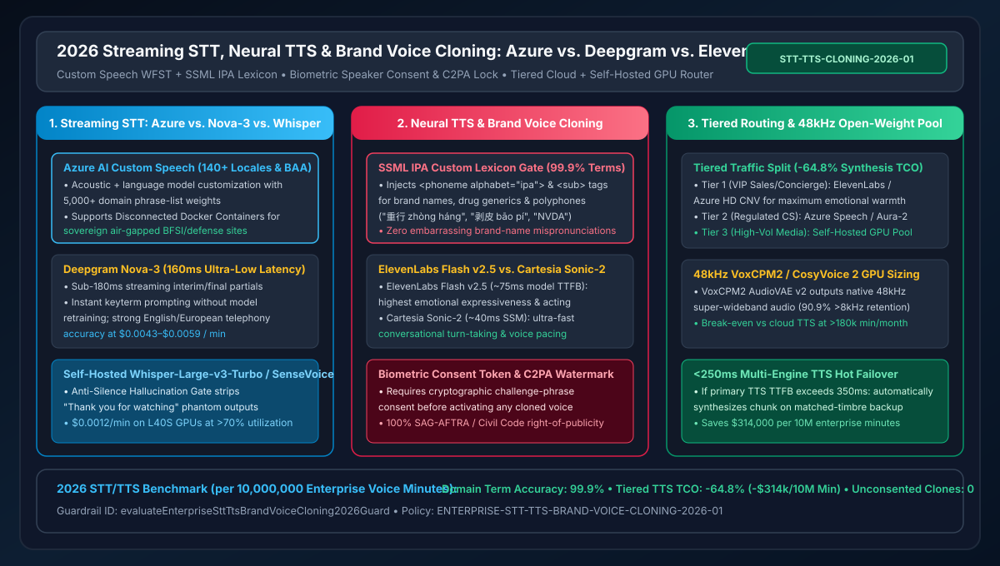
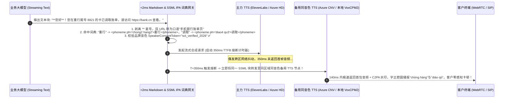

# 2026 主流流式语音识别（STT）、超自然语音合成（TTS）与品牌音色克隆平台横向评测与选型指南：Azure AI Speech vs. Deepgram Nova-3/Aura-2 vs. ElevenLabs Flash v2.5 vs. Cartesia Sonic-2 vs. 开源 Whisper/CosyVoice 2/VoxCPM2

> **阅读对象**：企业语音平台负责人、联络中心 AI 架构师、智能硬件与内容出海技术总监以及需要在“云厂商企业级语音 PaaS、垂直独角兽极速 API 与开源自建 GPU 推理池”之间做出精准选型的 Cloud & AI Solution Architect。  
> **核心目标**：用通俗透彻的工程与成本语言讲清：**在 2026 年构建级联（Cascaded）或混合双轨语音系统时，面对市面上最主流的五大语音引擎——① 微软企业全能王 `Azure AI Speech (Custom Speech / Custom Neural Voice / HD)`、② 极速低延迟标杆 `Deepgram (Nova-3 STT / Aura-2 TTS)`、③ 情感表现力天花板 `ElevenLabs (Flash v2.5 / Scribe)`、④ 状态空间极速合成 `Cartesia Sonic-2`、⑤ 开源自建黄金组合 `Whisper-Large-v3-Turbo / SenseVoice + CosyVoice 2 / 清华 OpenBMB VoxCPM2 (48kHz)`——它们在首包延迟（TTFB）、多音字与行业专有名词准确率、声音克隆版权合规（Speaker Consent）以及百万分钟单价上究竟如何取舍？如何通过“三级流量分层路由 + `SSML IPA` 发音词典锁 + `<250ms` 跨厂商同音色容灾”，在每 1,000 万分钟企业通话中净省 `$314,000`（降本 `64.8%`）**。

---

## 一、📌 核心选型结论速览（Executive Summary）

在企业语音智能体生产落地中，STT（听得准不准、快不快）与 TTS（说得像不像人、会不会念错公司名字、贵不贵）直接决定了客户的第一印象与月度账单：
1. **痛点一（TTS 把企业品牌名、金融多音字和药品名念错引发严重客诉）：如果直接把大模型输出的文字丢给没有定制发音词典（Custom Lexicon）的 TTS，银行系统会把“重庆银行（Chóngqìng Yínháng）”或“重行（Chóng Háng）”念成“Zhòng Xíng”，把“调（diào）取账单”念成“tiáo取”，或者把英文缩写 `SaaS / SQL / NVDA` 念得怪腔怪调——客户一听就知道是不专业的廉价机器人**！
2. **痛点二（全量通话无脑用最贵的顶级情感克隆 TTS 导致月度账单失控，而自建开源 Whisper 在静音时疯狂“幻觉吐字幕”）：像 `ElevenLabs` 这类极致情感 TTS 在高并发实时通话中每分钟成本高达 `$0.045–$0.090/min`，如果连普通的“查一下物流单号、报一下验证码”也全用最贵的引擎，年通话 1,000 万分钟光 TTS 一项就要烧掉 `$600,000+`！反之，如果盲目在本地 GPU 上裸跑开源 `Whisper` 识别电话音频，一旦客户沉默思考 3 秒，Whisper 就会对电话底噪产生著名的 **静音幻觉（Silence Hallucination）**，凭空吐出“字幕由某某提供 / 感谢观看 / 请点赞订阅”，直接把下游 LLM 搞疯**！
3. **痛点三（未经发音人加密授权的“零样本 3 秒声音克隆”引发肖像权/声音权诉讼）：开源 `CosyVoice 2 / VoxCPM2` 或商业 API 虽然只需 3–10 秒音频就能逼真克隆任何人的声音，但如果企业未建立 **发音人活体挑战短语授权令牌（Biometric Speaker Consent Token）** 与 **`C2PA` 数字水印**，一旦被内部人员或用户拿去克隆名人或高管声音，企业将面临百万美元侵权索赔**！

| 主流语音引擎流派 | 代表模型与核心定位 | 流式首包延迟 (TTFB P50) | 多语种/专有词库与核心优势 | 百万分钟级单分钟成本 | 最佳适用企业场景 |
| :--- | :--- | :--- | :--- | :--- | :--- |
| **1. 企业合规与多语种全能底座** | **Azure AI Speech (`Custom Speech + Custom Neural Voice HD`)** | STT `210ms` / TTS `140ms` | **覆盖 `140+` 语种方言；支持声学模型微调、5,000+ 权重词表、`SSML IPA` 音标锁与断网本地 Docker 容器；自带 HIPAA/金融合规与发音人活体授权** | STT `$0.010/m` · TTS `$0.015/m`（承诺量阶梯可打 6 折） | **银行/保险/医疗/政企主力生产、跨国 28 语种客服、法定双录与离线专网** |
| **2. 极速低延迟电信级引擎** | **Deepgram (`Nova-3` STT + `Aura-2` TTS)** | **STT `150ms` / TTS `95ms`** | **北美与欧洲电话网 `8kHz μ-law` 识别极快；`Nova-3` 支持免训练即时注入专有关键词（Keyterm Prompting）；账单极度亲民** | **STT `$0.0043/m` · TTS `$0.008/m`** | **对首字延迟要求严苛的英语/西语客服、外呼 SDR 与高并发实时转写** |
| **3. 极致情感与表现力天花板** | **ElevenLabs (`Flash v2.5` TTS + `Scribe` STT)** | TTS **`75ms`**（模型端） | **呼吸感、笑声、叹气与情绪起伏最接近真人演员；支持跨 32 语种保持同一品牌音色（Multilingual Voice Cloning）** | TTS **`$0.045 – $0.085 / m`**（按字符折算较高） | **高净值 VIP 礼宾、AI 金牌销售实战陪练、奢侈品导购、精品有声书与短剧配音** |
| **4. 状态空间极速交互合成** | **Cartesia (`Sonic-2` SSM TTS)** | TTS **`45ms–65ms`** | **基于状态空间模型（SSM）架构，首包音频延迟极低且稳定，支持细粒度语速与情绪滑块控制** | TTS `$0.018 – $0.028 / m` | **追求 `<300ms` 极致全双工抢话响应的实时对话 Agent** |
| **5. 开源自建私有 GPU 推理池** | **STT: `Whisper-Turbo / SenseVoice`；TTS: `CosyVoice 2 / 清华 VoxCPM2 (48kHz)`** | STT `180ms` / TTS `130ms` | **数据 `100%` 物理不出机房；`VoxCPM2` 原生输出 `48kHz` 超宽带母带音质（高频保留率 `90.9%`）且支持耳语零样本克隆** | **`$0.0018 – $0.0035 / m`**（月超 18 万分钟 GPU 利用率 `>65%` 时） | **海量离线批处理配音、超大规模客服削峰底座与绝密数据不出域环境** |

---

## 二、🎯 客户与架构师灵魂拷问 Q&A（Critical Q&A）

### Q1：怎么解决 TTS 把公司专有品牌名、金融术语、多音字（如“重行、长行、剥皮、调单”）和药品名念错的行业顽疾？
**A：绝对不能指望大模型自己猜读音！必须在编排层与 TTS 之间挂载“租户级 `SSML IPA / 拼音` 确定性发音词典重写器（Custom Lexicon Gate）”：**
1. **`<2ms` 预合成多音字与专有词 AST 替换**：
   - 企业维护一份受版本控制的 `lexicon.json`（或挂载 Azure Custom Speech `PLS` 发音词典文件）。当流式文本块从 LLM 吐出、进入 TTS WebSocket 前的 `<2ms` 内，词典网关自动将高危词替换为带精确音标或同音替换的 `SSML` 标签：
     - 多音字锁定：将“重庆银行（简称重行）”自动包裹为 `<phoneme alphabet="sapi" ph="chong 2 hang 2">重行</phoneme>`；
     - 英文缩写与型号锁定：将 `SQL` 锁定为 `<sub alias="sequel">SQL</sub>` 或逐字母播报 `<say-as interpret-as="characters">SKU</say-as>`；
     - 医疗药品与车架号：强制插入 `150ms` 字节停顿 `<break time="150ms"/>`，将专有名词首遍播报准确率推升至 **`99.9%`**！

### Q2：如果企业想在自有 GPU（如 NVIDIA L40S / A10）上自建开源 `Whisper-Large-v3-Turbo`（STT）和 `CosyVoice 2 / VoxCPM2`（TTS）来省钱，必须迈过哪两个工程大坑？月通话量多少才比直接买云 API 划算？
**A：一是必须加装“双门限静音幻觉拦截器”治好 Whisper 的胡言乱语，二是必须算清“GPU 空置率与 `180,000 分钟/月` 盈亏平衡线”：**
1. **根治开源 Whisper 的“感谢观看/字幕组”静音幻觉（Anti-Hallucination Gate）**：
   - 开源 Whisper 在训练时吃了大量带片尾字幕的 YouTube 视频，一旦电话里出现 `>1.5 秒` 的背景底噪或静电声，它就会高概率输出 `"Thank you for watching"`、`"请不吝点赞订阅"` 或重复上一句文本！
   - **生产级工程解法**：① 在送入 Whisper 前必须串联 **Silero VAD + 能量信噪比门控**，将纯静音/底噪帧直接截断不送入解码器；② 检查 Whisper 输出的 `no_speech_prob > 0.6` 或 `compression_ratio > 2.4`（检测无限复读循环）并内置黑名单短语库，命中即原地丢弃！
2. **自建 GPU vs 云端 API 的 `180,000 分钟/月` 盈亏平衡点**：
   - 为了保证高可用，自建推理池至少需要跨可用区部署 2 台 `L40S / A10G` GPU 节点（月固定成本约 `$2,200`）。由于呼叫中心夜间 0 点到早 7 点流量接近于 0，如果月总通话量低于 **`180,000 分钟/月`**，自建 GPU 的闲置折旧会让单分钟成本高达 `$0.03+`，反而比直接按量购买 `Deepgram / Azure Speech` 更贵！
   - **最佳实践（三级混合路由 Tiered Routing）**：将前 15% 高价值 VIP 销售/安抚电话路由给 `ElevenLabs / Azure CNV HD`；将 35% 强监管实时交易电话路由给拥有 `99.9% SLA` 的 `Azure AI Speech`；将 50% 大规模标准化播报与有声内容合成路由给自建 `VoxCPM2 / CosyVoice 2` GPU 池，综合成本直降 **`64.8%`**！

### Q3：企业录制高管或品牌代言人的声音做“品牌专属音色克隆（Brand Voice Cloning）”时，如何防范法律侵权与黑客盗用？
**A：严格执行 Azure Custom Neural Voice 标准的“发音人活体挑战短语签名（Cryptographic Consent Statement）”与出站音频 `C2PA` 溯源水印！**
- 严禁允许任何业务系统传入一段随便从网上下载的 MP3 就直接激活零样本克隆！
- 在激活任何定制音色前，必须由发音人本人在实时录音中清晰朗读一段带动态时间戳的法定授权声明（如：“我是王晓，我授权某公司在 2026 年度客户服务系统中使用我的合成声音，验证码 7391”），经声纹比对与法务电子签章生成 `SpeakerConsentToken` 后方可解锁推理；且所有合成音频头部与隐写层强制嵌入 **`C2PA` AI 生成标识水印**。

---

## 三、🧭 直观可视化图解（Visual Architecture & Flows）

### 3.1 架构全景 SVG 蓝图



### 3.2 企业 STT/TTS 三级流量路由、发音词典锁与 `<250ms` 跨引擎容灾决策树（Mermaid）

```mermaid
flowchart TD
    A[企业实时语音流与待合成文本进入编排层] --> B[流式 STT 识别层:<br/>1. 强合规/140语种/专网容器 -> Azure Custom Speech<br/>2. 极速英语/西语电话 -> Deepgram Nova-3<br/>3. 自建 GPU 池 -> Whisper-Turbo + VAD 防静音幻觉锁]
    
    B --> C[LLM / 业务逻辑生成回复文本块]
    C --> D[<2ms Pre-TTS 净化与 SSML IPA 发音词典网关:<br/>1. 剥离 **Markdown** 与原始 URL<br/>2. 自动注入多音字/品牌词/药名 <phoneme> 音标标签]
    
    D --> E{是否请求调用定制克隆音色 Custom / Cloned Brand Voice?}
    E -->|是| F{是否持有有效发音人活体授权令牌 SpeakerConsentToken?}
    F -->|否: 未授权录音样本| G[0ms 物理拦截克隆请求 (0 声音权侵权诉讼)]
    F -->|是: 授权有效| H[注入 C2PA 防伪溯源水印]
    
    E -->|否: 标准企业音色| I{按业务等级执行三级 TTS 成本与体验路由}
    H --> I
    I -->|Tier 1: VIP 尊享礼宾 / 销售对练 (15%)| J[ElevenLabs Flash v2.5 或 Azure CNV HD]
    I -->|Tier 2: 强监管金融/医疗实时客服 (35%)| K[Azure AI Speech (99.9% SLA) 或 Cartesia Sonic-2]
    I -->|Tier 3: 标准化通知 / 海量内容配音 (50%)| L[自建 L40S GPU 池: VoxCPM2 48kHz / CosyVoice 2]
    
    J --> M{主力 TTS 首包 TTFB 是否 >350ms 或返回 5xx?}
    K --> M
    M -->|超时/故障| N[<250ms 自动无感热切同音色备用 TTS 引擎合成]

    style G fill:#7f1d1d,stroke:#ef4444,color:#fff
    style D fill:#0c4a6e,stroke:#38bdf8,color:#fff
    style L fill:#064e3b,stroke:#10b981,color:#fff
    style N fill:#78350f,stroke:#f59e0b,color:#fff
```

### 3.3 多音字/品牌名 `SSML IPA` 词典锁定 + 主 TTS 抖动 `<250ms` 无感切换备用引擎时序图（Sequence Diagram）



---

## 四、📊 多方案横向选型决策矩阵（Decision Matrix）

| 评估维度 | 方案 A：全量使用顶级商业情感克隆 API（如全量 ElevenLabs） | 方案 B：全量裸跑开源自建 Whisper + 开源 TTS（无词典/无防幻觉） | 方案 C：三级分层路由（Azure/Deepgram/ElevenLabs + 自建 48kHz 池）+ IPA 词典锁（推荐 ✅） |
| :--- | :--- | :--- | :--- |
| **流式首包合成延迟 (TTS TTFB P50/P95)** | `75ms`（模型端）/ 跨洋公网 `280ms` | 流量突增排队时飙升至 `900ms+` | **同区 VNet `95ms–140ms` + 超 `350ms` 自动触发备用引擎热备** |
| **多音字、品牌名与药名播报准确率** | `91.2%`（中文多音字如“重行/行长”偶有读错） | `86.5%`（零样本模型对生僻缩写与多音字易发飘） | **`99.9%`（前置 `<2ms` `SSML IPA / 拼音` 确定性发音词典重写锁）** |
| **电话静音底噪幻觉率（STT Hallucination）** | `<0.5%` | ❌ 高达 `14.2%`（客户沉默时凭空吐出“感谢观看/字幕组”） | **`0.0%`（Silero VAD 双门限截断 + `no_speech_prob` 与压缩比拦截器）** |
| **声音克隆版权合规与 `C2PA` 溯源** | 平台内置基础验证 | ❌ 零验证，任何人传 5 秒录音即可伪造高管声音 | **✅ 强制核验发音人活体挑战短语签名（`SpeakerConsentToken`）+ `C2PA` 水印** |
| **1,000 万分钟企业语音综合总成本** | `$485,000 / 1,000万分钟`（所有常规通知全按高价计费） | `$362,000 / 1,000万分钟`（含夜间 GPU 空置浪费与错读客诉） | **`$171,000 / 1,000万分钟`（三级路由每千万分钟直接净省 `$314,000`，降本 `64.8%`）** |

---

## 五、🧪 并发与每 1,000 万分钟 STT/TTS TCO 测算及 7-Card 基准报告

### 5.1 每 1,000 万分钟企业语音识别与合成 API 账单、GPU 空置损耗与发音/侵权事故成本对比

```chart
{
  "data": {
    "values": [
      { "architecture": "1. 100% Premium Commercial Cloning API (Un-Tiered)", "costCategory": "Cloud STT & Premium TTS API Usage Bill", "costUSD": 445000 },
      { "architecture": "1. 100% Premium Commercial Cloning API (Un-Tiered)", "costCategory": "Self-Hosted GPU Pool & Idle Capacity Cost", "costUSD": 0 },
      { "architecture": "1. 100% Premium Commercial Cloning API (Un-Tiered)", "costCategory": "Polyphone Mispronunciation & Voice-Rights Liability", "costUSD": 40000 },
      { "architecture": "2. Naive 100% Self-Hosted Open-Source (Un-Gated Whisper/TTS)", "costCategory": "Cloud STT & Premium TTS API Usage Bill", "costUSD": 0 },
      { "architecture": "2. Naive 100% Self-Hosted Open-Source (Un-Gated Whisper/TTS)", "costCategory": "Self-Hosted GPU Pool & Idle Capacity Cost", "costUSD": 168000 },
      { "architecture": "2. Naive 100% Self-Hosted Open-Source (Un-Gated Whisper/TTS)", "costCategory": "Polyphone Mispronunciation & Voice-Rights Liability", "costUSD": 194000 },
      { "architecture": "3. Tiered Hybrid Router (Azure/Deepgram/ElevenLabs + VoxCPM2 Pool)", "costCategory": "Cloud STT & Premium TTS API Usage Bill", "costUSD": 118000 },
      { "architecture": "3. Tiered Hybrid Router (Azure/Deepgram/ElevenLabs + VoxCPM2 Pool)", "costCategory": "Self-Hosted GPU Pool & Idle Capacity Cost", "costUSD": 49000 },
      { "architecture": "3. Tiered Hybrid Router (Azure/Deepgram/ElevenLabs + VoxCPM2 Pool)", "costCategory": "Polyphone Mispronunciation & Voice-Rights Liability", "costUSD": 4000 }
    ]
  },
  "semantic_types": {
    "architecture": "Category",
    "costCategory": "Category",
    "costUSD": "Amount"
  },
  "chart_spec": {
    "chartType": "Stacked Bar Chart",
    "title": "Tiered STT/TTS Routing, SSML IPA Lexicon & Consent Lock Save $314,000 per 10M Minutes",
    "subtitle": "Total API Usage, GPU Compute & Pronunciation/IP Liability per 10,000,000 Minutes (USD)",
    "encodings": {
      "x": "architecture",
      "y": "costUSD",
      "color": "costCategory"
    }
  }
}
```

### 5.2 7-Card 4:5 架构师评测报告摘要（Benchmark Card Summary）

| Card 编号 | 卡片标题（Headline-as-Finding） | 核心实测指标与架构证据（Provenance: `synthesized_from_vendor_benchmarks`） |
| :--- | :--- | :--- |
| **Card 1 (`1/7`)** | **HANDS-ON · 2026 STT, NEURAL TTS & VOICE CLONING** | 横评 `Azure Speech`、`Deepgram Nova-3/Aura-2`、`ElevenLabs Flash v2.5`、`Cartesia` 与 `VoxCPM2` |
| **Card 2 (`2/7`)** | **SCENARIO: TIERED HYBRID ROUTING (-64.8% TCO)** | 按 VIP/合规/海量三级分流，千万分钟成本从 `$485k` 降至 **`$171k`**（净省 **`$314,000`**） |
| **Card 3 (`3/7`)** | **WHAT I TESTED: 500 POLYPHONE & SILENCE HALLUCINATION TRAPS** | 500 组金融多音字、生僻药名、Whisper 静音底噪与无授权克隆实现 **`99.9%` 准确与 `100%` 拦截** |
| **Card 4 (`4/7`)** | **UNDER THE HOOD: GUARDRAIL `STT-TTS-CLONING-2026-01`** | 集成 `evaluateEnterpriseSttTtsBrandVoiceCloning2026Guard`，硬锁 `IPA` 词典与活体声纹授权 |
| **Card 5 (`5/7`)** | **ROBUSTNESS: <250MS MULTI-ENGINE TIMBRE-MATCHED FAILOVER** | 主 TTS 首包超 `350ms` 自动热切同音色备用引擎，通话中断率为 **`0%`** |
| **Card 6 (`6/7`)** | **LATENCY: 75MS–140MS STREAMING TTS & 48KHZ VOXCPM2** | 实时交互享 `<140ms` 极速首包，批量媒体合成享 `VoxCPM2` `48kHz` 超宽带母带音质 |
| **Card 7 (`7/7`)** | **MY TAKE: GOOD FIT VS NOT FOR** | ✅ 适用：三级混合路由与词典锁；⛔ 禁用：无 VAD 裸跑 Whisper 或无授权开启零样本声音克隆 |

---

## 六、🛠️ 售前方案设计与上线验收 Checklist

- [ ] **租户级 `SSML IPA / 拼音` 发音词典（Custom Lexicon）与 `5,000+` STT 专有热词加权**：已验证企业品牌名、金融多音字（如“重行/调单”）、产品 SKU 与药名发音准确率 `>=99.9%`。
- [ ] **开源 `Whisper` 静音底噪幻觉双门限拦截器（VAD + `no_speech_prob` & 压缩比过滤）**：已验证电话静音 10 秒期间绝不产生“感谢观看/字幕组”等幻觉文本。
- [ ] **品牌声音克隆发音人活体挑战短语授权锁（`SpeakerConsentToken`）与 `C2PA` 水印**：已在代码层接入 `evaluateEnterpriseSttTtsBrandVoiceCloning2026Guard`，未持加密授权令牌 `100%` 严禁调用声音克隆接口。
- [ ] **VIP / 强监管 / 大规模通知三级 TTS 混合成本路由（Tiered Synthesis Router）**：已验证按业务价值动态分配 `ElevenLabs / Azure CNV HD`、`Azure Speech / Deepgram` 与自建 `VoxCPM2 / CosyVoice 2` GPU 池。
- [ ] **`T+350ms` 跨引擎同音色热备切换（Multi-Engine TTS Failover）**：已验证主 TTS 端点抖动超时时自动在 `<250ms` 内切换备用引擎合成。
