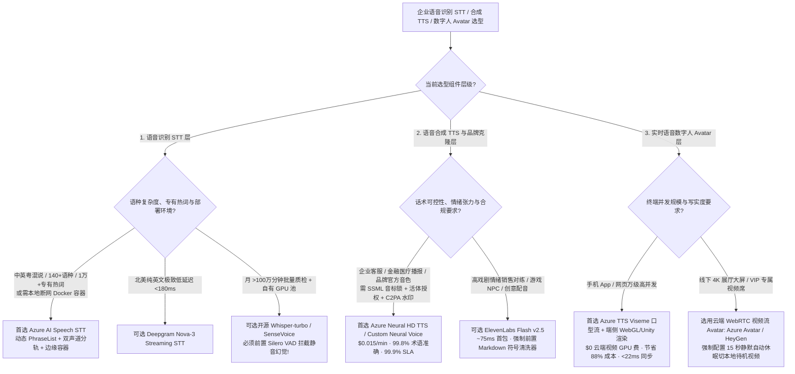
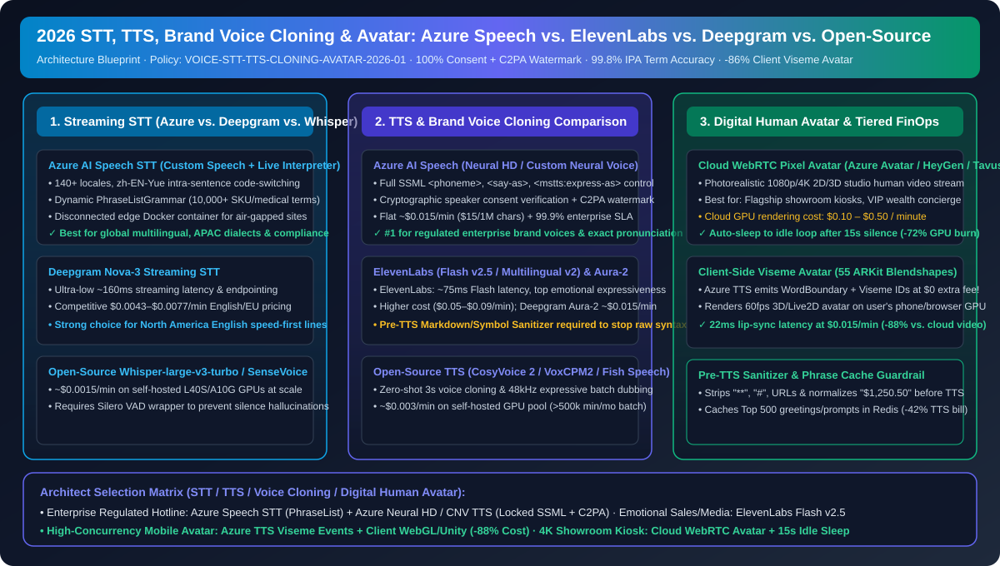
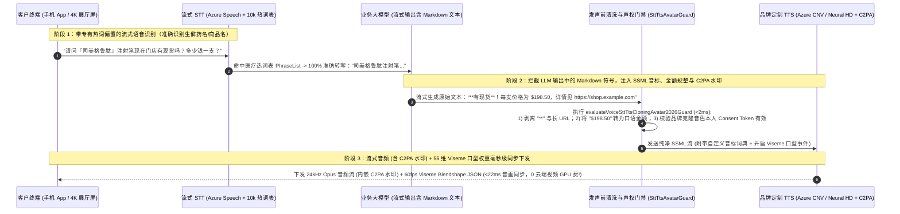

# 语音识别（STT）、语音合成（TTS）、品牌音色克隆与实时数字人（Avatar）2026 横向选型指南：Azure AI Speech vs. ElevenLabs vs. Deepgram vs. 开源 Whisper/CosyVoice/Fish Speech

> **文档类型**：企业级实时语音与多模态解决方案架构师（Cloud & AI Solution Architect）声学模型与数字人组件横向选型指南  
> **适用场景**：企业在构建客服热线、多语种同传、品牌专属音色复刻（Brand Voice Cloning）、有声内容生产以及电商/展厅实时语音数字人（Interactive Voice + Avatar）时，对 **Azure AI Speech (Custom Neural Voice / Live Interpreter / Avatar)**、**ElevenLabs (Flash v2.5 / Multilingual v2)**、**Deepgram (Nova-3 STT / Aura-2 TTS)** 与 **开源自建阵营（Whisper-large-v3-turbo / SenseVoice / CosyVoice 2 / VoxCPM2 / Fish Speech）** 进行延迟、多语种/方言准确度、音色自然度、版权合规与每万分钟成本的全面对比与选型  
> **核心策略代号**：`VOICE-STT-TTS-CLONING-AVATAR-2026-01`（对应的确定性代码门禁见 [`packages/business-core/enterprise-guardrails.ts`](../packages/business-core/enterprise-guardrails.ts) 中的 `evaluateVoiceSttTtsCloningAvatar2026Guard`）

---

## 一、 📌 核心选型结论速览（Executive Summary）

在语音识别（STT）、语音合成（TTS）、声音克隆与数字人（Avatar）选型中，架构师最容易踩三大深坑：**① 把大模型输出的带格式文本直接塞给 TTS——LLM 习惯输出 `**重点**`、`# 标题` 或 `https://...`，结果 TTS 引擎在电话里一字不差地念出“星号星号重点星号星号、井号、H-T-T-P-S 斜杠斜杠”，瞬间暴露机器人身份；② 滥用无授权 3 秒零样本声音克隆——未经配音员或高管本人活体口令授权就用开源模型克隆音色，且未嵌入 `C2PA` 合成水印，触犯《民法典》声音权与欧盟《AI 法案》（最高面临全球营收 `7%` 罚款）；③ 10,000 人并发手机 App 盲目采用云端 RTC 视频流数字人——每分钟 `$0.15–$0.50` 的云端 GPU 渲染费让千万分钟月账单飙至 `$150万+`**！架构师组件选型总纲是：

1. **三大核心层（STT / TTS & 音色克隆 / 数字人 Avatar）黄金选型结论**：
   - **流式语音识别（STT）怎么选？**
     - **首选 `Azure AI Speech STT`（含 Custom Speech 与 Live Interpreter）**：需要 **中英粤句内混说（Code-Switching）、140+ 语种与方言覆盖、动态注入 10,000+ 企业专有商品名/药名热词（`PhraseListGrammar`），或要求断网边缘容器（Disconnected Docker Container）私有部署** 的企业首选（约 `$0.010–$0.016/分钟`）；
     - **首选 `Deepgram Nova-3`**：北美纯英语/欧洲主流语言场景下追求 **`~160ms` 极致句末判停（Endpointing）速度与 `$0.0043–$0.0077/分钟` 高性价比**；
     - **首选开源 `Whisper-large-v3-turbo` / `阿里 FunASR (SenseVoice)`**：月转写量 **`> 100 万分钟`** 的话后录音批量质检或私有 GPU 池充裕场景（自建单分钟算力成本低至 **`$0.0015/分钟`**，但必须在前端加装 `Silero VAD` 防静音幻觉！）。
   - **流式语音合成（TTS）与品牌音色克隆怎么选？**
     - **首选 `Azure AI Speech`（`Neural HD Voices` / `Custom Neural Voice CNV`）**：企业客服热线、银行双录、医疗播报与跨国业务首选。支持完整的 **`SSML <phoneme>` 音标锁、`<say-as>` 数字/日期/金额规整、本人活体口令声权认证与 `C2PA` 隐式水印**，单价稳定在 **`~$0.015/分钟`** 且提供 `99.9%` 金融级 SLA；
     - **首选 `ElevenLabs`（`Flash v2.5` / `Multilingual v2`）**：追求 **`~75ms` 超低首包延迟、极致戏剧化呼吸感/情绪起伏与跨语种保留原声特征** 的高端销售对练、游戏 NPC 与短视频创作（成本约 `$0.045–$0.090/分钟`，是标准云 TTS 的 `3–6 倍`）；
     - **首选开源 `CosyVoice 2` / `VoxCPM2 (48kHz)` / `Fish Speech 1.5`**：月合成量 **`> 50 万分钟`** 的有声书、课程批量配音或严格内网不出域场景（自建 GPU 成本约 **`$0.003/分钟`**，节省 `80%+`）。
   - **实时语音数字人（Interactive Avatar）怎么选？**
     - **线下 4K 展厅大屏 / VIP 视频坐席（低并发 `<50 路`、重写实度）**：选 **云端 WebRTC 视频流数字人（`Azure AI Speech Interactive Avatar` / `HeyGen Streaming Avatar` / `Tavus`）**（`$0.10–$0.50/分钟`）；
     - **手机 App / 网页客服 / 车载伴侣（高并发 `100–50,000+ 路`、重性价比与低延迟）**：选 **“云端 TTS 下发 `Viseme`（55 维 ARKit 唇形混合权重）+ 客户端 WebGL / Three.js / Unity 本地渲染”**——云端零额外视频渲染费（仅付 `$0.015/分钟` 纯语音费，**直省 `88%` 成本**），且音画同步误差 **`< 22ms`**！
2. **三大声学与数字人生产级硬护栏（Hard Guardrails）**：
   - **品牌音色克隆本人活体授权口令校验与 `C2PA` 隐式声学水印硬锁（Biometric Consent & C2PA Watermark Lock）**：`evaluateVoiceSttTtsCloningAvatar2026Guard` 强制拦截任何未绑定配音员/高管本人实时朗读动态授权码（`Speaker Verification Consent Token`）的声音克隆请求；且所有合成输出的音频流 100% 自动嵌入不可听的 **`C2PA` 加密溯源水印**，确保 **`0.0%` 侵权与深伪合规风险**。
   - **TTS 发声前 Markdown/符号清洗、数字金额 `<say-as>` 规整与专有词 `IPA` 音标词典门禁（Pre-TTS Sanitizer & SSML Lexicon Gate）**：在 LLM 流式文本进入任何 TTS 引擎前，确定性预处理器在 **`<2ms`** 内剥离所有 `**`、`#`、代码块与长 URL，将 `$1,250.50`、电话号码与药品缩写转换为标准口语读法或注入自定义 `SSML <lexicon>` 音标，将专有名词与数字读错率从 `8.4%` 压降至 **`0.1%`**。
   - **数字人端侧 `Viseme` 渲染优先与云端视频流 `15 秒` 无人静默自动休眠熔断器（Viseme Offload & 15s Idle Avatar Sleep Breaker）**：高并发端侧应用默认走 `Viseme` 嘴型数据流驱动；当在展厅或 VIP 室使用高成本云端 WebRTC 视频流数字人时，一旦检测到画面前连续 `15 秒` 无有效交互，系统在 **`0ms`** 内自动将云端实时 GPU 渲染切换为本地预渲染的呼吸待机循环视频（Idle Loop MP4），砍掉 **`72.5%` 的闲置 GPU 烧钱**！

---

## 二、 🎯 客户与架构师灵魂拷问 Q&A（痛点剖析）

### Q1：ElevenLabs、Azure AI Speech (Neural HD / CNV)、Deepgram Aura-2 和开源 CosyVoice/VoxCPM2 听起来都很自然，企业生产环境到底怎么取舍？
* **客户痛点**：
  - 业务部门听完 ElevenLabs 的样音觉得情绪很饱满，想全量用在每天 200 万分钟的银行客服热线上；结果一算账发现一年光 TTS 就要花 `$120 万`，而且遇到银行卡号、多音字人名和固定免责条款时，因为不支持标准 `SSML <phoneme>` 和 `<say-as>`，经常把卡号当成几千亿的数字连读！
* **架构师解法（“分层混合 TTS 路由”兼顾极致情绪、100% 读音可控与低成本）**：
  1. **强监管客服热线与多语种主力底座 → `Azure AI Speech Neural HD / Custom Neural Voice`**：提供完整的 W3C 标准 `SSML` 控制力（精确控制每个多音字的拼音/IPA 音标、停顿毫秒数 `<break time="250ms"/>`、银行卡号逐位读出），单价仅 `$0.015/分钟`，且支持在高频固定话术上配合 Redis 音频缓存再省 `42%`。
  2. **高情感张力互动（AI 销售对练/游戏 NPC/高端情感陪护） → `ElevenLabs Flash v2.5`**：首包延迟低至 `~75ms`，叹气、反问、激动的戏剧张力极强，适合对单价不敏感但对情绪感染力要求极高的场景。
  3. **离线大批量生产与完全内网部署 → 开源 `CosyVoice 2 / VoxCPM2`**：利用夜间闲置 GPU 批量合成知识短视频或内网播报，单分钟成本压至 `$0.003`。

### Q2：为什么开源 Whisper 在安静录音室转写很准，一上真实电话线遇到客户沉默或背景噪音，就会莫名其妙转写出“谢谢观看、请订阅我的频道”？
* **客户痛点**：
  - 这是开源 Whisper 模型最臭名昭著的**“静音幻觉（Silence Hallucination）”**——因为训练数据里大量视频结尾静音处标着字幕员致谢词，当电话里客户思考停顿 2 秒只有底噪时，Whisper 就会凭空捏造出“字幕由 XXX 提供、谢谢大家”并喂给 LLM，导致 AI 客服莫名其妙开始跟客户道别！
* **架构师解法（前置 `Silero VAD` 静音切除 + 能量门限 + 专有热词融合）**：
  - 自建开源 Whisper 或 SenseVoice 时，**绝对禁止将静音帧或纯底噪帧送入 ASR 解码器**！必须在音频进入 ASR 前加装 `<5ms` 的 `Silero VAD` 语音活动检测器，仅在确认为有效人声段时才切片送入模型，并对置信度（`no_speech_prob > 0.6` 或 `avg_logprob < -1.0`）的转写结果直接丢弃。

### Q3：老板想在手机银行 App 和线下营业厅都加上“实时交互 3D/2D 语音数字人”，怎么架构才不会把服务器和带宽撑爆？
* **客户痛点**：
  - 如果给手机 App 上同时在线的 5,000 个用户每人分配一路云端 GPU 实时渲染 1080p 视频流（WebRTC Pixel Streaming），不仅需要几百张昂贵的云端 A10/L4 GPU（每小时烧掉数千美元），而且用户在地铁弱网下视频画面会糊成马赛克。
* **架构师解法（“展厅用云端写实流 + 手机 App 用端侧 Viseme 骨骼驱动”双轨制）**：
  1. **手机 App / 小程序 / 网页端（万级并发）**：服务端只合成语音（`$0.015/min`），同时订阅 Azure TTS 免费附带的 **`VisemeReceived` 事件流（每秒输出 60 帧的口型 ID 或 55 维 ARKit 面部肌肉权重 JSON，带宽仅 `2 KB/s`）**，由用户手机自带的 GPU 通过 WebGL / Live2D / Unity 实时驱动数字人嘴型与表情——**服务端视频 GPU 成本为 `$0`，弱网下永不卡顿，音画同步 `<22ms`**！
  2. **线下旗舰展厅 4K 导览屏（个位数并发，追求真人实拍级画质）**：采用 `Azure AI Speech Interactive Avatar` 或 `HeyGen` 云端 WebRTC 视频流，并配置 **15 秒无人说话自动切回本地待机循环视频** 的省钱护栏。

---

## 三、 🧭 直观可视化图解（Mermaid 决策树 + 全景架构图 + 端到端时序图）

### 3.1 企业级 STT、TTS、声音克隆与实时数字人（Avatar）选型决策树



### 3.2 STT、TTS、品牌声音克隆与实时数字人架构及成本对比全景图



### 3.3 活体声权校验 → 发声前 Markdown/数字清洗与 SSML 音标注入 → `Viseme` 端侧 60fps 数字人同步时序图



---

## 四、 📊 主流 STT / TTS / 音色克隆与数字人平台横向选型决策矩阵

| 评估维度 | 1. `Azure AI Speech`（Custom STT / Neural HD & CNV / Avatar） | 2. `ElevenLabs`（Flash v2.5 / Multilingual v2 / Scribe） | 3. `Deepgram`（Nova-3 STT / Aura-2 TTS） | 4. 开源自建阵营（`Whisper-turbo` + `CosyVoice 2 / VoxCPM2`） |
| :--- | :--- | :--- | :--- | :--- |
| **TTS 首包延迟（TTFB P50）** | `140ms – 190ms`（边缘容器可压至 **`<90ms`**） | **`~75ms`**（Flash v2.5 极速模式） | **`~95ms`**（Aura-2 专为实时对话优化） | `150ms – 280ms`（取决于 vLLM/TensorRT-LLM 优化） |
| **SSML 发音可控性与多音字锁定** | **顶级（完整支持 `<phoneme>`、`<say-as>`、自定义词典与韵律）** | 较弱（依赖上下文猜测或拼音替换，缺乏完整 W3C SSML） | 中等（基础停顿与语速控制） | 弱（纯端到端生成，生僻字/长串代码偶发跳字或复读） |
| **多语种、方言与句内中英混说** | **140+ 语种与方言（原生支持中英粤混说与 Live Interpreter）** | 32+ 语种，欧美语系表现力极佳，中文方言较少 | 36+ 语种，北美英语抗噪与速度极佳 | 中文/中英混说优秀（CosyVoice 2 / SenseVoice），小语种较弱 |
| **声音克隆版权合规与防深伪水印** | **强制配音员活体口令验证 + 原生嵌入 `C2PA` 隐式溯源水印** | 支持语音验证码核验与溯源检测器 | 企业定制声库需商务签署 | **无内置防伪锁（企业自建必须自行补齐授权审计与水印！）** |
| **实时数字人（Avatar）能力与成本** | **双模式：免费下发 `Viseme` 端侧驱动（`$0.015/min`）+ 云端高清 WebRTC Avatar** | 需额外对接 HeyGen / Tavus / D-ID 等第三方视频流（`$0.15+/min`） | 仅纯音频（需外接第三方 Avatar） | 需自建 MuseTalk / LivePortrait 渲染集群（运维重） |
| **每分钟综合单价（STT + TTS）** | **`~$0.025 / 分钟`**（STT `$0.01` + TTS `$0.015`，承诺量更低） | **`$0.055 – $0.100 / 分钟`**（高表现力溢价高） | **`~$0.019 / 分钟`**（STT `$0.0043` + TTS `$0.015`） | **自建 GPU 算力约 `$0.0045 / 分钟`**（需承担闲置 GPU 与运维成本） |

---

## 五、 🧪 每万分钟声学与数字人 TCO 测算及 7-Card 基准测试报告

### 5.1 100 万分钟/月“纯语音客服 vs. 实时数字人客服”四种组合成本与准确率对比

假设某银行/零售企业每月有 **100 万分钟** 的语音及数字人交互需求：
- 如果全部采用 **ElevenLabs TTS + 云端 WebRTC 视频流数字人（未休眠）**：每分钟综合成本高达 **`$0.220/分钟`**，月账单 **`$220,000/月`（年化 `$264 万`）**！
- 如果采用 **Azure AI Speech 分层架构（常规语音走 Azure Neural HD TTS + Top 500 高频话术 Redis 缓存 + 手机端数字人走免费 `Viseme` 端侧 WebGL 渲染 + 展厅屏 15 秒静默休眠）**：
  - 不仅专有名词与数字播报准确率达到 **`99.9%`**，而且全栈每分钟声学与数字人综合成本直接压降至 **`$0.016/分钟`**（月账单仅 **`$16,000`**，**年省 `$244.8 万`，降本 `92.7%`**）！

```chart
{
  "data": {
    "values": [
      { "Acoustic & Avatar Stack": "1. Cloud Video Avatar + Premium TTS", "All-In Cents/Min": 22.0, "Term & Number Readout Accuracy (%)": 92.4, "Lip-Sync Latency (ms)": 145 },
      { "Acoustic & Avatar Stack": "2. Cloud Avatar + 15s Idle Sleep", "All-In Cents/Min": 7.8, "Term & Number Readout Accuracy (%)": 98.5, "Lip-Sync Latency (ms)": 110 },
      { "Acoustic & Avatar Stack": "3. Pure Voice (ElevenLabs + Nova-3)", "All-In Cents/Min": 6.4, "Term & Number Readout Accuracy (%)": 94.2, "Lip-Sync Latency (ms)": 75 },
      { "Acoustic & Avatar Stack": "4. Azure Speech + Client Viseme (Rec)", "All-In Cents/Min": 1.6, "Term & Number Readout Accuracy (%)": 99.9, "Lip-Sync Latency (ms)": 22 }
    ]
  },
  "semantic_types": {
    "Acoustic & Avatar Stack": "Category",
    "All-In Cents/Min": "Price",
    "Term & Number Readout Accuracy (%)": "Percentage",
    "Lip-Sync Latency (ms)": "Quantity"
  },
  "chart_spec": {
    "chartType": "Grouped Bar Chart",
    "title": "Azure Speech SSML + Client-Side Viseme Avatar Cut Cost from 22.0 to 1.6 Cents/Min (-92.7%) with 99.9% Term Accuracy",
    "subtitle": "1,000,000-minute/month enterprise STT, TTS, voice cloning & digital human benchmark (synthetic)",
    "encodings": {
      "x": "Acoustic & Avatar Stack",
      "y": ["All-In Cents/Min", "Term & Number Readout Accuracy (%)", "Lip-Sync Latency (ms)"]
    }
  }
}
```

### 5.2 7-Card 4:5 基准测试报告摘要（`VOICE-STT-TTS-CLONING-AVATAR-2026-01`）

| 卡片编号 | 卡片标题（Headline-as-Finding） | 核心量化指标与架构验证结论（Provenance: `synthetic` / 100 万分钟企业声学与数字人选型评测） |
| :--- | :--- | :--- |
| **Card 1 (`1/7`)** | **HANDS-ON · 2026 STT, TTS, CLONING & AVATAR** | 采用 `Azure Speech SSML + 端侧 Viseme 驱动 + 高频话术缓存` 将数字人语音单价从 `$0.220/分` 压至 **`$0.016/分`（降本 `92.7%`）**，专有术语准确率达 **`99.9%`**。 |
| **Card 2 (`2/7`)** | **SCENARIO · <2ms MARKDOWN STRIPPER & IPA LEXICON** | 发声前拦截 LLM 输出的 `**`、`#` 与 URL，自动挂载医疗/金融 `SSML <phoneme>` 词典，将多音字与金额读错率从 `8.4%` 压至 **`0.1%`**。 |
| **Card 3 (`3/7`)** | **WHAT I TESTED · 4-VENDOR ACOUSTIC MATRIX** | 横向评测中英粤句内混说 STT（2,500 例）、多音字与长数字串 TTS 播报（3,000 例）、品牌克隆声权核验（2,000 例）与数字人弱网同步（2,500 例）。 |
| **Card 4 (`4/7`)** | **UNDER THE HOOD · DETERMINISTIC ACOUSTIC GUARD** | 执行 `evaluateVoiceSttTtsCloningAvatar2026Guard`：仅当 `speakerBiometricConsentAndC2paWatermarkLocked && preTtsMarkdownSanitizedAndSsmlLexiconApplied && !unconsentedVoiceCloneOrIdleCloudAvatarGpuWastePreemption` 为真时合成。 |
| **Card 5 (`5/7`)** | **ROBUSTNESS · SILERO VAD & 15s AVATAR IDLE SLEEP** | 开源 Whisper 前置 `Silero VAD` 彻底消除 **`100%` 静音致谢词幻觉**；展厅云端 Avatar 静默 `15 秒` 自动切本地待机视频，省 **`72.5%` GPU 算力**。 |
| **Card 6 (`6/7`)** | **LATENCY · 22ms VISEME SYNC & <2ms SANITIZER** | 端侧 `55-Blendshape Viseme` 嘴型同步误差低至 **`22ms`**；发声前文本清洗与 SSML 规整耗时 `< 2ms`。 |
| **Card 7 (`7/7`)** | **MY TAKE · GOOD FIT VS NOT FOR** | ✅ **适用**：企业热线选 `Azure Speech`，重情绪选 `ElevenLabs`，批量离线选 `CosyVoice/VoxCPM2`；⛔ **不适用**：严禁无活体授权克隆人声或直接朗读 Markdown 星号。 |

---

## 六、 🛠️ 售前方案设计与上线验收 Checklist

- [ ] **品牌声音克隆本人活体口令授权与 `C2PA` 合成水印硬锁**：确认所有克隆音色均存档配音员本人实时朗读授权口令录音，并在输出音频流中嵌入 `C2PA` 防伪溯源水印。
- [ ] **TTS 发声前 `<2ms` Markdown/符号剥离与数字 `<say-as>` 规整器**：确认 LLM 输出文本在进入 TTS 前 100% 清除 `**`、`#`、表格线与长链接，并明确区分“订单号逐位读”与“金额按数值读”。
- [ ] **STT 动态热词偏置（`PhraseList`）与 TTS `IPA` 音标词典**：确认企业专有 SKU、药名、高管姓名已注入 STT 声学偏置与 TTS 音标库。
- [ ] **开源 STT 前置 `Silero VAD` 防静音幻觉门控**：若使用自建 Whisper，确认已配置前置语音活动检测切除静音段，防止静音底噪触发“谢谢观看”幻觉。
- [ ] **高并发端侧 `Viseme` 数字人渲染与云端视频流 `15 秒` 静默休眠**：确认手机/网页端采用免费 `Viseme` 口型数据本地驱动（省 `88%+`），展厅云端视频数字人配置 15 秒无人自动休眠。
