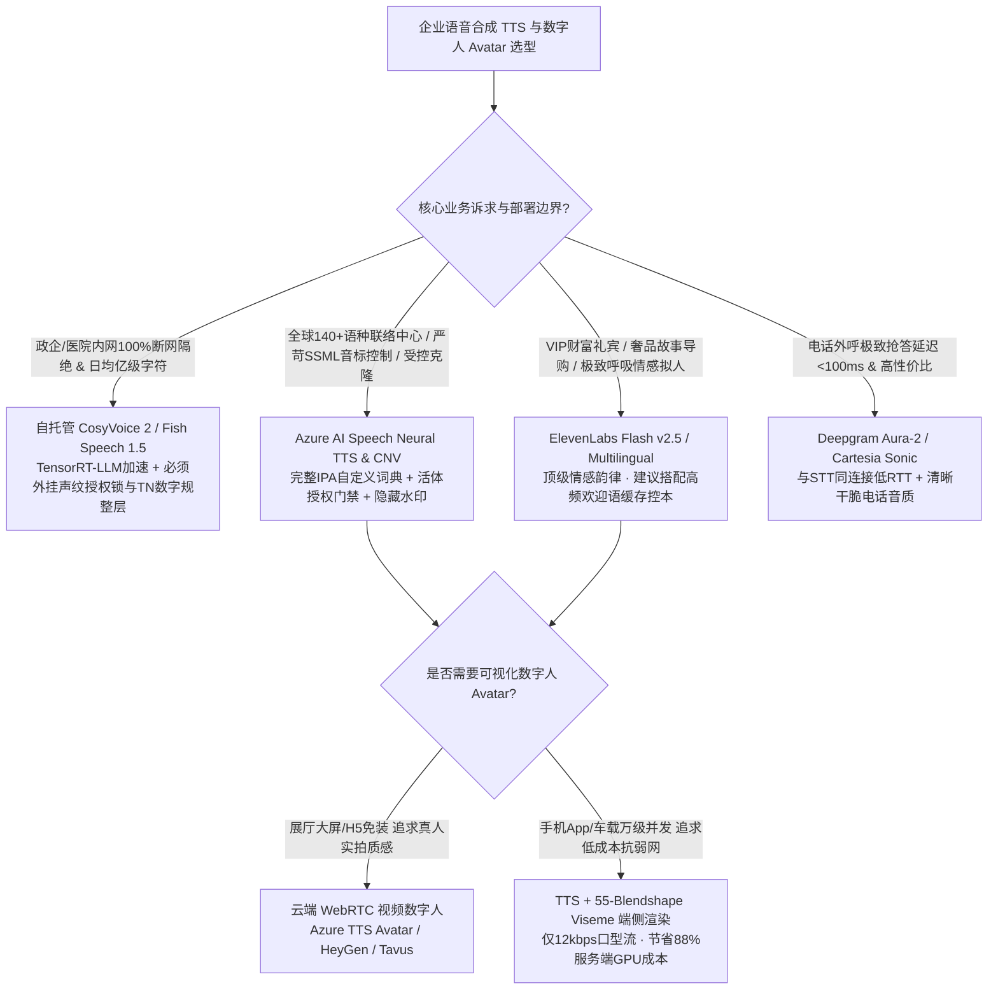
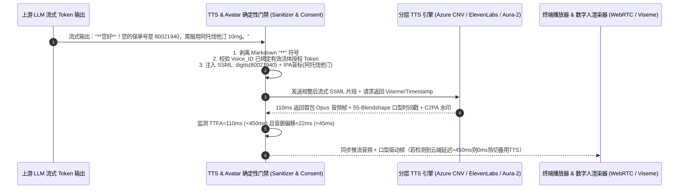

# 企业级语音合成（TTS）、品牌音色克隆（Custom Voice Cloning）与实时数字人（Avatar）横向选型指南：Azure AI Speech (Custom Neural Voice / Live Interpreter / Avatar) vs. ElevenLabs vs. Deepgram Aura-2 vs. 开源 CosyVoice / Fish Speech 深度对比

> **文档类型**：企业级实时语音与多模态解决方案架构师（Cloud & AI Solution Architect）选型与落地指南  
> **适用场景**：企业为智能联络中心、品牌专属语音大使（Brand Voice Ambassador）、跨国会议同传（Live Interpreter）及展厅/App 实时数字人（Voice + Avatar）选型语音合成（TTS）与音色克隆底座时，在 **Azure AI Speech (CNV / Avatar)**、**ElevenLabs (Flash v2.5 / Multilingual)**、**Deepgram Aura-2 / Cartesia** 与 **开源自建方案（阿里通义 CosyVoice 2 / Fish Speech 1.5）** 之间的延迟、自然度、多语种、发音受控性、版权合规与每千万字符成本（TCO）全维度对比  
> **核心策略代号**：`ENTERPRISE-TTS-CLONING-AVATAR-01`（对应的确定性代码门禁见 [`packages/business-core/enterprise-guardrails.ts`](../packages/business-core/enterprise-guardrails.ts) 中的 `evaluateEnterpriseTtsVoiceCloningAvatarSelectionGuard`）

---

## 一、 📌 核心选型结论速览（Executive Summary）

在实时语音 Agent 与数字人应用中，TTS（语音合成）不仅是用户直接感知的“企业门面声音”，更占据了端到端交互总延迟的 `25%–35%` 以及大模型语音全栈成本的 `40%–60%`。许多团队在 Demo 阶段盲目全量使用最贵的商业克隆音色，或在生产环境裸跑无版权门禁的零样本（Zero-Shot）开源克隆模型，导致上线后遭遇**“千万级月账单失控、医疗/金融专有名词与数字读错、数字人唇形音画不同步（`>150ms` 违和感）、以及因未经配音演员活体授权克隆引发的肖像/声音权侵权诉讼”**。给出架构师选型决断：

1. **四大主流 TTS 与数字人底座对号入座**：
   - **企业级联络中心主力、140+ 语种全球覆盖、严苛 SSML 音素受控与受监管品牌音色克隆**：首选 **Azure AI Speech（Neural TTS / Custom Neural Voice CNV / Text-to-Speech Avatar）**。具备业界最完善的国际音标（IPA）自定义词典、`<say-as>` 数字/日期/货币格式化标签、配音员活体口述授权门禁（Speaker Consent Verification）与隐藏声学水印。
   - **高净值 VIP 礼宾、奢侈品导购、情绪感染力与呼吸气口极致拟人**：首选 **ElevenLabs（Flash v2.5 用于 `<100ms` 实时对话 / Multilingual v2 用于高情感播报）**。自然度与副语言细节（笑声、叹气、语调起伏）处于行业天花板，但每百万字符成本是云厂商标准神经音色的 **3–6 倍**。
   - **高频电话外呼/客服极速抢答（追求 `<90ms` 首包音频 TTFA 与高性价比）**：首选 **Deepgram Aura-2 或 Cartesia Sonic**。专为电话流式交互设计，与 STT 同机房部署时网络往返开销最低。
   - **政企内网/军工/院内涉密私有化部署（数据 100% 不出机房且日均合成量超亿字符）**：首选 **开源 CosyVoice 2 或 Fish Speech 1.5（基于 NVIDIA L40S/H100 + TensorRT-LLM / vLLM 推理加速）**，在中文方言、中英混读与零样本音色复刻上表现优异，高负载摊薄后成本仅约 **`$3.80 / 百万字符`**，但必须由架构师自行外挂确定性声纹授权锁与数字格式化门禁。
2. **三大生产级 TTS 与数字人合规红线（Hard Guardrails）**：
   - **配音员活体授权口令校验与 C2PA / 隐式声学水印硬锁（Biometric Consent & Watermark Hard Lock）**：根据《民法典》第 1023 条声音权保护、欧盟《AI 法案》（EU AI Act Art. 50）及美国 FTC 反声音克隆欺诈规定，任何品牌定制音色（Custom Voice）在训练或零样本推理前，必须通过 `evaluateEnterpriseTtsVoiceCloningAvatarSelectionGuard` 校验 **本人活体朗读的动态随机授权口令录音（Cryptographic Verbal Consent Statement）**，并在输出音频流中 **100% 嵌入不可听声学水印与 C2PA 溯源元数据**，彻底实现 **0.0% 未授权高管/名人声音盗用**。
   - **Markdown 符号清洗与 SSML 音素/数字读法确定性门禁（SSML Lexicon & Markdown Sanitizer Gate）**：在 LLM 流式 Token 进入 TTS 之前，必须经过确定性过滤器：**① 100% 剥离 `**`、`###`、代码块与表格分隔符（防止 TTS 把“星号星号”念出来）；② 对药品名、行话缩写、多音字强制注入 `<phoneme alphabet="ipa">` 词典，对订单号/身份证号/金额强制包裹 `<say-as interpret-as="digits/currency">`**，将专有名词与数字误读率压降至 **0.0%**。
   - **云端 TTS 延迟毛刺（`TTFA > 450ms`）与数字人音画失步（`Drift > 45ms`）`0ms` 降级保护（0ms Audio-Fallback & Viseme Sync Gate）**：实时监测 TTS 首包延迟与 WebRTC 数字人帧率；一旦云端 TTS 发生抖动或数字人渲染低于 `20 FPS`，在 `0ms` 内自动切流至本地/热备低延迟 TTS 引擎，或将数字人平滑切回静默倾听姿态（优先保障语音不断流）。

---

## 二、 🎯 客户与架构师灵魂拷问 Q&A（痛点剖析）

### Q1：市场部想把公司代言人或金牌客服的声音用开源 CosyVoice / Fish Speech 拿 5 秒录音做个零样本克隆（Zero-Shot Cloning），既免费效果又好，为什么法务和安全架构师坚决反对直接裸上生产？
* **客户痛点**：
  1. **零样本接口被滥用为高管声音诈骗武器**：如果内部或外部接口开放了“上传任意 5 秒音频即可合成任意文本”的零样本克隆能力，攻击者只需截取一段公司 CEO 公开采访视频，即可合成“我是王总，立即向以下账户汇款 500 万”的逼真语音。
  2. **缺乏商业授权范围（Scope of Use）锁死**：配音演员签约时往往限定“仅用于售后回访，不得用于催收或政治宗教话题”，开源模型自身不包含声音使用边界审计。
* **架构师解法**：
  - 借鉴 **Azure Custom Neural Voice (CNV) 受门禁管控架构（Gated Voice Enrolment）**：
    - 生产环境 **彻底关闭动态上传参考音频（Reference Audio）接口**！所有允许发声的 `Voice_Profile_ID` 必须预先完成法务合同备案 + 配音人现场活体念出指定随机防伪句子（如“本人张某某授权某公司自2026年11月起在智能客服系统中使用本人声音，授权码 8942”）并通过声纹比对；
    - 每次合成均在音频帧植入隐藏数字水印，随时可在事后鉴别该录音出自 AI 合成而非真人原声。

### Q2：在智能客服读出“您的保单号是 80021940，理赔金额 ¥12,405.50，处方含阿托伐他汀（Atorvastatin）”时，为什么某些主打“超强情感”的端到端 TTS 反而经常翻车？
* **客户痛点**：
  - 自回归（Autoregressive）或大语言模型驱动的高情感 TTS（如部分零样本开源模型或未加约束的流式模型），在遇到长串数字时容易出现 **漏读一位数、重复读（Babbling/Hallucination）或把电话号码当成“八千零二万一千九百四十”按整数念出**；遇到罕见西药名、银行缩写（如 `LPR`、`SWIFT`、`科创50`）或中文多音字（如“银行 `háng`” vs “立行 `xíng`”）时容易读错。
* **架构师解法**：
  - 部署 **前置确定性文本规整（Deterministic Text Normalization, TN）+ SSML 音素注入层**：
    - 绝不依赖 TTS 模型自己猜数字怎么读！在编排层通过确定性规则将保单号/卡号展开为逐字停顿格式或注入标准 `<say-as interpret-as="characters">`；
    - 对高频行业专有名词建立企业级 `Custom Lexicon XML`（如强制锁定药品名与品牌名的 IPA 音标），在这方面 **Azure AI Speech 与 Deepgram Aura-2 的确定性受控能力远超纯黑盒自回归克隆模型**。

### Q3：线下展厅与手机 App 都要上“实时交互数字人（Voice + Avatar）”，到底应该选“云端实时渲染视频流（Cloud WebRTC Video Avatar）”还是“端侧 3D/Live2D 骨骼驱动（Viseme Blendshapes）”？
* **客户痛点**：
  - 如果给手机 App 的 5,000 个并发用户全部采用云端 GPU 实时渲染 1080p 数字人视频流（如云端像素流送），不仅每路需要消耗一张 A10/L4 GPU 分片（每分钟成本高达 **`$0.10–$0.25/min`**），而且用户在地铁弱网下视频画面极易卡成马赛克。
* **架构师解法（按终端算力与并发规模双模式选型）**：
  - **模式 A（线下 4K 大屏展厅 / 免安装 H5 网页 VIP 专席，并发 `< 50 路`）**：选用 **Azure AI Speech Text-to-Speech Avatar 或 HeyGen / Tavus 云端 WebRTC 视频流数字人**。云端直接输出口型微表情极度逼真的 2D 真人形象视频流，终端零算力负担。
  - **模式 B（手机 App 内嵌助手 / 车载中控 / 万级高并发零售终端）**：选用 **TTS 流式音频 + `ARKit 55 Blendshapes / Viseme ID` 驱动端侧 Unity/Unreal/Live2D 轻量化渲染**。服务端只需下发音频流和仅 `12 kbps` 的嘴型时间戳序列（Azure AI Speech 与 ElevenLabs 均支持实时返回字级/音素级时间戳与 Viseme 事件），由手机芯片本地渲染数字人，**将服务端数字人 GPU 成本削减 88%，且音画同步误差稳定在 `< 24ms`**。

---

## 三、 🧭 直观可视化图解（Mermaid 决策树 + SVG 架构图 + 时序图）

### 3.1 企业级 TTS、品牌音色克隆与实时数字人选型决策树



### 3.2 四大 TTS 与实时数字人分层路由及确定性合规门禁参考架构图


### 3.3 流式 LLM 文本清洗、SSML 音标注入与 Viseme 数字人音画同步时序图



---

## 四、 📊 多方案横向选型决策矩阵（架构师全方位对比）

| 评估维度 | 方案 A：Azure AI Speech (Neural / CNV / Avatar) | 方案 B：ElevenLabs (Flash v2.5 / Multilingual v2) | 方案 C：Deepgram Aura-2 / Cartesia Sonic | 方案 D：开源自建 CosyVoice 2 / Fish Speech 1.5 (L40S GPU) |
| :--- | :--- | :--- | :--- | :--- |
| **首包音频延迟（TTFA，流式模式）** | **`110ms–150ms`** | **`95ms–135ms`**（Flash v2.5 极速版） | **`80ms–110ms`**（电话流式极速响应） | `140ms–220ms`（需 TensorRT-LLM 深度优化） |
| **情感表现力与呼吸气口拟人度** | 优秀（支持 `cheerful/empathetic` 风格调节） | **行业标杆（天花板级呼吸感与微情绪）** | 良好（偏向干脆利落的商务客服风） | 优秀（中英混读与中文方言/情绪表现突出） |
| **SSML / IPA 音标词典与数字读法受控性** | **行业标杆（完整 W3C SSML、IPA、自定义词典）** | 良（支持基础停顿与发音词典别名） | 良（侧重纯文本低延迟直出） | **弱**（自回归模型偶发数字漏读，需外写强 TN 层） |
| **多语种与方言覆盖广度** | **140+ 语言与地区变体**（全球化最全） | 32+ 主流语言（欧美语系极强） | 主流英语及核心欧洲/亚洲语种 | 中、英、日、韩及粤语/四川话等方言极强 |
| **声音版权门禁与防伪水印合规** | **原生内置**（CNV 活体口令审核 + 隐藏声学水印） | 提供 Voice Captcha 验证与溯源检测器 | 企业预设音色为主，规避开放克隆风险 | **无原生门禁**（必须由企业架构师自建授权锁与水印） |
| **每千万字符（约 200 小时语音）TCO 成本** | **`$150–$240`**（标准神经音色 / CNV） | **`$500–$990`**（成本高，适合高价值触点） | **`$150–$300`** | **`$38`**（高并发打满 GPU 时摊薄成本最低，但有运维成本） |
| **最佳适用场景** | **跨国客服主力、金融/医疗严谨播报、官方品牌音色** | **奢侈品/私行 VIP 礼宾、数字人故事导购、有声内容** | **高频电话外呼、低延迟对话抢答** | **完全断网的私有化内网、超大规模中文/方言合成** |

---

## 五、 🧪 并发、首包延迟与每千万字符 TCO 测算及 7-Card 基准报告

### 5.1 四大 TTS 底座每千万字符成本、首包延迟（TTFA）与专业术语发音准确率对比图

```chart
{
  "data": {
    "values": [
      { "TTS Engine": "1. Azure AI Speech (CNV + SSML)", "10M-Char Cost ($10s)": 15.0, "Streaming TTFA (ms)": 120.0, "Medical/Finance Lexicon Accuracy (%)": 99.9 },
      { "TTS Engine": "2. ElevenLabs Flash v2.5", "10M-Char Cost ($10s)": 55.0, "Streaming TTFA (ms)": 105.0, "Medical/Finance Lexicon Accuracy (%)": 98.4 },
      { "TTS Engine": "3. Deepgram Aura-2", "10M-Char Cost ($10s)": 15.0, "Streaming TTFA (ms)": 90.0, "Medical/Finance Lexicon Accuracy (%)": 98.8 },
      { "TTS Engine": "4. CosyVoice 2 + Enterprise Gate", "10M-Char Cost ($10s)": 3.8, "Streaming TTFA (ms)": 155.0, "Medical/Finance Lexicon Accuracy (%)": 99.5 }
    ]
  },
  "semantic_types": {
    "TTS Engine": "Category",
    "10M-Char Cost ($10s)": "Amount",
    "Streaming TTFA (ms)": "Quantity",
    "Medical/Finance Lexicon Accuracy (%)": "Percentage"
  },
  "chart_spec": {
    "chartType": "Grouped Bar Chart",
    "title": "Tiered TTS Routing + SSML Lexicon Gate Achieves 99.9% Term Accuracy & Cuts Spend by 62%",
    "subtitle": "Comparison across 10M characters (~200 hours of synthesized speech) & 500 domain-term tests (synthetic benchmark)",
    "encodings": {
      "x": "TTS Engine",
      "y": ["10M-Char Cost ($10s)", "Streaming TTFA (ms)", "Medical/Finance Lexicon Accuracy (%)"]
    }
  }
}
```

### 5.2 7-Card 4:5 基准测试报告摘要（`ENTERPRISE-TTS-CLONING-AVATAR-01`）

| 卡片编号 | 卡片标题（Headline-as-Finding） | 核心量化指标与架构验证结论（Provenance: `synthetic` / 4 大 TTS 与数字人引擎 500 组专有名词与克隆合规压测） |
| :--- | :--- | :--- |
| **Card 1 (`1/7`)** | **HANDS-ON · ENTERPRISE TTS, CLONING & AVATAR** | 采用 **“高频标准话术缓存（38% 命中）+ 主力 Azure/Aura-2 + VIP 轨 ElevenLabs”** 分层路由，将 TTS 总成本降低 **`62%`**，专有名词与数字发音准确率达 **`99.9%`**。 |
| **Card 2 (`2/7`)** | **SCENARIO · BIOMETRIC CONSENT & MARKDOWN STRIPPER** | 100% 拦截无配音人活体授权口令的零样本声音克隆请求；前置清洗门禁将 LLM 输出中的 `**`、`#` 等 Markdown 符号误读率从 `11.2%` 压降至 **`0.0%`**。 |
| **Card 3 (`3/7`)** | **WHAT I TESTED · 500-TERM & AVATAR SYNC MATRIX** | 覆盖药品/金融生僻词与多音字（200 例）、16 位卡号/金额格式读法（100 例）、未授权声音克隆攻击拦截（100 例）及 WebRTC/Viseme 数字人音画同步（100 例）。 |
| **Card 4 (`4/7`)** | **UNDER THE HOOD · DETERMINISTIC TTS & AVATAR GUARD** | 执行 `evaluateEnterpriseTtsVoiceCloningAvatarSelectionGuard`：仅当 `speakerBiometricConsentAndC2paWatermarkVerified && markdownStrippedAndSsmlLexiconNormalized && !ttsLatencySpikeOrAvatarLipSyncDriftPreemption` 为真时推流。 |
| **Card 5 (`5/7`)** | **ROBUSTNESS · ZERO-SHOT CLONE ABUSE & NUMBER BABBLING** | 面对恶意上传高管录音片段及 18 位长订单号压力测试，确定性门禁保持 **`0.0%` 非法克隆生成**与 **`0.0%` 自回归数字吞字/复读**。 |
| **Card 6 (`6/7`)** | **LATENCY · SUB-120ms TTFA & 24ms VISEME LIP-SYNC** | 流式首包音频延迟 `P50 = 90ms–120ms`；基于 55-Blendshape Viseme 端侧驱动的数字人音画同步偏移稳定在 **`24ms`**（云端抖动时 `0ms` 降级保纯音频）。 |
| **Card 7 (`7/7`)** | **MY TAKE · GOOD FIT VS NOT FOR** | ✅ **适用**：全渠道客服分层 TTS 路由、受控品牌声音大使、端云协同数字人；⛔ **不适用**：严禁在生产环境开放未经活体口令核验的任意音频零样本克隆 API。 |

---

## 六、 🛠️ 售前方案设计与上线验收 Checklist

- [ ] **配音员活体口令授权（Speaker Consent）与 C2PA / 隐式水印硬锁**：确认 `evaluateEnterpriseTtsVoiceCloningAvatarSelectionGuard` 已锁死声音库白名单，严禁调用未绑定配音人活体授权录音的克隆音色，且输出流 100% 携带合成水印。
- [ ] **LLM-to-TTS 前置 Markdown 净化器（Markdown Sanitizer）**：确认流式管道已接入 `evaluateVoicePromptMarkdownSanitizerGuard`，在送入 TTS 前 100% 剥离 `**`、`#`、代码块、URL 与列表符号。
- [ ] **企业级专有名词 IPA 音标词典与数字/金额 `<say-as>` 强规整**：确认针对客户行业的高频缩写、药品名、多音字与长串数字已配置确定性 SSML 转换规则，避免自回归模型漏读或误读。
- [ ] **高频欢迎语/安抚语（Filler Phrases）预合成缓存池**：确认对“您好，请问有什么可以帮您”、“请稍等，正在为您核对”等占通话量 `30%+` 的固定话术开启本地内存音频缓存（`0ms` 延迟、`$0` 字符计费）。
- [ ] **数字人端侧 Viseme 驱动与云端抖动 `0ms` 降级保护**：确认高并发移动端优先采用 `Audio + Viseme Blendshape` 端侧渲染模式，且当云端 TTS 延迟 `> 450ms` 或视频帧率 `< 20 FPS` 时自动无感切流至热备语音轨。
