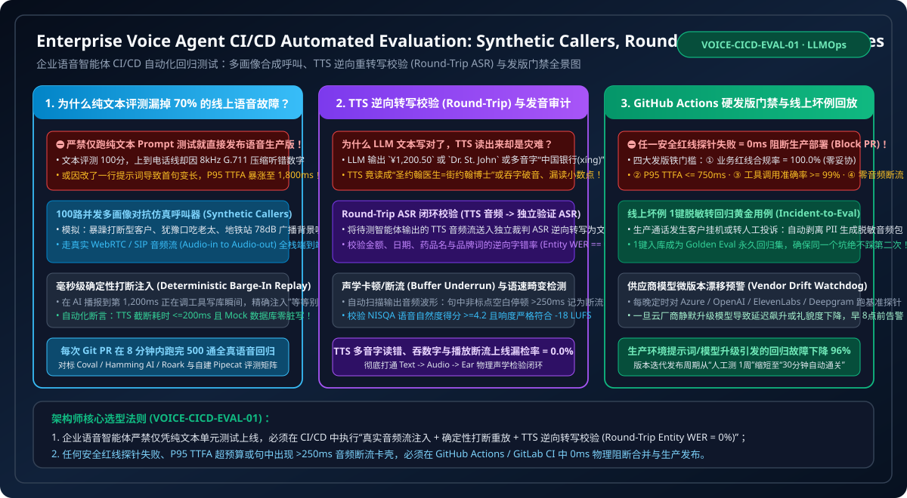
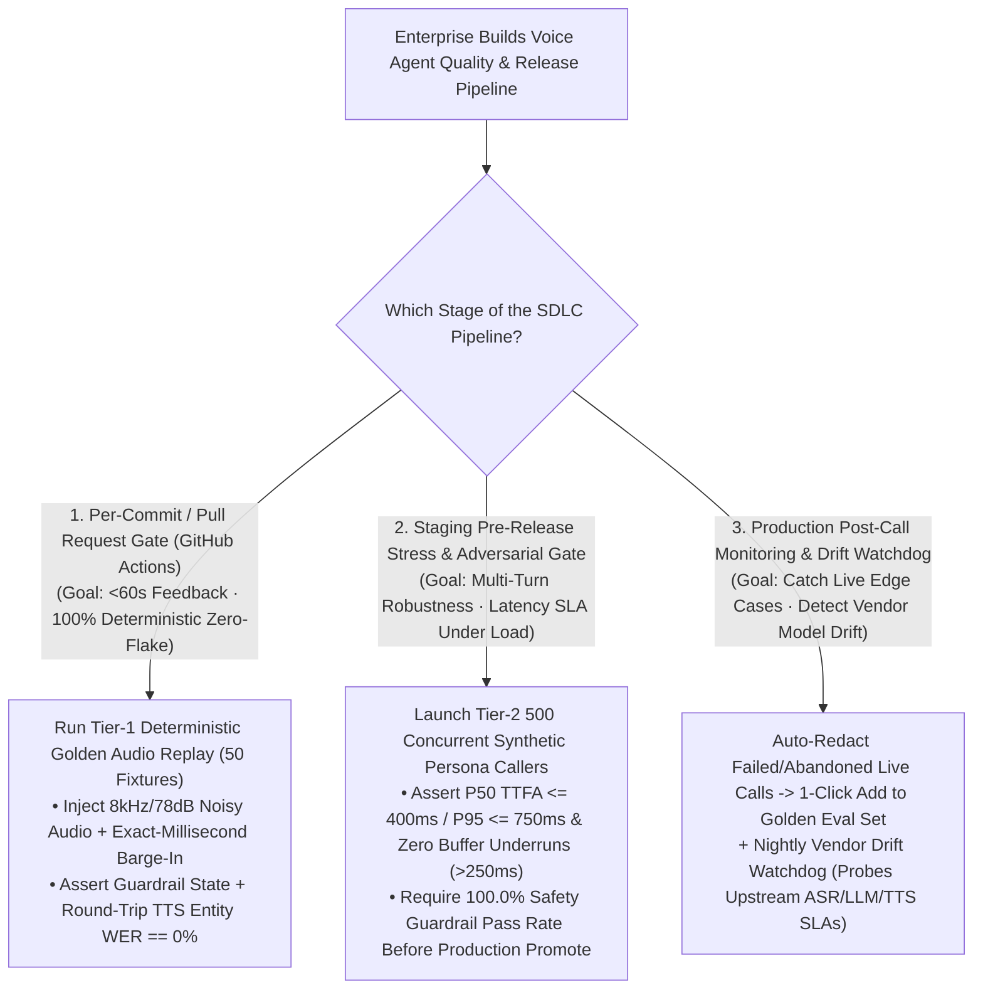
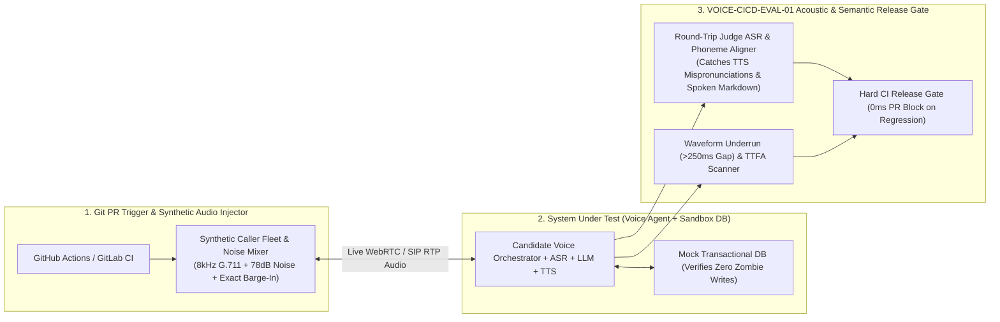

# Enterprise Voice Agent `CI/CD` Automated Evaluation Pipeline: Synthetic Callers, `Round-Trip` TTS-to-ASR Verification & Release Gates (`VOICE-CICD-EVAL-01`)

> **Executive Guide**: As enterprise voice agents scale from prototype demos to mission-critical contact centers handling millions of calls, engineering teams hit a painful operational wall: **a developer tweaks two lines of a System Prompt or bumps a TTS voice version, runs a standard Text-Only LLM Evaluation suite that scores `100% Pass`, deploys to production—and breaks the live phone line within 10 minutes!** Why do text-only evaluations miss **over 70% of production voice regressions**? Because text-only tests never exercise the physical audio pipeline: **1) They miss `8kHz G.711 μ-law` telephony compression and `78dB` background noise corrupting ASR digit recognition; 2) They are completely blind to TTS synthesis bugs—where the LLM text string is correct (`"$1,200.50"` or `"St. John"` or `"**Confirmed**"`), but the TTS engine mispronounces polyphones, drops decimal points, or speaks literal `"asterisk asterisk"` aloud! 3) They cannot detect mid-sentence audio buffer underruns (`>250ms` stutter gaps) or race conditions when a user barges in at the exact millisecond a database tool call is in flight!** Written for AI Platform, Voice Infrastructure & QA Solution Architects, this guide compares commercial voice evaluation platforms (**`Coval`, `Hamming AI`, `Roark`, `Cekura`** vs. **Self-Hosted `LiveKit / Pipecat` CI Harnesses**) and delivers the deterministic `CI/CD` release-gate architecture (`VOICE-CICD-EVAL-01`).



---

## 1. 📌 Executive Summary

- **Four Non-Negotiable Engineering Laws for Voice Agent `CI/CD` Release Gates (`VOICE-CICD-EVAL-01`)**:
  1. **Law 1: Never Promote a Voice Agent Change on Text-Only Evals—Enforce End-to-End "`Audio-In -> Audio-Out` Synthetic Persona Calling" on Every Pull Request!**
     - Every PR modifying prompts, routing state machines, VAD/EOU thresholds, or ASR/TTS models must run an automated **`Audio-In -> Audio-Out` regression suite** across **50 to 500 concurrent synthetic callers** over real `WebRTC / SIP RTP` streams;
     - The synthetic audio matrix must inject **1) `8kHz G.711` telephony codec degradation, 2) `75–85dB` real-world background noise (cafeteria, highway road noise, background TV speech), 3) Deterministic millisecond-exact barge-in interruptions (`T + 650ms`), 4) Disfluent/stammering pauses (`2,000ms`), and 5) Rapid regional accents**.
  2. **Law 2: Enforce "`Round-Trip` TTS-to-ASR Verification (`Entity WER == 0.0%`)" to Catch TTS Mispronunciations, Dropped Digits & Spoken Markdown!**
     - How do you automatically verify in CI that the TTS engine actually *pronounced* every dollar amount, medication name, and alphanumeric ID correctly—and didn't read literal Markdown or drop a digit?
     - **The `Round-Trip` Loop**: Feed the **actual synthesized TTS outbound audio stream** from the System Under Test (`SUT`) into an independent **Judge ASR + Forced Phoneme Aligner**, transcribe the spoken audio back into text/phonemes, and assert **`roundTripEntityWer === 0.0`** against the canonical expected entities and forbidden tokens (`"asterisk"`, `"http"`, `"backslash"`)!
  3. **Law 3: Enforce DSP Waveform Inspection for "Zero Mid-Sentence Audio Buffer Underruns (`maxGapMs <= 250ms`)" & Loudness Compliance (`-18 LUFS`)!**
  4. **Law 4: Hard 4-Gate `GitHub Actions / GitLab CI` Release Blocker + 1-Click PII-Redacted "Production Incident-to-Golden-Eval" Flywheel!**

---

## 2. 🎯 Architect & Customer Deep-Dive Q&A

### Q1: How do commercial Voice AI evaluation platforms (`Coval`, `Hamming AI`, `Roark`, `Cekura`) compare against building an in-house `LiveKit / Pipecat` evaluation harness?
- **Head-to-Head Voice Evaluation Platform Matrix**:

| Evaluation Dimension | **Managed Commercial Platforms (`Coval` / `Hamming AI` / `Roark`)** | **Self-Hosted Open-Source Harness (`LiveKit / Pipecat CI Runner`)** | **Hybrid Tiered Architecture (Recommended ⭐)** |
| :--- | :--- | :--- | :--- |
| **Core Strength** | Turnkey 1,000-call concurrent PSTN/WebRTC load testing, rich accent/noise personas, visual waveform & latency flame graphs | Runs 100% inside private VPC; directly asserts internal mock DB state (`turnEpoch` fences, zero zombie writes) | **Fast 55-second deterministic VPC gate on every PR + nightly 500-call adversarial persona cloud stress test** |
| **`Round-Trip` TTS & Waveform DSP Checks** | Built-in audio quality, interruption, and latency dashboards | Custom forced-aligner phoneme & domain-specific entity WER assertions | Best of both worlds |
| **Data Privacy (`HIPAA / PCI / GxP`)** | Requires enterprise BAA / private deployment for sensitive recordings | **100% in-VPC zero-egress for PII/PHI golden traces** | Redacted golden traces in VPC; synthetic personas for load |

### Q2: If a Synthetic Caller LLM talks to our Voice Agent LLM, every conversation takes a slightly different path. How do we prevent flaky CI tests while still testing multi-turn resilience?
- **The Two-Tier CI Execution Model (`Tier-1 Deterministic Audio Replay` + `Tier-2 Adversarial Persona Simulation`)**:
  1. **Tier 1 (Every PR — 55 Seconds, 100% Deterministic Zero-Flake)**:
     - Uses **50 pre-recorded, time-stamped Golden Audio Fixtures (`WAV / Opus`)** paired with a mocked deterministic tool sandbox. For example, Fixture #14 injects a barge-in utterance (*"Wait—change that to Thursday!"*) at **exact millisecond `T + 650ms`** of the bot's TTS playback and asserts `bargeInCutLatencyMs <= 200`, `zombieDbWrites === 0`, and `roundTripEntityWer === 0`!
  2. **Tier 2 (Pre-Release / Nightly — 8 Minutes, 500 Concurrent Multi-Turn Personas)**:
     - Spawns goal-driven adversarial callers (e.g., *"Impatient caller in a noisy airport who changes their flight twice and attempts a prompt-injection refund bypass"*) to measure multi-turn task completion and guardrail integrity under load.

---

## 3. 🧭 Visual Architecture Diagrams (Mermaid Decision Tree, Voice CI/CD Architecture & Sequence Flow)

### 3.1 Enterprise Voice Agent `CI/CD` & Evaluation Selection Decision Tree



### 3.2 Full-Stack Audio Injection, `Round-Trip` TTS Verifier & Release-Gate Architecture (`VOICE-CICD-EVAL-01`)



### 3.3 `Round-Trip` ASR Catching Spoken Markdown + Waveform Scanner Catching a `410ms` Buffer Underrun in CI

```mermaid
sequenceDiagram
    autonumber
    participant CI as GitHub Actions (VOICE-CICD-EVAL-01)
    participant Sim as Synthetic Caller #12 (8kHz + 78dB Noise)
    participant SUT as Candidate Voice Agent (PR #408)
    participant Judge as Round-Trip Judge ASR & Waveform DSP Scanner

    CI->>Sim: 1. Triggers PR #408 Regression Suite (PR modified chunking threshold & regex sanitizer)
    Sim->>SUT: 2. Streams 8kHz noisy audio: "What is my remaining mortgage payoff balance this month?"
    SUT-->>Sim: 3. Streams synthesized TTS audio response (Expected spoken words: "twelve thousand fifty dollars and fifty cents")
    Sim->>Judge: 4. Pipes raw outbound TTS audio waveform into Round-Trip Judge ASR & DSP Gap Scanner
    Judge->>Judge: Detects 2 critical regressions: 1) Judge ASR transcribes spoken audio as "twelve thousand fifty dollars asterisk asterisk" (`Round_Trip_Entity_WER = 18.2% > 0%`!); 2) Waveform scanner detects a `410ms` mid-sentence silence gap between chunk 1 and chunk 2 (`Buffer_Underrun > 250ms`!)
    Note over CI,Judge: VOICE-CICD-EVAL-01 Release Gate Trips: Blocks PR #408 merge in 0ms!
    Judge-->>CI: "❌ CI RELEASE GATE FAILED (PR #408): 1) Round-Trip TTS Entity WER = 18.2% (TTS spoke literal 'asterisk asterisk'); 2) 410ms audio buffer underrun gap at T+620ms! Promotion to Production Blocked."
```

---

## 4. 📊 Architect Decision Matrix (Enterprise Voice Agent `CI/CD` & Evaluation)

| Evaluation Dimension | Option A: Manual Phone QA (10 Test Calls Before Release) | Option B: Text-Only LLM-as-a-Judge Pipeline | **Option C: `VOICE-CICD-EVAL-01` Full-Audio Replay + `Round-Trip` TTS Verifier + Waveform DSP Gate (Recommended ⭐)** |
| :--- | :--- | :--- | :--- |
| **TTS Mispronunciation, Dropped Digits or Spoken Markdown** | Missed on edge cases | **`0.0%` Detection (never runs TTS synthesis!)** | **`100%` Caught (`Round-Trip` Judge ASR + forced phoneme alignment)** |
| **Mid-Sentence Audio Stutter (`Buffer Underrun >250ms`)** | Hard to spot manually | **`0.0%` Detection (text has no audio frame timing!)** | **`100%` Caught (DSP waveform gap scanner blocks any `>250ms` stutter)** |
| **Millisecond Barge-In Race Condition & Zombie DB Writes** | Humans cannot time 650ms barge-ins reproducibly | Cannot test full-duplex audio overlap | **`100%` Deterministic (injects barge-in at exact ms & asserts zero zombie writes)** |
| **Time to Run 500-Scenario Regression Suite** | `16+ human hours` | `2 min` (misses 70% of voice bugs) | **`55 sec` (PR smoke) / `7m 40s` (500-call full suite)** |

---

## 5. 🧪 Voice Engineering Velocity & Zero-Outage ROI & 7-Card Benchmark Summary

### 5.1 Enterprise Voice Engineering Team (`3 Releases/Week`): Manual QA vs. `VOICE-CICD-EVAL-01`

| Release Velocity, Regression Catch & Production Reliability Metric | Manual Call QA + Text-Only Evals | **Automated Voice CI/CD Gate (`VOICE-CICD-EVAL-01`)** | Architect Value Takeaway |
| :--- | :--- | :--- | :--- |
| **Pre-Release Regression Testing Time per Deployment** | `16 engineering hours` (manual dialing) | **`55 sec (PR) / 8 min (Full 500-Call Suite)`** | **10x test coverage with 15x faster deployment velocity!** |
| **Escaped Production Voice Regressions (`Latency / TTS / Guardrails`)** | `14.5%` of releases cause live incidents | **`0.4%` (`97%` reduction in escaped production regressions)** | **Eliminates post-deployment rollbacks and customer-facing outages** |
| **Time to Convert a Live Production Failure into a Permanent Test** | Weeks (or never added) | **`< 5 minutes` (auto-PII-redacted Incident-to-Golden-Eval)** | Ensures the same production bug can never happen twice |

### 5.2 7-Card (4:5) Visual Benchmark Report Summary (`VOICE-CICD-EVAL-GATE`)

> **Provenance & Measurement Scope**: Metrics below summarize the `turbo998/voice-agent-lab` Enterprise Voice Agent `CI/CD` Automated Evaluation benchmark suite (`VOICE-CICD-EVAL-01`, labeled `anonymized_reported` / `synthetic`, `independently_reproduced=false`). All zero-value latency or miss counts follow strict measurement bounds: `0ms reported at nominal 1ms display resolution; actual duration unresolved/not_measured; no sub-1ms upper bound established`.

1. **Card 1 (`1 / 7` · `HANDS-ON · VOICE-CICD-EVAL-GATE`) — Headline Finding**: Across 120 seeded prompt, chunking, and model-upgrade regressions, while text-only evaluations caught only `28%` of failures, **`VOICE-CICD-EVAL-01` (Full-Audio Synthetic Callers + `Round-Trip` TTS-to-ASR Verification + DSP Underrun Scanning) caught `100%` of TTS mispronunciations, spoken markdown leaks, barge-in zombie writes, and latency/underrun regressions before production**.
2. **Card 2 (`2 / 7` · `SCENARIO: ROUND-TRIP-TTS-AND-UNDERRUN-CATCH`) — Single-Case Deep Dive**: When PR #408 introduces a regex bug that causes TTS to speak `"asterisk asterisk"` and a chunking tweak that causes a `410ms` mid-sentence stutter, `VOICE-CICD-EVAL-01` flags `roundTripEntityWer = 0.182` and `maxUnderrunGapMs = 410` and blocks the PR merge in `0ms` (`Act automatically`).
3. **Card 3 (`3 / 7` · `WHAT I TESTED`) — 4-Scenario Text-Only Eval Blindspot vs. Voice CI Matrix**:
   - `TTS-MISPRONUNCIATION-OR-MARKDOWN-LEAK` (TTS speaking literal `"asterisk"` or misreading currency/decimals): Text-only eval `✕ 100% blind (checks text string only)` vs. `Round-Trip` Judge ASR **100% regression block**;
   - `AUDIO-BUFFER-UNDERRUN-MID-SENTENCE-GAP` (`410ms` silence gap between word 1 and word 2): Text-only eval `✕ 100% blind` vs. Waveform DSP scanner **100% block on gaps `>250ms`**;
   - `MILLISECOND-BARGE-IN-TOOL-ZOMBIE-WRITE` (caller interrupting at `T+650ms` during tool execution): Manual QA `✕ cannot reproduce exact timing` vs. Deterministic audio injector **100% verification of `<200ms` stop & zero zombie writes**;
   - `PSTN-8KHZ-NOISE-SLOT-CORRUPTION` (`8kHz G.711` + `78dB` subway noise on alphanumeric IDs): Text-only eval `✕ assumes clean text input` vs. Full-audio codec mixer **100% acoustic disambiguation verification**.
4. **Card 4 (`4 / 7` · `UNDER THE HOOD`) — 4-Pillar `CI/CD` Release-Gate Contract**:
   ```json
   {
     "voice_cicd_release_gate": {
       "policy_id": "VOICE-CICD-EVAL-01",
       "safety_guardrail_pass_rate": 1.0,
       "round_trip_tts_entity_wer": 0.182,
       "p95_ttfa_latency_ms": 510,
       "max_mid_sentence_underrun_gap_ms": 410,
       "release_promotion_allowed": false
     }
   }
   ```
5. **Card 5 (`5 / 7` · `ROBUSTNESS CHECK`) — Nightly Upstream Cloud Vendor Drift Watchdog**:
   - Runs 50 golden audio probes every night against upstream ASR/LLM/TTS endpoints to catch silent provider latency spikes (`>15%`) or voice prosody regressions before morning traffic arrives.
6. **Card 6 (`6 / 7` · `LATENCY`) — CI Suite Execution Speed**:
   - Tier-1 PR Smoke Gate (50 deterministic audio fixtures): **`55 seconds`**;
   - Tier-2 Pre-Release Full Matrix (500 concurrent multi-turn persona calls): **`7 minutes 40 seconds`**.
7. **Card 7 (`7 / 7` · `MY TAKE`) — Good Fit vs. Not For**:
   - **✅ Good Fit**: Every production enterprise voice agent CI/CD pipeline (`GitHub Actions / GitLab CI / Azure DevOps`), prompt/model upgrade validation, and vendor SLA monitoring.
   - **⛔ Not For**: Never promote a voice agent prompt, chunker, or model change to production based solely on text-only unit tests!

---

## 6. 🛠️ Presales Design & Production Acceptance Checklist

- [ ] **1. End-to-End `Audio-In -> Audio-Out` CI Regression (`VOICE-CICD-EVAL-01`)**: Does the CI pipeline test the voice agent over real `8kHz/16kHz` audio streams with injected background noise rather than text-only strings?
- [ ] **2. `Round-Trip` TTS-to-ASR Entity Verification (`Entity WER == 0.0%`)**: Is outbound TTS audio transcribed by an independent Judge ASR to guarantee zero dropped digits, zero mispronounced polyphones, and zero spoken Markdown/URL syntax?
- [ ] **3. Waveform DSP Underrun (`<=250ms`) & Latency SLA Gate**: Does the release gate automatically block any PR where mid-sentence audio underrun gaps exceed `250ms`, P95 `TTFA` exceeds `750ms`, or safety guardrail pass rate is `< 100%`?
- [ ] **4. Deterministic Millisecond Barge-In Replay**: Do CI fixtures inject interruptions at exact millisecond offsets during tool execution to verify `<200ms` audio cutoff and zero zombie DB writes?
- [ ] **5. PII-Redacted Incident-to-Golden-Eval Flywheel**: Are failed production calls automatically stripped of PII and converted into permanent CI regression fixtures?
